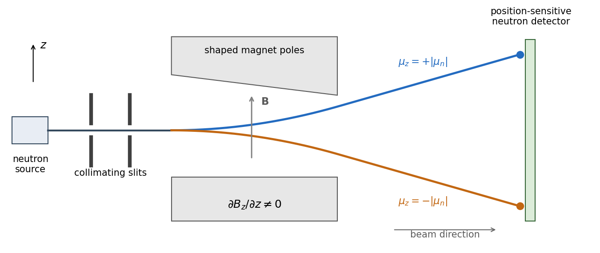
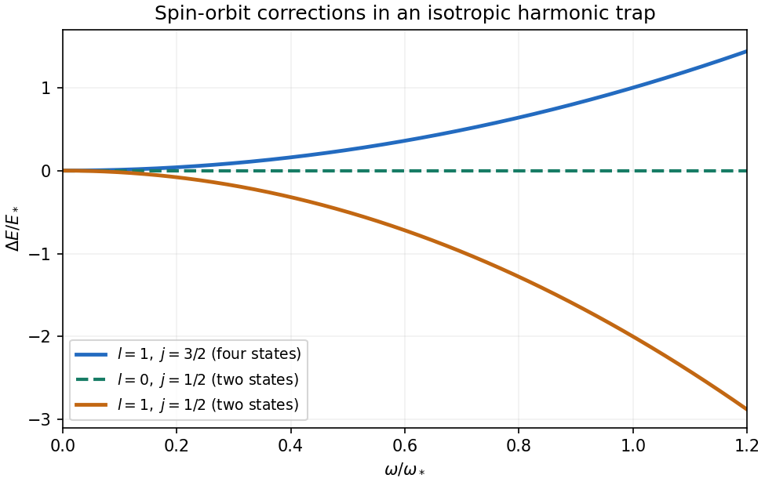
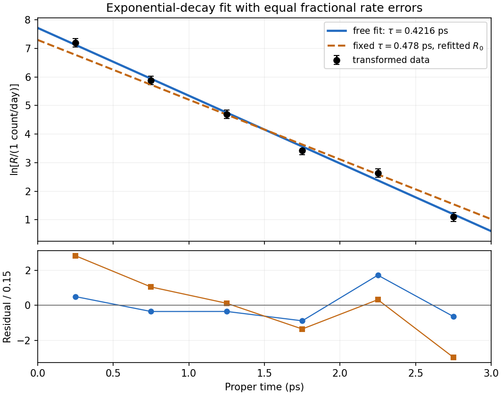

# Paper 1

↑ **Parent:** [2021](../2021.md)

[Original paper, released PDF pages 136–140](https://www.whatdotheyknow.com/request/natural_science_tripos_physics_e/response/2127325/attach/3/FOI%202022%20639%20Sullivan%20materials.pdf?cookie_passthrough=1#page=136)

**Table of contents**

- [Section A](#section-a)
  - [1](#section-a/1)
    - [Solution](#section-a/1/solution)
  - [2](#section-a/2)
    - [Solution](#section-a/2/solution)
  - [3](#section-a/3)
    - [Solution](#section-a/3/solution)
  - [4](#section-a/4)
    - [Solution](#section-a/4/solution)
  - [5](#section-a/5)
    - [Solution](#section-a/5/solution)
- [Section B](#section-b)
  - [B6](#section-b/b6)
    - [a](#section-b/b6/a)
      - [Solution](#section-b/b6/a/solution)
    - [b](#section-b/b6/b)
      - [Solution](#section-b/b6/b/solution)
    - [c](#section-b/b6/c)
      - [Solution](#section-b/b6/c/solution)
  - [B7](#section-b/b7)
    - [a](#section-b/b7/a)
      - [Solution](#section-b/b7/a/solution)
    - [b](#section-b/b7/b)
      - [Solution](#section-b/b7/b/solution)
    - [c](#section-b/b7/c)
      - [Solution](#section-b/b7/c/solution)
    - [d](#section-b/b7/d)
      - [Solution](#section-b/b7/d/solution)
- [Section C](#section-c)
  - [C8](#section-c/c8)
    - [a](#section-c/c8/a)
      - [Solution](#section-c/c8/a/solution)
    - [b](#section-c/c8/b)
      - [Solution](#section-c/c8/b/solution)
    - [c](#section-c/c8/c)
      - [Solution](#section-c/c8/c/solution)
    - [d](#section-c/c8/d)
      - [Solution](#section-c/c8/d/solution)
    - [e](#section-c/c8/e)
      - [Solution](#section-c/c8/e/solution)
- [Section D](#section-d)
  - [D9](#section-d/d9)
    - [Solution](#section-d/d9/solution)

## Section A

↑ **Parent:** [Paper 1](paper-1.md)

<h3 id="section-a/1">1</h3>

↑ **Parent:** [Section A](#section-a)

<h4 id="section-a/1/solution">Solution</h4>

↑ **Parent:** [1](#section-a/1)

The [Born rule](../../wave-function.md#born-rule) gives the required [probability](../../probability-theory.md#probability) by integrating the [probability density](../../wave-function.md#probability-density) over the central interval. Put $d=0.1\,\mathrm{nm}$. For this [infinite square well](../../quantum-mechanics.md#infinite-square-well) [ground state](../../quantum-mechanics.md#ground-state),

$$
P(|x|\leq d)=\frac2L\int_{-d}^{d}\cos^2\left(\frac{\pi x}L\right)dx
=\frac1L\int_{-d}^{d}\left[1+\cos\left(\frac{2\pi x}L\right)\right]dx
=\frac{2d}L+\frac1\pi\sin\left(\frac{2\pi d}L\right).
$$

Substitution of $d/L=0.1$ gives

$$
\boxed{P=0.2+\frac{\sin(0.2\pi)}\pi\simeq0.3871\simeq38.7\%.}
$$

This exceeds the interval's $20\%$ fraction of the box length because the [ground state](../../quantum-mechanics.md#ground-state) [probability density](../../wave-function.md#probability-density) is largest at the centre; it is not a uniform position distribution.

<h3 id="section-a/2">2</h3>

↑ **Parent:** [Section A](#section-a)

<h4 id="section-a/2/solution">Solution</h4>

↑ **Parent:** [2](#section-a/2)

Inside the [rectangular potential barrier](../../quantum-mechanics.md#rectangular-potential-barrier), the electron's [wavefunction](../../wave-function.md) is evanescent, with decay constant

$$
\kappa=\frac{\sqrt{2m_e(V_0-E)}}\hbar
=\frac{\sqrt{2m_e(2\,\mathrm{eV})}}\hbar
\simeq7.25\,\mathrm{nm}^{-1}.
$$

For width $a=1\,\mathrm{nm}$, the squared exponential suppression in the [quantum tunnelling](../../quantum-mechanics.md#quantum-tunnelling) [probability](../../probability-theory.md#probability) is

$$
\boxed{T\sim e^{-2\kappa a}=e^{-14.49}\simeq5.1\times10^{-7}.}
$$

This is the usual leading-exponential estimate. The [rectangular-barrier tunnelling probability](../../quantum-mechanics.md#rectangular-barrier-tunnelling-probability), retaining the interface-matching prefactor for equal potentials on the two sides, is

$$
T=\left[1+\frac{V_0^2\sinh^2(\kappa a)}{4E(V_0-E)}\right]^{-1}
\simeq\frac{16E(V_0-E)}{V_0^2}e^{-2\kappa a}.
$$

Here that prefactor is $16(8)(2)/10^2=2.56$, so the more accurate result is $\boxed{T\simeq1.30\times10^{-6}}$. Both estimates show that transmission is of order one part in a million. A classical particle with this [kinetic energy](../../energy.md#kinetic-energy) cannot cross the barrier at all.

<h3 id="section-a/3">3</h3>

↑ **Parent:** [Section A](#section-a)

<h4 id="section-a/3/solution">Solution</h4>

↑ **Parent:** [3](#section-a/3)

A [Stern-Gerlach experiment](../../angular-momentum-operator.md#stern-gerlach-experiment) sends a collimated beam through an inhomogeneous [magnetic field](../../magnetic-field.md) and then measures its transverse position after a drift region. The [neutron](../../neutron.md) is electrically neutral but has a nonzero [magnetic moment](../../electromagnetism.md#magnetic-dipole-moment) proportional to its [spin](../../angular-momentum-operator.md#spin), $\boldsymbol\mu=\gamma_n\mathbf S$. A predominantly $z$-directed field gives the interaction [Hamiltonian operator](../../quantum-system.md#hamiltonian-quantum-mechanics) and transverse [force](../../force.md)

$$
H_{\mathrm{int}}=-\boldsymbol\mu\cdot\mathbf B,\qquad
F_z=-\partial_zH_{\mathrm{int}}\simeq\mu_z\frac{\partial B_z}{\partial z}.
$$

Since a neutron has [spin one-half](../../angular-momentum-operator.md#spin-one-half), its spin component along the local field has only two [eigenvalues](../../linear-operator-theory.md#eigenvalue), $S_z=\pm\hbar/2$. Hence there are two opposite force branches, corresponding to $\mu_z=\pm\gamma_n\hbar/2$, and a beam containing both spin components gives two displaced detector spots. This is [neutron Stern-Gerlach splitting](../../angular-momentum-operator.md#neutron-stern-gerlach-splitting), not an electric-charge [Lorentz force](../../relativistic-electromagnetism.md#lorentz-force). A uniform [magnetic field](../../magnetic-field.md) can cause [Larmor precession](../../angular-momentum-operator.md#larmor-precession) but does not provide the required separating [magnetic field gradient](../../magnetic-field.md#magnetic-field-gradient).

**[Figure 1](#section-a/3/image-an-ideal-neutron-stern-gerlach-arrangement-separates-two-magnetic-moment-projections). An ideal neutron Stern-Gerlach arrangement separates two magnetic-moment projections**. Original functional schematic: collimating slits, a region with a [magnetic field gradient](../../magnetic-field.md#magnetic-field-gradient), and a position-sensitive neutron detector. The two curves represent the two allowed magnetic-moment branches, not a continuous distribution of classical spin orientations. Geometry and deflections are illustrative.

The neutron's [gyromagnetic ratio](../../electromagnetism.md#gyromagnetic-ratio) is negative, so its [magnetic moment](../../electromagnetism.md#magnetic-dipole-moment) points opposite to its [spin](../../angular-momentum-operator.md#spin); this reverses which spin label goes to which spot without changing the two-way splitting. Equal populations occur for an initially unpolarized beam. A beam prepared entirely in one field-axis [spin eigenstate](../../angular-momentum-operator.md#spin-eigenstate) gives only its corresponding branch, explaining the qualification “in general”.

<h3 id="section-a/4">4</h3>

↑ **Parent:** [Section A](#section-a)

<h4 id="section-a/4/solution">Solution</h4>

↑ **Parent:** [4](#section-a/4)

Assume independent background events at a known constant rate, so the background count follows a [Poisson distribution](../../discrete-probability-distribution.md#poisson-distribution). In five months its mean is $\mu_b=0.3\times5=1.5$. The [null hypothesis](../../statistical-hypothesis-test.md#null-hypothesis) of background alone assigns the observed upward fluctuation the [P-value](../../statistical-hypothesis-test.md#p-value)

$$
p=P(N\geq8\mid\mu_b=1.5)
=1-e^{-1.5}\sum_{n=0}^{7}\frac{1.5^n}{n!}
\simeq1.696\times10^{-4}.
$$

Thus

$$
\boxed{p\simeq1.7\times10^{-4}>10^{-6}:\quad\text{the discovery criterion is not met}.}
$$

The tail includes counts above eight because they would be at least as discrepant with the background-only prediction. Even the probability of exactly eight, $e^{-1.5}1.5^8/8!\simeq1.42\times10^{-4}$, exceeds the specified threshold, though it is not the appropriate tail test. The [Poisson tail discovery probability](../../statistical-hypothesis-test.md#poisson-tail-discovery-probability) is a probability of data under a background model; it is not a posterior probability that the background model is true. This interprets the question's discovery rule in its usual [statistical significance](../../statistical-hypothesis-test.md#statistical-significance) sense.

<h3 id="section-a/5">5</h3>

↑ **Parent:** [Section A](#section-a)

<h4 id="section-a/5/solution">Solution</h4>

↑ **Parent:** [5](#section-a/5)

For a real signal with highest [frequency](../../wave.md#frequency) $f_{\max}=40\,\mathrm{MHz}$, the [Nyquist–Shannon sampling theorem](../../fourier-analysis.md#nyquist-shannon-sampling-theorem) gives the nominal Nyquist [sampling rate](../../wave-equation.md#sampling-rate)

$$
\boxed{f_{s,\mathrm{Nyquist}}=2f_{\max}=80\,\mathrm{MHz}
=80\times10^6\ \text{samples per second}.}
$$

To cover an arbitrary component exactly at the band edge, choose $f_s>80\,\mathrm{MHz}$: a $40\,\mathrm{MHz}$ sine sampled at exactly $80\,\mathrm{MHz}$ can have every sample equal to zero for an unfortunate phase. Practical [aliasing](../../fourier-analysis.md#aliasing) suppression also calls for a margin above the nominal limiting rate.

With rounding to the nearest digitizer level, [quantization](../../computer-science.md#quantization-signal-processing) with step $q=0.1\,\mathrm{mV}$ has the [uniform-quantization error bound](../../computer-science.md#uniform-quantization-error-bound)

$$
\boxed{|V_{\mathrm{digitized}}-V_{\mathrm{sample}}|\leq q/2=0.05\,\mathrm{mV}.}
$$

Thus the stated digitizer meets the requested nominal amplitude precision per sample, assuming no clipping or other errors. The bandwidth sets the nominal minimum sampling rate; the level spacing sets the rounding precision. Strictly, the sampling theorem reconstructs exactly from exact samples. A uniform $0.05\,\mathrm{mV}$ error bound on the entire reconstructed continuous waveform is not guaranteed by the level spacing and sampling rate alone; that stronger requirement needs a specified reconstruction and noise model.

## Section B

↑ **Parent:** [Paper 1](paper-1.md)

<h3 id="section-b/b6">B6</h3>

↑ **Parent:** [Section B](#section-b)

<h4 id="section-b/b6/a">a</h4>

↑ **Parent:** [B6](#section-b/b6)

<h5 id="section-b/b6/a/solution">Solution</h5>

↑ **Parent:** [A](#section-b/b6/a)

The total [angular momentum operator](../../angular-momentum-operator.md) is $\mathbf J=\mathbf L+\mathbf S$. Since orbital and spin operators act on different factors of the [tensor product](../../multilinear-algebra.md#tensor-product), they commute, and expanding $J^2$ gives

$$
\mathbf L\cdot\mathbf S=\frac12(J^2-L^2-S^2).
$$

A coupled [angular momentum eigenstate](../../angular-momentum-operator.md#angular-momentum-eigenstate) $|l,s;j,m_j\rangle$ is a simultaneous [eigenstate](../../energy-eigenvalue.md#eigenstate) of these three squared operators, with [eigenvalues](../../linear-operator-theory.md#eigenvalue) $\hbar^2j(j+1)$, $\hbar^2l(l+1)$ and $\hbar^2s(s+1)$. Thus the angular factor in the [spin-orbit interaction](../../atomic-physics.md#spin-orbit-interaction) is the number

$$
\mathbf L\cdot\mathbf S\longmapsto
\frac{\hbar^2}{2}[j(j+1)-l(l+1)-s(s+1)].
$$

The other factor, $r^{-1}dV/dr$, is radial. It commutes with the angular operators, and a central-potential [energy eigenstate](../../energy-eigenvalue.md#energy-eigenstate) separates into a radial [wavefunction](../../wave-function.md) and an angular spinor. Taking its radial [expectation value](../../quantum-system.md#expectation-value) therefore gives

$$
\boxed{\langle H_1\rangle=\frac{\hbar^2}{4m^2c^2}
[j(j+1)-l(l+1)-s(s+1)]
\left\langle\frac1r\frac{dV}{dr}\right\rangle.}
$$

This [spin-orbit energy shift in a central potential](../../atomic-physics.md#spin-orbit-energy-shift-in-a-central-potential) is independent of $m_j$, so rotational symmetry preserves the $2j+1$ magnetic degeneracy within a fixed $j$ multiplet. It is a first-order [fine structure](../../atomic-physics.md#fine-structure) correction; the given coefficient already includes the relativistic factor needed for the electron's spin-orbit coupling.

<h4 id="section-b/b6/b">b</h4>

↑ **Parent:** [B6](#section-b/b6)

<h5 id="section-b/b6/b/solution">Solution</h5>

↑ **Parent:** [B](#section-b/b6/b)

The attractive [Coulomb potential energy](../../electrostatics.md#coulomb-potential-energy) is $V(r)=-e^2/(4\pi\epsilon_0r)$, so

$$
\frac1r\frac{dV}{dr}=\frac{e^2}{4\pi\epsilon_0r^3}.
$$

Use precisely the radial normalization stated in the PDF: the radial probability measure is $4\pi r^2|\psi|^2dr$. The supplied function has

$$
|\psi|^2=\frac{r^2}{96\pi a_0^5}e^{-r/a_0},
\qquad4\pi r^2|\psi|^2dr=\frac{r^4e^{-r/a_0}}{24a_0^5}dr.
$$

Its integral is one, since $\int_0^\infty r^4e^{-r/a_0}dr=24a_0^5$. In particular,

$$
\langle r^{-3}\rangle=\frac1{24a_0^5}\int_0^\infty re^{-r/a_0}dr
=\frac1{24a_0^3}.
$$

This calculation uses the supplied convention, rather than multiplying a separately normalized standard radial function by an extra $4\pi$.

The [addition of angular momentum](../../angular-momentum-operator.md#addition-of-angular-momentum) bracket is $j(j+1)-l(l+1)-s(s+1)=3/4-2-3/4=-2$. Substitution in the [spin-orbit energy shift in a central potential](../../atomic-physics.md#spin-orbit-energy-shift-in-a-central-potential) therefore gives

$$
\boxed{\langle H_1\rangle
=-\frac{\hbar^2}{2m^2c^2}\frac{e^2}{4\pi\epsilon_0}\frac1{24a_0^3}
=-\frac{\hbar^2e^2}{192\pi\epsilon_0m^2c^2a_0^3}
\simeq-3.02\times10^{-5}\,\mathrm{eV}.}
$$

Here $a_0=5.29\times10^{-11}\,\mathrm m$ is the supplied [Bohr radius](../../mathematical-physics.md#bohr-radius). The negative sign means the $j=1/2$ member of the $l=1$ pair is shifted downward by this [spin-orbit interaction](../../atomic-physics.md#spin-orbit-interaction); it is not the total hydrogen binding energy.

<h4 id="section-b/b6/c">c</h4>

↑ **Parent:** [B6](#section-b/b6)

<h5 id="section-b/b6/c/solution">Solution</h5>

↑ **Parent:** [C](#section-b/b6/c)

For the isotropic three-dimensional [quantum harmonic oscillator](../../quantum-harmonic-oscillator.md), $V(r)=m\omega^2r^2/2$, hence $r^{-1}dV/dr=m\omega^2$ is constant. No radial integral remains, so the [spin-orbit energy shift in a central potential](../../atomic-physics.md#spin-orbit-energy-shift-in-a-central-potential) reduces to

$$
\Delta E_{l,j}=\frac{\hbar^2\omega^2}{4mc^2}
[j(j+1)-l(l+1)-3/4].
$$

For $l=0$, the only possibility is $j=1/2$, and the bracket vanishes. For $l=1$, coupling to [spin one-half](../../angular-momentum-operator.md#spin-one-half) permits $j=1/2$ and $j=3/2$, whose brackets are $-2$ and $+1$. Thus

$$
\boxed{\begin{aligned}
\Delta E_{0,1/2}&=0,\\
\Delta E_{1,1/2}&=-\frac{\hbar^2\omega^2}{2mc^2},\\
\Delta E_{1,3/2}&=+\frac{\hbar^2\omega^2}{4mc^2}.
\end{aligned}}
$$

These [spin-orbit shifts of an isotropic harmonic oscillator](../../atomic-physics.md#spin-orbit-shifts-of-an-isotropic-harmonic-oscillator) are a zero line, a downward parabola, and an upward parabola of half the downward magnitude. They are independent of the radial excitation number, and their magnetic multiplicities are respectively two, two and four. Their weighted mean within the $l=1$ manifold is zero: $2\Delta E_{1,1/2}+4\Delta E_{1,3/2}=0$.

**[Figure 2](#section-b/b6/c/image-harmonic-oscillator-spin-orbit-shifts-grow-quadratically-with-trap-frequency). Harmonic-oscillator spin-orbit shifts grow quadratically with trap frequency**. Original plot with an arbitrary reference frequency $\omega_*$ and energy unit $E_*=\hbar^2\omega_*^2/(4mc^2)$. Only the [spin-orbit interaction](../../atomic-physics.md#spin-orbit-interaction) shifts are shown, not the unperturbed oscillator energies. The perturbative nonrelativistic regime requires these shifts to remain small relative to the orbital spacings.

<h3 id="section-b/b7">B7</h3>

↑ **Parent:** [Section B](#section-b)

<h4 id="section-b/b7/a">a</h4>

↑ **Parent:** [B7](#section-b/b7)

<h5 id="section-b/b7/a/solution">Solution</h5>

↑ **Parent:** [A](#section-b/b7/a)

Write $a=a_-$ and $a^\dagger=a_+$. Inverting the [annihilation operator](../../quantum-harmonic-oscillator.md#annihilation-operator) and [creation operator](../../quantum-harmonic-oscillator.md#creation-operator) definitions gives

$$
x=\sqrt{\frac{\hbar}{2m\omega}}(a+a^\dagger),\qquad
p=i\sqrt{\frac{m\hbar\omega}{2}}(a^\dagger-a).
$$

The ladder operators take $|n\rangle$ to orthogonal [quantum harmonic oscillator](../../quantum-harmonic-oscillator.md) [energy eigenstates](../../energy-eigenvalue.md#energy-eigenstate) $|n-1\rangle$ and $|n+1\rangle$. Thus $\langle n|a|n\rangle=\langle n|a^\dagger|n\rangle=0$, and

$$
\boxed{\langle x\rangle_n=0,\qquad\langle p\rangle_n=0.}
$$

For $n=0$, the lowering term is simply zero. The conclusion concerns an individual [energy eigenstate](../../energy-eigenvalue.md#energy-eigenstate); interference between different eigenstates can produce nonzero [expectation values](../../quantum-system.md#expectation-value).

<h4 id="section-b/b7/b">b</h4>

↑ **Parent:** [B7](#section-b/b7)

<h5 id="section-b/b7/b/solution">Solution</h5>

↑ **Parent:** [B](#section-b/b7/b)

For the [harmonic-oscillator number-state second moments](../../quantum-harmonic-oscillator.md#harmonic-oscillator-number-state-second-moments), the [number operator](../../quantum-harmonic-oscillator.md#number-operator) gives $\langle a^\dagger a\rangle_n=n$, while the [canonical commutation relation](../../quantum-mechanics.md#canonical-commutation-relation) gives $\langle aa^\dagger\rangle_n=n+1$. Terms with $a^2$ or $(a^\dagger)^2$ have zero diagonal [matrix elements](../../vector-space.md#matrix-element), since they change the [occupation number](../../quantum-field-theory.md#occupation-number) by two. Therefore

$$
\begin{aligned}
\langle x^2\rangle_n
&=\frac{\hbar}{2m\omega}\langle a^2+(a^\dagger)^2+aa^\dagger+a^\dagger a\rangle_n
=\frac{\hbar(2n+1)}{2m\omega},\\
\langle p^2\rangle_n
&=-\frac{m\hbar\omega}{2}\langle (a^\dagger)^2+a^2-a^\dagger a-aa^\dagger\rangle_n
=\frac{m\hbar\omega(2n+1)}2.
\end{aligned}
$$

Consequently the [potential energy](../../energy.md#potential-energy) and [kinetic energy](../../energy.md#kinetic-energy) means are

$$
\boxed{\langle V\rangle_n=\frac12m\omega^2\langle x^2\rangle_n
=\frac12\hbar\omega\left(n+\frac12\right),\qquad
\langle T\rangle_n=\frac{\langle p^2\rangle_n}{2m}
=\frac12\hbar\omega\left(n+\frac12\right).}
$$

Their sum is the oscillator [energy eigenvalue](../../energy-eigenvalue.md) $E_n=\hbar\omega(n+1/2)$. Their equality is also the [virial theorem](../../classical-mechanics.md#virial-theorem) result for a quadratic potential, here derived directly from the ladder operators.

<h4 id="section-b/b7/c">c</h4>

↑ **Parent:** [B7](#section-b/b7)

<h5 id="section-b/b7/c/solution">Solution</h5>

↑ **Parent:** [C](#section-b/b7/c)

The [standard deviations](../../variance.md#standard-deviation) defining the position and momentum uncertainties satisfy $(\Delta x)^2=\langle x^2\rangle-\langle x\rangle^2$ and $(\Delta p)^2=\langle p^2\rangle-\langle p\rangle^2$. Part (a) makes both means zero. Using the second moments from part (b),

$$
\Delta x=\sqrt{\frac{\hbar(n+1/2)}{m\omega}},\qquad
\Delta p=\sqrt{m\hbar\omega(n+1/2)}.
$$

Multiplication gives

$$
\boxed{\Delta x\,\Delta p=\hbar\left(n+\frac12\right).}
$$

The [Heisenberg uncertainty relation](../../quantum-theory.md#heisenberg-uncertainty-relation) requires only $\Delta x\Delta p\geq\hbar/2$. Among the oscillator [energy eigenstates](../../energy-eigenvalue.md#energy-eigenstate), equality occurs solely for the [ground state](../../quantum-mechanics.md#ground-state) $n=0$; the excited states have larger uncertainty products.

<h4 id="section-b/b7/d">d</h4>

↑ **Parent:** [B7](#section-b/b7)

<h5 id="section-b/b7/d/solution">Solution</h5>

↑ **Parent:** [D](#section-b/b7/d)

Each [energy eigenstate](../../energy-eigenvalue.md#energy-eigenstate) picks up its own phase under [unitary time evolution](../../quantum-system.md#unitary-time-evolution). The relative phase therefore changes at $(E_1-E_0)/\hbar=\omega$. After removing an irrelevant [global phase](../../quantum-system.md#global-phase), the state is

$$
|\Psi(t)\rangle=\cos\theta|0\rangle+
 e^{i(\phi-\omega t)}\sin\theta|1\rangle.
$$

The diagonal position [matrix elements](../../vector-space.md#matrix-element) vanish, but the [annihilation operator](../../quantum-harmonic-oscillator.md#annihilation-operator) and [creation operator](../../quantum-harmonic-oscillator.md#creation-operator) give

$$
\langle0|x|1\rangle=\langle1|x|0\rangle
=\sqrt{\frac{\hbar}{2m\omega}}.
$$

The two off-diagonal cross terms in the [expectation value](../../quantum-system.md#expectation-value) yield

$$
\boxed{\langle x\rangle_t=
\sqrt{\frac{\hbar}{2m\omega}}\sin(2\theta)\cos(\phi-\omega t).}
$$

Thus the [angular frequency](../../lagrangian-mechanics.md#angular-frequency) is $\omega$, and the magnitude of the oscillation, meaning its amplitude, is

$$
\boxed{A=\sqrt{\frac{\hbar}{2m\omega}}\,|\sin(2\theta)|.}
$$

The peak-to-peak displacement is $2A$. The phase $\phi$ fixes where the oscillation starts but does not change $A$. A pure $|0\rangle$ or $|1\rangle$ preparation has no mean oscillation, whereas an equal-weight [quantum superposition](../../quantum-system.md#quantum-superposition) maximizes its amplitude within this two-state family. The motion is produced by interference between [energy eigenstates](../../energy-eigenvalue.md#energy-eigenstate), rather than by a changing occupation of either one.

## Section C

↑ **Parent:** [Paper 1](paper-1.md)

<h3 id="section-c/c8">C8</h3>

↑ **Parent:** [Section C](#section-c)

<h4 id="section-c/c8/a">a</h4>

↑ **Parent:** [C8](#section-c/c8)

<h5 id="section-c/c8/a/solution">Solution</h5>

↑ **Parent:** [A](#section-c/c8/a)

Take the [natural logarithm](../../calculus.md#natural-logarithm) of the [exponential decay](../../analysis.md#exponential-decay) model. To keep the logarithm dimensionless, choose the reference rate $R_*=1\,\mathrm{count\,day^{-1}}$ and define

$$
\boxed{x=t,\qquad y=\ln(R/R_*),\qquad
m=-\frac1\tau,\qquad c=\ln(R_0/R_*).}
$$

Then $y=mx+c$. With time measured in picoseconds, the slope has units $\mathrm{ps}^{-1}$ and the intercept is dimensionless. A straight-line [linear regression](../../linear-regression.md) in these variables therefore estimates the inverse [mean lifetime](../../relativistic-quantum-field.md#mean-lifetime-physics) and logarithmic normalization.

<h4 id="section-c/c8/b">b</h4>

↑ **Parent:** [C8](#section-c/c8)

<h5 id="section-c/c8/b/solution">Solution</h5>

↑ **Parent:** [B](#section-c/c8/b)

Use $x=t$ in picoseconds and $y=\ln(R/R_*)$. Since the time uncertainty is negligible, only the vertical errors enter. First-order [propagation of uncertainty](../../wave-equation.md#propagation-of-uncertainty) gives

$$
\sigma_y\simeq\left|\frac{dy}{dR}\right|\sigma_R
=\frac{\sigma_R}R=0.15.
$$

The transformed measurements are

$$
\boxed{\begin{array}{r|r|c}
x\ (\mathrm{ps})&y&\sigma_y\\ \hline
0.25&7.19968&0.15\\
0.75&5.88610&0.15\\
1.25&4.70048&0.15\\
1.75&3.43399&0.15\\
2.25&2.63906&0.15\\
2.75&1.09861&0.15
\end{array}}
$$

Thus the [logarithmic transformation](../../statistical-modelling.md#logarithmic-transformation) converts constant fractional rate uncertainties into approximately equal absolute log-rate uncertainties. The equality is the linear error approximation; finite error bars would become slightly asymmetric under an exact logarithm.

<h4 id="section-c/c8/c">c</h4>

↑ **Parent:** [C8](#section-c/c8)

<h5 id="section-c/c8/c/solution">Solution</h5>

↑ **Parent:** [C](#section-c/c8/c)

Assume independent approximately Gaussian log-rate errors with known common [standard deviation](../../variance.md#standard-deviation) $s=0.15$. The [weighted least squares](../../normal-linear-model.md#weighted-least-squares) objective is

$$
\chi^2(m,c)=\frac1{s^2}\sum_{i=1}^{6}(y_i-mx_i-c)^2.
$$

Since all weights agree, the [normal equations for linear least squares](../../linear-regression.md#normal-equations-for-linear-least-squares) reduce to

$$
\widehat m=\frac{S_{xy}}{S_{xx}},\qquad
\widehat c=\bar y-\widehat m\bar x,
\quad S_{xx}=\sum_i(x_i-\bar x)^2,\quad
S_{xy}=\sum_i(x_i-\bar x)(y_i-\bar y).
$$

For these data, $\bar x=1.5\,\mathrm{ps}$, $\bar y=4.1596533$, $S_{xx}=4.375\,\mathrm{ps}^2$ and $S_{xy}=-10.3782409\,\mathrm{ps}$. Hence $\widehat m=-2.3721693\,\mathrm{ps}^{-1}$ and $\widehat c=7.7179073$.

The [covariance matrix](../../variance.md#covariance-matrix) of the fitted slope and intercept follows from the inverse weighted [design matrix](../../linear-regression.md#design-matrix) product, or directly by writing both estimates as linear combinations of the independent $y_i$:

$$
\operatorname{Var}(\widehat m)=\frac{s^2}{S_{xx}},\qquad
\operatorname{Var}(\widehat c)=s^2\left(\frac16+\frac{\bar x^2}{S_{xx}}\right),\qquad
\operatorname{Cov}(\widehat m,\widehat c)=-\frac{s^2\bar x}{S_{xx}}.
$$

This gives

$$
\boxed{\widehat m=(-2.372\pm0.072)\,\mathrm{ps}^{-1},\qquad
\widehat c=7.718\pm0.124.}
$$

The parameter conversion and first-order [propagation of uncertainty](../../wave-equation.md#propagation-of-uncertainty) are

$$
\widehat\tau=-\frac1{\widehat m},\quad
\sigma_\tau=\frac{\sigma_m}{\widehat m^2},\qquad
\widehat R_0=R_*e^{\widehat c},\quad
\sigma_{R_0}=\widehat R_0\sigma_c.
$$

Consequently,

$$
\boxed{\widehat\tau=(0.4216\pm0.0127)\,\mathrm{ps},\qquad
\widehat R_0=(2.25\pm0.28)\times10^3\,\mathrm{counts\,day^{-1}}.}
$$

These are one-[standard deviation](../../variance.md#standard-deviation) errors. The estimates are correlated, since $\operatorname{Cov}(\widehat m,\widehat c)=-0.0077143\,\mathrm{ps}^{-1}$. The minimum is $\chi^2_{\min}=4.6537$ for four residual degrees of freedom. Because $s$ is supplied as a known measurement uncertainty, it should not be rescaled by the observed reduced $\chi^2$. This is a [log-linear exponential-decay fit](../../linear-regression.md#log-linear-exponential-decay-fit).

**[Figure 3](#section-c/c8/c/image-log-rate-fit-and-the-effect-of-imposing-the-alternative-lifetime). Log-rate fit and the effect of imposing the alternative lifetime**. Original calculation from the exam measurements. The solid line fits both lifetime and normalization; the dashed line fixes $\tau=0.478\,\mathrm{ps}$ and refits its normalization. The lower panel shows standardized log-rate residuals for the two fits. No error bar is assigned to proper time.

<h4 id="section-c/c8/d">d</h4>

↑ **Parent:** [C8](#section-c/c8)

<h5 id="section-c/c8/d/solution">Solution</h5>

↑ **Parent:** [D](#section-c/c8/d)

For an independent count with a [Poisson distribution](../../discrete-probability-distribution.md#poisson-distribution), collected for exposure $T_i$ at rate $R_i$, the expected count is $N_i=R_iT_i$ and its [standard deviation](../../variance.md#standard-deviation) is $\sqrt{N_i}$. The fractional rate uncertainty is consequently

$$
\frac{\sigma_{R_i}}{R_i}\simeq\frac1{\sqrt{N_i}}.
$$

A target of $0.15$ requires $N_i\simeq(0.15)^{-2}=44.44$ counts at each proper-time setting. The [exposure time for a Poisson rate at fixed fractional precision](../../generalized-linear-model.md#exposure-time-for-a-poisson-rate-at-fixed-fractional-precision) is therefore $T_i=1/(0.15^2R_i)$, giving

$$
\begin{array}{r|r}
t\ (\mathrm{ps})&T_i\ (\mathrm{days})\\ \hline
0.25&0.03319\\
0.75&0.12346\\
1.25&0.40404\\
1.75&1.43369\\
2.25&3.17460\\
2.75&14.81481
\end{array}
$$

Since the settings are acquired independently rather than simultaneously,

$$
\boxed{T_{\mathrm{total}}=\frac1{0.15^2}\sum_i\frac1{R_i}
\simeq19.98\,\mathrm{days}\simeq20\,\mathrm{days}.}
$$

Nearly three quarters of the exposure is spent at the latest, lowest-rate setting. Proper time in picoseconds labels the decay distribution; it is not the laboratory acquisition time in days. This estimate assumes counting statistics dominate, with no additional background-subtraction uncertainty or acquisition overhead.

<h4 id="section-c/c8/e">e</h4>

↑ **Parent:** [C8](#section-c/c8)

<h5 id="section-c/c8/e/solution">Solution</h5>

↑ **Parent:** [E](#section-c/c8/e)

A [chi-squared test](../../statistical-inference.md#chi-squared-test) compares the sum of squared standardized [regression residuals](../../probability-and-statistics.md#regression-residual) with the appropriate [chi-squared distribution](../../probability-distribution.md#chi-squared-distribution). With both line parameters fitted, the data give $\chi^2=4.6537$ on $6-2=4$ degrees of freedom, with upper-tail [P-value](../../statistical-hypothesis-test.md#p-value) about $0.325$: the fitted [exponential decay](../../analysis.md#exponential-decay) model describes the data adequately.

First consider fixing the alternative lifetime at its central value $\tau_a=0.478\,\mathrm{ps}$. Its slope is $m_a=-1/\tau_a=-2.09205\,\mathrm{ps}^{-1}$. One must refit the normalization rather than retain the earlier intercept. Minimization over the intercept gives $c_a=\bar y-m_a\bar x=7.29773$, and

$$
\chi^2(\tau_a,\widehat c_a)=19.9111
$$

on $6-1=5$ degrees of freedom, with upper-tail [P-value](../../statistical-hypothesis-test.md#p-value) about $0.00130$. Thus that fixed central lifetime gives a substantially worse fit than $\widehat\tau=0.4216\,\mathrm{ps}$. Equivalently, the increase after profiling over the intercept is

$$
\Delta\chi^2=\frac{S_{xx}}{s^2}(m_a-\widehat m)^2=15.2574.
$$

This fixed-value comparison does not yet include the uncertainty of the alternative measurement.

For the [compatibility of independent lifetime measurements](../../statistical-inference.md#compatibility-of-independent-lifetime-measurements), include both errors. Under the approximately Gaussian lifetime-error model, equality of the two true lifetimes is tested by

$$
\boxed{\chi^2_{\mathrm{compat}}
=\frac{(\widehat\tau-\tau_a)^2}{\sigma_\tau^2+\sigma_a^2}
=\frac{(0.42156-0.478)^2}{0.01274^2+0.023^2}
\simeq4.61.}
$$

This has one degree of freedom and [P-value](../../statistical-hypothesis-test.md#p-value) approximately $0.032$, equivalent to a $2.15$-[standard deviation](../../variance.md#standard-deviation) discrepancy. The two measurements are therefore in mild tension: equality is rejected at a $5\%$ significance threshold, but not at $1\%$. There is no unique yes-or-no compatibility verdict without choosing such a threshold. Treating the alternative central value as exact would overstate the disagreement between the experiments.

The lifetime that provides the best fit to these six rates remains $\boxed{\tau=0.4216\,\mathrm{ps}}$, not $0.478\,\mathrm{ps}$. The compatibility calculation above assumes the two experiments have independent uncertainties; a shared systematic error would require its covariance.

## Section D

↑ **Parent:** [Paper 1](paper-1.md)

<h3 id="section-d/d9">D9</h3>

↑ **Parent:** [Section D](#section-d)

<h4 id="section-d/d9/solution">Solution</h4>

↑ **Parent:** [D9](#section-d/d9)

The [photoelectric effect](../../quantum-mechanics.md#photoelectric-effect), [black-body radiation](../../statistical-physics.md#black-body-radiation) and the [Davisson–Germer experiment](../../quantum-scattering.md#davisson-germer-experiment) challenge different parts of a fully classical picture. Classical [electromagnetic waves](../../electromagnetic-wave.md) successfully describe propagation, [interference](../../physical-optics.md#interference-wave-propagation) and [diffraction](../../quantum-scattering.md#diffraction), while classical particles follow trajectories determined by forces. The difficulty is combining that picture with the observed exchange of energy between radiation and matter, the equilibrium distribution of radiation, and electron scattering. The three experiments expose the roles of discrete energy exchange and coherent [matter waves](../../wave-function.md#matter-wave).

In a [photoelectric effect](../../quantum-mechanics.md#photoelectric-effect) experiment, monochromatic light illuminates a metal cathode in vacuum and a second electrode collects emitted [electrons](../../physics.md#electron). Varying the collecting voltage measures a [photocurrent](../../optical-instrument.md#photocurrent); reversing it until collection ceases determines the [stopping potential](../../quantum-mechanics.md#stopping-potential). The observations distinguish two controls: at fixed frequency above threshold, increasing [light intensity](../../wave.md#light-intensity) increases the emission rate, whereas the largest emitted [kinetic energy](../../energy.md#kinetic-energy) is determined mainly by frequency. There is a material-dependent [photoelectric threshold frequency](../../quantum-mechanics.md#photoelectric-threshold-frequency), and emission above threshold does not require the long charging-up delay predicted by a simple picture of gradual classical energy accumulation at low intensity.

A classical wave carries continuously distributed energy, with intensity proportional to squared field amplitude. On a fully classical absorption picture, increasing intensity would be expected to increase the energy delivered to an electron, and sufficiently long exposure could accumulate the escape energy even below the observed threshold. It does not naturally produce the measured universal straight-line relation between stopping potential and light frequency. In 1905, [Albert Einstein](../../physicist.md#albert-einstein) instead treated light-energy transfer as localized quanta. His argument distinguished the fastest escaping [electrons](../../physics.md#electron) from electrons losing energy before escape.[§8, printed pp. 193–196, energy balance and frequency versus intensity predictions](../../physics-bibliography.md#einstein-s-miraculous-year/on-a-heuristic-point-of-view-concerning-the-production-and-transformation-of-light-by-albert-einstein)

In the single-[photon](../../quantum-mechanics.md#photon) regime, [conservation of energy](../../mathematical-physics.md#conservation-of-energy) gives the [Einstein photoelectric equation](../../quantum-mechanics.md#einstein-photoelectric-equation)

$$
\boxed{K_{\max}=h\nu-\Phi=eV_s,\qquad\nu_0=\frac\Phi h,}
$$

where $\Phi$ is the surface [work function](../../quantum-mechanics.md#work-function). The photon supplies energy $h\nu$; the escape cost is paid first, and the remainder sets the upper electron-energy edge. Increasing intensity at fixed frequency increases the number of available [photons](../../quantum-mechanics.md#photon), so it raises current without raising this edge. Below $\nu_0$, one photon cannot pay the escape cost. In an actual measurement, stable surface preparation, suppression of unwanted higher-frequency light, and the [photoelectric contact-potential correction](../../quantum-mechanics.md#photoelectric-contact-potential-correction) are needed to test the slope $h/e$ reliably. [Robert Andrews Millikan](../../physicist.md#robert-andrews-millikan)'s experiment used selected mercury spectral lines, freshly exposed metal surfaces and an electrometer to make such a quantitative test.[§§2–4, printed pp. 361–375, apparatus and stopping-potential measurements](../../physics-bibliography.md#a-direct-photoelectric-determination-of-planck-s-h-by-robert-andrews-millikan) The interpretation is for weak single-photon illumination; [multiphoton photoemission](../../quantum-mechanics.md#multiphoton-photoemission) at sufficiently intense fields is a different regime.

[Black-body radiation](../../statistical-physics.md#black-body-radiation) tests equilibrium physics rather than the escape of individual electrons. A small aperture in an isothermal absorbing cavity approximates an ideal [blackbody](../../astrophysics.md#blackbody): radiation entering the hole undergoes repeated interactions with the walls, and the equilibrium spectrum depends on [temperature](../../temperature.md) rather than wall material. A spectrally resolving detector outside the aperture measures how emitted power varies with frequency or wavelength. Experimentally the spectrum has a finite peak, is strongly suppressed at short wavelengths, shifts toward shorter wavelengths when the cavity is heated, and has integrated emission proportional to $T^4$.

For a large cavity, the [electromagnetic mode density in a box](../../statistical-physics.md#electromagnetic-mode-density-in-a-box), including two independent transverse polarizations, is $g(\nu)=8\pi\nu^2/c^3$ per volume per unit frequency. The classical [equipartition theorem](../../canonical-ensemble.md#equipartition-theorem) assigns mean energy $k_BT$ to each mode, leading to the [Rayleigh-Jeans law](../../astrophysics.md#rayleigh-jeans-law)

$$
u_\nu^{\mathrm{classical}}=\frac{8\pi k_BT\nu^2}{c^3}.
$$

This agrees at low frequencies but diverges as frequency increases; integrating it over all frequencies gives infinite energy density at any nonzero temperature. This is the [ultraviolet catastrophe](../../astrophysics.md#ultraviolet-catastrophe), a failure of classical equipartition applied to the electromagnetic modes.

[Max Planck](../../physicist.md#max-planck)'s essential modification was that energy at a frequency is exchanged in units $h\nu$. In a modern oscillator description, the thermal excitation levels are $nh\nu$, $n=0,1,\ldots$. Using the [Boltzmann distribution](../../thermodynamics.md#boltzmann-distribution) and summing a [geometric series](../../sequence-and-series.md#geometric-series) gives

$$
Z=\sum_{n=0}^\infty e^{-nh\nu/(k_BT)}=\frac1{1-e^{-h\nu/(k_BT)}},\qquad
\langle E\rangle=\frac{h\nu}{e^{h\nu/(k_BT)}-1}.
$$

Multiplying by the mode density yields [Planck's law](../../statistical-physics.md#planck-s-law) for the spectral energy density,

$$
\boxed{u_\nu(T)=\frac{8\pi h\nu^3}{c^3}\frac1{e^{h\nu/(k_BT)}-1}.}
$$

When $h\nu\ll k_BT$, expansion of the denominator recovers the classical law. When $h\nu\gg k_BT$, the large excitation cost suppresses occupancy exponentially, removing the divergence. Its integral gives the [Stefan–Boltzmann law](../../heat.md#stefan-boltzmann-law), while its peak gives [Wien's displacement law](../../astrophysics.md#wien-s-displacement-law). Thus quantization repairs the spectral shape, total emission and temperature dependence together. The displayed thermal energy excludes the oscillator's temperature-independent [zero-point energy](../../quantum-harmonic-oscillator.md#zero-point-energy).

The [Davisson–Germer experiment](../../quantum-scattering.md#davisson-germer-experiment) supplies the complementary evidence that matter cannot always be treated as classical particles with definite scattering trajectories. In 1927, [Clinton J. Davisson](../../physicist.md#clinton-davisson) and [Lester Halbert Germer](../../physics-author.md#lester-halbert-germer) sent a narrow, accelerated electron beam normally onto a single [nickel](../../chemical-substance.md#nickel) crystal in vacuum. A movable collector measured the current of scattered [electrons](../../physics.md#electron) as direction and accelerating voltage were varied; a retarding potential selected electrons retaining approximately the incident energy. Sharp angular beams depended on crystal orientation and beam energy, with a prominent feature near $54\,\mathrm V$ and detector colatitude $50^\circ$. These are scattering directions and currents, not photographs of electron paths.[Printed pp. 707–710, apparatus; pp. 715–719, voltage and angular scans](../../physics-bibliography.md#diffraction-of-electrons-by-a-crystal-of-nickel-by-c-davisson-and-l-h-germer)

The [de Broglie wavelength](../../wave-function.md#de-broglie-wavelength) predicts

$$
\boxed{\lambda=\frac hp=\frac{h}{\sqrt{2m_e eU}}.}
$$

At $U=54\,\mathrm V$, this gives $\lambda\simeq0.167\,\mathrm{nm}$, comparable to atomic spacings. A crystalline arrangement supplies regularly spaced scattering sites, so scattered [probability amplitudes](../../wave-function.md#probability-amplitude) can add constructively in selected directions. For a suitable family of crystal planes, [Bragg's law](../../quantum-scattering.md#bragg-s-law) expresses the condition as $2d\sin\theta_B=n\lambda$, with $\theta_B$ measured relative to those planes. The detector colatitude is not automatically this angle. The measured angular structure and its variation with electron momentum are described by [electron diffraction](../../quantum-scattering.md#electron-diffraction) with the de Broglie wavelength. A classical point-particle deflection model has no phase wavelength $h/p$ and does not supply that interference condition.

The common quantum account preserves the successes of wave propagation and particle detection while changing what is quantized. [Photons](../../quantum-mechanics.md#photon) exchange energy in frequency-dependent units; a thermal distribution of those excitations gives the blackbody spectrum. [Electrons](../../physics.md#electron) have a [wavefunction](../../wave-function.md) whose amplitudes interfere on scattering from a crystal, while detection transfers localized charge. The [Born rule](../../wave-function.md#born-rule) turns squared amplitudes into event probabilities. These results invalidate a fully classical description of matter and radiation; the photoelectric energy law alone does not establish every property of a quantized electromagnetic field, but the three phenomena together provide complementary evidence for the quantum description.

## ↑ Ancestors (11)

1. [2021](../2021.md)
2. [Past exam of the physics A course of the University of Cambridge](../../past-exam-of-the-physics-a-course-of-the-university-of-cambridge.md)
3. [Physics A course of the University of Cambridge](../../university-of-cambridge.md#physics-a-course-of-the-university-of-cambridge)
4. [Physics course of the year 2 of the natural sciences course of the University of Cambridge](../../university-of-cambridge.md#physics-course-of-the-year-2-of-the-natural-sciences-course-of-the-university-of-cambridge)
5. [Year 2 of the natural sciences course of the University of Cambridge](../../university-of-cambridge.md#year-2-of-the-natural-sciences-course-of-the-university-of-cambridge)
6. [Year of the natural sciences course of the University of Cambridge](../../university-of-cambridge.md#year-of-the-natural-sciences-course-of-the-university-of-cambridge)
7. [Natural sciences course of the University of Cambridge](../../university-of-cambridge.md#natural-sciences-course-of-the-university-of-cambridge)
8. [Course of the University of Cambridge](../../university-of-cambridge.md#course-of-the-university-of-cambridge)
9. [University of Cambridge](../../university-of-cambridge.md)
10. [List of universities](../../README.md#list-of-universities)
11. [Codex Wiki](../../README.md)
