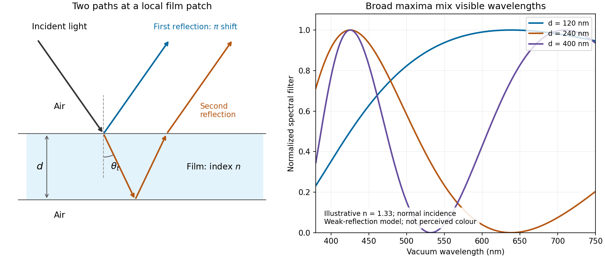

# Paper 2

↑ **Parent:** [2021](../2021.md)

[Original paper, released PDF pages 141–145](https://www.whatdotheyknow.com/request/natural_science_tripos_physics_e/response/2127325/attach/3/FOI%202022%20639%20Sullivan%20materials.pdf?cookie_passthrough=1#page=141)

**Table of contents**

- [Section A](#section-a)
  - [1](#section-a/1)
    - [Solution](#section-a/1/solution)
  - [2](#section-a/2)
    - [Solution](#section-a/2/solution)
  - [3](#section-a/3)
    - [Solution](#section-a/3/solution)
  - [4](#section-a/4)
    - [Solution](#section-a/4/solution)
  - [5](#section-a/5)
    - [Solution](#section-a/5/solution)
- [Section B](#section-b)
  - [B6](#section-b/b6)
    - [a](#section-b/b6/a)
      - [Solution](#section-b/b6/a/solution)
    - [b](#section-b/b6/b)
      - [Solution](#section-b/b6/b/solution)
    - [c](#section-b/b6/c)
      - [Solution](#section-b/b6/c/solution)
    - [d](#section-b/b6/d)
      - [Solution](#section-b/b6/d/solution)
    - [e](#section-b/b6/e)
      - [Solution](#section-b/b6/e/solution)
  - [B7](#section-b/b7)
    - [a](#section-b/b7/a)
      - [Solution](#section-b/b7/a/solution)
    - [b](#section-b/b7/b)
      - [Solution](#section-b/b7/b/solution)
    - [c](#section-b/b7/c)
      - [Solution](#section-b/b7/c/solution)
    - [d](#section-b/b7/d)
      - [Solution](#section-b/b7/d/solution)
- [Section C](#section-c)
  - [C8](#section-c/c8)
    - [a](#section-c/c8/a)
      - [Solution](#section-c/c8/a/solution)
    - [b](#section-c/c8/b)
      - [Solution](#section-c/c8/b/solution)
    - [c](#section-c/c8/c)
      - [Solution](#section-c/c8/c/solution)
    - [d](#section-c/c8/d)
      - [Solution](#section-c/c8/d/solution)
- [Section D](#section-d)
  - [D9](#section-d/d9)
    - [a](#section-d/d9/a)
      - [Solution](#section-d/d9/a/solution)
    - [b](#section-d/d9/b)
      - [Solution](#section-d/d9/b/solution)

## Section A

↑ **Parent:** [Paper 2](paper-2.md)

<h3 id="section-a/1">1</h3>

↑ **Parent:** [Section A](#section-a)

<h4 id="section-a/1/solution">Solution</h4>

↑ **Parent:** [1](#section-a/1)

For the [deep-water gravity wave](../../fluid-mechanics.md#deep-water-gravity-wave), the [phase velocity](../../dispersion-relation.md#phase-velocity) and [group velocity](../../dispersion-relation.md#group-velocity) follow from its [dispersion relation](../../dispersion-relation.md):

$$
v_p=\frac{\omega}{k}=\sqrt{\frac gk},\qquad v_g=\frac{d\omega}{dk}=\frac12\sqrt{\frac gk}=\frac{v_p}{2}.
$$

The [wave packet](../../dispersion-relation.md#wave-packet) travels at $v_g$, while the individual crests travel at $v_p$. Let its effective length be $D\simeq5\lambda$, where $\lambda=2\pi/k$ is the carrier [wavelength](../../wave-equation.md#wavelength). A fixed observer is inside the [wave packet](../../dispersion-relation.md#wave-packet) for $\Delta t=D/v_g$, and crests arrive with [wave period](../../wave.md#wave-period) $\lambda/v_p$. Thus

$$
\boxed{N_{\rm passing}=\frac{D/v_g}{\lambda/v_p}=5\frac{v_p}{v_g}=10\text{ crests}.}
$$

Crests enter the rear of the moving [wave packet](../../dispersion-relation.md#wave-packet) and disappear at its front, so the five visible at one instant are not five permanently identifiable crests. The count uses the intended narrow-band, approximately unchanged [wave packet](../../dispersion-relation.md#wave-packet) and neglects the precise visibility of its end crests.

<h3 id="section-a/2">2</h3>

↑ **Parent:** [Section A](#section-a)

<h4 id="section-a/2/solution">Solution</h4>

↑ **Parent:** [2](#section-a/2)

A bubble is a thin water layer surrounded by air. At a locally flat patch, let its thickness be $d$, its [refractive index](../../electromagnetic-wave.md#refractive-index) be $n$, and the internal angle of [refraction](../../optics.md#refraction) be $\theta_t$. The two principal reflected [light](../../optics.md#light) contributions are the reflection at the first surface and the contribution that enters the layer, reflects at its second surface and leaves again. The first reflection, from lower to higher [refractive index](../../electromagnetic-wave.md#refractive-index), introduces a $\pi$ [phase shift](../../wave.md#phase-shift); the second does not. Their [optical path difference](../../physical-optics.md#optical-path-difference) is $2nd\cos\theta_t$, so their [phase difference](../../wave.md#phase-difference) is, modulo $2\pi$,

$$
\Delta\phi=\frac{4\pi nd\cos\theta_t}{\lambda_0}+\pi,
$$

where $\lambda_0$ is the [vacuum](../../physics.md#vacuum) [wavelength](../../wave-equation.md#wavelength). [Constructive interference](../../fourier-analysis.md#constructive-interference) in reflected [light](../../optics.md#light) therefore occurs approximately when

$$
\boxed{2nd\cos\theta_t=(m+\tfrac12)\lambda_0,\qquad m=0,1,2,\ldots.}
$$

[Destructive interference](../../physical-optics.md#destructive-interference) occurs at $2nd\cos\theta_t=m\lambda_0$. In the weak-reflection approximation, the reflected [light intensity](../../wave.md#light-intensity) at each [wavelength](../../wave-equation.md#wavelength) is proportional to $\sin^2(2\pi nd\cos\theta_t/\lambda_0)$. This is a smooth spectral filter, with broad maxima and minima: it does not select three pure [wavelengths](../../wave-equation.md#wavelength) corresponding to display primaries. Ordinary illumination contains many visible [wavelengths](../../wave-equation.md#wavelength), and the eye combines their remaining contributions through [color vision](../../optics.md#color-vision). The result is a mixture of colours, often pastel or desaturated.

The layer thickness varies over the bubble because of drainage and flow; the bubble's curvature also changes the local angle of [refraction](../../optics.md#refraction) and the viewed [optical path difference](../../physical-optics.md#optical-path-difference). The spectral filter therefore changes continuously across the surface and in time. Very thin regions become dark because the two reflected contributions nearly cancel across the visible [optical spectrum](../../optics.md#optical-spectrum). [Thin-film interference](../../physical-optics.md#thin-film-interference) explains both the changing colours and this dark limit.

**[Figure 1](#section-a/2/image-two-reflected-paths-through-a-thin-film-and-the-broad-spectral-filtering-that-produces-mixed-colours). Two reflected paths through a thin film and the broad spectral filtering that produces mixed colours**.

The ray sketch shows a local patch and is not to scale. The plotted curves use a chosen constant $n=1.33$ at [normal incidence](../../optics.md#normal-incidence) and illustrative thicknesses; they show the spectral filter rather than calibrated perceived colours.

<h3 id="section-a/3">3</h3>

↑ **Parent:** [Section A](#section-a)

<h4 id="section-a/3/solution">Solution</h4>

↑ **Parent:** [3](#section-a/3)

Model the room's decaying [acoustic waves](../../fluid-mechanics.md#acoustic-wave) as a weakly damped [resonator](../../dynamical-systems.md#resonator). The [quality factor from ringdown](../../dynamical-systems.md#quality-factor-from-ringdown) is related to stored [energy](../../energy.md) $E$ by

$$
Q=\omega\frac{E}{-dE/dt},\qquad E(t)=E(0)e^{-\omega t/Q},\qquad A(t)=A(0)e^{-\omega t/(2Q)},
$$

where $A$ is the pressure [wave amplitude](../../wave.md#wave-amplitude) and $\omega=2\pi f$. The measured [frequency](../../wave.md#frequency) $f=440\,\mathrm{Hz}$ gives $\omega\simeq2.76\times10^3\,\mathrm{s^{-1}}$. If the stated $5\,\mathrm{s}$ is interpreted as an approximate [wave amplitude](../../wave.md#wave-amplitude) [exponential relaxation time](../../differential-equation.md#exponential-relaxation-time),

$$
\boxed{Q\simeq\frac{\omega\tau_A}{2}=\pi(440\,\mathrm{Hz})(5\,\mathrm{s})\simeq6.9\times10^3,}
$$

an estimate of order $10^4$. Taking $5\,\mathrm{s}$ as an [energy](../../energy.md) [exponential relaxation time](../../differential-equation.md#exponential-relaxation-time) instead gives $Q\simeq1.4\times10^4$.

There is a real convention ambiguity: “heard to die away” gives neither an initial sound level nor an audibility threshold, so it does not determine either [exponential relaxation time](../../differential-equation.md#exponential-relaxation-time). More generally, if the [energy](../../energy.md) falls by a factor $E(0)/E(t_d)$ in $t_d$,

$$
Q=\frac{2\pi f t_d}{\ln[E(0)/E(t_d)]}.
$$

In room [acoustics](../../physics.md#acoustics), a [reverberation time](../../physics.md#reverberation-time) $T_{60}$ usually denotes a [decibel](../../physics.md#decibel) drop of $60\,\mathrm{dB}$, or an [energy](../../energy.md) factor $10^6$. If $5\,\mathrm{s}$ means $T_{60}$, the corresponding estimate is instead $\boxed{Q\simeq2\pi(440)(5)/(6\ln10)\simeq1.0\times10^3}$. The simple decay-time estimate and the conventional [reverberation time](../../physics.md#reverberation-time) estimate should not be silently equated.

<h3 id="section-a/4">4</h3>

↑ **Parent:** [Section A](#section-a)

<h4 id="section-a/4/solution">Solution</h4>

↑ **Parent:** [4](#section-a/4)

The three [primitive lattice translation vectors](../../quantum-scattering.md#primitive-lattice-translation-vector) join a cube corner to the three adjacent face centres. Thus the [Bravais lattice](../../quantum-scattering.md#bravais-lattice) is a [face-centered cubic lattice](../../quantum-scattering.md#face-centered-cubic-lattice), with conventional cubic side $a$.

Write the given [primitive lattice translation vectors](../../quantum-scattering.md#primitive-lattice-translation-vector) as $\mathbf a_1,\mathbf a_2,\mathbf a_3$. Their [primitive unit cell](../../quantum-scattering.md#primitive-unit-cell) [volume](../../geometry-and-topology.md#volume) is

$$
\Omega=\mathbf a_1\cdot(\mathbf a_2\times\mathbf a_3)=\frac{a^3}{4},\qquad
\mathbf a_2\times\mathbf a_3=\frac{a^2}{4}(-1,1,1).
$$

The [reciprocal lattice](../../quantum-scattering.md#reciprocal-lattice) convention $\mathbf a_i\cdot\mathbf b_j=2\pi\delta_{ij}$ then gives

$$
\boxed{\begin{aligned}
\mathbf b_1&=\frac{2\pi}{a}(-1,1,1),\\
\mathbf b_2&=\frac{2\pi}{a}(1,-1,1),\\
\mathbf b_3&=\frac{2\pi}{a}(1,1,-1).
\end{aligned}}
$$

Each [reciprocal lattice](../../quantum-scattering.md#reciprocal-lattice) vector has units $\mathrm{m^{-1}}$ when $a$ is in metres. Integer combinations generate a [body-centered cubic lattice](../../quantum-scattering.md#body-centered-cubic-lattice) of conventional cubic side $4\pi/a$; the point $(2\pi/a)(1,1,1)$ is its body centre. Directly taking the nine [dot products](../../inner-product.md#dot-product) checks the signs and the $2\pi$ normalization.

<h3 id="section-a/5">5</h3>

↑ **Parent:** [Section A](#section-a)

<h4 id="section-a/5/solution">Solution</h4>

↑ **Parent:** [5](#section-a/5)

Let $N=L/a$ be the integer number of [primitive unit cells](../../quantum-scattering.md#primitive-unit-cell). A [Bloch state](../../bloch-s-theorem.md#bloch-state) can be written as $\psi_k(x)=e^{ikx}u_k(x)$, with $u_k(x+a)=u_k(x)$. The [periodic boundary condition](../../differential-equation.md#periodic-boundary-conditions) $\psi_k(x+L)=\psi_k(x)$ therefore requires

$$
e^{ikL}=1,\qquad k_j=\frac{2\pi j}{L},\qquad j\in\mathbb Z.
$$

The spacing of allowed [wavevectors](../../elasticity-physics.md#wavevector) is $\Delta k=2\pi/L$. The first [Brillouin zone](../../bloch-s-theorem.md#brillouin-zone) has width $2\pi/a$, so

$$
\boxed{N_k=\frac{2\pi/a}{2\pi/L}=\frac La=N.}
$$

For an exact endpoint convention take a half-open [Brillouin zone](../../bloch-s-theorem.md#brillouin-zone), such as $[-\pi/a,\pi/a)$. Its two endpoints differ by a [reciprocal lattice](../../quantum-scattering.md#reciprocal-lattice) vector and must not both be counted as distinct values of [crystal momentum](../../bloch-s-theorem.md#crystal-momentum). There are exactly $N$ inequivalent integers $j$ modulo $N$, irrespective of whether $N$ is even or odd. This is [state counting in a Bloch band](../../bloch-s-theorem.md#state-counting-in-a-bloch-band): one allowed [wavevector](../../elasticity-physics.md#wavevector) per [primitive unit cell](../../quantum-scattering.md#primitive-unit-cell) per [energy band](../../bloch-s-theorem.md#energy-band). A separate twofold [spin](../../angular-momentum-operator.md#spin) multiplicity gives $2N$ electronic states per [energy band](../../bloch-s-theorem.md#energy-band), without doubling the number of [wavevectors](../../elasticity-physics.md#wavevector).

## Section B

↑ **Parent:** [Paper 2](paper-2.md)

<h3 id="section-b/b6">B6</h3>

↑ **Parent:** [Section B](#section-b)

<h4 id="section-b/b6/a">a</h4>

↑ **Parent:** [B6](#section-b/b6)

<h5 id="section-b/b6/a/solution">Solution</h5>

↑ **Parent:** [A](#section-b/b6/a)

Use transverse displacement $y(x,t)$, small slopes and constant [tension](../../force.md#tension) $T$. For a short string element of length $dx$, [Newton's second law](../../force.md#newton-s-second-law) gives $\rho_L dx\,y_{tt}=T[y_x(x+dx)-y_x(x)]$. Hence the [wave equation on a string](../../wave-equation.md#wave-equation-on-a-string) is

$$
y_{tt}=c_L^2y_{xx},\qquad c_L=\sqrt{\frac T{\rho_L}},
$$

where $\rho_L$ is the [linear mass density](../../fluid-mechanics.md#linear-mass-density), in $\mathrm{kg\,m^{-1}}$.

The [mechanical impedance](../../classical-mechanics.md#mechanical-impedance) of a rightgoing [travelling wave](../../analysis.md#travelling-wave) is the transverse driving [force](../../force.md) divided by the transverse [velocity](../../classical-mechanics.md#velocity) at the driven section. Choose the [force](../../force.md) exerted by the material to the left on the material to the right, $F_y=-Ty_x$. For $y=f(x-c_Lt)$, the transverse [velocity](../../classical-mechanics.md#velocity) is $v_y=y_t=-c_Ly_x$. Thus the positive [characteristic impedance of a stretched string](../../wave-equation.md#characteristic-impedance-of-a-stretched-string) is

$$
\boxed{Z_L=\frac{F_y}{v_y}=\frac T{c_L}=\rho_Lc_L=\sqrt{T\rho_L},\qquad [Z_L]=\mathrm{N\,s\,m^{-1}}=\mathrm{kg\,s^{-1}}.}
$$

A leftgoing component has $F_y/v_y=-Z_L$ with this fixed orientation of [force](../../force.md). Specifying the orientation avoids confusing that propagation sign with a negative material [mechanical impedance](../../classical-mechanics.md#mechanical-impedance).

<h4 id="section-b/b6/b">b</h4>

↑ **Parent:** [B6](#section-b/b6)

<h5 id="section-b/b6/b/solution">Solution</h5>

↑ **Parent:** [B](#section-b/b6/b)

Place the junction at $x=0$ and use the [complex amplitude](../../wave.md#complex-amplitude) convention $e^{-i\omega t}$. With incident displacement [wave amplitude](../../wave.md#wave-amplitude) $A_i$, write

$$
y_L=A_i(e^{ik_Lx}+r e^{-ik_Lx})e^{-i\omega t},\qquad
y_R=A_i t e^{ik_Rx}e^{-i\omega t}.
$$

Here $r$ and $t$ are displacement [wave reflection](../../wave.md#wave-reflection) and [transmission coefficients](../../partial-differential-equation.md#transmission-coefficient), and $k_j=\omega/c_j$. The junction is assumed massless, with no externally applied transverse [force](../../force.md), and both strings have the common equilibrium [tension](../../force.md#tension) $T$. Continuity of displacement and transverse [force](../../force.md) gives

$$
1+r=t,\qquad Tk_L(1-r)=Tk_Rt.
$$

Since $Tk_j=\omega Z_j$, these become $1+r=t$ and $Z_L(1-r)=Z_Rt$. Solving,

$$
\boxed{\frac{A_r}{A_i}=r=\frac{Z_L-Z_R}{Z_L+Z_R},\qquad
\frac{A_t}{A_i}=t=\frac{2Z_L}{Z_L+Z_R}.}
$$

A larger right-hand [mechanical impedance](../../classical-mechanics.md#mechanical-impedance) produces a reflected displacement with reversed sign, as expected in the fixed-end limit $Z_R\to\infty$. Equal [mechanical impedances](../../classical-mechanics.md#mechanical-impedance) give $r=0$ and $t=1$.

<h4 id="section-b/b6/c">c</h4>

↑ **Parent:** [B6](#section-b/b6)

<h5 id="section-b/b6/c/solution">Solution</h5>

↑ **Parent:** [C](#section-b/b6/c)

The instantaneous rightward [energy flux](../../mathematical-physics.md#energy-flux) along a string is the transverse [force](../../force.md) times the transverse [velocity](../../classical-mechanics.md#velocity),

$$
P=-Ty_xy_t.
$$

For a rightgoing [time-harmonic wave](../../wave.md#time-harmonic-wave) of peak displacement [wave amplitude](../../wave.md#wave-amplitude) $|A|$, averaging over a [wave period](../../wave.md#wave-period) gives

$$
\langle P\rangle=\frac12Tk\omega|A|^2=\frac12Z\omega^2|A|^2.
$$

A leftgoing [time-harmonic wave](../../wave.md#time-harmonic-wave) has the opposite signed [energy flux](../../mathematical-physics.md#energy-flux). The positive ratios of reflected and transmitted [power](../../energy.md#power) to incident [power](../../energy.md#power) are therefore

$$
\mathcal R=|r|^2=\frac{(Z_L-Z_R)^2}{(Z_L+Z_R)^2},\qquad
\boxed{\mathcal T=\frac{Z_R}{Z_L}|t|^2=\frac{4Z_LZ_R}{(Z_L+Z_R)^2}.}
$$

All explicit [angular frequency](../../lagrangian-mechanics.md#angular-frequency) factors cancel. In the ideal [wave equation on a string](../../wave-equation.md#wave-equation-on-a-string), $T$ and the two [linear mass densities](../../fluid-mechanics.md#linear-mass-density) are constant, so the [mechanical impedances](../../classical-mechanics.md#mechanical-impedance) have no [frequency](../../wave.md#frequency) or [wavelength](../../wave-equation.md#wavelength) dependence. Consequently $\mathcal T$ is independent of [wavelength](../../wave-equation.md#wavelength) even though the two string [wavelengths](../../wave-equation.md#wavelength) generally differ.

Finally,

$$
\boxed{\mathcal R+\mathcal T=
\frac{(Z_L-Z_R)^2+4Z_LZ_R}{(Z_L+Z_R)^2}=1.}
$$

This is [conservation of energy](../../mathematical-physics.md#conservation-of-energy) at a lossless, massless junction. The transmitted displacement [wave amplitude](../../wave.md#wave-amplitude) can exceed the incident one when $Z_R<Z_L$; the factor $Z_R/Z_L$ is essential when comparing [power](../../energy.md#power).

<h4 id="section-b/b6/d">d</h4>

↑ **Parent:** [B6](#section-b/b6)

<h5 id="section-b/b6/d/solution">Solution</h5>

↑ **Parent:** [D](#section-b/b6/d)

Let the middle segment occupy $0<x<l$. Normalize the incident displacement [complex amplitude](../../wave.md#complex-amplitude) to one, suppress the common time factor $e^{-i\omega t}$, and choose

$$
\begin{aligned}
y_L(x)&=e^{ik_Lx}+r e^{-ik_Lx},&&x<0,\\
y_M(x)&=a e^{ik_Mx}+b e^{-ik_Mx},&&0<x<l,\\
y_R(x)&=t e^{ik_R(x-l)},&&x>l.
\end{aligned}
$$

Here $r$ is the reflected [complex amplitude](../../wave.md#complex-amplitude) at $0$, $a$ and $b$ are the rightgoing and leftgoing middle-segment [complex amplitudes](../../wave.md#complex-amplitude) referenced to $0$, and $t$ is the outgoing [complex amplitude](../../wave.md#complex-amplitude) referenced to $l$. The middle [wavenumber](../../wave-equation.md#wavenumber) is $k_M=\omega/c_M$, and

$$
\gamma=e^{ik_Ml},\qquad |\gamma|=1
$$

is the propagation [phase factor](../../wave.md#phase-factor) across the lossless middle segment.

At each junction, continuity of displacement and transverse [force](../../force.md) means continuity of $y$ and $Ty_x$. Using $Tk_j=\omega Z_j$ gives

$$
\boxed{\begin{aligned}
1+r&=a+b,\\
Z_L(1-r)&=Z_M(a-b),\\
\gamma a+\gamma^{-1}b&=t,\\
Z_M(\gamma a-\gamma^{-1}b)&=Z_Rt.
\end{aligned}}
$$

These [boundary conditions](../../differential-equation.md#boundary-condition) also include all multiple reflections inside the middle segment: $a$ and $b$ are the total travelling components, not just the first waves to cross a junction.

<h4 id="section-b/b6/e">e</h4>

↑ **Parent:** [B6](#section-b/b6)

<h5 id="section-b/b6/e/solution">Solution</h5>

↑ **Parent:** [E](#section-b/b6/e)

Put $\delta=k_Ml$. Eliminating the middle-segment [complex amplitudes](../../wave.md#complex-amplitude) using the right-hand [boundary conditions](../../differential-equation.md#boundary-condition) gives

$$
1+r=t\left(\cos\delta-i\frac{Z_R}{Z_M}\sin\delta\right),\qquad
Z_L(1-r)=t\left(Z_R\cos\delta-iZ_M\sin\delta\right).
$$

Hence the displacement [reflection coefficient](../../partial-differential-equation.md#reflection-coefficient) is

$$
r=\frac{(Z_L-Z_R)\cos\delta+i(Z_M-Z_LZ_R/Z_M)\sin\delta}
{(Z_L+Z_R)\cos\delta-i(Z_M+Z_LZ_R/Z_M)\sin\delta}.
$$

For finite positive real [mechanical impedances](../../classical-mechanics.md#mechanical-impedance), its denominator cannot vanish at real $\delta$. The real and imaginary parts of the numerator must therefore vanish separately:

$$
(Z_L-Z_R)\cos\delta=0,\qquad (Z_M^2-Z_LZ_R)\sin\delta=0.
$$

This gives all three possibilities.

If the exterior strings differ, $Z_L\ne Z_R$, then $\cos\delta=0$, so $\sin\delta\ne0$ and

$$
\boxed{Z_M=\sqrt{Z_LZ_R},\qquad l=\frac{(2n+1)\lambda_M}{4},\quad n=0,1,2,\ldots.}
$$

The middle segment is a [quarter-wave impedance transformer](../../electrical-circuit.md#quarter-wave-impedance-transformer). Its two reflected contributions cancel at these odd quarter-[wavelength](../../wave-equation.md#wavelength) thicknesses. Here $\lambda_M=2\pi/k_M$ is specifically the [wavelength](../../wave-equation.md#wavelength) in the middle string; the matching is not generally valid at every [frequency](../../wave.md#frequency).

If $Z_L=Z_R$ but $Z_M$ differs, the second condition requires $\sin\delta=0$, giving

$$
\boxed{l=\frac{n\lambda_M}{2},\quad n=1,2,\ldots.}
$$

A whole number of half-[wavelengths](../../wave-equation.md#wavelength) reproduces the exterior [mechanical impedance](../../classical-mechanics.md#mechanical-impedance) at the input. The formal $n=0$ limit is zero [frequency](../../wave.md#frequency) or zero segment length, rather than a finite-[wavelength](../../wave-equation.md#wavelength) resonance.

Finally, if $Z_L=Z_M=Z_R$, both conditions hold identically: $\boxed{r=0\text{ at every wavelength}}$. Since the system is lossless, each of these cases also gives unit transmitted [power](../../energy.md#power).

<h3 id="section-b/b7">B7</h3>

↑ **Parent:** [Section B](#section-b)

<h4 id="section-b/b7/a">a</h4>

↑ **Parent:** [B7](#section-b/b7)

<h5 id="section-b/b7/a/solution">Solution</h5>

↑ **Parent:** [A](#section-b/b7/a)

The expression is a [scalar diffraction theory](../../physical-optics.md#scalar-diffraction-theory) integral for a [monochromatic wave](../../wave.md#monochromatic-wave). The complex quantity $\psi_P$ represents a field [complex amplitude](../../wave.md#complex-amplitude), with physical field obtained by taking the real part after multiplication by $e^{-i\omega t}$. The [light intensity](../../wave.md#light-intensity) is proportional to $|\psi_P|^2$. The coordinates $x,y$ label transverse positions in the aperture plane, $\Sigma$ is its transmitting region, and $h(x,y)$ is the incident field multiplied by the aperture's complex transmission. The [wavenumber](../../wave-equation.md#wavenumber) is $k=2\pi/\lambda$ in the propagation medium, and $R$ is the axial propagation distance if $h$ already includes the incident field.

To derive the [Fresnel diffraction](../../physical-optics.md#fresnel-diffraction), start from [Huygens-Fresnel principle](../../physical-optics.md#huygens-fresnel-principle) contributions with propagation factor $e^{iks}/s$. With the coordinate origin at the projection of $P$ into the aperture plane,

$$
s=\sqrt{R^2+x^2+y^2}=R+\frac{x^2+y^2}{2R}-\frac{(x^2+y^2)^2}{8R^3}+\cdots.
$$

The [paraxial approximation](../../partial-differential-equation.md#paraxial-approximation) requires $\rho/R\ll1$, where $\rho^2=x^2+y^2$. Replace the slowly varying $1/s$ and the obliquity factor by their axial values, but retain the quadratic variation of [wave phase](../../wave.md#phase-waves). Neglect of the next [wave phase](../../wave.md#phase-waves) term requires $k\rho^4/(8R^3)\ll1$ over the relevant aperture. Thus, apart from a common constant,

$$
\psi_P\simeq\frac{e^{ikR}}{i\lambda R}\iint_\Sigma h(x,y)e^{ik(x^2+y^2)/(2R)}\,dx\,dy.
$$

The quadratic [wave phase](../../wave.md#phase-waves) may be of order one or much larger; setting it to zero would require the stronger conditions for [Fraunhofer diffraction](../../physical-optics.md#fraunhofer-diffraction). The scalar treatment also neglects the detailed vector field at aperture edges and assumes dimensions large enough compared with [wavelength](../../wave-equation.md#wavelength) for this approximation to be useful.

For a finite-distance axial point source at distance $p$ and an observer at distance $q$, the incident field contributes its own quadratic [wave phase](../../wave.md#phase-waves). If $h$ instead denotes only the aperture transmission, the combined curvature is described by an effective distance

$$
\boxed{\frac1{R_{\rm eff}}=\frac1p+\frac1q,\qquad R_{\rm eff}=\frac{pq}{p+q}.}
$$

These are two equivalent conventions for distributing the incident [wave phase](../../wave.md#phase-waves) between $h$ and the exponential. Both distances must be included in the later calculation.

<h4 id="section-b/b7/b">b</h4>

↑ **Parent:** [B7](#section-b/b7)

<h5 id="section-b/b7/b/solution">Solution</h5>

↑ **Parent:** [B](#section-b/b7/b)

Write $p$ and $q$ for the axial source and observation distances, and put $R_{\rm eff}=pq/(p+q)$. The aperture is $-d/2<x,y<d/2$. Under the [Fresnel diffraction](../../physical-optics.md#fresnel-diffraction), the spherical incident [wave amplitude](../../wave.md#wave-amplitude) is effectively constant over this small aperture, while its quadratic [wave phase](../../wave.md#phase-waves) must be retained. Therefore the two transverse [integrals](../../integral.md) separate:

$$
\psi_P=K\left[\int_{-d/2}^{d/2}\exp\left(\frac{i\pi x^2}{\lambda R_{\rm eff}}\right)dx\right]^2,
$$

where $K$ contains the source strength, the propagation distances and a common [phase factor](../../wave.md#phase-factor).

Use the dimensionless variable $u=x\sqrt{2/(\lambda R_{\rm eff})}$ and define the [optical normalization of Fresnel integrals](../../fourier-transform.md#optical-normalization-of-fresnel-integrals)

$$
F(w)=C(w)+iS(w)=\int_0^w e^{i\pi u^2/2}\,du,\qquad
w=\frac d2\sqrt{\frac{2}{\lambda R_{\rm eff}}}.
$$

The oddness of $F$ makes the bracket $\sqrt{2\lambda R_{\rm eff}}F(w)$, so

$$
\boxed{\psi_P=2K\lambda R_{\rm eff}[C(w)+iS(w)]^2.}
$$

This [square-aperture Fresnel diffraction](../../physical-optics.md#square-aperture-fresnel-diffraction) normalization is especially useful for comparing with no aperture. In the same [Fresnel diffraction](../../physical-optics.md#fresnel-diffraction), the unrestricted one-dimensional [Fresnel integral](../../fourier-transform.md#fresnel-integral) is $\sqrt{\lambda R_{\rm eff}}e^{i\pi/4}$; its square is $i\lambda R_{\rm eff}$. Thus, writing $\psi_0$ for the unobscured field at the same point,

$$
\boxed{\frac{\psi_P}{\psi_0}=-2i[C(w)+iS(w)]^2,\qquad
\frac{I_P}{I_0}=4[C(w)^2+S(w)^2]^2.}
$$

The normalization has the correct no-aperture limit because $C(\infty)=S(\infty)=1/2$ in this convention.

<h4 id="section-b/b7/c">c</h4>

↑ **Parent:** [B7](#section-b/b7)

<h5 id="section-b/b7/c/solution">Solution</h5>

↑ **Parent:** [C](#section-b/b7/c)

Use SI units throughout: $d=1.0\times10^{-3}\,\mathrm m$, $\lambda=1.0\times10^{-6}\,\mathrm m$, and $p=q=1.0\,\mathrm m$. The effective propagation distance is $R_{\rm eff}=0.50\,\mathrm m$, giving

$$
w=\frac{10^{-3}}2\sqrt{\frac{2}{(10^{-6})(0.50)}}=1.
$$

In the supplied [Cornu spiral](../../topology.md#euler-spiral), the endpoint at $w=1$ is approximately $(C,S)=(0.78,0.44)$. Hence

$$
\boxed{\frac{I_P}{I_0}=4(0.78^2+0.44^2)^2\simeq2.6.}
$$

More accurate [Fresnel integrals](../../fourier-transform.md#fresnel-integral), $C(1)=0.7798934$ and $S(1)=0.4382591$, give $I_P/I_0=2.562$. The central [light intensity](../../wave.md#light-intensity) is increased to about $2.6$ times the unobscured value, an increase of roughly $160\%$.

There is no violation of [conservation of energy](../../mathematical-physics.md#conservation-of-energy): the aperture reduces the total transmitted [power](../../energy.md#power), while removing contributions that partly cancel the central field redistributes the transmitted [power](../../energy.md#power) across the observation plane. In particular, the square aperture does not give the same central field as a circular aperture of a superficially similar size.

**[Figure 2](#section-b/b7/c/image-calculated-central-intensity-and-an-off-axis-section-for-the-square-aperture-in-the-fresnel-approximation). Calculated central intensity and an off-axis section for the square aperture in the Fresnel approximation**.

<h4 id="section-b/b7/d">d</h4>

↑ **Parent:** [B7](#section-b/b7)

<h5 id="section-b/b7/d/solution">Solution</h5>

↑ **Parent:** [D](#section-b/b7/d)

Let the source remain at $(0,0,-p)$ and let the observation point be $(X,Y,q)$. The [paraxial approximation](../../partial-differential-equation.md#paraxial-approximation) to the source-to-aperture-to-observer [optical path length](../../physical-optics.md#optical-path-length) is

$$
p+q+\frac{x^2+y^2}{2p}+\frac{(X-x)^2+(Y-y)^2}{2q}.
$$

Completing the squares gives

$$
p+q+\frac{X^2+Y^2}{2(p+q)}
+\frac{(x-x_0)^2+(y-y_0)^2}{2R_{\rm eff}},\qquad
x_0=\frac{pX}{p+q},\quad y_0=\frac{pY}{p+q}.
$$

The point $(x_0,y_0)$ is where the straight source-observer line intersects the aperture. Define the four dimensionless edge positions

$$
u_{x,\pm}=\sqrt{\frac{2}{\lambda R_{\rm eff}}}\left(\pm\frac d2-x_0\right),\qquad
u_{y,\pm}=\sqrt{\frac{2}{\lambda R_{\rm eff}}}\left(\pm\frac d2-y_0\right).
$$

On the [Cornu spiral](../../topology.md#euler-spiral) $F(u)=C(u)+iS(u)$, draw the directed chord from $F(u_{x,-})$ to $F(u_{x,+})$, and a second directed chord from $F(u_{y,-})$ to $F(u_{y,+})$. Denote their complex differences by $D_x$ and $D_y$. The [complex amplitude](../../wave.md#complex-amplitude) is proportional to their product: multiply their lengths and add their arguments, including the common propagation [phase factor](../../wave.md#phase-factor).

More explicitly, normalize by the unobscured field $\psi_0(X,Y)$ at this same observation point. The constant [wave phase](../../wave.md#phase-waves) from completing the square is then already included in $\psi_0$, and

$$
\boxed{\frac{\psi(X,Y)}{\psi_0(X,Y)}=\frac{D_xD_y}{2i},\qquad
\frac{I(X,Y)}{I_0(X,Y)}=\frac{|D_x|^2|D_y|^2}{4}.}
$$

Each directed chord is a one-dimensional [Fresnel diffraction](../../physical-optics.md#fresnel-diffraction) factor. One must multiply the two factors, rather than add the chords or use just one chord length for the square aperture. Setting $X=Y=0$ recovers $D_x=D_y=2F(w)$ and the on-axis answer.

## Section C

↑ **Parent:** [Paper 2](paper-2.md)

<h3 id="section-c/c8">C8</h3>

↑ **Parent:** [Section C](#section-c)

<h4 id="section-c/c8/a">a</h4>

↑ **Parent:** [C8](#section-c/c8)

<h5 id="section-c/c8/a/solution">Solution</h5>

↑ **Parent:** [A](#section-c/c8/a)

The crystal has [periodic potential](../../bloch-s-theorem.md#periodic-potential) $V(x+a)=V(x)$. By [Bloch's theorem](../../bloch-s-theorem.md), an [energy eigenstate](../../energy-eigenvalue.md#energy-eigenstate) may be chosen as

$$
\psi_k(x)=e^{ikx}u_k(x),\qquad u_k(x+a)=u_k(x).
$$

Expand the periodic factor in a [Fourier series](../../fourier-series.md):

$$
u_k(x)=\sum_{n\in\mathbb Z}C_{k,n}e^{inG_1x},\qquad G_1=\frac{2\pi}{a}.
$$

Multiplication by $e^{ikx}$ gives the stated plane-wave expansion. Here $x$ is position, $a$ is the [primitive unit cell](../../quantum-scattering.md#primitive-unit-cell) length, $G_1$ is the primitive [reciprocal lattice](../../quantum-scattering.md#reciprocal-lattice) [wavenumber](../../wave-equation.md#wavenumber), $n$ runs over every integer, and $C_{k,n}$ are [complex numbers](../../complex-analysis.md#complex-number) specifying the component [wave amplitudes](../../wave.md#wave-amplitude). The [wavevector](../../elasticity-physics.md#wavevector) $k$ labels the [Bloch state](../../bloch-s-theorem.md#bloch-state) modulo $G_1$; $\hbar k$ is its [crystal momentum](../../bloch-s-theorem.md#crystal-momentum), rather than generally its measured free-space [momentum](../../momentum.md).

The component $e^{i(k+nG_1)x}$ is a [plane wave](../../wave-function.md#plane-wave) of [wavevector](../../elasticity-physics.md#wavevector) $k+nG_1$. All these components acquire the same [phase factor](../../wave.md#phase-factor) $e^{ika}$ under $x\mapsto x+a$, since $e^{inG_1a}=1$. Their mixing therefore respects the crystal's translation symmetry. The coefficients and [energy eigenvalue](../../energy-eigenvalue.md) follow from the [Schrödinger equation](../../mathematical-physics.md#schrodinger-equation); the expression is not a claim that the coefficients are equal or that only finitely many are nonzero. The [energy band](../../bloch-s-theorem.md#energy-band) index is suppressed in the notation, so different [energy bands](../../bloch-s-theorem.md#energy-band) at a common $k$ generally have different coefficient sets.

<h4 id="section-c/c8/b">b</h4>

↑ **Parent:** [C8](#section-c/c8)

<h5 id="section-c/c8/b/solution">Solution</h5>

↑ **Parent:** [B](#section-c/c8/b)

Choose the [Fourier series](../../fourier-series.md) convention

$$
V(x)=\sum_{j\in\mathbb Z}V_j e^{ijG_1x},\qquad
V_j=\frac1a\int_0^aV(x)e^{-ijG_1x}\,dx.
$$

For a real [potential energy](../../energy.md#potential-energy), $V_{-1}=V_1^*$. The symbol $V(G_1)$ means the [Fourier coefficient](../../fourier-series.md#fourier-coefficient) $V_1$, with units of [energy](../../energy.md), rather than the pointwise value of $V(x)$ at a position $G_1$.

Retain the two [plane waves](../../wave-function.md#plane-wave) $|1\rangle=L^{-1/2}e^{ikx}$ and $|2\rangle=L^{-1/2}e^{i(k-G_1)x}$ in the [nearly-free electron model](../../bloch-s-theorem.md#nearly-free-electron-model). Their kinetic [energies](../../energy.md) are $\epsilon_1=\hbar^2k^2/(2m)$ and $\epsilon_2=\hbar^2(k-G_1)^2/(2m)$. The [matrix representation of a linear map](../../vector-space.md#matrix-representation-of-a-linear-map) for the [Quantum Hamiltonian](../../quantum-system.md#hamiltonian-quantum-mechanics) projected onto this two-dimensional [basis](../../vector-space.md#basis) is

$$
H=\begin{pmatrix}\epsilon_1+V_0&V_1\\V_1^*&\epsilon_2+V_0\end{pmatrix}.
$$

Thus $\det(H-EI)=0$ gives

$$
(E-V_0-\epsilon_1)(E-V_0-\epsilon_2)-|V_1|^2=0.
$$

Solving this [quadratic equation](../../polynomial.md#quadratic-equation) yields

$$
\boxed{E_\pm=V_0+\frac{\epsilon_1+\epsilon_2}{2}
\pm\frac12\sqrt{(\epsilon_1-\epsilon_2)^2+4|V_1|^2}.}
$$

Choosing the zero of [potential energy](../../energy.md#potential-energy) so that its spatial average is $V_0=0$ reproduces the requested expression. If that average has not been removed, both [energy bands](../../bloch-s-theorem.md#energy-band) are shifted by $V_0$; no [band gap](../../bloch-s-theorem.md#band-gap), [group velocity](../../dispersion-relation.md#group-velocity) or [effective mass](../../bloch-s-theorem.md#band-effective-mass) is changed by this constant shift.

The two kinetic [energies](../../energy.md) coincide at $k=G_1/2$. Their coupling gives an [avoided crossing](../../bloch-s-theorem.md#avoided-crossing) with [band gap](../../bloch-s-theorem.md#band-gap) $2|V_1|$. The result is exact within the projected two-wave [Quantum Hamiltonian](../../quantum-system.md#hamiltonian-quantum-mechanics). It is an approximation to the full crystal problem, appropriate near this crossing for a weak [periodic potential](../../bloch-s-theorem.md#periodic-potential) whose other [Fourier coefficients](../../fourier-series.md#fourier-coefficient) do not cause strong mixing with remote [plane waves](../../wave-function.md#plane-wave). Small $|V_1|$ alone would not justify ignoring arbitrarily large other [Fourier coefficients](../../fourier-series.md#fourier-coefficient).

<h4 id="section-c/c8/c">c</h4>

↑ **Parent:** [C8](#section-c/c8)

<h5 id="section-c/c8/c/solution">Solution</h5>

↑ **Parent:** [C](#section-c/c8/c)

Set $G=G_1$, $\kappa=\Delta k$, $U=|V_1|>0$ and $E_B=\hbar^2G^2/(8m)$. The two kinetic [energies](../../energy.md) satisfy

$$
\frac{\epsilon_1+\epsilon_2}{2}=E_B+\frac{\hbar^2\kappa^2}{2m},\qquad
\frac{\epsilon_1-\epsilon_2}{2}=\frac{\hbar^2G\kappa}{2m}.
$$

Consequently the [nearly-free electron dispersion near a one-dimensional band gap](../../bloch-s-theorem.md#nearly-free-electron-dispersion-near-a-one-dimensional-band-gap) becomes

$$
E_\pm\left(\frac G2+\kappa\right)=V_0+E_B+\frac{\hbar^2\kappa^2}{2m}
\pm\sqrt{U^2+\left(\frac{\hbar^2G\kappa}{2m}\right)^2}.
$$

The [Taylor expansion](../../calculus.md#taylor-expansion) $\sqrt{U^2+s^2}=U+s^2/(2U)+O(s^4/U^3)$ gives

$$
\boxed{E_\pm=V_0+E_B\pm U+
\left(\frac{\hbar^2}{2m}\pm\frac{\hbar^4G^2}{8m^2U}\right)(\Delta k)^2
+O((\Delta k)^4).}
$$

For the paper's [energy](../../energy.md) convention, set $V_0=0$. There is no linear or cubic term because each branch is an even function of displacement from the crossing in this two-wave approximation. Each coefficient multiplying $(\Delta k)^2$ has units of [energy](../../energy.md) times length squared, as required.

The expansion requires

$$
\left|\frac{\hbar^2G\Delta k}{2m}\right|\ll U,
$$

a more restrictive condition than merely $|\Delta k|\ll G$ when the [band gap](../../bloch-s-theorem.md#band-gap) is small. If $U=0$, the square root is proportional to $|\Delta k|$ and this analytic expansion of the energy-ordered branches is unavailable.

<h4 id="section-c/c8/d">d</h4>

↑ **Parent:** [C8](#section-c/c8)

<h5 id="section-c/c8/d/solution">Solution</h5>

↑ **Parent:** [D](#section-c/c8/d)

Twice the quadratic coefficient from the previous part is the [band curvature](../../bloch-s-theorem.md#band-curvature) $E_\pm''(G_1/2)$. Thus the [band effective masses](../../bloch-s-theorem.md#band-effective-mass) are

$$
\frac1{m_\pm^*}=\frac1{\hbar^2}E_\pm''\left(\frac{G_1}2\right)
=\frac1m\pm\frac{\hbar^2G_1^2}{4m^2U},\qquad
\boxed{m_\pm^*=\frac{m}{1\pm\hbar^2G_1^2/(4mU)}=\frac{m}{1\pm2E_B/U}.}
$$

Here $U=|V(G_1)|$ and $E_B=\hbar^2G_1^2/(8m)$. In the weak-potential regime $U\ll E_B$,

$$
\boxed{m_+^*\simeq+\frac{4m^2U}{\hbar^2G_1^2},\qquad
m_-^*\simeq-\frac{4m^2U}{\hbar^2G_1^2}.}
$$

Both have units of [mass](../../classical-mechanics.md#mass); their magnitudes are much smaller than $m$ in this asymptotic regime. The upper [energy band](../../bloch-s-theorem.md#energy-band) has a local minimum and positive [effective mass](../../bloch-s-theorem.md#band-effective-mass), while the lower [energy band](../../bloch-s-theorem.md#energy-band) has a local maximum and negative [effective mass](../../bloch-s-theorem.md#band-effective-mass). The exact lower-branch sign changes at $U=2E_B$ in the two-wave formula; the intended weak-coupling limit lies below that threshold.

The physical meaning follows from the semiclassical equations for an [electron](../../physics.md#electron) [wave packet](../../dispersion-relation.md#wave-packet) in one [energy band](../../bloch-s-theorem.md#energy-band):

$$
v=\frac1\hbar\frac{dE}{dk},\qquad \hbar\dot k=F,\qquad \dot v=\frac F{m^*}.
$$

An upper-band [electron](../../physics.md#electron) near its minimum accelerates in the direction of the applied [force](../../force.md), whereas a lower-band [electron](../../physics.md#electron) near its maximum accelerates opposite to it. At the extremum itself the [group velocity](../../dispersion-relation.md#group-velocity) is zero. A nearly filled lower [energy band](../../bloch-s-theorem.md#energy-band) is conveniently described by [electron holes](../../quantum-mechanics.md#electron-hole) with positive [electric charge](../../electric-charge.md) $+e$ and positive [effective mass](../../bloch-s-theorem.md#band-effective-mass) $m_h^*=-m_-^*$. Negative curvature is a response of a crystal [energy eigenstate](../../energy-eigenvalue.md#energy-eigenstate), not a negative bare [electron mass](../../physics.md#electron-mass). These statements assume slow forcing that does not induce transitions across the [band gap](../../bloch-s-theorem.md#band-gap).

## Section D

↑ **Parent:** [Paper 2](paper-2.md)

<h3 id="section-d/d9">D9</h3>

↑ **Parent:** [Section D](#section-d)

<h4 id="section-d/d9/a">a</h4>

↑ **Parent:** [D9](#section-d/d9)

<h5 id="section-d/d9/a/solution">Solution</h5>

↑ **Parent:** [A](#section-d/d9/a)

In a [metal](../../chemical-substance.md#metal), a partially filled [energy band](../../bloch-s-theorem.md#energy-band) or overlapping [energy bands](../../bloch-s-theorem.md#energy-band) supplies [electrons](../../physics.md#electron) with nearby unoccupied states. At [thermal equilibrium](../../thermal-equilibrium.md), oppositely directed [group velocities](../../dispersion-relation.md#group-velocity) are equally populated and the net [electric current](../../electric-charge.md#electric-current) vanishes. An applied [electric field](../../electric-field.md) distorts the occupation distribution, producing a small mean [drift velocity](../../electric-charge.md#drift-velocity). A filled [energy band](../../bloch-s-theorem.md#energy-band) alone has no such low-field intraband response because its velocity contributions cancel over the entire [Brillouin zone](../../bloch-s-theorem.md#brillouin-zone).

In the [Drude model](../../electric-charge.md#drude-model), let $n$ be the mobile [electron](../../physics.md#electron) [number density](../../statistical-physics.md#number-density), let $e>0$ be the [elementary charge](../../electric-charge.md#elementary-charge), and let $\tau$ be the [momentum relaxation time](../../electric-charge.md#momentum-relaxation-time). The mean motion obeys

$$
m\frac{d\mathbf v_d}{dt}=-e\mathbf E-\frac{m\mathbf v_d}{\tau}.
$$

The steady state is $\mathbf v_d=-e\tau\mathbf E/m$. The [current density](../../electric-charge.md#current-density) is opposite to the [electron](../../physics.md#electron) [drift velocity](../../electric-charge.md#drift-velocity):

$$
\boxed{\mathbf J=-ne\mathbf v_d=\sigma\mathbf E,\qquad
\sigma=\frac{ne^2\tau}{m},\qquad \rho_{\rm el}=\frac{m}{ne^2\tau}.}
$$

This gives microscopic [Ohm's law](../../electric-charge.md#ohm-s-law), with [electrical conductivity](../../electric-charge.md#electrical-conductivity) $\sigma$ in $\mathrm{S\,m^{-1}}$ and [electrical resistivity](../../electric-charge.md#electrical-resistivity) $\rho_{\rm el}$ in $\Omega\,\mathrm m$. For a uniform wire of length $\ell$ and cross-sectional [area](../../differential-geometry.md#surface-area) $A$, its [electrical resistance](../../electric-charge.md#electrical-resistance) is $R=\rho_{\rm el}\ell/A$. The dissipated [power](../../energy.md#power) per [volume](../../geometry-and-topology.md#volume) is $\mathbf J\cdot\mathbf E=\sigma E^2$, the [Joule heating](../../electric-charge.md#joule-heating) supplied by the external source.

The [free electron model](../../physics.md#free-electron-model) with [Fermi-Dirac statistics](../../tensor-product-of-quantum-systems.md#fermi-dirac-statistics) improves the microscopic picture. The [Pauli exclusion principle](../../tensor-product-of-quantum-systems.md#pauli-exclusion-principle) fills states up to the [Fermi energy](../../quantum-ideal-gas-statistics.md#fermi-energy) at low [temperature](../../temperature.md). For a spherical, parabolic [energy band](../../bloch-s-theorem.md#energy-band) with two [spin](../../angular-momentum-operator.md#spin) states,

$$
k_F=(3\pi^2n)^{1/3},\qquad E_F=\frac{\hbar^2k_F^2}{2m},\qquad v_F=\frac{\hbar k_F}{m}.
$$

Only states near the [Fermi surface](../../fermi-liquid.md#fermi-surface) change their occupation in a weak-field response; the large equilibrium [Fermi velocity](../../quantum-ideal-gas-statistics.md#fermi-velocity) is not the small [drift velocity](../../electric-charge.md#drift-velocity). The same $ne^2\tau/m$ formula results for this isotropic parabolic model when $\tau$ is evaluated for transport near the [Fermi surface](../../fermi-liquid.md#fermi-surface). In a crystal, the [energy band](../../bloch-s-theorem.md#energy-band) [group velocity](../../dispersion-relation.md#group-velocity), [effective mass](../../bloch-s-theorem.md#band-effective-mass) and possibly direction-dependent scattering replace the simplest bare-particle picture. The [mean free path](../../ideal-gas.md#mean-free-path) is approximately $\ell_{\rm mfp}=v_F\tau$.

A perfectly periodic static lattice is already included in [Bloch states](../../bloch-s-theorem.md#bloch-state) and does not by itself give a finite [electrical resistivity](../../electric-charge.md#electrical-resistivity). [Momentum](../../momentum.md) relaxation comes from defects, impurities, boundaries, and [electron-phonon scattering](../../quantum-ideal-gas-statistics.md#electron-phonon-scattering). Independent scattering mechanisms approximately add their rates, giving [Matthiessen's rule](../../electric-charge.md#matthiessen-s-rule),

$$
\frac1\tau\simeq\frac1{\tau_{\rm imp}}+\frac1{\tau_{\rm ph}}+\cdots,\qquad
\rho_{\rm el}(T)\simeq\rho_0+\rho_{\rm ph}(T).
$$

The approximately temperature-independent $\rho_0$ is the [residual resistivity](../../electric-charge.md#residual-resistivity). In ordinary simple metals, the phonon contribution is approximately proportional to [temperature](../../temperature.md) at high [temperature](../../temperature.md); a three-dimensional acoustic-phonon transport model gives a $T^5$ contribution well below the relevant [Debye temperature](../../quantum-ideal-gas-statistics.md#debye-temperature). Other mechanisms can dominate in particular materials or regimes, so neither power law is universal.

The classical [Drude model](../../electric-charge.md#drude-model) incorrectly treats the equilibrium carrier statistics. [Fermi-Dirac statistics](../../tensor-product-of-quantum-systems.md#fermi-dirac-statistics) explains the small [electronic heat capacity](../../heat.md#electronic-heat-capacity), while electrons carrying both charge and heat give the approximate [Wiedemann-Franz law](../../heat.md#wiedemann-franz-law) $\kappa_e/(\sigma T)=\pi^2k_B^2/(3e^2)$ for degenerate carriers with appropriate nearly elastic scattering. Both the simple [electrical conductivity](../../electric-charge.md#electrical-conductivity) formula and this thermal relation depend on the assumptions about [energy bands](../../bloch-s-theorem.md#energy-band) and scattering, rather than being exact for all [metals](../../chemical-substance.md#metal).

<h4 id="section-d/d9/b">b</h4>

↑ **Parent:** [D9](#section-d/d9)

<h5 id="section-d/d9/b/solution">Solution</h5>

↑ **Parent:** [B](#section-d/d9/b)

The [Debye model](../../quantum-ideal-gas-statistics.md#debye-model) approximates a three-dimensional crystal as an elastic continuum supporting quantized [normal modes](../../wave-equation.md#normal-mode), or [phonons](../../quantum-ideal-gas-statistics.md#phonon). At long [wavelengths](../../wave-equation.md#wavelength), the [acoustic phonon branches](../../quantum-ideal-gas-statistics.md#acoustic-phonon-branch) have approximately linear [dispersion relations](../../dispersion-relation.md) $\omega_s(k)=v_s k$: one longitudinal branch and two transverse branches. Replace their complicated actual spectra by these linear forms, then introduce a cutoff chosen to preserve the total $3N$ vibrational degrees of freedom for $N$ atoms. This is an approximation to the spectrum, not a claim that a real crystal has no non-acoustic branches.

For [periodic boundary conditions](../../differential-equation.md#periodic-boundary-conditions) in [volume](../../geometry-and-topology.md#volume) $V$, each allowed [wavevector](../../elasticity-physics.md#wavevector) occupies $(2\pi)^3/V$ in the space of [wavevectors](../../elasticity-physics.md#wavevector). Counting a spherical shell for each branch gives the [density of states](../../quantum-ideal-gas-statistics.md#density-of-states) per unit [angular frequency](../../lagrangian-mechanics.md#angular-frequency)

$$
g(\omega)=\frac{V\omega^2}{2\pi^2}\left(\frac1{v_l^3}+\frac2{v_t^3}\right).
$$

An effective [speed of sound](../../compressible-flow.md#speed-of-sound) $v_D$ can be defined by $3/v_D^3=1/v_l^3+2/v_t^3$. In the single-speed [Debye model](../../quantum-ideal-gas-statistics.md#debye-model), choose $\omega_D=v_Dk_D$ so that

$$
\int_0^{\omega_D}g(\omega)\,d\omega=3N.
$$

Thus the [Debye wavevector](../../quantum-ideal-gas-statistics.md#debye-wavevector), [Debye frequency](../../quantum-ideal-gas-statistics.md#debye-frequency) and [Debye temperature](../../quantum-ideal-gas-statistics.md#debye-temperature) satisfy

$$
\boxed{k_D=\left(\frac{6\pi^2N}{V}\right)^{1/3},\qquad
\omega_D=v_Dk_D,\qquad \Theta_D=\frac{\hbar\omega_D}{k_B},\qquad
g(\omega)=\frac{9N\omega^2}{\omega_D^3}\quad(0<\omega<\omega_D).}
$$

Here $g$ has units of seconds when [angular frequency](../../lagrangian-mechanics.md#angular-frequency) is measured in $\mathrm{s^{-1}}$; its integral is the dimensionless number of [normal modes](../../wave-equation.md#normal-mode). The spherical cutoff replaces the real [Brillouin zone](../../bloch-s-theorem.md#brillouin-zone) by an equal-count continuum construction.

Each [phonon](../../quantum-ideal-gas-statistics.md#phonon) mode is a [quantum harmonic oscillator](../../quantum-harmonic-oscillator.md). Since [phonon](../../quantum-ideal-gas-statistics.md#phonon) number is not conserved at [thermal equilibrium](../../thermal-equilibrium.md), the [chemical potential](../../chemical-potential.md) is zero and its [Bose-Einstein distribution](../../quantum-ideal-gas-statistics.md#bose-einstein-distribution) gives mean thermal [energy](../../energy.md) $\hbar\omega/[e^{\hbar\omega/(k_BT)}-1]$. The [zero-point energy](../../quantum-harmonic-oscillator.md#zero-point-energy) is independent of [temperature](../../temperature.md) in the harmonic, fixed-volume approximation and does not contribute to the [heat capacity at constant volume](../../heat.md#heat-capacity-at-constant-volume). Excluding that constant term,

$$
U(T)=\int_0^{\omega_D}\frac{g(\omega)\hbar\omega}{e^{\hbar\omega/(k_BT)}-1}\,d\omega
=9Nk_BT\left(\frac{T}{\Theta_D}\right)^3
\int_0^{\Theta_D/T}\frac{x^3}{e^x-1}\,dx.
$$

Differentiating the first [integral](../../integral.md) at fixed [volume](../../geometry-and-topology.md#volume) avoids losing the temperature-dependent upper limit in the second one. The resulting [Debye heat capacity](../../quantum-ideal-gas-statistics.md#debye-heat-capacity) is

$$
\boxed{C_V=9Nk_B\left(\frac{T}{\Theta_D}\right)^3
\int_0^{\Theta_D/T}\frac{x^4e^x}{(e^x-1)^2}\,dx.}
$$

For $T\ll\Theta_D$, extend the upper limit to infinity. Expanding $1/(e^x-1)=\sum_{r\ge1}e^{-rx}$ and integrating term by term gives $\int_0^\infty x^3/(e^x-1)\,dx=6\zeta(4)=\pi^4/15$. Therefore

$$
U\simeq\frac{3\pi^4}{5}Nk_B\frac{T^4}{\Theta_D^3},\qquad
\boxed{C_V\simeq\frac{12\pi^4}{5}Nk_B\left(\frac{T}{\Theta_D}\right)^3.}
$$

This $T^3$ law follows from the three-dimensional $\omega^2$ [density of states](../../quantum-ideal-gas-statistics.md#density-of-states) and the availability only of low-[frequency](../../wave.md#frequency) modes at low [temperature](../../temperature.md). It is a central success of the [Debye model](../../quantum-ideal-gas-statistics.md#debye-model).

For $T\gg\Theta_D$, the [Bose-Einstein distribution](../../quantum-ideal-gas-statistics.md#bose-einstein-distribution) reduces to the classical [equipartition theorem](../../canonical-ensemble.md#equipartition-theorem): every mode contributes thermal [energy](../../energy.md) $k_BT$. Consequently

$$
\boxed{U\simeq3Nk_BT,\qquad C_V\longrightarrow3Nk_B,}
$$

the [Dulong-Petit law](../../heat.md#dulong-petit-law), or $3R$ per mole of atoms. The simple model omits detailed [phonon dispersion relation](../../quantum-ideal-gas-statistics.md#phonon-dispersion-relation), distinct [optical phonon branches](../../quantum-ideal-gas-statistics.md#optical-phonon-branch), and anharmonic effects such as [thermal expansion](../../thermodynamics.md#thermal-expansion). In a [metal](../../chemical-substance.md#metal), the low-[temperature](../../temperature.md) total [heat capacity](../../heat.md#heat-capacity) additionally contains a term approximately proportional to $T$ from [electrons](../../physics.md#electron), so the lattice $T^3$ term should not be mistaken for the whole measurement.

## ↑ Ancestors (11)

1. [2021](../2021.md)
2. [Past exam of the physics A course of the University of Cambridge](../../past-exam-of-the-physics-a-course-of-the-university-of-cambridge.md)
3. [Physics A course of the University of Cambridge](../../university-of-cambridge.md#physics-a-course-of-the-university-of-cambridge)
4. [Physics course of the year 2 of the natural sciences course of the University of Cambridge](../../university-of-cambridge.md#physics-course-of-the-year-2-of-the-natural-sciences-course-of-the-university-of-cambridge)
5. [Year 2 of the natural sciences course of the University of Cambridge](../../university-of-cambridge.md#year-2-of-the-natural-sciences-course-of-the-university-of-cambridge)
6. [Year of the natural sciences course of the University of Cambridge](../../university-of-cambridge.md#year-of-the-natural-sciences-course-of-the-university-of-cambridge)
7. [Natural sciences course of the University of Cambridge](../../university-of-cambridge.md#natural-sciences-course-of-the-university-of-cambridge)
8. [Course of the University of Cambridge](../../university-of-cambridge.md#course-of-the-university-of-cambridge)
9. [University of Cambridge](../../university-of-cambridge.md)
10. [List of universities](../../README.md#list-of-universities)
11. [Codex Wiki](../../README.md)
