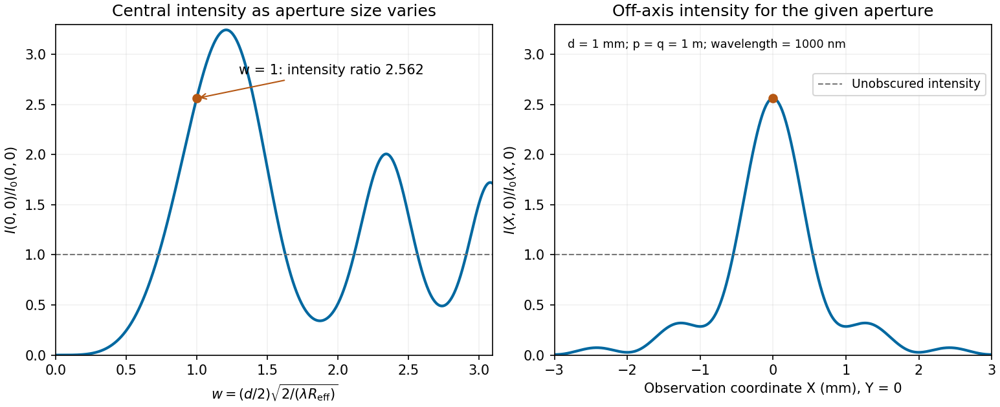

<h1 id="section-b/b7/c/solution">Solution</h1>

↑ **Parent:** [C](../c.md)

Use SI units throughout: $d=1.0\times10^{-3}\,\mathrm m$, $\lambda=1.0\times10^{-6}\,\mathrm m$, and $p=q=1.0\,\mathrm m$. The effective propagation distance is $R_{\rm eff}=0.50\,\mathrm m$, giving

$$
w=\frac{10^{-3}}2\sqrt{\frac{2}{(10^{-6})(0.50)}}=1.
$$

In the supplied [Cornu spiral](../../../../../../euler-spiral.md), the endpoint at $w=1$ is approximately $(C,S)=(0.78,0.44)$. Hence

$$
\boxed{\frac{I_P}{I_0}=4(0.78^2+0.44^2)^2\simeq2.6.}
$$

More accurate [Fresnel integrals](../../../../../../fresnel-integral.md), $C(1)=0.7798934$ and $S(1)=0.4382591$, give $I_P/I_0=2.562$. The central [light intensity](../../../../../../light-intensity.md) is increased to about $2.6$ times the unobscured value, an increase of roughly $160\%$.

There is no violation of [conservation of energy](../../../../../../conservation-of-energy.md): the aperture reduces the total transmitted [power](../../../../../../power.md), while removing contributions that partly cancel the central field redistributes the transmitted [power](../../../../../../power.md) across the observation plane. In particular, the square aperture does not give the same central field as a circular aperture of a superficially similar size.

**[Figure 2](#section-b/b7/c/image-calculated-central-intensity-and-an-off-axis-section-for-the-square-aperture-in-the-fresnel-approximation). Calculated central intensity and an off-axis section for the square aperture in the Fresnel approximation**.

## ↑ Ancestors (15)

1. [C](../c.md)
2. [B7](../../b7.md)
3. [Section B](../../../section-b.md)
4. [Paper 2](../../../../paper-2-split.md)
5. [2021](../../../../split.md)
6. [Past exam of the physics A course of the University of Cambridge](../../../../../split.md)
7. [Physics A course of the University of Cambridge](../../../../../../physics-a-course-of-the-university-of-cambridge.md)
8. [Physics course of the year 2 of the natural sciences course of the University of Cambridge](../../../../../../physics-course-of-the-year-2-of-the-natural-sciences-course-of-the-university-of-cambridge.md)
9. [Year 2 of the natural sciences course of the University of Cambridge](../../../../../../year-2-of-the-natural-sciences-course-of-the-university-of-cambridge.md)
10. [Year of the natural sciences course of the University of Cambridge](../../../../../../year-of-the-natural-sciences-course-of-the-university-of-cambridge.md)
11. [Natural sciences course of the University of Cambridge](../../../../../../natural-sciences-course-of-the-university-of-cambridge.md)
12. [Course of the University of Cambridge](../../../../../../course-of-the-university-of-cambridge.md)
13. [University of Cambridge](../../../../../../university-of-cambridge-split.md)
14. [List of universities](../../../../../../list-of-universities.md)
15. [Codex Wiki](../../../../../../split.md)
