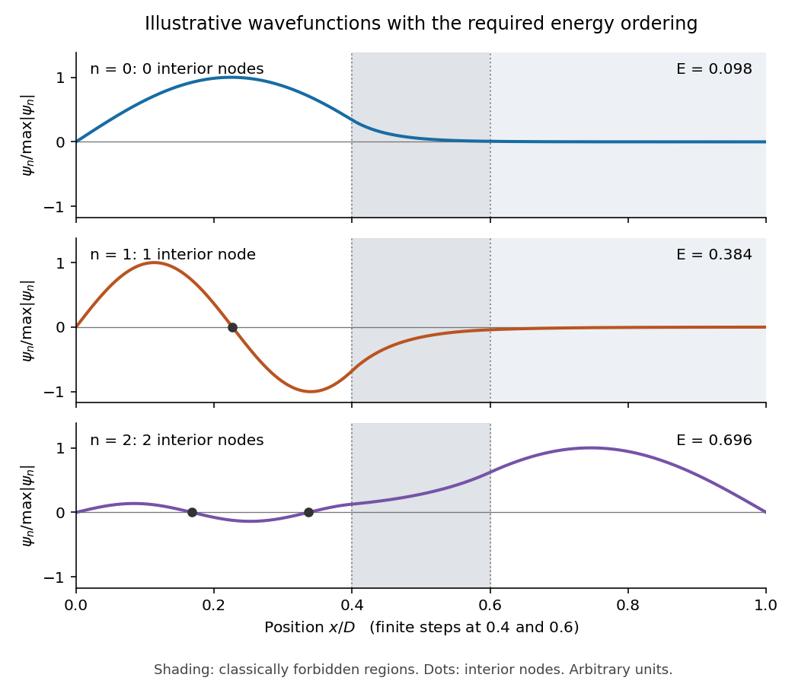

<h1 id="section-a/1/solution">Solution</h1>

↑ **Parent:** [1](../1.md)

Let the infinite outer walls be at $x=0,D$, the finite steps at $x=a,b$, and the three [potential energy](../../../../../potential-energy.md) values be $V_L,V_B,V_R$. The original drawing specifies the ordering

$$
V_L<E_0<E_1<V_R<E_2<V_B.
$$

The [energy eigenstates](../../../../../energy-eigenstate.md) can be chosen real. The [Dirichlet boundary conditions](../../../../../dirichlet-boundary-condition.md) are $\psi(0)=\psi(D)=0$; [wavefunction matching at a finite potential step](../../../../../wavefunction-matching-at-a-finite-potential-step.md) requires both $\psi$ and $\psi'$ to be continuous at $a,b$. In particular, neither finite step acts as an additional hard wall.

The [time-independent Schrödinger equation](../../../../../time-independent-schrodinger-equation.md) gives

$$
\psi''=\frac{2m}{\hbar^2}(V-E)\psi.
$$

Thus a [wavefunction](../../../../../wave-function-split.md) is sinusoidal in a [classically allowed region](../../../../../classically-allowed-region.md), with [wavenumber](../../../../../wavenumber.md) $k=\sqrt{2m(E-V)}/\hbar$, and a [linear combination](../../../../../linear-combination.md) of [exponential functions](../../../../../exponential-function.md) in a [classically forbidden region](../../../../../classically-forbidden-region.md), with inverse decay length $q=\sqrt{2m(V-E)}/\hbar$. Its [curvature](../../../../../curvature.md) changes sign relative to $\psi$ at a step crossing $E$; its [slope](../../../../../slope.md) does not jump.

By the [Sturm oscillation theorem](../../../../../sturm-oscillation-theorem.md), the three [energy eigenstates](../../../../../energy-eigenstate.md) have exactly **zero, one, and two interior nodes**, respectively. Choose their [global phases](../../../../../global-phase.md) so that their slopes at the left wall are positive:

- $E_0$: a positive lobe in the left-hand [potential well](../../../../../potential-well.md), followed by a nonoscillatory tail through the barrier and right-hand region. The tail reaches zero at the right wall. There are no interior [nodes](../../../../../node-dynamical-systems.md).
- $E_1$: two lobes of opposite sign in the left-hand [potential well](../../../../../potential-well.md), with one interior [node](../../../../../node-dynamical-systems.md), followed by a nonoscillatory tail of the sign of the second lobe. Both the middle and right regions are [classically forbidden regions](../../../../../classically-forbidden-region.md).
- $E_2$: sinusoidal behavior in both outer regions, joined through the nonoscillatory barrier. There are two interior [nodes](../../../../../node-dynamical-systems.md) in total. The right-hand [wavelength](../../../../../wavelength.md) is longer than the left-hand [wavelength](../../../../../wavelength.md), because $E_2-V_R<E_2-V_L$.

For $E_0,E_1$, the right-hand piece is proportional to $\sinh[q_R(D-x)]$, rather than a pure decaying exponential: this enforces the finite-distance hard wall exactly. The barrier pieces likewise contain both exponential solutions. Their small tails are an instance of [quantum tunnelling](../../../../../quantum-tunnelling.md).

**[Figure 1](#section-a/1/image-illustrative-lowest-three-wavefunctions-for-the-potential-ordering-in-a1). Illustrative lowest three wavefunctions for the potential ordering in A1**.

This is an original illustrative calculation, with vertical lines marking only the region boundaries. It uses $D=1$, $a=0.4$, $b=0.6$, $V_L=0$, $V_R=0.62$, $V_B=0.82$, and $\hbar^2/(2mD^2)=0.002$ in arbitrary [energy](../../../../../energy-split.md) units. Its lowest [energy eigenvalues](../../../../../energy-eigenvalue-split.md) are approximately $0.098,0.384,0.696$, so it has exactly the required ordering. Here both [nodes](../../../../../node-dynamical-systems.md) of the third [wavefunction](../../../../../wave-function-split.md) happen to lie towards the left; its dominant lobe is on the right. These precise positions and relative amplitudes are illustrative: the original drawing supplies no numerical lengths, barrier heights, or [mass](../../../../../mass.md), so it does not determine a unique quantitative [wavefunction](../../../../../wave-function-split.md). The required sketch features are the matching, [curvature](../../../../../curvature.md), hard-wall zeros, and ordered [node](../../../../../node-dynamical-systems.md) counts.

## ↑ Ancestors (14)

1. [1](../1.md)
2. [Section A](../../section-a.md)
3. [Paper 1](../../../paper-1-split.md)
4. [2022](../../../split.md)
5. [Past exam of the physics A course of the University of Cambridge](../../../../split.md)
6. [Physics A course of the University of Cambridge](../../../../../physics-a-course-of-the-university-of-cambridge.md)
7. [Physics course of the year 2 of the natural sciences course of the University of Cambridge](../../../../../physics-course-of-the-year-2-of-the-natural-sciences-course-of-the-university-of-cambridge.md)
8. [Year 2 of the natural sciences course of the University of Cambridge](../../../../../year-2-of-the-natural-sciences-course-of-the-university-of-cambridge.md)
9. [Year of the natural sciences course of the University of Cambridge](../../../../../year-of-the-natural-sciences-course-of-the-university-of-cambridge.md)
10. [Natural sciences course of the University of Cambridge](../../../../../natural-sciences-course-of-the-university-of-cambridge.md)
11. [Course of the University of Cambridge](../../../../../course-of-the-university-of-cambridge.md)
12. [University of Cambridge](../../../../../university-of-cambridge-split.md)
13. [List of universities](../../../../../list-of-universities.md)
14. [Codex Wiki](../../../../../split.md)
