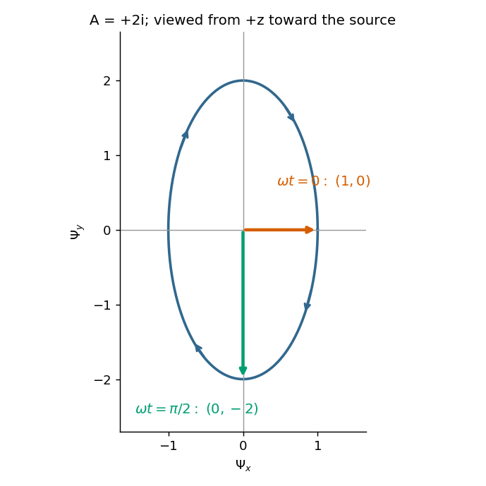
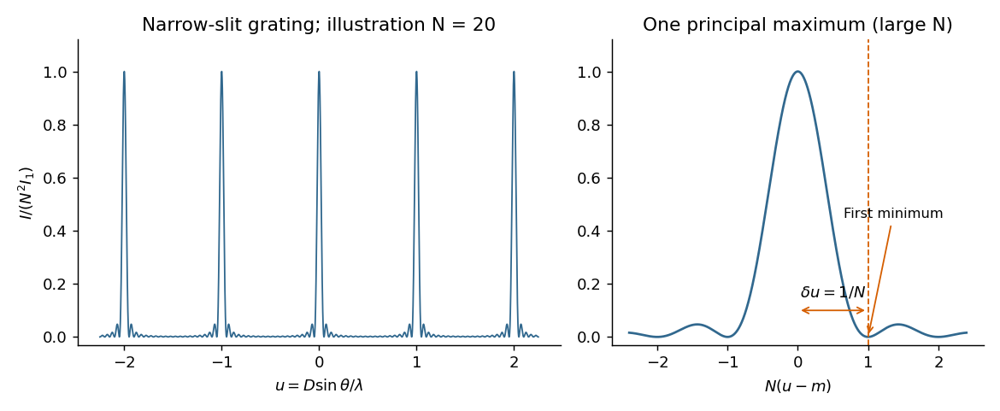

# Paper 2

↑ **Parent:** [2022](../2022.md)

[Original paper, released PDF pages 155–159](https://www.whatdotheyknow.com/request/natural_science_tripos_physics_e/response/2127325/attach/3/FOI%202022%20639%20Sullivan%20materials.pdf?cookie_passthrough=1#page=155)

**Table of contents**

- [Section A](#section-a)
  - [1](#section-a/1)
    - [Solution](#section-a/1/solution)
  - [2](#section-a/2)
    - [Solution](#section-a/2/solution)
  - [3](#section-a/3)
    - [Solution](#section-a/3/solution)
  - [4](#section-a/4)
    - [Solution](#section-a/4/solution)
  - [5](#section-a/5)
    - [Solution](#section-a/5/solution)
- [Section B](#section-b)
  - [B6](#section-b/b6)
    - [a](#section-b/b6/a)
      - [Solution](#section-b/b6/a/solution)
    - [b](#section-b/b6/b)
      - [i](#section-b/b6/b/i)
        - [Solution](#section-b/b6/b/i/solution)
      - [ii](#section-b/b6/b/ii)
        - [Solution](#section-b/b6/b/ii/solution)
    - [c](#section-b/b6/c)
      - [Solution](#section-b/b6/c/solution)
    - [d](#section-b/b6/d)
      - [Solution](#section-b/b6/d/solution)
  - [B7](#section-b/b7)
    - [a](#section-b/b7/a)
      - [Solution](#section-b/b7/a/solution)
    - [b](#section-b/b7/b)
      - [Solution](#section-b/b7/b/solution)
    - [c](#section-b/b7/c)
      - [i](#section-b/b7/c/i)
        - [Solution](#section-b/b7/c/i/solution)
      - [ii](#section-b/b7/c/ii)
        - [Solution](#section-b/b7/c/ii/solution)
    - [d](#section-b/b7/d)
      - [Solution](#section-b/b7/d/solution)
    - [e](#section-b/b7/e)
      - [Solution](#section-b/b7/e/solution)
- [Section C](#section-c)
  - [C8](#section-c/c8)
    - [a](#section-c/c8/a)
      - [Solution](#section-c/c8/a/solution)
    - [b](#section-c/c8/b)
      - [i](#section-c/c8/b/i)
        - [Solution](#section-c/c8/b/i/solution)
      - [ii](#section-c/c8/b/ii)
        - [Solution](#section-c/c8/b/ii/solution)
      - [iii](#section-c/c8/b/iii)
        - [Solution](#section-c/c8/b/iii/solution)
    - [c](#section-c/c8/c)
      - [Solution](#section-c/c8/c/solution)
    - [d](#section-c/c8/d)
      - [Solution](#section-c/c8/d/solution)
    - [e](#section-c/c8/e)
      - [Solution](#section-c/c8/e/solution)
    - [f](#section-c/c8/f)
      - [Solution](#section-c/c8/f/solution)
- [Section D](#section-d)
  - [D9](#section-d/d9)
    - [a](#section-d/d9/a)
      - [Solution](#section-d/d9/a/solution)
    - [b](#section-d/d9/b)
      - [Solution](#section-d/d9/b/solution)

## Section A

↑ **Parent:** [Paper 2](paper-2.md)

<h3 id="section-a/1">1</h3>

↑ **Parent:** [Section A](#section-a)

<h4 id="section-a/1/solution">Solution</h4>

↑ **Parent:** [1](#section-a/1)

Use [Fresnel diffraction](../../physical-optics.md#fresnel-diffraction), since the detector moves along the axis through successive near-field [interference](../../physical-optics.md#interference-wave-propagation) extrema. Write $z$ for its distance from the opening and $\rho$ for the integration coordinate within the opening. For a uniform incident [plane wave](../../wave-function.md#plane-wave), the on-axis [complex amplitude](../../wave.md#complex-amplitude), in the [paraxial approximation](../../partial-differential-equation.md#paraxial-approximation), is proportional to

$$
\frac{e^{ikz}}{i\lambda z}\int_0^r e^{i\pi\rho^2/(\lambda z)}2\pi\rho\,d\rho
=e^{ikz}\left(1-e^{i\pi r^2/(\lambda z)}\right).
$$

Thus the [light intensity](../../wave.md#light-intensity) relative to the incident value is

$$
\frac{I(z)}{I_{\rm inc}}=4\sin^2\left(\frac{\pi r^2}{2\lambda z}\right).
$$

The [Fresnel number](../../physical-optics.md#fresnel-number) $F=r^2/(\lambda z)$ is an odd integer at a maximum and an even integer at a minimum. It decreases as the detector moves away. Adjacent extrema therefore differ by one:

$$
\frac{r^2}{\lambda}\left(\frac1{1.00\,\mathrm m}-\frac1{1.25\,\mathrm m}\right)=1.
$$

Consequently

$$
\boxed{r^2=2.25\times10^{-6}\,\mathrm{m^2},\qquad r=1.50\times10^{-3}\,\mathrm m=1.50\,\mathrm{mm}.}
$$

As a check, $F=5$ at $z=1\,\mathrm m$ and $F=4$ at $z=1.25\,\mathrm m$, so these are indeed a maximum followed by the next minimum. Also $r/z\simeq1.5\times10^{-3}$, consistent with the [paraxial approximation](../../partial-differential-equation.md#paraxial-approximation).

<h3 id="section-a/2">2</h3>

↑ **Parent:** [Section A](#section-a)

<h4 id="section-a/2/solution">Solution</h4>

↑ **Parent:** [2](#section-a/2)

The components are in [phase quadrature](../../wave.md#phase-quadrature) when the axes of the [ellipse](../../euclidean-geometry.md#ellipse) coincide with the coordinate axes. Since the $x$ [wave amplitude](../../wave.md#wave-amplitude) is one and the $y$ [wave amplitude](../../wave.md#wave-amplitude) is two, the [Jones vector](../../wave.md#jones-vector) must have $A=\pm2i$.

A handedness convention is essential. Adopt the optical convention in which right-handed [elliptical polarization](../../wave.md#elliptical-polarization) rotates clockwise when viewed toward the source, from the positive-$z$ side. With the paper's $e^{+i\omega t}$ [phase convention for complex amplitudes](../../wave.md#phase-convention-for-complex-amplitudes), this gives

$$
\boxed{A=+2i,\qquad \boldsymbol\Psi(t)=(\cos\omega t,-2\sin\omega t).}
$$

The tip follows $\Psi_x^2+\Psi_y^2/4=1$. In particular,

$$
\boxed{\boldsymbol\Psi(0)=(1,0),\qquad \boldsymbol\Psi(\pi/(2\omega))=(0,-2).}
$$

**[Figure 1](#section-a/2/image-an-original-elliptical-polarization-trajectory-and-the-two-requested-vectors-using-a-plus-2i). An original elliptical polarization trajectory and the two requested vectors, using $A=+2i$**.

The figure states the viewing direction and shows increasing time. Under the alternative convention that calls rotation from $+x$ toward $+y$ right-handed when looking along propagation, the equally consistent answer is $A=-2i$ and the second [vector](../../vector-space.md#vector) is $(0,+2)$. The original paper does not state a handedness convention, so its wording alone cannot select between these labels; the real components and viewing direction remove the ambiguity.

<h3 id="section-a/3">3</h3>

↑ **Parent:** [Section A](#section-a)

<h4 id="section-a/3/solution">Solution</h4>

↑ **Parent:** [3](#section-a/3)

Choose positive [electric current](../../electric-charge.md#electric-current) in the initial discharge direction, since the source diagram does not label the initial plate polarity or a current arrow. Let $q$ be the charge remaining on the initially positive plate, so $I=-\dot q$. [Kirchhoff's voltage law](../../random-walk.md#kirchhoff-cycle-law) for the [series RLC circuit](../../electrical-circuit.md#series-rlc-circuit) gives

$$
L\ddot q+R\dot q+\frac qC=0,\qquad q(0)=CV_0=150\,\mu\mathrm C,\quad \dot q(0)=0.
$$

The natural [angular frequency](../../lagrangian-mechanics.md#angular-frequency), [damping](../../wave-equation.md#damping) coefficient and [quality factor](../../dynamical-systems.md#q-factor) are

$$
\omega_0=\frac1{\sqrt{LC}}=816.50\,\mathrm{rad\,s^{-1}},\qquad
\alpha=\frac R{2L}=33.333\,\mathrm{s^{-1}},\qquad
\boxed{Q=\frac{\omega_0L}{R}=12.25.}
$$

Since $\alpha<\omega_0$ (equivalently $Q>1/2$), this is an [underdamped RLC response](../../electrical-circuit.md#underdamped-rlc-response). With $\omega_d=\sqrt{\omega_0^2-\alpha^2}=815.82\,\mathrm{rad\,s^{-1}}$, satisfying the initial conditions gives

$$
q(t)=CV_0e^{-\alpha t}\left(\cos\omega_dt+\frac\alpha{\omega_d}\sin\omega_dt\right),
$$

and differentiating gives

$$
\boxed{I(t)=\frac{V_0}{L\omega_d}e^{-\alpha t}\sin\omega_dt
=(0.12258\,\mathrm A)e^{-t/(30.0\,\mathrm{ms})}\sin\left[(815.82\,\mathrm{rad\,s^{-1}})t\right].}
$$

The [electric current](../../electric-charge.md#electric-current) starts at zero with $\dot I(0)=V_0/L=100\,\mathrm{A\,s^{-1}}$. Its [wave period](../../wave.md#wave-period) is $T_d=2\pi/\omega_d=7.702\,\mathrm{ms}$, its zeros occur every $3.851\,\mathrm{ms}$, and its positive and negative [wave envelopes](../../dispersion-relation.md#envelope-waves) decay with time constant $30.0\,\mathrm{ms}$. The first maximum obeys $\tan\omega_dt=\omega_d/\alpha$ and is $0.1151\,\mathrm A$ at $1.875\,\mathrm{ms}$. The [electric current](../../electric-charge.md#electric-current) tends to zero as the initial [capacitor](../../electromagnetism.md#capacitor) [energy](../../energy.md) is dissipated in the [resistor](../../electric-charge.md#resistor).

**[Figure 2](#section-a/3/image-original-calculated-electric-current-and-decay-wave-envelopes-for-the-underdamped-rlc-response). Original calculated electric current and decay wave envelopes for the underdamped RLC response**.

<h3 id="section-a/4">4</h3>

↑ **Parent:** [Section A](#section-a)

<h4 id="section-a/4/solution">Solution</h4>

↑ **Parent:** [4](#section-a/4)

Take a [p-n junction](../../semiconductor.md#p-n-junction) made from one [semiconductor](../../semiconductor.md), with the [p-type semiconductor](../../semiconductor.md#p-type-semiconductor) on the left and the [n-type semiconductor](../../semiconductor.md#n-type-semiconductor) on the right. At [thermal equilibrium](../../thermal-equilibrium.md) the [chemical potential](../../chemical-potential.md) $\mu=E_F$ is horizontal throughout. Before contact the [chemical potential](../../chemical-potential.md) lies nearer the [valence band](../../quantum-mechanics.md#valence-band) on the p side and nearer the [conduction band](../../quantum-mechanics.md#conduction-band) on the n side; after contact the band edges bend to permit one common value.

**[Figure 3](#section-a/4/image-original-equilibrium-p-n-junction-energy-band-diagram-impurity-levels-common-chemical-potential-and-depletion-region). Original equilibrium p-n junction energy band diagram, impurity levels, common chemical potential and depletion region**.

In this orientation both the [conduction band](../../quantum-mechanics.md#conduction-band) edge $E_C$ and the [valence band](../../quantum-mechanics.md#valence-band) edge $E_V$ decrease from p to n by $eV_{\rm bi}$. For a [homojunction](../../semiconductor.md#homojunction) their separation $E_g=E_C-E_V$ is constant. The [acceptor impurity](../../semiconductor.md#acceptor-impurity) level $E_A$ lies just above $E_V$ where acceptors are present, and the [donor impurity](../../semiconductor.md#donor-impurity) level $E_D$ lies just below $E_C$ where donors are present. These [impurity levels](../../semiconductor.md#impurity-level) follow the local [band bending](../../semiconductor.md#band-bending); they do not form one additional horizontal band across the device.

The shaded [depletion region](../../semiconductor.md#depletion-region) has few mobile [electrons](../../physics.md#electron) or [electron holes](../../quantum-mechanics.md#electron-hole) and contains fixed negative ionized [acceptor impurities](../../semiconductor.md#acceptor-impurity) on the p side and positive ionized [donor impurities](../../semiconductor.md#donor-impurity) on the n side. Thus its [electric field](../../electric-field.md) points from n to p. Its neutral outer regions have negligible [electric field](../../electric-field.md), so the band edges become flat there. In the [depletion approximation](../../semiconductor.md#depletion-approximation), [charge neutrality](../../electric-charge.md#charge-neutrality) requires $N_Ax_p=N_Dx_n$; the symmetric drawing illustrates $N_A=N_D$ rather than assuming that equality is universal. [Diffusion](../../thermodynamics.md#diffusion) and field-driven [drift current](../../electric-charge.md#drift-current) cancel at equilibrium: no applied [voltage](../../random-walk.md#voltage) does not mean zero internal [electric field](../../electric-field.md) or zero built-in [electric potential difference](../../electric-field.md#electric-potential-difference).

<h3 id="section-a/5">5</h3>

↑ **Parent:** [Section A](#section-a)

<h4 id="section-a/5/solution">Solution</h4>

↑ **Parent:** [5](#section-a/5)

In an ordinary three-dimensional crystalline [electrical insulator](../../permittivity.md#electrical-insulator), heat is carried mainly by [phonons](../../quantum-ideal-gas-statistics.md#phonon). [Kinetic theory](../../kinetic-theory.md) gives the estimate

$$
\kappa\simeq\frac13 c_Vv_s\ell,
$$

where $c_V$ is [heat capacity](../../heat.md#heat-capacity) per unit [volume](../../geometry-and-topology.md#volume), $v_s$ is a typical [sound speed](../../compressible-flow.md#speed-of-sound), and $\ell$ is the [phonon mean free path](../../quantum-ideal-gas-statistics.md#phonon-mean-free-path). The [thermal conductivity](../../heat.md#thermal-conductivity) $\kappa$ has units $\mathrm{W\,m^{-1}\,K^{-1}}$.

At low [temperature](../../temperature.md), $T\ll\Theta_D$, the [Debye model](../../quantum-ideal-gas-statistics.md#debye-model) gives $c_V\propto T^3$. With phonon-phonon collisions frozen out, diffuse scattering at the sample boundaries makes $\ell$ approximately constant, and $v_s$ is nearly constant. Hence

$$
\boxed{\kappa\propto T^3\quad\text{at low }T\text{ with boundary-limited scattering}.}
$$

At high [temperature](../../temperature.md), of order or above the [Debye temperature](../../quantum-ideal-gas-statistics.md#debye-temperature), the [Dulong-Petit law](../../heat.md#dulong-petit-law) makes $c_V$ approximately constant. Anharmonic [phonon scattering](../../quantum-ideal-gas-statistics.md#phonon-scattering), especially resistive [Umklapp scattering](../../quantum-ideal-gas-statistics.md#umklapp-scattering), has a collision rate approximately proportional to $T$. Thus $\ell\propto T^{-1}$ and

$$
\boxed{\kappa\propto T^{-1}\quad\text{at high }T\text{ with Umklapp-limited scattering}.}
$$

These two regimes usually give an intermediate maximum of [thermal conductivity](../../heat.md#thermal-conductivity). The assumptions matter: glassy materials, strong defects or specular boundary reflection can change the low-[temperature](../../temperature.md) law; these are not universal laws for every [electrical insulator](../../permittivity.md#electrical-insulator).

## Section B

↑ **Parent:** [Paper 2](paper-2.md)

<h3 id="section-b/b6">B6</h3>

↑ **Parent:** [Section B](#section-b)

<h4 id="section-b/b6/a">a</h4>

↑ **Parent:** [B6](#section-b/b6)

<h5 id="section-b/b6/a/solution">Solution</h5>

↑ **Parent:** [A](#section-b/b6/a)

A [nondispersive wave](../../dispersion-relation.md#nondispersive-wave) has a linear [dispersion relation](../../dispersion-relation.md) $\omega=vk$ over the relevant range, so every [Fourier transform](../../fourier-transform.md) component has the same [phase velocity](../../dispersion-relation.md#phase-velocity) $v_p=\omega/k=v$ and [group velocity](../../dispersion-relation.md#group-velocity) $v_g=d\omega/dk=v$. A [wave packet](../../dispersion-relation.md#wave-packet) then translates without spreading in an ideal homogeneous lossless medium.

For [wave dispersion](../../dispersion-relation.md#wave-dispersion), $v_p$ depends on [frequency](../../wave.md#frequency) or [wavenumber](../../wave-equation.md#wavenumber). Different components accumulate different [phases](../../wave.md#phase-waves), and in general the [group velocity](../../dispersion-relation.md#group-velocity) differs from the [phase velocity](../../dispersion-relation.md#phase-velocity); variation of [group velocity](../../dispersion-relation.md#group-velocity) across the spectrum produces spreading of a [wave packet](../../dispersion-relation.md#wave-packet). The membrane material can be nondispersive while confinement in a [membrane waveguide](../../wave-equation.md#membrane-waveguide) introduces [wave dispersion](../../dispersion-relation.md#wave-dispersion) along its length.

<h4 id="section-b/b6/b">b</h4>

↑ **Parent:** [B6](#section-b/b6)

<h5 id="section-b/b6/b/i">i</h5>

↑ **Parent:** [B](#section-b/b6/b)

<h6 id="section-b/b6/b/i/solution">Solution</h6>

↑ **Parent:** [I](#section-b/b6/b/i)

Twice differentiating the proposed [normal mode](../../wave-equation.md#normal-mode) gives

$$
\frac{\partial^2z}{\partial x^2}=-k_x^2z,\qquad
\frac{\partial^2z}{\partial y^2}=-k_y^2z,\qquad
\frac{\partial^2z}{\partial t^2}=-\omega^2z.
$$

It therefore solves the two-dimensional [wave equation](../../wave-equation.md) precisely when

$$
\omega^2=v^2(k_x^2+k_y^2).
$$

The fixed-edge [boundary conditions](../../differential-equation.md#boundary-condition) require $z(x,0,t)=z(x,b,t)=0$. The first is automatic, and the second requires $\sin(k_yb)=0$. The nonzero [normal modes](../../wave-equation.md#normal-mode) are therefore

$$
\boxed{k_y=\frac{n\pi}{b},\quad n=1,2,\ldots;\qquad
k_x=\pm\sqrt{\frac{\omega^2}{v^2}-\frac{n^2\pi^2}{b^2}}.}
$$

The apparent $n=0$ choice gives identically zero [displacement](../../classical-mechanics.md#displacement) for this sine solution. There are no imposed end conditions in $x$, so $k_x$ is continuous rather than quantized by a second length. For a propagating mode it is real; the plus sign in the stated $\cos(\omega t-k_xx)$ convention describes propagation in $+x$. Each positive integer $n$ labels a transverse [standing wave](../../mathematical-physics.md#standing-wave) across the strip.

<h5 id="section-b/b6/b/ii">ii</h5>

↑ **Parent:** [B](#section-b/b6/b)

<h6 id="section-b/b6/b/ii/solution">Solution</h6>

↑ **Parent:** [Ii](#section-b/b6/b/ii)

For a fixed transverse [normal mode](../../wave-equation.md#normal-mode), define its cutoff [angular frequency](../../lagrangian-mechanics.md#angular-frequency)

$$
\omega_{c,n}=\frac{n\pi v}{b},\qquad
\omega^2=\omega_{c,n}^2+v^2k_x^2.
$$

The longitudinal [phase velocity](../../dispersion-relation.md#phase-velocity) and [group velocity](../../dispersion-relation.md#group-velocity), for propagation in $+x$, are

$$
\boxed{v_p=\frac\omega{k_x}=\frac{v}{\sqrt{1-(\omega_{c,n}/\omega)^2}},\qquad
v_g=\left.\frac{d\omega}{dk_x}\right|_n
=\frac{v^2k_x}{\omega}=v\sqrt{1-(\omega_{c,n}/\omega)^2}.}
$$

Thus $v_pv_g=v^2$, $v_p>v$ and $v_g<v$. The large longitudinal [phase velocity](../../dispersion-relation.md#phase-velocity) reflects the geometry of the transverse [standing wave](../../mathematical-physics.md#standing-wave) and does not imply faster transport of [energy](../../energy.md) than the membrane [wave speed](../../wave-equation.md#wave-speed).

The [cutoff frequency of a membrane waveguide](../../wave-equation.md#cutoff-frequency-of-a-membrane-waveguide) for mode $n$ is

$$
\boxed{f_{c,n}=\frac{\omega_{c,n}}{2\pi}=\frac{nv}{2b}.}
$$

At cutoff $k_x=0$ and $v_g=0$; the longitudinal [phase velocity](../../dispersion-relation.md#phase-velocity) has no finite value. Below cutoff,

$$
k_x=i\gamma_n,\qquad \gamma_n=\sqrt{(n\pi/b)^2-\omega^2/v^2},
$$

and a bounded field excited at $x=0$ decays as $e^{-\gamma_nx}$. It is an [evanescent wave](../../elasticity-physics.md#evanescent-wave), rather than a freely propagating mode carrying net time-averaged [energy flux](../../mathematical-physics.md#energy-flux) down an indefinitely long uniform strip. A finite section can still transmit through coupling of evanescent fields.

<h4 id="section-b/b6/c">c</h4>

↑ **Parent:** [B6](#section-b/b6)

<h5 id="section-b/b6/c/solution">Solution</h5>

↑ **Parent:** [C](#section-b/b6/c)

The natural interpretation is the fundamental transverse [normal mode](../../wave-equation.md#normal-mode), $n=1$. Indeed

$$
\omega_{c,1}=\frac{\pi v}{b}=62.832\,\mathrm{rad\,s^{-1}},\qquad
\omega_{c,2}=125.66\,\mathrm{rad\,s^{-1}},
$$

so only $n=1$ propagates over the main part of the given [Gaussian distribution](../../probability-distribution.md#normal-distribution) of [angular frequencies](../../lagrangian-mechanics.md#angular-frequency). Its centre travels at

$$
v_{g,0}=2\sqrt{1-(62.832/100)^2}=1.5559\,\mathrm{m\,s^{-1}},\qquad
t_0=\frac{10\,\mathrm m}{v_{g,0}}=6.4271\,\mathrm s.
$$

Differentiate the [group velocity](../../dispersion-relation.md#group-velocity) with respect to [angular frequency](../../lagrangian-mechanics.md#angular-frequency):

$$
\frac{dv_g}{d\omega}
=\frac{v\omega_c^2}{\omega^3\sqrt{1-(\omega_c/\omega)^2}}.
$$

At the centre this is $0.010149\,\mathrm m$. The one-standard-deviation [group velocity](../../dispersion-relation.md#group-velocity) spread is consequently

$$
\sigma_v\simeq\left|\frac{dv_g}{d\omega}\right|_{\omega_0}\sigma_\omega
=0.05075\,\mathrm{m\,s^{-1}}.
$$

Over the central travel time the associated spatial shear is

$$
\boxed{\sigma_{x,\rm disp}\simeq t_0\sigma_v=0.326\,\mathrm m.}
$$

Equivalently, use representative components at $\omega_0\pm\sigma_\omega$, for which $v_g(95)=1.5001\,\mathrm{m\,s^{-1}}$ and $v_g(105)=1.6024\,\mathrm{m\,s^{-1}}$. Their separation after $t_0$ is

$$
\boxed{\Delta x_{[-\sigma,+\sigma]}\simeq[v_g(105)-v_g(95)]t_0=0.658\,\mathrm m\simeq0.65\,\mathrm m.}
$$

At a fixed detector $10\,\mathrm m$ away, the corresponding arrival-time difference is $10/v_g(95)-10/v_g(105)=0.426\,\mathrm s$.

The paper asks for an estimate of spreading, without specifying a spatial width convention or the initial spectral [phase](../../wave.md#phase-waves). A [Gaussian distribution](../../probability-distribution.md#normal-distribution) has no finite full range. Thus $0.326\,\mathrm m$ is a one-standard-deviation dispersive contribution, whereas about $0.65\,\mathrm m$ describes the separation of the $\pm\sigma_\omega$ representatives. Neither is automatically the increase in the packet's original width. For an initially unchirped [Gaussian wave packet](../../wave-function.md#gaussian-wave-packet) in the narrow-band approximation, independent initial and dispersive contributions combine as $\sigma_{x,f}^2\simeq\sigma_{x,0}^2+\sigma_{x,\rm disp}^2$; a packet with an initial [chirp](../../wave.md#chirp) can behave differently. The modal assumption and width convention must accompany the numerical answer.

<h4 id="section-b/b6/d">d</h4>

↑ **Parent:** [B6](#section-b/b6)

<h5 id="section-b/b6/d/solution">Solution</h5>

↑ **Parent:** [D](#section-b/b6/d)

Different transverse [normal modes](../../wave-equation.md#normal-mode) have different cutoff [frequencies](../../wave.md#frequency) and [group velocities](../../dispersion-relation.md#group-velocity). A pulse exciting several of them reaches the output in delayed modal components, causing [intermodal dispersion](../../dispersion-relation.md#intermodal-dispersion), pulse distortion and overlap of successive signals. Their [interference](../../physical-optics.md#interference-wave-propagation) also makes the transverse [wave intensity](../../wave.md#intensity-physics) pattern depend on propagation distance; irregularities can transfer [energy](../../energy.md) between modes.

Mitigations are to operate between the first and second [cutoff frequencies of a membrane waveguide](../../wave-equation.md#cutoff-frequency-of-a-membrane-waveguide), excite only the desired [mode shape](../../wave-equation.md#mode-shape) with a suitable source, and use smooth uniform boundaries or gradual transitions to reduce mode conversion. Reducing the signal bandwidth keeps its spectrum inside the single-mode interval and reduces [group velocity dispersion](../../dispersion-relation.md#group-velocity-dispersion) within the selected mode. Single-mode operation removes [intermodal dispersion](../../dispersion-relation.md#intermodal-dispersion) but does not remove the dispersion derived in part (b).

<h3 id="section-b/b7">B7</h3>

↑ **Parent:** [Section B](#section-b)

<h4 id="section-b/b7/a">a</h4>

↑ **Parent:** [B7](#section-b/b7)

<h5 id="section-b/b7/a/solution">Solution</h5>

↑ **Parent:** [A](#section-b/b7/a)

For the normally incident [plane wave](../../wave-function.md#plane-wave), the incident [complex amplitude](../../wave.md#complex-amplitude) and [phase](../../wave.md#phase-waves) are uniform across the aperture. Treat the field using scalar [diffraction](../../quantum-scattering.md#diffraction), with the aperture represented by its prescribed [amplitude transmittance](../../physical-optics.md#amplitude-transmittance) $h(x,y)$. Let $R$ be the distance from the aperture centre to the observation point and let $\ell_x,\ell_y$ be the transverse direction cosines of that point.

Across an aperture of characteristic size $a$, the [Fraunhofer diffraction](../../physical-optics.md#fraunhofer-diffraction) assumptions are that $a/R\ll1$, so $1/r\simeq1/R$ and the [obliquity factor](../../quantum-scattering.md#obliquity-factor) is nearly constant, and that the quadratic contribution to the propagation [phase](../../wave.md#phase-waves) is negligible:

$$
\frac{ka^2}{2R}\ll1,\qquad\text{or, in order of magnitude,}\quad \frac{a^2}{\lambda R}\ll1.
$$

The remaining path-length dependence is linear:

$$
r\simeq R-\ell_xx-\ell_yy.
$$

A coherent [monochromatic wave](../../wave.md#monochromatic-wave) and an aperture large enough relative to [wavelength](../../wave-equation.md#wavelength) for the scalar aperture model complete the usual physical assumptions. The [complex amplitude](../../wave.md#complex-amplitude) becomes

$$
\boxed{\psi_P=C\iint h(x,y)e^{-ik(\ell_xx+\ell_yy)}\,dx\,dy,}
$$

where $C$ includes the common propagation [phase](../../wave.md#phase-waves), distance factor and nearly constant [obliquity factor](../../quantum-scattering.md#obliquity-factor). For the central part of a planar screen in the [paraxial approximation](../../partial-differential-equation.md#paraxial-approximation), $\ell_x\simeq X/R$ and $\ell_y\simeq Y/R$. Small observation angles are useful for that screen-coordinate formula; a general far-field [Fourier transform](../../fourier-transform.md) can instead use the exact direction cosines. A lens can also produce this pattern in its focal plane without requiring a physically very distant screen.

<h4 id="section-b/b7/b">b</h4>

↑ **Parent:** [B7](#section-b/b7)

<h5 id="section-b/b7/b/solution">Solution</h5>

↑ **Parent:** [B](#section-b/b7/b)

The far-field [complex amplitude](../../wave.md#complex-amplitude) is the two-dimensional [Fourier transform](../../fourier-transform.md) of the aperture [amplitude transmittance](../../physical-optics.md#amplitude-transmittance), evaluated at transverse [spatial frequencies](../../fourier-analysis.md#spatial-frequency) $q_x=k\ell_x$, $q_y=k\ell_y$. The [light intensity](../../wave.md#light-intensity) is proportional to the squared magnitude of this transform.

Use [linearity](../../vector-space.md#linearity) to add the transforms of simpler aperture components, preserving their relative [phases](../../wave.md#phase-waves). A translated component acquires a [complex exponential](../../calculus.md#complex-exponential-function) factor. Repeated identical openings can be expressed as the [convolution](../../fourier-analysis.md#convolution) of one opening with a sum of [Dirac delta functions](../../distribution-theory.md#dirac-delta-function); the [convolution theorem](../../fourier-analysis.md#convolution-theorem) then factors the field into a single-opening transform and an array factor. Multiplying aperture functions instead convolves their transforms. These operations simplify complex apertures without repeatedly evaluating the full [diffraction](../../quantum-scattering.md#diffraction) integral. It is the [complex amplitudes](../../wave.md#complex-amplitude), rather than their [wave intensities](../../wave.md#intensity-physics), that are added for coherent illumination.

<h4 id="section-b/b7/c">c</h4>

↑ **Parent:** [B7](#section-b/b7)

<h5 id="section-b/b7/c/i">i</h5>

↑ **Parent:** [C](#section-b/b7/c)

<h6 id="section-b/b7/c/i/solution">Solution</h6>

↑ **Parent:** [I](#section-b/b7/c/i)

Take the quoted separation to mean adjacent slit centre spacing $d=50\,\mu\mathrm m$. For three equal very narrow slits at $-d,0,d$, the [Fraunhofer diffraction](../../physical-optics.md#fraunhofer-diffraction) [complex amplitude](../../wave.md#complex-amplitude) in the transverse direction is

$$
\psi(\theta)=\psi_1\left(e^{-2i\beta}+1+e^{2i\beta}\right)
=\psi_1(1+2\cos2\beta),\qquad
\beta=\frac{\pi d\sin\theta}{\lambda}.
$$

With $I_1$ denoting one narrow slit's contribution, the [light intensity](../../wave.md#light-intensity) is

$$
\boxed{\frac{I}{I_1}=\left(1+2\cos2\beta\right)^2
=\left(\frac{\sin3\beta}{\sin\beta}\right)^2.}
$$

The quotient is interpreted by its limit where both numerator and denominator vanish. At small angles on a screen at $R=1\,\mathrm m$, $\sin\theta\simeq X/R$ and $\beta=\pi X/(10\,\mathrm{mm})$. Principal [interference fringes](../../physical-optics.md#interference-fringe) occur at

$$
\boxed{X_m\simeq m\frac{\lambda R}{d}=m(10.0\,\mathrm{mm}),\qquad I(X_m)=9I_1.}
$$

Between successive principal maxima there are two zeros, at $X=(m+1/3)(10\,\mathrm{mm})$ and $X=(m+2/3)(10\,\mathrm{mm})$. Halfway between them is a smaller maximum $I=I_1$, one ninth of a principal peak. The pattern is symmetric about $X=0$. The positions quoted in millimetres use the [paraxial approximation](../../partial-differential-equation.md#paraxial-approximation); exactly $d\sin\theta_m=m\lambda$ and $X_m=R\tan\theta_m$.

**[Figure 4](#section-b/b7/c/i/image-original-calculated-fraunhofer-diffraction-patterns-for-three-narrow-slits-and-for-three-finite-width-slits). Original calculated Fraunhofer diffraction patterns for three narrow slits and for three finite-width slits**.

<h5 id="section-b/b7/c/ii">ii</h5>

↑ **Parent:** [C](#section-b/b7/c)

<h6 id="section-b/b7/c/ii/solution">Solution</h6>

↑ **Parent:** [Ii](#section-b/b7/c/ii)

A slit of width $w$ has the [single-slit diffraction](../../physical-optics.md#single-slit-diffraction) [complex amplitude](../../wave.md#complex-amplitude) factor $\sin\alpha/\alpha$, where $\alpha=\pi w\sin\theta/\lambda$. Thus for $w=25\,\mu\mathrm m=d/2$,

$$
\boxed{\frac{I(\theta)}{I(0)}
=\left(\frac{\sin\alpha}{\alpha}\right)^2
\frac{(1+2\cos2\beta)^2}{9},\qquad \alpha=\frac\beta2.}
$$

The [interference](../../physical-optics.md#interference-wave-propagation) factor keeps the same zeros and the same nominal principal-order positions as in part (i), while the [single-slit diffraction](../../physical-optics.md#single-slit-diffraction) [wave envelope](../../dispersion-relation.md#envelope-waves) suppresses off-axis [wave intensity](../../wave.md#intensity-physics). Its zeros are

$$
\sin\theta=p\frac\lambda w=p(0.0200),\quad p\neq0,\qquad
X\simeq p(20.0\,\mathrm{mm}).
$$

At nominal principal [diffraction orders](../../physical-optics.md#diffraction-order) $\sin\theta_m=m\lambda/d$, the [wave envelope](../../dispersion-relation.md#envelope-waves) factor is $[\sin(m\pi/2)/(m\pi/2)]^2$. Consequently

$$
\boxed{\frac{I(\theta_{\pm1})}{I(0)}=\frac4{\pi^2}=0.4053,\qquad
I(\theta_{\pm2})=0,\qquad
\frac{I(\theta_{\pm3})}{I(0)}=\frac4{9\pi^2}=0.0450.}
$$

All nonzero even principal orders are missing. The central [single-slit diffraction](../../physical-optics.md#single-slit-diffraction) maximum extends between the envelope zeros near $X=\pm20\,\mathrm{mm}$ and includes the central and the $m=\pm1$ principal orders. Because there are only three slits, the maxima of the product can shift slightly from the nominal nonzero-order positions; the quoted values are the exact product at those positions. The lower panel of the figure shows the full product.

Both panels normalize to their own central [wave intensity](../../wave.md#intensity-physics). An absolute comparison would require the unspecified widths and transmitted power of the initially “narrow” slits; the normalized pattern change is fully determined.

<h4 id="section-b/b7/d">d</h4>

↑ **Parent:** [B7](#section-b/b7)

<h5 id="section-b/b7/d/solution">Solution</h5>

↑ **Parent:** [D](#section-b/b7/d)

For $N$ equally spaced illuminated slits, with $N\simeq W/D$, summing a [geometric series](../../sequence-and-series.md#geometric-series) of [complex amplitudes](../../wave.md#complex-amplitude) gives

$$
I(\theta)=I_1(\theta)\left[\frac{\sin(N\beta)}{\sin\beta}\right]^2,\qquad
\beta=\frac{\pi D\sin\theta}{\lambda}.
$$

Here $I_1(\theta)$ is the one-slit [single-slit diffraction](../../physical-optics.md#single-slit-diffraction) [wave envelope](../../dispersion-relation.md#envelope-waves). The [grating equation](../../physical-optics.md#grating-equation) for principal maxima is

$$
D\sin\theta_m=m\lambda,
$$

with height $N^2I_1(\theta_m)$ and much weaker subsidiary maxima between orders. The first zeros around order $m$ are $\beta=m\pi\pm\pi/N$, so the angular distance from a maximum to its first minimum is, for large $N$,

$$
\delta\theta_{\rm zero}\simeq\frac{\lambda}{ND\cos\theta_m}
\simeq\frac{\lambda}{W\cos\theta_m}.
$$

Changing [wavelength](../../wave-equation.md#wavelength) by $\delta\lambda$ moves the same [diffraction order](../../physical-optics.md#diffraction-order) by

$$
\delta\theta_\lambda\simeq\left|\frac{d\theta_m}{d\lambda}\right|\delta\lambda
=\frac{|m|\delta\lambda}{D\cos\theta_m}.
$$

The [Rayleigh criterion](../../point-spread-function.md#rayleigh-criterion) places the maximum for one wavelength at the first zero for its neighbour. Equating these separations gives

$$
\boxed{\frac{\lambda}{\delta\lambda}=|m|N\simeq\frac{|m|W}{D}.}
$$

This is the ideal [resolving power of a diffraction grating](../../physical-optics.md#resolving-power-of-a-diffraction-grating), for an illuminated and transmitted order with sufficiently narrow source and instrumental broadening. The zeroth order has no [wavelength](../../wave-equation.md#wavelength) separation and therefore no useful spectral resolving power. The distinction between $W=ND$ and the span $(N-1)D$ of the outer slit centres is a small edge convention; the exact state count in the resolving-power formula is $N$.

**[Figure 5](#section-b/b7/d/image-original-diffraction-grating-pattern-and-the-first-zero-width-used-in-the-rayleigh-criterion). Original diffraction grating pattern and the first-zero width used in the Rayleigh criterion**.

<h4 id="section-b/b7/e">e</h4>

↑ **Parent:** [B7](#section-b/b7)

<h5 id="section-b/b7/e/solution">Solution</h5>

↑ **Parent:** [E](#section-b/b7/e)

The required [resolving power of a diffraction grating](../../physical-optics.md#resolving-power-of-a-diffraction-grating) is

$$
\mathcal R_{\rm req}=\frac{589.3\,\mathrm{nm}}{0.6\,\mathrm{nm}}=982.2.
$$

For $N=260$ illuminated slits, $\mathcal R=260|m|$. In orders $1,2,3,4$, the ideal resolvable [wavelength](../../wave-equation.md#wavelength) differences are respectively $2.267$, $1.133$, $0.756$ and $0.567\,\mathrm{nm}$. Thus

$$
\boxed{\text{The doublet is unresolved in orders 1--3; order 4 is the first potentially resolving order.}}
$$

Fourth order gives $\mathcal R=1040>982.2$, only a modest margin. It must also exist: for normal incidence the [grating equation](../../physical-optics.md#grating-equation) requires $D\geq4\lambda\simeq2.36\,\mu\mathrm m$, with $D>4\lambda$ needed to avoid an exactly grazing order. The relevant order must transmit appreciable [light intensity](../../wave.md#light-intensity) rather than lie at a single-slit [diffraction](../../quantum-scattering.md#diffraction) zero, and the source and detector widths must preserve this resolution.

The original question gives only the slit count, not the line spacing, slit width, usable [diffraction order](../../physical-optics.md#diffraction-order) or instrumental broadening. It therefore supports the conditional conclusion “yes in fourth or higher usable order”, but not an unconditional historical claim that this particular instrument resolved the [sodium](../../chemical-substance.md#sodium) [absorption line](../../stellar-astrophysics.md#absorption-line) doublet in its observed configuration.

## Section C

↑ **Parent:** [Paper 2](paper-2.md)

<h3 id="section-c/c8">C8</h3>

↑ **Parent:** [Section C](#section-c)

<h4 id="section-c/c8/a">a</h4>

↑ **Parent:** [C8](#section-c/c8)

<h5 id="section-c/c8/a/solution">Solution</h5>

↑ **Parent:** [A](#section-c/c8/a)

For a [plane wave](../../wave-function.md#plane-wave) [wavefunction](../../wave-function.md) $\psi_k(x)\propto e^{ikx}$, impose the cyclic or [periodic boundary condition](../../differential-equation.md#periodic-boundary-conditions) $\psi_k(x+L)=\psi_k(x)$. It requires

$$
e^{ikL}=1,\qquad k_n=\frac{2\pi n}{L},\quad n\in\mathbb Z.
$$

Adjacent allowed [wavenumbers](../../wave-equation.md#wavenumber) on the full signed $k$ axis are spaced by $\Delta k=2\pi/L$. Ignoring [spin](../../angular-momentum-operator.md#spin), the [density of states](../../quantum-ideal-gas-statistics.md#density-of-states) per unit $k$ is consequently

$$
\boxed{\rho_k=\frac1{\Delta k}=\frac{L}{2\pi}.}
$$

Both positive and negative $k$ are included in this density. It is not yet the density per unit magnitude $|k|$, which has an extra factor of two away from zero. In $d$ independent dimensions the same [periodic boundary conditions](../../differential-equation.md#periodic-boundary-conditions) give one spatial state per $k$-space cell of measure $(2\pi/L)^d$.

<h4 id="section-c/c8/b">b</h4>

↑ **Parent:** [C8](#section-c/c8)

<h5 id="section-c/c8/b/i">i</h5>

↑ **Parent:** [B](#section-c/c8/b)

<h6 id="section-c/c8/b/i/solution">Solution</h6>

↑ **Parent:** [I](#section-c/c8/b/i)

To preserve the convention of part (a), first count one [spin](../../angular-momentum-operator.md#spin) species. Define $g_d^{(1)}(\epsilon)\,d\epsilon$ as the number of spatial states in the whole specimen in that [energy](../../energy.md) interval. Put

$$
k=\frac{\sqrt{2m\epsilon}}{\hbar},\qquad
\frac{dk}{d\epsilon}=\frac{m}{\hbar^2k}.
$$

In one dimension there are intervals near both $+k$ and $-k$, so the [one-dimensional free-electron density of states](../../quantum-ideal-gas-statistics.md#one-dimensional-free-electron-density-of-states) is

$$
g_1^{(1)}(\epsilon)=\frac{L}{2\pi}\,2\frac{dk}{d\epsilon}
=\boxed{\frac{L\sqrt{2m}}{2\pi\hbar}\epsilon^{-1/2}.}
$$

Thus $g_1^{(1)}\propto\epsilon^{-1/2}$. The factor of two here comes from opposite [momenta](../../momentum.md), not [spin](../../angular-momentum-operator.md#spin). For physical [electrons](../../physics.md#electron) with two [spin](../../angular-momentum-operator.md#spin) states, the [spin-summed density of states](../../quantum-ideal-gas-statistics.md#spin-summed-density-of-states) is $g_1=2g_1^{(1)}=L\sqrt{2m}\,\epsilon^{-1/2}/(\pi\hbar)$. These expressions are continuum approximations away from individual discrete levels.

<h5 id="section-c/c8/b/ii">ii</h5>

↑ **Parent:** [B](#section-c/c8/b)

<h6 id="section-c/c8/b/ii/solution">Solution</h6>

↑ **Parent:** [Ii](#section-c/c8/b/ii)

In two dimensions the [density of states](../../quantum-ideal-gas-statistics.md#density-of-states) in $k$ space per [spin](../../angular-momentum-operator.md#spin) species is $(L/2\pi)^2$. A [annulus](../../topology.md#annulus-mathematics) of radius $k$ and thickness $dk$ has area $2\pi k\,dk$. Therefore

$$
g_2^{(1)}(\epsilon)=\left(\frac{L}{2\pi}\right)^2 2\pi k\frac{dk}{d\epsilon}
=\boxed{\frac{L^2m}{2\pi\hbar^2}.}
$$

The [two-dimensional free-electron density of states](../../quantum-ideal-gas-statistics.md#two-dimensional-free-electron-density-of-states) is constant in [energy](../../energy.md), $g_2^{(1)}\propto\epsilon^0$, above the band bottom. Including both [spin](../../angular-momentum-operator.md#spin) states gives $g_2=L^2m/(\pi\hbar^2)$. Dividing by $L^2$ gives the density per unit physical area, rather than the total specimen's density.

<h5 id="section-c/c8/b/iii">iii</h5>

↑ **Parent:** [B](#section-c/c8/b)

<h6 id="section-c/c8/b/iii/solution">Solution</h6>

↑ **Parent:** [Iii](#section-c/c8/b/iii)

In three dimensions use the $k$-space [density of states](../../quantum-ideal-gas-statistics.md#density-of-states) $(L/2\pi)^3$ per [spin](../../angular-momentum-operator.md#spin) species and the [spherical shell](../../euclidean-geometry.md#spherical-shell) volume $4\pi k^2dk$:

$$
g_3^{(1)}(\epsilon)=\left(\frac{L}{2\pi}\right)^3 4\pi k^2\frac{dk}{d\epsilon}
=\boxed{\frac{L^3}{4\pi^2}\left(\frac{2m}{\hbar^2}\right)^{3/2}\epsilon^{1/2}.}
$$

Thus the [three-dimensional free-electron density of states](../../quantum-ideal-gas-statistics.md#three-dimensional-free-electron-density-of-states) grows as $\epsilon^{1/2}$. For physical [electrons](../../physics.md#electron), including both [spin](../../angular-momentum-operator.md#spin) states gives

$$
g_3(\epsilon)=\frac{L^3}{2\pi^2}\left(\frac{2m}{\hbar^2}\right)^{3/2}\epsilon^{1/2}.
$$

All three total [density of states](../../quantum-ideal-gas-statistics.md#density-of-states) functions have units $\mathrm{J^{-1}}$ when [energy](../../energy.md) is in [joules](../../physics.md#joule); they count states per energy interval. The paper explicitly suppresses [spin](../../angular-momentum-operator.md#spin) in (a) but does not repeat that convention in (b), so giving both conventions avoids a hidden factor-of-two ambiguity. Parts (c)--(f) below use the physical two-spin-state [electron gas](../../physics.md#electron-gas).

<h4 id="section-c/c8/c">c</h4>

↑ **Parent:** [C8](#section-c/c8)

<h5 id="section-c/c8/c/solution">Solution</h5>

↑ **Parent:** [C](#section-c/c8/c)

Let $d=1,2,3$ and take a specimen of length, area or volume $L^d$. One [monovalent atom](../../physics.md#monovalent-atom) per [unit cell](../../quantum-scattering.md#unit-cell) supplies

$$
N_e=(L/a)^d
$$

[electrons](../../physics.md#electron). At zero [temperature](../../temperature.md), the [Pauli exclusion principle](../../tensor-product-of-quantum-systems.md#pauli-exclusion-principle) fills the lowest [energy](../../energy.md) states, with two [spin](../../angular-momentum-operator.md#spin) states per spatial [wavevector](../../elasticity-physics.md#wavevector). The occupied region is an interval, disk or ball of radius $k_F$. Using the $k$-space [density of states](../../quantum-ideal-gas-statistics.md#density-of-states) gives, in one dimension,

$$
\frac La=2\frac L{2\pi}(2k_F),\qquad
\boxed{k_F^{(1)}=\frac\pi{2a},\quad E_F^{(1)}=\frac{\hbar^2\pi^2}{8ma^2}.}
$$

In two dimensions,

$$
\frac{L^2}{a^2}=2\left(\frac L{2\pi}\right)^2\pi k_F^2,\qquad
\boxed{k_F^{(2)}=\frac{\sqrt{2\pi}}a,\quad E_F^{(2)}=\frac{\pi\hbar^2}{ma^2}.}
$$

In three dimensions,

$$
\frac{L^3}{a^3}=2\left(\frac L{2\pi}\right)^3\frac{4\pi k_F^3}3,\qquad
\boxed{k_F^{(3)}=\frac{(3\pi^2)^{1/3}}a,\quad E_F^{(3)}=\frac{\hbar^2(3\pi^2)^{2/3}}{2ma^2}.}
$$

Each [Fermi energy](../../quantum-ideal-gas-statistics.md#fermi-energy) follows from the [free electron model](../../physics.md#free-electron-model) [dispersion relation](../../dispersion-relation.md) $E_F=\hbar^2k_F^2/(2m)$. The [Fermi wavevectors](../../quantum-ideal-gas-statistics.md#fermi-wavevector) have units $\mathrm{m^{-1}}$ and the [Fermi energies](../../quantum-ideal-gas-statistics.md#fermi-energy) have units [joules](../../physics.md#joule) for $a$ in metres and $m$ in kilograms. No numerical lattice spacing is supplied, so numerical energies in [electronvolts](../../electronegativity.md#electronvolt) cannot be uniquely calculated. The [spin](../../angular-momentum-operator.md#spin) factor of two is necessary here for actual monovalent [crystals](../../thermodynamics.md#crystal); the spinless auxiliary count of part (a) was not an instruction to remove electron spin from these crystals.

<h4 id="section-c/c8/d">d</h4>

↑ **Parent:** [C8](#section-c/c8)

<h5 id="section-c/c8/d/solution">Solution</h5>

↑ **Parent:** [D](#section-c/c8/d)

For each primitive linear, square or cubic [Bravais lattice](../../quantum-scattering.md#bravais-lattice) of spacing $a$, the [reciprocal lattice](../../quantum-scattering.md#reciprocal-lattice) has spacing $2\pi/a$. The first [Brillouin zone](../../bloch-s-theorem.md#brillouin-zone) is consequently the interval, square or cube with faces at components $k_i=\pm\pi/a$. The nearest zone boundary is a distance $k_B=\pi/a$ from the centre. The ratios are

$$
\boxed{\frac{k_F^{(1)}}{k_B}=\frac12,\qquad
\frac{k_F^{(2)}}{k_B}=\sqrt{\frac2\pi}=0.7979,\qquad
\frac{k_F^{(3)}}{k_B}=\left(\frac3\pi\right)^{1/3}=0.9847.}
$$

All are below one: the ideal free-electron [Fermi surface](../../fermi-liquid.md#fermi-surface) lies wholly inside the first [Brillouin zone](../../bloch-s-theorem.md#brillouin-zone). Its nearest approach to the boundary is in three dimensions, where it lies only about $1.53\%$ short of the nearest face. A lattice-induced [band gap](../../bloch-s-theorem.md#band-gap) at a zone face therefore does not by itself make these half-filled systems insulating in the stated free-electron model. Interactions, structural changes and actual [electronic band structure](../../bloch-s-theorem.md#electronic-band-structure) can alter that model prediction.

<h4 id="section-c/c8/e">e</h4>

↑ **Parent:** [C8](#section-c/c8)

<h5 id="section-c/c8/e/solution">Solution</h5>

↑ **Parent:** [E](#section-c/c8/e)

The length, area and volume of a first [Brillouin zone](../../bloch-s-theorem.md#brillouin-zone) are $(2\pi/a)^d$. The corresponding occupied $k$-space measures are

$$
2k_F^{(1)}=\frac\pi a=\frac12\frac{2\pi}a,
$$

$$
\pi(k_F^{(2)})^2=\frac{2\pi^2}{a^2}=\frac12\left(\frac{2\pi}a\right)^2,
$$

$$
\frac{4\pi}3(k_F^{(3)})^3=\frac{4\pi^3}{a^3}=\frac12\left(\frac{2\pi}a\right)^3.
$$

Hence

$$
\boxed{\frac{\text{occupied }k\text{-space measure}}{\text{one Brillouin-zone measure}}=\frac12\quad\text{in all three dimensions}.}
$$

This is state counting, independent of the interval/disk/ball geometry. One [Brillouin zone](../../bloch-s-theorem.md#brillouin-zone) contains one spatial state per [unit cell](../../quantum-scattering.md#unit-cell) in a single [energy band](../../bloch-s-theorem.md#energy-band), and that band can hold two [electrons](../../physics.md#electron) per cell because of [spin](../../angular-momentum-operator.md#spin). One [electron](../../physics.md#electron) per cell therefore occupies half of it. The “volume enclosed” is the occupied [Fermi sea](../../quantum-ideal-gas-statistics.md#fermi-sea), not the lower-dimensional area of the [Fermi surface](../../fermi-liquid.md#fermi-surface) itself. Its half-volume does not mean half the distance to the zone boundary in two or three dimensions.

<h4 id="section-c/c8/f">f</h4>

↑ **Parent:** [C8](#section-c/c8)

<h5 id="section-c/c8/f/solution">Solution</h5>

↑ **Parent:** [F](#section-c/c8/f)

Keep the [electron](../../physics.md#electron) number fixed, so

$$
N_e=\int_0^\infty g(\epsilon)p_F(\epsilon)\,d\epsilon
$$

and $\mu(0)=E_F$. Heating smooths the [Fermi-Dirac distribution](../../quantum-ideal-gas-statistics.md#fermi-dirac-distribution) across the [Fermi energy](../../quantum-ideal-gas-statistics.md#fermi-energy), creating holes below $\mu$ and particles above it. The sign of the low-[temperature](../../temperature.md) adjustment of [chemical potential](../../chemical-potential.md) follows from the local slope of the [density of states](../../quantum-ideal-gas-statistics.md#density-of-states).

In one dimension, $g\propto\epsilon^{-1/2}$ decreases with [energy](../../energy.md). At fixed $\mu$, smoothing removes more [electrons](../../physics.md#electron) below it than it adds above it, so $\mu$ initially rises. In three dimensions, $g\propto\epsilon^{1/2}$ increases, so $\mu$ falls. In two dimensions the constant [density of states](../../quantum-ideal-gas-statistics.md#density-of-states) makes the leading changes cancel, so $\mu$ stays extremely close to $E_F$ in the degenerate regime.

For quantitative checks, a [Sommerfeld expansion](../../quantum-ideal-gas-statistics.md#sommerfeld-expansion) gives, for $k_BT\ll E_F$,

$$
\boxed{\mu_1(T)=E_F+\frac{\pi^2}{12}\frac{(k_BT)^2}{E_F}+\cdots,\qquad
\mu_3(T)=E_F-\frac{\pi^2}{12}\frac{(k_BT)^2}{E_F}+\cdots.}
$$

For a constant two-dimensional [density of states](../../quantum-ideal-gas-statistics.md#density-of-states) above an unbounded parabolic band bottom, the number [integral](../../integral.md) can be done exactly:

$$
N_e=g_2k_BT\ln(1+e^{\mu_2/(k_BT)})=g_2E_F,
$$

so

$$
\boxed{\mu_2(T)=k_BT\ln\left(e^{E_F/(k_BT)}-1\right)
=E_F+k_BT\ln\left(1-e^{-E_F/(k_BT)}\right).}
$$

It actually decreases, but its low-[temperature](../../temperature.md) correction is exponentially small rather than quadratic. “Constant in two dimensions” is therefore a low-[temperature](../../temperature.md) approximation, not an exact statement for every $T$.

The one-dimensional rise is also only an initial trend. In the high-[temperature](../../temperature.md) [Maxwell-Boltzmann distribution](../../quantum-ideal-gas-statistics.md#maxwell-boltzmann-distribution) limit, the ideal $d$-dimensional [electron gas](../../physics.md#electron-gas) has $\mu\simeq k_BT\ln[n_d\lambda_T^d/2]$, where $n_d=N_e/L^d$ and $\lambda_T=\sqrt{2\pi\hbar^2/(mk_BT)}$ is the [thermal de Broglie wavelength](../../canonical-ensemble.md#thermal-de-broglie-wavelength). It eventually becomes negative and decreases in every dimension. The one-dimensional [chemical potential](../../chemical-potential.md) thus passes through a maximum. This high-[temperature](../../temperature.md) statement refers to the stipulated unbounded free-electron [dispersion relation](../../dispersion-relation.md), not a claim that a real finite-width crystal band remains parabolic indefinitely.

## Section D

↑ **Parent:** [Paper 2](paper-2.md)

<h3 id="section-d/d9">D9</h3>

↑ **Parent:** [Section D](#section-d)

<h4 id="section-d/d9/a">a</h4>

↑ **Parent:** [D9](#section-d/d9)

<h5 id="section-d/d9/a/solution">Solution</h5>

↑ **Parent:** [A](#section-d/d9/a)

A [mass](../../classical-mechanics.md#mass) $M$ on a [spring](../../elasticity-physics.md#spring) of stiffness $K$, subject to linear [viscous damping](../../wave-equation.md#viscous-damping) and a sinusoidal drive, obeys the [forced harmonic oscillator](../../analysis.md#forced-harmonic-oscillator) equation

$$
M\ddot x+2M\gamma\dot x+Kx=F_0\cos\Omega t,\qquad
\omega_0=\sqrt{K/M},\quad\gamma>0.
$$

Here $x$ is [displacement](../../classical-mechanics.md#displacement), $2M\gamma$ has units $\mathrm{kg\,s^{-1}}$, and $F_0$ is a [force](../../force.md) in [newtons](../../physics.md#newton-unit). A [series RLC circuit](../../electrical-circuit.md#series-rlc-circuit) is an electrical analogue, with $M\leftrightarrow L$, $2M\gamma\leftrightarrow R$, $K\leftrightarrow1/C$ and $x\leftrightarrow q$.

For free motion set $F_0=0$ and solve the [characteristic equation](../../linear-ordinary-differential-equation.md#characteristic-equation-of-a-constant-coefficient-differential-equation) $s^2+2\gamma s+\omega_0^2=0$. The roots $s=-\gamma\pm\sqrt{\gamma^2-\omega_0^2}$ distinguish three cases:

- For [underdamping](../../wave-equation.md#underdamping), $\gamma<\omega_0$, the motion is $x=Ae^{-\gamma t}\cos(\omega_dt-\phi)$, where $\omega_d=\sqrt{\omega_0^2-\gamma^2}$. The [amplitude](../../wave.md#wave-amplitude) decays on time $1/\gamma$ and the [frequency](../../wave.md#frequency) is reduced from its undamped value.
- At [critical damping](../../wave-equation.md#critical-damping), $\gamma=\omega_0$, the repeated root gives $x=(A+Bt)e^{-\omega_0t}$. This marks the boundary between oscillatory and nonoscillatory relaxation; it is the usual fastest settling without oscillation for a release from rest.
- For [overdamping](../../wave-equation.md#overdamping), $\gamma>\omega_0$, $x=Ae^{s_+t}+Be^{s_-t}$ with both roots real and negative. At large [damping](../../wave-equation.md#damping) the slow root approaches $-\omega_0^2/(2\gamma)$, so increasing the resistance to motion can slow equilibration.

The constants are set by initial [position](../../classical-mechanics.md#position) and [velocity](../../classical-mechanics.md#velocity). The mechanical [energy](../../energy.md) and its rate of change in free motion are

$$
E=\frac12M\dot x^2+\frac12Kx^2,\qquad
\frac{dE}{dt}=-2M\gamma\dot x^2\leq0.
$$

For weak [damping](../../wave-equation.md#damping), the cycle-averaged [energy](../../energy.md) decays approximately as $e^{-2\gamma t}$. The [quality factor](../../dynamical-systems.md#q-factor) is $Q=\omega_0/(2\gamma)$; for $Q\gg1$ it equals $2\pi$ times stored [energy](../../energy.md) divided by the loss per cycle. [Logarithmic decrement](../../wave-equation.md#logarithmic-decrement) of successive free-decay peaks determines $\gamma$ experimentally.

For driven motion the complete answer is the decaying free transient plus a steady response at the driving [angular frequency](../../lagrangian-mechanics.md#angular-frequency):

$$
x_{\rm ss}=X(\Omega)\cos(\Omega t-\delta),\qquad
\boxed{X(\Omega)=\frac{F_0/M}{\sqrt{(\omega_0^2-\Omega^2)^2+4\gamma^2\Omega^2}},\quad
\delta=\operatorname{atan2}(2\gamma\Omega,\omega_0^2-\Omega^2).}
$$

At low [frequency](../../wave.md#frequency), $X\to F_0/K$ and the [displacement](../../classical-mechanics.md#displacement) is nearly in phase with the drive. At $\Omega=\omega_0$, the lag is $\pi/2$ and $X=F_0/(2M\gamma\omega_0)$. At high [frequency](../../wave.md#frequency), $X\simeq F_0/(M\Omega^2)$ and the lag tends to $\pi$. The [displacement](../../classical-mechanics.md#displacement) [resonance](../../dynamical-systems.md#resonance) maximum lies at

$$
\Omega_r=\sqrt{\omega_0^2-2\gamma^2}
$$

only when $\gamma<\omega_0/\sqrt2$. Thus an underdamped oscillator need not have a nonzero-frequency displacement resonance peak.

In the steady state the mean input [power](../../energy.md#power) equals the mean dissipated [power](../../energy.md#power):

$$
\boxed{\overline P=M\gamma\Omega^2X^2
=\frac{F_0^2\gamma\Omega^2/M}{(\omega_0^2-\Omega^2)^2+4\gamma^2\Omega^2}.}
$$

This absorption peaks exactly at $\Omega=\omega_0$, rather than at $\Omega_r$. Its half-power points have bandwidth $\Delta\Omega=2\gamma$, so $Q=\omega_0/\Delta\Omega$ for this linear model. For weak [damping](../../wave-equation.md#damping), a high [quality factor](../../dynamical-systems.md#q-factor) therefore means a narrow strong [resonance](../../dynamical-systems.md#resonance) and a long free-decay time. Exactly zero [damping](../../wave-equation.md#damping) at resonant driving has no finite steady response: a secular [amplitude](../../wave.md#wave-amplitude) grows with time.

<h4 id="section-d/d9/b">b</h4>

↑ **Parent:** [D9](#section-d/d9)

<h5 id="section-d/d9/b/solution">Solution</h5>

↑ **Parent:** [B](#section-d/d9/b)

To determine a [crystal structure](../../physical-chemistry.md#crystal-structure), scatter probes whose [wavelength](../../wave-equation.md#wavelength) is comparable to atomic spacings, typically $0.1\,\mathrm{nm}$. [X-ray diffraction](../../quantum-scattering.md#x-ray-diffraction), [neutron diffraction](../../neutron.md#neutron-diffraction) and [electron diffraction](../../quantum-scattering.md#electron-diffraction) probe periodic order through coherent elastic scattering. With incident and outgoing [wavevectors](../../elasticity-physics.md#wavevector) $\mathbf k_i,\mathbf k_f$, define $\mathbf Q=\mathbf k_i-\mathbf k_f$. Elastic scattering has $|\mathbf k_i|=|\mathbf k_f|$ and constructive [interference](../../physical-optics.md#interference-wave-propagation) occurs when $\mathbf Q=\mathbf G$, a [reciprocal lattice](../../quantum-scattering.md#reciprocal-lattice) vector. The equivalent [Bragg's law](../../quantum-scattering.md#bragg-s-law) is

$$
\boxed{2d_{hkl}\sin\theta=n\lambda,}
$$

where the detector scattering angle is $2\theta$, not $\theta$. Peak positions reveal plane spacings and the [unit cell](../../quantum-scattering.md#unit-cell); systematic absent reflections constrain centring and the atomic basis.

For [X-ray diffraction](../../quantum-scattering.md#x-ray-diffraction), a laboratory tube or a [synchrotron](../../particle-accelerator.md#synchrotron) supplies a collimated beam. In a monochromatic single-crystal experiment a [goniometer](../../optical-instrument.md#goniometer) rotates the specimen and an area detector records reflection positions and integrated [wave intensities](../../wave.md#intensity-physics). A powder experiment uses many randomly oriented crystallites; the reflections form cones recorded as rings or peaks versus $2\theta$, permitting indexing and determination of lattice constants without selecting one crystallite. For a cubic cell, for example, $d_{hkl}=a/\sqrt{h^2+k^2+l^2}$. The white-beam [Laue method](../../quantum-scattering.md#laue-method) is especially useful for [crystal](../../thermodynamics.md#crystal) orientation.

The [crystal basis structure factor](../../quantum-scattering.md#crystal-basis-structure-factor) is

$$
F_{\mathbf G}=\sum_j f_j(\mathbf Q)e^{i\mathbf G\cdot\mathbf r_j},\qquad I_{\mathbf G}\propto|F_{\mathbf G}|^2
$$

after geometric and thermal corrections, including the [Debye–Waller factor](../../quantum-ideal-gas-statistics.md#debye-waller-factor). For [X-rays](../../electromagnetic-radiation.md#x-ray), $f_j$ describes scattering from the atomic [electron density](../../chemistry.md#electron-density). Thus positions provide lattice geometry while relative [wave intensities](../../wave.md#intensity-physics) constrain atomic positions and species. [Wave intensities](../../wave.md#intensity-physics) do not directly give the [phases](../../wave.md#phase-waves) of $F_{\mathbf G}$: structure refinement or other constraints must address the [phase problem](../../physical-chemistry.md#phase-problem).

[Neutron diffraction](../../neutron.md#neutron-diffraction) uses a reactor or spallation source, wavelength selection and a detector bank or time-of-flight detection. Neutrons interact with nuclei through nuclear scattering lengths that vary between elements and isotopes rather than simply with atomic number. This makes them useful for light atoms, isotope contrast and distinguishing some neighbours in the periodic table; their magnetic interaction also probes magnetic order. [Electron diffraction](../../quantum-scattering.md#electron-diffraction) in a transmission electron microscope gives strong signals from very small thin crystallites, although strong multiple scattering often complicates quantitative [wave intensity](../../wave.md#intensity-physics) analysis. These techniques complement one another.

A [phonon dispersion relation](../../quantum-ideal-gas-statistics.md#phonon-dispersion-relation) requires both momentum and [energy](../../energy.md) transfer, so elastic [diffraction](../../quantum-scattering.md#diffraction) alone is insufficient. In coherent [inelastic neutron scattering](../../neutron.md#inelastic-neutron-scattering), the measured transfers for phonon creation are

$$
\boxed{\hbar\mathbf Q=\hbar(\mathbf k_i-\mathbf k_f),\quad
\hbar\omega=E_i-E_f,\quad
\mathbf Q=\mathbf G+\mathbf q,\quad\omega=\omega_s(\mathbf q).}
$$

Here $\mathbf q$ is the [phonon](../../quantum-ideal-gas-statistics.md#phonon) [wavevector](../../elasticity-physics.md#wavevector) reduced into a [Brillouin zone](../../bloch-s-theorem.md#brillouin-zone), and $s$ labels an [acoustic phonon branch](../../quantum-ideal-gas-statistics.md#acoustic-phonon-branch) or [optical phonon branch](../../quantum-ideal-gas-statistics.md#optical-phonon-branch). Negative [energy](../../energy.md) transfer corresponds to annihilating an already occupied [phonon](../../quantum-ideal-gas-statistics.md#phonon). For neutrons $E=\hbar^2k^2/(2m_n)$, so wavelength and [energy](../../energy.md) selection are linked. Typical thermal-neutron energies of a few to tens of millielectronvolts ($1\,\mathrm{meV}=10^{-3}$ [electronvolts](../../electronegativity.md#electronvolt)) are well matched to many lattice vibrations.

A [triple-axis spectrometer](../../neutron.md#triple-axis-spectrometer) uses a [monochromator](../../optical-instrument.md#monochromator) crystal to select $\mathbf k_i$, the sample as the second scattering axis, and an analyser crystal to select $\mathbf k_f$ before detection. Rotate these elements and the specimen to hold $\mathbf Q$ fixed while scanning $E_i-E_f$; inelastic peaks locate $\omega_s(\mathbf q)$. Repeat at different $\mathbf q$ along symmetry directions to map the [phonon dispersion relation](../../quantum-ideal-gas-statistics.md#phonon-dispersion-relation). The [dynamic structure factor](../../critical-phenomenon.md#dynamic-structure-factor) governs peak weights, including the selection of [phonon](../../quantum-ideal-gas-statistics.md#phonon) polarization by the scattering geometry. A time-of-flight spectrometer instead infers outgoing neutron [energy](../../energy.md) from travel time over a known flight path and records many directions simultaneously.

[Inelastic X-ray scattering](../../quantum-scattering.md#inelastic-x-ray-scattering) can also resolve [phonons](../../quantum-ideal-gas-statistics.md#phonon) when very high [energy resolution](../../physics.md#energy-resolution) is available. Optical [Raman scattering](../../optics.md#raman-scattering) and [Brillouin scattering](../../optics.md#brillouin-scattering) measure vibrations near the zone centre because photon momentum transfers are small compared with a typical [reciprocal lattice](../../quantum-scattering.md#reciprocal-lattice) spacing; they complement, rather than generally map the entire zone like, momentum-resolved neutron measurements. [Ultrasound](../../fluid-mechanics.md#ultrasound) measurements give the long-wavelength [sound speed](../../compressible-flow.md#speed-of-sound), the initial slope $d\omega/dq$ of an [acoustic phonon branch](../../quantum-ideal-gas-statistics.md#acoustic-phonon-branch).

## ↑ Ancestors (11)

1. [2022](../2022.md)
2. [Past exam of the physics A course of the University of Cambridge](../../past-exam-of-the-physics-a-course-of-the-university-of-cambridge.md)
3. [Physics A course of the University of Cambridge](../../university-of-cambridge.md#physics-a-course-of-the-university-of-cambridge)
4. [Physics course of the year 2 of the natural sciences course of the University of Cambridge](../../university-of-cambridge.md#physics-course-of-the-year-2-of-the-natural-sciences-course-of-the-university-of-cambridge)
5. [Year 2 of the natural sciences course of the University of Cambridge](../../university-of-cambridge.md#year-2-of-the-natural-sciences-course-of-the-university-of-cambridge)
6. [Year of the natural sciences course of the University of Cambridge](../../university-of-cambridge.md#year-of-the-natural-sciences-course-of-the-university-of-cambridge)
7. [Natural sciences course of the University of Cambridge](../../university-of-cambridge.md#natural-sciences-course-of-the-university-of-cambridge)
8. [Course of the University of Cambridge](../../university-of-cambridge.md#course-of-the-university-of-cambridge)
9. [University of Cambridge](../../university-of-cambridge.md)
10. [List of universities](../../README.md#list-of-universities)
11. [Codex Wiki](../../README.md)
