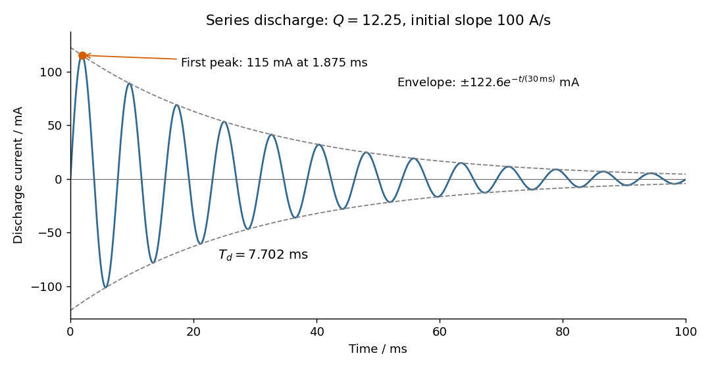

<h1 id="section-a/3/solution">Solution</h1>

↑ **Parent:** [3](../3.md)

Choose positive [electric current](../../../../../electric-current.md) in the initial discharge direction, since the source diagram does not label the initial plate polarity or a current arrow. Let $q$ be the charge remaining on the initially positive plate, so $I=-\dot q$. [Kirchhoff's voltage law](../../../../../kirchhoff-cycle-law.md) for the [series RLC circuit](../../../../../series-rlc-circuit.md) gives

$$
L\ddot q+R\dot q+\frac qC=0,\qquad q(0)=CV_0=150\,\mu\mathrm C,\quad \dot q(0)=0.
$$

The natural [angular frequency](../../../../../angular-frequency.md), [damping](../../../../../damping.md) coefficient and [quality factor](../../../../../q-factor.md) are

$$
\omega_0=\frac1{\sqrt{LC}}=816.50\,\mathrm{rad\,s^{-1}},\qquad
\alpha=\frac R{2L}=33.333\,\mathrm{s^{-1}},\qquad
\boxed{Q=\frac{\omega_0L}{R}=12.25.}
$$

Since $\alpha<\omega_0$ (equivalently $Q>1/2$), this is an [underdamped RLC response](../../../../../underdamped-rlc-response.md). With $\omega_d=\sqrt{\omega_0^2-\alpha^2}=815.82\,\mathrm{rad\,s^{-1}}$, satisfying the initial conditions gives

$$
q(t)=CV_0e^{-\alpha t}\left(\cos\omega_dt+\frac\alpha{\omega_d}\sin\omega_dt\right),
$$

and differentiating gives

$$
\boxed{I(t)=\frac{V_0}{L\omega_d}e^{-\alpha t}\sin\omega_dt
=(0.12258\,\mathrm A)e^{-t/(30.0\,\mathrm{ms})}\sin\left[(815.82\,\mathrm{rad\,s^{-1}})t\right].}
$$

The [electric current](../../../../../electric-current.md) starts at zero with $\dot I(0)=V_0/L=100\,\mathrm{A\,s^{-1}}$. Its [wave period](../../../../../wave-period.md) is $T_d=2\pi/\omega_d=7.702\,\mathrm{ms}$, its zeros occur every $3.851\,\mathrm{ms}$, and its positive and negative [wave envelopes](../../../../../envelope-waves.md) decay with time constant $30.0\,\mathrm{ms}$. The first maximum obeys $\tan\omega_dt=\omega_d/\alpha$ and is $0.1151\,\mathrm A$ at $1.875\,\mathrm{ms}$. The [electric current](../../../../../electric-current.md) tends to zero as the initial [capacitor](../../../../../capacitor.md) [energy](../../../../../energy-split.md) is dissipated in the [resistor](../../../../../resistor.md).

**[Figure 2](#section-a/3/image-original-calculated-electric-current-and-decay-wave-envelopes-for-the-underdamped-rlc-response). Original calculated electric current and decay wave envelopes for the underdamped RLC response**.

## ↑ Ancestors (14)

1. [3](../3.md)
2. [Section A](../../section-a.md)
3. [Paper 2](../../../paper-2-split.md)
4. [2022](../../../split.md)
5. [Past exam of the physics A course of the University of Cambridge](../../../../split.md)
6. [Physics A course of the University of Cambridge](../../../../../physics-a-course-of-the-university-of-cambridge.md)
7. [Physics course of the year 2 of the natural sciences course of the University of Cambridge](../../../../../physics-course-of-the-year-2-of-the-natural-sciences-course-of-the-university-of-cambridge.md)
8. [Year 2 of the natural sciences course of the University of Cambridge](../../../../../year-2-of-the-natural-sciences-course-of-the-university-of-cambridge.md)
9. [Year of the natural sciences course of the University of Cambridge](../../../../../year-of-the-natural-sciences-course-of-the-university-of-cambridge.md)
10. [Natural sciences course of the University of Cambridge](../../../../../natural-sciences-course-of-the-university-of-cambridge.md)
11. [Course of the University of Cambridge](../../../../../course-of-the-university-of-cambridge.md)
12. [University of Cambridge](../../../../../university-of-cambridge-split.md)
13. [List of universities](../../../../../list-of-universities.md)
14. [Codex Wiki](../../../../../split.md)
