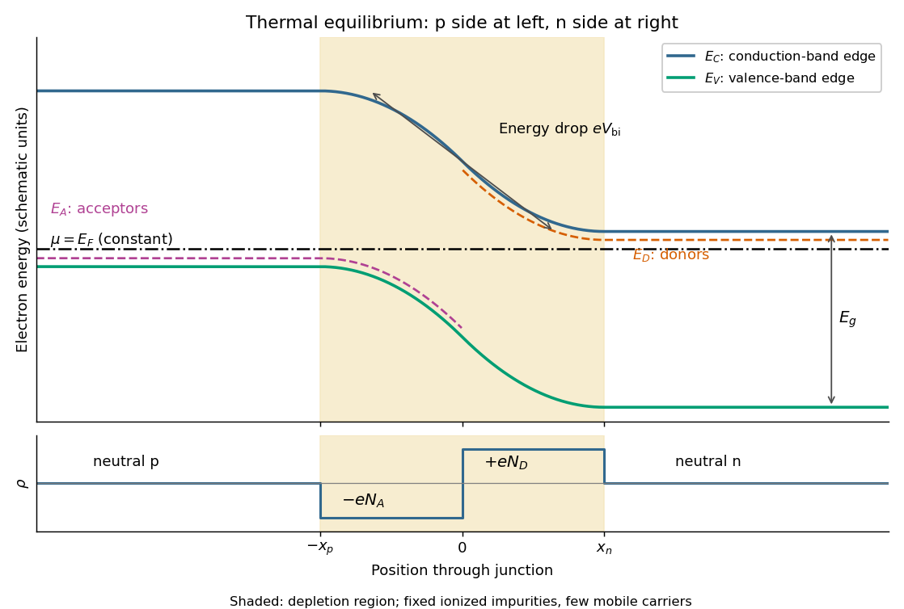

<h1 id="section-a/4/solution">Solution</h1>

↑ **Parent:** [4](../4.md)

Take a [p-n junction](../../../../../p-n-junction.md) made from one [semiconductor](../../../../../semiconductor-split.md), with the [p-type semiconductor](../../../../../p-type-semiconductor.md) on the left and the [n-type semiconductor](../../../../../n-type-semiconductor.md) on the right. At [thermal equilibrium](../../../../../thermal-equilibrium-split.md) the [chemical potential](../../../../../chemical-potential-split.md) $\mu=E_F$ is horizontal throughout. Before contact the [chemical potential](../../../../../chemical-potential-split.md) lies nearer the [valence band](../../../../../valence-band.md) on the p side and nearer the [conduction band](../../../../../conduction-band.md) on the n side; after contact the band edges bend to permit one common value.

**[Figure 3](#section-a/4/image-original-equilibrium-p-n-junction-energy-band-diagram-impurity-levels-common-chemical-potential-and-depletion-region). Original equilibrium p-n junction energy band diagram, impurity levels, common chemical potential and depletion region**.

In this orientation both the [conduction band](../../../../../conduction-band.md) edge $E_C$ and the [valence band](../../../../../valence-band.md) edge $E_V$ decrease from p to n by $eV_{\rm bi}$. For a [homojunction](../../../../../homojunction.md) their separation $E_g=E_C-E_V$ is constant. The [acceptor impurity](../../../../../acceptor-impurity.md) level $E_A$ lies just above $E_V$ where acceptors are present, and the [donor impurity](../../../../../donor-impurity.md) level $E_D$ lies just below $E_C$ where donors are present. These [impurity levels](../../../../../impurity-level.md) follow the local [band bending](../../../../../band-bending.md); they do not form one additional horizontal band across the device.

The shaded [depletion region](../../../../../depletion-region.md) has few mobile [electrons](../../../../../electron.md) or [electron holes](../../../../../electron-hole.md) and contains fixed negative ionized [acceptor impurities](../../../../../acceptor-impurity.md) on the p side and positive ionized [donor impurities](../../../../../donor-impurity.md) on the n side. Thus its [electric field](../../../../../electric-field-split.md) points from n to p. Its neutral outer regions have negligible [electric field](../../../../../electric-field-split.md), so the band edges become flat there. In the [depletion approximation](../../../../../depletion-approximation.md), [charge neutrality](../../../../../charge-neutrality.md) requires $N_Ax_p=N_Dx_n$; the symmetric drawing illustrates $N_A=N_D$ rather than assuming that equality is universal. [Diffusion](../../../../../diffusion.md) and field-driven [drift current](../../../../../drift-current.md) cancel at equilibrium: no applied [voltage](../../../../../voltage.md) does not mean zero internal [electric field](../../../../../electric-field-split.md) or zero built-in [electric potential difference](../../../../../electric-potential-difference.md).

## ↑ Ancestors (14)

1. [4](../4.md)
2. [Section A](../../section-a.md)
3. [Paper 2](../../../paper-2-split.md)
4. [2022](../../../split.md)
5. [Past exam of the physics A course of the University of Cambridge](../../../../split.md)
6. [Physics A course of the University of Cambridge](../../../../../physics-a-course-of-the-university-of-cambridge.md)
7. [Physics course of the year 2 of the natural sciences course of the University of Cambridge](../../../../../physics-course-of-the-year-2-of-the-natural-sciences-course-of-the-university-of-cambridge.md)
8. [Year 2 of the natural sciences course of the University of Cambridge](../../../../../year-2-of-the-natural-sciences-course-of-the-university-of-cambridge.md)
9. [Year of the natural sciences course of the University of Cambridge](../../../../../year-of-the-natural-sciences-course-of-the-university-of-cambridge.md)
10. [Natural sciences course of the University of Cambridge](../../../../../natural-sciences-course-of-the-university-of-cambridge.md)
11. [Course of the University of Cambridge](../../../../../course-of-the-university-of-cambridge.md)
12. [University of Cambridge](../../../../../university-of-cambridge-split.md)
13. [List of universities](../../../../../list-of-universities.md)
14. [Codex Wiki](../../../../../split.md)
