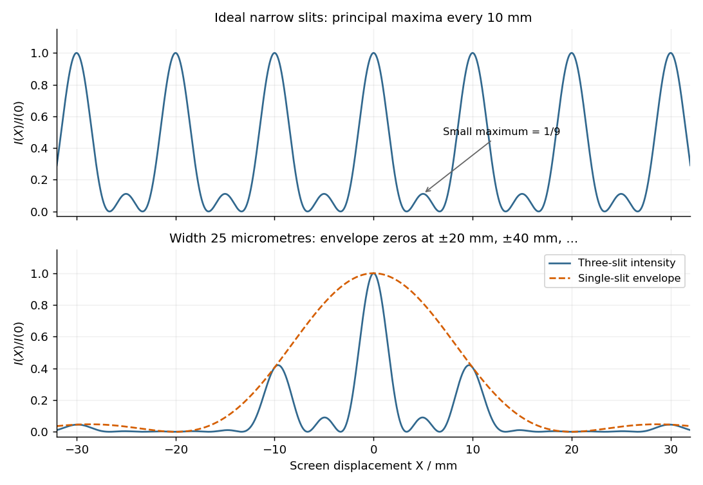

<h1 id="section-b/b7/c/i/solution">Solution</h1>

↑ **Parent:** [I](../i.md)

Take the quoted separation to mean adjacent slit centre spacing $d=50\,\mu\mathrm m$. For three equal very narrow slits at $-d,0,d$, the [Fraunhofer diffraction](../../../../../../../fraunhofer-diffraction.md) [complex amplitude](../../../../../../../complex-amplitude.md) in the transverse direction is

$$
\psi(\theta)=\psi_1\left(e^{-2i\beta}+1+e^{2i\beta}\right)
=\psi_1(1+2\cos2\beta),\qquad
\beta=\frac{\pi d\sin\theta}{\lambda}.
$$

With $I_1$ denoting one narrow slit's contribution, the [light intensity](../../../../../../../light-intensity.md) is

$$
\boxed{\frac{I}{I_1}=\left(1+2\cos2\beta\right)^2
=\left(\frac{\sin3\beta}{\sin\beta}\right)^2.}
$$

The quotient is interpreted by its limit where both numerator and denominator vanish. At small angles on a screen at $R=1\,\mathrm m$, $\sin\theta\simeq X/R$ and $\beta=\pi X/(10\,\mathrm{mm})$. Principal [interference fringes](../../../../../../../interference-fringe.md) occur at

$$
\boxed{X_m\simeq m\frac{\lambda R}{d}=m(10.0\,\mathrm{mm}),\qquad I(X_m)=9I_1.}
$$

Between successive principal maxima there are two zeros, at $X=(m+1/3)(10\,\mathrm{mm})$ and $X=(m+2/3)(10\,\mathrm{mm})$. Halfway between them is a smaller maximum $I=I_1$, one ninth of a principal peak. The pattern is symmetric about $X=0$. The positions quoted in millimetres use the [paraxial approximation](../../../../../../../paraxial-approximation.md); exactly $d\sin\theta_m=m\lambda$ and $X_m=R\tan\theta_m$.

**[Figure 4](#section-b/b7/c/i/image-original-calculated-fraunhofer-diffraction-patterns-for-three-narrow-slits-and-for-three-finite-width-slits). Original calculated Fraunhofer diffraction patterns for three narrow slits and for three finite-width slits**.

## ↑ Ancestors (16)

1. [I](../i.md)
2. [C](../../c.md)
3. [B7](../../../b7.md)
4. [Section B](../../../../section-b.md)
5. [Paper 2](../../../../../paper-2-split.md)
6. [2022](../../../../../split.md)
7. [Past exam of the physics A course of the University of Cambridge](../../../../../../split.md)
8. [Physics A course of the University of Cambridge](../../../../../../../physics-a-course-of-the-university-of-cambridge.md)
9. [Physics course of the year 2 of the natural sciences course of the University of Cambridge](../../../../../../../physics-course-of-the-year-2-of-the-natural-sciences-course-of-the-university-of-cambridge.md)
10. [Year 2 of the natural sciences course of the University of Cambridge](../../../../../../../year-2-of-the-natural-sciences-course-of-the-university-of-cambridge.md)
11. [Year of the natural sciences course of the University of Cambridge](../../../../../../../year-of-the-natural-sciences-course-of-the-university-of-cambridge.md)
12. [Natural sciences course of the University of Cambridge](../../../../../../../natural-sciences-course-of-the-university-of-cambridge.md)
13. [Course of the University of Cambridge](../../../../../../../course-of-the-university-of-cambridge.md)
14. [University of Cambridge](../../../../../../../university-of-cambridge-split.md)
15. [List of universities](../../../../../../../list-of-universities.md)
16. [Codex Wiki](../../../../../../../split.md)
