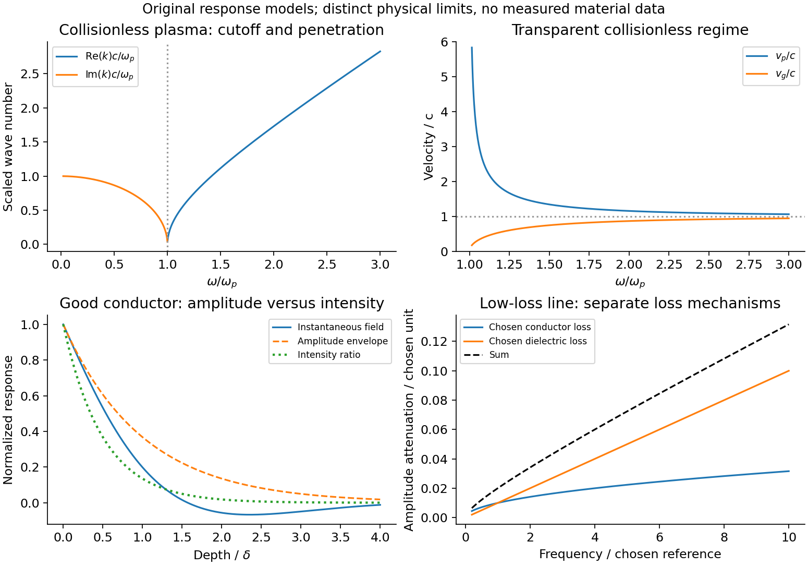
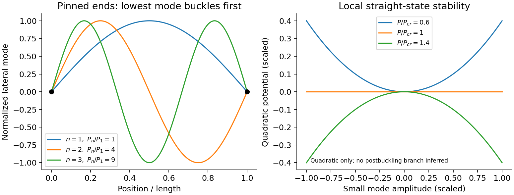
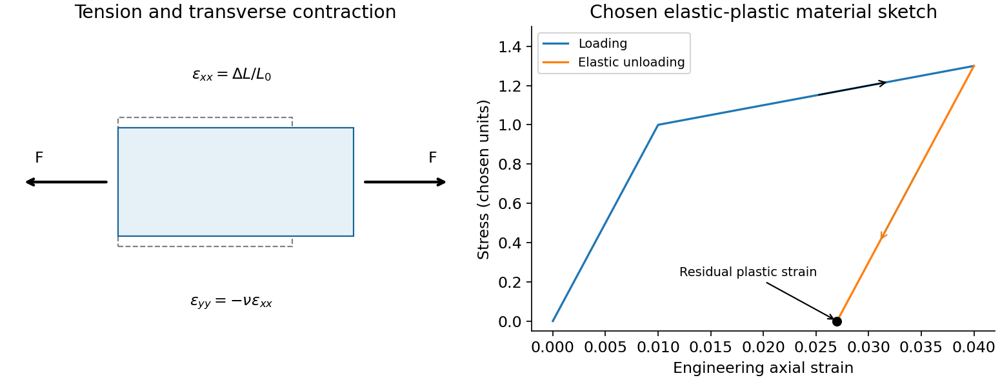
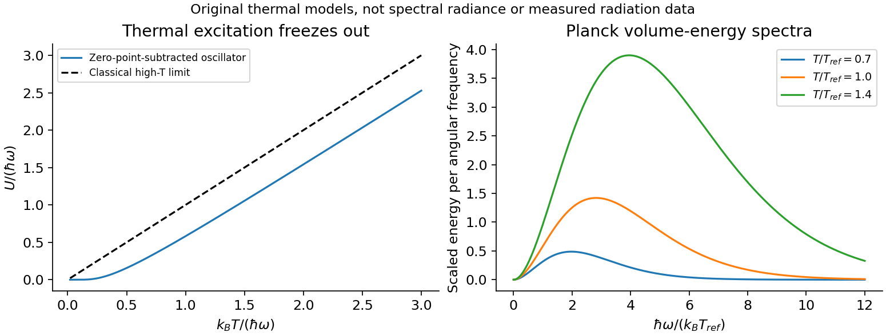

# Paper 1

↑ **Parent:** [2010](../2010.md)

Original paper: [Public original, physical PDF pages 261–264](https://www.whatdotheyknow.com/request/physics_past_papers_23/response/3514893/attach/4/FOI%202026%20628%20Smith%20materials.pdf?cookie_passthrough=1#page=261).

**Table of contents**

- [Section A](#section-a)
  - [1](#section-a/1)
    - [Solution](#section-a/1/solution)
  - [2](#section-a/2)
    - [Solution](#section-a/2/solution)
  - [3](#section-a/3)
    - [Solution](#section-a/3/solution)
  - [4](#section-a/4)
    - [Solution](#section-a/4/solution)
  - [5](#section-a/5)
    - [Solution](#section-a/5/solution)
- [Section B](#section-b)
  - [B6](#section-b/b6)
    - [a](#section-b/b6/a)
      - [Solution](#section-b/b6/a/solution)
    - [b](#section-b/b6/b)
      - [Solution](#section-b/b6/b/solution)
    - [c](#section-b/b6/c)
      - [Solution](#section-b/b6/c/solution)
    - [d](#section-b/b6/d)
      - [Solution](#section-b/b6/d/solution)
  - [B7](#section-b/b7)
    - [Solution](#section-b/b7/solution)
  - [B8](#section-b/b8)
    - [a](#section-b/b8/a)
      - [Solution](#section-b/b8/a/solution)
    - [b](#section-b/b8/b)
      - [Solution](#section-b/b8/b/solution)
    - [c](#section-b/b8/c)
      - [Solution](#section-b/b8/c/solution)
    - [d](#section-b/b8/d)
      - [Solution](#section-b/b8/d/solution)
  - [B9](#section-b/b9)
    - [Solution](#section-b/b9/solution)
- [Section C](#section-c)
  - [C10](#section-c/c10)
    - [Solution](#section-c/c10/solution)
    - [a](#section-c/c10/a)
      - [Solution](#section-c/c10/a/solution)
    - [b](#section-c/c10/b)
      - [Solution](#section-c/c10/b/solution)
  - [C11](#section-c/c11)
    - [Solution](#section-c/c11/solution)
  - [C12](#section-c/c12)
    - [Solution](#section-c/c12/solution)
  - [C13](#section-c/c13)
    - [Solution](#section-c/c13/solution)

## Section A

↑ **Parent:** [Paper 1](paper-1.md)

<h3 id="section-a/1">1</h3>

↑ **Parent:** [Section A](#section-a)

<h4 id="section-a/1/solution">Solution</h4>

↑ **Parent:** [1](#section-a/1)

For a fixed linear circuit, [self-inductance](../../electromagnetism.md#self-inductance) relates the [magnetic flux linkage](../../electromagnetism.md#magnetic-flux-linkage) produced by its own current to that current: $\Lambda=LI$, with $\Lambda=\sum_{\rm turns}\Phi_B$. The self-induced [electromotive force](../../electric-charge.md#electromotive-force) is $\mathcal E=-d\Lambda/dt=-L\,dI/dt$ when $L$ is constant. Its unit is the henry, $1\,\mathrm H=1\,\mathrm{Wb/A}$.

[mutual inductance](../../electromagnetism.md#mutual-inductance) relates the linkage in one circuit to current in another: $\Lambda_2=M_{21}I_1$ and $\Lambda_1=M_{12}I_2$. For stationary reciprocal linear media, $M_{12}=M_{21}=M$ with consistently oriented turns, and $\mathcal E_2=-M\,dI_1/dt$. Orientation fixes the sign. The coupled magnetic [energy](../../energy.md) is $W=\tfrac12L_1I_1^2+\tfrac12L_2I_2^2+MI_1I_2$, so positivity requires $M^2\leq L_1L_2$. Moving coils or nonlinear cores require differentiation of the full linkage rather than treating the [inductance](../../electromagnetism.md#inductance) as a constant.

<h3 id="section-a/2">2</h3>

↑ **Parent:** [Section A](#section-a)

<h4 id="section-a/2/solution">Solution</h4>

↑ **Parent:** [2](#section-a/2)

Use local east, north and up axes. At latitude $\lambda$, $\boldsymbol\Omega=(0,\Omega\cos\lambda,\Omega\sin\lambda)$ and eastward [velocity](../../classical-mechanics.md#velocity) is $(v,0,0)$. The [Coriolis acceleration](../../mathematical-physics.md#coriolis-acceleration) is

$$
-2\boldsymbol\Omega\times\mathbf v=(0,-2\Omega v\sin\lambda,2\Omega v\cos\lambda).
$$

Its horizontal part is southward, so the lift must acquire a northward component: **bank left**, with the north wing lower. For the requested local Coriolis correction, let the vertical lift balance $mg$. The [Coriolis bank angle for eastward flight](../../mathematical-physics.md#coriolis-bank-angle-for-eastward-flight) is

$$
\tan\theta=\frac{2\Omega v\sin\lambda}{g},\qquad
v=\frac{800}{3.6}=222.22\,\mathrm{m\,s^{-1}},\qquad
\boxed{\theta\simeq0.00310\,\mathrm{rad}=0.178^\circ.}
$$

Use $g=9.81\,\mathrm{m\,s^{-2}}$ and $\Omega=7.2921\times10^{-5}\,\mathrm{s^{-1}}$. Including the upward Coriolis term replaces $g$ by $g-2\Omega v\cos\lambda$ and changes the answer by only about $0.1\%$. This is the horizontal Coriolis compensation, not a full calculation of a curved constant-latitude flight path. The rotation rate follows Earth's sidereal period.[Orbital parameters: sidereal rotation period 23.9345 hours](../../physics-bibliography.md#earth-fact-sheet-by-national-aeronautics-and-space-administration)

<h3 id="section-a/3">3</h3>

↑ **Parent:** [Section A](#section-a)

<h4 id="section-a/3/solution">Solution</h4>

↑ **Parent:** [3](#section-a/3)

Let $Q_c$ be [heat](../../heat.md) extracted from the cold reservoir, $Q_h$ the [heat](../../heat.md) delivered to the surroundings and $W$ the supplied work. The [entropy](../../entropy.md) inequality for a cyclic [refrigerator](../../thermodynamics.md#refrigerator) is

$$
\frac{Q_h}{T_h}-\frac{Q_c}{T_c}\geq0.
$$

Equality is the reversible [Carnot refrigerator](../../thermodynamics.md#carnot-refrigerator) limit. Therefore

$$
\boxed{Q_{h,\min}=\frac{300}{4}\times1\,\mathrm J=75\,\mathrm J.}
$$

[energy](../../energy.md) conservation gives $W_{\min}=Q_h-Q_c=74\,\mathrm J$. The requested rejected [heat](../../heat.md) is **75 J**, while **74 J** is the minimum work; both have to be distinguished. Any [entropy](../../entropy.md) production increases the required rejection at these fixed reservoir [temperatures](../../temperature.md).

<h3 id="section-a/4">4</h3>

↑ **Parent:** [Section A](#section-a)

<h4 id="section-a/4/solution">Solution</h4>

↑ **Parent:** [4](#section-a/4)

For a [plane wave](../../wave-function.md#plane-wave) propagating along $\hat{\mathbf k}$ in [vacuum](../../physics.md#vacuum), [Maxwell equations](../../maxwell-equations.md) give $\mathbf B=\hat{\mathbf k}\times\mathbf E/c$, with $\mathbf E\perp\hat{\mathbf k}$. Hence

$$
\mathbf S=\frac{\mathbf E\times\mathbf B}{\mu_0}
=\frac{E^2}{\mu_0c}\hat{\mathbf k}
=\epsilon_0cE^2\hat{\mathbf k}.
$$

Taking $E=E_0\cos(\mathbf k\cdot\mathbf r-\omega t)$, the period average of the squared [cosine](../../geometry-and-topology.md#cosine) is $1/2$. Thus

$$
\boxed{\left\langle|\mathbf S|\right\rangle=\frac12\epsilon_0cE_0^2.}
$$

The fields are in phase, so the travelling-wave [energy flux](../../mathematical-physics.md#energy-flux) never reverses. The peak [amplitude](../../wave.md#wave-amplitude) convention is essential; using a root-mean-square [electric field](../../electric-field.md) would remove the factor $1/2$.

<h3 id="section-a/5">5</h3>

↑ **Parent:** [Section A](#section-a)

<h4 id="section-a/5/solution">Solution</h4>

↑ **Parent:** [5](#section-a/5)

Use a circular [Kepler orbit](../../celestial-mechanics.md#kepler-orbit) to eliminate the terrestrial gravitational parameter: $T^2/r^3$ is constant for both satellites. The reference orbital [radius](../../topology.md#radius) is $r_1=(6400+150)\,\mathrm{km}=6550\,\mathrm{km}$, measured from Earth's centre. A [geostationary orbit](../../celestial-mechanics.md#geostationary-orbit) is circular, equatorial and prograde, with the sidereal rotation period, approximately $86164\,\mathrm s$. Thus

$$
\boxed{r_{\rm geo}=6550\left(\frac{86164}{87\times60}\right)^{2/3}\,\mathrm{km}
\simeq4.25\times10^4\,\mathrm{km}.}
$$

Its altitude is about $3.61\times10^4\,\mathrm{km}$ above the stated surface. The approximate low-orbit input sets the accuracy; replacing it by a modern measured gravitational parameter would answer a different numerical estimate. A $24$-hour approximation changes the [radius](../../topology.md#radius) by less than $0.2\%$. Matching the period alone would not make an inclined or eccentric [orbit](../../dynamical-systems.md#orbit-dynamical-system) stationary above one point.

## Section B

↑ **Parent:** [Paper 1](paper-1.md)

<h3 id="section-b/b6">B6</h3>

↑ **Parent:** [Section B](#section-b)

<h4 id="section-b/b6/a">a</h4>

↑ **Parent:** [B6](#section-b/b6)

<h5 id="section-b/b6/a/solution">Solution</h5>

↑ **Parent:** [A](#section-b/b6/a)

[displacement current](../../maxwell-equations.md#displacement-current) completes Ampère's law:

$$
\nabla\times\mathbf H=\mathbf J_{\rm free}+\frac{\partial\mathbf D}{\partial t},\qquad
I_d=\frac{d}{dt}\int_S\mathbf D\cdot d\mathbf A.
$$

In [vacuum](../../physics.md#vacuum) $\mathbf D=\epsilon_0\mathbf E$. Taking the [divergence](../../multivariable-calculus.md#divergence) and using $\nabla\cdot\mathbf D=\rho_{\rm free}$ gives $\nabla\cdot\mathbf J_{\rm free}+\partial_t\rho_{\rm free}=0$, exactly the [continuity equation](../../mathematical-physics.md#continuity-equation). Without the added term a time-dependent charge distribution would contradict the [curl](../../multivariable-calculus.md#curl) equation.

A charging parallel-plate capacitor illustrates the physics. For plate [area](../../differential-geometry.md#surface-area) $A$, $Q=\epsilon_0AE$, so the gap [displacement current](../../maxwell-equations.md#displacement-current) is $I_d=\epsilon_0A\dot E=\dot Q$, equal to the conduction current in its leads. An Ampère contour therefore gives the same magnetic [circulation](../../vorticity.md#circulation-physics) whether its spanning surface crosses the wire or the gap. No electrons have to cross an ideal [vacuum](../../physics.md#vacuum) gap. In matter, $\partial_t\mathbf D$ includes the polarization response as well as the [vacuum](../../physics.md#vacuum) term. Combined with Faraday induction, the [displacement](../../classical-mechanics.md#displacement) term permits source-free electromagnetic waves.

<h4 id="section-b/b6/b">b</h4>

↑ **Parent:** [B6](#section-b/b6)

<h5 id="section-b/b6/b/solution">Solution</h5>

↑ **Parent:** [B](#section-b/b6/b)

A thin pillbox applied to $\nabla\cdot\mathbf B=0$ and a thin rectangular contour applied to the magnetostatic Ampère law give

$$
\boxed{\hat{\mathbf n}\cdot(\mathbf B_2-\mathbf B_1)=0,\qquad
\hat{\mathbf n}\times(\mathbf H_2-\mathbf H_1)=\mathbf K_{\rm free}.}
$$

The normal points from medium1 to medium2, and $\mathbf K_{\rm free}$ is a free sheet current. Without such a current, tangential $H$ is continuous; normal $B$ is continuous independently. The remaining components need not be continuous because $\mathbf B=\mu_0(\mathbf H+\mathbf M)$ contains the [magnetization](../../electromagnetism.md#magnetization).

For linear isotropic media with no free sheet current, $B_{1n}=B_{2n}$ and $B_{1t}/\mu_1=B_{2t}/\mu_2$. If $\theta_i$ measures a field-line angle to the normal, $\tan\theta_2/\tan\theta_1=\mu_2/\mu_1$. This magnetic field-line [refraction](../../optics.md#refraction) follows from the two different component conditions, not from continuity of the complete vector field. Bound surface currents are already represented in the constitutive relation and must not be added again as free currents.

<h4 id="section-b/b6/c">c</h4>

↑ **Parent:** [B6](#section-b/b6)

<h5 id="section-b/b6/c/solution">Solution</h5>

↑ **Parent:** [C](#section-b/b6/c)

In [paramagnetism](../../electromagnetism.md#paramagnetism), a material develops [magnetization](../../electromagnetism.md#magnetization) along a weak applied field, with positive susceptibility; in [diamagnetism](../../electromagnetism.md#diamagnetism), it develops an induced moment opposing it, with negative susceptibility. In a simple localized-moment paramagnet, Zeeman alignment competes with thermal disorder. For independent two-state moments $\pm\mu$,

$$
Z_1=2\cosh\frac{\mu B}{k_BT},\qquad
M=n\mu\tanh\frac{\mu B}{k_BT},\qquad
\chi_H\simeq\frac{\mu_0n\mu^2}{k_BT}
$$

when the field is weak and demagnetizing corrections are negligible. Stronger fields saturate the moment; interactions and conduction-electron [Pauli paramagnetism](../../quantum-ideal-gas-statistics.md#pauli-paramagnetism) can depart from this [Curie law](../../statistical-physics.md#curie-s-law).

Ordinary [diamagnetism](../../electromagnetism.md#diamagnetism) comes from a field-induced change of orbital motion, including in closed-shell matter without permanent atomic moments. Its weak susceptibility is often nearly [temperature](../../temperature.md) independent away from a transition, and it contributes a background even when another magnetic response dominates. A nonuniform field tends to attract a paramagnetic specimen toward stronger field and repel a diamagnetic specimen in the weak linear regime. Calibrate the holder contribution and field [gradient](../../multivariable-calculus.md#gradient) and measure a [temperature](../../temperature.md)/field series to distinguish induced response from retained [magnetization](../../electromagnetism.md#magnetization). Ferromagnetic [hysteresis](../../critical-phenomenon.md#hysteresis) and superconducting flux expulsion require different collective explanations.

<h4 id="section-b/b6/d">d</h4>

↑ **Parent:** [B6](#section-b/b6)

<h5 id="section-b/b6/d/solution">Solution</h5>

↑ **Parent:** [D](#section-b/b6/d)

Since $\nabla\cdot\mathbf B=0$, a [magnetic field](../../magnetic-field.md) can locally be represented by a [magnetic vector potential](../../electromagnetism.md#magnetic-vector-potential),

$$
\mathbf B=\nabla\times\mathbf A.
$$

It is not unique: $\mathbf A\to\mathbf A+\nabla\chi$ leaves its [curl](../../multivariable-calculus.md#curl) unchanged. In magnetostatics, choose the [Coulomb gauge](../../electromagnetism.md#coulomb-gauge) $\nabla\cdot\mathbf A=0$. Ampère's law then gives $\nabla^2\mathbf A=-\mu_0\mathbf J$ in [vacuum](../../physics.md#vacuum). For a localized steady current distribution with the usual decay condition,

$$
\mathbf A(\mathbf r)=\frac{\mu_0}{4\pi}\int\frac{\mathbf J(\mathbf r')}{|\mathbf r-\mathbf r'|}\,d^3r'.
$$

Its [curl](../../multivariable-calculus.md#curl) gives the Biot–Savart field. For a uniform field, one convenient choice is $\mathbf A=\tfrac12\mathbf B\times\mathbf r$. Stokes's theorem relates $\oint_C\mathbf A\cdot d\mathbf l$ to [magnetic flux](../../magnetic-field.md#magnetic-flux) through a spanning surface. In time-dependent electrodynamics, $\mathbf E=-\nabla\phi-\partial_t\mathbf A$; changing $\mathbf A$ by $\nabla\chi$ requires $\phi\to\phi-\partial_t\chi$ to preserve the [electric field](../../electric-field.md). Gauge freedom simplifies calculation without changing the electromagnetic observables.

<h3 id="section-b/b7">B7</h3>

↑ **Parent:** [Section B](#section-b)

<h4 id="section-b/b7/solution">Solution</h4>

↑ **Parent:** [B7](#section-b/b7)

State a time convention before using complex response: take fields proportional to $e^{i(kz-\omega t)}$, with $k=k_r+i\kappa$ and $\kappa\geq0$ for a passive wave entering the material. In a homogeneous Ohmic medium, [Maxwell equations](../../maxwell-equations.md) with $\mathbf J=\sigma\mathbf E$ give

$$
k^2=\mu\epsilon\omega^2+i\mu\sigma\omega
=\mu\omega^2\left(\epsilon+\frac{i\sigma}{\omega}\right).
$$

The [ohmic-conductor complex wavenumber](../../electric-charge.md#ohmic-conductor-complex-wavenumber) describes both phase advance and [amplitude](../../wave.md#wave-amplitude) decay. Real constant conductivity is only a low-frequency approximation. In the [Drude model](../../electric-charge.md#drude-model), $m\dot{\mathbf v}+m\gamma\mathbf v=-e\mathbf E$ gives

$$
\sigma(\omega)=\frac{ne^2}{m(\gamma-i\omega)},\qquad
\epsilon_r(\omega)=1-\frac{\omega_p^2}{\omega(\omega+i\gamma)},\qquad
\omega_p^2=\frac{ne^2}{m\epsilon_0},
$$

with a fixed positive ionic background and no additional bound-electron contribution in this simple model. The [plasma frequency](../../physics.md#plasma-frequency) marks the inertial electron-response scale. More elaborate band structure, interband transitions and nonlocal transport limit this scalar treatment.[Dielectric constant of a collisional plasma, equations (1201)–(1205): electron inertia, collisions and dielectric response](../../physics-bibliography.md#electromagnetism-lecture-notes-by-richard-fitzpatrick)

In the collisionless nonmagnetic limit, the [dispersion relation](../../dispersion-relation.md) is $\omega^2=\omega_p^2+c^2k^2$. For $\omega>\omega_p$,

$$
v_p=\frac\omega k=\frac{c}{\sqrt{1-\omega_p^2/\omega^2}}>c,\qquad
v_g=\frac{d\omega}{dk}=c\sqrt{1-\omega_p^2/\omega^2}<c.
$$

A crest can move faster than $c$ without carrying a new signal faster than [light](../../optics.md#light). Below cutoff the ideal wave is evanescent, with penetration [length](../../physics.md#length) $c/\sqrt{\omega_p^2-\omega^2}$; it does not propagate as an ordinary real-$k$ bulk wave. Evanescence in the lossless limit is not Joule dissipation. Nonzero collision rate gives a dissipative conductivity and smooths this ideal cutoff picture.

For a good conductor with approximately real $\sigma\gg\omega\epsilon$, the spatial branch becomes

$$
\boxed{k\simeq\frac{1+i}{\delta},\qquad\delta=\sqrt{\frac{2}{\mu\sigma\omega}}.}
$$

A field [amplitude](../../wave.md#wave-amplitude) falls as $e^{-z/\delta}$, while [intensity](../../wave.md#intensity-physics) falls as $e^{-2z/\delta}$. The [phase velocity](../../dispersion-relation.md#phase-velocity) is $\omega\delta$ in this limit. Magnetic and electric [amplitudes](../../wave.md#wave-amplitude) are not related by the [vacuum](../../physics.md#vacuum) ratio: $Z_s=E/H=(1-i)\sqrt{\mu\omega/(2\sigma)}$ with the chosen time convention. Its positive real part is the surface resistance. The local mean heating is $\tfrac12\operatorname{Re}\sigma\,|E|^2$, consistent with electromagnetic [energy](../../energy.md) flowing into the metal. [skin depth](../../electric-charge.md#skin-depth) is an [amplitude](../../wave.md#wave-amplitude) [length](../../physics.md#length); interpreting it as an [intensity](../../wave.md#intensity-physics) [length](../../physics.md#length) gives a factor-of-two error.

A transmission-line mode propagates chiefly through the [dielectric](../../permittivity.md#dielectric) between conductors, even though finite metal conductivity causes loss at its boundaries. With per-length parameters $R',L',G',C'$, the [telegrapher's equations](../../electrical-engineering.md#telegrapher-s-equations) give, for the same $e^{-i\omega t}$ convention,

$$
\frac{dV}{dz}=-(R'-i\omega L')I,\qquad
\frac{dI}{dz}=-(G'-i\omega C')V.
$$

Writing a forward wave as $e^{-\Gamma z}$, $\Gamma=\alpha-i\beta$, gives $\Gamma^2=(R'-i\omega L')(G'-i\omega C')$. In the low-loss regime $R'\ll\omega L'$ and $G'\ll\omega C'$, set $Z_0\simeq\sqrt{L'/C'}$ to obtain

$$
\boxed{\alpha\simeq\frac{R'}{2Z_0}+\frac{G'Z_0}{2},\qquad
\beta\simeq\omega\sqrt{L'C'}.}
$$

This [low-loss transmission-line attenuation](../../electrical-engineering.md#low-loss-transmission-line-attenuation) separates series conductor loss from [dielectric](../../permittivity.md#dielectric) leakage loss. Average forward power falls as $e^{-2\alpha z}$. In the normal skin-effect regime, reduced conducting [area](../../differential-geometry.md#surface-area) makes the AC conductor resistance increase roughly as $\sqrt\omega$; [dielectric loss](../../permittivity.md#dielectric-loss) can supply a separate [frequency](../../wave.md#frequency) dependence. Reflection from a mismatched termination changes delivered power without being, by itself, dissipation in the line.[Chapter14, §§14.7–14.9: distributed losses, Ohmic waves and conductor-loss approximation](../../physics-bibliography.md#electromagnetic-fields-and-energy-by-hermann-a-haus-and-james-r-melcher)

To test loss, compare several [lengths](../../physics.md#length) of otherwise identical line with matched terminations, calibrate connectors and incident/reflected power, and monitor [temperature](../../temperature.md). Separate [amplitude](../../wave.md#wave-amplitude) attenuation from phase delay and from standing-wave minima. Bulk penetration, line attenuation and [dielectric](../../permittivity.md#dielectric) propagation [speed](../../classical-mechanics.md#speed) are related electromagnetic quantities but describe different experimental geometries.

**[Figure 1](#section-b/b7/image-conducting-wave-propagation). Conducting-wave propagation**. Chosen dispersion and decay models.

<h3 id="section-b/b8">B8</h3>

↑ **Parent:** [Section B](#section-b)

<h4 id="section-b/b8/a">a</h4>

↑ **Parent:** [B8](#section-b/b8)

<h5 id="section-b/b8/a/solution">Solution</h5>

↑ **Parent:** [A](#section-b/b8/a)

The [vorticity](../../vorticity.md) of a [fluid](../../fluid-mechanics.md#fluid) [velocity](../../classical-mechanics.md#velocity) field is $\boldsymbol\omega=\nabla\times\mathbf v$. A [vortex line](../../vorticity.md#vortex-line) is an integral curve tangent to that vector, not generally a particle path or [streamline](../../fluid-mechanics.md#streamline). Since $\nabla\cdot\boldsymbol\omega=0$, [vorticity](../../vorticity.md) flux through successive cross-sections of a [vortex tube](../../vorticity.md#vortex-tube) is equal; a regular line cannot simply end inside the [fluid](../../fluid-mechanics.md#fluid). By Stokes's theorem, the tube strength is the [circulation](../../vorticity.md#circulation-physics)

$$
\Gamma=\int_S\boldsymbol\omega\cdot d\mathbf A=\oint_{\partial S}\mathbf v\cdot d\mathbf l.
$$

For an inviscid [barotropic fluid](../../fluid-mechanics.md#barotropic-fluid) with conservative body [force](../../force.md), [Kelvin's circulation theorem](../../vorticity.md#kelvin-s-circulation-theorem) conserves [circulation](../../vorticity.md#circulation-physics) around a material circuit. Under those assumptions [vortex tubes](../../vorticity.md#vortex-tube) move with the [fluid](../../fluid-mechanics.md#fluid). In three-dimensional incompressible ideal [flow](../../flow-network.md#flow),

$$
\frac{D\boldsymbol\omega}{Dt}=(\boldsymbol\omega\cdot\nabla)\mathbf v;
$$

stretching a material tube raises its [vorticity](../../vorticity.md) as its cross-section shrinks. In two-dimensional [incompressible flow](../../fluid-mechanics.md#incompressible-flow) there is no such stretching, so scalar [vorticity](../../vorticity.md) is materially conserved. Constant [viscosity](../../dynamic-viscosity.md) adds a diffusion term $\nu\nabla^2\boldsymbol\omega$; [baroclinicity](../../mathematical-physics.md#baroclinity) and boundaries can also generate [vorticity](../../vorticity.md).

An ideal line vortex has $v_\phi=\Gamma/(2\pi r)$ and zero ordinary [vorticity](../../vorticity.md) for $r>0$, with its [circulation](../../vorticity.md#circulation-physics) concentrated in the singular core. Circular trajectories therefore do not imply nonzero local [vorticity](../../vorticity.md) everywhere. A finite physical core removes the [velocity](../../classical-mechanics.md#velocity) singularity.

<h4 id="section-b/b8/b">b</h4>

↑ **Parent:** [B8](#section-b/b8)

<h5 id="section-b/b8/b/solution">Solution</h5>

↑ **Parent:** [B](#section-b/b8/b)

A freely rotating [rigid body](../../rigid-body-dynamics.md) with no external [torque](../../momentum.md#torque) conserves its inertial [angular momentum](../../momentum.md#angular-momentum) and [kinetic energy](../../energy.md#kinetic-energy). In body-fixed [principal axes](../../rigid-body-dynamics.md#principal-axis), the Euler equations include

$$
I_1\dot\omega_1+(I_3-I_2)\omega_2\omega_3=0
$$

and cyclic permutations. The body can still change its orientation relative to its fixed angular-momentum vector; zero [torque](../../momentum.md#torque) does not require every [principal axis](../../rigid-body-dynamics.md#principal-axis) to remain fixed.

For a [symmetric top](../../rigid-body-dynamics.md#symmetric-top), $I_1=I_2=I_\perp$, $I_3=I_\parallel$. The axial rate $\omega_3$ is constant, and $\omega_1+i\omega_2$ rotates in body coordinates with signed [frequency](../../wave.md#frequency) $(I_\parallel-I_\perp)\omega_3/I_\perp$. In space,

$$
\mathbf L=I_\perp\boldsymbol\omega+(I_\parallel-I_\perp)\omega_3\hat{\mathbf e}_3,
\qquad
\dot{\hat{\mathbf e}}_3=\frac{\mathbf L}{I_\perp}\times\hat{\mathbf e}_3.
$$

Thus the [symmetry](../../physics.md#symmetry-physics) axis precesses about fixed $\mathbf L$ at rate $L/I_\perp$ and constant inclination. This [body-frame and space-frame frequencies of free symmetric-top precession](../../rigid-body-dynamics.md#body-frame-and-space-frame-frequencies-of-free-symmetric-top-precession) distinction avoids confusing two different frame-dependent rates. A sphere has no dynamically distinguished [symmetry](../../physics.md#symmetry-physics) axis even though a chosen body marker rotates.

For a general body, rotations about the largest and smallest principal inertias are stable to small perturbations, while rotation about the intermediate inertia is unstable. With $I_1<I_2<I_3$ and rotation $\omega_2=\Omega$, linearization gives $\ddot\omega_1=\Omega^2(I_3-I_2)(I_2-I_1)\omega_1/(I_1I_3)$, showing exponential growth. This is torque-free motion, distinct from the gravity-driven [precession](../../rigid-body-dynamics.md#precession) of a supported [gyroscope](../../momentum.md#gyroscope).

<h4 id="section-b/b8/c">c</h4>

↑ **Parent:** [B8](#section-b/b8)

<h5 id="section-b/b8/c/solution">Solution</h5>

↑ **Parent:** [C](#section-b/b8/c)

An [Euler strut](../../elasticity-physics.md#euler-strut) is a slender initially straight elastic column under axial compression. For a uniform [bending stiffness](../../elasticity-physics.md#bending-stiffness) $EI$ and a small transverse [displacement](../../classical-mechanics.md#displacement) $y(x)$, the second-order [potential energy](../../energy.md#potential-energy) under a conservative compressive load $P$ is

$$
\Pi^{(2)}=\frac12\int_0^L\left[EI(y'')^2-P(y')^2\right]dx.
$$

The bending term is positive; shortening releases load potential. Stationarity yields $EIy^{(4)}+Py''=0$. Pinned ends impose $y(0)=y(L)=0$ and zero end [bending moments](../../elasticity-physics.md#bending-moment), $y''(0)=y''(L)=0$. Substitution of $y=A\sin(n\pi x/L)$ gives

$$
P_n=\frac{n^2\pi^2EI}{L^2},\qquad
\boxed{P_{\rm cr}=\frac{\pi^2EI}{L^2}.}
$$

The straight configuration loses stability first in the longest admissible bending mode. The [second moment of area](../../elasticity-physics.md#second-moment-of-area) $I=\int z^2dA$ is geometric, not a [mass](../../classical-mechanics.md#mass) [moment of inertia](../../rigid-body-dynamics.md#moment-of-inertia). Boundary conditions matter: a fixed-free column has effective [length](../../physics.md#length) $2L$, while fixed-fixed ends have effective [length](../../physics.md#length) $L/2$, changing the threshold by factors $1/4$ and $4$. Slenderness, elastic material response, alignment and the weak bending direction must be checked. Imperfections produce bending before the ideal threshold, and a short column can yield or crush first. Linear buckling theory does not predict an unlimited deflection or a complete postbuckling curve.

**[Figure 2](#section-b/b8/c/image-euler-strut-instability). Euler strut instability**. Ideal pinned modes and energy curvature.

<h4 id="section-b/b8/d">d</h4>

↑ **Parent:** [B8](#section-b/b8)

<h5 id="section-b/b8/d/solution">Solution</h5>

↑ **Parent:** [D](#section-b/b8/d)

The [Reynolds number](../../dynamic-viscosity.md#reynolds-number) is $\mathrm{Re}=\rho UL/\eta=UL/\nu$, comparing inertial [stress](../../continuum-mechanics.md#stress) $\rho U^2$ with viscous [stress](../../continuum-mechanics.md#stress) $\eta U/L$. Nondimensionalizing an incompressible Newtonian [flow](../../flow-network.md#flow) with [velocity](../../classical-mechanics.md#velocity) $U$, [length](../../physics.md#length) $L$ and [pressure](../../pressure.md) $\rho U^2$ gives

$$
\partial_{t^*}\mathbf v^*+\mathbf v^*\cdot\nabla^*\mathbf v^*
=-\nabla^*p^*+\frac1{\mathrm{Re}}\nabla^{*2}\mathbf v^*.
$$

At small [Reynolds number](../../dynamic-viscosity.md#reynolds-number) inertia is negligible and a creeping-flow balance applies. At large [Reynolds number](../../dynamic-viscosity.md#reynolds-number) the outer [flow](../../flow-network.md#flow) may be approximately inviscid, but thin no-slip [boundary layers](../../continuum-mechanics.md#boundary-layer) can still govern drag, separation and dissipation. A high [Reynolds number](../../dynamic-viscosity.md#reynolds-number) permits turbulent motion without guaranteeing it; transition depends on geometry, disturbances and roughness.

Dynamically similar model experiments need matching geometry and relevant dimensionless parameters, including [Reynolds number](../../dynamic-viscosity.md#reynolds-number). If gravity, compressibility or surface tension matters, Froude, Mach or capillary-related parameters must also be matched. Testing linear pressure-flow or force-speed relations while varying $U$, $L$, [viscosity](../../dynamic-viscosity.md) and [temperature](../../temperature.md) is more informative than assigning one universal transition value to all apparatus.

<h3 id="section-b/b9">B9</h3>

↑ **Parent:** [Section B](#section-b)

<h4 id="section-b/b9/solution">Solution</h4>

↑ **Parent:** [B9](#section-b/b9)

[stress](../../continuum-mechanics.md#stress) describes internal [force](../../force.md) per [area](../../differential-geometry.md#surface-area). A cut with unit normal $\hat{\mathbf n}$ has [traction](../../continuum-mechanics.md#traction) $\mathbf t=\boldsymbol\sigma\hat{\mathbf n}$; its normal component is $\hat{\mathbf n}\cdot\boldsymbol\sigma\hat{\mathbf n}$ and its remainder is shear [traction](../../continuum-mechanics.md#traction). [force balance](../../force.md#force-balance) constrains the [stress](../../continuum-mechanics.md#stress) [divergence](../../multivariable-calculus.md#divergence), while ordinary local angular-momentum balance makes the [Cauchy stress tensor](../../continuum-mechanics.md#cauchy-stress-tensor) symmetric in a medium without body couples.

[strain](../../continuum-mechanics.md#strain) describes deformation rather than [force](../../force.md). For small [displacement](../../classical-mechanics.md#displacement) [gradients](../../multivariable-calculus.md#gradient),

$$
\epsilon_{ij}=\frac12(\partial_i u_j+\partial_j u_i),\qquad
\frac{\Delta V}{V}=\epsilon_{kk}.
$$

The antisymmetric displacement-gradient part is a rigid rotation to first order and contributes no infinitesimal [strain](../../continuum-mechanics.md#strain). Engineering [shear strain](../../continuum-mechanics.md#shear-strain) is $\gamma_{xy}=2\epsilon_{xy}$, so it must not be confused with the tensor component. [stress](../../continuum-mechanics.md#stress) has units of [pressure](../../pressure.md); [strain](../../continuum-mechanics.md#strain) is dimensionless.

An isotropic linear elastic solid obeys

$$
\sigma_{ij}=\lambda\epsilon_{kk}\delta_{ij}+2G\epsilon_{ij},\qquad
w=\tfrac12\lambda(\epsilon_{kk})^2+G\epsilon_{ij}\epsilon_{ij}.
$$

Two independent moduli are required. The [shear modulus](../../elasticity-physics.md#shear-modulus) $G$ and [bulk modulus](../../elasticity-physics.md#bulk-modulus) $K=\lambda+2G/3$ must be positive for stability. [Young's modulus](../../elasticity-physics.md#young-s-modulus) and Poisson ratio satisfy

$$
E=2G(1+\nu)=\frac{9KG}{3K+G},\qquad
K=\frac{E}{3(1-2\nu)},\qquad -1<\nu<\tfrac12.
$$

For a tensile specimen with free side faces, $\sigma_{xx}=F/A$ gives $\epsilon_{xx}=\sigma_{xx}/E$ and $\epsilon_{yy}=\epsilon_{zz}=-\nu\sigma_{xx}/E$. Pure shear gives $\tau=G\gamma$; hydrostatic loading gives $\Delta V/V=-p/K$. The incompressible limit has $\nu\to1/2$ at finite shear stiffness, not vanishing shear resistance. Crystals can be anisotropic and need a fourth-rank elastic stiffness tensor instead of the isotropic two-constant law.

[elastic deformation](../../elasticity-physics.md#elastic-deformation) is recoverable on unloading; it need not remain linear at large [strain](../../continuum-mechanics.md#strain). Beyond yield, irreversible rearrangements such as [dislocation](../../physical-chemistry.md#dislocation) motion cause plastic [strain](../../continuum-mechanics.md#strain), often followed by hardening. Ductile samples can neck before fracture; brittle failure has much less plastic deformation. Engineering [stress](../../continuum-mechanics.md#stress) uses initial [area](../../differential-geometry.md#surface-area), while true [stress](../../continuum-mechanics.md#stress) uses the changing instantaneous [area](../../differential-geometry.md#surface-area). A decreasing engineering [stress](../../continuum-mechanics.md#stress) during [necking](../../continuum-mechanics.md#necking-engineering) therefore need not mean that local true [stress](../../continuum-mechanics.md#stress) decreases. [stress](../../continuum-mechanics.md#stress) concentrations, flaws and loading geometry can determine failure before a uniform-material strength is reached. Viscoelastic materials also show rate dependence, creep and [stress relaxation](../../rheology.md#stress-relaxation); their losses cannot be described by a static Hooke law alone.

A tensile test should measure [force](../../force.md) and gauge-length extension independently, correct machine compliance, align the grips, and control [strain](../../continuum-mechanics.md#strain) rate and [temperature](../../temperature.md). Unloading distinguishes recoverable [strain](../../continuum-mechanics.md#strain) from a residual plastic extension. Separate shear or hydrostatic tests determine moduli that one axial measurement does not fix. Compression specimens need [friction](../../newtonian-mechanics.md#friction) and buckling checks. Work per [volume](../../geometry-and-topology.md#volume) is $\int\sigma_{ij}d\epsilon_{ij}$; the recoverable part is [elastic energy](../../elasticity-physics.md#elastic-energy), while a dissipative cycle produces a loss rather than creating [energy](../../energy.md). The original loading/unloading curve below is a chosen constitutive sketch, not measured material data.

**[Figure 3](#section-b/b9/image-stress-and-strain). Stress and strain**. Small-strain geometry and illustrative unloading.

## Section C

↑ **Parent:** [Paper 1](paper-1.md)

<h3 id="section-c/c10">C10</h3>

↑ **Parent:** [Section C](#section-c)

<h4 id="section-c/c10/solution">Solution</h4>

↑ **Parent:** [C10](#section-c/c10)

For a fixed-composition [simple compressible system](../../thermodynamics.md#simple-compressible-system), $dG=-S\,dT+V\,dp$ gives $S=-(\partial G/\partial T)_p$ and $V=(\partial G/\partial p)_T$. Equality of mixed [derivatives](../../calculus.md#derivative) yields $(\partial S/\partial p)_T=-(\partial V/\partial T)_p$. Therefore

$$
dS=-\left(\frac{\partial V}{\partial T}\right)_pdp
+\left(\frac{\partial S}{\partial T}\right)_pdT.
$$

For one mole of [ideal gas](../../ideal-gas.md), $V_m=RT/p$, so $(\partial V_m/\partial T)_p=R/p$. Reversible [heat](../../heat.md) at fixed [pressure](../../pressure.md) gives $(\partial S_m/\partial T)_p=C_{mp}/T$, and consequently

$$
dS_m=-\frac Rp\,dp+\frac{C_{mp}}T\,dT.
$$

With constant positive [molar heat capacity](../../heat.md#molar-heat-capacity), integrate from a reference state $(p_0,T_0)$:

$$
\boxed{S_m=S_0-R\ln\frac p{p_0}+C_{mp}\ln\frac T{T_0}.}
$$

If [heat capacity](../../heat.md#heat-capacity) varies, the last term must instead be $\int_{T_0}^{T}C_{mp}(T')\,dT'/T'$. The reference ratios make the logarithms dimensionless. The following [classical ideal-gas entropy limits](../../ideal-gas.md#classical-ideal-gas-entropy-limits) test where the constant-heat-capacity expression remains applicable.

<h4 id="section-c/c10/a">a</h4>

↑ **Parent:** [C10](#section-c/c10)

<h5 id="section-c/c10/a/solution">Solution</h5>

↑ **Parent:** [A](#section-c/c10/a)

At fixed positive [pressure](../../pressure.md), the extrapolated term $C_{mp}\ln(T/T_0)$ tends to **$-\infty$** as $T\to0^+$. That prediction is **not physically realistic** for an equilibrium sample. The classical ideal-gas description with constant [heat capacity](../../heat.md#heat-capacity) cannot extend unchanged to absolute zero. A real substance generally undergoes phase changes, and [quantum statistics](../../quantum-ideal-gas-statistics.md) and thermal freeze-out change its [heat capacity](../../heat.md#heat-capacity) and [entropy](../../entropy.md). For a nondegenerate equilibrium [ground state](../../quantum-mechanics.md#ground-state), the third law gives [entropy](../../entropy.md) approaching zero; residual ground-state degeneracy can give a finite residual value rather than this negative [divergence](../../multivariable-calculus.md#divergence). This is a breakdown of the extrapolation, not a violation of the third law by a real gas.

<h4 id="section-c/c10/b">b</h4>

↑ **Parent:** [C10](#section-c/c10)

<h5 id="section-c/c10/b/solution">Solution</h5>

↑ **Parent:** [B](#section-c/c10/b)

At fixed positive [temperature](../../temperature.md), $-R\ln(p/p_0)$ tends to **$+\infty$** as $p\to0^+$. This is a **physically meaningful unbounded-volume limit** for a fixed mole number: $V_m=RT/p\to\infty$, so the number of accessible translational configurations grows without bound. For an [ideal gas](../../ideal-gas.md) the [entropy](../../entropy.md) difference is $R\ln(V_{m,2}/V_{m,1})$ at fixed [temperature](../../temperature.md). No finite vessel reaches an infinite [entropy](../../entropy.md), and $p=0$ at finite [temperature](../../temperature.md) is not a finite-volume one-mole state. The [divergence](../../multivariable-calculus.md#divergence) is approached by dilution; it does not conflict with the third law, which concerns a different [temperature](../../temperature.md) limit.

<h3 id="section-c/c11">C11</h3>

↑ **Parent:** [Section C](#section-c)

<h4 id="section-c/c11/solution">Solution</h4>

↑ **Parent:** [C11](#section-c/c11)

Let two weakly coupled bodies exchange [energy](../../energy.md) while their total [energy](../../energy.md) $U$ is fixed. If body1 has $U_1$, the number of compatible states is $\Omega_1(U_1)\Omega_2(U-U_1)$. Its most probable equilibrium division maximizes the logarithm, giving

$$
\frac{\partial\ln\Omega_1}{\partial U_1}
=\frac{\partial\ln\Omega_2}{\partial U_2}.
$$

This equal intensive quantity labels [thermal equilibrium](../../thermal-equilibrium.md). With $S=k_B\ln\Omega$ and thermodynamic $1/T=(\partial S/\partial U)_{V,N}$,

$$
\boxed{\left(\frac{\partial\ln\Omega}{\partial U}\right)_{V,N}=\frac1{k_BT}=\beta.}
$$

Ordinary positive [heat capacities](../../heat.md#heat-capacity) make the [entropy](../../entropy.md) maximum locally stable. Particle numbers and [volumes](../../geometry-and-topology.md#volume) are held fixed during the exchange.

For a subsystem coupled to a large [heat](../../heat.md) bath, the exact level weight is proportional to $g_j\Omega_b(U-\epsilon_j)$. Expanding the bath [entropy](../../entropy.md) gives $\ln\Omega_b(U-\epsilon_j)=\ln\Omega_b(U)-\beta\epsilon_j+\cdots$. Normalization therefore gives

$$
\boxed{P(\epsilon_j)=\frac{g_je^{-\beta\epsilon_j}}Z,\qquad
Z=\sum_i g_ie^{-\beta\epsilon_i}.}
$$

The Boltzmann form uses the reservoir limit; an arbitrary small isolated pair instead retains its exact bath state count. The degeneracy counts distinct subsystem [microstates](../../statistical-physics.md#microstate) at the same [energy](../../energy.md), rather than adding another Boltzmann factor for the whole level.

In the [two-level donor occupancy](../../semiconductor.md#two-level-donor-occupancy) model, set the single bound-state [energy](../../energy.md) to zero and the conduction representative to $\Delta=0.04\,\mathrm{eV}$ with degeneracy $g$. Ignoring [spin](../../angular-momentum-operator.md#spin), its bound [probability](../../probability-theory.md#probability) is

$$
P_b(T)=\frac1{1+g e^{-\Delta/(k_BT)}}.
$$

The measured model occupancy gives $g e^{-\Delta/(k_B150\,\mathrm K)}=9$, so

$$
\boxed{g=9e^{0.04/(150k_B)}\simeq1.99\times10^2\simeq200,}
$$

using $k_B=8.61733\times10^{-5}\,\mathrm{eV\,K^{-1}}$. The supplied occupancy and [energy](../../energy.md) are rounded, so there is no reason to demand an exact nonrounded integer from that inference.

For $P_b=0.9$, the excited-to-bound weight must be $1/9$. Eliminate $g$ using the first point:

$$
\frac1T=\frac1{150\,\mathrm K}+\frac{2k_B\ln9}{\Delta},\qquad
\boxed{T\simeq62.0\,\mathrm K.}
$$

The [probability](../../probability-theory.md#probability) decreases monotonically from1 as $T\to0$ toward $1/(1+g)\simeq0.005$ as $T\to\infty$. The nonzero high-temperature limit follows from the stipulated finite effective degeneracy, not from a full continuum conduction-band calculation. A realistic band with energy-dependent [density of states](../../quantum-ideal-gas-statistics.md#density-of-states) need not retain this two-level limit.

**[Figure 4](#section-c/c11/image-donor-occupancy). Donor occupancy**. Two-level model with both inferred temperature points.

<h3 id="section-c/c12">C12</h3>

↑ **Parent:** [Section C](#section-c)

<h4 id="section-c/c12/solution">Solution</h4>

↑ **Parent:** [C12](#section-c/c12)

For excitation [energy](../../energy.md) $\Delta=\hbar\omega$, the [geometric series](../../sequence-and-series.md#geometric-series) gives the [thermal partition function of a quantum harmonic oscillator](../../quantum-harmonic-oscillator.md#thermal-partition-function-of-a-quantum-harmonic-oscillator) with its [zero-point energy](../../quantum-harmonic-oscillator.md#zero-point-energy) subtracted:

$$
Z=\sum_{n=0}^{\infty}e^{-\beta n\Delta}=\frac1{1-e^{-\beta\Delta}},\qquad
U=-\frac{\partial\ln Z}{\partial\beta}
=\boxed{\frac{\hbar\omega}{e^{\beta\hbar\omega}-1}.}
$$

Thus $U\to0$ at low [temperature](../../temperature.md) and approaches $k_BT$ at high [temperature](../../temperature.md). Restoring the zero-point term multiplies $Z$ by $e^{-\beta\Delta/2}$ and adds $\Delta/2$ to $U$, without changing the thermal occupation [probabilities](../../probability-theory.md#probability).

To count electromagnetic modes, put a large cavity in a periodic box of [volume](../../geometry-and-topology.md#volume) $V$. One transverse polarization has wavevector-state [density](../../fluid-mechanics.md#density) $V/(2\pi)^3$; there are two independent polarizations. In the shell $k\to k+dk$,

$$
dN=2\frac{V}{(2\pi)^3}4\pi k^2dk
=\frac{V}{\pi^2}k^2dk.
$$

With $\omega=ck$, the [electromagnetic mode density in a box](../../statistical-physics.md#electromagnetic-mode-density-in-a-box) becomes

$$
\boxed{g(\omega)=\frac{dN}{d\omega}=\frac{V\omega^2}{\pi^2c^3}.}
$$

The continuum expression is the large-cavity leading term; using standing-wave boundary conditions gives the same bulk count. Both [photon](../../quantum-mechanics.md#photon) polarizations must be included. This is [density](../../fluid-mechanics.md#density) per [angular frequency](../../lagrangian-mechanics.md#angular-frequency), not per ordinary [frequency](../../wave.md#frequency).

Each mode is an oscillator with zero [photon](../../quantum-mechanics.md#photon) [chemical potential](../../chemical-potential.md) in [thermal equilibrium](../../thermal-equilibrium.md). Multiplying its mean thermal [energy](../../energy.md) by the mode [density](../../fluid-mechanics.md#density) per [volume](../../geometry-and-topology.md#volume) gives the [angular-frequency Planck energy density](../../statistical-physics.md#angular-frequency-planck-energy-density)

$$
\boxed{u(\omega,T)=\frac{\hbar\omega^3}{\pi^2c^3}\frac1{e^{\hbar\omega/(k_BT)}-1}.}
$$

At small $\hbar\omega/(k_BT)$ it reduces to the Rayleigh–Jeans result $k_BT\omega^2/(\pi^2c^3)$; exponential suppression at high [frequency](../../wave.md#frequency) prevents a divergent thermal [energy](../../energy.md). With $x=\hbar\omega/(k_BT)$,

$$
u(T)=\int_0^{\infty}u(\omega,T)d\omega
=\frac{k_B^4T^4}{\pi^2\hbar^3c^3}\int_0^{\infty}\frac{x^3}{e^x-1}dx
=\boxed{\frac{\pi^2k_B^4}{15\hbar^3c^3}T^4.}
$$

The integral is the stipulated $\pi^4/15$. This is a [volume](../../geometry-and-topology.md#volume) [energy](../../energy.md) [density](../../fluid-mechanics.md#density), $aT^4$; for isotropic cavity radiation the outward black-surface flux is $cu/4=\sigma_{\rm SB}T^4$, with $\sigma_{\rm SB}=\pi^2k_B^4/(60\hbar^3c^2)$. Distinguishing flux, spectral [density](../../fluid-mechanics.md#density) and total [volume](../../geometry-and-topology.md#volume) [energy](../../energy.md) avoids extra factors of $c$, $4$ or $2\pi$.

**[Figure 5](#section-c/c12/image-oscillator-and-radiation-energy). Oscillator and radiation energy**. Thermal excitation and dimensionless Planck spectra.

<h3 id="section-c/c13">C13</h3>

↑ **Parent:** [Section C](#section-c)

<h4 id="section-c/c13/solution">Solution</h4>

↑ **Parent:** [C13](#section-c/c13)

The [zeroth law of thermodynamics](../../thermodynamics.md#zeroth-law-of-thermodynamics) states the transitivity of [thermal equilibrium](../../thermal-equilibrium.md): if two systems each equilibrate thermally with a third, they equilibrate with one another. A reproducible thermometric property can therefore label their [temperature](../../temperature.md). Its empirical numerical scale is not itself the complete thermodynamic content; reversible heat-engine relations establish an absolute [temperature](../../temperature.md) scale.

The [first law of thermodynamics](../../first-law-of-thermodynamics.md) expresses [energy](../../energy.md) conservation. For a [closed system](../../thermodynamics.md#closed-system), $dU=\delta Q-\delta W$ when $\delta W$ is work done by the system. [internal energy](../../internal-energy.md) is a state function, while [heat](../../heat.md) and work depend on the path. In reversible simple compressible motion, $\delta W=p\,dV$ and $dU=T\,dS-p\,dV$; an open system additionally needs the energies carried by transferred matter. An [ideal gas](../../ideal-gas.md) can expand freely with $Q=W=0$ and unchanged [internal energy](../../internal-energy.md). The first law alone does not decide whether the reverse spontaneous process occurs.

The [Second law of thermodynamics](../../second-law-of-thermodynamics.md) introduces [entropy](../../entropy.md) and restricts direction. For a reversible path, $dS=\delta Q_{\rm rev}/T$; for an irreversible process the [entropy](../../entropy.md) balance includes nonnegative production. The [entropy](../../entropy.md) of an isolated system cannot decrease. In a cycle, the [Clausius inequality](../../second-law-of-thermodynamics.md#clausius-inequality) is $\oint\delta Q/T\leq0$, using the appropriate boundary/reservoir [temperatures](../../temperature.md). The Kelvin–Planck statement forbids a cyclic device whose sole effect is extracting [heat](../../heat.md) from one reservoir and turning all of it into work; the Clausius statement forbids moving [heat](../../heat.md) from cold to hot with no compensating effect. A [refrigerator](../../thermodynamics.md#refrigerator) is allowed because it consumes work. A two-reservoir engine has $\eta\leq1-T_c/T_h$, with equality in the reversible limit. Work may be fully dissipated as [heat](../../heat.md) without contradicting this one-way restriction.

The [third law of thermodynamics](../../thermodynamics.md#third-law-of-thermodynamics) constrains low-temperature [entropy](../../entropy.md). An equilibrium perfect crystal with a nondegenerate [ground state](../../quantum-mechanics.md#ground-state) approaches zero [entropy](../../entropy.md) as $T\to0$, fixing the conventional absolute [entropy](../../entropy.md) reference. Degenerate [ground states](../../quantum-mechanics.md#ground-state) or frozen nonequilibrium disorder require care when discussing [residual entropy](../../entropy.md#residual-entropy). Under regular equilibrium conditions the [heat capacity](../../heat.md#heat-capacity) must decrease sufficiently for $\int C/T\,dT$ to remain finite; a constant positive classical [heat capacity](../../heat.md#heat-capacity) cannot be extrapolated to zero [temperature](../../temperature.md). The unattainability formulation states that absolute zero cannot be reached by a finite sequence of admissible cooling operations. These statements concern the limiting thermodynamic regime, rather than predicting that every substance stays in one classical phase during cooling.

The laws work together: conservation sets a device's [energy](../../energy.md) budget, [entropy](../../entropy.md) production restricts the attainable budget, and constitutive equations give the properties of its working material. For fixed [temperature](../../temperature.md) and [volume](../../geometry-and-topology.md#volume), [Helmholtz free energy](../../thermodynamic-potential.md#helmholtz-free-energy) decreases toward equilibrium; at fixed [temperature](../../temperature.md) and [pressure](../../pressure.md) the corresponding potential is [Gibbs free energy](../../thermodynamic-potential.md#gibbs-free-energy). Stable equilibrium, [phase coexistence](../../critical-phenomenon.md#phase-coexistence) and [Maxwell relations](../../thermodynamics.md#maxwell-relations) follow from these potentials with appropriate constraints. Calorimetry, mechanical-work measurements, thermometry and reversible-path comparisons test different parts of this framework. None of the laws by itself supplies a particular gas [equation of state](../../pressure.md#equation-of-state) or microscopic [heat capacity](../../heat.md#heat-capacity).

## ↑ Ancestors (11)

1. [2010](../2010.md)
2. [Past exam of the physics B course of the University of Cambridge](../../past-exam-of-the-physics-b-course-of-the-university-of-cambridge.md)
3. [Physics B course of the University of Cambridge](../../university-of-cambridge.md#physics-b-course-of-the-university-of-cambridge)
4. [Physics course of the year 2 of the natural sciences course of the University of Cambridge](../../university-of-cambridge.md#physics-course-of-the-year-2-of-the-natural-sciences-course-of-the-university-of-cambridge)
5. [Year 2 of the natural sciences course of the University of Cambridge](../../university-of-cambridge.md#year-2-of-the-natural-sciences-course-of-the-university-of-cambridge)
6. [Year of the natural sciences course of the University of Cambridge](../../university-of-cambridge.md#year-of-the-natural-sciences-course-of-the-university-of-cambridge)
7. [Natural sciences course of the University of Cambridge](../../university-of-cambridge.md#natural-sciences-course-of-the-university-of-cambridge)
8. [Course of the University of Cambridge](../../university-of-cambridge.md#course-of-the-university-of-cambridge)
9. [University of Cambridge](../../university-of-cambridge.md)
10. [List of universities](../../README.md#list-of-universities)
11. [Codex Wiki](../../README.md)
