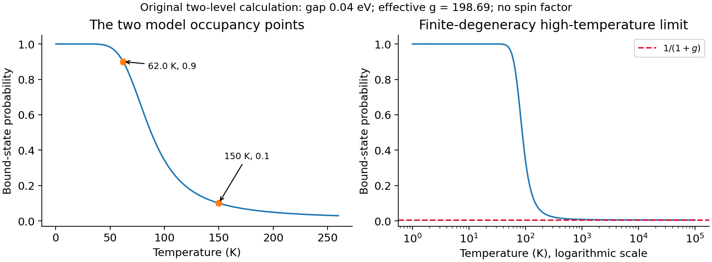

<h1 id="section-c/c11/solution">Solution</h1>

↑ **Parent:** [C11](../c11.md)

Let two weakly coupled bodies exchange [energy](../../../../../energy-split.md) while their total [energy](../../../../../energy-split.md) $U$ is fixed. If body1 has $U_1$, the number of compatible states is $\Omega_1(U_1)\Omega_2(U-U_1)$. Its most probable equilibrium division maximizes the logarithm, giving

$$
\frac{\partial\ln\Omega_1}{\partial U_1}
=\frac{\partial\ln\Omega_2}{\partial U_2}.
$$

This equal intensive quantity labels [thermal equilibrium](../../../../../thermal-equilibrium-split.md). With $S=k_B\ln\Omega$ and thermodynamic $1/T=(\partial S/\partial U)_{V,N}$,

$$
\boxed{\left(\frac{\partial\ln\Omega}{\partial U}\right)_{V,N}=\frac1{k_BT}=\beta.}
$$

Ordinary positive [heat capacities](../../../../../heat-capacity.md) make the [entropy](../../../../../entropy-split.md) maximum locally stable. Particle numbers and [volumes](../../../../../volume.md) are held fixed during the exchange.

For a subsystem coupled to a large [heat](../../../../../heat-split.md) bath, the exact level weight is proportional to $g_j\Omega_b(U-\epsilon_j)$. Expanding the bath [entropy](../../../../../entropy-split.md) gives $\ln\Omega_b(U-\epsilon_j)=\ln\Omega_b(U)-\beta\epsilon_j+\cdots$. Normalization therefore gives

$$
\boxed{P(\epsilon_j)=\frac{g_je^{-\beta\epsilon_j}}Z,\qquad
Z=\sum_i g_ie^{-\beta\epsilon_i}.}
$$

The Boltzmann form uses the reservoir limit; an arbitrary small isolated pair instead retains its exact bath state count. The degeneracy counts distinct subsystem [microstates](../../../../../microstate.md) at the same [energy](../../../../../energy-split.md), rather than adding another Boltzmann factor for the whole level.

In the [two-level donor occupancy](../../../../../two-level-donor-occupancy.md) model, set the single bound-state [energy](../../../../../energy-split.md) to zero and the conduction representative to $\Delta=0.04\,\mathrm{eV}$ with degeneracy $g$. Ignoring [spin](../../../../../spin.md), its bound [probability](../../../../../probability.md) is

$$
P_b(T)=\frac1{1+g e^{-\Delta/(k_BT)}}.
$$

The measured model occupancy gives $g e^{-\Delta/(k_B150\,\mathrm K)}=9$, so

$$
\boxed{g=9e^{0.04/(150k_B)}\simeq1.99\times10^2\simeq200,}
$$

using $k_B=8.61733\times10^{-5}\,\mathrm{eV\,K^{-1}}$. The supplied occupancy and [energy](../../../../../energy-split.md) are rounded, so there is no reason to demand an exact nonrounded integer from that inference.

For $P_b=0.9$, the excited-to-bound weight must be $1/9$. Eliminate $g$ using the first point:

$$
\frac1T=\frac1{150\,\mathrm K}+\frac{2k_B\ln9}{\Delta},\qquad
\boxed{T\simeq62.0\,\mathrm K.}
$$

The [probability](../../../../../probability.md) decreases monotonically from1 as $T\to0$ toward $1/(1+g)\simeq0.005$ as $T\to\infty$. The nonzero high-temperature limit follows from the stipulated finite effective degeneracy, not from a full continuum conduction-band calculation. A realistic band with energy-dependent [density of states](../../../../../density-of-states.md) need not retain this two-level limit.

**[Figure 4](#section-c/c11/image-donor-occupancy). Donor occupancy**. Two-level model with both inferred temperature points.

## ↑ Ancestors (14)

1. [C11](../c11.md)
2. [Section C](../../section-c.md)
3. [Paper 1](../../../paper-1-split.md)
4. [2010](../../../split.md)
5. [Past exam of the physics B course of the University of Cambridge](../../../../split.md)
6. [Physics B course of the University of Cambridge](../../../../../physics-b-course-of-the-university-of-cambridge.md)
7. [Physics course of the year 2 of the natural sciences course of the University of Cambridge](../../../../../physics-course-of-the-year-2-of-the-natural-sciences-course-of-the-university-of-cambridge.md)
8. [Year 2 of the natural sciences course of the University of Cambridge](../../../../../year-2-of-the-natural-sciences-course-of-the-university-of-cambridge.md)
9. [Year of the natural sciences course of the University of Cambridge](../../../../../year-of-the-natural-sciences-course-of-the-university-of-cambridge.md)
10. [Natural sciences course of the University of Cambridge](../../../../../natural-sciences-course-of-the-university-of-cambridge.md)
11. [Course of the University of Cambridge](../../../../../course-of-the-university-of-cambridge.md)
12. [University of Cambridge](../../../../../university-of-cambridge-split.md)
13. [List of universities](../../../../../list-of-universities.md)
14. [Codex Wiki](../../../../../split.md)
