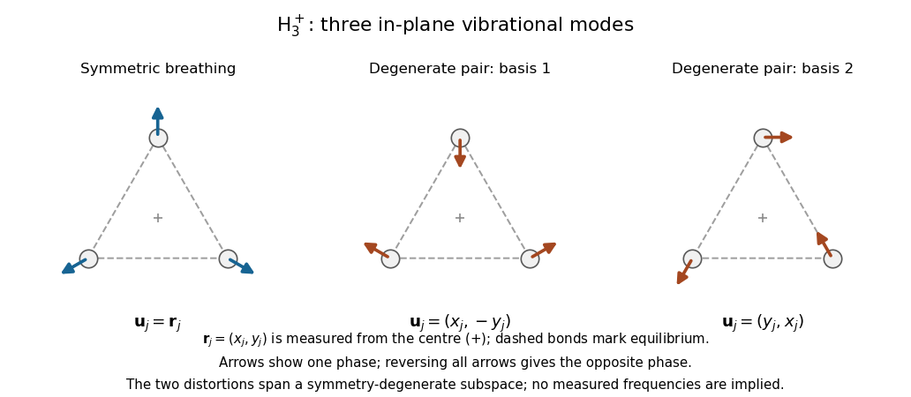

<h1 id="section-a/5/solution">Solution</h1>

↑ **Parent:** [5](../5.md)

The [trihydrogen cation](../../../../../trihydrogen-cation.md) is a nonlinear three-nucleus molecule. Removing three translations and three rigid rotations leaves $3(3)-6=3$ vibrational degrees of freedom. One [normal mode](../../../../../normal-mode.md) is the symmetric in-plane breathing motion: every nucleus moves radially toward or away from the centre. The remaining two [normal modes](../../../../../normal-mode.md) form a degenerate in-plane distortion pair, stretching one direction while compressing another.

For an explicit sketch, let $\mathbf r_j$ be the equilibrium vertices relative to their centre. Displacements proportional to

$$
\mathbf u_j^{(1)}=\mathbf r_j,\qquad
\mathbf u_j^{(2)}=\begin{pmatrix}1&0\\0&-1\end{pmatrix}\mathbf r_j,\qquad
\mathbf u_j^{(3)}=\begin{pmatrix}0&1\\1&0\end{pmatrix}\mathbf r_j
$$

give the breathing mode and a basis of the degenerate pair. Linear combinations within the latter pair are equally valid. Their actual frequencies require molecular force constants, which are not supplied. An apparent out-of-plane motion of three point nuclei is a translation or infinitesimal rigid rotation, rather than an additional independent vibration.

**[Figure 1](#section-a/5/image-breathing-and-degenerate-distortion-modes-of-an-equilateral-molecule). Breathing and degenerate distortion modes of an equilateral molecule**. Original displacement vectors in a simple symmetric bond-spring illustration. The degeneracy is fixed by symmetry; no measured molecular frequencies are asserted.

## ↑ Ancestors (14)

1. [5](../5.md)
2. [Section A](../../section-a.md)
3. [Paper 2A](../../../paper-2a-split.md)
4. [2010](../../../split.md)
5. [Past exam of the physics B course of the University of Cambridge](../../../../split.md)
6. [Physics B course of the University of Cambridge](../../../../../physics-b-course-of-the-university-of-cambridge.md)
7. [Physics course of the year 2 of the natural sciences course of the University of Cambridge](../../../../../physics-course-of-the-year-2-of-the-natural-sciences-course-of-the-university-of-cambridge.md)
8. [Year 2 of the natural sciences course of the University of Cambridge](../../../../../year-2-of-the-natural-sciences-course-of-the-university-of-cambridge.md)
9. [Year of the natural sciences course of the University of Cambridge](../../../../../year-of-the-natural-sciences-course-of-the-university-of-cambridge.md)
10. [Natural sciences course of the University of Cambridge](../../../../../natural-sciences-course-of-the-university-of-cambridge.md)
11. [Course of the University of Cambridge](../../../../../course-of-the-university-of-cambridge.md)
12. [University of Cambridge](../../../../../university-of-cambridge-split.md)
13. [List of universities](../../../../../list-of-universities.md)
14. [Codex Wiki](../../../../../split.md)

## ← Incoming links (1)

- [Solution](../../../paper-2b/section-a/5/solution.md)
