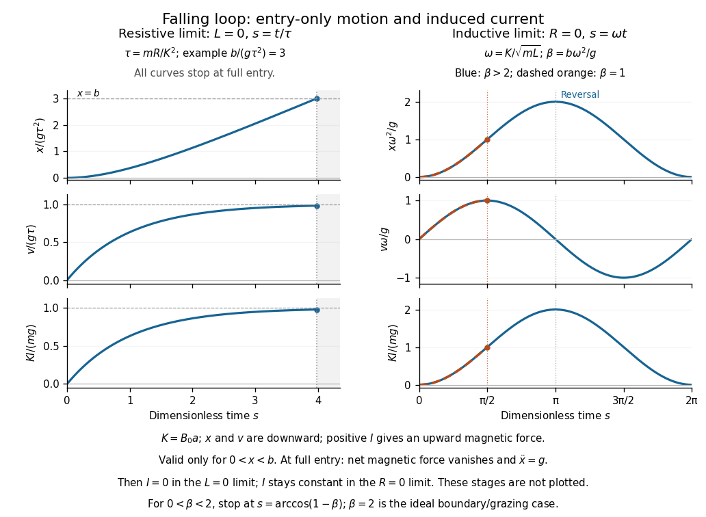

<h1 id="section-b/b7/solution">Solution</h1>

↑ **Parent:** [B7](../b7.md)

[Faraday's law](../../../../../faraday-s-law-of-induction.md) for a moving circuit is $\mathcal E=\oint(\mathbf E+\mathbf v\times\mathbf B)\cdot d\boldsymbol\ell=-d\Phi_B/dt$. The [magnetic flux](../../../../../magnetic-flux.md) $\Phi_B$ is through a surface bounded by the instantaneous loop, with consistent orientation. For the stationary external field here, the motion supplies the [motional electromotive force](../../../../../motional-electromotive-force.md).

Let $x$ be downward penetration of the bottom segment, $v=\dot x$, and $K=B_0a$. While $0<x<b$, flux grows at rate $Kv$. Define positive current as the direction whose [magnetic force](../../../../../magnetic-force.md) is upward. With negligible [self-inductance](../../../../../self-inductance.md), $I=Kv/R$ and

$$
m\dot v=mg-KI=mg-\frac{K^2}R v,\qquad \tau=\frac{mR}{K^2}.
$$

The [resistive magnetic entry of a falling loop](../../../../../resistive-magnetic-entry-of-a-falling-loop.md) gives

$$
\boxed{v=g\tau(1-e^{-t/\tau}),\qquad I=\frac{Kg\tau}R(1-e^{-t/\tau}),\qquad
x=g\tau[t-\tau(1-e^{-t/\tau})].}
$$

The initial acceleration is $g$ and the speed approaches $g\tau$ if the loop remains partly immersed long enough. Joule heating $I^2R$ removes gravitational energy. At the first $x=b$, both horizontal segments are inside the uniform field: the net flux becomes constant, the net magnetic force vanishes, and this zero-inductance model has $I=0$ thereafter. The subsequent speed increases with acceleration $g$.

For negligible [electrical resistance](../../../../../electrical-resistance.md), conservation of total linked flux instead gives $LI=Kx$ in the braking-current convention. Therefore

$$
m\ddot x=mg-\frac{K^2}Lx,\qquad \omega=\frac K{\sqrt{mL}},
$$

and the [lossless limit of magnetic loop braking](../../../../../lossless-limit-of-magnetic-loop-braking.md) yields

$$
\boxed{x=\frac g{\omega^2}(1-\cos\omega t),\qquad
v=\frac g\omega\sin\omega t,\qquad
I=\frac{mg}K(1-\cos\omega t).}
$$

Here energy is stored reversibly in $LI^2/2$, not dissipated. If $b>2g/\omega^2$, the loop reverses before complete entry and executes the ideal oscillatory motion while straddling the boundary. If $b<2g/\omega^2$, it reaches complete entry on its first descent; thereafter the current is constant, the forces on its two horizontal segments cancel, and it falls with acceleration $g$. The exact grazing case needs care at the ideal discontinuous field boundary. An entry-only sinusoid must not be extrapolated through full immersion.

**[Figure 2](#section-b/b7/image-resistive-relaxation-and-reversible-inductive-motion-during-loop-entry). Resistive relaxation and reversible inductive motion during loop entry**. Original dimensionless entry solutions. Curves assume that the loop is long enough for the indicated stage; a fully immersed loop has different subsequent dynamics.

## ↑ Ancestors (14)

1. [B7](../b7.md)
2. [Section B](../../section-b.md)
3. [Paper 2A](../../../paper-2a-split.md)
4. [2010](../../../split.md)
5. [Past exam of the physics B course of the University of Cambridge](../../../../split.md)
6. [Physics B course of the University of Cambridge](../../../../../physics-b-course-of-the-university-of-cambridge.md)
7. [Physics course of the year 2 of the natural sciences course of the University of Cambridge](../../../../../physics-course-of-the-year-2-of-the-natural-sciences-course-of-the-university-of-cambridge.md)
8. [Year 2 of the natural sciences course of the University of Cambridge](../../../../../year-2-of-the-natural-sciences-course-of-the-university-of-cambridge.md)
9. [Year of the natural sciences course of the University of Cambridge](../../../../../year-of-the-natural-sciences-course-of-the-university-of-cambridge.md)
10. [Natural sciences course of the University of Cambridge](../../../../../natural-sciences-course-of-the-university-of-cambridge.md)
11. [Course of the University of Cambridge](../../../../../course-of-the-university-of-cambridge.md)
12. [University of Cambridge](../../../../../university-of-cambridge-split.md)
13. [List of universities](../../../../../list-of-universities.md)
14. [Codex Wiki](../../../../../split.md)

## ← Incoming links (1)

- [Solution](../../../paper-2b/section-b/b7/solution.md)
