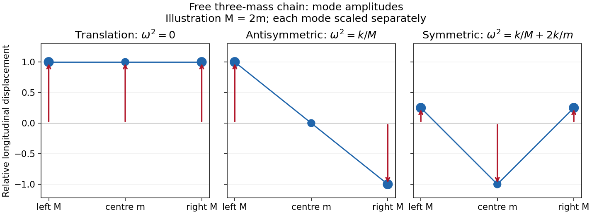

<h1 id="section-d/d14/solution">Solution</h1>

↑ **Parent:** [D14](../d14.md)

A [normal mode](../../../../../normal-mode.md) has all [displacement](../../../../../displacement.md) coordinates proportional to a common time dependence, with fixed relative amplitudes. For a nonzero [frequency](../../../../../frequency.md) the time dependence is sinusoidal. A zero-frequency mode is a free [displacement](../../../../../displacement.md) or uniform drift rather than an [oscillation](../../../../../oscillation.md).

Use the printed mass ordering $M,m,M$. [Displacements](../../../../../displacement.md) are measured from the unstretched [equilibrium](../../../../../equilibrium-point-of-a-dynamical-system.md) positions, giving

$$
M\ddot x_1=k(x_2-x_1),\qquad
m\ddot x_2=k(x_1-2x_2+x_3),\qquad
M\ddot x_3=k(x_2-x_3).
$$

Equivalently,

$$
\boxed{\mathsf M\ddot{\mathbf x}+\mathsf K\mathbf x=0,\quad
\mathsf M=\operatorname{diag}(M,m,M),\quad
\mathsf K=k\begin{pmatrix}1&-1&0\\-1&2&-1\\0&-1&1\end{pmatrix}.}
$$

This is the [generalized eigenvalue problem](../../../../../generalized-eigenvalue-problem.md) for [normal modes of three masses connected by two equal springs](../../../../../normal-modes-of-three-masses-connected-by-two-equal-springs.md). Substitute $\mathbf x=\mathbf u e^{i\omega t}$ to obtain $\mathsf K\mathbf u=\omega^2\mathsf M\mathbf u$. [Reflection symmetry](../../../../../reflection-symmetry.md) gives an antisymmetric [vector](../../../../../vector.md) $(1,0,-1)$ and [symmetric](../../../../../symmetric-relation.md) [vectors](../../../../../vector.md) $(1,b,1)$. The former has $\omega^2=k/M$. For a [symmetric](../../../../../symmetric-relation.md) [vector](../../../../../vector.md), the end and centre equations give $M\omega^2=k(1-b)$ and $m\omega^2b=2k(b-1)$. Their solutions are $b=1$, $\omega=0$, or $b=-2M/m$, $\omega^2=k/M+2k/m$. Hence

$$
\boxed{\begin{array}{c|c|l}
\mathbf u&\omega^2&\text{relative motion}\\\hline
(1,1,1)&0&\text{rigid translation, neither spring stretched}\\
(1,0,-1)&k/M&\text{end masses opposite, centre fixed}\\
(1,-2M/m,1)&k/M+2k/m&\text{ends together, centre opposite}.
\end{array}}
$$

These are all three [eigenmodes](../../../../../normal-mode.md). The last two keep the [centre of mass](../../../../../center-of-mass.md) fixed and are [orthogonal](../../../../../orthogonal-vectors.md) in the mass-weighted [inner product](../../../../../inner-product-split.md). The general zero-mode contribution is $(A+Bt)(1,1,1)$, accounting for both a centre-of-mass shift and a conserved total [momentum](../../../../../momentum-split.md). There are no fixed end springs in this system.

**[Figure 3](#section-d/d14/image-free-chain-mode-shapes). Free-chain mode shapes**.

The original amplitude profiles illustrate $M=2m$; the [symmetric](../../../../../symmetric-relation.md) internal shape is rescaled for display. The formula above gives every positive mass ratio.

Two further physical examples are **standing-wave modes of a string fixed at both ends**, with spatial shapes $\sin(n\pi x/L)$ and [frequencies](../../../../../frequency.md) $n\pi c/L$, and **electrical [normal modes](../../../../../normal-mode.md) of two coupled [LC circuits](../../../../../lc-circuit.md)**, in which the [capacitor](../../../../../capacitor.md) charges oscillate at fixed relative amplitudes. Independent [normal mode coordinates](../../../../../normal-coordinate.md) simplify both systems in the same way as the spring-chain [eigenvectors](../../../../../eigenvector.md).

## ↑ Ancestors (14)

1. [D14](../d14.md)
2. [Section D](../../section-d.md)
3. [Paper 2A](../../../paper-2a-split.md)
4. [2010](../../../split.md)
5. [Past exam of the physics B course of the University of Cambridge](../../../../split.md)
6. [Physics B course of the University of Cambridge](../../../../../physics-b-course-of-the-university-of-cambridge.md)
7. [Physics course of the year 2 of the natural sciences course of the University of Cambridge](../../../../../physics-course-of-the-year-2-of-the-natural-sciences-course-of-the-university-of-cambridge.md)
8. [Year 2 of the natural sciences course of the University of Cambridge](../../../../../year-2-of-the-natural-sciences-course-of-the-university-of-cambridge.md)
9. [Year of the natural sciences course of the University of Cambridge](../../../../../year-of-the-natural-sciences-course-of-the-university-of-cambridge.md)
10. [Natural sciences course of the University of Cambridge](../../../../../natural-sciences-course-of-the-university-of-cambridge.md)
11. [Course of the University of Cambridge](../../../../../course-of-the-university-of-cambridge.md)
12. [University of Cambridge](../../../../../university-of-cambridge-split.md)
13. [List of universities](../../../../../list-of-universities.md)
14. [Codex Wiki](../../../../../split.md)
