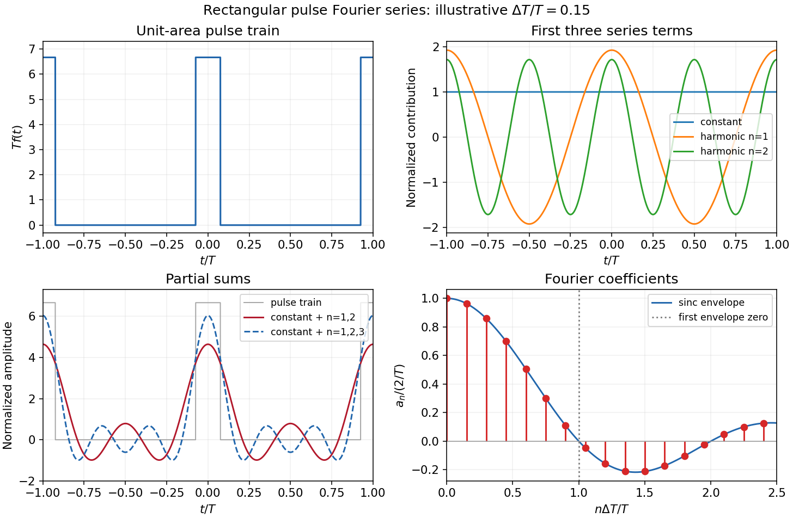

<h1 id="section-d/d15/solution">Solution</h1>

↑ **Parent:** [D15](../d15.md)

A [Fourier series](../../../../../fourier-series-split.md) separates a periodic physical [signal](../../../../../signal.md) into harmonics. For example, a periodic [voltage](../../../../../voltage.md) applied to a linear circuit can be treated one [frequency](../../../../../frequency.md) at a time; the harmonic responses then superpose to give the output waveform.

Write $w=\Delta T$ for the pulse width and $\delta=w/T$ for its [duty cycle](../../../../../duty-cycle.md), with $0<w<T$. The waveform is a train of positive [rectangular pulses](../../../../../rectangular-function.md) centred on $t=jT$, each with area one. It is even about $t=0$, so every [sine](../../../../../sine.md) coefficient vanishes. [Cosine](../../../../../cosine.md) [orthogonality](../../../../../orthogonal-vectors.md) gives

$$
a_0=\frac2T\int_{-T/2}^{T/2}f(t)\,dt=\frac2T,
$$

and, for $n\geq1$,

$$
a_n=\frac2{Tw}\int_{-w/2}^{w/2}\cos\frac{2\pi nt}{T}\,dt
=\frac{2}{\pi nw}\sin\frac{\pi nw}{T}.
$$

This is the [Fourier series of a periodic rectangular pulse](../../../../../fourier-series-of-a-periodic-rectangular-pulse.md):

$$
\boxed{a_n=\frac2T\operatorname{sinc}(\pi n\delta)\quad(n\geq0),\qquad
\operatorname{sinc}z=\frac{\sin z}{z},\quad\operatorname{sinc}0=1.}
$$

The actual constant term in the series is $a_0/2=1/T$, not $a_0$. As usual for a [jump discontinuity](../../../../../jump-discontinuity.md), the series converges to the average of the one-sided values at each pulse edge, namely $1/(2w)$, irrespective of the value assigned at that isolated endpoint. Elsewhere it converges to the rectangular waveform.

Counting the constant as the first term, the first three terms are

$$
\frac1T,\qquad \frac2T\operatorname{sinc}(\pi\delta)\cos\frac{2\pi t}{T},\qquad
\frac2T\operatorname{sinc}(2\pi\delta)\cos\frac{4\pi t}{T},
$$

so their sum is

$$
\boxed{S_2(t)=\frac1T+\frac2T\left[\operatorname{sinc}(\pi\delta)\cos\frac{2\pi t}{T}+\operatorname{sinc}(2\pi\delta)\cos\frac{4\pi t}{T}\right].}
$$

If “first three” instead means the first three nonconstant harmonics, add $a_3\cos(6\pi t/T)$; the original plot shows that alternative partial sum as well. The three-term approximation rounds the narrow peaks and ripples between them; many harmonics are needed to represent a sharp pulse.

**[Figure 4](#section-d/d15/image-rectangular-pulse-harmonics). Rectangular pulse harmonics**.

The original sketches use the illustrative [duty cycle](../../../../../duty-cycle.md) $\delta=0.15$ and cover $-T\leq t\leq T$. The coefficient panel also displays the first spectral zero.

For $n\delta\ll1$, expand the [sinc function](../../../../../sinc-function.md):

$$
\boxed{a_n=\frac2T\left[1-\frac{\pi^2n^2\delta^2}{6}+O(n^4\delta^4)\right]\simeq\frac2T.}
$$

Thus the low-index coefficients, including $a_0$, have nearly equal values, although their _constant-series contribution_ still has the factor $1/2$. The first sinc zero occurs at $n\delta=1$, or $n=T/w$. If this is not an integer, the closest integer coefficient is near zero rather than exactly zero: writing $n\delta=1+\varepsilon$ gives $a_n\simeq-(2/T)\varepsilon$. This [pulse-width scale of Fourier coefficients](../../../../../pulse-width-scale-of-fourier-coefficients.md) means that a narrower pulse requires significant harmonics extending to proportionally larger indices, the reciprocal time-width/frequency-width relation.

## ↑ Ancestors (14)

1. [D15](../d15.md)
2. [Section D](../../section-d.md)
3. [Paper 2A](../../../paper-2a-split.md)
4. [2010](../../../split.md)
5. [Past exam of the physics B course of the University of Cambridge](../../../../split.md)
6. [Physics B course of the University of Cambridge](../../../../../physics-b-course-of-the-university-of-cambridge.md)
7. [Physics course of the year 2 of the natural sciences course of the University of Cambridge](../../../../../physics-course-of-the-year-2-of-the-natural-sciences-course-of-the-university-of-cambridge.md)
8. [Year 2 of the natural sciences course of the University of Cambridge](../../../../../year-2-of-the-natural-sciences-course-of-the-university-of-cambridge.md)
9. [Year of the natural sciences course of the University of Cambridge](../../../../../year-of-the-natural-sciences-course-of-the-university-of-cambridge.md)
10. [Natural sciences course of the University of Cambridge](../../../../../natural-sciences-course-of-the-university-of-cambridge.md)
11. [Course of the University of Cambridge](../../../../../course-of-the-university-of-cambridge.md)
12. [University of Cambridge](../../../../../university-of-cambridge-split.md)
13. [List of universities](../../../../../list-of-universities.md)
14. [Codex Wiki](../../../../../split.md)
