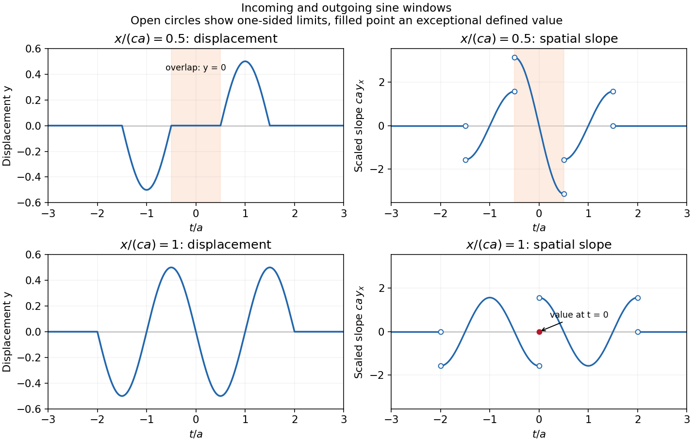

<h1 id="section-d/d16/solution">Solution</h1>

↑ **Parent:** [D16](../d16.md)

[Linearity](../../../../../linearity.md) means that the [differential operator](../../../../../differential-operator.md) $L=\partial_x^2-c^{-2}\partial_t^2$ obeys $L(ay_1+by_2)=aLy_1+bLy_2$. Therefore any [linear combination](../../../../../linear-combination.md) of homogeneous solutions is again a solution; associated initial or boundary data must be combined by the same rule.

With [characteristic coordinates](../../../../../characteristic-coordinate.md) $\xi=x-ct$ and $\eta=x+ct$, the equation becomes $4y_{\xi\eta}=0$. Integrating in these coordinates gives

$$
\boxed{y=F(x-ct)+G(x+ct).}
$$

The two profiles propagate without changing shape at speeds $+c$ and $-c$. Equivalently write $y=P(t-x/c)+Q(t+x/c)$. At $x=0$, the data imply $P+Q=f$ and $-P'+Q'=0$. Hence $P-Q$ is constant; its two contributions cancel in $y$, giving

$$
\boxed{y(x,t)=\tfrac12[f(t-x/c)+f(t+x/c)],\qquad
y_x(x,t)=\frac{-f'(t-x/c)+f'(t+x/c)}{2c}.}
$$

The slope formula holds classically wherever the two [derivatives](../../../../../derivative.md) exist, and as a [weak derivative](../../../../../weak-derivative.md) otherwise. Since the string [tension](../../../../../tension.md) is $\rho c^2$, $\rho$ here must be mass per unit length. These are [two-sided string data with zero slope](../../../../../two-sided-string-data-with-zero-slope.md). The stipulated boundary data specify **incoming as well as outgoing waves**; this is not a pulse generated on an everywhere initially resting infinite string. For example, at a positive observation point its incoming [signal](../../../../../signal.md) can begin before the motion at $x=0$ begins.

For explicit profiles put $u=t/a$, $s=x/(ca)$ and

$$
h(v)=\begin{cases}\sin(\pi v),&|v|\leq1,\\0,&|v|>1.\end{cases}
$$

Then $y_s(u)=[h(u-s)+h(u+s)]/2$ and $ca\,y_x=[-h'(u-s)+h'(u+s)]/2$. At ordinary points, $h'(v)=\pi\cos(\pi v)$ for $|v|<1$ and zero for $|v|>1$. Because $h$ itself vanishes at both support edges, this first [weak derivative](../../../../../weak-derivative.md) has **no delta-function term**, although it has jumps.

At $x=ca/2$, the [displacement](../../../../../displacement.md) is

$$
\boxed{y_{1/2}(u)=\begin{cases}
\tfrac12\cos(\pi u),&-3/2<u<-1/2,\\
-\tfrac12\cos(\pi u),&1/2<u<3/2,\\
0,&\text{otherwise}.
\end{cases}}
$$

For non-front times its slope is

$$
\boxed{ca\,y_x=\begin{cases}
-\tfrac\pi2\sin(\pi u),&-3/2<u<-1/2,\\
-\pi\sin(\pi u),&-1/2<u<1/2,\\
-\tfrac\pi2\sin(\pi u),&1/2<u<3/2,\\
0,&|u|>3/2.
\end{cases}}
$$

This is [displacement cancellation without slope cancellation in crossing pulses](../../../../../displacement-cancellation-without-slope-cancellation-in-crossing-pulses.md): **[displacement](../../../../../displacement.md) cancels throughout the overlap $-1/2<u<1/2$, but slope generally does not.** Cancellation at one spatial position for an interval of time does not imply cancellation of the [spatial derivative](../../../../../spatial-derivative.md) there. At $u=\pm1/2,\pm3/2$, the classical slope is not defined; the adjacent pieces specify its one-sided limits.

At $x=ca$ the two windows meet without an open overlap. Their [displacements](../../../../../displacement.md) combine into

$$
\boxed{y_1(u)=\begin{cases}-\tfrac12\sin(\pi u),&-2\leq u\leq2,\\0,&|u|>2,\end{cases}}
$$

with slope

$$
\boxed{ca\,y_x=\begin{cases}
-\tfrac\pi2\cos(\pi u),&-2<u<0,\\
\tfrac\pi2\cos(\pi u),&0<u<2,\\
0,&|u|>2\ \text{or }u=0.
\end{cases}}
$$

At $u=\pm2$ the classical slope is undefined. At the exceptional meeting time $u=0$, oddness of $f$ gives $y(x,0)=0$ for every $x$, so the [spatial derivative](../../../../../spatial-derivative.md) is **exactly zero** there. Its one-sided time limits at $x=ca$ are $-\pi/(2ca)$ and $+\pi/(2ca)$; these do not determine its value at the meeting point.

**[Figure 5](#section-d/d16/image-displacement-and-slope-pulses). Displacement and slope pulses**.

The original graphs distinguish continuous [displacements](../../../../../displacement.md), open-ended one-sided slope traces, and the zero slope at the isolated meeting point. The sharp temporal window is not differentiable at its endpoints, so the overall solution is piecewise classical and globally weak. In particular the literal boundary slope at $(x,t)=(0,\pm a)$ is not a classical [derivative](../../../../../derivative.md): the even spatial profile has a cusp there. The zero-slope boundary prescription is satisfied at regular times and in its almost-everywhere trace sense; it cannot be read as a globally smooth classical condition for this nonsmooth $f$.

## ↑ Ancestors (14)

1. [D16](../d16.md)
2. [Section D](../../section-d.md)
3. [Paper 2A](../../../paper-2a-split.md)
4. [2010](../../../split.md)
5. [Past exam of the physics B course of the University of Cambridge](../../../../split.md)
6. [Physics B course of the University of Cambridge](../../../../../physics-b-course-of-the-university-of-cambridge.md)
7. [Physics course of the year 2 of the natural sciences course of the University of Cambridge](../../../../../physics-course-of-the-year-2-of-the-natural-sciences-course-of-the-university-of-cambridge.md)
8. [Year 2 of the natural sciences course of the University of Cambridge](../../../../../year-2-of-the-natural-sciences-course-of-the-university-of-cambridge.md)
9. [Year of the natural sciences course of the University of Cambridge](../../../../../year-of-the-natural-sciences-course-of-the-university-of-cambridge.md)
10. [Natural sciences course of the University of Cambridge](../../../../../natural-sciences-course-of-the-university-of-cambridge.md)
11. [Course of the University of Cambridge](../../../../../course-of-the-university-of-cambridge.md)
12. [University of Cambridge](../../../../../university-of-cambridge-split.md)
13. [List of universities](../../../../../list-of-universities.md)
14. [Codex Wiki](../../../../../split.md)
