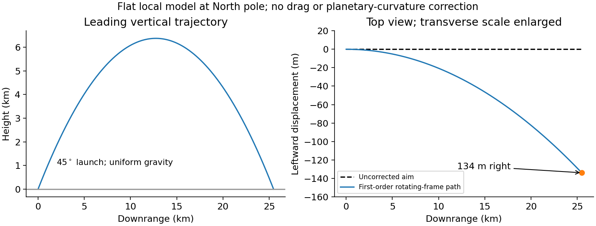
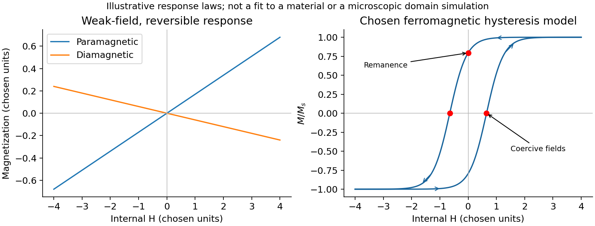
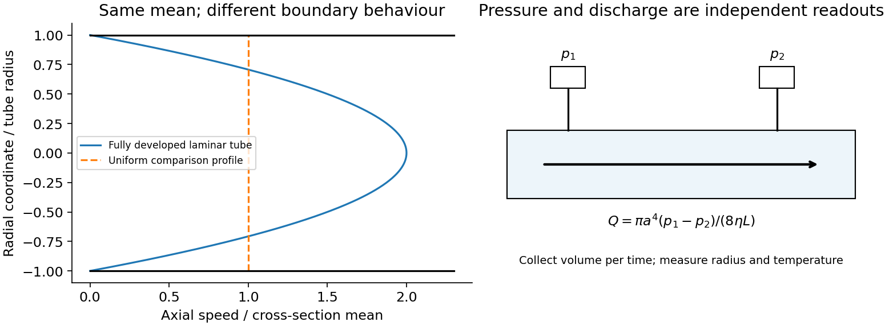
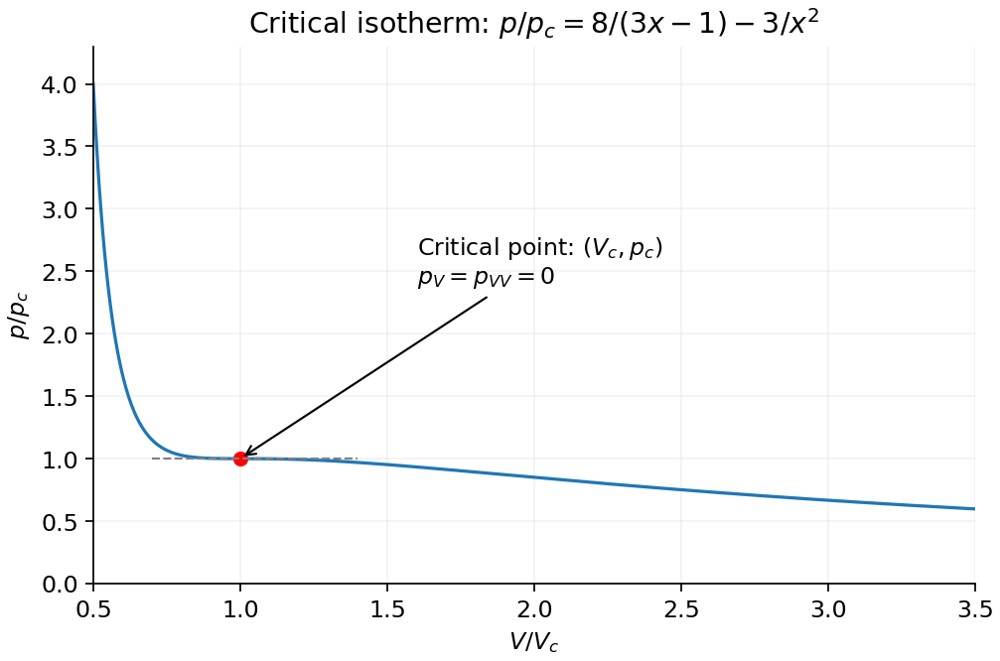
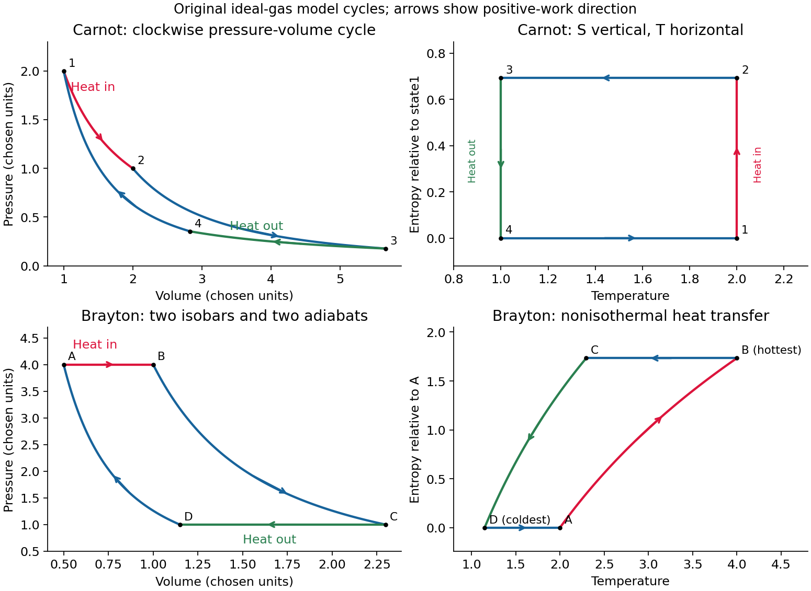

# Paper 1

↑ **Parent:** [2011](../2011.md)

Original paper: [Public original, physical PDF pages 279–282](https://www.whatdotheyknow.com/request/physics_past_papers_23/response/3514893/attach/4/FOI%202026%20628%20Smith%20materials.pdf?cookie_passthrough=1#page=279).

**Table of contents**

- [Section A](#section-a)
  - [A1](#section-a/a1)
    - [Solution](#section-a/a1/solution)
  - [A2](#section-a/a2)
    - [Solution](#section-a/a2/solution)
  - [A3](#section-a/a3)
    - [Solution](#section-a/a3/solution)
  - [A4](#section-a/a4)
    - [Solution](#section-a/a4/solution)
  - [A5](#section-a/a5)
    - [Solution](#section-a/a5/solution)
- [Section B](#section-b)
  - [B6](#section-b/b6)
    - [a](#section-b/b6/a)
      - [Solution](#section-b/b6/a/solution)
    - [b](#section-b/b6/b)
      - [Solution](#section-b/b6/b/solution)
    - [c](#section-b/b6/c)
      - [Solution](#section-b/b6/c/solution)
    - [d](#section-b/b6/d)
      - [Solution](#section-b/b6/d/solution)
  - [B7](#section-b/b7)
    - [Solution](#section-b/b7/solution)
  - [B8](#section-b/b8)
    - [a](#section-b/b8/a)
      - [Solution](#section-b/b8/a/solution)
    - [b](#section-b/b8/b)
      - [Solution](#section-b/b8/b/solution)
    - [c](#section-b/b8/c)
      - [Solution](#section-b/b8/c/solution)
    - [d](#section-b/b8/d)
      - [Solution](#section-b/b8/d/solution)
  - [B9](#section-b/b9)
    - [Solution](#section-b/b9/solution)
- [Section C](#section-c)
  - [C10](#section-c/c10)
    - [Solution](#section-c/c10/solution)
  - [C11](#section-c/c11)
    - [Solution](#section-c/c11/solution)
  - [C12](#section-c/c12)
    - [Solution](#section-c/c12/solution)
  - [C13](#section-c/c13)
    - [Solution](#section-c/c13/solution)

## Section A

↑ **Parent:** [Paper 1](paper-1.md)

<h3 id="section-a/a1">A1</h3>

↑ **Parent:** [Section A](#section-a)

<h4 id="section-a/a1/solution">Solution</h4>

↑ **Parent:** [A1](#section-a/a1)

For an outward radial [electric field](../../electric-field.md), [Gauss's law](../../maxwell-equations.md#gauss-s-law) gives the enclosed charge

$$
Q(r)=4\pi\epsilon_0r^2 E_r=4\pi\epsilon_0\alpha r e^{-\lambda r}.
$$

Taking the enclosing sphere to infinity gives **$Q_{\rm total}=0$**. A nonzero local field is compatible with zero net charge. Indeed, for $r>0$,

$$
\rho(r)=\epsilon_0\nabla\cdot\mathbf E
=\frac{\epsilon_0\alpha e^{-\lambda r}}{r^2}(1-\lambda r).
$$

Positive inner charge is balanced by negative outer charge. There is no point charge at the origin, since $\lim_{r\to0}4\pi\epsilon_0r^2 E_r=0$. The field's magnitude does not specify its inward/outward sign, but reversing a globally radial direction leaves the zero total unchanged. This is [net charge from the asymptotic radial electric field](../../maxwell-equations.md#net-charge-from-the-asymptotic-radial-electric-field).

<h3 id="section-a/a2">A2</h3>

↑ **Parent:** [Section A](#section-a)

<h4 id="section-a/a2/solution">Solution</h4>

↑ **Parent:** [A2](#section-a/a2)

In steady state the incoming [volumetric flow rate](../../fluid-mechanics.md#volumetric-flow-rate) equals the discharge. [Bernoulli's principle](../../euler-equations-for-an-inviscid-fluid.md#bernoulli-s-principle) between a nearly stationary free surface and the atmospheric outlet gives the ideal [Torricelli's law](../../fluid-mechanics.md#torricelli-s-law) [speed](../../classical-mechanics.md#speed) $\sqrt{2gh}$. The specified [discharge coefficient](../../fluid-mechanics.md#discharge-coefficient) multiplies the opening-flow rate, so

$$
Q=\frac{10\times10^{-3}}{60}=1.6667\times10^{-4}\,\mathrm{m^3\,s^{-1}},\qquad
Q=C_d A\sqrt{2gh}.
$$

Thus, with $A=10^{-4}\,\mathrm{m^2}$ and $g=9.81\,\mathrm{m\,s^{-2}}$,

$$
\boxed{h=\frac1{2g}\left(\frac{Q}{0.62A}\right)^2=0.368\,\mathrm m.}
$$

Neglect surface-speed and capillary corrections. The coefficient includes contraction and loss effects; it should not be applied a second time to the calculated height.

<h3 id="section-a/a3">A3</h3>

↑ **Parent:** [Section A](#section-a)

<h4 id="section-a/a3/solution">Solution</h4>

↑ **Parent:** [A3](#section-a/a3)

Take $f$ as the tensile [force](../../force.md) exerted on the band, so reversible stretching supplies work $f\,dx$. At fixed other mechanical variables,

$$
dU=T\,dS+f\,dx,\qquad dF=-S\,dT+f\,dx.
$$

Equality of mixed [derivatives](../../calculus.md#derivative) of the [Helmholtz free energy](../../thermodynamic-potential.md#helmholtz-free-energy) yields the [thermoelastic Maxwell relation for a stretched band](../../continuum-mechanics.md#thermoelastic-maxwell-relation-for-a-stretched-band)

$$
\boxed{\left(\frac{\partial S}{\partial x}\right)_T=-\left(\frac{\partial f}{\partial T}\right)_x.}
$$

For entropy-dominated [rubber elasticity](../../polymer.md#rubber-elasticity), increasing extension reduces [configurational entropy](../../entropy.md#configurational-entropy), consistently giving a tensile [force](../../force.md) that increases with [temperature](../../temperature.md) at fixed extension. A [force](../../force.md) defined as the band's restoring [force](../../force.md) on its support has the opposite sign.

<h3 id="section-a/a4">A4</h3>

↑ **Parent:** [Section A](#section-a)

<h4 id="section-a/a4/solution">Solution</h4>

↑ **Parent:** [A4](#section-a/a4)

For a nonabsorbing interface at [normal incidence](../../optics.md#normal-incidence), the [Fresnel equations](../../electromagnetic-wave.md#fresnel-equations) give the [intensity](../../wave.md#intensity-physics) [reflectance](../../radiometry.md#reflectance)

$$
\mathcal R=\left(\frac{n-1}{n+1}\right)^2=0.04.
$$

The two air–glass interfaces each transmit a fraction $1-\mathcal R$ of their incident power. Omitting all internally reflected paths,

$$
\boxed{\frac{I_{\rm transmitted}}{I_{\rm incident}}=(1-0.04)^2=0.9216,\qquad\text{reduction}=7.84\%\simeq8\%.}
$$

The power-transmission factors, rather than electric-field [amplitudes](../../wave.md#wave-amplitude) alone, are multiplied. Absorption, coatings and interference are excluded by this approximation.

<h3 id="section-a/a5">A5</h3>

↑ **Parent:** [Section A](#section-a)

<h4 id="section-a/a5/solution">Solution</h4>

↑ **Parent:** [A5](#section-a/a5)

Use a local horizontal plane, constant gravity and first order in Earth's angular [speed](../../classical-mechanics.md#speed). Let $x$ point along the initial horizontal shot, $y$ to the gunner's left and $z$ upward. At the North pole, $\boldsymbol\Omega=\Omega\hat{\mathbf z}$. Maximum unperturbed range at equal launch and landing heights requires a $45^\circ$ elevation, giving

$$
v_x=\frac{u}{\sqrt2},\qquad t_f=\frac{\sqrt2u}{g},\qquad R_0=\frac{u^2}{g}.
$$

The leading [Coriolis acceleration](../../mathematical-physics.md#coriolis-acceleration) is $\ddot y=-2\Omega v_x$, while vertical motion has no first-order Coriolis correction. With zero initial lateral [displacement](../../classical-mechanics.md#displacement) and [velocity](../../classical-mechanics.md#velocity),

$$
y(t_f)=-\Omega v_x t_f^2,\qquad
\boxed{|y(t_f)|=\frac{\sqrt2\Omega u^3}{g^2}\simeq1.34\times10^2\,\mathrm m.}
$$

Here $u=500\,\mathrm{m\,s^{-1}}$, $g\simeq9.81\,\mathrm{m\,s^{-2}}$ and $\Omega\simeq7.2921\times10^{-5}\,\mathrm{s^{-1}}$. The miss is **to the right of the aiming direction**, independent of its azimuth at the pole. The flight time is about $72.1\,\mathrm s$, so $\Omega t_f\simeq0.0053\ll1$. This [polar projectile Coriolis deflection](../../mathematical-physics.md#polar-projectile-coriolis-deflection) uses the usual flat, uniform-gravity approximation; planetary [curvature](../../differential-geometry.md#curvature) and variation of gravity are beyond its accuracy. Using the polar gravity rather than $9.81$ changes the estimate by less than one percent. Earth's sidereal rotation period, rather than the solar day, sets $\Omega$.[Orbital parameters: sidereal rotation period 23.9345 hours; bulk parameters: polar surface acceleration](../../physics-bibliography.md#earth-fact-sheet-by-national-aeronautics-and-space-administration)

**[Figure 1](#section-a/a5/image-polar-projectile-deflection). Polar projectile deflection**.

## Section B

↑ **Parent:** [Paper 1](paper-1.md)

<h3 id="section-b/b6">B6</h3>

↑ **Parent:** [Section B](#section-b)

<h4 id="section-b/b6/a">a</h4>

↑ **Parent:** [B6](#section-b/b6)

<h5 id="section-b/b6/a/solution">Solution</h5>

↑ **Parent:** [A](#section-b/b6/a)

[Gauss's law](../../maxwell-equations.md#gauss-s-law) connects [electric flux](../../electric-field.md#electric-flux) through a closed surface to its enclosed charge:

$$
\oint_{\partial V}\mathbf E\cdot d\mathbf A=\frac{Q_{\rm enc}}{\epsilon_0},\qquad
\nabla\cdot\mathbf E=\frac{\rho}{\epsilon_0}.
$$

The differential form follows from the [divergence theorem](../../multivariable-calculus.md#divergence-theorem). The law is exact; extracting a field magnitude by simple division additionally needs [symmetry](../../physics.md#symmetry-physics). For [spherical symmetry](../../geometry-and-topology.md#spherical-symmetry), $E_r(r)=Q(r)/(4\pi\epsilon_0r^2)$; a uniformly charged ball therefore has a field linear in $r$ inside and an inverse-square field outside. An infinite line of linear [charge density](../../electric-charge.md#charge-density) $\Lambda$ gives $E_r=\Lambda/(2\pi\epsilon_0r)$ by a cylindrical surface. A uniformly charged infinite sheet gives $E=\sigma/(2\epsilon_0)$ on either side by a pillbox.

An electrostatic conductor has zero interior field and constant potential; excess charge occupies its surface. A pillbox gives $E_{n,\rm out}=\sigma/\epsilon_0$ when the inside is conducting. More generally, $\hat{\mathbf n}\cdot(\mathbf E_2-\mathbf E_1)=\sigma/\epsilon_0$. For [dielectric](../../permittivity.md#dielectric) matter, $\nabla\cdot\mathbf D=\rho_{\rm free}$ separates bound polarization charge from free charge. [Gauss's law](../../maxwell-equations.md#gauss-s-law) alone does not establish a uniform field for an arbitrary finite plate or recover a detailed nonsymmetric charge distribution from one flux measurement.

<h4 id="section-b/b6/b">b</h4>

↑ **Parent:** [B6](#section-b/b6)

<h5 id="section-b/b6/b/solution">Solution</h5>

↑ **Parent:** [B](#section-b/b6/b)

An [electric dipole](../../electrostatics.md#electric-dipole) has equal and opposite charges separated by a small vector from negative to positive, with [electric dipole moment](../../electrostatics.md#electric-dipole-moment) $\mathbf p=q\mathbf d$. More generally, a localized neutral distribution has $\mathbf p=\int\mathbf r'\rho(\mathbf r')\,d^3r'$, independent of origin. At distances large compared with its size, the leading nonzero term in the [multipole expansion](../../electrostatics.md#electric-multipole-expansion) is

$$
\phi(\mathbf r)=\frac{\mathbf p\cdot\hat{\mathbf r}}{4\pi\epsilon_0r^2},\qquad
\mathbf E(\mathbf r)=\frac{3(\mathbf p\cdot\hat{\mathbf r})\hat{\mathbf r}-\mathbf p}{4\pi\epsilon_0r^3},\quad r>0.
$$

The field points along $\mathbf p$ on either axial side and opposite $\mathbf p$ in the equatorial plane; its axial magnitude is twice the equatorial magnitude at equal [radius](../../topology.md#radius). Near the charges the finite-charge expression must replace the far-field approximation.

A permanent dipole in an externally imposed slowly varying electrostatic field has interaction [energy](../../energy.md) $-\mathbf p\cdot\mathbf E$, [torque](../../momentum.md#torque) $\boldsymbol\tau=\mathbf p\times\mathbf E$ and [force](../../force.md) $\nabla(\mathbf p\cdot\mathbf E)$ for fixed $\mathbf p$. A uniform field aligns it but gives no net [force](../../force.md). For a linearly induced dipole $\mathbf p=\alpha\mathbf E$, the formation-inclusive [energy](../../energy.md) is $-\alpha E^2/2$, not $-\alpha E^2$: the moment itself grows while the field is applied. Dipole [density](../../fluid-mechanics.md#density) gives [electric polarization](../../electromagnetism.md#polarization-density), whose bound charges are $\rho_b=-\nabla\cdot\mathbf P$ and $\sigma_b=\mathbf P\cdot\hat{\mathbf n}$.

<h4 id="section-b/b6/c">c</h4>

↑ **Parent:** [B6](#section-b/b6)

<h5 id="section-b/b6/c/solution">Solution</h5>

↑ **Parent:** [C](#section-b/b6/c)

For a fixed circuit, [Faraday's law of induction](../../maxwell-equations.md#faraday-s-law-of-induction) reads

$$
\oint_C\mathbf E\cdot d\mathbf l=-\frac{d}{dt}\int_S\mathbf B\cdot d\mathbf A,
\qquad \nabla\times\mathbf E=-\frac{\partial\mathbf B}{\partial t}.
$$

Surface orientation and contour direction obey the right-hand rule. The negative sign is [Lenz's law](../../maxwell-equations.md#lenz-s-law): a passive induced current acts against the flux change, consistently with [energy](../../energy.md) conservation. The induced [electric field](../../electric-field.md) generally has nonzero [curl](../../multivariable-calculus.md#curl) and cannot be represented by one single-valued [electrostatic potential](../../electric-field.md#electric-potential).

For a material circuit moving with local [velocity](../../classical-mechanics.md#velocity) $\mathbf u$, the measured [electromotive force](../../electric-charge.md#electromotive-force) includes the magnetic [Lorentz force](../../relativistic-electromagnetism.md#lorentz-force) on its carriers:

$$
\mathcal E=\oint_{C(t)}(\mathbf E+\mathbf u\times\mathbf B)\cdot d\mathbf l
=-\frac{d\Phi_B[C(t)]}{dt}.
$$

This distinguishes transformer induction in a stationary coil from motional induction in a changing circuit. A straight sliding rod of [length](../../physics.md#length) $l$ moving perpendicular to itself and to uniform $B$ has $|\mathcal E|=Blv$. With circuit resistance $R$, the electrical power $(Blv)^2/R$ equals the external mechanical power needed to oppose magnetic drag. An ideal transformer gives $V_2/V_1=N_2/N_1$ in magnitude from common [flux linkage](../../electromagnetism.md#magnetic-flux-linkage); real leakage, resistance and core losses limit that simple result. [pickup coils](../../maxwell-equations.md#pickup-coil) measure flux change rather than an absolute static [magnetic field](../../magnetic-field.md), so integration and a reference state are needed to recover a field history.

<h4 id="section-b/b6/d">d</h4>

↑ **Parent:** [B6](#section-b/b6)

<h5 id="section-b/b6/d/solution">Solution</h5>

↑ **Parent:** [D](#section-b/b6/d)

In charge- and current-free [vacuum](../../physics.md#vacuum), [Maxwell equations](../../maxwell-equations.md) reduce to

$$
\nabla\cdot\mathbf E=\nabla\cdot\mathbf B=0,\qquad
\nabla\times\mathbf E=-\partial_t\mathbf B,\qquad
\nabla\times\mathbf B=\mu_0\epsilon_0\partial_t\mathbf E.
$$

Taking a [curl](../../multivariable-calculus.md#curl) and using $\nabla\times\nabla\times\mathbf E=\nabla(\nabla\cdot\mathbf E)-\nabla^2\mathbf E$ gives

$$
\nabla^2\mathbf E=\frac1{c^2}\partial_t^2\mathbf E,\qquad
c=(\mu_0\epsilon_0)^{-1/2},
$$

and the same wave equation for $\mathbf B$. For a [plane wave](../../wave-function.md#plane-wave) $\mathbf E=\operatorname{Re}[\mathbf E_0e^{i(\mathbf k\cdot\mathbf r-\omega t)}]$, $\omega=ck$, $\mathbf k\cdot\mathbf E_0=\mathbf k\cdot\mathbf B_0=0$ and $\mathbf B_0=\hat{\mathbf k}\times\mathbf E_0/c$. Thus the fields are transverse, mutually perpendicular and in phase; polarization describes the electric-field trajectory at a fixed point.

The [energy](../../energy.md) [density](../../fluid-mechanics.md#density) and [Poynting vector](../../electromagnetic-wave.md#poynting-vector) are

$$
u=\frac{\epsilon_0E^2}{2}+\frac{B^2}{2\mu_0}=\epsilon_0E^2,\qquad
\mathbf S=\frac{\mathbf E\times\mathbf B}{\mu_0}=cu\hat{\mathbf k}.
$$

For a linearly polarized sinusoid with peak electric [amplitude](../../wave.md#wave-amplitude) $E_0$, the mean [intensity](../../wave.md#intensity-physics) is $\epsilon_0cE_0^2/2$. Electromagnetic momentum [density](../../fluid-mechanics.md#density) is $\mathbf S/c^2$; normal absorption produces [radiation pressure](../../pressure.md#radiation-pressure) $\langle S\rangle/c$, while ideal retroreflection doubles it. Linear [superposition](../../vector-space.md#superposition-principle) permits interference and standing waves, whose local electric and [magnetic fields](../../magnetic-field.md) need not have the traveling-plane-wave equality point by point.

<h3 id="section-b/b7">B7</h3>

↑ **Parent:** [Section B](#section-b)

<h4 id="section-b/b7/solution">Solution</h4>

↑ **Parent:** [B7](#section-b/b7)

The microscopic magnetic response becomes a macroscopic field problem through the [magnetization](../../electromagnetism.md#magnetization) $\mathbf M$, the [magnetic dipole moment](../../electromagnetism.md#magnetic-dipole-moment) per unit [volume](../../geometry-and-topology.md#volume). Define

$$
\mathbf B=\mu_0(\mathbf H+\mathbf M),\qquad
\nabla\cdot\mathbf B=0,\qquad \nabla\times\mathbf H=\mathbf J_{\rm free}
$$

in magnetostatics. Bound currents are represented by $\mathbf J_b=\nabla\times\mathbf M$ and surface current $\mathbf K_b=\mathbf M\times\hat{\mathbf n}$. Normal $B$ is continuous across an interface, while $\hat{\mathbf n}\times(\mathbf H_2-\mathbf H_1)=\mathbf K_{\rm free}$. It is generally incorrect to impose continuity of every component of both fields. A linear isotropic material has $\mathbf M=\chi\mathbf H$ and $\mu_r=1+\chi$, but a ferromagnet usually requires a nonlinear, history-dependent constitutive relation.

Internal field differs from externally applied field. For uniform [magnetization](../../electromagnetism.md#magnetization) along a [principal axis](../../rigid-body-dynamics.md#principal-axis) of an ellipsoid, the [demagnetizing field](../../statistical-physics.md#demagnetizing-field) is $-N_dM$ and $H_{\rm int}=H_{\rm applied}-N_dM$. A linear specimen therefore has apparent susceptibility $\chi/(1+N_d\chi)$ relative to the applied field. Shape is especially important for large susceptibility. A long closed [magnetic circuit](../../electromagnetism.md#magnetic-circuit) reduces stray fields; a bar magnet still has [demagnetizing fields](../../statistical-physics.md#demagnetizing-field) despite the absence of magnetic monopoles. Equivalent magnetic-pole descriptions are bookkeeping for [magnetization](../../electromagnetism.md#magnetization) [divergence](../../multivariable-calculus.md#divergence), not free magnetic charge.[Equations (699)–(706): magnetization, scalar potential and effective pole density](../../physics-bibliography.md#classical-electromagnetism-by-richard-fitzpatrick/permanent-ferromagnets)

In [paramagnetism](../../electromagnetism.md#paramagnetism), permanent localized moments are preferentially aligned by the field, against thermal disorder. For independent spin-one-half moments with projections $\pm\mu$, the two [Zeeman energies](../../electromagnetism.md#zeeman-energy) give

$$
Z_1=2\cosh\left(\frac{\mu B}{k_BT}\right),\qquad
M=n\mu\tanh\left(\frac{\mu B}{k_BT}\right),\qquad
\chi\simeq\frac{\mu_0n\mu^2}{k_BT}>0
$$

in the dilute weak-field limit with $B\simeq\mu_0H$. This is a [Curie law](../../statistical-physics.md#curie-s-law); the response saturates at $n\mu$ when alignment dominates. More generally, [spin](../../angular-momentum-operator.md#spin) $J$ gives $\chi=\mu_0n(g\mu_B)^2J(J+1)/(3k_BT)$. Interactions can produce a Curie–Weiss response $C/(T-\Theta)$ over a suitable range. Conduction-electron [Pauli paramagnetism](../../quantum-ideal-gas-statistics.md#pauli-paramagnetism) need not show the localized-moment $1/T$ law.

In [diamagnetism](../../electromagnetism.md#diamagnetism), the field induces a [magnetic moment](../../electromagnetism.md#magnetic-dipole-moment) opposing it, so the linear susceptibility is negative. The microscopic cause is the change in orbital electronic motion, and a closed-shell insulating material has no permanent atomic moment to orient. This weak response is often only mildly [temperature](../../temperature.md) dependent away from other transitions. It also exists as a background in materials with a stronger positive response. Perfect flux expulsion in a superconductor is a distinct collective phenomenon and should not be identified with ordinary weak atomic [diamagnetism](../../electromagnetism.md#diamagnetism).

In [ferromagnetism](../../electromagnetism.md#ferromagnetism), [exchange interactions](../../electromagnetism.md#exchange-interaction) stabilize spontaneous magnetic order below the [Curie temperature](../../electromagnetism.md#curie-temperature). A specimen can have zero net moment while its [magnetic domains](../../electromagnetism.md#magnetic-domain) remain locally magnetized in different directions. Domain-wall motion and moment rotation produce a large response; anisotropy and pinning lead to [remanence](../../electromagnetism.md#remanent-magnetization), coercivity and [hysteresis](../../critical-phenomenon.md#hysteresis). Increasing field eventually approaches saturation. Heating above the ordering transition removes spontaneous order, although an applied field still induces a response. Soft magnetic cores favor easy reversal and small cyclic loss; hard permanent-magnet materials favor retained [magnetization](../../electromagnetism.md#magnetization) and resistance to reversal. These properties concern collective order and barriers, not merely independent moments all following a weak field.[§12.7, Magnetism in Matter: susceptibility, magnetic domains, Curie temperature and hysteresis](../../physics-bibliography.md#university-physics-volume-2-by-samuel-j-ling-and-others)

A practical distinction requires a controlled field sweep and a separate magnetic readout. A toroidal core with drive winding $N_1$, path [length](../../physics.md#length) $l$ and current $I$ has approximately $H=N_1I/l$. A pickup winding measures $\mathcal E_2=-N_2A\,dB/dt$; integrating after calibration gives $B$, and $M=B/\mu_0-H$. Reversing the sweep reveals a loop whose positive loss [area](../../differential-geometry.md#surface-area) per [volume](../../geometry-and-topology.md#volume) is $\oint H\,dB$. An air-core/empty-holder reference, known geometry and turn count, offset correction, [temperature](../../temperature.md) control and slower sweeps test background, heating and rate-dependent eddy-current losses. A single [force](../../force.md) or susceptibility reading cannot establish spontaneous order or [hysteresis](../../critical-phenomenon.md#hysteresis). The original curves below are illustrative responses, not measured material data.

**[Figure 2](#section-b/b7/image-magnetic-response-and-hysteresis). Magnetic response and hysteresis**.

<h3 id="section-b/b8">B8</h3>

↑ **Parent:** [Section B](#section-b)

<h4 id="section-b/b8/a">a</h4>

↑ **Parent:** [B8](#section-b/b8)

<h5 id="section-b/b8/a/solution">Solution</h5>

↑ **Parent:** [A](#section-b/b8/a)

A [galilean transformation](../../special-relativity.md#galilean-transformation) relates [inertial frames](../../mathematical-physics.md#inertial-frame) in uniform relative translation. For $\mathbf V$ the [velocity](../../classical-mechanics.md#velocity) of the primed origin,

$$
\mathbf r'=\mathbf r-\mathbf Vt,\qquad t'=t,\qquad
\mathbf v'=\mathbf v-\mathbf V,\qquad \mathbf a'=\mathbf a.
$$

Absolute time and invariant [acceleration](../../classical-mechanics.md#acceleration) make [Newton's second law](../../force.md#newton-s-second-law) retain its form for the usual nonrelativistic interactions. For a particle of [mass](../../classical-mechanics.md#mass) $m$, $\mathbf p'=\mathbf p-m\mathbf V$ and $K'=K-\mathbf V\cdot\mathbf p+mV^2/2$. Momentum and [kinetic energy](../../energy.md#kinetic-energy) are frame dependent, although an isolated system's conservation laws hold in either [inertial frame](../../mathematical-physics.md#inertial-frame). Relative [velocities](../../classical-mechanics.md#velocity) and collision predictions are consistent between frames. A rotating or accelerating frame instead requires inertial-force terms. [Maxwell equations](../../maxwell-equations.md) with a fixed [light](../../optics.md#light) [speed](../../classical-mechanics.md#speed) are not Galilean invariant; [Lorentz transformations](../../special-relativity.md#lorentz-transformation) replace these relations when relativistic effects matter.

<h4 id="section-b/b8/b">b</h4>

↑ **Parent:** [B8](#section-b/b8)

<h5 id="section-b/b8/b/solution">Solution</h5>

↑ **Parent:** [B](#section-b/b8/b)

[Kepler's laws of planetary motion](../../mathematical-physics.md#kepler-s-laws-of-planetary-motion) state that, in the relative two-body description, bound trajectories are [ellipses](../../euclidean-geometry.md#ellipse) with the attracting body at a focus, the [radius](../../topology.md#radius) vector sweeps equal [areas](../../differential-geometry.md#surface-area) in equal times, and the square of the period is proportional to the cube of the [semimajor axis](../../celestial-mechanics.md#semi-major-axis) for a fixed total [mass](../../classical-mechanics.md#mass). Their Newtonian derivation is especially informative. With relative coordinate $\mathbf r$ and $\mu_g=G(M+m)$, the inverse-square [acceleration](../../classical-mechanics.md#acceleration) is $-\mu_g\mathbf r/r^3$. Its zero [torque](../../momentum.md#torque) conserves $\mathbf h=\mathbf r\times\dot{\mathbf r}$, fixing a plane and the [areal velocity](../../momentum.md#areal-velocity) $h/2$.

For $u=1/r$, the [orbit](../../dynamical-systems.md#orbit-dynamical-system) equation is $u''+u=\mu_g/h^2$ as a function of polar angle. Therefore

$$
r=\frac{h^2/\mu_g}{1+e\cos(\phi-\phi_0)}.
$$

Bound negative-energy motion has $0\leq e<1$ and semilatus rectum $h^2/\mu_g=a(1-e^2)$. Dividing [ellipse](../../euclidean-geometry.md#ellipse) [area](../../differential-geometry.md#surface-area) by [areal velocity](../../momentum.md#areal-velocity) gives

$$
\boxed{T^2=\frac{4\pi^2a^3}{G(M+m)}.}
$$

For a planet much lighter than its star, replace $M+m$ by $M$. Zero-energy and positive-energy encounters are parabolic and hyperbolic rather than periodic [ellipses](../../euclidean-geometry.md#ellipse). Perturbations from other bodies and departures from point-mass Newtonian gravity can precess or otherwise modify the [orbit](../../dynamical-systems.md#orbit-dynamical-system); Kepler's laws are a two-body approximation, not an exact rule for every observed planetary path.

<h4 id="section-b/b8/c">c</h4>

↑ **Parent:** [B8](#section-b/b8)

<h5 id="section-b/b8/c/solution">Solution</h5>

↑ **Parent:** [C](#section-b/b8/c)

A [tidal force](../../newton-s-law-of-universal-gravitation.md#tidal-force) measures the difference of [gravitational acceleration](../../newton-s-law-of-universal-gravitation.md#gravitational-acceleration) across an extended object. A freely falling [reference frame](../../mathematical-physics.md#reference-frame) removes a spatially uniform [acceleration](../../classical-mechanics.md#acceleration), but not its [gradient](../../multivariable-calculus.md#gradient). For a distant point [mass](../../classical-mechanics.md#mass) $M$ at distance $R$ and direction $\hat{\mathbf n}$ from the reference centre, a small internal [displacement](../../classical-mechanics.md#displacement) $\mathbf x$ gives

$$
\delta\mathbf g=\frac{GM}{R^3}\left[3\hat{\mathbf n}(\hat{\mathbf n}\cdot\mathbf x)-\mathbf x\right],\qquad |\mathbf x|\ll R.
$$

The [tidal tensor](../../newton-s-law-of-universal-gravitation.md#tidal-tensor) has [eigenvalues](../../linear-operator-theory.md#eigenvalue) $2GM/R^3$ radially and $-GM/R^3$ in each transverse direction: radial stretching and transverse squeezing. Its trace vanishes in the source-free region, consistent with the gravitational Gauss law. An associated relative potential is $\Phi_{\rm tide}=-GM[3(\hat{\mathbf n}\cdot\mathbf x)^2-x^2]/(2R^3)$.

The scale is $GMl/R^3$ across size $l$, not the centre's absolute gravity $GM/R^2$. This distinction explains how a more distant massive object can exert a large [force](../../force.md) but a modest tide. Opposite-side stretching supports the elementary two-bulge picture; real ocean tides also involve rotation, basin geometry and [fluid](../../fluid-mechanics.md#fluid) dynamics, so the static [gradient](../../multivariable-calculus.md#gradient) alone does not predict coastal heights or timing. The same [gradient](../../multivariable-calculus.md#gradient) stresses satellites and can disrupt a self-gravitating body when it competes with the body's own gravitational restoring [acceleration](../../classical-mechanics.md#acceleration).

<h4 id="section-b/b8/d">d</h4>

↑ **Parent:** [B8](#section-b/b8)

<h5 id="section-b/b8/d/solution">Solution</h5>

↑ **Parent:** [D](#section-b/b8/d)

A rapidly spinning [gyroscope](../../momentum.md#gyroscope) approximately has [angular momentum](../../momentum.md#angular-momentum) $\mathbf L=I_3\omega_3\hat{\mathbf e}$ along its axle. With no [torque](../../momentum.md#torque) in an [inertial frame](../../mathematical-physics.md#inertial-frame), this vector retains its direction. A transverse [torque](../../momentum.md#torque) changes its direction according to $d\mathbf L/dt=\boldsymbol\tau$; it does not initially push the axle in the direction of the applied [force](../../force.md).

For a fixed pivot, [centre of mass](../../classical-mechanics.md#center-of-mass) $l\hat{\mathbf e}$ from it and gravity $-Mg\hat{\mathbf z}$, the [torque](../../momentum.md#torque) is $Mgl\hat{\mathbf z}\times\hat{\mathbf e}$. In slow steady [precession](../../rigid-body-dynamics.md#precession) about the vertical, $d\mathbf L/dt=\Omega\hat{\mathbf z}\times\mathbf L$, giving

$$
\boxed{\Omega\simeq\frac{Mgl}{I_3\omega_3}.}
$$

The factor $\sin\theta$ appears both in [torque](../../momentum.md#torque) and in the [radius](../../topology.md#radius) traced by the angular-momentum tip, so it cancels for a nonvertical axle. Reversing [spin](../../angular-momentum-operator.md#spin) reverses this [precession](../../rigid-body-dynamics.md#precession). The full symmetric-top steady condition is $I_1\cos\theta\,\Omega^2-I_3\omega_3\Omega+Mgl=0$; the approximation neglects its quadratic term. Sudden release can also produce [nutation](../../rigid-body-dynamics.md#nutation), so large [spin](../../angular-momentum-operator.md#spin) alone does not guarantee a steady sweep.

A wheel-on-pivot experiment can compare [precession](../../rigid-body-dynamics.md#precession) periods at different measured [spin](../../angular-momentum-operator.md#spin) [speeds](../../classical-mechanics.md#speed) and reverse the [spin](../../angular-momentum-operator.md#spin). Keep the pivot and [centre of mass](../../classical-mechanics.md#center-of-mass) fixed; bearing [friction](../../newtonian-mechanics.md#friction), [spin](../../angular-momentum-operator.md#spin) decay, an initial push and support motion can mimic departures from the predicted inverse-spin relation. A freely gimballed direction reference and a gravity-loaded precessing wheel test different [torque](../../momentum.md#torque) conditions.[Equation11.12 and torque/precession geometry](../../physics-bibliography.md#university-physics-volume-1-by-william-moebs-and-others/11-4-precession-of-a-gyroscope)

<h3 id="section-b/b9">B9</h3>

↑ **Parent:** [Section B](#section-b)

<h4 id="section-b/b9/solution">Solution</h4>

↑ **Parent:** [B9](#section-b/b9)

A [fluid](../../fluid-mechanics.md#fluid) is described on a continuum scale by [density](../../fluid-mechanics.md#density), [pressure](../../pressure.md) and [velocity](../../classical-mechanics.md#velocity) fields. An Eulerian field is measured at fixed position; a material element changes at rate $D/Dt=\partial_t+\mathbf v\cdot\nabla$. [mass](../../classical-mechanics.md#mass) conservation requires

$$
\partial_t\rho+\nabla\cdot(\rho\mathbf v)=0.
$$

For [incompressible flow](../../fluid-mechanics.md#incompressible-flow) this becomes $\nabla\cdot\mathbf v=0$. A [streamline](../../fluid-mechanics.md#streamline) is instantaneously tangent to [velocity](../../classical-mechanics.md#velocity), whereas a [pathline](../../fluid-mechanics.md#pathline) follows a particle through time; they coincide in a steady [flow](../../flow-network.md#flow) but need not in an unsteady one.

For an ideal inviscid [fluid](../../fluid-mechanics.md#fluid), [pressure](../../pressure.md) and body [forces](../../force.md) give the Euler equation. In the constant-density gravitational case,

$$
\rho\frac{D\mathbf v}{Dt}=-\nabla p+\rho\mathbf g.
$$

A stationary impermeable boundary requires zero normal [velocity](../../classical-mechanics.md#velocity), but inviscid theory does not impose no slip. Taking its steady projection along a [streamline](../../fluid-mechanics.md#streamline) gives $p/\rho+v^2/2+gz=\mathrm{constant}$. If the [flow](../../flow-network.md#flow) is also irrotational in the connected region, that constant is shared between [streamlines](../../fluid-mechanics.md#streamline). Inviscid does not mean irrotational: rotating ideal-fluid [flows](../../flow-network.md#flow) are possible. A [velocity](../../classical-mechanics.md#velocity) potential exists locally for an irrotational field, and in [incompressible flow](../../fluid-mechanics.md#incompressible-flow) it obeys [Laplace's equation](../../partial-differential-equation.md#laplace-equation). The Bernoulli assumptions must be checked before converting a [pressure](../../pressure.md) difference into a [speed](../../classical-mechanics.md#speed).[Restrictions and Common Assumptions: inviscid, steady, incompressible flow and streamline dependence](../../physics-bibliography.md#bernoulli’s-equation-by-nasa-glenn-research-center)

Real [fluids](../../fluid-mechanics.md#fluid) transmit shear stress. An incompressible [Newtonian fluid](../../viscous-fluid-flow.md#newtonian-fluid) with constant [dynamic viscosity](../../dynamic-viscosity.md) $\eta$ obeys

$$
\rho\frac{D\mathbf v}{Dt}=-\nabla p+\eta\nabla^2\mathbf v+\rho\mathbf g.
$$

The constitutive shear stress is proportional to strain rate, and stationary solid boundaries usually impose no slip. [viscosity](../../dynamic-viscosity.md) diffuses [vorticity](../../vorticity.md) and converts organized mechanical [energy](../../energy.md) into [heat](../../heat.md); its local dissipation $2\eta e_{ij}e_{ij}$ is nonnegative. It cannot generally be included merely by changing the constant in a lossless Bernoulli equation.

In a long straight circular tube, steady fully developed [laminar flow](../../fluid-mechanics.md#laminar-flow) has

$$
v_z(r)=\frac{\Delta p}{4\eta L}(a^2-r^2),\qquad
Q=\frac{\pi a^4\Delta p}{8\eta L}.
$$

This [Hagen-Poiseuille equation](../../viscous-fluid-flow.md#hagen-poiseuille-equation) follows by balancing the axial [pressure](../../pressure.md) [gradient](../../multivariable-calculus.md#gradient) with viscous shear and setting $v_z(a)=0$. The parabolic profile, the fourth-power [radius](../../topology.md#radius) sensitivity and the pumping power $\Delta p\,Q$ are experimentally distinct consequences. Entrance regions, rough walls, non-Newtonian response or a changing [temperature](../../temperature.md) require additional modelling.

The [Reynolds number](../../dynamic-viscosity.md#reynolds-number) $\mathrm{Re}=\rho UL/\eta$ compares inertia with [viscosity](../../dynamic-viscosity.md). Small values favor creeping-flow balances; high values permit thin [boundary layers](../../continuum-mechanics.md#boundary-layer), separation and [turbulence](../../turbulence.md), although transition depends on geometry and perturbations, not one universal critical number. At high [Reynolds number](../../dynamic-viscosity.md#reynolds-number) an outer [flow](../../flow-network.md#flow) can be approximately inviscid while near-wall [viscosity](../../dynamic-viscosity.md) still determines drag. This resolves why a zero-drag ideal potential-flow model cannot predict the resistance of an ordinary moving body. In turbulent [flow](../../flow-network.md#flow), fluctuating [Reynolds stresses](../../turbulence.md#reynolds-stress) redistribute momentum and increase the required [pressure](../../pressure.md) drop; averaging the equations introduces closure requirements.

A controlled tube experiment measures [pressure](../../pressure.md) difference and collected [volume](../../geometry-and-topology.md#volume) per time while changing forcing. Use tracers or a [velocity](../../classical-mechanics.md#velocity) probe to test profile shape, allow sufficient entrance [length](../../physics.md#length), and monitor [radius](../../topology.md#radius) and [temperature](../../temperature.md) independently. Repeat with reversed [flow](../../flow-network.md#flow) and at several rates to test offsets and linearity. Dye mixing alone does not measure [viscosity](../../dynamic-viscosity.md) or establish a fully developed [velocity](../../classical-mechanics.md#velocity) profile. The original figure below separates a specified laminar velocity profile from an independent pressure/discharge measurement.

**[Figure 3](#section-b/b9/image-ideal-and-viscous-fluid-flow). Ideal and viscous fluid flow**.

## Section C

↑ **Parent:** [Paper 1](paper-1.md)

<h3 id="section-c/c10">C10</h3>

↑ **Parent:** [Section C](#section-c)

<h4 id="section-c/c10/solution">Solution</h4>

↑ **Parent:** [C10](#section-c/c10)

Use $c_p,c_V$ for the [heat capacities](../../heat.md#heat-capacity) of the entire $n$-mole sample. For a stable simple compressible gas, a [Maxwell relation](../../thermodynamics.md#maxwell-relations) gives

$$
c_p-c_V=T\left(\frac{\partial p}{\partial T}\right)_V\left(\frac{\partial V}{\partial T}\right)_p
=\frac{TV\alpha_V^2}{\kappa_T}\geq0,
$$

where $\alpha_V=V^{-1}(\partial V/\partial T)_p$ and $\kappa_T=-V^{-1}(\partial V/\partial p)_T>0$. This [heat-capacity difference and mechanical stability](../../enthalpy.md#heat-capacity-difference-and-mechanical-stability) explains the sign without assuming the [internal energy](../../internal-energy.md) depends only on [temperature](../../temperature.md). It is strictly positive for an ordinary expanding gas; the unrestricted word “always” needs the qualification that equality is possible when [thermal expansion](../../thermodynamics.md#thermal-expansion) vanishes.

For an [ideal gas](../../ideal-gas.md), thermodynamic consistency gives

$$
\left(\frac{\partial U}{\partial V}\right)_T
=T\left(\frac{\partial p}{\partial T}\right)_V-p=0.
$$

Consequently $U=U(T)$, while $H=U+pV=U+nRT$. Differentiating gives **$c_p-c_V=nR$**: at fixed [pressure](../../pressure.md) extra supplied [heat](../../heat.md) permits expansion work in addition to the internal-energy increase.

Differentiate the supplied [entropy](../../entropy.md) at fixed $n$:

$$
\frac1T=\left(\frac{\partial S}{\partial U}\right)_{V,n}=\frac{5nR}{2U},\qquad
\frac pT=\left(\frac{\partial S}{\partial V}\right)_{U,n}=\frac{nR}{V}.
$$

Thus $U=5nRT/2$, consistently recovering $pV=nRT$, and

$$
\boxed{c_V=\frac52nR,\qquad c_p=\frac72nR.}
$$

The coefficient in this [entropy](../../entropy.md) corresponds to five active quadratic thermal degrees of freedom per molecule. It should not be replaced by the monatomic value. Reference scales needed to make logarithms dimensionless are absorbed into the [entropy](../../entropy.md) constant and do not affect these [derivatives](../../calculus.md#derivative).

With open windows the house equilibrates mechanically at approximately the same atmospheric [pressure](../../pressure.md) before and after heating. It is an open system: its mole number is not fixed. The [isobaric ideal-gas internal-energy density](../../ideal-gas.md#isobaric-ideal-gas-internal-energy-density) is

$$
\boxed{\frac UV=\frac52\frac{nRT}{V}=\frac52p,\qquad
\frac{(U/V)_{300}}{(U/V)_{273}}=1.}
$$

At a fixed house [volume](../../geometry-and-topology.md#volume), $n_{300}/n_{273}=273/300=0.91$: fewer molecules occupy the house, each with greater mean [energy](../../energy.md). Heating [energy](../../energy.md) can enter while [enthalpy](../../enthalpy.md) leaves with escaping air. Treating the room as a sealed fixed-$n$ gas would give the wrong energy-density comparison.

<h3 id="section-c/c11">C11</h3>

↑ **Parent:** [Section C](#section-c)

<h4 id="section-c/c11/solution">Solution</h4>

↑ **Parent:** [C11](#section-c/c11)

Keep the problem's one-mole convention throughout. The excluded-volume parameter $b$ represents the loss of available translational [volume](../../geometry-and-topology.md#volume) due to short-range repulsion; it is an effective covolume, not simply the literal molecular material [volume](../../geometry-and-topology.md#volume). The attraction parameter $a$ reduces the [pressure](../../pressure.md) below its purely repulsive value. In a mean-field picture, interaction [energy](../../energy.md) is proportional to pair [density](../../fluid-mechanics.md#density), so the attractive free-energy contribution scales as $-a/V$ for one mole and the [pressure](../../pressure.md) correction as $-a/V^2$. Equivalently, molecular cohesive [forces](../../force.md) and the number striking a wall each supply a [density](../../fluid-mechanics.md#density) factor. These parameters approximate microscopic correlations rather than measuring every pair potential exactly.

At fixed [temperature](../../temperature.md), $dF=-p\,dV$. Substituting $p=RT/(V-b)-a/V^2$ and integrating gives the [isothermal free-energy change of a Van der Waals gas](../../pressure.md#isothermal-free-energy-change-of-a-van-der-waals-gas)

$$
\boxed{\Delta F=-RT\ln\frac{V_2-b}{V_1-b}+a\left(\frac1{V_1}-\frac1{V_2}\right).}
$$

The arbitrary temperature-only term cancels. The internal-energy [derivative](../../calculus.md#derivative) is instead

$$
\left(\frac{\partial U}{\partial V}\right)_T
=T\left(\frac{\partial p}{\partial T}\right)_V-p=\frac a{V^2},\qquad
\boxed{\Delta U=a\left(\frac1{V_1}-\frac1{V_2}\right).}
$$

Expansion raises the attractive [internal energy](../../internal-energy.md) toward zero. As a check, the [entropy](../../entropy.md) change is $R\ln[(V_2-b)/(V_1-b)]$, so $\Delta F=\Delta U-T\Delta S$. Constant $a,b$ and a homogeneous branch with $V>b$ are assumed. If a subcritical equilibrium path crosses coexistence, a [Maxwell construction](../../thermodynamic-potential.md#maxwell-construction) replaces the unstable homogeneous continuation; the displayed integral is the direct equation-of-state result, not a claim that such a continuation is physically stable.

At the [Van der Waals critical point](../../pressure.md#van-der-waals-critical-point), the critical isotherm has a stationary inflection:

$$
0=-\frac{RT_c}{(V_c-b)^2}+\frac{2a}{V_c^3},\qquad
0=\frac{2RT_c}{(V_c-b)^3}-\frac{6a}{V_c^4}.
$$

Equating the resulting expressions for $RT_c$ gives $2V_c=3(V_c-b)$, hence

$$
V_c=3b,\qquad RT_c=\frac{8a}{27b},\qquad p_c=\frac{a}{27b^2},\qquad
\boxed{\frac{p_cV_c}{RT_c}=\frac38.}
$$

In reduced variables $x=V/V_c$, the critical curve is $p/p_c=8/(3x-1)-3/x^2$: it decreases through $(1,1)$ with zero first and second [derivative](../../calculus.md#derivative), rather than having separate liquid/gas turning points at the critical [temperature](../../temperature.md).

**[Figure 4](#section-c/c11/image-critical-van-der-waals-isotherm). Critical Van der Waals isotherm**.

<h3 id="section-c/c12">C12</h3>

↑ **Parent:** [Section C](#section-c)

<h4 id="section-c/c12/solution">Solution</h4>

↑ **Parent:** [C12](#section-c/c12)

In the [Carnot cycle](../../second-law-of-thermodynamics.md#carnot-cycle), let $1\to2$ be reversible [isothermal expansion](../../second-law-of-thermodynamics.md#isothermal-expansion) at $T_h$, $2\to3$ reversible [adiabatic expansion](../../first-law-of-thermodynamics.md#adiabatic-expansion), $3\to4$ [isothermal compression](../../second-law-of-thermodynamics.md#isothermal-compression) at $T_c$, and $4\to1$ [adiabatic compression](../../first-law-of-thermodynamics.md#adiabatic-compression). The [pressure](../../pressure.md)–[volume](../../geometry-and-topology.md#volume) curve is clockwise. The [entropy](../../entropy.md)–[temperature](../../temperature.md) figure below uses [temperature](../../temperature.md) on the horizontal axis and [entropy](../../entropy.md) on the vertical axis, literally an $S$–$T$ plot: isotherms are vertical and adiabats horizontal. The hot isotherm increases [entropy](../../entropy.md) by $\Delta S$ and absorbs $Q_h=T_h\Delta S$; the cold one rejects $Q_c=T_c\Delta S$. Thus $W=(T_h-T_c)\Delta S$ and $\eta_C=1-T_c/T_h$.

For the second engine, choose the working direction with [heat](../../heat.md) addition during $A\to B$ at $p_1$ and rejection during $C\to D$ at $p_2$. A [reversible ideal-gas adiabat](../../first-law-of-thermodynamics.md#reversible-ideal-gas-adiabat) obeys $T\propto p^{(\gamma-1)/\gamma}$. Define

$$
r=\left(\frac{p_1}{p_2}\right)^{(\gamma-1)/\gamma}>1,\qquad
\frac{T_B}{T_C}=\frac{T_A}{T_D}=r.
$$

The two constant-pressure [heat](../../heat.md) transfers are $Q_{\rm in}=c_p(T_B-T_A)$ and $Q_{\rm out}=c_p(T_C-T_D)=Q_{\rm in}/r$, where rejected [heat](../../heat.md) is quoted positive. Therefore the [Brayton cycle](../../thermodynamics.md#brayton-cycle) efficiency is

$$
\eta=1-\frac1r,\qquad
\boxed{\eta_{\rm mono}=1-\left(\frac{p_2}{p_1}\right)^{2/5}}
$$

for $\gamma=5/3$. All heat-capacity amount conventions cancel in the ratio.

Since $T_B>T_A$ and $T_C=T_B/r$, $T_D=T_A/r$, the maximum is **at B** and the minimum **at D**. The [Brayton-Carnot efficiency comparison](../../thermodynamics.md#brayton-carnot-efficiency-comparison) is

$$
\eta_C-\eta
=\left(1-\frac{T_D}{T_B}\right)-\left(1-\frac1r\right)
=\frac1r\left(1-\frac{T_A}{T_B}\right)>0.
$$

The inequality is strict for a nondegenerate cycle with positive [heat](../../heat.md) input. Although each process can be reversible, the isobaric [heat](../../heat.md) transfer spans a range of [temperatures](../../temperature.md); making the whole cycle reversible requires a succession of matched-temperature reservoirs, rather than just the hottest and coldest reservoirs.

For an ideal diatomic gas with active rotation and frozen vibration, $\gamma=7/5$ and

$$
\eta_{\rm diatomic}=1-\left(\frac{p_2}{p_1}\right)^{2/7}<1-\left(\frac{p_2}{p_1}\right)^{2/5}.
$$

Here $0<p_2/p_1<1$. This comparison holds at the same [pressure](../../pressure.md) ratio and assumes temperature-independent [heat capacities](../../heat.md#heat-capacity) in the stated mode regime. Frozen rotation or excited vibration would require their actual [heat capacities](../../heat.md#heat-capacity).

**[Figure 5](#section-c/c12/image-carnot-and-brayton-cycles). Carnot and Brayton cycles**.

<h3 id="section-c/c13">C13</h3>

↑ **Parent:** [Section C](#section-c)

<h4 id="section-c/c13/solution">Solution</h4>

↑ **Parent:** [C13](#section-c/c13)

A [microstate](../../statistical-physics.md#microstate) specifies the microscopic state: classically the positions and momenta of all particles, or quantum mechanically an allowed many-body state. A [macrostate](../../statistical-physics.md#macrostate) specifies a few coarse variables such as [energy](../../energy.md), [volume](../../geometry-and-topology.md#volume) and particle number. Many [microstates](../../statistical-physics.md#microstate) can give the same [macrostate](../../statistical-physics.md#macrostate). A [statistical ensemble](../../thermodynamics.md#statistical-ensemble) is a [probability](../../probability-theory.md#probability) assignment over hypothetical copies prepared with the same macroscopic constraints; it does not require a sample to be literally divided into many physical copies. An observable's ensemble mean is $\langle A\rangle=\sum_i p_iA_i$, with an integral replacing the sum in classical [phase space](../../hamiltonian-mechanics.md#phase-space).

For an isolated system at fixed $U,V,N$, the [microcanonical ensemble](../../statistical-physics.md#microcanonical-ensemble) assigns equal [probability](../../probability-theory.md#probability) to accessible [microstates](../../statistical-physics.md#microstate) in a narrow [energy](../../energy.md) shell. If their number is $\Omega(U,V,N)$, the [Boltzmann entropy](../../entropy.md#boltzmann-s-entropy-formula) is $S=k_B\ln\Omega$. Thermal contact between two initially isolated systems allows [energy](../../energy.md) to be shared while their sum stays fixed. The most probable division maximizes $S_1(U_1)+S_2(U-U_1)$, so equilibrium requires equal $\partial S/\partial U$. This gives the statistical [temperature](../../temperature.md) definition

$$
\boxed{\frac1T=\left(\frac{\partial S}{\partial U}\right)_{V,N},\qquad
\beta=\frac1{k_BT}=\left(\frac{\partial\ln\Omega}{\partial U}\right)_{V,N}.}
$$

For positive [temperature](../../temperature.md), [energy](../../energy.md) tends to [flow](../../flow-network.md#flow) from lower [entropy](../../entropy.md) slope to higher [entropy](../../entropy.md) slope until those slopes agree. The narrow energy-shell width represents macroscopic resolution; it must not exclude the physically accessible states.

For a small subsystem exchanging [energy](../../energy.md) with a much larger bath, the bath has [energy](../../energy.md) $U_{\rm tot}-E_i$ when subsystem [microstate](../../statistical-physics.md#microstate) $i$ has [energy](../../energy.md) $E_i$. Expanding its [entropy](../../entropy.md) gives $S_b(U_{\rm tot}-E_i)=S_b(U_{\rm tot})-E_i/T+\cdots$. Counting compatible bath states therefore yields the [Boltzmann distribution](../../thermodynamics.md#boltzmann-distribution) and [canonical ensemble](../../canonical-ensemble.md):

$$
p_i=\frac{e^{-\beta E_i}}Z,\qquad Z=\sum_i e^{-\beta E_i},\qquad
U=-\frac{\partial\ln Z}{\partial\beta},\qquad F=-k_BT\ln Z.
$$

The exponential weights individual [microstates](../../statistical-physics.md#microstate). An [energy](../../energy.md) level of degeneracy $g_j$ has total [probability](../../probability-theory.md#probability) $g_je^{-\beta E_j}/Z$; a more degenerate excited level can outweigh one ground-state level even though each of its [microstates](../../statistical-physics.md#microstate) is less probable. The [Gibbs entropy](../../statistical-physics.md#gibbs-entropy) $-k_B\sum_i p_i\ln p_i$ gives $S=k_B\ln Z+U/T$. The equilibrium [energy](../../energy.md) [variance](../../variance.md) is $\langle(\Delta E)^2\rangle=k_BT^2c_V$, linking measurable fluctuations to a macroscopic response.

If particle exchange is also allowed, a reservoir fixes $T$ and [chemical potential](../../chemical-potential.md) $\mu$. The [grand canonical ensemble](../../statistical-physics.md#grand-canonical-ensemble) weights a state by $e^{-\beta(E_i-\mu N_i)}/\Xi$, with $\Xi=\sum_{N,i}e^{-\beta(E_i-\mu N)}$. Mean particle number is $k_BT\,\partial\ln\Xi/\partial\mu$, while [volume](../../geometry-and-topology.md#volume) remains a constraint in this version. Thus the ensemble follows the physical exchange conditions: fixed [energy](../../energy.md), thermal contact, or thermal and particle contact.

In ordinary large short-range systems, relative fluctuations often decrease as $N^{-1/2}$ and the ensembles give the same bulk thermodynamics away from singular limits. Finite systems, critical fluctuations and long-range interactions require care. Interpreting a time average as an [ensemble average](../../expected-value.md) additionally requires appropriate sampling or mixing dynamics; it is not guaranteed solely by naming an ensemble. [thermal equilibrium](../../thermal-equilibrium.md) [probability](../../probability-theory.md#probability) assignments do not describe every driven or relaxing state.

## ↑ Ancestors (11)

1. [2011](../2011.md)
2. [Past exam of the physics B course of the University of Cambridge](../../past-exam-of-the-physics-b-course-of-the-university-of-cambridge.md)
3. [Physics B course of the University of Cambridge](../../university-of-cambridge.md#physics-b-course-of-the-university-of-cambridge)
4. [Physics course of the year 2 of the natural sciences course of the University of Cambridge](../../university-of-cambridge.md#physics-course-of-the-year-2-of-the-natural-sciences-course-of-the-university-of-cambridge)
5. [Year 2 of the natural sciences course of the University of Cambridge](../../university-of-cambridge.md#year-2-of-the-natural-sciences-course-of-the-university-of-cambridge)
6. [Year of the natural sciences course of the University of Cambridge](../../university-of-cambridge.md#year-of-the-natural-sciences-course-of-the-university-of-cambridge)
7. [Natural sciences course of the University of Cambridge](../../university-of-cambridge.md#natural-sciences-course-of-the-university-of-cambridge)
8. [Course of the University of Cambridge](../../university-of-cambridge.md#course-of-the-university-of-cambridge)
9. [University of Cambridge](../../university-of-cambridge.md)
10. [List of universities](../../README.md#list-of-universities)
11. [Codex Wiki](../../README.md)
