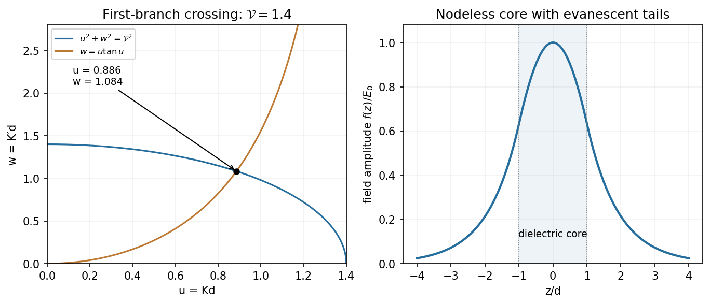
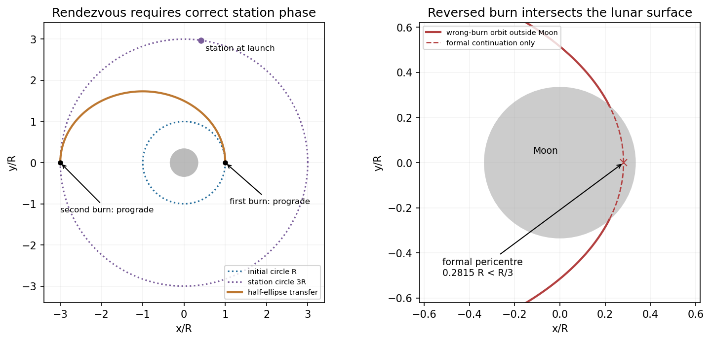
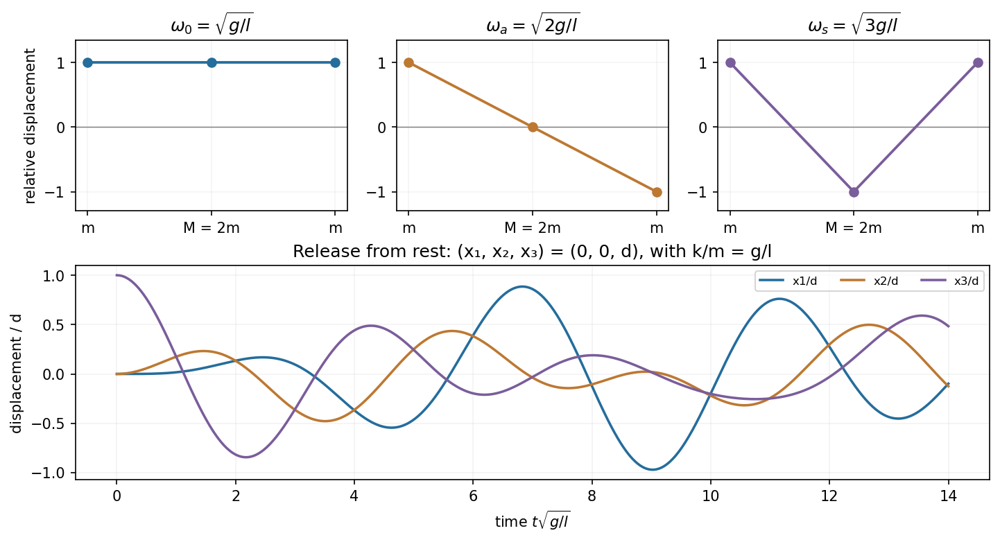

# Paper 2

↑ **Parent:** [2011](../2011.md)

Original examination: [Physical PDF pages 283–291; Physics B Paper 2, 8 June 2011](https://www.whatdotheyknow.com/request/physics_past_papers_23/response/3514893/attach/4/FOI%202026%20628%20Smith%20materials.pdf?cookie_passthrough=1#page=283). All questions and both field forms in B9 are covered. Approximations not fixed by the wording are stated explicitly.

**Table of contents**

- [Section A](#section-a)
  - [A1](#section-a/a1)
    - [Solution](#section-a/a1/solution)
  - [A2](#section-a/a2)
    - [Solution](#section-a/a2/solution)
  - [A3](#section-a/a3)
    - [Solution](#section-a/a3/solution)
  - [A4](#section-a/a4)
    - [Solution](#section-a/a4/solution)
  - [A5](#section-a/a5)
    - [Solution](#section-a/a5/solution)
- [Section B](#section-b)
  - [B6](#section-b/b6)
    - [Solution](#section-b/b6/solution)
    - [i](#section-b/b6/i)
      - [Solution](#section-b/b6/i/solution)
    - [ii](#section-b/b6/ii)
      - [Solution](#section-b/b6/ii/solution)
  - [B7](#section-b/b7)
    - [Solution](#section-b/b7/solution)
  - [B8](#section-b/b8)
    - [Solution](#section-b/b8/solution)
  - [B9](#section-b/b9)
    - [Solution](#section-b/b9/solution)
- [Section C](#section-c)
  - [C10](#section-c/c10)
    - [Solution](#section-c/c10/solution)
  - [C11](#section-c/c11)
    - [Solution](#section-c/c11/solution)
  - [C12](#section-c/c12)
    - [Solution](#section-c/c12/solution)
  - [C13](#section-c/c13)
    - [Solution](#section-c/c13/solution)

## Section A

↑ **Parent:** [Paper 2](paper-2.md)

<h3 id="section-a/a1">A1</h3>

↑ **Parent:** [Section A](#section-a)

<h4 id="section-a/a1/solution">Solution</h4>

↑ **Parent:** [A1](#section-a/a1)

For the [entropy balance of a thermostatted resistor](../../electric-charge.md#entropy-balance-of-a-thermostatted-resistor), electrical work becomes [heat](../../heat.md) $Q=I^2Rt=2.0\times10^7\,\mathrm J$. At fixed [temperature](../../temperature.md) the [resistor](../../electric-charge.md#resistor) has no net change of [thermodynamic state](../../thermodynamics.md#thermodynamic-state); it exports this [heat](../../heat.md) to its thermostat. Treating the electrical supply as a source of work,

$$
\boxed{\Delta S_{\rm resistor}=0,\qquad \Delta S_{\rm universe}=\frac{I^2Rt}{T}=6.67\times10^4\,\mathrm{J\,K^{-1}}.}
$$

[Entropy](../../entropy.md) is produced by [Joule heating](../../electric-charge.md#joule-heating) even though it does not accumulate in the [resistor](../../electric-charge.md#resistor). Additional [entropy production](../../stochastic-thermodynamics.md#entropy-production) inside a nonideal [power](../../energy.md#power) supply is outside the specified model.

<h3 id="section-a/a2">A2</h3>

↑ **Parent:** [Section A](#section-a)

<h4 id="section-a/a2/solution">Solution</h4>

↑ **Parent:** [A2](#section-a/a2)

For a [uniformly magnetized ring with a narrow gap](../../electromagnetism.md#uniformly-magnetized-ring-with-a-narrow-gap), take the local direction of [magnetization](../../electromagnetism.md#magnetization) as positive around the [magnetic circuit](../../electromagnetism.md#magnetic-circuit). Neglect leakage and fringing in the narrow gap, and take the cross section as uniform. [Continuity](../../calculus.md#continuous-function) of [magnetic flux](../../magnetic-field.md#magnetic-flux) gives $H_g=H_r+M$. With no free current, [Ampère's law](../../maxwell-equations.md#ampere-s-circuital-law) gives $lH_r+aH_g=0$. Hence

$$
\boxed{H_g=\frac{lM}{l+a}\simeq M,\qquad H_r=-\frac{aM}{l+a}\simeq-\frac al M.}
$$

The rod's field is a [demagnetizing field](../../statistical-physics.md#demagnetizing-field) opposite its [magnetization](../../electromagnetism.md#magnetization); its magnitude is $aM/(l+a)$. The gap field points with the [magnetization](../../electromagnetism.md#magnetization) and $B_g=\mu_0H_g$.

<h3 id="section-a/a3">A3</h3>

↑ **Parent:** [Section A](#section-a)

<h4 id="section-a/a3/solution">Solution</h4>

↑ **Parent:** [A3](#section-a/a3)

Put the positive plate at $z=d/2$ and the negative plate at $z=-d/2$. Reflection through $z=0$, combined with reversal of the two plate charges, makes the tangential fields cancel at every point of the mid-plane. Thus **$E_x=E_y=0$** at the corner as well as inside the [capacitor](../../electromagnetism.md#capacitor).

For the [uniform-charge estimate at a capacitor corner](../../electromagnetism.md#uniform-charge-estimate-at-a-capacitor-corner), assemble four identical square pairs around their common corner. Their normal fields there are equal by rotation [symmetry](../../physics.md#symmetry-physics) and add to the central field $\sigma/\epsilon_0$ of the larger plate pair. With the bulk parallel-plate relation $\sigma\simeq\epsilon_0V/d$, the conventional corner estimate is

$$
\boxed{\mathbf E_{\rm corner}\simeq\left(0,0,-\frac{V}{4d}\right)\quad\text{(uniform charge sheets).}}
$$

This quarter-field result uses prescribed uniform surface charge, not [symmetry](../../physics.md#symmetry-physics) alone for finite equipotential conductors. Real conducting plates redistribute charge near their edges; $d\ll a$ justifies the bulk relation away from the edges but does not remove the local corner fringe. For that exact conductor problem only the zero tangential components follow from the stated [reflection symmetry](../../physics.md#reflection-symmetry); its normal coefficient requires a fringing-field boundary-value solution. The standard parallel-plate formula explicitly neglects edge effects.[Section 8.1, parallel-plate field and the approximation of negligible edge effects](../../physics-bibliography.md#university-physics-volume-2-by-samuel-j-ling-and-others)

<h3 id="section-a/a4">A4</h3>

↑ **Parent:** [Section A](#section-a)

<h4 id="section-a/a4/solution">Solution</h4>

↑ **Parent:** [A4](#section-a/a4)

For a monatomic [ideal gas](../../ideal-gas.md), $\gamma=C_P/C_V=5/3$. If the expansion is reversible adiabatic, $TV^{\gamma-1}$ is constant, so

$$
\boxed{T_f=300\times8^{-2/3}=75\,\mathrm K\quad\text{(isentropic expansion).}}
$$

Adiabatic isolation alone does not imply this [temperature](../../temperature.md) law. For example, [free expansion](../../thermodynamics.md#free-expansion) into vacuum has $Q=W=0$, so an [ideal gas](../../ideal-gas.md) remains at $300\,\mathrm K$. Thus $75\,\mathrm K$ is the usual intended answer with the additional isentropic assumption; the literal adjective “adiabatic” does not uniquely select it.[“Isothermal and Adiabatic Expansion”, Eqs. (6.53) and (6.61); “Free Expansion of Gas”, Eqs. (6.144)–(6.148)](../../physics-bibliography.md#thermodynamics-and-statistical-mechanics-by-richard-fitzpatrick)

<h3 id="section-a/a5">A5</h3>

↑ **Parent:** [Section A](#section-a)

<h4 id="section-a/a5/solution">Solution</h4>

↑ **Parent:** [A5](#section-a/a5)

Choose $z$ normal to the sheet and $x$ along the in-plane projection of the rotation axis. A uniform square has $I_x=I_y=ma^2/12$ and $I_z=ma^2/6$. Since $\omega_x=\omega_z=\omega/\sqrt2$, the two nonzero angular-momentum components are $J_x=I_x\omega/\sqrt2$ and $J_z=I_z\omega/\sqrt2$. Therefore

$$
\boxed{|\mathbf J|=\frac{ma^2\omega}{12}\sqrt{\frac52}=\frac{\sqrt{10}}{24}ma^2\omega.}
$$

[Angular momentum](../../momentum.md#angular-momentum) is not parallel to the prescribed rotation axis. Multiplying the [moment of inertia](../../rigid-body-dynamics.md#moment-of-inertia) _about that axis_ by $\omega$ would give the projection of [angular momentum](../../momentum.md#angular-momentum) on the axis, not its magnitude.

## Section B

↑ **Parent:** [Paper 2](paper-2.md)

<h3 id="section-b/b6">B6</h3>

↑ **Parent:** [Section B](#section-b)

<h4 id="section-b/b6/solution">Solution</h4>

↑ **Parent:** [B6](#section-b/b6)

Apply [Faraday's law](../../maxwell-equations.md#faraday-s-law-of-induction) to a shrinking rectangular loop crossing the interface. For bounded fields the magnetic-flux term vanishes with its area, giving $\mathbf E_{t,+}=\mathbf E_{t,-}$. A shrinking [Gaussian pillbox](../../maxwell-equations.md#gaussian-pillbox) similarly gives $D_{n,+}-D_{n,-}=\sigma_{\rm free}$. Thus **normal $D$ is continuous when no free surface charge is present**, even though a bound polarization charge may remain. These are the assumptions needed for the stated [dielectric-interface boundary conditions](../../electromagnetic-wave.md#dielectric-interface-boundary-conditions).

Write $\epsilon=\epsilon_r\epsilon_0$, $r_+=\sqrt{(x-a)^2+y^2+z^2}$ and $r_-=\sqrt{(x+a)^2+y^2+z^2}$. Use each region's own [permittivity](../../permittivity.md) in its [Coulomb potential](../../electrostatics.md#coulomb-potential-energy):

$$
\phi_- =\frac{Q+Q'}{4\pi\epsilon r_+},\qquad
\phi_+=\frac1{4\pi\epsilon_0}\left(\frac Q{r_+}+\frac{Q''}{r_-}\right).
$$

At $x=0$, [continuity](../../calculus.md#continuous-function) of potential and normal displacement gives

$$
\frac{Q+Q'}{\epsilon_r}=Q+Q'',\qquad Q+Q'=Q-Q''.
$$

Solving,

$$
\boxed{Q'=\frac{\epsilon_r-1}{\epsilon_r+1}Q,\qquad
Q''=-\frac{\epsilon_r-1}{\epsilon_r+1}Q.}
$$

This [permittivity convention for transmitted image charges](../../electric-field.md#permittivity-convention-for-transmitted-image-charges) matters: if the vacuum Coulomb prefactor is used even for $\phi_-$, its combined effective source is $2Q/(1+\epsilon_r)$ instead. The physical potential is the same. The two numbered leaves identify how these sources satisfy the equations in their respective regions.

The real charge feels only the image contribution after removing its own singular self-field. The image at $(-a,0,0)$ is separated from it by $2a$, so

$$
\boxed{\mathbf F=\left(-\frac{\epsilon_r-1}{\epsilon_r+1}\frac{Q^2}{16\pi\epsilon_0a^2},0,0\right).}
$$

For the [bound charge](../../electromagnetism.md#bound-charge), the outward normal of the [dielectric](../../permittivity.md#dielectric) is $+\hat x$ and $\mathbf P=\epsilon_0(\epsilon_r-1)\mathbf E_-$. Differentiating $\phi_-$ at $x=0$ gives $E_{-,x}=-a(Q+Q')/[4\pi\epsilon(a^2+y^2+z^2)^{3/2}]$. Therefore

$$
\boxed{\sigma_b=\mathbf P\cdot\hat x=-\frac{\epsilon_r-1}{\epsilon_r+1}\frac{aQ}{2\pi(a^2+y^2+z^2)^{3/2}}.}
$$

Its [integral](../../integral.md) over the plane is $Q''$, consistent with the external image representation. For $\epsilon_r=1$ both the image force and induced surface charge vanish.

<h4 id="section-b/b6/i">i</h4>

↑ **Parent:** [B6](#section-b/b6)

<h5 id="section-b/b6/i/solution">Solution</h5>

↑ **Parent:** [I](#section-b/b6/i)

For the [dielectric](../../permittivity.md#dielectric) half-space the two formal sources coincide at $(a,0,0)$, outside the region being represented. Their sum is $Q+Q'=2\epsilon_rQ/(1+\epsilon_r)$ in the [dielectric](../../permittivity.md#dielectric) Coulomb kernel, hence

$$
\boxed{\phi_-(x,y,z)=\frac{2Q}{4\pi\epsilon_0(1+\epsilon_r)r_+}\quad(x<0).}
$$

There is no charge singularity inside this half-space. The expression satisfies [Laplace's equation](../../partial-differential-equation.md#laplace-equation) there, decays at infinity, and matches the vacuum solution's tangential [electric field](../../electric-field.md) and normal electric displacement. The coincident image is a mathematical representation, not an extra physical charge in the vacuum region.

<h4 id="section-b/b6/ii">ii</h4>

↑ **Parent:** [B6](#section-b/b6)

<h5 id="section-b/b6/ii/solution">Solution</h5>

↑ **Parent:** [Ii](#section-b/b6/ii)

For the vacuum half-space keep the actual charge $Q$ at $(a,0,0)$ and put its image at the reflected point $(-a,0,0)$. Then

$$
\boxed{\phi_+(x,y,z)=\frac{Q}{4\pi\epsilon_0}\left[\frac1{r_+}-\frac{\epsilon_r-1}{\epsilon_r+1}\frac1{r_-}\right]\quad(x>0).}
$$

The reflected singularity lies outside this region. The real singularity has the correct charge strength, and the interface coefficients obey the two matching equations in the parent Solution at every $y,z$. With decay at infinity, [uniqueness of an electrostatic dielectric boundary-value problem](../../electrostatics.md#uniqueness-of-an-electrostatic-dielectric-boundary-value-problem) establishes the construction throughout both half-spaces.

<h3 id="section-b/b7">B7</h3>

↑ **Parent:** [Section B](#section-b)

<h4 id="section-b/b7/solution">Solution</h4>

↑ **Parent:** [B7](#section-b/b7)

[Self-inductance](../../electromagnetism.md#self-inductance) relates current to its own [magnetic flux linkage](../../electromagnetism.md#magnetic-flux-linkage): $\Lambda=LI$, so the induced [electromotive force](../../electric-charge.md#electromotive-force) is $-L\dot I$ for fixed geometry. A long [solenoid](../../magnetic-field.md#solenoid) has $B=\mu_0NI/l$ and area $\pi a^2$. Its $N$ turns give

$$
\boxed{L=\frac{\mu_0N^2\pi a^2}{l}.}
$$

The [homopolar generator](../../electromagnetism.md#homopolar-generator) uses a disc rotating through this axial field; integrate the motional [Lorentz force](../../relativistic-electromagnetism.md#lorentz-force) from shaft to rim:

$$
\mathcal E=\int_0^a\omega rB\,dr=\frac12\omega B a^2=C\omega I,\qquad C=\frac{\mu_0Na^2}{2l}.
$$

For a [homopolar disc dynamo](../../resistive-magnetohydrodynamics.md#homopolar-disc-dynamo), choose the wiring and rotation sense giving positive magnetic feedback. [Kirchhoff's voltage law](../../random-walk.md#kirchhoff-cycle-law) is

$$
L\dot I+RI=C\omega I,\qquad I(t)=I(0)\exp\!\left[\frac{C\omega-R}{L}t\right]
$$

for prescribed constant $\omega$. Thus

$$
\boxed{\omega_c=\frac{R}{C}=\frac{2Rl}{\mu_0Na^2}.}
$$

A nonzero seed grows when $\omega>\omega_c$, decays when $\omega<\omega_c$, and is marginal at equality. This explains the printed $\omega\geq\omega_c$ as the threshold including its boundary; equality does not itself give exponential growth. An exactly zero initial current remains zero in the ideal homogeneous equation, and reversing the feedback sense prevents the instability.

In the [torque-controlled homopolar dynamo equilibrium](../../resistive-magnetohydrodynamics.md#torque-controlled-homopolar-dynamo-equilibrium), a radial current element exerts a braking [torque](../../momentum.md#torque) $dG_B=I B r\,dr$, so $G_B=IBa^2/2=C I^2$. For steady rotation and nonzero steady current, $G=CI^2$ and $\omega=\omega_c$. Hence the field intensity magnitude is

$$
\boxed{|H|=\frac Nl\sqrt{\frac GC}=\sqrt{\frac{2NG}{\mu_0a^2l}}.}
$$

The two current signs give opposite magnetic polarities. Finally,

$$
\boxed{P_{\rm mechanical}=G\omega_c=CI^2\frac RC=RI^2=P_{\rm Joule}.}
$$

The steady magnetic and rotational [energies](../../energy.md) do not change. This is a steady-state balance, not an assertion that every dynamical trajectory must approach that state.

<h3 id="section-b/b8">B8</h3>

↑ **Parent:** [Section B](#section-b)

<h4 id="section-b/b8/solution">Solution</h4>

↑ **Parent:** [B8](#section-b/b8)

Insert $\nabla\times\mathbf E=-\partial_t\mathbf B$ and $\nabla\times\mathbf H=\mathbf J+\partial_t\mathbf D$ into the given identity. For a linear, time-independent, nondispersive medium, $\mathbf D=\epsilon\mathbf E$ and $\mathbf B=\mu\mathbf H$, giving

$$
\nabla\cdot(\mathbf E\times\mathbf H)=-\mathbf J\cdot\mathbf E-\partial_tu,
\qquad u=\frac12\mathbf E\cdot\mathbf D+\frac12\mathbf H\cdot\mathbf B.
$$

The [divergence theorem](../../multivariable-calculus.md#divergence-theorem) then yields

$$
\boxed{\oint_S(\mathbf E\times\mathbf H)\cdot d\mathbf S=-\int_V[\mathbf J\cdot\mathbf E+\partial_tu]\,dV.}
$$

The left side is outward electromagnetic [power](../../energy.md#power) flow. The current term is [power](../../energy.md#power) delivered to matter, becoming [Joule heating](../../electric-charge.md#joule-heating) for an [Ohmic conductor](../../electric-charge.md#ohmic-conductor), and $\partial_tu$ is the change in stored electric plus [magnetic energy](../../electromagnetic-wave.md#magnetic-energy). The minus sign says outward flux reduces stored [energy](../../energy.md) unless supplied locally.

Follow the drawing's coordinates: lower strip at $z=0$, upper strip at $z=d$, current $I$ along $+x$ in the upper strip and back along the lower. The wording “both strips lie in the $xy$-plane” must mean parallel to that plane, since the drawing separates them in $z$. Neglect the side and end fringes using $l\gg a\gg d$. Then $I=V_0/(R+R_L)$ and the top-strip potential is $V(x)=V_0-IRx/l$, while the lower strip is equipotential at zero.

The harmonic function matching those two surfaces is

$$
\boxed{\phi=\frac zd\left(V_0-\frac{IRx}{l}\right).}
$$

Indeed $\nabla^2\phi=0$, and it has the required potentials at $z=0,d$. Thus

$$
\mathbf E=\left(\frac{IRz}{ld},0,-\frac{V(x)}d\right),\qquad
\mathbf H=\left(0,\frac Ia,0\right).
$$

The two current sheets reinforce their [magnetic field](../../magnetic-field.md) between the strips; its direction follows the right-hand rule. The [Poynting flow in resistive parallel strips](../../electromagnetic-wave.md#poynting-flow-in-resistive-parallel-strips) follows from their cross product:

$$
\boxed{\mathbf S=\left(\frac{IV(x)}{ad},\ 0,\ \frac{I^2Rz}{ald}\right).}
$$

[Power](../../energy.md#power) flows along the gap towards the load and upwards into the resistive strip. Across a transverse area $ad$, $P_x(x)=IV(x)$ falls from $IV_0$ to $I^2R_L$. The upper surface receives $\int_0^l aS_z(z=d)\,dx=I^2R$, exactly the strip's heating; the ideal lower strip receives none. In the charge-free gap, $\partial_xS_x+\partial_zS_z=0$, consistent with a static field and no local dissipation. The small longitudinal [electric field](../../electric-field.md) cannot be discarded if this upward [energy](../../energy.md) transfer is to be represented.

<h3 id="section-b/b9">B9</h3>

↑ **Parent:** [Section B](#section-b)

<h4 id="section-b/b9/solution">Solution</h4>

↑ **Parent:** [B9](#section-b/b9)

In a homogeneous, source-free, nonmagnetic [dielectric](../../permittivity.md#dielectric) the electric [wave equation](../../wave-equation.md) is

$$
\boxed{\nabla^2\mathbf E-\frac{\epsilon_r}{c^2}\partial_t^2\mathbf E=0.}
$$

Set $\theta=\omega t-kx$ and $E_y=f(z)\cos\theta$. Substitution gives $f''+(\epsilon_r\omega^2/c^2-k^2)f=0$. For the labelled field form (a), $f=E_0\cos Kz$, so $K^2=\epsilon_r\omega^2/c^2-k^2>0$. For form (b), $f=E'_0e^{sK'z}$ with $s=\pm1$, so $K'^2=k^2-\epsilon_r\omega^2/c^2>0$. These give the two stated inequalities, with equality a zero-transverse-wavenumber limiting case.

[Faraday's law](../../maxwell-equations.md#faraday-s-law-of-induction) gives the associated wave [magnetic field](../../magnetic-field.md), without an added static field,

$$
\boxed{\mathbf H=\frac1{\mu_0\omega}\left(f'(z)\sin\theta,0,kf(z)\cos\theta\right).}
$$

Thus in case (a), $H_x=-KE_0\sin(Kz)\sin\theta/(\mu_0\omega)$ and $H_z=kE_0\cos(Kz)\cos\theta/(\mu_0\omega)$. In case (b), $H_x=sK'E'_0e^{sK'z}\sin\theta/(\mu_0\omega)$ and $H_z=kE'_0e^{sK'z}\cos\theta/(\mu_0\omega)$. In both cases $H_y=0$.

For the [planar dielectric waveguide](../../electromagnetic-wave.md#planar-dielectric-waveguide) the core is [dielectric](../../permittivity.md#dielectric) but the exterior is vacuum. Consequently the _exterior_ decay constant has $K'^2=k^2-\omega^2/c^2$, while the interior oscillation has $K^2=\epsilon_r\omega^2/c^2-k^2$. Adding gives the relation labelled (c):

$$
\boxed{K^2+K'^2=\frac{(\epsilon_r-1)\omega^2}{c^2}.}
$$

For an even bound mode the complete profile can be written

$$
f(z)=\begin{cases}E_0\cos(Kz),&|z|\leq d,\\E_0\cos(Kd)e^{-K'(|z|-d)},&|z|\geq d.\end{cases}
$$

[Continuity](../../calculus.md#continuous-function) of tangential $E_y$ fixes the exterior amplitude; [continuity](../../calculus.md#continuous-function) of tangential $H_x$ makes $f'$ continuous because both media have [magnetic permeability](../../maxwell-equations.md#permeability-electromagnetism) $\mu_0$. At $z=d$,

$$
-KE_0\sin(Kd)=-K'E_0\cos(Kd),\qquad
\boxed{K\tan(Kd)=K',}
$$

which is the relation labelled (d). The same even profile also matches at $z=-d$; [continuity](../../calculus.md#continuous-function) of $H_z$ follows from that of $E_y$.

In the requested $K,K'$ plot, (c) is a first-quadrant [circle](../../topology.md#circle) and (d) rises from the origin to its first pole at $Kd=\pi/2$. Equivalently put $u=Kd$, $w=K'd$, and $\mathcal V=(\omega d/c)\sqrt{\epsilon_r-1}$. At $u=0$ the [circle](../../topology.md#circle) has $w=\mathcal V>0$ whereas $u\tan u=0$. At the other end of $0<u<\min(\mathcal V,\pi/2)$, the rising tangent curve exceeds the falling [circle](../../topology.md#circle). [Monotonicity](../../calculus.md#monotonic-function) therefore gives one intersection on this first branch for every $\mathcal V>0$.

**The [fundamental even mode of a symmetric dielectric slab](../../electromagnetic-wave.md#fundamental-even-mode-of-a-symmetric-dielectric-slab) has no positive cutoff in index contrast or thickness.** Its electric profile is a nodeless [cosine](../../geometry-and-topology.md#cosine) maximum at the mid-plane, smoothly joined to decaying exterior tails. The qualifier $\epsilon_r>1$ is essential: for the printed limiting value $\epsilon_r=1$, the [circle](../../topology.md#circle) collapses to $K=K'=0$ and there is no transversely confined bound mode. A uniform unconstrained wave is not a guided mode. This even-mode argument does not assert that the specified [cosine](../../geometry-and-topology.md#cosine) describes every possible odd guide mode.

**[Figure 1](#section-b/b9/image-fundamental-slab-mode). Fundamental slab mode**.

The original diagram uses the illustrative normalized radius $\mathcal V=1.4$; it is a scaled $KK'$ plot with $u=Kd,w=K'd$, followed by the corresponding field profile.

## Section C

↑ **Parent:** [Paper 2](paper-2.md)

<h3 id="section-c/c10">C10</h3>

↑ **Parent:** [Section C](#section-c)

<h4 id="section-c/c10/solution">Solution</h4>

↑ **Parent:** [C10](#section-c/c10)

Relative to an origin, the [inertia tensor](../../rigid-body-dynamics.md#inertia-tensor) is $I_{ij}=\int(r^2\delta_{ij}-r_ir_j)\,dm$, with $\mathbf J=\mathsf I\boldsymbol\omega$. Its orthogonal [eigenvectors](../../linear-operator-theory.md#eigenvector) are [principal axes](../../rigid-body-dynamics.md#principal-axis), with [eigenvalues](../../linear-operator-theory.md#eigenvalue) the principal moments of inertia. Different components of $\boldsymbol\omega$ are multiplied by different [eigenvalues](../../linear-operator-theory.md#eigenvalue), so [angular momentum](../../momentum.md#angular-momentum) need not point along [angular velocity](../../rigid-body-dynamics.md#angular-velocity).

For a uniform thin disc, radial integration gives $I_z=\int r^2dm=ma^2/2$. The [perpendicular axis theorem](../../rigid-body-dynamics.md#perpendicular-axis-theorem) and [symmetry](../../physics.md#symmetry-physics) then give $I_x=I_y=I_z/2$, hence

$$
\boxed{I_d=ma^2/4\quad\text{about a diameter}.}
$$

For the [elastic eccentric impact of a thin disc](../../classical-mechanics.md#elastic-eccentric-impact-of-a-thin-disc), neglect gravity's [impulse](../../classical-mechanics.md#impulse) and take the pole's [impulse](../../classical-mechanics.md#impulse) as vertical. Let $z$ point up and let the contact position relative to the centre be $r\hat x$. An upward [impulse](../../classical-mechanics.md#impulse) $P$ gives

$$
v_C=-u+P/m,\qquad \boldsymbol\omega=-\frac{rP}{I_d}\hat y.
$$

For an elastic impact with a fixed pole, the contact point reverses its normal velocity, so $-u+P/m+r^2P/I_d=+u$. Therefore

$$
\boxed{P=\frac{2mu}{1+4r^2/a^2},\quad
v_C=u\frac{a^2-4r^2}{a^2+4r^2},\quad
\boldsymbol\omega=-\frac{8ur}{a^2+4r^2}\hat y.}
$$

Here $v_C>0$ denotes upward motion; the centre can still move down if $r>a/2$. Substitution gives

$$
\boxed{v_{\rm contact}=v_C+(\boldsymbol\omega\times r\hat x)_z=u.}
$$

This also follows by combining conserved [angular momentum](../../momentum.md#angular-momentum) about the fixed contact with conserved [kinetic energy](../../energy.md#kinetic-energy) and selecting the separating, nonzero-impulse solution. At $r=0$ the disc simply rebounds without rotation; at $r=a/2$ its centre is instantaneously stationary. The rebound result concerns the contacting material point immediately after this ideal impact, not its subsequent contact history.

<h3 id="section-c/c11">C11</h3>

↑ **Parent:** [Section C](#section-c)

<h4 id="section-c/c11/solution">Solution</h4>

↑ **Parent:** [C11](#section-c/c11)

Let $s$ denote distance from the [neutral axis](../../elasticity-physics.md#neutral-axis) within a cross section. Bending to radius $R$ gives longitudinal [strain](../../continuum-mechanics.md#strain) $s/R$, so [Hooke's law](../../elasticity-physics.md#hooke-s-law) gives [stress](../../continuum-mechanics.md#stress) $Es/R$. Its moment is

$$
\boxed{B=\int_A s\frac{Es}{R}\,dA=\frac{EI}{R},\qquad I=\int_A s^2dA.}
$$

Here $E$ is [Young's modulus](../../elasticity-physics.md#young-s-modulus) and $I$ is the _[second moment of area](../../elasticity-physics.md#second-moment-of-area)_, not a mass [moment of inertia](../../rigid-body-dynamics.md#moment-of-inertia). For the stated square orientation, $I=a^4/12$.

For [self-weight deflection of a square cantilever](../../elasticity-physics.md#self-weight-deflection-of-a-square-cantilever), the downward load per unit length is $q=\rho a^2g$. A free-end segment from $x$ to $l$ has shear-force magnitude $F(x)=q(l-x)$ and bending-moment magnitude $B(x)=q(l-x)^2/2$. Thus, with the given sign conventions,

$$
-F'(x)=q=B''(x).
$$

Using the small-slope [curvature](../../differential-geometry.md#curvature) $1/R\simeq y''$ for downward deflection,

$$
\boxed{y''''=\beta,\qquad\beta=\frac q{EI}=\frac{12\rho g}{Ea^2}.}
$$

The clamp fixes position and slope, and the unloaded free end has zero moment and shear:

$$
y(0)=y'(0)=0,\qquad y''(l)=y'''(l)=0.
$$

Four integrations yield

$$
y(x)=\frac\beta{24}x^2(x^2-4lx+6l^2),\qquad
\boxed{y(l)=\frac{\beta l^4}{8}=\frac{3\rho g l^4}{2Ea^2}\quad\text{downwards}.}
$$

The linear beam model requires small slopes and [strains](../../continuum-mechanics.md#strain); the strong $l^4$ dependence eventually invalidates that approximation if other dimensions and material properties are fixed.

<h3 id="section-c/c12">C12</h3>

↑ **Parent:** [Section C](#section-c)

<h4 id="section-c/c12/solution">Solution</h4>

↑ **Parent:** [C12](#section-c/c12)

Write $\mu=GM$ and $A=\mu m$. For a [circular orbit](../../classical-mechanics.md#circular-orbit) of radius $r$, centripetal balance gives $v^2=\mu/r$. Thus $E=mv^2/2-A/r=-A/(2r)$ and $J^2=m^2r^2v^2=Amr$. Since $e=0$, $a=r_0=r$, these agree with the general expressions.

For an outward coplanar [Hohmann transfer](../../celestial-mechanics.md#hohmann-transfer-orbit), burn prograde at the inner [circle](../../topology.md#circle) to put its radius at the ellipse's [pericentre](../../celestial-mechanics.md#periapsis), then burn prograde at [apocentre](../../celestial-mechanics.md#apoapsis) to circularize at the station's radius. The station must be phased to meet the spacecraft there. With $r_p=R$, $r_a=\alpha R$,

$$
\boxed{a_T=\frac{1+\alpha}{2}R,\qquad e_T=\frac{\alpha-1}{\alpha+1},\qquad r_0=a_T(1-e_T^2)=\frac{2\alpha R}{1+\alpha}.}
$$

[Energy](../../energy.md) at the first burn, with $v_0^2=\mu/R$, gives

$$
\frac{v_1^2}{2}-\frac\mu R=-\frac\mu{(1+\alpha)R},\qquad
\boxed{v_1=v_0\sqrt{\frac{2\alpha}{1+\alpha}}.}
$$

[Angular momentum](../../momentum.md#angular-momentum) is conserved along the transfer ellipse, so $v_{2-}=v_1/\alpha$, while the outer circular speed is $v_{2+}=v_0/\sqrt\alpha$. For $\alpha=3$,

$$
\boxed{v_{2-}=\frac{v_0}{\sqrt6},\qquad v_{2+}=\frac{v_0}{\sqrt3}.}
$$

The correct second [impulse](../../classical-mechanics.md#impulse) adds $\Delta v=v_{2+}-v_{2-}$. The [reversed circularization burn in a Hohmann transfer](../../celestial-mechanics.md#reversed-circularization-burn-in-a-hohmann-transfer), using the _same_ [impulse](../../classical-mechanics.md#impulse) magnitude, instead leaves

$$
v_w=2v_{2-}-v_{2+}=v_0\left(\frac2{\sqrt6}-\frac1{\sqrt3}\right)>0.
$$

Its magnitude is below the circular speed at $3R$, so that point is the new [apocentre](../../celestial-mechanics.md#apoapsis). Define $q=r_a v_w^2/\mu=(\sqrt2-1)^2=3-2\sqrt2$. For an ellipse at [apocentre](../../celestial-mechanics.md#apoapsis), $q=1-e_w$, giving

$$
\boxed{e_w=2\sqrt2-2\simeq0.8284,\qquad
r_{p,w}=3R\frac{1-e_w}{1+e_w}=3R\frac{3-2\sqrt2}{2\sqrt2-1}\simeq0.2815R.}
$$

The lunar radius is $R/3$. Since $r_{p,w}<R/3$, **the osculating [orbit](../../dynamical-systems.md#orbit-dynamical-system) intersects the [Moon](../../planetary-science.md#moon): the spacecraft crashes before reaching its formal [pericentre](../../celestial-mechanics.md#periapsis).** The calculation uses impulsive tangential burns and a spherical central gravitational field; it does not assume that a trajectory continues through the solid body.

**[Figure 2](#section-c/c12/image-correct-and-reversed-transfer-burn). Correct and reversed transfer burn**.

The original plot uses $R$ as the length unit and $R/3$ as the lunar radius. The initial station position shown is phased for rendezvous: its initial angular lead is $\pi-\pi[(1+\alpha)/(2\alpha)]^{3/2}$, modulo $2\pi$.

<h3 id="section-c/c13">C13</h3>

↑ **Parent:** [Section C](#section-c)

<h4 id="section-c/c13/solution">Solution</h4>

↑ **Parent:** [C13](#section-c/c13)

A [normal mode](../../wave-equation.md#normal-mode) is a small-oscillation motion with every coordinate proportional to one common sinusoid, at a fixed amplitude ratio and relative phase. Expanding an arbitrary small motion in [normal mode coordinates](../../classical-mechanics.md#normal-coordinate) decouples its linear equations into independent oscillators. With [mechanical mass matrix](../../lagrangian-mechanics.md#mechanical-mass-matrix) $\mathsf M$ and [mechanical stiffness matrix](../../lagrangian-mechanics.md#mechanical-stiffness-matrix) $\mathsf K$, the generalized [eigenvalue](../../linear-operator-theory.md#eigenvalue) equation is $\mathsf K\mathbf u=\omega^2\mathsf M\mathbf u$.

Horizontal gravitational restoring force on each bob is $-m_i(g/l)x_i$. The two springs add $k(x_2-x_1)$ on the first bob, $k(x_1-2x_2+x_3)$ on the middle bob, and $k(x_2-x_3)$ on the last. Dividing by the bob masses gives the stated equations with

$$
\boxed{\alpha=g/l,\qquad\beta=k.}
$$

[Reflection symmetry](../../physics.md#reflection-symmetry) separates an antisymmetric end motion from two symmetric motions. The [three coupled pendulums with equal end masses](../../wave.md#three-coupled-pendulums-with-equal-end-masses) have independent modes

$$
\begin{array}{c|c|l}
\text{amplitude vector}&\omega^2&\text{motion}\\\hline
(1,1,1)&g/l&\text{all bobs together; springs unstretched}\\
(1,0,-1)&g/l+k/m&\text{end bobs opposite; middle at rest}\\
(1,-2m/M,1)&g/l+k/m+2k/M&\text{ends together; middle opposite}.
\end{array}
$$

Call their positive frequencies $\omega_0,\omega_a,\omega_s$ respectively. The middle amplitude in the last mode ensures $m x_1+M x_2+m x_3=0$. The modes are orthogonal in the mass-weighted [inner product](../../inner-product.md), rather than generally in the unweighted coordinate dot product.

The initially stationary displacement decomposes as

$$
(0,0,d)=\frac{md}{M+2m}(1,1,1)-\frac d2(1,0,-1)+\frac{Md}{2(M+2m)}(1,-2m/M,1).
$$

There are no [sine](../../geometry-and-topology.md#sine) terms because every initial velocity is zero. Therefore

$$
\boxed{\begin{aligned}
x_1(t)&=\frac{md}{M+2m}\cos\omega_0t-\frac d2\cos\omega_at+\frac{Md}{2(M+2m)}\cos\omega_st,\\
x_2(t)&=\frac{md}{M+2m}(\cos\omega_0t-\cos\omega_st),\\
x_3(t)&=\frac{md}{M+2m}\cos\omega_0t+\frac d2\cos\omega_at+\frac{Md}{2(M+2m)}\cos\omega_st.
\end{aligned}}
$$

These give $(0,0,d)$ at $t=0$ and solve all three coupled equations. The [spring constant](../../elasticity-physics.md#spring-constant) is assumed positive; for $k=0$ the frequencies become degenerate and the same [superposition](../../vector-space.md#superposition-principle) reduces to uncoupled pendulum motion.

**[Figure 3](#section-c/c13/image-three-pendulum-modes). Three pendulum modes**.

The original example uses $M=2m$ and $k/m=g/l$ to display the mode [vectors](../../vector-space.md#vector) and resulting [superposition](../../vector-space.md#superposition-principle). Those illustrative parameter ratios are not additional supplied data.

## ↑ Ancestors (11)

1. [2011](../2011.md)
2. [Past exam of the physics B course of the University of Cambridge](../../past-exam-of-the-physics-b-course-of-the-university-of-cambridge.md)
3. [Physics B course of the University of Cambridge](../../university-of-cambridge.md#physics-b-course-of-the-university-of-cambridge)
4. [Physics course of the year 2 of the natural sciences course of the University of Cambridge](../../university-of-cambridge.md#physics-course-of-the-year-2-of-the-natural-sciences-course-of-the-university-of-cambridge)
5. [Year 2 of the natural sciences course of the University of Cambridge](../../university-of-cambridge.md#year-2-of-the-natural-sciences-course-of-the-university-of-cambridge)
6. [Year of the natural sciences course of the University of Cambridge](../../university-of-cambridge.md#year-of-the-natural-sciences-course-of-the-university-of-cambridge)
7. [Natural sciences course of the University of Cambridge](../../university-of-cambridge.md#natural-sciences-course-of-the-university-of-cambridge)
8. [Course of the University of Cambridge](../../university-of-cambridge.md#course-of-the-university-of-cambridge)
9. [University of Cambridge](../../university-of-cambridge.md)
10. [List of universities](../../README.md#list-of-universities)
11. [Codex Wiki](../../README.md)
