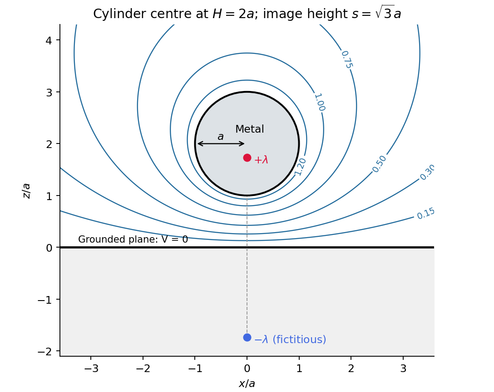

<h1 id="section-b/b6/solution">Solution</h1>

↑ **Parent:** [B6](../b6.md)

In a charge-free region of homogeneous [permittivity](../../../../../permittivity-split.md), [Gauss's law](../../../../../gauss-s-law.md) and $\mathbf E=-\nabla V$ give [Laplace's equation](../../../../../laplace-equation.md), $\nabla^2V=0$. Prescribed surface [electric potentials](../../../../../electric-potential.md) specify a [Dirichlet problem](../../../../../dirichlet-problem.md). Its [Uniqueness of the Dirichlet problem](../../../../../uniqueness-of-the-dirichlet-problem.md) permits replacing conductors by fictitious charges outside the physical solution region: a harmonic candidate with the same [boundary conditions](../../../../../boundary-condition.md) is the physical solution. For an exterior problem its behaviour at infinity must also be prescribed. For a proof, subtract two candidate potentials to obtain $u$ with zero boundary values. [Green's first identity](../../../../../green-s-first-identity.md) gives $\int|\nabla u|^2d^3x=0$, so $u$ is constant and its boundary value fixes it to zero. Conditions on a normal [electric field](../../../../../electric-field-split.md) instead determine a potential only up to an additive constant when the usual compatibility condition holds.

A cylindrical [Gaussian surface](../../../../../gaussian-surface.md) around an infinite [line charge](../../../../../line-charge.md) gives $E_r=\lambda/(2\pi\epsilon_0r)$. The [electric potential difference](../../../../../electric-potential-difference.md) is therefore

$$
V(r_2)-V(r_1)=-\int_{r_1}^{r_2}E_r\,dr
=\frac{\lambda}{2\pi\epsilon_0}\ln\frac{r_1}{r_2}.
$$

An isolated infinite [line charge](../../../../../line-charge.md) has no finite potential zero at infinity. For the opposite pair, however, the logarithmic growth terms cancel and one can choose $V\to0$ there. Define $r_b^2=(x-b)^2+y^2$ and $r_c^2=(x-c)^2+y^2$. [superposition](../../../../../superposition-principle.md) gives

$$
V(x,y)=\frac{\lambda}{2\pi\epsilon_0}\ln\frac{r_c}{r_b}.
$$

On $x^2+y^2=bc$,

$$
r_c^2=c(b+c-2x),\qquad r_b^2=b(b+c-2x),
\qquad
\boxed{V=\frac{\lambda}{4\pi\epsilon_0}\ln\frac cb.}
$$

Thus the circle, and its cylindrical extension, is an [equipotential](../../../../../equipotential.md). This is an [Apollonius circle](../../../../../circles-of-apollonius.md): a constant ratio of distances gives a circle rather than a constant distance from either charge.

For the cylinder above the plane, call its centre height $H>a$ and set $s=\sqrt{H^2-a^2}$. The [cylinder-plane image charges](../../../../../cylinder-plane-image-charges.md) are $+\lambda$ at height $s$ and $-\lambda$ at height $-s$. Their distances are equal on the grounded plane, while their distance ratio is $(H+s)/a$ on the circular surface. The positive fictitious line lies inside the metal, so the exterior is charge-free and [Uniqueness of the Dirichlet problem](../../../../../uniqueness-of-the-dirichlet-problem.md) applies. A [Gaussian surface](../../../../../gaussian-surface.md) enclosing the physical cylinder confirms that its [charge per unit length](../../../../../linear-charge-density.md) is indeed $\lambda$. Its [voltage](../../../../../voltage.md) is

$$
V_c=\frac{\lambda}{2\pi\epsilon_0}\operatorname{arcosh}\frac Ha.
$$

The physical field [energy](../../../../../energy-split.md) per unit [length](../../../../../length.md) at fixed cylinder charge is $U'=\lambda V_c/2$. Differentiate with respect to height, keeping $a$ and $\lambda$ fixed:

$$
\frac{F_z}{\ell}=-\frac{\partial U'}{\partial H}
=-\frac{\lambda^2}{4\pi\epsilon_0\sqrt{H^2-a^2}},
\qquad
\boxed{\left.\frac{\mathbf F}{\ell}\right|_{H=2a}
=-\frac{\lambda^2}{4\pi\epsilon_0\sqrt3\,a}\,\widehat{\mathbf z}.}
$$

The [electrostatic attraction per unit length of a cylinder above a plane](../../../../../electrostatic-attraction-per-unit-length-of-a-cylinder-above-a-plane.md) is downward for either sign of charge. Placing the fictitious line at the cylinder centre would give the wrong answer at this separation. The long-cylinder approximation neglects the ends.

**[Figure 1](#section-b/b6/image-original-cylinder-plane-image-charges-construction-and-exterior-equipotentials). Original cylinder-plane image charges construction and exterior equipotentials**.

## ↑ Ancestors (14)

1. [B6](../b6.md)
2. [Section B](../../section-b.md)
3. [Paper 1](../../../paper-1-split.md)
4. [2012](../../../split.md)
5. [Past exam of the physics B course of the University of Cambridge](../../../../split.md)
6. [Physics B course of the University of Cambridge](../../../../../physics-b-course-of-the-university-of-cambridge.md)
7. [Physics course of the year 2 of the natural sciences course of the University of Cambridge](../../../../../physics-course-of-the-year-2-of-the-natural-sciences-course-of-the-university-of-cambridge.md)
8. [Year 2 of the natural sciences course of the University of Cambridge](../../../../../year-2-of-the-natural-sciences-course-of-the-university-of-cambridge.md)
9. [Year of the natural sciences course of the University of Cambridge](../../../../../year-of-the-natural-sciences-course-of-the-university-of-cambridge.md)
10. [Natural sciences course of the University of Cambridge](../../../../../natural-sciences-course-of-the-university-of-cambridge.md)
11. [Course of the University of Cambridge](../../../../../course-of-the-university-of-cambridge.md)
12. [University of Cambridge](../../../../../university-of-cambridge-split.md)
13. [List of universities](../../../../../list-of-universities.md)
14. [Codex Wiki](../../../../../split.md)
