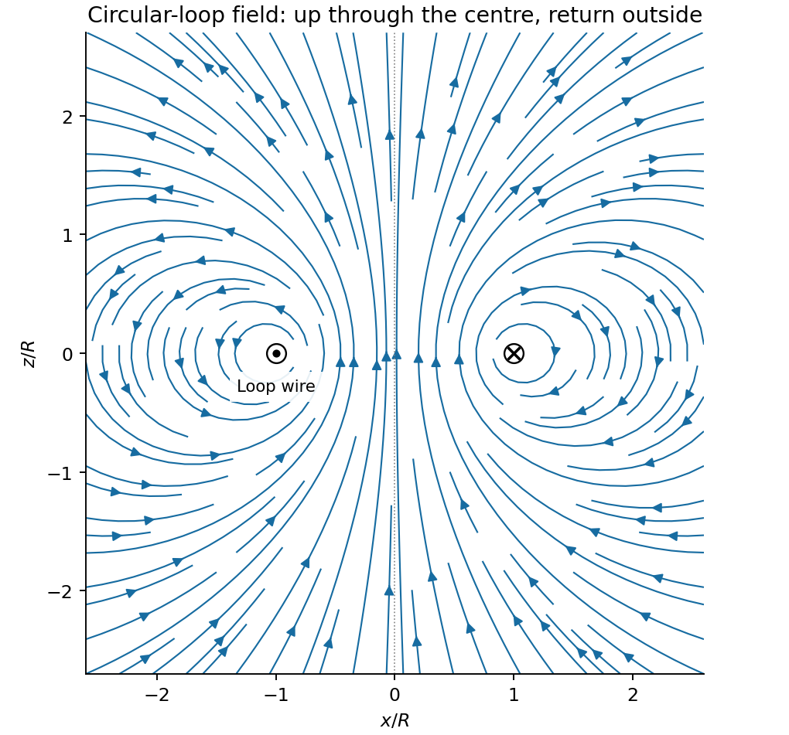

<h1 id="section-b/b8/solution">Solution</h1>

↑ **Parent:** [B8](../b8.md)

For a steady thin-wire [electric current](../../../../../electric-current.md), the [Biot-Savart law](../../../../../biot-savart-law.md) is

$$
d\mathbf B(\mathbf r)=\frac{\mu_0I}{4\pi}
\frac{d\boldsymbol\ell'\times(\mathbf r-\mathbf r')}{|\mathbf r-\mathbf r'|^3},
$$

where the source element follows positive current. For a circular loop, source points are $(R\cos\phi,R\sin\phi,0)$ and the observer is $(0,0,z)$. Their [cross product](../../../../../cross-product.md) with $d\boldsymbol\ell'$ has axial component $R^2d\phi$; transverse components integrate to zero. Thus the [on-axis magnetic field of a circular current loop](../../../../../on-axis-magnetic-field-of-a-circular-current-loop.md), multiplied by the number of coincident turns, is

$$
\boxed{B_0(z)=B_z(0,z)=\frac{\mu_0N_1I_1R^2}{2(R^2+z^2)^{3/2}}.}
$$

Take positive current counterclockwise as seen from $+z$. [magnetic field lines](../../../../../magnetic-field-line.md) pass upward through the loop and return around its exterior, closing rather than terminating. They fan outward above its centre and converge below it. The original numerical [Biot-Savart law](../../../../../biot-savart-law.md) integration below illustrates these directions; the wire singularities are masked.

**[Figure 2](#section-b/b8/image-original-circular-loop-magnetic-field-lines-in-a-meridional-cross-section). Original circular-loop magnetic field lines in a meridional cross-section**.

The [axisymmetric magnetic field near a regular axis](../../../../../axisymmetric-magnetic-field-near-a-regular-axis.md) follows from [Gauss's law for magnetism](../../../../../gauss-s-law-for-magnetism.md). In [cylindrical coordinates](../../../../../cylindrical-coordinate-system.md), regularity gives $B_\rho(0,z)=0$, while [symmetry](../../../../../symmetry-physics.md) gives $B_z(\rho,z)=B_0(z)+O(\rho^2)$. Integrate $\partial_\rho(\rho B_\rho)=-\rho B_0'(z)$ from the axis:

$$
B_\rho(\rho,z)=-\frac\rho2 B_0'(z)+O(\rho^3),
\qquad
\boxed{B_\rho(\rho,z)\simeq
\frac{3\mu_0N_1I_1R^2\rho z}{4(R^2+z^2)^{5/2}}.}
$$

A formal $C(z)/\rho$ term is excluded by regularity. For $z>0$ the axial field decreases upward, so the radial component is outward, consistent with the sketch.

On the small receiving coil, $d\boldsymbol\ell=a\,d\phi\,\widehat{\boldsymbol\phi}$. The [Lorentz force](../../../../../lorentz-force.md) $I_2d\boldsymbol\ell\times\mathbf B$ has axial component $-I_2a B_\rho(a,d)d\phi$. Contributions from the axial field cancel radially around the loop. Therefore

$$
\boxed{F_z\simeq-2\pi N_2I_2aB_\rho(a,d)
=-\frac{3\pi\mu_0N_1N_2I_1I_2R^2a^2d}{2(R^2+d^2)^{5/2}}.}
$$

With both currents giving [magnetic dipole moments](../../../../../magnetic-dipole-moment.md) along $+z$ and $d>0$, this is attraction. Reversing one current reverses the [force](../../../../../force-split.md). The small coil has $m_2=N_2I_2\pi a^2$, so the result is exactly the leading [magnetic dipole force](../../../../../magnetic-dipole-force.md) $F_z=m_2B_0'(d)$. Equivalently $U=-\mathbf m_2\cdot\mathbf B_0$. The approximation requires $a\ll R$ and negligible variation over the receiving coil; corrections begin at relative order $a^2/(R^2+d^2)$.

## ↑ Ancestors (14)

1. [B8](../b8.md)
2. [Section B](../../section-b.md)
3. [Paper 1](../../../paper-1-split.md)
4. [2012](../../../split.md)
5. [Past exam of the physics B course of the University of Cambridge](../../../../split.md)
6. [Physics B course of the University of Cambridge](../../../../../physics-b-course-of-the-university-of-cambridge.md)
7. [Physics course of the year 2 of the natural sciences course of the University of Cambridge](../../../../../physics-course-of-the-year-2-of-the-natural-sciences-course-of-the-university-of-cambridge.md)
8. [Year 2 of the natural sciences course of the University of Cambridge](../../../../../year-2-of-the-natural-sciences-course-of-the-university-of-cambridge.md)
9. [Year of the natural sciences course of the University of Cambridge](../../../../../year-of-the-natural-sciences-course-of-the-university-of-cambridge.md)
10. [Natural sciences course of the University of Cambridge](../../../../../natural-sciences-course-of-the-university-of-cambridge.md)
11. [Course of the University of Cambridge](../../../../../course-of-the-university-of-cambridge.md)
12. [University of Cambridge](../../../../../university-of-cambridge-split.md)
13. [List of universities](../../../../../list-of-universities.md)
14. [Codex Wiki](../../../../../split.md)
