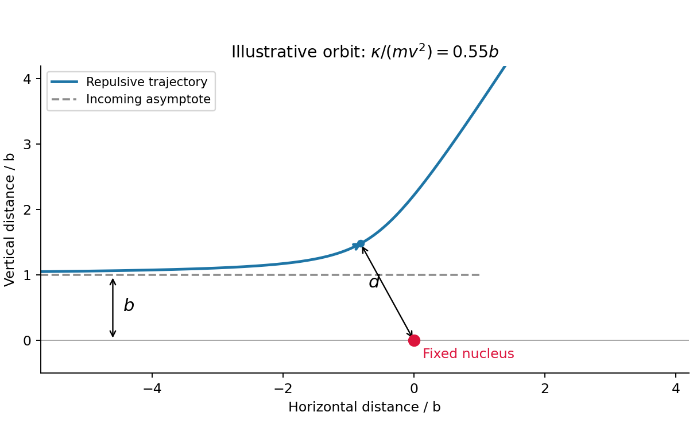

<h1 id="section-c/c11/solution">Solution</h1>

↑ **Parent:** [C11](../c11.md)

For the scattering calculation, take the heavy target as fixed and define $\kappa=2Ze^2/(4\pi\epsilon_0)>0$. The incoming [kinetic energy](../../../../../kinetic-energy.md) and [angular momentum](../../../../../angular-momentum.md) are $E=mv^2/2$ and $J=mvb$. In the original sketch, the horizontal dashed incoming asymptote has perpendicular distance $b$ from the nucleus, while $d$ is the [radius](../../../../../radius.md) from the nucleus to the point where $\dot r=0$.

**[Figure 3](#section-c/c11/image-original-repulsive-rutherford-scattering-trajectory-with-impact-parameter-and-closest-approach). Original repulsive Rutherford scattering trajectory with impact parameter and closest approach**.

At closest approach, the [velocity](../../../../../velocity.md) is tangential and $v_t=J/(md)=vb/d$. [conservation of energy](../../../../../conservation-of-energy.md) gives

$$
\frac12mv^2=\frac{J^2}{2md^2}+\frac\kappa d,
\qquad mv^2d^2-2\kappa d-mv^2b^2=0.
$$

Choose the positive root and put $s=\kappa/(mv^2)$:

$$
\boxed{d_{\rm rep}=s+\sqrt{s^2+b^2}.}
$$

Head-on incidence gives $d_{\rm rep}=2s$, and repulsion always gives $d_{\rm rep}>b$. With an attractive [Coulomb force](../../../../../coulomb-force.md), change the sign of the potential term:

$$
\boxed{d_{\rm att}=\sqrt{s^2+b^2}-s.}
$$

For $b>0$, the [attractive and repulsive inverse-square closest approaches](../../../../../attractive-and-repulsive-inverse-square-closest-approaches.md) obey $d_{\rm att}d_{\rm rep}=b^2$. For $b=0$ attraction causes a collision with the point centre, so $d=0$ is a singular endpoint, not a regular scattering turning point. Finite nuclear size is excluded by the stated point-force model.

For the repulsive [inverse-cube central force](../../../../../inverse-cube-central-force.md) $\mathbf F=\kappa_3\widehat{\mathbf r}/r^3$, the [torque](../../../../../torque.md) vanishes, $\mathbf r\times\mathbf F=0$, and [angular momentum](../../../../../angular-momentum.md) is still conserved. Its [potential energy](../../../../../potential-energy.md) is $+\kappa_3/(2r^2)$, since $-dV/dr=+\kappa_3/r^3$. Thus

$$
\frac12mv^2=\frac{m^2v^2b^2}{2md^2}+\frac{\kappa_3}{2d^2},\qquad
\boxed{d=\sqrt{b^2+\frac{\kappa_3}{mv^2}}.}
$$

The new coefficient is denoted $\kappa_3$ because its units are $\mathrm{N\,m^3}$, unlike the $\mathrm{N\,m^2}$ units of the inverse-square coefficient. Conserving [angular momentum](../../../../../angular-momentum.md) depends on centrality, not on a particular radial power law.

## ↑ Ancestors (14)

1. [C11](../c11.md)
2. [Section C](../../section-c.md)
3. [Paper 1](../../../paper-1-split.md)
4. [2012](../../../split.md)
5. [Past exam of the physics B course of the University of Cambridge](../../../../split.md)
6. [Physics B course of the University of Cambridge](../../../../../physics-b-course-of-the-university-of-cambridge.md)
7. [Physics course of the year 2 of the natural sciences course of the University of Cambridge](../../../../../physics-course-of-the-year-2-of-the-natural-sciences-course-of-the-university-of-cambridge.md)
8. [Year 2 of the natural sciences course of the University of Cambridge](../../../../../year-2-of-the-natural-sciences-course-of-the-university-of-cambridge.md)
9. [Year of the natural sciences course of the University of Cambridge](../../../../../year-of-the-natural-sciences-course-of-the-university-of-cambridge.md)
10. [Natural sciences course of the University of Cambridge](../../../../../natural-sciences-course-of-the-university-of-cambridge.md)
11. [Course of the University of Cambridge](../../../../../course-of-the-university-of-cambridge.md)
12. [University of Cambridge](../../../../../university-of-cambridge-split.md)
13. [List of universities](../../../../../list-of-universities.md)
14. [Codex Wiki](../../../../../split.md)
