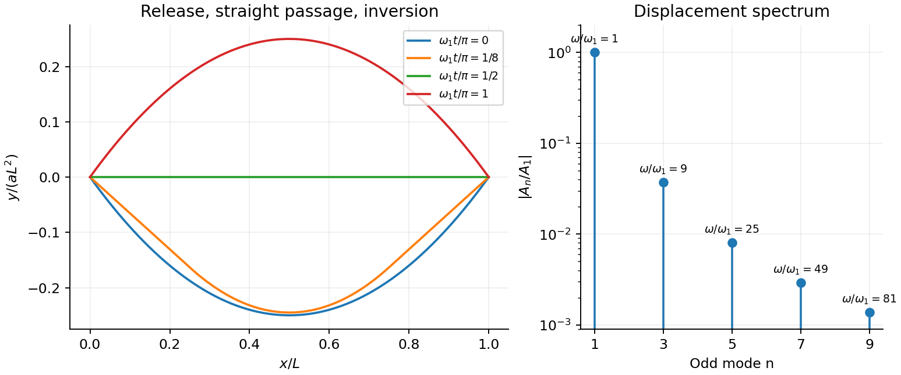

<h1 id="section-c/c13/solution">Solution</h1>

↑ **Parent:** [C13](../c13.md)

Use the [Euler-Bernoulli beam equation](../../../../../euler-bernoulli-beam-equation.md) for a uniform slender [elastic beam](../../../../../elastic-beam.md), small deflection and small slope, neglecting axial tension, shear deformation, rotational inertia of a cross-section and [damping](../../../../../damping.md). Let $E$ be [Young's modulus](../../../../../young-s-modulus.md), $I=\int_A z^2dA$ the [second moment of area](../../../../../second-moment-of-area.md) about the [neutral axis](../../../../../neutral-axis.md), and $\rho$ the [mass](../../../../../mass.md) per unit [length](../../../../../length.md). If [density](../../../../../density.md) instead denotes [mass](../../../../../mass.md) per [volume](../../../../../volume.md), replace this $\rho$ by $\rho_{\rm bulk}A$. The [bending stiffness](../../../../../bending-stiffness.md) is $EI$; the small-slope [curvature](../../../../../curvature.md) is $y_{xx}$. The bending and [kinetic energies](../../../../../kinetic-energy.md) are

$$
U=\frac{EI}{2}\int_0^L y_{xx}^2dx,\qquad
T=\frac\rho2\int_0^L y_t^2dx.
$$

Twice integrating the variation of $U$ by parts gives the restoring load $-EIy_{xxxx}$ per unit [length](../../../../../length.md). [Newton's second law](../../../../../newton-s-second-law.md) therefore gives

$$
\boxed{\rho y_{tt}+EIy_{xxxx}=0.}
$$

At a pivot, [displacement](../../../../../displacement.md) is fixed but slope is free; zero end [bending moment](../../../../../bending-moment.md) gives $EIy_{xx}=0$. This also follows from the natural boundary term $EIy_{xx}\delta y_x$ in the variation.

With [separation of variables](../../../../../separation-of-variables.md), $y=XT$ gives

$$
\frac{T''}{T}=-\frac{EI}{\rho}\frac{X''''}{X}=-\omega^2.
$$

Choose the time normalization $T(0)=1$. Initial rest removes the [sine](../../../../../sine.md) time term, so $T(t)=\cos\omega t$. The spatial characteristic roots are $\pm ik,\pm k$, giving

$$
X=A\sin kx+B\cos kx+C\sinh kx+D\cosh kx,
\qquad
\boxed{\omega=k^2\sqrt{EI/\rho}.}
$$

The two conditions at $x=0$ give $B+D=0$ and $-B+D=0$, hence $B=D=0$. At $L$, addition and subtraction of $X(L)=X''(L)=0$ give $C\sinh kL=0$ and $A\sin kL=0$. Nontrivial positive-frequency modes therefore have $C=0$ and $k_n=n\pi/L$. Thus the [simply supported beam normal modes](../../../../../simply-supported-beam-normal-modes.md) are

$$
\boxed{X_n(x)=\sin\frac{n\pi x}{L},\qquad
\omega_n=\frac{n^2\pi^2}{L^2}\sqrt{\frac{EI}{\rho}},\quad n=1,2,\ldots.}
$$

The zero-frequency cubic solution also vanishes under these four endpoint conditions, so $n=0$ is not an additional mode.

For the specified release, small slope requires $|a|L\ll1$. Expand the initial deflection in the [Fourier sine series](../../../../../fourier-sine-series.md). Its coefficients are

$$
A_n=\frac{2a}{L}\int_0^L x(x-L)\sin\frac{n\pi x}{L}\,dx
=-\frac{4aL^2[1-(-1)^n]}{n^3\pi^3}.
$$

Writing $\omega_1=\pi^2\sqrt{EI/\rho}/L^2$, the resulting motion is

$$
\boxed{y(x,t)=-\frac{8aL^2}{\pi^3}\sum_{j=0}^\infty
\frac{\sin[(2j+1)\pi x/L]}{(2j+1)^3}
\cos[(2j+1)^2\omega_1t].}
$$

Only odd [normal modes](../../../../../normal-mode.md) occur because the initial profile is symmetric about the midpoint, and their [amplitudes](../../../../../wave-amplitude.md) decrease as $n^{-3}$. The [frequencies](../../../../../frequency.md) grow as $n^2$, so the motion is dispersive and is not a single shape multiplied by one [cosine](../../../../../cosine.md). Nevertheless the ideal undamped solution is exactly periodic with period $2\pi/\omega_1$. At $t=\pi/(2\omega_1)$ all odd-mode [cosines](../../../../../cosine.md) vanish, so the bar is instantaneously straight; at $t=\pi/\omega_1$ it has the opposite initial deflection. The first mode dominates [displacement](../../../../../displacement.md), with third-mode [amplitude](../../../../../wave-amplitude.md) only $1/27$ of the first.

There is [initial curvature incompatibility at a moment-free beam end](../../../../../initial-curvature-incompatibility-at-a-moment-free-beam-end.md): the prescribed [parabola](../../../../../parabola.md) has $y_{xx}(x,0)=2a$, whereas a moment-free pivot requires zero [curvature](../../../../../curvature.md) at an endpoint. Therefore the data do not define a classical solution with [curvature](../../../../../curvature.md) continuous through the two end-time corners. They do define a finite-energy [weak solution](../../../../../weak-solution.md) after release of the [forces](../../../../../force-split.md) or end moments that prepared the initial shape. The [sine](../../../../../sine.md) expansion represents that solution: its [displacement](../../../../../displacement.md) reproduces the initial [parabola](../../../../../parabola.md), each mode satisfies the released endpoint conditions, and $\sum_n n^4|A_n|^2<\infty$ gives finite bending [energy](../../../../../energy-split.md). One must not differentiate the initial series twice at its endpoints and assign the interior [parabola](../../../../../parabola.md)'s [curvature](../../../../../curvature.md) there. This qualification leaves the modal [displacement](../../../../../displacement.md) prediction intact.

**[Figure 4](#section-c/c13/image-original-modal-evolution-after-releasing-a-parabolic-elastic-beam-deflection). Original modal evolution after releasing a parabolic elastic beam deflection**.

## ↑ Ancestors (14)

1. [C13](../c13.md)
2. [Section C](../../section-c.md)
3. [Paper 1](../../../paper-1-split.md)
4. [2012](../../../split.md)
5. [Past exam of the physics B course of the University of Cambridge](../../../../split.md)
6. [Physics B course of the University of Cambridge](../../../../../physics-b-course-of-the-university-of-cambridge.md)
7. [Physics course of the year 2 of the natural sciences course of the University of Cambridge](../../../../../physics-course-of-the-year-2-of-the-natural-sciences-course-of-the-university-of-cambridge.md)
8. [Year 2 of the natural sciences course of the University of Cambridge](../../../../../year-2-of-the-natural-sciences-course-of-the-university-of-cambridge.md)
9. [Year of the natural sciences course of the University of Cambridge](../../../../../year-of-the-natural-sciences-course-of-the-university-of-cambridge.md)
10. [Natural sciences course of the University of Cambridge](../../../../../natural-sciences-course-of-the-university-of-cambridge.md)
11. [Course of the University of Cambridge](../../../../../course-of-the-university-of-cambridge.md)
12. [University of Cambridge](../../../../../university-of-cambridge-split.md)
13. [List of universities](../../../../../list-of-universities.md)
14. [Codex Wiki](../../../../../split.md)
