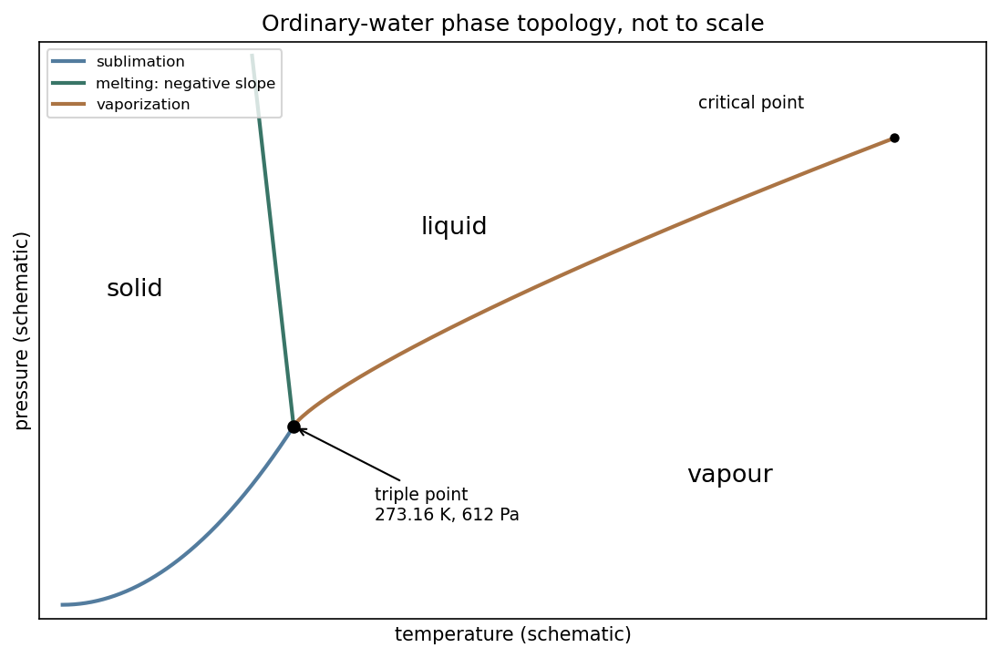

# Paper 2

↑ **Parent:** [2012](../2012.md)

[Original public PDF, physical pages 136–141; examination dated 6 June 2012](https://www.whatdotheyknow.com/request/natural_science_tripos_physics_e_2/response/2340776/attach/2/FOI%202023%20399%20Zahid%20materials.pdf?cookie_passthrough=1#page=136)

An alternate public copy is [Physical pages 300–305 of the alternate source PDF](https://www.whatdotheyknow.com/request/physics_past_papers_23/response/3514893/attach/4/FOI%202026%20628%20Smith%20materials.pdf?cookie_passthrough=1#page=300).

**Table of contents**

- [Section A](#section-a)
  - [A1](#section-a/a1)
    - [Solution](#section-a/a1/solution)
  - [A2](#section-a/a2)
    - [Solution](#section-a/a2/solution)
  - [A3](#section-a/a3)
    - [Solution](#section-a/a3/solution)
  - [A4](#section-a/a4)
    - [Solution](#section-a/a4/solution)
  - [A5](#section-a/a5)
    - [Solution](#section-a/a5/solution)
- [Section B](#section-b)
  - [B6](#section-b/b6)
    - [a](#section-b/b6/a)
      - [Solution](#section-b/b6/a/solution)
    - [b](#section-b/b6/b)
      - [Solution](#section-b/b6/b/solution)
    - [c](#section-b/b6/c)
      - [Solution](#section-b/b6/c/solution)
    - [d](#section-b/b6/d)
      - [Solution](#section-b/b6/d/solution)
  - [B7](#section-b/b7)
    - [Solution](#section-b/b7/solution)
  - [B8](#section-b/b8)
    - [a](#section-b/b8/a)
      - [Solution](#section-b/b8/a/solution)
    - [b](#section-b/b8/b)
      - [Solution](#section-b/b8/b/solution)
    - [c](#section-b/b8/c)
      - [Solution](#section-b/b8/c/solution)
    - [d](#section-b/b8/d)
      - [Solution](#section-b/b8/d/solution)
  - [B9](#section-b/b9)
    - [Solution](#section-b/b9/solution)
- [Section C](#section-c)
  - [C10](#section-c/c10)
    - [Solution](#section-c/c10/solution)
  - [C11](#section-c/c11)
    - [Solution](#section-c/c11/solution)
  - [C12](#section-c/c12)
    - [Solution](#section-c/c12/solution)
  - [C13](#section-c/c13)
    - [Solution](#section-c/c13/solution)

## Section A

↑ **Parent:** [Paper 2](paper-2.md)

<h3 id="section-a/a1">A1</h3>

↑ **Parent:** [Section A](#section-a)

<h4 id="section-a/a1/solution">Solution</h4>

↑ **Parent:** [A1](#section-a/a1)

For the one-mole convention, **$b$ is the excluded [molar volume](../../thermodynamics.md#molar-volume)**: finite molecular size reduces the volume available for translational motion from $V$ to $V-b$. It is an effective [excluded volume](../../statistical-physics.md#excluded-volume), not simply the sum of the bare molecular volumes. **$a/V^2$ corrects for attractive [intermolecular forces](../../force.md#intermolecular-force)**, which reduce the [pressure](../../pressure.md) exerted on the wall. The attraction per molecule scales with [number density](../../statistical-physics.md#number-density), and the number of affected molecules also scales with [density](../../fluid-mechanics.md#density), producing the density-squared correction. The [Van der Waals equation](../../pressure.md#van-der-waals-equation) consequently raises the measured [pressure](../../pressure.md) to the corresponding repulsive-gas value before multiplying by the available volume. Both corrections vanish relative to the ideal-gas terms at sufficiently low [density](../../fluid-mechanics.md#density).

<h3 id="section-a/a2">A2</h3>

↑ **Parent:** [Section A](#section-a)

<h4 id="section-a/a2/solution">Solution</h4>

↑ **Parent:** [A2](#section-a/a2)

For inner radius $a$ and outer conductor's inner radius $b$, [Gauss's law](../../maxwell-equations.md#gauss-s-law) gives $E(s)=\lambda/(2\pi\epsilon_0\epsilon_rs)$. Integrating across the [dielectric](../../permittivity.md#dielectric) gives [voltage](../../random-walk.md#voltage) $V=\lambda\ln(b/a)/(2\pi\epsilon_0\epsilon_r)$. Thus the [capacitance](../../electromagnetism.md#capacitance) per unit length is

$$
\boxed{C'=\frac{2\pi\epsilon_0\epsilon_r}{\ln(b/a)}
=\frac{4\pi\epsilon_0}{\ln2}\simeq1.61\times10^{-10}\,\mathrm{F\,m^{-1}}
=161\,\mathrm{pF\,m^{-1}}.}
$$

The stated outer radius is interpreted as the radius of the dielectric-facing surface. [Magnetic permeability](../../maxwell-equations.md#permeability-electromagnetism) affects [inductance](../../electromagnetism.md#inductance), but does not enter this electrostatic [capacitance](../../electromagnetism.md#capacitance).

<h3 id="section-a/a3">A3</h3>

↑ **Parent:** [Section A](#section-a)

<h4 id="section-a/a3/solution">Solution</h4>

↑ **Parent:** [A3](#section-a/a3)

[Kepler's third law](../../mathematical-physics.md#kepler-s-third-law) for negligible planet [mass](../../classical-mechanics.md#mass) gives $a_P/a_E=(P_P/P_E)^{2/3}$. Therefore $a_P=1.5\times10^8(248)^{2/3}\simeq5.92\times10^9\,\mathrm{km}$. The furthest point is [apoapsis](../../celestial-mechanics.md#apoapsis), so

$$
\boxed{r_{\max}=a_P(1+e)\simeq7.40\times10^9\,\mathrm{km}.}
$$

The supplied orbital period and [eccentricity](../../euclidean-geometry.md#eccentricity-of-a-conic) are sufficient; no present-day ephemeris is needed.

<h3 id="section-a/a4">A4</h3>

↑ **Parent:** [Section A](#section-a)

<h4 id="section-a/a4/solution">Solution</h4>

↑ **Parent:** [A4](#section-a/a4)

Neglect ends and take the exterior as vacuum. With polar angle measured from the applied field, regularity inside and the far-field condition allow

$$
\phi_{\rm in}=-B E_0s\cos\theta,\qquad
\phi_{\rm out}=-E_0s\cos\theta+A E_0a^2\frac{\cos\theta}{s}.
$$

Continuity of potential gives $B=1-A$; continuity of normal electric [displacement](../../classical-mechanics.md#displacement), with no free surface charge, gives $\epsilon_rB=1+A$. Hence the [transverse electrostatic field inside a dielectric cylinder](../../permittivity.md#transverse-electrostatic-field-inside-a-dielectric-cylinder) is uniform, parallel to the applied field, with magnitude

$$
\boxed{E_{\rm in}=\frac{2E_0}{1+\epsilon_r}.}
$$

This cylindrical result differs from the spherical depolarization factor. It returns $E_0$ for $\epsilon_r=1$ and tends to zero for large positive $\epsilon_r$.

<h3 id="section-a/a5">A5</h3>

↑ **Parent:** [Section A](#section-a)

<h4 id="section-a/a5/solution">Solution</h4>

↑ **Parent:** [A5](#section-a/a5)

Let $N$ be circumferential [tension](../../force.md#tension). A small arc subtending $d\theta$ has inward resultant $N\,d\theta$ and [mass](../../classical-mechanics.md#mass) $\rho A r\,d\theta$. Its [centripetal acceleration](../../classical-mechanics.md#centripetal-acceleration) gives $N=\rho A\omega^2r^2$. Circumferential [stress](../../continuum-mechanics.md#stress) is $N/A$ and the [strain](../../continuum-mechanics.md#strain) is $\Delta(2\pi r)/(2\pi r)=\Delta r/r$. Thus the [centrifugal strain of a thin elastic hoop](../../elasticity-physics.md#centrifugal-strain-of-a-thin-elastic-hoop) is

$$
\boxed{\frac{\Delta r}{r}\simeq\frac{\rho\omega^2r^2}{E}.}
$$

Use the unstrained radius and cross-section at this order. The approximation requires $\rho\omega^2r^2/E\ll1$, a slender hoop and linear elastic response; the area cancels.

## Section B

↑ **Parent:** [Paper 2](paper-2.md)

<h3 id="section-b/b6">B6</h3>

↑ **Parent:** [Section B](#section-b)

<h4 id="section-b/b6/a">a</h4>

↑ **Parent:** [B6](#section-b/b6)

<h5 id="section-b/b6/a/solution">Solution</h5>

↑ **Parent:** [A](#section-b/b6/a)

A [transmission line](../../electrical-engineering.md#transmission-line) stores electric and magnetic [energy](../../energy.md) along its length, so [voltage](../../random-walk.md#voltage) and current depend on both position and time. A distributed circuit uses [inductance](../../electromagnetism.md#inductance) $L'$ and [capacitance](../../electromagnetism.md#capacitance) $C'$ per length, together with resistance $R'$ and leakage conductance $G'$. Applying [voltage](../../random-walk.md#voltage) and charge balance to a short segment gives the [telegrapher's equations](../../electrical-engineering.md#telegrapher-s-equations),

$$
\partial_xV=-R'I-L'\partial_tI,\qquad
\partial_xI=-G'V-C'\partial_tV.
$$

For a lossless line, both variables obey [wave equations](../../wave-equation.md) with speed $v=1/\sqrt{L'C'}$ and [characteristic impedance](../../electrical-engineering.md#characteristic-impedance) $Z_0=\sqrt{L'/C'}$. Forward and backward [waves](../../wave.md) obey $I^+=V^+/Z_0$ and $I^-=-V^-/Z_0$. Matching a termination $Z_L$ gives the [voltage](../../random-walk.md#voltage) [reflection coefficient](../../partial-differential-equation.md#reflection-coefficient)

$$
\boxed{\Gamma_L=\frac{Z_L-Z_0}{Z_L+Z_0}.}
$$

A matched load absorbs without reflection; an open circuit has $\Gamma_L=1$, and a short has $\Gamma_L=-1$. Reflections can produce [standing waves](../../mathematical-physics.md#standing-wave). A coaxial line confines the fields between conductors and, for a uniform [dielectric](../../permittivity.md#dielectric) TEM [wave](../../wave.md), has $v=1/\sqrt{\mu\epsilon}$. Finite loss attenuates [waves](../../wave.md); frequency-dependent losses or material properties can also distort pulses. **A long line is a wave-carrying distributed system, so it cannot generally be replaced by one lumped capacitor.**

<h4 id="section-b/b6/b">b</h4>

↑ **Parent:** [B6](#section-b/b6)

<h5 id="section-b/b6/b/solution">Solution</h5>

↑ **Parent:** [B](#section-b/b6/b)

[Polarization density](../../electromagnetism.md#polarization-density) $\mathbf P$ is [electric dipole moment](../../electrostatics.md#electric-dipole-moment) per unit volume. Displacing positive and negative [bound charges](../../electromagnetism.md#bound-charge) leaves the bulk nearly neutral locally but can produce uncompensated charge where polarization varies or terminates. For a [dielectric](../../permittivity.md#dielectric) occupying a volume with outward unit normal $\mathbf n$,

$$
\boxed{\rho_b=-\nabla\cdot\mathbf P,\qquad \sigma_b=\mathbf P\cdot\mathbf n.}
$$

The [divergence theorem](../../multivariable-calculus.md#divergence-theorem) makes their total sum zero for a body described entirely by bound dipoles. Uniform polarization gives no interior volume charge but generally gives opposite surface charges on different faces.

In a linear isotropic [dielectric](../../permittivity.md#dielectric), $\mathbf P=\epsilon_0\chi_e\mathbf E$ and $\mathbf D=\epsilon_0\mathbf E+\mathbf P=\epsilon\mathbf E$. [Gauss's law](../../maxwell-equations.md#gauss-s-law) becomes $\nabla\cdot\mathbf D=\rho_f$, separating free from [bound charge](../../electromagnetism.md#bound-charge). Across a static interface, tangential [electric field](../../electric-field.md) is continuous, while the normal [displacement](../../classical-mechanics.md#displacement) jumps by the free surface charge. Polarization charges alter the internal field, as in the [dielectric](../../permittivity.md#dielectric) cylinder calculation. Molecular distortion and orientation contribute differently, and response can depend on [temperature](../../temperature.md) and frequency. **[Bound charge](../../electromagnetism.md#bound-charge) is a redistribution of material charge, not an additional free-charge reservoir.**

<h4 id="section-b/b6/c">c</h4>

↑ **Parent:** [B6](#section-b/b6)

<h5 id="section-b/b6/c/solution">Solution</h5>

↑ **Parent:** [C](#section-b/b6/c)

Write [magnetization](../../electromagnetism.md#magnetization) as [magnetic dipole moment](../../electromagnetism.md#magnetic-dipole-moment) per volume. In weak-field linear response, $\mathbf M=\chi\mathbf H$ and $\mathbf B=\mu_0(\mathbf H+\mathbf M)$.

**[Paramagnetism](../../electromagnetism.md#paramagnetism)** has positive susceptibility: permanent spin or orbital moments tend to align with a field against thermal disorder. Independent localized moments in the classical weak-field regime give $\chi\propto1/T$, the [Curie law](../../statistical-physics.md#curie-s-law). Conduction-electron [Pauli paramagnetism](../../quantum-ideal-gas-statistics.md#pauli-paramagnetism) has a different origin and need not follow that [temperature](../../temperature.md) law.

**[Diamagnetism](../../electromagnetism.md#diamagnetism)** is the induced magnetic response opposing the applied field, giving negative susceptibility. Changes in orbital motion underlie this response; it exists even without permanent moments. It is often relatively weak and only weakly [temperature](../../temperature.md) dependent, although particular quantum systems have stronger or more complicated behaviour.

**[Ferromagnetism](../../electromagnetism.md#ferromagnetism)** arises from interactions favouring parallel magnetic order. Below the [Curie temperature](../../electromagnetism.md#curie-temperature) a domain can have spontaneous [magnetization](../../electromagnetism.md#magnetization) even at zero applied field. A sample can nevertheless have nearly zero net moment if differently oriented domains cancel. Domain rearrangement and rotation produce a nonlinear [magnetization](../../electromagnetism.md#magnetization) curve, saturation, [remanence](../../electromagnetism.md#remanent-magnetization) and [coercivity](../../real-analysis.md#coercive-function); [hysteresis](../../critical-phenomenon.md#hysteresis) dissipates [energy](../../energy.md) in a field cycle. Above the ordering [temperature](../../temperature.md) the spontaneous order disappears, and a Curie-Weiss susceptibility is a useful mean-field approximation. **The signs of weak-field susceptibility distinguish para- and [diamagnetism](../../electromagnetism.md#diamagnetism); spontaneous order and domain dynamics distinguish [ferromagnetism](../../electromagnetism.md#ferromagnetism) from independent-moment alignment.**

<h4 id="section-b/b6/d">d</h4>

↑ **Parent:** [B6](#section-b/b6)

<h5 id="section-b/b6/d/solution">Solution</h5>

↑ **Parent:** [D](#section-b/b6/d)

Use a cold, unmagnetized, collisionless [electron](../../physics.md#electron) plasma with immobile ions. For an oscillating field proportional to $e^{-i\omega t}$, the [electron](../../physics.md#electron) [displacement](../../classical-mechanics.md#displacement) follows $-m_e\omega^2\mathbf x=-e\mathbf E$. Hence $\mathbf P=-n_ee\mathbf x=-n_ee^2\mathbf E/(m_e\omega^2)$ and

$$
\boxed{\epsilon_r(\omega)=1-\frac{\omega_p^2}{\omega^2},\qquad
\omega_p^2=\frac{n_ee^2}{\epsilon_0m_e}.}
$$

The induced polarization opposes the field because [electron](../../physics.md#electron) inertia changes the phase of its [displacement](../../classical-mechanics.md#displacement). [Maxwell's equations](../../maxwell-equations.md) give transverse electromagnetic [dispersion](../../dispersion-relation.md#wave-dispersion)

$$
\omega^2=\omega_p^2+c^2k^2.
$$

Thus [transverse waves](../../wave.md#transverse-wave) propagate above the [plasma frequency](../../physics.md#plasma-frequency), while below it the wavenumber is imaginary and a semi-infinite lossless plasma reflects an incident [wave](../../wave.md) with an evanescent interior field. In the cold electrostatic model, a longitudinal [density](../../fluid-mechanics.md#density) oscillation instead has frequency $\omega_p$.

Collisions at rate $\nu$ give $\epsilon_r=1-\omega_p^2/[\omega(\omega+i\nu)]$ for this time convention, introducing absorption. A background [magnetic field](../../magnetic-field.md) makes the response anisotropic, and thermal motion supplies additional [dispersion](../../dispersion-relation.md#wave-dispersion) and static screening. The divergent zero-frequency cold collisionless formula should not be mistaken for a complete description of static Debye screening. **The simple [dielectric](../../permittivity.md#dielectric) function is a dynamical electron-inertia response under stated assumptions.**

<h3 id="section-b/b7">B7</h3>

↑ **Parent:** [Section B](#section-b)

<h4 id="section-b/b7/solution">Solution</h4>

↑ **Parent:** [B7](#section-b/b7)

In microscopic SI form, [Maxwell's equations](../../maxwell-equations.md) couple charge [density](../../fluid-mechanics.md#density) $\rho$ and current [density](../../fluid-mechanics.md#density) $\mathbf J$ to electric and [magnetic fields](../../magnetic-field.md):

$$
\nabla\cdot\mathbf E=\frac\rho{\epsilon_0},\qquad
\nabla\cdot\mathbf B=0,\qquad
\nabla\times\mathbf E=-\partial_t\mathbf B,\qquad
\nabla\times\mathbf B=\mu_0\mathbf J+\mu_0\epsilon_0\partial_t\mathbf E.
$$

Gauss's electric law expresses electric flux from charge and reduces to the inverse-square Coulomb field for a point charge. Gauss's magnetic law gives zero net [magnetic flux](../../magnetic-field.md#magnetic-flux) through every closed surface; [magnetic field](../../magnetic-field.md) lines do not begin or end on magnetic monopoles in this theory.

Faraday's induction law says changing [magnetic flux](../../magnetic-field.md#magnetic-flux) produces a circulating [electric field](../../electric-field.md). For a fixed loop, its circulation is minus the rate of change of enclosed [magnetic flux](../../magnetic-field.md#magnetic-flux), explaining the sign of induction and [Lenz's law](../../maxwell-equations.md#lenz-s-law). For example, changing a primary coil's [electric current](../../electric-charge.md#electric-current) changes the flux through a stationary secondary coil and induces a [voltage](../../random-walk.md#voltage). A moving wire also has the magnetic part of the [Lorentz force](../../relativistic-electromagnetism.md#lorentz-force) on its charges; the fixed-loop field equation and the full motional-emf calculation must be distinguished.

The Ampère-Maxwell law relates magnetic circulation to conduction current and [displacement current](../../maxwell-equations.md#displacement-current). The latter is essential around a charging capacitor: a surface cutting the lead and another passing through the gap must predict the same circulation. Taking the divergence gives

$$
\nabla\cdot\mathbf J+\partial_t\rho=0,
$$

using Gauss's electric law. [Charge conservation](../../electric-charge.md#charge-conservation) therefore fixes the consistency of the time-dependent equations. In matter, the equivalent macroscopic equations use $\mathbf D$ and $\mathbf H$, free sources and constitutive relations. The [Lorentz force](../../relativistic-electromagnetism.md#lorentz-force) [density](../../fluid-mechanics.md#density) $\rho\mathbf E+\mathbf J\times\mathbf B$ describes exchange of [momentum](../../momentum.md) with charges.

In source-free vacuum, take the curl of Faraday's law and use $\nabla\times(\nabla\times\mathbf E)=\nabla(\nabla\cdot\mathbf E)-\nabla^2\mathbf E$. Both fields satisfy

$$
\boxed{\nabla^2\mathbf E=\mu_0\epsilon_0\partial_t^2\mathbf E,\qquad
\nabla^2\mathbf B=\mu_0\epsilon_0\partial_t^2\mathbf B,
\qquad c=\frac1{\sqrt{\mu_0\epsilon_0}}.}
$$

For a [plane wave](../../wave-function.md#plane-wave), $\omega=ck$, $\mathbf k\cdot\mathbf E=\mathbf k\cdot\mathbf B=0$ and $\mathbf B=\hat{\mathbf k}\times\mathbf E/c$. The fields are transverse, mutually perpendicular and in phase. Their [energy density](../../statistical-physics.md#energy-density) and [energy flux](../../mathematical-physics.md#energy-flux) are

$$
u=\frac{\epsilon_0E^2}{2}+\frac{B^2}{2\mu_0},\qquad
\mathbf S=\frac{\mathbf E\times\mathbf B}{\mu_0},\qquad
\partial_tu+\nabla\cdot\mathbf S=-\mathbf J\cdot\mathbf E.
$$

This is [Poynting's theorem](../../electromagnetic-wave.md#poynting-theorem): field [energy](../../energy.md) is transported and can do [work](../../energy.md#work) on matter. **[Electromagnetic radiation](../../electromagnetic-radiation.md) is a propagating, energy-carrying solution of the coupled electric and [magnetic field](../../magnetic-field.md) equations.**

<h3 id="section-b/b8">B8</h3>

↑ **Parent:** [Section B](#section-b)

<h4 id="section-b/b8/a">a</h4>

↑ **Parent:** [B8](#section-b/b8)

<h5 id="section-b/b8/a/solution">Solution</h5>

↑ **Parent:** [A](#section-b/b8/a)

Let a frame's origin have inertial acceleration $\mathbf a_0$ and its axes rotate with [angular velocity](../../rigid-body-dynamics.md#angular-velocity) $\boldsymbol\Omega(t)$. For position $\mathbf r$ and [velocity](../../classical-mechanics.md#velocity) $\mathbf v'$ measured in that frame, Newton's law becomes

$$
m\mathbf a'=\mathbf F-m\mathbf a_0
-2m\boldsymbol\Omega\times\mathbf v'
-m\dot{\boldsymbol\Omega}\times\mathbf r
-m\boldsymbol\Omega\times(\boldsymbol\Omega\times\mathbf r).
$$

The extra terms are translational, Coriolis, Euler and centrifugal inertial [forces](../../force.md). [Centrifugal force](../../mathematical-physics.md#centrifugal-force) points away from the rotation axis; [Coriolis force](../../mathematical-physics.md#coriolis-force) deflects moving bodies sideways and does no instantaneous [work](../../energy.md#work) on their relative motion, since it is perpendicular to $\mathbf v'$. The Euler term appears when the rotation rate or axis changes.

For constant $\boldsymbol\Omega$, [centrifugal force](../../mathematical-physics.md#centrifugal-force) has potential $U_{\rm cf}=-m|\boldsymbol\Omega\times\mathbf r|^2/2$. It can be combined with a conservative real potential to find rotating-frame equilibria. The Coriolis term remains [velocity](../../classical-mechanics.md#velocity) dependent. These [forces](../../force.md) arise from describing acceleration in a noninertial frame; they are not additional interactions between bodies. They are essential for trajectories on rotating apparatus and for large-scale terrestrial motions. **Frame-dependent terms must be included consistently with the chosen coordinates.**

<h4 id="section-b/b8/b">b</h4>

↑ **Parent:** [B8](#section-b/b8)

<h5 id="section-b/b8/b/solution">Solution</h5>

↑ **Parent:** [B](#section-b/b8/b)

A small [displacement](../../classical-mechanics.md#displacement) $\mathbf u$ in a homogeneous isotropic elastic solid obeys [linear elasticity](../../elasticity-physics.md#linear-elasticity). With Lamé constants $\lambda,\mu$ and [mass](../../classical-mechanics.md#mass) [density](../../fluid-mechanics.md#density) $\rho$, [momentum](../../momentum.md) balance gives

$$
\rho\partial_t^2\mathbf u=(\lambda+\mu)\nabla(\nabla\cdot\mathbf u)+\mu\nabla^2\mathbf u.
$$

A longitudinal [plane wave](../../wave-function.md#plane-wave) has [displacement](../../classical-mechanics.md#displacement) parallel to its propagation direction and changes local volume. A [transverse wave](../../wave.md#transverse-wave) has perpendicular [displacement](../../classical-mechanics.md#displacement) and produces shear. Substitution gives

$$
\boxed{c_L=\sqrt{\frac{\lambda+2\mu}{\rho}},\qquad
c_T=\sqrt{\frac\mu\rho}.}
$$

An ideal fluid has no static [shear modulus](../../elasticity-physics.md#shear-modulus) and cannot support this bulk transverse [elastic wave](../../wave-equation.md#elastic-wave). A thin rod with free lateral surfaces instead supports an extensional long-wavelength mode with speed $\sqrt{E/\rho}$; its transverse contraction changes the effective stiffness, so it should not be identified with the unbounded-solid longitudinal mode.

[Stress](../../continuum-mechanics.md#stress) and [displacement](../../classical-mechanics.md#displacement) boundary conditions produce reflection, transmission, mode conversion and guided [waves](../../wave.md). [Viscoelasticity](../../rheology.md#viscoelasticity) and scattering can attenuate [waves](../../wave.md); finite geometry can make guided modes dispersive even when the bulk elastic constants are frequency independent. **[Wave](../../wave.md) speed depends on both material stiffness and the allowed deformation.**

<h4 id="section-b/b8/c">c</h4>

↑ **Parent:** [B8](#section-b/b8)

<h5 id="section-b/b8/c/solution">Solution</h5>

↑ **Parent:** [C](#section-b/b8/c)

Choose body-fixed [principal axes](../../rigid-body-dynamics.md#principal-axis) through a fixed point or the centre of [mass](../../classical-mechanics.md#mass), with principal moments $I_1,I_2,I_3$. [Angular momentum](../../momentum.md#angular-momentum) has components $L_i=I_i\omega_i$. The inertial [derivative](../../calculus.md#derivative) is the body [derivative](../../calculus.md#derivative) plus $\boldsymbol\omega\times\mathbf L$, so [Euler's equations](../../rigid-body-dynamics.md#euler-s-equations-rigid-body-dynamics) read

$$
\boxed{I_1\dot\omega_1+(I_3-I_2)\omega_2\omega_3=\tau_1,\quad
I_2\dot\omega_2+(I_1-I_3)\omega_3\omega_1=\tau_2,\quad
I_3\dot\omega_3+(I_2-I_1)\omega_1\omega_2=\tau_3.}
$$

They avoid differentiating the rotating [inertia tensor](../../rigid-body-dynamics.md#inertia-tensor) in laboratory coordinates. [Torques](../../momentum.md#torque) must refer to the chosen point, and the displayed fixed moments require a [rigid body](../../rigid-body-dynamics.md).

For zero [torque](../../momentum.md#torque), laboratory [angular momentum](../../momentum.md#angular-momentum) is constant, while its components can change in the body frame. Both $L^2$ and rotational [kinetic energy](../../energy.md#kinetic-energy) $T=\tfrac12\sum I_i\omega_i^2$ are conserved. The intersections of their constant-value surfaces constrain the motion. For distinct $I_1<I_2<I_3$, steady rotation about either extreme [principal axis](../../rigid-body-dynamics.md#principal-axis) is stable against small perturbations, whereas rotation about the intermediate axis is unstable. For example perturbing rotation $\Omega$ about axis 2 gives

$$
\ddot{\delta\omega_1}=
\Omega^2\frac{(I_2-I_3)(I_1-I_2)}{I_1I_3}\,\delta\omega_1,
$$

whose coefficient is positive. A symmetric body has additional simplifications and can precess. **Conservation of laboratory [angular momentum](../../momentum.md#angular-momentum) does not imply constant body-frame [angular velocity](../../rigid-body-dynamics.md#angular-velocity).**

<h4 id="section-b/b8/d">d</h4>

↑ **Parent:** [B8](#section-b/b8)

<h5 id="section-b/b8/d/solution">Solution</h5>

↑ **Parent:** [D](#section-b/b8/d)

For [conservative forces](../../energy.md#conservative-force) and ideal constraints that do no [work](../../energy.md#work), [mechanical energy](../../energy.md#mechanical-energy) $E=T+U$ is constant. Work-energy balance remains useful with nonconservative [forces](../../force.md): their power gives $dE/dt$. In one dimension,

$$
\tfrac12m\dot q^2+U(q)=E
$$

locates accessible regions and turning points, and reduces the trajectory to a quadrature $dt=dq/\sqrt{2(E-U)/m}$. A local minimum of potential is a stable equilibrium; a local maximum is unstable. Near a nondegenerate minimum, $U=U_0+K(q-q_0)^2/2+\cdots$ gives $\omega^2=K/m$.

For a [central force](../../mathematical-physics.md#central-force), conserved [angular momentum](../../momentum.md#angular-momentum) reduces radial motion to an [effective potential](../../mathematical-physics.md#effective-potential) $U_{\rm eff}=U(r)+L^2/(2mr^2)$. Its extrema determine circular orbits and their radial stability. In several coordinates, [small oscillations](../../lagrangian-mechanics.md#small-oscillation) follow from the kinetic-energy [mass matrix](../../finite-element-method.md#mass-matrix) $M$ and potential Hessian $K$ through $\det(K-\omega^2M)=0$.

[Energy](../../energy.md) is also central to the [Lagrangian](../../calculus-of-variations.md#lagrangian) $\mathcal L=T-U$ and the [Euler-Lagrange equations](../../analysis.md#euler-lagrange-equation). A time-independent natural mechanical system has conserved [energy](../../energy.md); [cyclic coordinates](../../lagrangian-mechanics.md#cyclic-coordinate) yield additional momenta. [Energy](../../energy.md) alone does not normally determine every coordinate of a multi-degree-of-freedom motion. **Its value is to expose allowed motion, stability and reductions before solving the full differential equations.**

<h3 id="section-b/b9">B9</h3>

↑ **Parent:** [Section B](#section-b)

<h4 id="section-b/b9/solution">Solution</h4>

↑ **Parent:** [B9](#section-b/b9)

A [velocity field](../../fluid-mechanics.md#velocity-field) $\mathbf u(\mathbf x,t)$ assigns a [velocity](../../classical-mechanics.md#velocity) to each point. Following a fluid parcel rather than holding position fixed gives the material or convective [derivative](../../calculus.md#derivative)

$$
\boxed{\frac D{Dt}=\partial_t+\mathbf u\cdot\nabla.}
$$

The convective term can accelerate fluid even in a steady flow, for example as a stream narrows. Conservation of [mass](../../classical-mechanics.md#mass) is $\partial_t\rho+\nabla\cdot(\rho\mathbf u)=0$; constant-density [incompressible flow](../../fluid-mechanics.md#incompressible-flow) has $\nabla\cdot\mathbf u=0$.

For an incompressible [Newtonian fluid](../../viscous-fluid-flow.md#newtonian-fluid) of constant [density](../../fluid-mechanics.md#density) and [viscosity](../../dynamic-viscosity.md), with conservative body-force potential per [mass](../../classical-mechanics.md#mass) $\Phi$, [momentum](../../momentum.md) balance is

$$
\frac{D\mathbf u}{Dt}=-\frac{\nabla p}{\rho}-\nabla\Phi+\nu\nabla^2\mathbf u.
$$

Neglect [viscosity](../../dynamic-viscosity.md) and assume steady flow. Dotting with an element along a streamline, or using $(\mathbf u\cdot\nabla)\mathbf u=\nabla(u^2/2)-\mathbf u\times(\nabla\times\mathbf u)$, gives

$$
\boxed{\frac p\rho+\frac{u^2}{2}+\Phi=B\quad\text{along a streamline}.}
$$

This is Bernoulli's equation: [pressure](../../pressure.md) [work](../../energy.md#work), [kinetic energy](../../energy.md#kinetic-energy) and gravitational [potential energy](../../energy.md#potential-energy) interconvert. In a connected irrotational region under the same assumptions, $B$ is the same for all streamlines. In a rotational flow it can vary between them. Viscous dissipation, pumps or unsteady motion require the corresponding modified balance; the steady inviscid expression cannot be applied indiscriminately.

[Vorticity](../../vorticity.md) $\boldsymbol\zeta=\nabla\times\mathbf u$ measures local fluid rotation. For constant-density [incompressible flow](../../fluid-mechanics.md#incompressible-flow) it evolves by

$$
\frac{D\boldsymbol\zeta}{Dt}=(\boldsymbol\zeta\cdot\nabla)\mathbf u+\nu\nabla^2\boldsymbol\zeta,
$$

showing vortex stretching and viscous diffusion. A [potential flow](../../fluid-mechanics.md#potential-flow) has $\mathbf u=\nabla\phi$ locally, so irrotational incompressible motion satisfies $\nabla^2\phi=0$. Boundary conditions then determine flows around simple shapes. A multiply connected region can have circulation even when its local [vorticity](../../vorticity.md) vanishes; ideal [potential flow](../../fluid-mechanics.md#potential-flow) also misses no-slip [boundary layers](../../continuum-mechanics.md#boundary-layer) and viscous drag.

For a [Newtonian fluid](../../viscous-fluid-flow.md#newtonian-fluid), [shear stress](../../viscous-fluid-flow.md#shear-stress) is proportional to [strain](../../continuum-mechanics.md#strain) rate. No-slip at solid walls produces [velocity](../../classical-mechanics.md#velocity) gradients and dissipation. Fully developed laminar pipe flow, for example, has

$$
u_z(s)=\frac{\Delta p}{4\mu\ell}(R^2-s^2),\qquad
Q=\frac{\pi R^4\Delta p}{8\mu\ell}.
$$

The [Reynolds number](../../dynamic-viscosity.md#reynolds-number) $\operatorname{Re}=UL/\nu$ compares inertial and viscous terms. Small values favour creeping-flow approximations; large values can permit thin [boundary layers](../../continuum-mechanics.md#boundary-layer) and [turbulence](../../turbulence.md), without guaranteeing [turbulence](../../turbulence.md) in every geometry. **The appropriate flow model follows from conservation laws, constitutive properties, boundaries and scale comparisons.**

## Section C

↑ **Parent:** [Paper 2](paper-2.md)

<h3 id="section-c/c10">C10</h3>

↑ **Parent:** [Section C](#section-c)

<h4 id="section-c/c10/solution">Solution</h4>

↑ **Parent:** [C10](#section-c/c10)

At coexistence, the two phases have equal [chemical potential](../../chemical-potential.md). For a single component, $d\mu=-s\,dT+v\,dp$, with [entropy](../../entropy.md) and volume measured on the same molar or [mass](../../classical-mechanics.md#mass) basis. Equating the phase [derivatives](../../calculus.md#derivative) along coexistence gives $\Delta v\,dp=\Delta s\,dT$. Reversible [latent heat](../../thermodynamic-potential.md#latent-heat) satisfies $L=T\Delta s$, hence

$$
\boxed{\frac{dp}{dT}=\frac{L}{T\Delta v}.}
$$

Here $p$ and $T$ are coexistence [pressure](../../pressure.md) and absolute [temperature](../../temperature.md), $L$ is [latent heat](../../thermodynamic-potential.md#latent-heat) for transforming phase 1 to phase 2, and $\Delta v=v_2-v_1$ uses the same amount of material as $L$.

For vaporization, neglect liquid [molar volume](../../thermodynamics.md#molar-volume) compared with ideal-vapour volume $RT/p$. The ideal-vapour Clausius-Clapeyron approximation becomes

$$
\frac{dp}{dT}=\frac{pL_e}{RT^2},\qquad
\ln\frac p{p_b}=-\frac{L_e}{R}\left(\frac1T-\frac1{T_b}\right).
$$

Using the normal boiling reference $T_b=373.15\,\mathrm K$, $p_b=1.01325\times10^5\,\mathrm{Pa}$ and the supplied constant $L_e$ gives

$$
\boxed{p(273\,\mathrm K)\simeq8.2\times10^2\,\mathrm{Pa}.}
$$

This deliberately constant-latent-heat extrapolation does not reproduce the supplied triple-point [pressure](../../pressure.md) exactly. It predicts the liquid-vapour branch, metastable against ice below the triple-point [temperature](../../temperature.md); it is not a precision sublimation-pressure prediction.

The [phase diagram](../../thermodynamic-potential.md#phase-diagram) has solid, liquid and vapour regions meeting at the [triple point](../../thermodynamic-potential.md#triple-point). The [sublimation](../../critical-phenomenon.md#sublimation) and vaporization boundaries have positive slopes, whereas the ordinary ice–water boundary slopes negatively because ice has larger specific volume. The liquid–vapour line terminates at a [critical point](../../analysis.md#critical-point); the original schematic below emphasizes topology and marks the supplied [triple point](../../thermodynamic-potential.md#triple-point).

**[Figure 1](#section-c/c10/image-schematic-pressure-temperature-phase-topology-of-ordinary-water-with-negative-melting-slope-and-the-supplied-triple-point). Schematic pressure–temperature phase topology of ordinary water, with negative melting slope and the supplied triple point**.

For the melting-pressure estimate, [Archimedes' principle](../../fluid-mechanics.md#archimedes-principle) gives $\rho_i=0.90\rho_w=900\,\mathrm{kg\,m^{-3}}$, so

$$
\Delta v=v_w-v_i=\frac1{1000}-\frac1{900}
=-1.111\times10^{-4}\,\mathrm{m^3\,kg^{-1}}.
$$

Convert the molar evaporation [heat](../../heat.md) using water [molar mass](../../chemistry.md#molar-mass) $M\simeq0.0180\,\mathrm{kg\,mol^{-1}}$, rounded from the tabulated value $18.0153\,\mathrm{g\,mol^{-1}}$.[Water entry, CAS 7732-18-5, molecular weight 18.0153](../../chemistry-bibliography.md#nist-chemistry-webbook-srd-69) An [enthalpy](../../enthalpy.md) cycle through vapour then gives

$$
L_f=L_s-\frac{L_e}{M}
\simeq2.8\times10^6-\frac{40700}{0.0180}
\simeq5.39\times10^5\,\mathrm{J\,kg^{-1}}.
$$

This uses the question's temperature-independent evaporation [heat](../../heat.md) all the way to the [triple point](../../thermodynamic-potential.md#triple-point); no replacement experimental fusion [heat](../../heat.md) is inserted. The [melting pressure inferred from flotation and latent heats](../../thermodynamic-potential.md#melting-pressure-inferred-from-flotation-and-latent-heats), on holding $L_f$ and $\Delta v$ constant, is

$$
\boxed{p-p_t=\frac{L_f}{\Delta v}\ln\frac T{T_t}
\simeq5.37\times10^7\,\mathrm{Pa},\qquad
p\simeq54\,\mathrm{MPa},}
$$

using $T_t=273.16\,\mathrm K$ and $T=270.15\,\mathrm K$. Linearizing the logarithm about the [triple point](../../thermodynamic-potential.md#triple-point) gives $53.4\,\mathrm{MPa}$ instead of $53.7\,\mathrm{MPa}$. Both are estimates within the stated constant-property approximation; the negative melting slope makes a positive [pressure](../../pressure.md) necessary to lower the melting [temperature](../../temperature.md).

<h3 id="section-c/c11">C11</h3>

↑ **Parent:** [Section C](#section-c)

<h4 id="section-c/c11/solution">Solution</h4>

↑ **Parent:** [C11](#section-c/c11)

**Capacity convention.** The printed equation requires $c$ to be [volumetric heat capacity](../../heat.md#volumetric-heat-capacity), in $\mathrm{J\,m^{-3}\,K^{-1}}$. If “[specific heat capacity](../../heat.md#specific-heat-capacity)” means per unit [mass](../../classical-mechanics.md#mass) instead, the storage term is $\rho_m c\,\partial_tT$ and both denominators in the printed equation must contain $\rho_m c$. This distinction is fixed by dimensions.

For a fixed material region $V$, conservation of thermal [energy](../../energy.md) gives the [heat balance with volumetric heat generation](../../diffusion-equation.md#heat-balance-with-volumetric-heat-generation),

$$
\frac d{dt}\int_VcT\,dV
=-\oint_{\partial V}\mathbf J\cdot\mathbf n\,dS+\int_VH\,dV.
$$

Use the [divergence theorem](../../multivariable-calculus.md#divergence-theorem), $\mathbf J=-\kappa\nabla T$ and constant coefficients. Since the region is arbitrary,

$$
\boxed{c\partial_tT=\kappa\nabla^2T+H,\qquad
\partial_tT=\frac\kappa c\nabla^2T+\frac Hc.}
$$

The [heat](../../heat.md) source is power per volume, while $\kappa$ is [thermal conductivity](../../heat.md#thermal-conductivity) rather than [thermal diffusivity](../../heat.md#thermal-diffusivity).

For uniform [electrical conductivity](../../electric-charge.md#electrical-conductivity) and imposed current, current [density](../../fluid-mechanics.md#density) is $j=I/(\pi a^2)$ and [Joule heating](../../electric-charge.md#joule-heating) is $H=j^2/\sigma$. A long, steady, cylindrically symmetric wire therefore satisfies

$$
\frac1s\frac d{ds}\left(s\frac{dT}{ds}\right)=-\frac H\kappa.
$$

Integration gives $T'=-Hs/(2\kappa)+C/s$. Regularity at $s=0$ makes $C=0$, and the surface condition fixes the remaining constant. Thus the [Joule-heated cylindrical wire](../../electric-charge.md#joule-heated-cylindrical-wire) has

$$
\boxed{T(s)=T_0+\frac{I^2}{4\pi^2a^4\kappa\sigma}(a^2-s^2).}
$$

Here $s$ denotes the printed radial coordinate $\rho$ and avoids confusing it with [mass](../../classical-mechanics.md#mass) [density](../../fluid-mechanics.md#density). The centre is hotter by $I^2/(4\pi^2a^2\kappa\sigma)$.

For the air boundary, the internal flux at $s=a$ is $-\kappa T'(a)=Ha/2$. Equate this to $\alpha[T(a)-T_{\rm air}]$. The [Newton cooling of a Joule-heated wire](../../electric-charge.md#newton-cooling-of-a-joule-heated-wire) gives

$$
\boxed{T(a)=T_{\rm air}+\frac{Ha}{2\alpha}
=T_{\rm air}+\frac{I^2}{2\pi^2a^3\sigma\alpha}.}
$$

Multiplication by circumference $2\pi a$ verifies that surface loss per length equals $I^2/(\pi a^2\sigma)$, the electrical power per length. The full air-cooled profile uses this surface [temperature](../../temperature.md) plus the same parabolic interior excess, assuming constant material properties and negligible end losses.

<h3 id="section-c/c12">C12</h3>

↑ **Parent:** [Section C](#section-c)

<h4 id="section-c/c12/solution">Solution</h4>

↑ **Parent:** [C12](#section-c/c12)

A [heat engine](../../thermodynamics.md#heat-engine)'s [thermal efficiency](../../thermodynamics.md#thermal-efficiency) is net [work](../../energy.md#work) out divided by [heat](../../heat.md) absorbed,

$$
\boxed{\eta=\frac{W_{\rm out}}{Q_{\rm in}}=1-\frac{Q_{\rm out}}{Q_{\rm in}},}
$$

where both [heat](../../heat.md) quantities are positive magnitudes. The last equality follows from the first law over a complete cycle.

Use $n$ moles of an [ideal gas](../../ideal-gas.md) with constant molar $C_V,C_p$ and $\gamma=C_p/C_V>1$. For the [Otto cycle](../../thermodynamics.md#otto-cycle), reversible [adiabats](../../first-law-of-thermodynamics.md#adiabat) give $T_2=T_1r^{\gamma-1}$ and $T_3/T_4=r^{\gamma-1}$. Isochoric [heat](../../heat.md) input and rejection are $Q_{\rm in}=nC_V(T_3-T_2)$ and $Q_{\rm out}=nC_V(T_4-T_1)$. Therefore

$$
\boxed{\eta_O=1-\frac{T_4-T_1}{T_3-T_2}=1-r^{1-\gamma}.}
$$

The denominator's [temperature](../../temperature.md) difference is $r^{\gamma-1}$ times the numerator's difference.

For the ideal [Atkinson cycle](../../thermodynamics.md#atkinson-cycle), heating at fixed volume gives $T_3/T_2=r_p$. The longer expansion ends when $p_{4'}=p_1$. Combining the adiabatic [pressure](../../pressure.md)–[temperature](../../temperature.md) relation with $p_2/p_1=r^\gamma$ yields

$$
\boxed{T_2=T_1r^{\gamma-1},\qquad
T_3=T_1r_p r^{\gamma-1},\qquad
T_{4'}=T_3\left(\frac{p_1}{p_3}\right)^{(\gamma-1)/\gamma}
=T_1r_p^{1/\gamma}.}
$$

Also $V_{4'}=V_1r_p^{1/\gamma}>V_1$ for $r_p>1$. The PDF asks explicitly for $T_3,T_{4'}$; the transcription additionally names $T_2$, which is supplied above too.

[Heat](../../heat.md) input remains $nC_VT_1r^{\gamma-1}(r_p-1)$, while the isobaric return rejects $nC_pT_1(r_p^{1/\gamma}-1)$. Hence the [Atkinson efficiency advantage from extended expansion](../../thermodynamics.md#atkinson-efficiency-advantage-from-extended-expansion) is quantified by

$$
\boxed{\eta_A=1-\gamma r^{1-\gamma}
\frac{r_p^{1/\gamma}-1}{r_p-1}.}
$$

Compare cycles with the same initial state, compression ratio and [heat](../../heat.md) input. The extra expansion and constant-pressure return enclose positive extra [work](../../energy.md#work),

$$
\Delta W=\int_{V_1}^{V_{4'}}[p_{\rm expansion}(V)-p_1]\,dV>0.
$$

It uses [heat](../../heat.md) that the [Otto cycle](../../thermodynamics.md#otto-cycle) would reject, while $Q_{\rm in}$ is unchanged. Equivalently, [concavity](../../real-analysis.md#concave-function) gives $\gamma(r_p^{1/\gamma}-1)<r_p-1$, so **$\eta_A>\eta_O$ for $r_p>1$ under this matched comparison**. This is an ideal-cycle result; the question's named real-engine application is not needed to establish it.

**[Figure 2](#section-c/c12/image-original-ideal-gas-cycle-calculation-showing-the-extra-expansion-work-and-the-matched-otto-atkinson-efficiency-comparison). Original ideal-gas cycle calculation showing the extra expansion work and the matched Otto–Atkinson efficiency comparison**.

<h3 id="section-c/c13">C13</h3>

↑ **Parent:** [Section C](#section-c)

<h4 id="section-c/c13/solution">Solution</h4>

↑ **Parent:** [C13](#section-c/c13)

For a simple compressible one-component equilibrium system, the fundamental thermodynamic relation is

$$
dU=T\,dS-p\,dV+\mu\,dN.
$$

The [internal energy](../../internal-energy.md) has natural variables $(S,V,N)$: its [derivatives](../../calculus.md#derivative) give $T$, $-p$ and [chemical potential](../../chemical-potential.md) $\mu$. The [natural variables of a thermodynamic potential](../../thermodynamic-potential.md#natural-variables-of-a-thermodynamic-potential) identify the independent arguments whose conjugates appear directly in a potential's differential. A [Legendre transform](../../convex-optimization.md#convex-conjugate) exchanges a variable for its conjugate, giving potentials suited to different controlled conditions:

| potential | definition | natural variables | differential |
| --- | --- | --- | --- |
| [internal energy](../../internal-energy.md) | $U$ | $S,V,N$ | $dU=T\,dS-p\,dV+\mu\,dN$ |
| [enthalpy](../../enthalpy.md) | $H=U+pV$ | $S,p,N$ | $dH=T\,dS+V\,dp+\mu\,dN$ |
| [Helmholtz free energy](../../thermodynamic-potential.md#helmholtz-free-energy) | $F=U-TS$ | $T,V,N$ | $dF=-S\,dT-p\,dV+\mu\,dN$ |
| [Gibbs free energy](../../thermodynamic-potential.md#gibbs-free-energy) | $G=U+pV-TS$ | $T,p,N$ | $dG=-S\,dT+V\,dp+\mu\,dN$ |

For fixed composition and the appropriate closed-system constraints, equilibrium minimizes $U$ at fixed $S,V$, $H$ at fixed $S,p$, $F$ at fixed $T,V$, or $G$ at fixed $T,p$, with other allowable internal variations understood. [Enthalpy](../../enthalpy.md) is useful for constant-pressure [heat](../../heat.md) exchange with only [pressure](../../pressure.md)–volume [work](../../energy.md#work). [Helmholtz free energy](../../thermodynamic-potential.md#helmholtz-free-energy) is suited to fixed-temperature, fixed-volume systems, and [Gibbs free energy](../../thermodynamic-potential.md#gibbs-free-energy) to fixed-temperature, fixed-pressure phase or chemical equilibrium. Coexisting phases of one substance have equal [chemical potentials](../../chemical-potential.md).

Where a potential is twice continuously differentiable, equality of mixed [derivatives](../../calculus.md#derivative) gives [Maxwell relations](../../thermodynamics.md#maxwell-relations). At fixed $N$, the four usual forms are

$$
\boxed{\left(\frac{\partial T}{\partial V}\right)_S
=-\left(\frac{\partial p}{\partial S}\right)_V,
\qquad
\left(\frac{\partial T}{\partial p}\right)_S
=\left(\frac{\partial V}{\partial S}\right)_p,}
$$

$$
\boxed{\left(\frac{\partial S}{\partial V}\right)_T
=\left(\frac{\partial p}{\partial T}\right)_V,
\qquad
\left(\frac{\partial S}{\partial p}\right)_T
=-\left(\frac{\partial V}{\partial T}\right)_p.}
$$

The fixed subscripts and signs follow from the chosen natural variables. [Derivatives](../../calculus.md#derivative) through a nonsmooth phase boundary require separate phase descriptions rather than automatic use of the smooth single-phase formulas.

As an application, the Helmholtz relation turns [pressure](../../pressure.md) data into an isothermal [entropy](../../entropy.md) change. For an [ideal gas](../../ideal-gas.md), $(\partial p/\partial T)_V=nR/V$, giving

$$
\boxed{\Delta S_{T}=\int_{V_1}^{V_2}\left(\frac{\partial p}{\partial T}\right)_VdV
=nR\ln\frac{V_2}{V_1}.}
$$

Combining the same relation with $dU=T\,dS-p\,dV$ yields $(\partial U/\partial V)_T=T(\partial p/\partial T)_V-p$, which vanishes for an [ideal gas](../../ideal-gas.md) and reveals attractive-energy effects for a van der Waals gas. **[Thermodynamic potentials](../../thermodynamic-potential.md) organize equilibrium constraints, while [Maxwell relations](../../thermodynamics.md#maxwell-relations) convert difficult [entropy](../../entropy.md) [derivatives](../../calculus.md#derivative) into measurable response [derivatives](../../calculus.md#derivative).**

## ↑ Ancestors (11)

1. [2012](../2012.md)
2. [Past exam of the physics B course of the University of Cambridge](../../past-exam-of-the-physics-b-course-of-the-university-of-cambridge.md)
3. [Physics B course of the University of Cambridge](../../university-of-cambridge.md#physics-b-course-of-the-university-of-cambridge)
4. [Physics course of the year 2 of the natural sciences course of the University of Cambridge](../../university-of-cambridge.md#physics-course-of-the-year-2-of-the-natural-sciences-course-of-the-university-of-cambridge)
5. [Year 2 of the natural sciences course of the University of Cambridge](../../university-of-cambridge.md#year-2-of-the-natural-sciences-course-of-the-university-of-cambridge)
6. [Year of the natural sciences course of the University of Cambridge](../../university-of-cambridge.md#year-of-the-natural-sciences-course-of-the-university-of-cambridge)
7. [Natural sciences course of the University of Cambridge](../../university-of-cambridge.md#natural-sciences-course-of-the-university-of-cambridge)
8. [Course of the University of Cambridge](../../university-of-cambridge.md#course-of-the-university-of-cambridge)
9. [University of Cambridge](../../university-of-cambridge.md)
10. [List of universities](../../README.md#list-of-universities)
11. [Codex Wiki](../../README.md)
