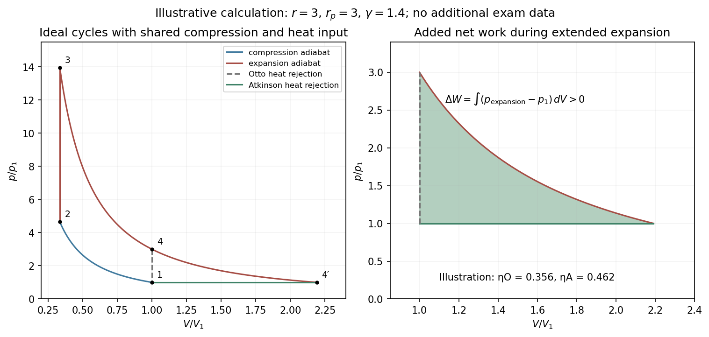

<h1 id="section-c/c12/solution">Solution</h1>

↑ **Parent:** [C12](../c12.md)

A [heat engine](../../../../../heat-engine.md)'s [thermal efficiency](../../../../../thermal-efficiency.md) is net [work](../../../../../work.md) out divided by [heat](../../../../../heat-split.md) absorbed,

$$
\boxed{\eta=\frac{W_{\rm out}}{Q_{\rm in}}=1-\frac{Q_{\rm out}}{Q_{\rm in}},}
$$

where both [heat](../../../../../heat-split.md) quantities are positive magnitudes. The last equality follows from the first law over a complete cycle.

Use $n$ moles of an [ideal gas](../../../../../ideal-gas-split.md) with constant molar $C_V,C_p$ and $\gamma=C_p/C_V>1$. For the [Otto cycle](../../../../../otto-cycle.md), reversible [adiabats](../../../../../adiabat.md) give $T_2=T_1r^{\gamma-1}$ and $T_3/T_4=r^{\gamma-1}$. Isochoric [heat](../../../../../heat-split.md) input and rejection are $Q_{\rm in}=nC_V(T_3-T_2)$ and $Q_{\rm out}=nC_V(T_4-T_1)$. Therefore

$$
\boxed{\eta_O=1-\frac{T_4-T_1}{T_3-T_2}=1-r^{1-\gamma}.}
$$

The denominator's [temperature](../../../../../temperature-split.md) difference is $r^{\gamma-1}$ times the numerator's difference.

For the ideal [Atkinson cycle](../../../../../atkinson-cycle.md), heating at fixed volume gives $T_3/T_2=r_p$. The longer expansion ends when $p_{4'}=p_1$. Combining the adiabatic [pressure](../../../../../pressure-split.md)–[temperature](../../../../../temperature-split.md) relation with $p_2/p_1=r^\gamma$ yields

$$
\boxed{T_2=T_1r^{\gamma-1},\qquad
T_3=T_1r_p r^{\gamma-1},\qquad
T_{4'}=T_3\left(\frac{p_1}{p_3}\right)^{(\gamma-1)/\gamma}
=T_1r_p^{1/\gamma}.}
$$

Also $V_{4'}=V_1r_p^{1/\gamma}>V_1$ for $r_p>1$. The PDF asks explicitly for $T_3,T_{4'}$; the transcription additionally names $T_2$, which is supplied above too.

[Heat](../../../../../heat-split.md) input remains $nC_VT_1r^{\gamma-1}(r_p-1)$, while the isobaric return rejects $nC_pT_1(r_p^{1/\gamma}-1)$. Hence the [Atkinson efficiency advantage from extended expansion](../../../../../atkinson-efficiency-advantage-from-extended-expansion.md) is quantified by

$$
\boxed{\eta_A=1-\gamma r^{1-\gamma}
\frac{r_p^{1/\gamma}-1}{r_p-1}.}
$$

Compare cycles with the same initial state, compression ratio and [heat](../../../../../heat-split.md) input. The extra expansion and constant-pressure return enclose positive extra [work](../../../../../work.md),

$$
\Delta W=\int_{V_1}^{V_{4'}}[p_{\rm expansion}(V)-p_1]\,dV>0.
$$

It uses [heat](../../../../../heat-split.md) that the [Otto cycle](../../../../../otto-cycle.md) would reject, while $Q_{\rm in}$ is unchanged. Equivalently, [concavity](../../../../../concave-function.md) gives $\gamma(r_p^{1/\gamma}-1)<r_p-1$, so **$\eta_A>\eta_O$ for $r_p>1$ under this matched comparison**. This is an ideal-cycle result; the question's named real-engine application is not needed to establish it.

**[Figure 2](#section-c/c12/image-original-ideal-gas-cycle-calculation-showing-the-extra-expansion-work-and-the-matched-otto-atkinson-efficiency-comparison). Original ideal-gas cycle calculation showing the extra expansion work and the matched Otto–Atkinson efficiency comparison**.

## ↑ Ancestors (14)

1. [C12](../c12.md)
2. [Section C](../../section-c.md)
3. [Paper 2](../../../paper-2-split.md)
4. [2012](../../../split.md)
5. [Past exam of the physics B course of the University of Cambridge](../../../../split.md)
6. [Physics B course of the University of Cambridge](../../../../../physics-b-course-of-the-university-of-cambridge.md)
7. [Physics course of the year 2 of the natural sciences course of the University of Cambridge](../../../../../physics-course-of-the-year-2-of-the-natural-sciences-course-of-the-university-of-cambridge.md)
8. [Year 2 of the natural sciences course of the University of Cambridge](../../../../../year-2-of-the-natural-sciences-course-of-the-university-of-cambridge.md)
9. [Year of the natural sciences course of the University of Cambridge](../../../../../year-of-the-natural-sciences-course-of-the-university-of-cambridge.md)
10. [Natural sciences course of the University of Cambridge](../../../../../natural-sciences-course-of-the-university-of-cambridge.md)
11. [Course of the University of Cambridge](../../../../../course-of-the-university-of-cambridge.md)
12. [University of Cambridge](../../../../../university-of-cambridge-split.md)
13. [List of universities](../../../../../list-of-universities.md)
14. [Codex Wiki](../../../../../split.md)
