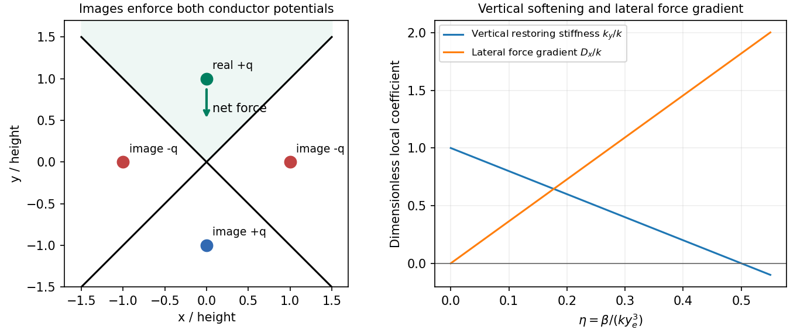
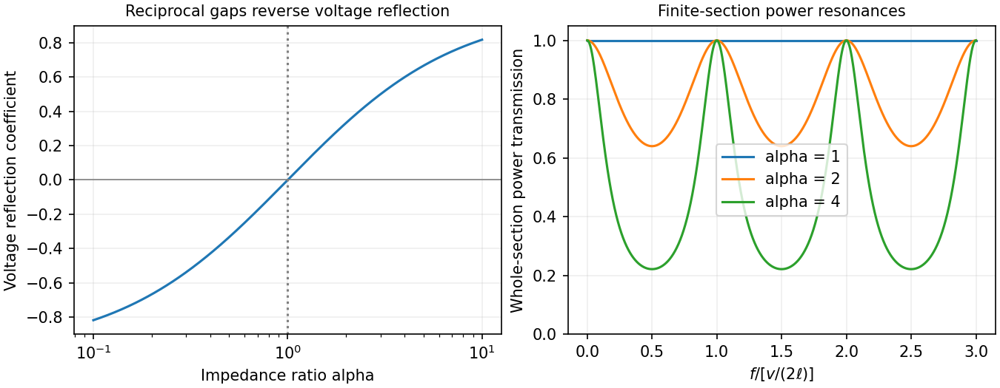
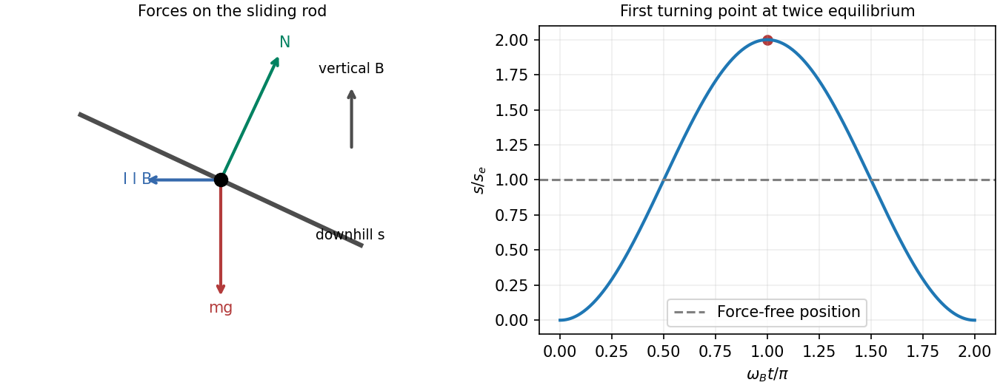

# Paper 1

↑ **Parent:** [2013](../2013.md)

Original paper: [Public original, physical PDF pages 142–149](https://www.whatdotheyknow.com/request/natural_science_tripos_physics_e_2/response/2340776/attach/2/FOI%202023%20399%20Zahid%20materials.pdf?cookie_passthrough=1#page=142).

**Table of contents**

- [Section A](#section-a)
  - [A1](#section-a/a1)
    - [Solution](#section-a/a1/solution)
  - [A2](#section-a/a2)
    - [Solution](#section-a/a2/solution)
  - [A3](#section-a/a3)
    - [Solution](#section-a/a3/solution)
  - [A4](#section-a/a4)
    - [Solution](#section-a/a4/solution)
  - [A5](#section-a/a5)
    - [Solution](#section-a/a5/solution)
- [Section B](#section-b)
  - [B6](#section-b/b6)
    - [Solution](#section-b/b6/solution)
  - [B7](#section-b/b7)
    - [Solution](#section-b/b7/solution)
  - [B8](#section-b/b8)
    - [Solution](#section-b/b8/solution)
  - [B9](#section-b/b9)
    - [Solution](#section-b/b9/solution)
- [Section C](#section-c)
  - [C10](#section-c/c10)
    - [Solution](#section-c/c10/solution)
  - [C11](#section-c/c11)
    - [Solution](#section-c/c11/solution)
  - [C12](#section-c/c12)
    - [Solution](#section-c/c12/solution)
  - [C13](#section-c/c13)
    - [Solution](#section-c/c13/solution)

## Section A

↑ **Parent:** [Paper 1](paper-1.md)

<h3 id="section-a/a1">A1</h3>

↑ **Parent:** [Section A](#section-a)

<h4 id="section-a/a1/solution">Solution</h4>

↑ **Parent:** [A1](#section-a/a1)

For [hydrostatic volume strain from Young's modulus and Poisson's ratio](../../elasticity-physics.md#hydrostatic-volume-strain-from-young-s-modulus-and-poisson-s-ratio) in isotropic [linear elasticity](../../elasticity-physics.md#linear-elasticity), the [bulk modulus](../../elasticity-physics.md#bulk-modulus) is $K=E/[3(1-2\nu)]=5.56\,\mathrm{GPa}$. Hydrostatic compression therefore gives

$$
\boxed{\Delta V=-\frac{pV}{K}=-1.82\times10^{-5}\,\mathrm{m^3}\simeq-18.2\,\mathrm{cm^3}.}
$$

Here $p=101325\,\mathrm{Pa}$ is the [pressure](../../pressure.md) increase, and the negative sign denotes contraction. Equivalently each normal [strain](../../continuum-mechanics.md#strain) is $-(1-2\nu)p/E$ and the three [strains](../../continuum-mechanics.md#strain) add. This is the small-strain isotropic model; concrete's microstructure is represented only through the supplied elastic constants.

<h3 id="section-a/a2">A2</h3>

↑ **Parent:** [Section A](#section-a)

<h4 id="section-a/a2/solution">Solution</h4>

↑ **Parent:** [A2](#section-a/a2)

Put [line charges](../../electric-charge.md#line-charge) $+\lambda$ and $-\lambda$ on the two axes. For $d\gg a_1,a_2$, the surface potentials differ by

$$
V_1-V_2\simeq\frac{\lambda}{2\pi\epsilon_0}
\left(\ln\frac d{a_1}+\ln\frac d{a_2}\right).
$$

Thus the [capacitance per unit length](../../electromagnetism.md#capacitance-per-unit-length) in vacuum is

$$
\boxed{C'=\frac{2\pi\epsilon_0}{\ln[d^2/(a_1a_2)]}
=\frac{\pi\epsilon_0}{\ln[d/\sqrt{a_1a_2}]}.}
$$

The two logarithms belong to one potential difference, not two independent [capacitances](../../electromagnetism.md#capacitance) in parallel. A homogeneous [dielectric](../../permittivity.md#dielectric) replaces $\epsilon_0$ by its absolute [permittivity](../../permittivity.md); finite radii and proximity corrections are neglected.

<h3 id="section-a/a3">A3</h3>

↑ **Parent:** [Section A](#section-a)

<h4 id="section-a/a3/solution">Solution</h4>

↑ **Parent:** [A3](#section-a/a3)

With the standard liquid-water approximation $\rho\simeq10^3\,\mathrm{kg\,m^{-3}}$, each portion has [mass](../../classical-mechanics.md#mass) $100\,\mathrm{kg}$. The equal [heat capacities](../../heat.md#heat-capacity) give final [temperature](../../temperature.md) $T_f=310\,\mathrm K$ by [energy](../../energy.md) conservation. For an insulated mixing process with no other changes,

$$
\boxed{\Delta S_{\rm universe}=mc\ln\frac{T_f}{280}
+mc\ln\frac{T_f}{340}
=4.20\times10^5\ln\frac{310^2}{280\times340}
\simeq3.95\times10^3\,\mathrm{J\,K^{-1}}.}
$$

The reversible integrals $mc\int dT/T$ evaluate [entropy](../../entropy.md) differences between [equilibrium](../../dynamical-systems.md#equilibrium-point-of-a-dynamical-system) states; the actual [heat](../../heat.md) transfer is irreversible. These are two portions of the same substance, so there is no additional ideal-mixture compositional [entropy](../../entropy.md).

<h3 id="section-a/a4">A4</h3>

↑ **Parent:** [Section A](#section-a)

<h4 id="section-a/a4/solution">Solution</h4>

↑ **Parent:** [A4](#section-a/a4)

Let absorbed solar flux per unit surface area be $F_\odot=\sigma T_0^4$. The [single-layer greenhouse model](../../exoplanet.md#single-layer-greenhouse-model) emits infrared upward and downward. Top-of-atmosphere balance gives $\sigma T_a^4=F_\odot$, hence $T_a=T_0$. Surface balance is $\sigma T_s^4=F_\odot+\sigma T_a^4$, so

$$
\boxed{T_s=2^{1/4}T_0\simeq333\,\mathrm K.}
$$

The layer simultaneously satisfies $\sigma T_s^4=2\sigma T_a^4$. This ideal radiative model excludes convection, spectral windows and atmospheric [temperature](../../temperature.md) structure; it is not a quantitative prediction for the real atmosphere.

<h3 id="section-a/a5">A5</h3>

↑ **Parent:** [Section A](#section-a)

<h4 id="section-a/a5/solution">Solution</h4>

↑ **Parent:** [A5](#section-a/a5)

For the [tangent-axis inertia of a spherical shell](../../rigid-body-dynamics.md#tangent-axis-inertia-of-a-spherical-shell), subtract the missing solid core from a solid sphere:

$$
M=\frac{4\pi\rho}{3}(R_2^3-R_1^3),\qquad
I_c=\frac{8\pi\rho}{15}(R_2^5-R_1^5).
$$

The [parallel axis theorem](../../rigid-body-dynamics.md#parallel-axis-theorem) shifts the axis a distance $R_2$:

$$
\boxed{I_{\rm tangent}=\frac{8\pi\rho}{15}(R_2^5-R_1^5)
+\frac{4\pi\rho}{3}(R_2^3-R_1^3)R_2^2.}
$$

It tends to $7MR_2^2/5$ for a solid sphere and $5MR_2^2/3$ for a thin [spherical shell](../../euclidean-geometry.md#spherical-shell).

## Section B

↑ **Parent:** [Paper 1](paper-1.md)

<h3 id="section-b/b6">B6</h3>

↑ **Parent:** [Section B](#section-b)

<h4 id="section-b/b6/solution">Solution</h4>

↑ **Parent:** [B6](#section-b/b6)

The [image charge](../../electric-field.md#image-charge) construction replaces conductor-induced charge by fictitious sources outside the physical domain. Match the conductor potentials and the far-field condition; uniqueness then fixes the potential in the physical region. For a grounded plane, reflect a charge and reverse its sign, giving attraction $q^2/(16\pi\epsilon_0h^2)$. For a grounded sphere of radius $a$, a charge at distance $R>a$ has image $-qa/R$ at radial distance $a^2/R$. These are examples with prescribed zero potential, not arbitrary isolated conductors.[grounded plane construction and its uniqueness argument](../../physics-bibliography.md#method-of-images-by-richard-fitzpatrick)

Use horizontal $x$ and upward $y$ in the upper right-angle wedge. The sheets meet electrically, so take their common potential as zero and assume no externally imposed field. For a real charge at $(0,y)$, the [image charges in a right-angle conducting wedge](../../electric-field.md#image-charges-in-a-right-angle-conducting-wedge) are $-q$ at $(y,0)$ and $(-y,0)$, and $+q$ at $(0,-y)$. The first two contributions have cancelling horizontal components. With $K_e=1/(4\pi\epsilon_0)$,

$$
F_y=-\frac{K_eq^2}{\sqrt2y^2}+\frac{K_eq^2}{4y^2}
=-\frac\beta{y^2},\qquad
\boxed{\beta=\frac{q^2(2\sqrt2-1)}{16\pi\epsilon_0}.}
$$

Thus the [force](../../force.md) magnitude at the original height is $\beta/y_0^2$, directed down toward the intersection. The sphere is treated as a [point charge](../../electric-field.md#point-charge), with size much smaller than its distances from the sheets.

Since gravity is already balanced in the uncharged [equilibrium](../../dynamical-systems.md#equilibrium-point-of-a-dynamical-system), the charged vertical [equilibrium](../../dynamical-systems.md#equilibrium-point-of-a-dynamical-system) satisfies $k(y_e-y_0)+\beta/y_e^2=0$. For $\beta/(ky_0^3)\ll1$, $y_e\simeq y_0-\beta/(ky_0^2)$. Differentiating the [force](../../force.md) gives

$$
\omega_y^2=\frac1m\left(k-\frac{2\beta}{y_e^3}\right),\qquad
\boxed{\frac{\omega_y-\omega_0}{\omega_0}\simeq-\frac{\beta}{ky_0^3},\quad\omega_0=\sqrt{k/m}.}
$$

The [electrostatic softening above a conducting wedge](../../electric-field.md#electrostatic-softening-above-a-conducting-wedge) reduces the restoring [force](../../force.md); the small-charge vertical [equilibrium](../../dynamical-systems.md#equilibrium-point-of-a-dynamical-system) remains stable.

For the [lateral stability of a spring-supported charge in a wedge](../../electric-field.md#lateral-stability-of-a-spring-supported-charge-in-a-wedge), the off-axis images of $(x,y)$ are $-q$ at $(y,x)$ and $(-y,-x)$ and $+q$ at $(-x,-y)$. Expansion near the bisector gives

$$
F_x=D_xx+O(x^3),\qquad
D_x=\frac{K_eq^2}{y_e^3}\left(\sqrt2+\frac14\right)>0.
$$

So **the electrostatic [force](../../force.md) is laterally destabilizing**: moving toward either sheet strengthens its attraction. In the simplified model where the [spring](../../elasticity-physics.md#spring) supplies only a vertical [force](../../force.md), the overall [equilibrium](../../dynamical-systems.md#equilibrium-point-of-a-dynamical-system) is a saddle and is unstable.

A three-dimensional [spring](../../elasticity-physics.md#spring) suspension also has geometrical transverse stiffness. If its charged-equilibrium tension is $T$ and [length](../../physics.md#length) is $\ell$, a small sideways displacement gives [spring](../../elasticity-physics.md#spring) [force](../../force.md) $-(T/\ell)x$, with $T=mg+\beta/y_e^2$. The full stability conditions in this suspension model are

$$
\boxed{k>\frac{2\beta}{y_e^3},\qquad\frac T\ell>D_x.}
$$

Motion parallel to the intersection line has no electrostatic stiffness in the ideal infinite-wedge geometry and is stabilized by the positive [spring](../../elasticity-physics.md#spring) tension. Thus **lateral electrostatic destabilization alone does not prove instability of a real hanging spring**. At fixed finite support geometry, a sufficiently small charge preserves stability because $D_x=O(q^2)$ while $T/\ell\to mg/\ell>0$. The given vertical-displacement approximation does not specify the attachment [length](../../physics.md#length) or by itself establish the transverse inequality for an arbitrary charge. The general criterion above states what can be concluded; the saddle verdict applies to the distinct idealization with zero lateral support stiffness.

**[Figure 1](#section-b/b6/image-original-image-charge-field-construction-and-the-opposite-signs-of-vertical-softening-and-lateral-electrostatic-stiffness). Original image-charge field construction and the opposite signs of vertical softening and lateral electrostatic stiffness**.

<h3 id="section-b/b7">B7</h3>

↑ **Parent:** [Section B](#section-b)

<h4 id="section-b/b7/solution">Solution</h4>

↑ **Parent:** [B7](#section-b/b7)

For distributed [inductance](../../electromagnetism.md#inductance) $L$ and [capacitance](../../electromagnetism.md#capacitance) $C$, a small segment obeys $V_z=-L I_t$ and $I_z=-C V_t$. Differentiation gives $V_{zz}=LCV_{tt}$ and $I_{zz}=LCI_{tt}$. For a forward wave,

$$
\boxed{v=\frac1{\sqrt{LC}},\qquad Z=\frac{V^+}{I^+}=\sqrt{L/C}.}
$$

A backward [voltage](../../random-walk.md#voltage) wave has current $I^-=-V^-/Z$. This sign matters at an impedance discontinuity.

The source figure is the stacked-strip [parallel-plate transmission line](../../electrical-engineering.md#parallel-plate-transmission-line) geometry, despite its use of the word coplanar. [Gauss's law](../../maxwell-equations.md#gauss-s-law) gives $C=\epsilon_0\epsilon_r a/d$. Opposite surface currents give [magnetic field](../../magnetic-field.md) $B=\mu_0I/a$ between the strips by [Ampère's law](../../maxwell-equations.md#ampere-s-circuital-law); the [magnetic flux](../../magnetic-field.md#magnetic-flux) per unit [length](../../physics.md#length) is $Bd$, hence $L=Bd/I=\mu_0d/a$. Therefore

$$
\boxed{v=\frac{c}{\sqrt{2.3}}\simeq1.98\times10^8\,\mathrm{m\,s^{-1}},\quad
Z=\frac da\sqrt{\frac{\mu_0}{2.3\epsilon_0}}
\simeq248.4\frac da\,\Omega.}
$$

No numerical $a/d$ is given; the impedance is appropriately left in terms of that ratio. The line is taken to be nonmagnetic and lossless.

Increasing the gap by $\alpha$ changes $L$ to $\alpha L$ and $C$ to $C/\alpha$, so $Z_2=\alpha Z_1$ while $v$ is unchanged. [voltage](../../random-walk.md#voltage) and current continuity at the step give

$$
V_i+V_r=V_t,\qquad \frac{V_i-V_r}{Z_1}=\frac{V_t}{Z_2}.
$$

Consequently the [voltage](../../random-walk.md#voltage) and energy-flux [transmission coefficients](../../partial-differential-equation.md#transmission-coefficient) are

$$
\boxed{t_V=\frac{2\alpha}{1+\alpha},\qquad
\mathcal T=\frac{Z_1}{Z_2}|t_V|^2=\frac{4\alpha}{(1+\alpha)^2},}
\qquad r_V=\frac{\alpha-1}{\alpha+1}.
$$

Here amplitudes are peak [voltage](../../random-walk.md#voltage) amplitudes, with mean [power](../../energy.md#power) $|V|^2/(2Z)$. The reciprocal gaps have $r_V(1/\alpha)=-r_V(\alpha)$: equal reflected [energy](../../energy.md) but opposite [voltage](../../random-walk.md#voltage) phase. A [voltage](../../random-walk.md#voltage) [transmission coefficient](../../partial-differential-equation.md#transmission-coefficient) above one does not imply [energy](../../energy.md) gain.

For a [finite impedance section of a transmission line](../../electrical-engineering.md#finite-impedance-section-of-a-transmission-line), put $\ell=l_2-l_1$ and $\delta=\omega\ell/v$. Multiple reflections inside the altered section interfere. Summing their [geometric series](../../sequence-and-series.md#geometric-series), relative to the first boundary,

$$
t_{\rm whole}=\frac{(1-r_V^2)e^{i\delta}}{1-r_V^2e^{2i\delta}},\qquad
\boxed{\mathcal T_{\rm whole}=\left[1+\frac{(\alpha^2-1)^2}{4\alpha^2}\sin^2\delta\right]^{-1}.}
$$

Transmission is unity at $\delta=n\pi$ and minimal at $\delta=(n+1/2)\pi$, with minima $4\alpha^2/(1+\alpha^2)^2$. Resonances are separated by $\Delta f=v/(2\ell)$; the long-wavelength limit also transmits fully. Matching the far termination removes end echoes, not the two internal reflections.

**[Figure 2](#section-b/b7/image-original-calculated-power-transmission-through-a-finite-changed-impedance-section-between-matched-lines). Original calculated power transmission through a finite changed-impedance section between matched lines**.

<h3 id="section-b/b8">B8</h3>

↑ **Parent:** [Section B](#section-b)

<h4 id="section-b/b8/solution">Solution</h4>

↑ **Parent:** [B8](#section-b/b8)

For a moving loop, [Faraday's law of induction](../../maxwell-equations.md#faraday-s-law-of-induction) is $\mathcal E=\oint(\mathbf E+\mathbf u\times\mathbf B)\cdot d\mathbf l=-d\Phi_B/dt$, where $\mathbf u$ is the local wire [velocity](../../classical-mechanics.md#velocity), $\Phi_B=\int\mathbf B\cdot d\mathbf S$, and the oriented boundary and surface follow the right-hand rule. For a fixed loop the motional term vanishes. [Lenz's law](../../maxwell-equations.md#lenz-s-law) is the minus sign: the induced response opposes the change of linked flux, not necessarily the applied field itself.

Let $s$ increase downhill and choose positive current $I$ to produce an uphill magnetic [force](../../force.md). The normal component of the imposed field is $B\cos\theta$, so the changing external flux is $Bl\cos\theta\,s$. With initially zero current and no resistance, conservation of [flux linkage](../../electromagnetism.md#magnetic-flux-linkage) gives $LI=Bl\cos\theta\,s$. The rod feels gravity vertically downward, a rail reaction normal to the slope, and magnetic [force](../../force.md) of magnitude $IlB$ horizontally uphill. Its downhill component is $-IlB\cos\theta$; its normal component presses the rod into the rails, giving $N=mg\cos\theta+IlB\sin\theta$.

The [inductive oscillation of a sliding rod on inclined rails](../../electric-charge.md#inductive-oscillation-of-a-sliding-rod-on-inclined-rails) follows from

$$
m\ddot s=mg\sin\theta-\frac{B^2l^2\cos^2\theta}{L}s,
\qquad\boxed{\kappa=\frac{l^2\cos^2\theta}{L}.}
$$

The magnetic [force](../../force.md) is not itself parallel to the rails. Defining $\omega_B=Bl\cos\theta/\sqrt{mL}$ and $s_e=mg\sin\theta/(m\omega_B^2)$, release from rest gives

$$
s(t)=s_e(1-\cos\omega_Bt),\qquad
\boxed{s_{\rm first\ stop}=2s_e=\frac{2mgL\sin\theta}{B^2l^2\cos^2\theta}.}
$$

The first stop occurs at $t=\pi/\omega_B$; the rod then returns and oscillates between $0$ and $2s_e$. At $s_e$ the [force](../../force.md) is zero but the [speed](../../classical-mechanics.md#speed) is maximal. Mechanical [potential energy](../../energy.md#potential-energy) is reversibly exchanged with [kinetic energy](../../energy.md#kinetic-energy) and $LI^2/2$; a perfectly conducting circuit provides no damping.

For the [resistive long-time drift of an inductive sliding rod](../../electric-charge.md#resistive-long-time-drift-of-an-inductive-sliding-rod), with loop resistance $R>0$, use

$$
L\dot I+RI=Bl\cos\theta\,\dot s,\qquad
m\ddot s=mg\sin\theta-Bl\cos\theta\,I.
$$

[Joule heating](../../electric-charge.md#joule-heating) damps the transient oscillation. On sufficiently long rails the asymptotic motion is steady sliding, not permanent rest:

$$
\boxed{I_\infty=\frac{mg\sin\theta}{Bl\cos\theta},\qquad
v_\infty=\frac{Rmg\sin\theta}{B^2l^2\cos^2\theta}.}
$$

The zero-resistance model has persistent oscillations; its late-time limit cannot be interchanged with taking $R\to0$. These results assume $B\cos\theta\ne0$, smooth contacts, negligible rod self-inductance and constant geometry.

**[Figure 3](#section-b/b8/image-original-rod-force-resolution-and-calculated-ideal-inductive-oscillation-along-the-slope). Original rod force resolution and calculated ideal inductive oscillation along the slope**.

<h3 id="section-b/b9">B9</h3>

↑ **Parent:** [Section B](#section-b)

<h4 id="section-b/b9/solution">Solution</h4>

↑ **Parent:** [B9](#section-b/b9)

For cold, collisionless, unmagnetized electrons with stationary heavy ions, $-m_e\omega^2\mathbf x=-e\mathbf E$. Therefore $\mathbf P=-ne\mathbf x=-ne^2\mathbf E/(m_e\omega^2)$ and

$$
\boxed{\epsilon_r(\omega)=1-\frac{\omega_p^2}{\omega^2},\qquad
\omega_p=\sqrt{\frac{ne^2}{m_e\epsilon_0}}.}
$$

This is the [cold collisionless plasma dielectric response](../../physics.md#cold-collisionless-plasma-dielectric-response). For a propagating transverse wave, $\mathbf B=\mathbf k\times\mathbf E/\omega$, so $E/B=c$ in vacuum and $E/B=c/n_p$ in [plasma](../../physics.md#plasma-physics), where $n_p=\sqrt{\epsilon_r}$. Equivalently $E/H=Z_0$ and $Z_0/n_p$ for $\mu=\mu_0$.

Converting the [density](../../fluid-mechanics.md#density) gives $n=10^{18}\,\mathrm{m^{-3}}$, so $\omega_p=5.64\times10^{10}\,\mathrm{s^{-1}}$ and $f_p=8.98\,\mathrm{GHz}$. At $10\,\mathrm{GHz}$,

$$
\boxed{\epsilon_r\simeq0.19384,\qquad n_p\simeq0.4403.}
$$

At an interface without independently imposed surface charge or sheet current, tangential $\mathbf E,\mathbf H$ and normal $\mathbf B,\mathbf D$ are continuous, with the electron response included in the effective [permittivity](../../permittivity.md). Normal $E$ need not be continuous; the induced electron charge is represented by that response. In a convention treating it explicitly as a surface charge, the normal vacuum-displacement jump equals that charge instead.

For the downward transmitted wave, transversality gives $k_xE_x+k_zE_z=0$. The measured field therefore has $k_x/(-k_z)=3$, so $\tan\theta_t=3$ and $\sin\theta_t=3/\sqrt{10}$. Tangential [phase matching](../../physical-optics.md#phase-matching) gives

$$
\boxed{\theta_i=\sin^{-1}\left(n_p\frac3{\sqrt{10}}\right)\simeq24.69^\circ.}
$$

For [inferring incident power from a transmitted plasma field](../../physics.md#inferring-incident-power-from-a-transmitted-plasma-field), choose $\mathbf E_i=E_i(\cos\theta_i,0,\sin\theta_i)$ and $\mathbf E_r=E_r(\cos\theta_i,0,-\sin\theta_i)$. Their [magnetic fields](../../magnetic-field.md) have opposite $y$ directions. The two tangential conditions are

$$
(E_i+E_r)\cos\theta_i=1\,\mathrm{V\,m^{-1}},\qquad
E_i-E_r=n_p\sqrt{10}\,\mathrm{V\,m^{-1}}.
$$

Hence $E_i\simeq1.2464\,\mathrm{V\,m^{-1}}$ and $E_r\simeq-0.1458\,\mathrm{V\,m^{-1}}$. Since these are peak phasor amplitudes,

$$
\boxed{\langle S_i\rangle=\frac{E_i^2}{2Z_0}
\simeq2.06\times10^{-3}\,\mathrm{W\,m^{-2}}.}
$$

This is incident [power](../../energy.md#power) per area perpendicular to its propagation. Per area of the interface the incoming normal flux is $\langle S_i\rangle\cos\theta_i\simeq1.87\times10^{-3}\,\mathrm{W\,m^{-2}}$. The reflected sign is a phase reversal, not negative reflected [energy](../../energy.md).

At $1\,\mathrm{GHz}<f_p$, the [relative permittivity](../../quantum-mechanics.md#relative-permittivity) is negative and there is no propagating transverse bulk wave. The field decays evanescently into the [plasma](../../physics.md#plasma-physics) and the ideal collisionless half-space reflects all incoming normal [power](../../energy.md#power). Collisions would allow absorption; a [complex refractive index](../../electromagnetic-wave.md#complex-refractive-index) here does not by itself imply dissipative heating.

## Section C

↑ **Parent:** [Paper 1](paper-1.md)

<h3 id="section-c/c10">C10</h3>

↑ **Parent:** [Section C](#section-c)

<h4 id="section-c/c10/solution">Solution</h4>

↑ **Parent:** [C10](#section-c/c10)

A [fictitious force](../../mathematical-physics.md#fictitious-force) is a term required when writing [Newton's second law](../../force.md#newton-s-second-law) in an accelerating frame; it comes from the coordinate choice rather than a new interaction. For axes rotating at constant $\boldsymbol\Omega$ about a fixed inertial origin,

$$
\left(\frac{d\mathbf A}{dt}\right)_{\!I}
=\left(\frac{d\mathbf A}{dt}\right)_{\!R}+\boldsymbol\Omega\times\mathbf A.
$$

Apply this identity twice to position to get $\mathbf a_I=\mathbf a_R+2\boldsymbol\Omega\times\mathbf v_R+\boldsymbol\Omega\times(\boldsymbol\Omega\times\mathbf r)$. Moving the last two terms to the right of $m\mathbf a_I=\mathbf F$ gives the stated Coriolis and [centrifugal forces](../../mathematical-physics.md#centrifugal-force). An accelerating origin or changing rotation rate would add further terms.

A slowly rotating fluid planet follows an equipotential of gravitational plus [centrifugal potential](../../mathematical-physics.md#centrifugal-potential). The [centrifugal potential](../../mathematical-physics.md#centrifugal-potential) is $-\Omega^2r^2\cos^2\lambda/2$, most negative at the equator. An outward equatorial shift raises [gravitational potential](../../newton-s-law-of-universal-gravitation.md#newtonian-potential-of-a-point-mass) and restores the balance, producing an oblate figure. Self-gravity also changes with the shape; no flattening coefficient follows from rotation alone without a [density](../../fluid-mechanics.md#density) model.

Using local north and radial-up [unit vectors](../../vector-space.md#unit-vector), the [centrifugal acceleration](../../mathematical-physics.md#centrifugal-acceleration) on a stationary [mass](../../classical-mechanics.md#mass) is

$$
\mathbf a_{\rm cf}=\Omega^2R\big(\cos^2\lambda\,\mathbf e_U
-\sin\lambda\cos\lambda\,\mathbf e_N\big).
$$

It points away from the rotation axis: upward and equatorward, at angle $\lambda$ to radial up in the northern hemisphere. Its vertical fraction of gravitational [force](../../force.md) is

$$
\boxed{\frac{F_{{\rm cf},U}}{mg}=\frac{\Omega^2R}{g}\cos^2\lambda
\simeq3.45\times10^{-3}\cos^2\lambda,}
$$

using a $24\,\mathrm h$ day for this approximate number. The resultant effective weight tilts equatorward relative to radial down. A plumb-defined local vertical already follows effective gravity; the component calculation uses the spherical radial vertical. A supported stationary [mass](../../classical-mechanics.md#mass) of course has zero net [acceleration](../../classical-mechanics.md#acceleration).

For the [Coriolis deflection of vertical launch and drop](../../mathematical-physics.md#coriolis-deflection-of-vertical-launch-and-drop), retain only first order in $\Omega$, use effective constant $g$, and neglect horizontal [velocities](../../classical-mechanics.md#velocity) in the Coriolis term as instructed. With east positive, vertical [velocity](../../classical-mechanics.md#velocity) gives $\ddot x=-2\Omega\cos\lambda\,\dot z$ and no northward [acceleration](../../classical-mechanics.md#acceleration). For launch, $z=ut-gt^2/2$ and the flight time is $2u/g$. Integrating with zero initial horizontal [velocity](../../classical-mechanics.md#velocity) gives

$$
\dot x=-2\Omega\cos\lambda\,z,\qquad
\boxed{x_X=-\frac{4\Omega u^3\cos\lambda}{3g^2},\quad y_X=0.}
$$

The landing is westward. The westward [velocity](../../classical-mechanics.md#velocity) accumulated on ascent is only recovered on descent, so the two displacement contributions do not cancel.

For release from rest at $h_0=u^2/(2g)$, $z=h_0-gt^2/2$, $t_{\rm fall}=u/g$, and $\ddot x=2\Omega g t\cos\lambda$. Thus

$$
\boxed{x_{X'}=\frac{\Omega u^3\cos\lambda}{3g^2}=-\frac14x_X,\quad y_{X'}=0.}
$$

The drop lands eastward with one quarter the launch-return displacement magnitude. North–south corrections from horizontal Coriolis coupling are beyond the retained approximation.

**[Figure 4](#section-c/c10/image-original-centrifugal-geometry-and-opposite-east-west-deflections-for-launch-return-and-drop-trajectories). Original centrifugal geometry and opposite east–west deflections for launch-return and drop trajectories**.

<h3 id="section-c/c11">C11</h3>

↑ **Parent:** [Section C](#section-c)

<h4 id="section-c/c11/solution">Solution</h4>

↑ **Parent:** [C11](#section-c/c11)

The [shell theorem](../../mathematical-physics.md#spherical-shell-theorem) gives enclosed halo [mass](../../classical-mechanics.md#mass) $4\pi\rho r^3/3$. Define $\alpha=4\pi\rho/3$. Then **$F_r=-GMm/r^2-\alpha Gmr$**. Interior to the uniform halo its [potential energy](../../energy.md#potential-energy) may be written

$$
U(r)=-\frac{GMm}{r}+\frac12\alpha Gmr^2+U_0,
\quad
E=\frac m2(\dot r^2+r^2\dot\phi^2)+U(r).
$$

Outer shells alter the additive constant, not this interior [force](../../force.md). An actually infinite uniform [mass](../../classical-mechanics.md#mass) distribution has no finite potential referenced to infinity; only local potential differences are needed here.

The [central force](../../mathematical-physics.md#central-force) has zero [torque](../../momentum.md#torque), so $\mathbf J=\mathbf r\times m\dot{\mathbf r}$ is conserved and the motion is planar. With $J=mr^2\dot\phi$, the effective radial potential and equation are

$$
U_{\rm eff}=\frac{J^2}{2mr^2}-\frac{GMm}{r}+\frac12\alpha Gmr^2,
\qquad \ddot r=\frac{J^2}{m^2r^3}-\frac{GM}{r^2}-\alpha Gr.
$$

For circular radius $r_0$, $J=mr_0^2\Omega$ gives

$$
\boxed{\Omega^2=\frac{GM}{r_0^3}+\alpha G.}
$$

Set $r=r_0+\xi$ at fixed $J$. The [derivative](../../calculus.md#derivative) of the right-hand side at [equilibrium](../../dynamical-systems.md#equilibrium-point-of-a-dynamical-system) is $-3\Omega^2+2GM/r_0^3-\alpha G$, so

$$
\boxed{\ddot\xi+\omega^2\xi=0,\qquad
\omega^2=\frac{GM}{r_0^3}+4\alpha G.}
$$

Both [frequencies](../../wave.md#frequency) are positive, but radial and azimuthal motion no longer close with the Kepler ratio. At first order in [eccentricity](../../euclidean-geometry.md#eccentricity-of-a-conic) $e$, one may write $r=r_0(1-e\cos\omega t)$ and $\phi=\Omega t+(2\Omega e/\omega)\sin\omega t$. For a weak halo this is a nearly Keplerian ellipse whose apsis rotates at angular rate $\Omega-\omega$.

Put $\Omega_K=\sqrt{GM/r_0^3}$ and $\varepsilon=\alpha r_0^3/M\ll1$. Expansion yields

$$
\boxed{\dot\varpi=\Omega-\omega\simeq-\frac32\Omega_K\varepsilon
=-\frac{3\alpha G}{2\Omega_K}=-\frac{2\pi G\rho}{\Omega_K}.}
$$

The precession is retrograde. In cycles per unit time the precession [frequency](../../wave.md#frequency) is $\dot\varpi/(2\pi)$; per radial period the apsidal shift is $2\pi(\Omega/\omega-1)\simeq-3\pi\varepsilon$. This weak-halo interpretation avoids confusing a focus-centred Kepler ellipse with the centred ellipse of a purely harmonic potential.

<h3 id="section-c/c12">C12</h3>

↑ **Parent:** [Section C](#section-c)

<h4 id="section-c/c12/solution">Solution</h4>

↑ **Parent:** [C12](#section-c/c12)

A [normal mode](../../wave-equation.md#normal-mode) is a pattern in which all coordinates share one [frequency](../../wave.md#frequency) and fixed relative amplitudes. For a conservative linear system, it solves a generalized [eigenvalue](../../linear-operator-theory.md#eigenvalue) equation with [stiffness matrix](../../finite-element-method.md#stiffness-matrix) $K$ and [mass matrix](../../finite-element-method.md#mass-matrix) $M$. For this [free three-mass spring chain](../../wave-equation.md#free-three-mass-spring-chain),

$$
K=k\begin{pmatrix}1&-1&0\\-1&2&-1\\0&-1&1\end{pmatrix},
\qquad M=m\operatorname{diag}(1,\alpha,1).
$$

Solving $K\mathbf u=\omega^2M\mathbf u$, for $\alpha>0$, gives

$$
\boxed{\begin{array}{c|c}
\omega^2&\mathbf u\\\hline
0&(1,1,1)\\
k/m&(1,0,-1)\\
(k/m)(1+2/\alpha)&(1,-2/\alpha,1)
\end{array}.}
$$

Their overall normalization is arbitrary; distinct modes are [orthogonal](../../inner-product.md#orthogonal-vectors) in the [mass](../../classical-mechanics.md#mass) [inner product](../../inner-product.md). The zero mode is rigid translation because neither end is fixed. In the antisymmetric mode the middle [mass](../../classical-mechanics.md#mass) stays still, so changing its [mass](../../classical-mechanics.md#mass) cannot alter the [frequency](../../wave.md#frequency). The symmetric internal mode keeps the [centre of mass](../../classical-mechanics.md#center-of-mass) fixed through its middle displacement $-2/\alpha$. Its [frequency](../../wave.md#frequency) rises without bound as $\alpha\to0$ and approaches $\sqrt{k/m}$ as $\alpha\to\infty$, becoming degenerate with the antisymmetric [frequency](../../wave.md#frequency) in that limit.

For equal [masses](../../classical-mechanics.md#mass) put $\omega_1=\sqrt{k/m}$ and $\omega_2=\sqrt{3k/m}$. Positions are [equilibrium](../../dynamical-systems.md#equilibrium-point-of-a-dynamical-system) positions plus displacements

$$
\mathbf q(t)=(A_0+B_0t)\mathbf u_0
+(A_1\cos\omega_1t+B_1\sin\omega_1t)\mathbf u_1
+(A_2\cos\omega_2t+B_2\sin\omega_2t)\mathbf u_2.
$$

The translational mode needs the linear-in-time term; a cosine at zero [frequency](../../wave.md#frequency) alone would miss arbitrary centre-of-mass [velocity](../../classical-mechanics.md#velocity).

Taking the [springs](../../elasticity-physics.md#spring) initially at [equilibrium](../../dynamical-systems.md#equilibrium-point-of-a-dynamical-system), the [impulse](../../classical-mechanics.md#impulse) gives $\dot{\mathbf q}(0)=(v,0,0)=(v/3)\mathbf u_0+(v/2)\mathbf u_1+(v/6)\mathbf u_2$. Their squared Euclidean norms are $3,2,6$, so their initial [kinetic energies](../../energy.md#kinetic-energy) are $mv^2/6,mv^2/4,mv^2/12$. Relative to total $mv^2/2$,

$$
\boxed{\frac{E_0}{E}=\frac13,\qquad\frac{E_1}{E}=\frac12,\qquad\frac{E_2}{E}=\frac16.}
$$

Subsequent motion conserves each mode's total [energy](../../energy.md), exchanging its kinetic and [spring](../../elasticity-physics.md#spring) contributions. The zero-mode share remains centre-of-mass [kinetic energy](../../energy.md#kinetic-energy).

**[Figure 5](#section-c/c12/image-original-displacement-vector-sketches-and-mass-ratio-dependence-of-the-free-three-mass-chain-modes). Original displacement-vector sketches and mass-ratio dependence of the free three-mass chain modes**.

<h3 id="section-c/c13">C13</h3>

↑ **Parent:** [Section C](#section-c)

<h4 id="section-c/c13/solution">Solution</h4>

↑ **Parent:** [C13](#section-c/c13)

Locally, zero curl permits $\mathbf v=\nabla\Phi$; for a global single-valued potential the [circulation](../../vorticity.md#circulation-physics) around every noncontractible loop must also vanish. [incompressibility](../../fluid-mechanics.md#incompressible-flow) gives $\nabla\cdot\mathbf v=\nabla^2\Phi=0$. The exterior of a cylinder is multiply connected, so local irrotationality alone does not exclude a circulating solution.

For inviscid constant-density flow under conservative gravity, Euler's equation is $\partial_t\mathbf v+(\mathbf v\cdot\nabla)\mathbf v=-\nabla(p/\rho+\phi_g)$. The identity $(\mathbf v\cdot\nabla)\mathbf v=\nabla(v^2/2)-\mathbf v\times(\nabla\times\mathbf v)$ gives, for [irrotational flow](../../vorticity.md#irrotational-flow),

$$
\partial_t\Phi+\frac p\rho+\frac{v^2}{2}+\phi_g=C(t).
$$

For [steady flow](../../fluid-mechanics.md#steady-flow), absorb the potential's time-only gauge term and obtain **$p+\rho v^2/2+\rho\phi_g=\mathrm{constant}$** throughout the connected fluid region. Without irrotationality the steady constant need only be common along each [streamline](../../fluid-mechanics.md#streamline).

Use $U$ for the uniform upstream [speed](../../classical-mechanics.md#speed) and take the flow along $+x$. The [boundary conditions](../../differential-equation.md#boundary-condition) are $v_r(a,\theta)=0$ and $\mathbf v\to U\mathbf e_x$ at infinity. A perfect inviscid model imposes no penetration, not no slip. For the intended no-circulation solution, require a globally single-valued potential, so the coefficient of $\theta$ is zero. The logarithmic term would be a net source and violates no penetration, so its coefficient is also zero. Growing terms with $n\geq2$ violate the uniform far field. For each remaining $n\geq2$, the surface normal condition then [forces](../../force.md) its decaying coefficient to vanish. The $n=1$ terms satisfy $C_1=U$ and $D_1=Ua^2$:

$$
\boxed{\Phi=U(r+a^2/r)\cos\theta,\qquad
v_r=U(1-a^2/r^2)\cos\theta,\quad
v_\theta=-U(1+a^2/r^2)\sin\theta.}
$$

An irrelevant additive potential constant is understood. At the same elevation, Bernoulli balance with the upstream stream gives

$$
\boxed{p(a,\theta)=p_\infty+\frac12\rho U^2(1-4\sin^2\theta).}
$$

The [force](../../force.md) per unit height is

$$
\mathbf F'=-a\int_0^{2\pi}p(a,\theta)(\cos\theta,\sin\theta)\,d\theta
=\boxed{\mathbf0.}
$$

[pressure](../../pressure.md) [symmetry](../../physics.md#symmetry-physics) gives zero [drag](../../fluid-mechanics.md#drag-physics) and zero [lift](../../lift-force.md) in this zero-circulation idealization. [D'Alembert's paradox](../../fluid-mechanics.md#d-alembert-s-paradox) is the failure of this inviscid model to represent real separated viscous wakes and their [drag](../../fluid-mechanics.md#drag-physics), not a claim that a real pole feels no [force](../../force.md).

The zero-circulation assumption matters: $\Phi\to\Phi+\Gamma\theta/(2\pi)$ leaves the stated [velocity](../../classical-mechanics.md#velocity) [boundary conditions](../../differential-equation.md#boundary-condition) intact but adds $\Gamma/(2\pi a)$ to the surface tangential [speed](../../classical-mechanics.md#speed). It produces $F'_y=-\rho U\Gamma$ for positive counterclockwise [circulation](../../vorticity.md#circulation-physics). Thus the [boundary conditions](../../differential-equation.md#boundary-condition) alone do not justify excluding the angular term; an initially noncirculating inviscid start, or an explicitly single-valued potential, supplies the missing condition.[equations 5.73–5.81 and discussion after 5.83: circulation, force and the zero-circulation initial condition](../../physics-bibliography.md#flow-past-a-cylindrical-obstacle-by-richard-fitzpatrick)

**[Figure 6](#section-c/c13/image-original-calculated-zero-circulation-cylinder-streamlines-and-surface-pressure-coefficient). Original calculated zero-circulation cylinder streamlines and surface pressure coefficient**.

## ↑ Ancestors (11)

1. [2013](../2013.md)
2. [Past exam of the physics B course of the University of Cambridge](../../past-exam-of-the-physics-b-course-of-the-university-of-cambridge.md)
3. [Physics B course of the University of Cambridge](../../university-of-cambridge.md#physics-b-course-of-the-university-of-cambridge)
4. [Physics course of the year 2 of the natural sciences course of the University of Cambridge](../../university-of-cambridge.md#physics-course-of-the-year-2-of-the-natural-sciences-course-of-the-university-of-cambridge)
5. [Year 2 of the natural sciences course of the University of Cambridge](../../university-of-cambridge.md#year-2-of-the-natural-sciences-course-of-the-university-of-cambridge)
6. [Year of the natural sciences course of the University of Cambridge](../../university-of-cambridge.md#year-of-the-natural-sciences-course-of-the-university-of-cambridge)
7. [Natural sciences course of the University of Cambridge](../../university-of-cambridge.md#natural-sciences-course-of-the-university-of-cambridge)
8. [Course of the University of Cambridge](../../university-of-cambridge.md#course-of-the-university-of-cambridge)
9. [University of Cambridge](../../university-of-cambridge.md)
10. [List of universities](../../README.md#list-of-universities)
11. [Codex Wiki](../../README.md)
