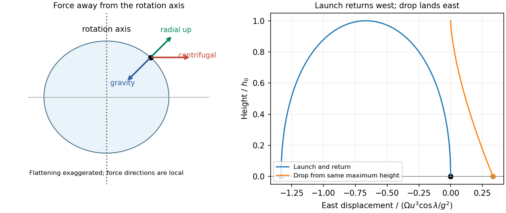

<h1 id="section-c/c10/solution">Solution</h1>

↑ **Parent:** [C10](../c10.md)

A [fictitious force](../../../../../fictitious-force.md) is a term required when writing [Newton's second law](../../../../../newton-s-second-law.md) in an accelerating frame; it comes from the coordinate choice rather than a new interaction. For axes rotating at constant $\boldsymbol\Omega$ about a fixed inertial origin,

$$
\left(\frac{d\mathbf A}{dt}\right)_{\!I}
=\left(\frac{d\mathbf A}{dt}\right)_{\!R}+\boldsymbol\Omega\times\mathbf A.
$$

Apply this identity twice to position to get $\mathbf a_I=\mathbf a_R+2\boldsymbol\Omega\times\mathbf v_R+\boldsymbol\Omega\times(\boldsymbol\Omega\times\mathbf r)$. Moving the last two terms to the right of $m\mathbf a_I=\mathbf F$ gives the stated Coriolis and [centrifugal forces](../../../../../centrifugal-force.md). An accelerating origin or changing rotation rate would add further terms.

A slowly rotating fluid planet follows an equipotential of gravitational plus [centrifugal potential](../../../../../centrifugal-potential.md). The [centrifugal potential](../../../../../centrifugal-potential.md) is $-\Omega^2r^2\cos^2\lambda/2$, most negative at the equator. An outward equatorial shift raises [gravitational potential](../../../../../newtonian-potential-of-a-point-mass.md) and restores the balance, producing an oblate figure. Self-gravity also changes with the shape; no flattening coefficient follows from rotation alone without a [density](../../../../../density.md) model.

Using local north and radial-up [unit vectors](../../../../../unit-vector.md), the [centrifugal acceleration](../../../../../centrifugal-acceleration.md) on a stationary [mass](../../../../../mass.md) is

$$
\mathbf a_{\rm cf}=\Omega^2R\big(\cos^2\lambda\,\mathbf e_U
-\sin\lambda\cos\lambda\,\mathbf e_N\big).
$$

It points away from the rotation axis: upward and equatorward, at angle $\lambda$ to radial up in the northern hemisphere. Its vertical fraction of gravitational [force](../../../../../force-split.md) is

$$
\boxed{\frac{F_{{\rm cf},U}}{mg}=\frac{\Omega^2R}{g}\cos^2\lambda
\simeq3.45\times10^{-3}\cos^2\lambda,}
$$

using a $24\,\mathrm h$ day for this approximate number. The resultant effective weight tilts equatorward relative to radial down. A plumb-defined local vertical already follows effective gravity; the component calculation uses the spherical radial vertical. A supported stationary [mass](../../../../../mass.md) of course has zero net [acceleration](../../../../../acceleration.md).

For the [Coriolis deflection of vertical launch and drop](../../../../../coriolis-deflection-of-vertical-launch-and-drop.md), retain only first order in $\Omega$, use effective constant $g$, and neglect horizontal [velocities](../../../../../velocity.md) in the Coriolis term as instructed. With east positive, vertical [velocity](../../../../../velocity.md) gives $\ddot x=-2\Omega\cos\lambda\,\dot z$ and no northward [acceleration](../../../../../acceleration.md). For launch, $z=ut-gt^2/2$ and the flight time is $2u/g$. Integrating with zero initial horizontal [velocity](../../../../../velocity.md) gives

$$
\dot x=-2\Omega\cos\lambda\,z,\qquad
\boxed{x_X=-\frac{4\Omega u^3\cos\lambda}{3g^2},\quad y_X=0.}
$$

The landing is westward. The westward [velocity](../../../../../velocity.md) accumulated on ascent is only recovered on descent, so the two displacement contributions do not cancel.

For release from rest at $h_0=u^2/(2g)$, $z=h_0-gt^2/2$, $t_{\rm fall}=u/g$, and $\ddot x=2\Omega g t\cos\lambda$. Thus

$$
\boxed{x_{X'}=\frac{\Omega u^3\cos\lambda}{3g^2}=-\frac14x_X,\quad y_{X'}=0.}
$$

The drop lands eastward with one quarter the launch-return displacement magnitude. North–south corrections from horizontal Coriolis coupling are beyond the retained approximation.

**[Figure 4](#section-c/c10/image-original-centrifugal-geometry-and-opposite-east-west-deflections-for-launch-return-and-drop-trajectories). Original centrifugal geometry and opposite east–west deflections for launch-return and drop trajectories**.

## ↑ Ancestors (14)

1. [C10](../c10.md)
2. [Section C](../../section-c.md)
3. [Paper 1](../../../paper-1-split.md)
4. [2013](../../../split.md)
5. [Past exam of the physics B course of the University of Cambridge](../../../../split.md)
6. [Physics B course of the University of Cambridge](../../../../../physics-b-course-of-the-university-of-cambridge.md)
7. [Physics course of the year 2 of the natural sciences course of the University of Cambridge](../../../../../physics-course-of-the-year-2-of-the-natural-sciences-course-of-the-university-of-cambridge.md)
8. [Year 2 of the natural sciences course of the University of Cambridge](../../../../../year-2-of-the-natural-sciences-course-of-the-university-of-cambridge.md)
9. [Year of the natural sciences course of the University of Cambridge](../../../../../year-of-the-natural-sciences-course-of-the-university-of-cambridge.md)
10. [Natural sciences course of the University of Cambridge](../../../../../natural-sciences-course-of-the-university-of-cambridge.md)
11. [Course of the University of Cambridge](../../../../../course-of-the-university-of-cambridge.md)
12. [University of Cambridge](../../../../../university-of-cambridge-split.md)
13. [List of universities](../../../../../list-of-universities.md)
14. [Codex Wiki](../../../../../split.md)
