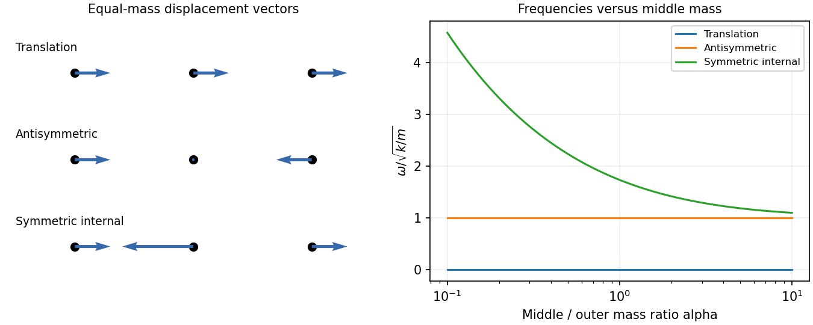

<h1 id="section-c/c12/solution">Solution</h1>

↑ **Parent:** [C12](../c12.md)

A [normal mode](../../../../../normal-mode.md) is a pattern in which all coordinates share one [frequency](../../../../../frequency.md) and fixed relative amplitudes. For a conservative linear system, it solves a generalized [eigenvalue](../../../../../eigenvalue.md) equation with [stiffness matrix](../../../../../stiffness-matrix.md) $K$ and [mass matrix](../../../../../mass-matrix.md) $M$. For this [free three-mass spring chain](../../../../../free-three-mass-spring-chain.md),

$$
K=k\begin{pmatrix}1&-1&0\\-1&2&-1\\0&-1&1\end{pmatrix},
\qquad M=m\operatorname{diag}(1,\alpha,1).
$$

Solving $K\mathbf u=\omega^2M\mathbf u$, for $\alpha>0$, gives

$$
\boxed{\begin{array}{c|c}
\omega^2&\mathbf u\\\hline
0&(1,1,1)\\
k/m&(1,0,-1)\\
(k/m)(1+2/\alpha)&(1,-2/\alpha,1)
\end{array}.}
$$

Their overall normalization is arbitrary; distinct modes are [orthogonal](../../../../../orthogonal-vectors.md) in the [mass](../../../../../mass.md) [inner product](../../../../../inner-product-split.md). The zero mode is rigid translation because neither end is fixed. In the antisymmetric mode the middle [mass](../../../../../mass.md) stays still, so changing its [mass](../../../../../mass.md) cannot alter the [frequency](../../../../../frequency.md). The symmetric internal mode keeps the [centre of mass](../../../../../center-of-mass.md) fixed through its middle displacement $-2/\alpha$. Its [frequency](../../../../../frequency.md) rises without bound as $\alpha\to0$ and approaches $\sqrt{k/m}$ as $\alpha\to\infty$, becoming degenerate with the antisymmetric [frequency](../../../../../frequency.md) in that limit.

For equal [masses](../../../../../mass.md) put $\omega_1=\sqrt{k/m}$ and $\omega_2=\sqrt{3k/m}$. Positions are [equilibrium](../../../../../equilibrium-point-of-a-dynamical-system.md) positions plus displacements

$$
\mathbf q(t)=(A_0+B_0t)\mathbf u_0
+(A_1\cos\omega_1t+B_1\sin\omega_1t)\mathbf u_1
+(A_2\cos\omega_2t+B_2\sin\omega_2t)\mathbf u_2.
$$

The translational mode needs the linear-in-time term; a cosine at zero [frequency](../../../../../frequency.md) alone would miss arbitrary centre-of-mass [velocity](../../../../../velocity.md).

Taking the [springs](../../../../../spring.md) initially at [equilibrium](../../../../../equilibrium-point-of-a-dynamical-system.md), the [impulse](../../../../../impulse.md) gives $\dot{\mathbf q}(0)=(v,0,0)=(v/3)\mathbf u_0+(v/2)\mathbf u_1+(v/6)\mathbf u_2$. Their squared Euclidean norms are $3,2,6$, so their initial [kinetic energies](../../../../../kinetic-energy.md) are $mv^2/6,mv^2/4,mv^2/12$. Relative to total $mv^2/2$,

$$
\boxed{\frac{E_0}{E}=\frac13,\qquad\frac{E_1}{E}=\frac12,\qquad\frac{E_2}{E}=\frac16.}
$$

Subsequent motion conserves each mode's total [energy](../../../../../energy-split.md), exchanging its kinetic and [spring](../../../../../spring.md) contributions. The zero-mode share remains centre-of-mass [kinetic energy](../../../../../kinetic-energy.md).

**[Figure 5](#section-c/c12/image-original-displacement-vector-sketches-and-mass-ratio-dependence-of-the-free-three-mass-chain-modes). Original displacement-vector sketches and mass-ratio dependence of the free three-mass chain modes**.

## ↑ Ancestors (14)

1. [C12](../c12.md)
2. [Section C](../../section-c.md)
3. [Paper 1](../../../paper-1-split.md)
4. [2013](../../../split.md)
5. [Past exam of the physics B course of the University of Cambridge](../../../../split.md)
6. [Physics B course of the University of Cambridge](../../../../../physics-b-course-of-the-university-of-cambridge.md)
7. [Physics course of the year 2 of the natural sciences course of the University of Cambridge](../../../../../physics-course-of-the-year-2-of-the-natural-sciences-course-of-the-university-of-cambridge.md)
8. [Year 2 of the natural sciences course of the University of Cambridge](../../../../../year-2-of-the-natural-sciences-course-of-the-university-of-cambridge.md)
9. [Year of the natural sciences course of the University of Cambridge](../../../../../year-of-the-natural-sciences-course-of-the-university-of-cambridge.md)
10. [Natural sciences course of the University of Cambridge](../../../../../natural-sciences-course-of-the-university-of-cambridge.md)
11. [Course of the University of Cambridge](../../../../../course-of-the-university-of-cambridge.md)
12. [University of Cambridge](../../../../../university-of-cambridge-split.md)
13. [List of universities](../../../../../list-of-universities.md)
14. [Codex Wiki](../../../../../split.md)
