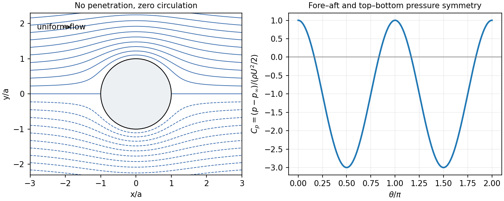

<h1 id="section-c/c13/solution">Solution</h1>

↑ **Parent:** [C13](../c13.md)

Locally, zero curl permits $\mathbf v=\nabla\Phi$; for a global single-valued potential the [circulation](../../../../../circulation-physics.md) around every noncontractible loop must also vanish. [incompressibility](../../../../../incompressible-flow.md) gives $\nabla\cdot\mathbf v=\nabla^2\Phi=0$. The exterior of a cylinder is multiply connected, so local irrotationality alone does not exclude a circulating solution.

For inviscid constant-density flow under conservative gravity, Euler's equation is $\partial_t\mathbf v+(\mathbf v\cdot\nabla)\mathbf v=-\nabla(p/\rho+\phi_g)$. The identity $(\mathbf v\cdot\nabla)\mathbf v=\nabla(v^2/2)-\mathbf v\times(\nabla\times\mathbf v)$ gives, for [irrotational flow](../../../../../irrotational-flow.md),

$$
\partial_t\Phi+\frac p\rho+\frac{v^2}{2}+\phi_g=C(t).
$$

For [steady flow](../../../../../steady-flow.md), absorb the potential's time-only gauge term and obtain **$p+\rho v^2/2+\rho\phi_g=\mathrm{constant}$** throughout the connected fluid region. Without irrotationality the steady constant need only be common along each [streamline](../../../../../streamline.md).

Use $U$ for the uniform upstream [speed](../../../../../speed.md) and take the flow along $+x$. The [boundary conditions](../../../../../boundary-condition.md) are $v_r(a,\theta)=0$ and $\mathbf v\to U\mathbf e_x$ at infinity. A perfect inviscid model imposes no penetration, not no slip. For the intended no-circulation solution, require a globally single-valued potential, so the coefficient of $\theta$ is zero. The logarithmic term would be a net source and violates no penetration, so its coefficient is also zero. Growing terms with $n\geq2$ violate the uniform far field. For each remaining $n\geq2$, the surface normal condition then [forces](../../../../../force-split.md) its decaying coefficient to vanish. The $n=1$ terms satisfy $C_1=U$ and $D_1=Ua^2$:

$$
\boxed{\Phi=U(r+a^2/r)\cos\theta,\qquad
v_r=U(1-a^2/r^2)\cos\theta,\quad
v_\theta=-U(1+a^2/r^2)\sin\theta.}
$$

An irrelevant additive potential constant is understood. At the same elevation, Bernoulli balance with the upstream stream gives

$$
\boxed{p(a,\theta)=p_\infty+\frac12\rho U^2(1-4\sin^2\theta).}
$$

The [force](../../../../../force-split.md) per unit height is

$$
\mathbf F'=-a\int_0^{2\pi}p(a,\theta)(\cos\theta,\sin\theta)\,d\theta
=\boxed{\mathbf0.}
$$

[pressure](../../../../../pressure-split.md) [symmetry](../../../../../symmetry-physics.md) gives zero [drag](../../../../../drag-physics.md) and zero [lift](../../../../../lift-force-split.md) in this zero-circulation idealization. [D'Alembert's paradox](../../../../../d-alembert-s-paradox.md) is the failure of this inviscid model to represent real separated viscous wakes and their [drag](../../../../../drag-physics.md), not a claim that a real pole feels no [force](../../../../../force-split.md).

The zero-circulation assumption matters: $\Phi\to\Phi+\Gamma\theta/(2\pi)$ leaves the stated [velocity](../../../../../velocity.md) [boundary conditions](../../../../../boundary-condition.md) intact but adds $\Gamma/(2\pi a)$ to the surface tangential [speed](../../../../../speed.md). It produces $F'_y=-\rho U\Gamma$ for positive counterclockwise [circulation](../../../../../circulation-physics.md). Thus the [boundary conditions](../../../../../boundary-condition.md) alone do not justify excluding the angular term; an initially noncirculating inviscid start, or an explicitly single-valued potential, supplies the missing condition.[equations 5.73–5.81 and discussion after 5.83: circulation, force and the zero-circulation initial condition](../../../../../flow-past-a-cylindrical-obstacle-by-richard-fitzpatrick.md)

**[Figure 6](#section-c/c13/image-original-calculated-zero-circulation-cylinder-streamlines-and-surface-pressure-coefficient). Original calculated zero-circulation cylinder streamlines and surface pressure coefficient**.

## ↑ Ancestors (14)

1. [C13](../c13.md)
2. [Section C](../../section-c.md)
3. [Paper 1](../../../paper-1-split.md)
4. [2013](../../../split.md)
5. [Past exam of the physics B course of the University of Cambridge](../../../../split.md)
6. [Physics B course of the University of Cambridge](../../../../../physics-b-course-of-the-university-of-cambridge.md)
7. [Physics course of the year 2 of the natural sciences course of the University of Cambridge](../../../../../physics-course-of-the-year-2-of-the-natural-sciences-course-of-the-university-of-cambridge.md)
8. [Year 2 of the natural sciences course of the University of Cambridge](../../../../../year-2-of-the-natural-sciences-course-of-the-university-of-cambridge.md)
9. [Year of the natural sciences course of the University of Cambridge](../../../../../year-of-the-natural-sciences-course-of-the-university-of-cambridge.md)
10. [Natural sciences course of the University of Cambridge](../../../../../natural-sciences-course-of-the-university-of-cambridge.md)
11. [Course of the University of Cambridge](../../../../../course-of-the-university-of-cambridge.md)
12. [University of Cambridge](../../../../../university-of-cambridge-split.md)
13. [List of universities](../../../../../list-of-universities.md)
14. [Codex Wiki](../../../../../split.md)
