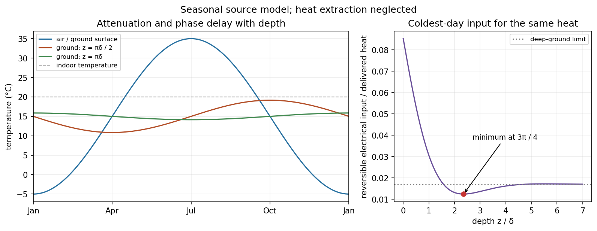

<h1 id="section-c/c12/solution">Solution</h1>

↑ **Parent:** [C12](../c12.md)

A [heat pump](../../../../../heat-pump.md) delivers $Q_H=Q_S+W$: electrical [work](../../../../../work.md) moves [heat](../../../../../heat-split.md) from a source as well as contributing [energy](../../../../../energy-split.md) itself. Its heating [coefficient of performance](../../../../../coefficient-of-performance.md) can therefore exceed one, whereas direct resistance heating supplies at most its electrical input as useful room [heat](../../../../../heat-split.md). For an ideal reversible pump,

$$
\mathrm{COP}_H=\frac{T_H}{T_H-T_S},\qquad W=Q_H\frac{T_H-T_S}{T_H},
$$

with absolute [temperatures](../../../../../temperature-split.md) and $T_S<T_H$. This is an ideal limit; actual costs also depend on compressor performance and tariffs.

For the [annual ground-temperature wave](../../../../../annual-ground-temperature-wave.md), model the soil as a homogeneous semi-infinite conductor, with depth positive downward and a prescribed surface [temperature](../../../../../temperature-split.md). Here $\kappa$ is [thermal conductivity](../../../../../thermal-conductivity.md) and $C$ is [heat capacity](../../../../../heat-capacity.md) per unit volume, so the [thermal diffusivity](../../../../../thermal-diffusivity.md) is $\kappa/C$. Conservation of [energy](../../../../../energy-split.md) gives $C\partial_tT=\kappa\partial_z^2T$. After transients decay, put $T-T_0=\operatorname{Re}[A e^{i\omega t-qz}]$. Substitution gives $q^2=i\omega C/\kappa$; the solution bounded at depth uses $q=(1+i)/\delta$. Matching the surface then gives

$$
\boxed{\delta=\sqrt{\frac{2\kappa}{\omega C}},\quad
T_S=T_0-T_Ae^{-z/\delta}\cos(\omega t-z/\delta).}
$$

This approximation identifies the ground surface with air [temperature](../../../../../temperature-split.md) and neglects the pump's perturbation of the ground, as required by the model. The attenuation and phase delay arise from [heat](../../../../../heat-split.md) [diffusion](../../../../../diffusion.md), not propagation at one fixed wave [speed](../../../../../speed.md).

The graph below covers a full annual cycle. At $z/\delta=\pi/2$, the amplitude is $20e^{-\pi/2}=4.16$ K and the minimum lags January by a quarter-year. At $z/\delta=\pi$, the amplitude is only $0.864$ K and the minimum lags by half a year: the ground is slightly warmer than its annual mean in January.

**[Figure 1](#section-c/c12/image-annual-air-and-ground-temperatures-with-attenuation-and-depth-dependent-phase-delay). Annual air and ground temperatures, with attenuation and depth-dependent phase delay**.

The [seasonal source depth for a reversible heat pump](../../../../../seasonal-source-depth-for-a-reversible-heat-pump.md) has a subtle limit: a deep source approaches $T_0$ and avoids severe winter cooling, but infinite depth is not the thermal optimum of this single-frequency model. In January, with $x=z/\delta$, maximize $T_S=T_0-T_Ae^{-x}\cos x$. The first and largest maximum is at $x=3\pi/4$, where $\cos x+\sin x=0$, giving **$z=3\pi\delta/4$ and $T_S\simeq16.34^\circ\mathrm C$**. It is also the optimum of the ideal annually integrated heating [work](../../../../../work.md): the heating load is even about January, so its weighted sine term integrates to zero and the depth dependence is again proportional to $e^{-x}\cos x$. Installation cost, finite tube spacing, [heat](../../../../../heat-split.md) extraction, weather and real pump performance alter this result. The supplied model therefore supports a finite seasonal thermal optimum, while not fixing a practical burial depth in metres.

## ↑ Ancestors (14)

1. [C12](../c12.md)
2. [Section C](../../section-c.md)
3. [Paper 2](../../../paper-2-split.md)
4. [2013](../../../split.md)
5. [Past exam of the physics B course of the University of Cambridge](../../../../split.md)
6. [Physics B course of the University of Cambridge](../../../../../physics-b-course-of-the-university-of-cambridge.md)
7. [Physics course of the year 2 of the natural sciences course of the University of Cambridge](../../../../../physics-course-of-the-year-2-of-the-natural-sciences-course-of-the-university-of-cambridge.md)
8. [Year 2 of the natural sciences course of the University of Cambridge](../../../../../year-2-of-the-natural-sciences-course-of-the-university-of-cambridge.md)
9. [Year of the natural sciences course of the University of Cambridge](../../../../../year-of-the-natural-sciences-course-of-the-university-of-cambridge.md)
10. [Natural sciences course of the University of Cambridge](../../../../../natural-sciences-course-of-the-university-of-cambridge.md)
11. [Course of the University of Cambridge](../../../../../course-of-the-university-of-cambridge.md)
12. [University of Cambridge](../../../../../university-of-cambridge-split.md)
13. [List of universities](../../../../../list-of-universities.md)
14. [Codex Wiki](../../../../../split.md)
