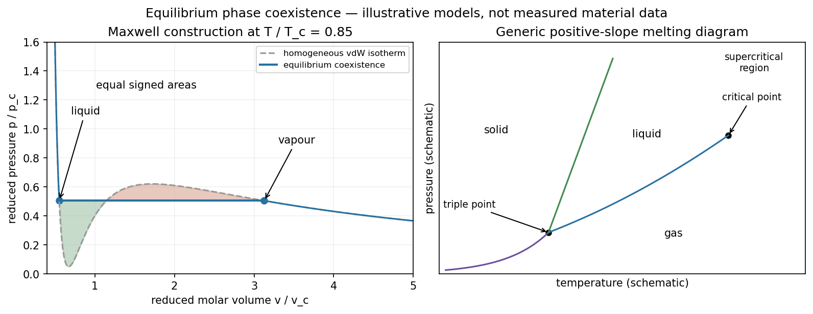

<h1 id="section-c/c13/solution">Solution</h1>

↑ **Parent:** [C13](../c13.md)

[Phase equilibrium](../../../../../phase-equilibrium.md) minimizes [Gibbs free energy](../../../../../gibbs-free-energy.md) at specified [temperature](../../../../../temperature-split.md), [pressure](../../../../../pressure-split.md) and composition. Coexisting phases have equal [temperature](../../../../../temperature-split.md), [pressure](../../../../../pressure-split.md) and [chemical potential](../../../../../chemical-potential-split.md). For a pure substance, a first-order transition has continuous equilibrium [Gibbs free energy](../../../../../gibbs-free-energy.md) but a jump in its first derivatives, such as [entropy](../../../../../entropy-split.md) or volume; the [latent heat](../../../../../latent-heat.md) is $T\Delta S$. Continuous transitions lack that [latent heat](../../../../../latent-heat.md) and can instead have singular or discontinuous higher responses.

The van der Waals molar equation

$$
p=\frac{RT}{v-b}-\frac a{v^2}
$$

combines an excluded-volume correction with attractive interactions. Its inflection conditions give

$$
\boxed{v_c=3b,\quad T_c=\frac{8a}{27Rb},\quad p_c=\frac{a}{27b^2}.}
$$

Below $T_c$, the oscillatory isotherm contains a mechanically unstable segment with $(\partial p/\partial v)_T>0$. Equilibrium instead replaces the loop by a constant-pressure coexistence line. Equality of chemical potentials gives the [Maxwell construction](../../../../../maxwell-construction.md),

$$
\int_{v_\ell}^{v_g}[p(v,T)-p_{\rm sat}]\,dv=0.
$$

On isothermal compression the gas reaches saturation, then converts progressively into liquid at fixed [pressure](../../../../../pressure-split.md). The mean [molar volume](../../../../../molar-volume.md) obeys $v=(1-x)v_\ell+xv_g$, where $x$ is the gas fraction. Metastable superheated or supercooled states can persist when [nucleation](../../../../../nucleation.md) is delayed; they are not the global equilibrium selected by this construction.

**[Figure 2](#section-c/c13/image-illustrative-reduced-van-der-waals-coexistence-and-a-generic-pure-substance-phase-diagram). Illustrative reduced van der Waals coexistence and a generic pure-substance phase diagram**.

A [pressure](../../../../../pressure-split.md)–[temperature](../../../../../temperature-split.md) [phase diagram](../../../../../phase-diagram.md) contains coexistence curves separating solid, liquid and gas. Three phases meet at a [triple point](../../../../../triple-point.md); the liquid–gas coexistence curve ends at a [thermodynamic critical point](../../../../../thermodynamic-critical-point.md), above which liquid and gas can be connected without crossing a first-order phase boundary. A generic solid–liquid line continues beyond the liquid–gas critical [temperature](../../../../../temperature-split.md). For one component the [Gibbs phase rule](../../../../../phase-rule.md) is $F=3-P$, so a three-phase equilibrium fixes both [temperature](../../../../../temperature-split.md) and [pressure](../../../../../pressure-split.md).

Along a two-phase coexistence curve, $d\mu=-s\,dT+v\,dp$ for each phase gives

$$
\boxed{\frac{dp}{dT}=\frac{\Delta s}{\Delta v}=\frac{L}{T\Delta v}.}
$$

This is the Clapeyron equation, valid with consistent molar or specific quantities. For vaporization, neglecting the liquid volume and treating the vapour as ideal gives $\Delta v\simeq RT/p$, hence $d\ln p/dT=L/(RT^2)$. With approximately constant molar [latent heat](../../../../../latent-heat.md),

$$
\boxed{\ln\frac{p_2}{p_1}=-\frac LR\left(\frac1{T_2}-\frac1{T_1}\right).}
$$

This Clausius–Clapeyron approximation explains the rapid rise of vapour [pressure](../../../../../pressure-split.md) with [temperature](../../../../../temperature-split.md). It fails close to the [thermodynamic critical point](../../../../../thermodynamic-critical-point.md), where phase volumes converge, and is not a universal expression for melting. The sign of a melting-line slope depends on its volume change; water's denser liquid gives a familiar negative slope.

## ↑ Ancestors (14)

1. [C13](../c13.md)
2. [Section C](../../section-c.md)
3. [Paper 2](../../../paper-2-split.md)
4. [2013](../../../split.md)
5. [Past exam of the physics B course of the University of Cambridge](../../../../split.md)
6. [Physics B course of the University of Cambridge](../../../../../physics-b-course-of-the-university-of-cambridge.md)
7. [Physics course of the year 2 of the natural sciences course of the University of Cambridge](../../../../../physics-course-of-the-year-2-of-the-natural-sciences-course-of-the-university-of-cambridge.md)
8. [Year 2 of the natural sciences course of the University of Cambridge](../../../../../year-2-of-the-natural-sciences-course-of-the-university-of-cambridge.md)
9. [Year of the natural sciences course of the University of Cambridge](../../../../../year-of-the-natural-sciences-course-of-the-university-of-cambridge.md)
10. [Natural sciences course of the University of Cambridge](../../../../../natural-sciences-course-of-the-university-of-cambridge.md)
11. [Course of the University of Cambridge](../../../../../course-of-the-university-of-cambridge.md)
12. [University of Cambridge](../../../../../university-of-cambridge-split.md)
13. [List of universities](../../../../../list-of-universities.md)
14. [Codex Wiki](../../../../../split.md)
