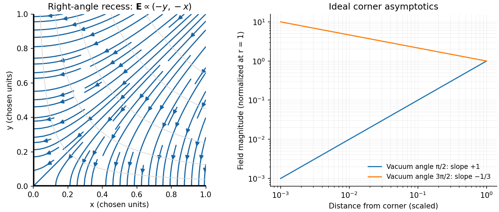
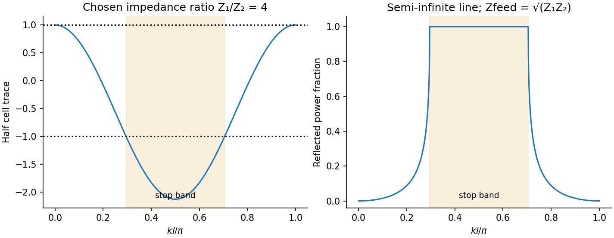

# Paper 1

↑ **Parent:** [2014](../2014.md)

Original paper: [Public original, physical PDF pages 156–163](https://www.whatdotheyknow.com/request/natural_science_tripos_physics_e_2/response/2340776/attach/2/FOI%202023%20399%20Zahid%20materials.pdf?cookie_passthrough=1#page=156).

**Table of contents**

- [Section A](#section-a)
  - [A1](#section-a/a1)
    - [Solution](#section-a/a1/solution)
  - [A2](#section-a/a2)
    - [Solution](#section-a/a2/solution)
  - [A3](#section-a/a3)
    - [Solution](#section-a/a3/solution)
  - [A4](#section-a/a4)
    - [Solution](#section-a/a4/solution)
  - [A5](#section-a/a5)
    - [Solution](#section-a/a5/solution)
- [Section B](#section-b)
  - [B6](#section-b/b6)
    - [Solution](#section-b/b6/solution)
  - [B7](#section-b/b7)
    - [Solution](#section-b/b7/solution)
  - [B8](#section-b/b8)
    - [Solution](#section-b/b8/solution)
    - [a](#section-b/b8/a)
      - [Solution](#section-b/b8/a/solution)
    - [b](#section-b/b8/b)
      - [Solution](#section-b/b8/b/solution)
  - [B9](#section-b/b9)
    - [Solution](#section-b/b9/solution)
- [Section C](#section-c)
  - [C10](#section-c/c10)
    - [Solution](#section-c/c10/solution)
  - [C11](#section-c/c11)
    - [Solution](#section-c/c11/solution)
  - [C12](#section-c/c12)
    - [Solution](#section-c/c12/solution)
  - [C13](#section-c/c13)
    - [Solution](#section-c/c13/solution)

## Section A

↑ **Parent:** [Paper 1](paper-1.md)

<h3 id="section-a/a1">A1</h3>

↑ **Parent:** [Section A](#section-a)

<h4 id="section-a/a1/solution">Solution</h4>

↑ **Parent:** [A1](#section-a/a1)

For [rolling without slipping](../../rigid-body-dynamics.md#rolling-without-slipping) through height $h$, [conservation of energy](../../mathematical-physics.md#conservation-of-energy) gives

$$
mgh=\tfrac12mv^2+\tfrac12I(v/R)^2,\qquad
\boxed{v^2=\frac{2gh}{1+I/(mR^2)}.}
$$

A uniform solid sphere has $I/(mR^2)=2/5$, a solid cylinder $1/2$, and a pipe $(1+r_{\rm in}^2/R^2)/2>1/2$. Thus **the ball is fastest, then the solid cylinder, then the pipe**. A smaller [moment of inertia](../../rigid-body-dynamics.md#moment-of-inertia) leaves more [energy](../../energy.md) in translation. This assumes release from rest through the same height, adequate [static friction](../../force.md#static-friction) and negligible rolling resistance; a thin pipe has $v^2=gh$.

<h3 id="section-a/a2">A2</h3>

↑ **Parent:** [Section A](#section-a)

<h4 id="section-a/a2/solution">Solution</h4>

↑ **Parent:** [A2](#section-a/a2)

The [Maxwell speed distribution](../../quantum-ideal-gas-statistics.md#maxwell-speed-distribution) is proportional to $v^2e^{-mv^2/(2k_BT)}$. Setting its logarithmic derivative to zero gives the most probable [speed](../../classical-mechanics.md#speed):

$$
\boxed{v_{\rm mp}=\sqrt{\frac{2k_BT}{m}}=\sqrt{\frac{2RT}{M}}
\simeq3.95\times10^2\,\mathrm{m\,s^{-1}}.}
$$

Use molecular [oxygen](../../chemical-substance.md#oxygen), with $M\simeq0.032\,\mathrm{kg\,mol^{-1}}$, and $T=300\,\mathrm K$.

<h3 id="section-a/a3">A3</h3>

↑ **Parent:** [Section A](#section-a)

<h4 id="section-a/a3/solution">Solution</h4>

↑ **Parent:** [A3](#section-a/a3)

For steady thin beams a distance $d$ apart, let $\lambda_1,\lambda_2$ be their laboratory charge per [length](../../physics.md#length). Their current magnitudes are $|\lambda_j|v$, giving [force](../../force.md) magnitudes per [length](../../physics.md#length)

$$
f_E=\frac{|\lambda_1\lambda_2|}{2\pi\epsilon_0d},\qquad
f_B=\frac{\mu_0|\lambda_1\lambda_2|v^2}{2\pi d},\qquad
\boxed{\frac{f_E}{f_B}=\frac{c^2}{v^2}.}
$$

The [electric force](../../electric-field.md#electric-force) is repulsive and the magnetic [force](../../force.md) attractive for the parallel electron [velocities](../../classical-mechanics.md#velocity). The net [force](../../force.md) remains repulsive for $v<c$.

<h3 id="section-a/a4">A4</h3>

↑ **Parent:** [Section A](#section-a)

<h4 id="section-a/a4/solution">Solution</h4>

↑ **Parent:** [A4](#section-a/a4)

For isotropic planar motion, the [planar effusion flux](../../kinetic-theory.md#planar-effusion-flux) gives an escape rate through a gap of width $w$ is $\Gamma=w(N/\mathcal A)\langle v\rangle/\pi$, where $\mathcal A$ is tray [area](../../differential-geometry.md#surface-area). At fixed equilibrium [kinetic energy](../../energy.md#kinetic-energy), or fixed shape of the scaled [speed distribution](../../kinetic-theory.md#speed-distribution), $v\propto m^{-1/2}$. Hence **halving the [mass](../../classical-mechanics.md#mass) increases the rate by $\sqrt2$**. This planar [effusion](../../kinetic-theory.md#effusion) result assumes the same spatial [density](../../fluid-mechanics.md#density) and an unrestricted small opening. Strictly, average [energy](../../energy.md) alone fixes $\langle v^2\rangle$, not $\langle v\rangle$; an arbitrary change of distribution shape would need more information.

<h3 id="section-a/a5">A5</h3>

↑ **Parent:** [Section A](#section-a)

<h4 id="section-a/a5/solution">Solution</h4>

↑ **Parent:** [A5](#section-a/a5)

Assume uniform charge per unit [length](../../physics.md#length) and the same angular [speed](../../classical-mechanics.md#speed) $\Omega$. A charge element at distance $r$ has $\mathbf v=\boldsymbol\Omega\times\mathbf r$, so the [Biot-Savart law](../../electromagnetism.md#biot-savart-law) gives the [centre field of a rigidly rotating charged loop](../../electromagnetism.md#centre-field-of-a-rigidly-rotating-charged-loop) as $dB=\mu_0\Omega\,dq/(4\pi r)$. For one square side, with $b=a/2$,

$$
\int_{-b}^{b}\frac{dx}{\sqrt{x^2+b^2}}=2\ln(1+\sqrt2).
$$

Using $dq=Q\,dx/(4a)$ on each side gives

$$
B_{\square}=\frac{\mu_0Q\Omega}{2\pi a}\ln(1+\sqrt2),\qquad
B_{\circ}=\frac{\mu_0Q\Omega}{2\pi a}.
$$

Thus **$B_{\square}/B_{\circ}=\ln(1+\sqrt2)\simeq0.8814$**: the circular field is larger by $1/\ln(1+\sqrt2)\simeq1.135$. This is a rigidly rotating charge distribution, not a current constrained to the sides of a stationary square.

## Section B

↑ **Parent:** [Paper 1](paper-1.md)

<h3 id="section-b/b6">B6</h3>

↑ **Parent:** [Section B](#section-b)

<h4 id="section-b/b6/solution">Solution</h4>

↑ **Parent:** [B6](#section-b/b6)

Specifying potential on the complete boundary gives a [Dirichlet boundary condition](../../differential-equation.md#dirichlet-boundary-condition) and a unique harmonic solution. Specifying its normal derivative gives a [Neumann boundary condition](../../differential-equation.md#neumann-boundary-condition), with the zero-net-flux compatibility condition and an undetermined additive constant. Mixed conditions on complementary portions also give uniqueness when a potential reference is fixed. In an exterior domain, conditions at infinity are needed. These statements follow by applying [Green's first identity](../../partial-differential-equation.md#green-s-first-identity) to the difference of two solutions. A metal in [electrostatic equilibrium](../../electrostatics.md#electrostatic-equilibrium) is an equipotential: $\Phi=V_0$, tangential [electric field](../../electric-field.md) zero, and normal field $E_n=\sigma/\epsilon_0$ just outside a vacuum interface.

For the [conducting-wedge potential expansion](../../electrostatics.md#conducting-wedge-potential-expansion), put $u=\Phi-V_0$ in the empty sector $0<\theta<\alpha$. For $u=r^\nu\Psi(\theta)$, Laplace's equation gives $\Psi''+\nu^2\Psi=0$. Vanishing values on both faces require $\Psi\propto\sin(n\pi\theta/\alpha)$, hence

$$
\boxed{\Phi=V_0+\sum_{n=1}^{\infty}\left(a_nr^{n\pi/\alpha}+b_nr^{-n\pi/\alpha}\right)\sin\frac{n\pi\theta}{\alpha}.}
$$

Bounded potential at the corner sets $b_n=0$. The coefficients still require outer boundary data; the metal potential alone cannot select them. For a generic nonzero $a_1$, put $p=\pi/\alpha$. Differentiation gives

$$
\boxed{E_r\simeq-pa_1r^{p-1}\sin p\theta,\qquad E_\theta\simeq-pa_1r^{p-1}\cos p\theta.}
$$

If $a_1=0$, the first nonzero higher harmonic replaces this leading term. For $\alpha=\pi/2$, $u\simeq2a_1xy$, so $\mathbf E=-2a_1(y,x)$ and field lines satisfy **$x^2-y^2=\mathrm{constant}$**, meeting the metal faces normally and tending to zero field at the corner. For $\alpha=3\pi/2$, the [electrostatic corner-field exponent](../../electrostatics.md#electrostatic-corner-field-exponent) is $-1/3$. A real tip's rounding cuts off this divergence; breakdown or [field emission](../../quantum-mechanics.md#field-electron-emission) can limit the attainable field.

**[Figure 1](#section-b/b6/image-original-right-angle-field-line-calculation-and-the-two-corner-field-power-laws). Original right-angle field-line calculation and the two corner-field power laws**.

<h3 id="section-b/b7">B7</h3>

↑ **Parent:** [Section B](#section-b)

<h4 id="section-b/b7/solution">Solution</h4>

↑ **Parent:** [B7](#section-b/b7)

Applying [Gauss's law for magnetism](../../maxwell-equations.md#gauss-s-law-for-magnetism) to a pillbox and [Ampère's law](../../maxwell-equations.md#ampere-s-circuital-law) to an interface-crossing rectangle gives

$$
\boxed{\hat n\cdot(\mathbf B_2-\mathbf B_1)=0,\qquad
\hat n\times(\mathbf H_2-\mathbf H_1)=\mathbf K_f.}
$$

Here $\hat n$ points from material 1 to 2 and $\mathbf K_f$ is free surface current. With no such current, $B_n$ and $H_t$ are continuous. For linear isotropic media, $B_{t2}/\mu_2=B_{t1}/\mu_1$ and $\mu_2H_{n2}=\mu_1H_{n1}$. The [magnetic fields](../../magnetic-field.md) need not have equal magnitudes on either side.

With negligible leakage, [Gauss's law for magnetism](../../maxwell-equations.md#gauss-s-law-for-magnetism) makes each cross-section of a [magnetic flux](../../magnetic-field.md#magnetic-flux) tube carry the same flux $\mathcal F$. High permeability guides it through the core; a short gap permits neglect of fringing. Flux conservation across these particular geometric sections is an approximation, not a consequence of zero divergence without controlling side leakage.

Let $L$ be the constant-radius arc marked in the figure, and $\mu_r=\mu/\mu_0$. For each straight taper, the [radius](../../topology.md#radius) changes linearly from $R$ to $r$, giving the [reluctance of a conical magnetic pole](../../electromagnetism.md#reluctance-of-a-conical-magnetic-pole)

$$
\int_{\rm taper}\frac{dx}{\mu\pi a(x)^2}=\frac{s}{\mu\pi Rr}.
$$

Summing [magnetic reluctances](../../electromagnetism.md#magnetic-reluctance) to find the [gap field of a tapered electromagnet](../../electromagnetism.md#gap-field-of-a-tapered-electromagnet), and using $B_g=\mathcal F/(\pi r^2)$ gives

$$
NI=\mathcal F\left(\frac{L}{\mu\pi R^2}+\frac{2s}{\mu\pi Rr}+\frac{h}{\mu_0\pi r^2}\right),\qquad
\boxed{H_g=\frac{NI}{h+\mu_r^{-1}(Lr^2/R^2+2sr/R)},\quad B_g=\mu_0H_g.}
$$

If $L$ is instead defined as the total magnetic-material [length](../../physics.md#length), replace the displayed uniform-arc [length](../../physics.md#length) by $L-2s$. The comparison untapered core has uniform [radius](../../topology.md#radius) $R$ and material [length](../../physics.md#length) $L+2s$, so

$$
\boxed{\frac{H_g}{H_{g0}}=
\frac{h+(L+2s)/\mu_r}{h+(Lr^2/R^2+2sr/R)/\mu_r}.}
$$

**The original PDF specifies $s/L\ll r/R$**; the TeX transcription reverses this inequality. In the printed limit the taper reluctances are small relative to that of the broad arc. The gain is approximately $[h+L/\mu_r]/[h+Lr^2/(\mu_rR^2)]$, approaching $(R/r)^2$ if the gap reluctance is also negligible. If the gap dominates, both fields instead approach $NI/h$ and the gain approaches one. [magnetic saturation](../../electromagnetism.md#magnetic-saturation) near the small poles, gap fringing, leakage and winding heating limit practical enhancement.

<h3 id="section-b/b8">B8</h3>

↑ **Parent:** [Section B](#section-b)

<h4 id="section-b/b8/solution">Solution</h4>

↑ **Parent:** [B8](#section-b/b8)

The macroscopic [Maxwell equations](../../maxwell-equations.md), with free charge and current, are

$$
\nabla\cdot\mathbf D=\rho_f,\quad \nabla\cdot\mathbf B=0,\quad
\nabla\times\mathbf E=-\partial_t\mathbf B,\quad
\nabla\times\mathbf H=\mathbf J_f+\partial_t\mathbf D.
$$

Inside this body $\mathbf D=\epsilon_0\mathbf E$ and $\mathbf B=\mu_0\mathbf H$. The wave [magnetic field](../../magnetic-field.md) lies along $z$; its sign follows the local wave component. Faraday's and Ampère's laws give

$$
\partial_xE_y=-\mu_0\partial_tH_z,\qquad
\boxed{\mathbf J=(0,-\partial_xH_z-\epsilon_0\partial_tE_y,0).}
$$

Static background fields are excluded from this wave solution. The magnetic [force](../../force.md) [density](../../fluid-mechanics.md#density) is along $x$, with $f_x=\mu_0J_yH_z$. For a steady periodic state, $\overline{H_z\partial_tE_y}=-\overline{E_y\partial_tH_z}$. Therefore

$$
\boxed{\overline f_x=-\partial_x\left(\tfrac12\mu_0\overline{H_z^2}+\tfrac12\epsilon_0\overline{E_y^2}\right).}
$$

The result gives [radiation-force density without Ohm's law](../../electromagnetism.md#radiation-force-density-without-ohm-s-law). Integrating through the body gives its [pressure](../../pressure.md) as the boundary value of the averaged [electromagnetic energy](../../electromagnetic-wave.md#electromagnetic-energy) [density](../../fluid-mechanics.md#density) minus its value deep inside. In both limiting cases below the latter is zero. Take $A$ as the incident [electric field](../../electric-field.md)'s peak amplitude and write $Z_v=\sqrt{\mu_0/\epsilon_0}$.

<h4 id="section-b/b8/a">a</h4>

↑ **Parent:** [B8](#section-b/b8)

<h5 id="section-b/b8/a/solution">Solution</h5>

↑ **Parent:** [A](#section-b/b8/a)

With no reflected field, $\overline{E_y^2}=A^2/2$ and $\overline{H_z^2}=A^2/(2Z_v^2)$ at the entrance. Thus

$$
\boxed{P_{\rm abs}=\frac12\epsilon_0A^2=\frac{\overline S_{\rm inc}}c,\qquad
\overline S_{\rm inc}=\frac{A^2}{2Z_v}.}
$$

Complete absorption transfers the incident normal [momentum flux](../../mathematical-physics.md#momentum-flux) to the body.

<h4 id="section-b/b8/b">b</h4>

↑ **Parent:** [B8](#section-b/b8)

<h5 id="section-b/b8/b/solution">Solution</h5>

↑ **Parent:** [B](#section-b/b8/b)

At a perfect conductor, the reflected [electric field](../../electric-field.md) cancels the incident tangential field, while their [magnetic fields](../../magnetic-field.md) add. Thus $E_y(0)=0$ and $H_z(0)$ has peak amplitude $2A/Z_v$. Taking the zero-penetration limit, including its surface [force](../../force.md), gives

$$
\boxed{P_{\rm refl}=\epsilon_0A^2=\frac{2\overline S_{\rm inc}}c.}
$$

Reversal of the normal momentum doubles the [pressure](../../pressure.md) compared with absorption at the same incident Poynting flux.

<h3 id="section-b/b9">B9</h3>

↑ **Parent:** [Section B](#section-b)

<h4 id="section-b/b9/solution">Solution</h4>

↑ **Parent:** [B9](#section-b/b9)

$Z$ is the terminating load impedance, $Z_0$ the line's [characteristic impedance](../../electrical-engineering.md#characteristic-impedance), and $k$ the propagation [wave number](../../wave-equation.md#wavenumber); $l$ is its [length](../../physics.md#length). In the lossless convention printed, an open circuit gives $Z_{\rm in}=-iZ_0\cot kl$, a short circuit gives $iZ_0\tan kl$, and a matched load $Z=Z_0$ gives **$Z_{\rm in}=Z_0$ for every [length](../../physics.md#length)**. The divergent or zero limits at isolated electrical [lengths](../../physics.md#length) are understood continuously.

Put $\theta=kl$, $c_\theta=\cos\theta$, $s_\theta=\sin\theta$. The voltage/current [matrix](../../vector-space.md#matrix) of one section is

$$
M_j=\begin{pmatrix}c_\theta&iZ_js_\theta\\is_\theta/Z_j&c_\theta\end{pmatrix}.
$$

For a pair beginning with $Z_1$, write $M_1M_2=\left(\begin{smallmatrix}A&B\\C&D\end{smallmatrix}\right)$. Its entries are $A=c_\theta^2-(Z_1/Z_2)s_\theta^2$, $D=c_\theta^2-(Z_2/Z_1)s_\theta^2$, $B=i(Z_1+Z_2)s_\theta c_\theta$, and $C=i(1/Z_1+1/Z_2)s_\theta c_\theta$. The [alternating-impedance transmission line](../../electrical-engineering.md#alternating-impedance-transmission-line) has unchanged input $X$, its [Bloch impedance](../../electrical-engineering.md#bloch-impedance), obeying $X=(AX+B)/(CX+D)$. Hence, away from the removable dividing zeros,

$$
iX^2(Z_1+Z_2)+X(Z_1^2-Z_2^2)\tan\theta-iZ_1Z_2(Z_1+Z_2)=0,
$$

$$
\boxed{X=\frac{i(Z_1-Z_2)\tan\theta\ \pm\sqrt{4Z_1Z_2-(Z_1-Z_2)^2\tan^2\theta}}2.}
$$

For real positive $Z_1,Z_2$, select the branch carrying [energy](../../energy.md) into the line or decaying into it. A positive real part selects the pass-band root; infinitesimal passive loss resolves the stop-band branch. At $\theta=m\pi$ the cell [matrix](../../vector-space.md#matrix) is the identity, so the exact fixed-point condition alone does not determine $X$; at odd quarter-wave [lengths](../../physics.md#length) the appropriate limiting impedance can be zero or infinite.

In a [transmission-line stop band](../../electrical-engineering.md#transmission-line-stop-band), a lossless semi-infinite ladder totally reflects because its physical input is reactive. Equivalently its cell has

$$
\tfrac12\operatorname{tr}M=1-\frac{(Z_1+Z_2)^2}{2Z_1Z_2}\sin^2\theta<-1.
$$

Thus, for nonzero contrast, the stop-band interiors satisfy

$$
\boxed{|\tan kl|>\frac{2\sqrt{Z_1Z_2}}{|Z_1-Z_2|},\quad\text{equivalently}\quad
\sin^2kl>\frac{4Z_1Z_2}{(Z_1+Z_2)^2}.}
$$

With $\theta_c=\arcsin[2\sqrt{Z_1Z_2}/(Z_1+Z_2)]$, these are $m\pi+\theta_c<kl<(m+1)\pi-\theta_c$; band-edge reflection follows by a limit. If $k=\omega/u$, multiply the endpoints by $u/l$ for [angular frequencies](../../lagrangian-mechanics.md#angular-frequency). Identical impedances have no stop band. A finite ladder can transmit by tunnelling, unlike the semi-infinite idealization.

**[Figure 2](#section-b/b9/image-calculated-bloch-trace-and-reflected-power-for-a-chosen-alternating-impedance-line). Calculated Bloch trace and reflected power for a chosen alternating-impedance line**.

## Section C

↑ **Parent:** [Paper 1](paper-1.md)

<h3 id="section-c/c10">C10</h3>

↑ **Parent:** [Section C](#section-c)

<h4 id="section-c/c10/solution">Solution</h4>

↑ **Parent:** [C10](#section-c/c10)

A [fictitious force](../../mathematical-physics.md#fictitious-force) accounts for acceleration of the chosen [reference frame](../../mathematical-physics.md#reference-frame) rather than an additional interaction. For axes rotating at constant $\boldsymbol\Omega$, differentiating a vector uses $(d/dt)_{\rm lab}=(d/dt)_{\rm rot}+\boldsymbol\Omega\times$. Twice applying this gives

$$
\mathbf a_{\rm lab}=\mathbf a+2\boldsymbol\Omega\times\mathbf v+
\boldsymbol\Omega\times(\boldsymbol\Omega\times\mathbf r),
$$

so moving the last two terms to the [force](../../force.md) side produces the Coriolis and [centrifugal forces](../../mathematical-physics.md#centrifugal-force). Here $\mathbf v$ is measured in rotating axes.

The [rotating saddle trap](../../mathematical-physics.md#rotating-saddle-trap) has potential [force](../../force.md) $(-m\omega^2x,+m\omega^2y)$. Therefore

$$
\ddot x=(\Omega^2-\omega^2)x+2\Omega\dot y,\qquad
\ddot y=(\Omega^2+\omega^2)y-2\Omega\dot x.
$$

The trial solution gives

$$
(\epsilon^2+\Omega^2)^2-\omega^4-4\Omega^2\epsilon^2=0,
\qquad\boxed{\epsilon_\pm^2=\Omega^2\pm\omega^2.}
$$

Both modes are bounded for arbitrary sufficiently small initial displacements and [velocities](../../classical-mechanics.md#velocity) precisely when **$|\Omega|>\omega$**. At equality there is a zero-frequency secular mode; the exactly stationary solution does not establish stability.

For [rapidly rotating saddle confinement](../../mathematical-physics.md#rapidly-rotating-saddle-confinement) with $\Omega\gg\omega>0$, real mode ellipses can be written

$$
(x,y)_+=A\left(\cos\epsilon_+t,-\frac\Omega{\epsilon_+}\sin\epsilon_+t\right),\qquad
(x,y)_-=B\left(\cos\epsilon_-t,-\frac{\epsilon_-}\Omega\sin\epsilon_-t\right).
$$

They are nearly circular clockwise motions at rates $\epsilon_\pm\simeq\Omega\pm\omega^2/(2\Omega)$. Rotating these axes back to the laboratory cancels the large angular rate: **the leading laboratory motion is a slow approximately harmonic ellipse with [frequency](../../wave.md#frequency) $\omega^2/(2\Omega)$**, plus small rapid micromotion. It results from the changing saddle [force](../../force.md), not a static potential minimum. At next order the ellipse precesses prograde at $\omega^4/(8\Omega^3)$. The rotating-potential model and this guiding-centre distinction are analysed in the primary work cited here.[preprint pp. 2 and 6–7, equations (12)–(18)](../../physics-bibliography.md#rotating-saddle-trap-as-foucault-s-pendulum-by-oleg-n-kirillov-and-mark-levi)

**[Figure 3](#section-c/c10/image-original-exact-trajectories-in-rotating-and-laboratory-coordinates-for-a-chosen-rapid-saddle-rotation). Original exact trajectories in rotating and laboratory coordinates for a chosen rapid saddle rotation**.

<h3 id="section-c/c11">C11</h3>

↑ **Parent:** [Section C](#section-c)

<h4 id="section-c/c11/solution">Solution</h4>

↑ **Parent:** [C11](#section-c/c11)

A [normal mode](../../wave-equation.md#normal-mode) is a [small oscillation](../../lagrangian-mechanics.md#small-oscillation) with fixed relative displacement amplitudes, all coordinates oscillating at one [frequency](../../wave.md#frequency). [linearization](../../algebra.md#linearization) gives $M\ddot{\mathbf y}=-K\mathbf y$, so mode shapes solve $K\mathbf u=\omega_n^2M\mathbf u$.

Write $C=q^2/(4\pi\epsilon_0)$. [force](../../force.md) balance on an outer ion gives $m\omega^2x_0=C/x_0^2+C/(2x_0)^2$, hence

$$
\boxed{x_0=\left(\frac{5q^2}{16\pi\epsilon_0m\omega^2}\right)^{1/3}.}
$$

A pair separated by $d$ has quadratic [energy](../../energy.md) $C(y_j-y_i)^2/d^3$, equivalent to spring constant $2C/d^3$. The adjacent-pair constants are $8m\omega^2/5$, and the outer-pair constant is $m\omega^2/5$. Adding the trap stiffness gives

$$
\ddot{\mathbf y}=-\frac{\omega^2}{5}
\begin{pmatrix}14&-8&-1\\-8&21&-8\\-1&-8&14\end{pmatrix}\mathbf y.
$$

In the [three-ion axial normal modes](../../wave-equation.md#three-ion-axial-normal-modes), the translation mode leaves every separation unchanged. The antisymmetric breathing mode leaves the central ion fixed; the remaining vector is [orthogonal](../../inner-product.md#orthogonal-vectors) to both. Direct multiplication yields

$$
\boxed{\begin{array}{c|c}
\text{mode vector}&\text{angular frequency}\\\hline
(1,1,1)&\omega\\
(1,0,-1)&\sqrt3\omega\\
(1,-2,1)&\sqrt{29/5}\,\omega
\end{array}}
$$

For [breathing excitation after a trap-frequency quench](../../wave-equation.md#breathing-excitation-after-a-trap-frequency-quench), put $\omega'=\omega+\delta\omega$ and $x_0'=x_0(\omega/\omega')^{2/3}$. The displacement from the new equilibrium is solely along the breathing vector and the initial [velocity](../../classical-mechanics.md#velocity) is zero. To first order in the fractional quench,

$$
\boxed{x_2(t)=0,\qquad x_{1,3}(t)=\mp\left[x_0'+(x_0-x_0')\cos(\sqrt3\omega't)\right],
\quad x_0-x_0'\simeq\frac{2x_0\delta\omega}{3\omega}.}
$$

The [frequency](../../wave.md#frequency) shown is the linearized [frequency](../../wave.md#frequency) about the new equilibrium. Nonlinear amplitude corrections are beyond this small-quench result.

<h3 id="section-c/c12">C12</h3>

↑ **Parent:** [Section C](#section-c)

<h4 id="section-c/c12/solution">Solution</h4>

↑ **Parent:** [C12](#section-c/c12)

At distance $y$ from the [neutral axis](../../elasticity-physics.md#neutral-axis), bending [strain](../../continuum-mechanics.md#strain) has magnitude $y/R$ and the corresponding [stress](../../continuum-mechanics.md#stress) is $Ey/R$. Its moment is therefore

$$
\boxed{B=\int_A y\frac{Ey}{R}\,dA=\frac{EI}{R},\qquad I=\int_Ay^2\,dA.}
$$

The [second moment of area](../../elasticity-physics.md#second-moment-of-area) is about the neutral bending axis and has units of [length](../../physics.md#length) to the fourth power. This assumes a slender linear-elastic beam, small [strains](../../continuum-mechanics.md#strain) and plane sections remaining plane, not necessarily small deflections.

For horizontal compression $F>0$, moment balance across a short arc gives $dB/ds=-F\,dy/ds=-F\sin\theta$. Since $B=EI\theta'$, the exact-angle [Euler elastica](../../elasticity-physics.md#euler-elastica) equation and its first integral are

$$
\boxed{EI\theta''+F\sin\theta=0,\qquad
\frac{EI}{2}\theta'^2-F\cos\theta=C.}
$$

The first integral follows by multiplying by $\theta'$ and integrating; no small-angle replacement has been made.

For tension set $F=-T$. The straight far-field ends give $C=T$, so on the increasing-angle [tensile elastica loop](../../elasticity-physics.md#tensile-elastica-loop) branch

$$
\theta'=2\sqrt{\frac{T}{EI}}\sin\frac\theta2,\qquad
\ln\tan\frac\theta4=s\sqrt{\frac{T}{EI}}.
$$

Choosing $s=0$ at $\theta=\pi$ gives

$$
\boxed{\theta(s)=4\arctan e^{\alpha s},\qquad\alpha=\sqrt{T/(EI)}.}
$$

The terminal [angles](../../geometry-and-topology.md#angle) are $0$ and $2\pi$, the same physical tangent direction. At the top, $\theta'(0)=2\alpha$ and the [bending moment](../../elasticity-physics.md#bending-moment) is $2EI\alpha$. The horizontal tensile [force](../../force.md) has lever arm $h$, so

$$
\boxed{Th=2EI\alpha,\qquad h=2\sqrt{EI/T}.}
$$

Integrating $(x',y')=(\cos\theta,\sin\theta)$ independently gives $x=s-2\tanh(\alpha s)/\alpha$, $y=2\operatorname{sech}(\alpha s)/\alpha$, confirming the height. This ideal loop neglects self-contact and thickness at its crossing.

**[Figure 4](#section-c/c12/image-original-analytic-tensile-elastica-shape-and-its-tangent-angle-and-curvature-profiles). Original analytic tensile-elastica shape and its tangent-angle and curvature profiles**.

<h3 id="section-c/c13">C13</h3>

↑ **Parent:** [Section C](#section-c)

<h4 id="section-c/c13/solution">Solution</h4>

↑ **Parent:** [C13](#section-c/c13)

In [irrotational flow](../../vorticity.md#irrotational-flow), the [velocity](../../classical-mechanics.md#velocity) has a [velocity potential](../../fluid-mechanics.md#velocity-potential) locally, and globally in a simply connected flow domain. [incompressibility](../../fluid-mechanics.md#incompressible-flow) then gives $\nabla\cdot\mathbf v=\nabla^2\Phi=0$. For a sphere moving at [speed](../../classical-mechanics.md#speed) $U$ along $z$ through fluid at rest far away, the [potential of a translating sphere](../../fluid-mechanics.md#potential-of-a-translating-sphere) is a decaying axisymmetric dipole. Its solution and its impermeability condition give

$$
\Phi=\frac{\beta\cos\theta}{r^2},\quad
\left.\partial_r\Phi\right|_a=U\cos\theta,
\qquad\boxed{\beta=-\frac12Ua^3.}
$$

These are laboratory fluid [velocities](../../classical-mechanics.md#velocity) expressed relative to a moving origin. A [velocity](../../classical-mechanics.md#velocity) field measured in the sphere-rest frame instead requires adding $-Ur\cos\theta$ to the potential.

**The vector identity printed in the PDF has its signs reversed.** The product rule gives the consistent identity $v^2=\nabla\cdot(\Phi\mathbf v)-\Phi\nabla\cdot\mathbf v$. With outward normal of the exterior fluid equal to $-\hat r$ at the sphere, the [divergence theorem](../../multivariable-calculus.md#divergence-theorem) yields

$$
\int_{r>a}v^2\,dV=\int_{r=a}\Phi(-v_r)\,dS
=\frac{U^2a}{2}\int\cos^2\theta\,dS=\frac{2\pi a^3U^2}{3}.
$$

The integral at infinity vanishes. Hence

$$
K_f=\frac{\pi\rho_0a^3U^2}{3}=\tfrac12m_aU^2,
\qquad\boxed{m_a=\frac{2\pi\rho_0a^3}{3},\quad m_{\rm eff}=\frac{4\pi a^3}{3}(\rho+\rho_0/2).}
$$

This [added mass of a sphere](../../mathematical-physics.md#added-mass-of-a-sphere) is half the displaced fluid [mass](../../classical-mechanics.md#mass). For a spring of unchanged stiffness, [buoyancy](../../fluid-mechanics.md#buoyancy) only shifts the static equilibrium. Its [oscillation frequency with fluid added mass](../../mathematical-physics.md#oscillation-frequency-with-fluid-added-mass) is

$$
\boxed{\omega_s'=\omega_s\sqrt{\frac\rho{\rho+\rho_0/2}}.}
$$

For a small-angle [simple pendulum](../../simple-pendulum.md), [buoyancy](../../fluid-mechanics.md#buoyancy) also reduces restoring [torque](../../momentum.md#torque) from $mg\ell\theta$ to $(m-\rho_0V)g\ell\theta$, while the inertia is $(m+m_a)\ell^2$. Thus

$$
\boxed{\omega_p'=\omega_p\sqrt{\frac{\rho-\rho_0}{\rho+\rho_0/2}}.}
$$

The downward equilibrium is stable only for $\rho>\rho_0$. The ideal results assume unbounded fluid, negligible [viscosity](../../dynamic-viscosity.md), small excursions, and no important free-surface or container corrections.

## ↑ Ancestors (11)

1. [2014](../2014.md)
2. [Past exam of the physics B course of the University of Cambridge](../../past-exam-of-the-physics-b-course-of-the-university-of-cambridge.md)
3. [Physics B course of the University of Cambridge](../../university-of-cambridge.md#physics-b-course-of-the-university-of-cambridge)
4. [Physics course of the year 2 of the natural sciences course of the University of Cambridge](../../university-of-cambridge.md#physics-course-of-the-year-2-of-the-natural-sciences-course-of-the-university-of-cambridge)
5. [Year 2 of the natural sciences course of the University of Cambridge](../../university-of-cambridge.md#year-2-of-the-natural-sciences-course-of-the-university-of-cambridge)
6. [Year of the natural sciences course of the University of Cambridge](../../university-of-cambridge.md#year-of-the-natural-sciences-course-of-the-university-of-cambridge)
7. [Natural sciences course of the University of Cambridge](../../university-of-cambridge.md#natural-sciences-course-of-the-university-of-cambridge)
8. [Course of the University of Cambridge](../../university-of-cambridge.md#course-of-the-university-of-cambridge)
9. [University of Cambridge](../../university-of-cambridge.md)
10. [List of universities](../../README.md#list-of-universities)
11. [Codex Wiki](../../README.md)
