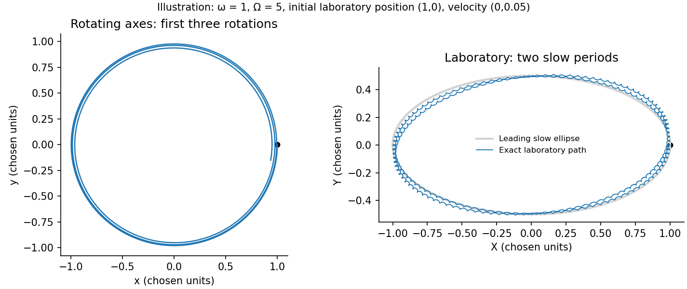

<h1 id="section-c/c10/solution">Solution</h1>

↑ **Parent:** [C10](../c10.md)

A [fictitious force](../../../../../fictitious-force.md) accounts for acceleration of the chosen [reference frame](../../../../../reference-frame.md) rather than an additional interaction. For axes rotating at constant $\boldsymbol\Omega$, differentiating a vector uses $(d/dt)_{\rm lab}=(d/dt)_{\rm rot}+\boldsymbol\Omega\times$. Twice applying this gives

$$
\mathbf a_{\rm lab}=\mathbf a+2\boldsymbol\Omega\times\mathbf v+
\boldsymbol\Omega\times(\boldsymbol\Omega\times\mathbf r),
$$

so moving the last two terms to the [force](../../../../../force-split.md) side produces the Coriolis and [centrifugal forces](../../../../../centrifugal-force.md). Here $\mathbf v$ is measured in rotating axes.

The [rotating saddle trap](../../../../../rotating-saddle-trap.md) has potential [force](../../../../../force-split.md) $(-m\omega^2x,+m\omega^2y)$. Therefore

$$
\ddot x=(\Omega^2-\omega^2)x+2\Omega\dot y,\qquad
\ddot y=(\Omega^2+\omega^2)y-2\Omega\dot x.
$$

The trial solution gives

$$
(\epsilon^2+\Omega^2)^2-\omega^4-4\Omega^2\epsilon^2=0,
\qquad\boxed{\epsilon_\pm^2=\Omega^2\pm\omega^2.}
$$

Both modes are bounded for arbitrary sufficiently small initial displacements and [velocities](../../../../../velocity.md) precisely when **$|\Omega|>\omega$**. At equality there is a zero-frequency secular mode; the exactly stationary solution does not establish stability.

For [rapidly rotating saddle confinement](../../../../../rapidly-rotating-saddle-confinement.md) with $\Omega\gg\omega>0$, real mode ellipses can be written

$$
(x,y)_+=A\left(\cos\epsilon_+t,-\frac\Omega{\epsilon_+}\sin\epsilon_+t\right),\qquad
(x,y)_-=B\left(\cos\epsilon_-t,-\frac{\epsilon_-}\Omega\sin\epsilon_-t\right).
$$

They are nearly circular clockwise motions at rates $\epsilon_\pm\simeq\Omega\pm\omega^2/(2\Omega)$. Rotating these axes back to the laboratory cancels the large angular rate: **the leading laboratory motion is a slow approximately harmonic ellipse with [frequency](../../../../../frequency.md) $\omega^2/(2\Omega)$**, plus small rapid micromotion. It results from the changing saddle [force](../../../../../force-split.md), not a static potential minimum. At next order the ellipse precesses prograde at $\omega^4/(8\Omega^3)$. The rotating-potential model and this guiding-centre distinction are analysed in the primary work cited here.[preprint pp. 2 and 6–7, equations (12)–(18)](../../../../../rotating-saddle-trap-as-foucault-s-pendulum-by-oleg-n-kirillov-and-mark-levi.md)

**[Figure 3](#section-c/c10/image-original-exact-trajectories-in-rotating-and-laboratory-coordinates-for-a-chosen-rapid-saddle-rotation). Original exact trajectories in rotating and laboratory coordinates for a chosen rapid saddle rotation**.

## ↑ Ancestors (14)

1. [C10](../c10.md)
2. [Section C](../../section-c.md)
3. [Paper 1](../../../paper-1-split.md)
4. [2014](../../../split.md)
5. [Past exam of the physics B course of the University of Cambridge](../../../../split.md)
6. [Physics B course of the University of Cambridge](../../../../../physics-b-course-of-the-university-of-cambridge.md)
7. [Physics course of the year 2 of the natural sciences course of the University of Cambridge](../../../../../physics-course-of-the-year-2-of-the-natural-sciences-course-of-the-university-of-cambridge.md)
8. [Year 2 of the natural sciences course of the University of Cambridge](../../../../../year-2-of-the-natural-sciences-course-of-the-university-of-cambridge.md)
9. [Year of the natural sciences course of the University of Cambridge](../../../../../year-of-the-natural-sciences-course-of-the-university-of-cambridge.md)
10. [Natural sciences course of the University of Cambridge](../../../../../natural-sciences-course-of-the-university-of-cambridge.md)
11. [Course of the University of Cambridge](../../../../../course-of-the-university-of-cambridge.md)
12. [University of Cambridge](../../../../../university-of-cambridge-split.md)
13. [List of universities](../../../../../list-of-universities.md)
14. [Codex Wiki](../../../../../split.md)
