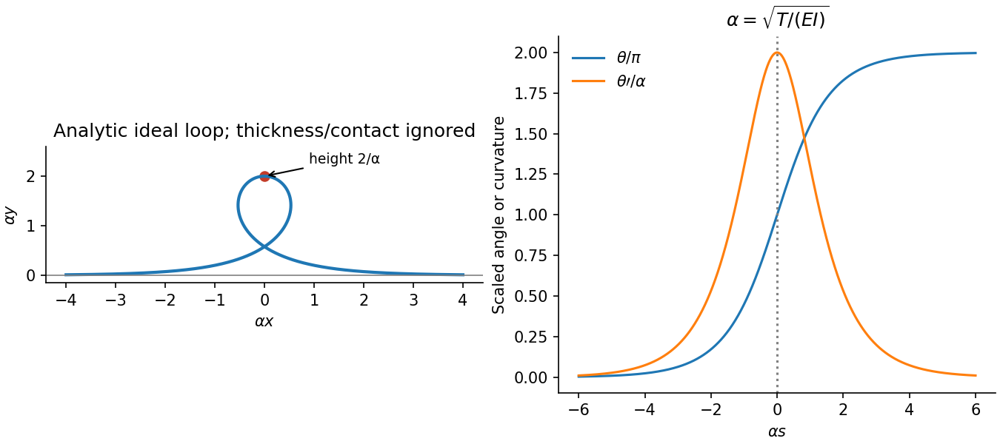

<h1 id="section-c/c12/solution">Solution</h1>

↑ **Parent:** [C12](../c12.md)

At distance $y$ from the [neutral axis](../../../../../neutral-axis.md), bending [strain](../../../../../strain.md) has magnitude $y/R$ and the corresponding [stress](../../../../../stress.md) is $Ey/R$. Its moment is therefore

$$
\boxed{B=\int_A y\frac{Ey}{R}\,dA=\frac{EI}{R},\qquad I=\int_Ay^2\,dA.}
$$

The [second moment of area](../../../../../second-moment-of-area.md) is about the neutral bending axis and has units of [length](../../../../../length.md) to the fourth power. This assumes a slender linear-elastic beam, small [strains](../../../../../strain.md) and plane sections remaining plane, not necessarily small deflections.

For horizontal compression $F>0$, moment balance across a short arc gives $dB/ds=-F\,dy/ds=-F\sin\theta$. Since $B=EI\theta'$, the exact-angle [Euler elastica](../../../../../euler-elastica.md) equation and its first integral are

$$
\boxed{EI\theta''+F\sin\theta=0,\qquad
\frac{EI}{2}\theta'^2-F\cos\theta=C.}
$$

The first integral follows by multiplying by $\theta'$ and integrating; no small-angle replacement has been made.

For tension set $F=-T$. The straight far-field ends give $C=T$, so on the increasing-angle [tensile elastica loop](../../../../../tensile-elastica-loop.md) branch

$$
\theta'=2\sqrt{\frac{T}{EI}}\sin\frac\theta2,\qquad
\ln\tan\frac\theta4=s\sqrt{\frac{T}{EI}}.
$$

Choosing $s=0$ at $\theta=\pi$ gives

$$
\boxed{\theta(s)=4\arctan e^{\alpha s},\qquad\alpha=\sqrt{T/(EI)}.}
$$

The terminal [angles](../../../../../angle.md) are $0$ and $2\pi$, the same physical tangent direction. At the top, $\theta'(0)=2\alpha$ and the [bending moment](../../../../../bending-moment.md) is $2EI\alpha$. The horizontal tensile [force](../../../../../force-split.md) has lever arm $h$, so

$$
\boxed{Th=2EI\alpha,\qquad h=2\sqrt{EI/T}.}
$$

Integrating $(x',y')=(\cos\theta,\sin\theta)$ independently gives $x=s-2\tanh(\alpha s)/\alpha$, $y=2\operatorname{sech}(\alpha s)/\alpha$, confirming the height. This ideal loop neglects self-contact and thickness at its crossing.

**[Figure 4](#section-c/c12/image-original-analytic-tensile-elastica-shape-and-its-tangent-angle-and-curvature-profiles). Original analytic tensile-elastica shape and its tangent-angle and curvature profiles**.

## ↑ Ancestors (14)

1. [C12](../c12.md)
2. [Section C](../../section-c.md)
3. [Paper 1](../../../paper-1-split.md)
4. [2014](../../../split.md)
5. [Past exam of the physics B course of the University of Cambridge](../../../../split.md)
6. [Physics B course of the University of Cambridge](../../../../../physics-b-course-of-the-university-of-cambridge.md)
7. [Physics course of the year 2 of the natural sciences course of the University of Cambridge](../../../../../physics-course-of-the-year-2-of-the-natural-sciences-course-of-the-university-of-cambridge.md)
8. [Year 2 of the natural sciences course of the University of Cambridge](../../../../../year-2-of-the-natural-sciences-course-of-the-university-of-cambridge.md)
9. [Year of the natural sciences course of the University of Cambridge](../../../../../year-of-the-natural-sciences-course-of-the-university-of-cambridge.md)
10. [Natural sciences course of the University of Cambridge](../../../../../natural-sciences-course-of-the-university-of-cambridge.md)
11. [Course of the University of Cambridge](../../../../../course-of-the-university-of-cambridge.md)
12. [University of Cambridge](../../../../../university-of-cambridge-split.md)
13. [List of universities](../../../../../list-of-universities.md)
14. [Codex Wiki](../../../../../split.md)
