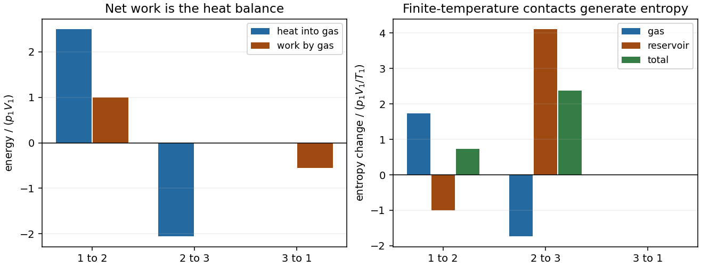

<h1 id="section-c/c10/solution-cycle-calculations">Solution (cycle calculations)</h1>

↑ **Parent:** [C10](../c10.md)

Put $P_*=p_1V_1=nRT_1$. For the specified [ideal gas](../../../../../ideal-gas-split.md), $C_V=3nR/2$, $C_p=5nR/2$ and $\gamma=5/3$. Isobaric expansion doubles [temperature](../../../../../temperature-split.md), so $T_2=2T_1$. Reversible adiabatic closure gives $TV^{\gamma-1}=\mathrm{constant}$, hence

$$
x\equiv\frac{T_3}{T_1}=2^{-2/3}=0.62996,
\qquad
\boxed{W_{31}^{\rm on}=\frac32(1-x)P_*=0.5551P_*.}
$$

There is no [heat](../../../../../heat-split.md) input on that compression. The other stages give

$$
Q_{12}=\frac52P_*,\quad W_{12}^{\rm by}=P_*,\quad
\boxed{Q_{23}=\frac32(x-2)P_*=-2.0551P_*.}
$$

Therefore $W_{\rm net}^{\rm by}=P_*-W_{31}^{\rm on}=0.44494P_*$ and

$$
\boxed{\eta=\frac{0.44494}{2.5}=0.17798\simeq17.8\%.}
$$

The hot reservoir changes [entropy](../../../../../entropy-split.md) by $-Q_{12}/(2.5T_1)=-P_*/T_1$. The cold reservoir changes by $-Q_{23}/(0.5T_1)=4.11012P_*/T_1$. Since the gas completes a cycle,

$$
\boxed{\Delta S_{\rm universe}=3.11012\,\frac{p_1V_1}{T_1}>0.}
$$

Although the mechanical paths can be quasistatic, [heat](../../../../../heat-split.md) flows across finite [temperature](../../../../../temperature-split.md) differences in both contacts. This [entropy](../../../../../entropy-split.md) generation explains why the efficiency is well below the Carnot value $1-0.5/2.5=80\%$ between these reservoirs.

For an isothermal final compression at $T_1$, the preceding constant-volume cooling must instead end at $T_3=T_1$; keeping the old state 3 would not close the cycle. Compression then requires [work](../../../../../work.md) $P_*\ln2$, while the [heat](../../../../../heat-split.md) input remains $5P_*/2$. Thus

$$
\boxed{\eta_{\rm iso}=\frac{1-\ln2}{5/2}=0.12274\simeq12.3\%,}
$$

which is **lower**: this isothermal compression occurs at a higher [temperature](../../../../../temperature-split.md) throughout than the original adiabat and consumes more [work](../../../../../work.md). It also rejects [heat](../../../../../heat-split.md) during compression.

**[Figure 1](#section-c/c10/image-energy-balance-and-entropy-production-in-each-stage-of-the-three-stage-engine). Energy balance and entropy production in each stage of the three-stage engine**.

## ↑ Ancestors (14)

1. [C10](../c10.md)
2. [Section C](../../section-c.md)
3. [Paper 2](../../../paper-2-split.md)
4. [2014](../../../split.md)
5. [Past exam of the physics B course of the University of Cambridge](../../../../split.md)
6. [Physics B course of the University of Cambridge](../../../../../physics-b-course-of-the-university-of-cambridge.md)
7. [Physics course of the year 2 of the natural sciences course of the University of Cambridge](../../../../../physics-course-of-the-year-2-of-the-natural-sciences-course-of-the-university-of-cambridge.md)
8. [Year 2 of the natural sciences course of the University of Cambridge](../../../../../year-2-of-the-natural-sciences-course-of-the-university-of-cambridge.md)
9. [Year of the natural sciences course of the University of Cambridge](../../../../../year-of-the-natural-sciences-course-of-the-university-of-cambridge.md)
10. [Natural sciences course of the University of Cambridge](../../../../../natural-sciences-course-of-the-university-of-cambridge.md)
11. [Course of the University of Cambridge](../../../../../course-of-the-university-of-cambridge.md)
12. [University of Cambridge](../../../../../university-of-cambridge-split.md)
13. [List of universities](../../../../../list-of-universities.md)
14. [Codex Wiki](../../../../../split.md)
