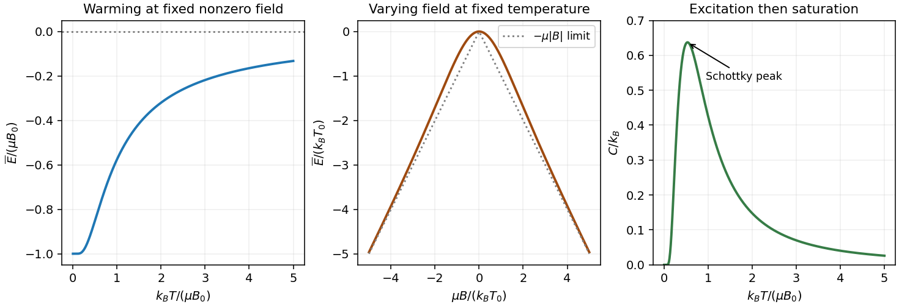

<h1 id="section-c/c12/solution">Solution</h1>

↑ **Parent:** [C12](../c12.md)

In the [canonical ensemble](../../../../../canonical-ensemble-split.md), $Z(\beta)=\sum_i e^{-\beta E_i}$ normalizes the probabilities $p_i=e^{-\beta E_i}/Z$. For temperature-independent levels,

$$
\boxed{\overline E=-\frac{1}{Z}\frac{dZ}{d\beta}
=-\frac{d\ln Z}{d\beta},\qquad
C=\frac{d\overline E}{dT}
=-\frac{1}{k_BT^2}\frac{d\overline E}{d\beta}.}
$$

The [derivative](../../../../../derivative.md) holds external parameters, including [magnetic field](../../../../../magnetic-field-split.md), fixed.

For one [independent symmetric three-level system](../../../../../independent-symmetric-three-level-system.md) put $\epsilon=\mu B$ and $x=\beta\epsilon$. Then $Z=1+2\cosh x$ and

$$
\boxed{\overline E=-\frac{2\epsilon\sinh x}{1+2\cosh x}.}
$$

At nonzero fixed field, the ground state dominates as $T\to0$, so $\overline E\to-\mu|B|$. At high [temperature](../../../../../temperature-split.md) all three levels become nearly equally populated and their mean tends to zero from below. At fixed positive [temperature](../../../../../temperature-split.md) the [energy](../../../../../energy-split.md) is even in $B$, is quadratic near zero field, and approaches $-\mu|B|$ at large $|B|$ as the lowest level becomes occupied. The [heat capacity](../../../../../heat-capacity.md) vanishes both when excitations are frozen out and when populations are almost equal, with a positive [Schottky anomaly](../../../../../schottky-anomaly.md) between those limits.

**[Figure 2](#section-c/c12/image-three-level-mean-energy-versus-temperature-and-field-and-its-schottky-heat-capacity-peak). Three-level mean energy versus temperature and field, and its Schottky heat-capacity peak**.

At $|x|\ll1$, expanding the hyperbolic functions gives

$$
\boxed{\overline E\simeq-\frac{2\mu^2B^2}{3k_BT},
\qquad C\simeq\frac{2\mu^2B^2}{3k_BT^2}.}
$$

Interpreting the stated [heat capacity](../../../../../heat-capacity.md) on the same one-atom basis as the preceding calculation, its tail coefficient gives

$$
\boxed{\mu=\frac1B\sqrt{\frac{3ak_B}{2}}
\simeq2.89\times10^{-5}\,\mathrm{eV\,T^{-1}}
=4.64\times10^{-24}\,\mathrm{J\,T^{-1}}\simeq0.500\,\mu_B.}
$$

Here $k_B=8.61733\times10^{-5}\,\mathrm{eV\,K^{-1}}$ is used consistently with $a$ in electronvolt kelvin. For a sample of $N$ independent atoms, the total coefficient would be $N$ times the one-atom coefficient; it must first be divided by $N$.

Finally, two derivatives of $Z$ supply the second [energy](../../../../../energy-split.md) moment:

$$
\overline{E^2}=\frac{Z''}{Z},\qquad
\frac{d\overline E}{d\beta}
=-\left(\frac{Z''}{Z}-\frac{Z'^2}{Z^2}\right)
=-\operatorname{Var}(E).
$$

Combining this with the heat-capacity [derivative](../../../../../derivative.md) yields the [canonical energy fluctuation](../../../../../canonical-energy-fluctuation.md) relation

$$
\boxed{C=\frac{\operatorname{Var}(E)}{k_BT^2},
\qquad\Delta E=\sqrt{k_BT^2C}.}
$$

It also explains why this canonical [heat capacity](../../../../../heat-capacity.md) is nonnegative.[§§1.3.1–1.3.2, printed pages 18–20, equations (1.25)–(1.27)](../../../../../statistical-physics-by-david-tong.md)

## ↑ Ancestors (14)

1. [C12](../c12.md)
2. [Section C](../../section-c.md)
3. [Paper 2](../../../paper-2-split.md)
4. [2014](../../../split.md)
5. [Past exam of the physics B course of the University of Cambridge](../../../../split.md)
6. [Physics B course of the University of Cambridge](../../../../../physics-b-course-of-the-university-of-cambridge.md)
7. [Physics course of the year 2 of the natural sciences course of the University of Cambridge](../../../../../physics-course-of-the-year-2-of-the-natural-sciences-course-of-the-university-of-cambridge.md)
8. [Year 2 of the natural sciences course of the University of Cambridge](../../../../../year-2-of-the-natural-sciences-course-of-the-university-of-cambridge.md)
9. [Year of the natural sciences course of the University of Cambridge](../../../../../year-of-the-natural-sciences-course-of-the-university-of-cambridge.md)
10. [Natural sciences course of the University of Cambridge](../../../../../natural-sciences-course-of-the-university-of-cambridge.md)
11. [Course of the University of Cambridge](../../../../../course-of-the-university-of-cambridge.md)
12. [University of Cambridge](../../../../../university-of-cambridge-split.md)
13. [List of universities](../../../../../list-of-universities.md)
14. [Codex Wiki](../../../../../split.md)
