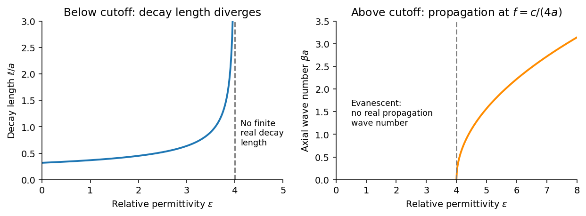

<h1 id="section-b/b9/solution">Solution</h1>

↑ **Parent:** [B9](../b9.md)

Choose the guide axis as $z$, with $0<x<a$ and $0<y<b$. The [electric field](../../../../../electric-field-split.md) is along $y$, parallel to the walls' $b$ dimension. Take a homogeneous lossless nonmagnetic [dielectric](../../../../../dielectric.md) with [relative permittivity](../../../../../relative-permittivity.md) $\epsilon$, ideal conducting walls, and time dependence $e^{-i\omega t}$. The lowest [transverse electric mode of a rectangular waveguide](../../../../../transverse-electric-mode-of-a-rectangular-waveguide.md) is

$$
\widetilde{\mathbf E}=\widehat{\mathbf y}E_0\sin\!\left(\frac{\pi x}a\right)e^{i\beta z},\qquad
\beta^2=\frac{\epsilon\omega^2}{c^2}-\frac{\pi^2}{a^2},\qquad \omega=2\pi f.
$$

At $x=0,a$, this tangential [electric field](../../../../../electric-field-split.md) vanishes. At $y=0,b$ the [electric field](../../../../../electric-field-split.md) is normal to the wall; a nonzero value is supported by surface [electric charge](../../../../../electric-charge-split.md) and violates no conducting boundary condition. The field has zero [divergence](../../../../../divergence.md). The associated normal [magnetic field](../../../../../magnetic-field-split.md) also vanishes at each wall, as verified below. The fundamental sine across the wider dimension minimizes the nonzero transverse wave number; $\mathrm{TE}_{00}$ is not a physical propagating mode of a hollow simply connected guide.

Below the [waveguide cutoff frequency](../../../../../waveguide-cutoff-frequency.md) $f_c=c/(2a\sqrt\epsilon)$, put $\beta=i\kappa$ with $\kappa>0$ to select decay for $z>0$. The [evanescent transverse electric mode in a rectangular waveguide](../../../../../evanescent-transverse-electric-mode-in-a-rectangular-waveguide.md) then has

$$
\widetilde E_y=E_0\sin(\pi x/a)e^{-\kappa z},\qquad
\boxed{\ell^{-2}=\kappa^2=\pi^2\!\left(\frac1{a^2}-\frac{4\epsilon f^2}{c^2}\right).}
$$

For the fixed [frequency](../../../../../frequency.md) in the question,

$$
\boxed{\frac\ell a=\frac1{\pi\sqrt{1-\epsilon/4}}\quad(0<\epsilon<4).}
$$

The decay length increases monotonically and diverges as $\epsilon\to4^-$; its formal limit at $\epsilon\to0^+$ is $a/\pi$. At $\epsilon=4$ the mode is at cutoff, with zero axial wave number. For $\epsilon>4$, $\beta=(\pi/a)\sqrt{\epsilon/4-1}$ is real and the mode propagates without axial attenuation in this ideal lossless model. There is no real finite evanescent decay length to continue beyond cutoff. The paper's graph notation $l$ denotes the same $\ell$ as its preceding formula.

**[Figure 1](#section-b/b9/image-evanescent-decay-length-and-propagating-axial-wave-number-on-opposite-sides-of-cutoff). Evanescent decay length and propagating axial wave number on opposite sides of cutoff**.

From [Faraday's law of induction](../../../../../faraday-s-law-of-induction.md), $\nabla\times\widetilde{\mathbf E}=i\omega\widetilde{\mathbf B}$. Writing $q=\pi/a$ gives

$$
\boxed{\widetilde B_x=-\frac{i\kappa}{\omega}E_0\sin(qx)e^{-\kappa z},\quad
\widetilde B_y=0,\quad
\widetilde B_z=-\frac{iq}{\omega}E_0\cos(qx)e^{-\kappa z}.}
$$

Thus $B_x$ vanishes on the $x$ walls and $B_y$ vanishes on the $y$ walls, meeting the normal magnetic boundary conditions. The fields also satisfy $\nabla\cdot\mathbf B=0$. For real $E_0$ the physical fields are $E_y=E_0\sin(qx)e^{-\kappa z}\cos\omega t$, $B_x=-(\kappa/\omega)E_0\sin(qx)e^{-\kappa z}\sin\omega t$, and $B_z=-(q/\omega)E_0\cos(qx)e^{-\kappa z}\sin\omega t$.

The time-averaged [Poynting vector](../../../../../poynting-vector.md) is

$$
\langle\mathbf S\rangle=\frac1{2\mu_0}\operatorname{Re}
(\widetilde{\mathbf E}\times\widetilde{\mathbf B}^{\,*})=\mathbf0,
\qquad \boxed{\langle P_z\rangle=0.}
$$

All products are imaginary because the [electric field](../../../../../electric-field-split.md) and [magnetic field](../../../../../magnetic-field-split.md) are in quadrature. A single decaying [evanescent wave](../../../../../evanescent-wave.md) stores reactive [energy](../../../../../energy-split.md) without transmitting average power into a semi-infinite lossless guide. A finite below-cutoff section can transmit power when both independent evanescent solutions are present; that is a different boundary-value problem.

The [skin effect](../../../../../skin-effect.md) also gives exponential field decay, but in a good metal $k$ has both real and imaginary parts and there is a real inward mean [Poynting vector](../../../../../poynting-vector.md). That flux supplies [Joule heating](../../../../../joule-heating.md) $\sigma|\widetilde E|^2/2$. Here attenuation comes from geometric cutoff in a lossless region, with no conductivity and no dissipative power sink; exponential decay alone does not establish absorption.

## ↑ Ancestors (14)

1. [B9](../b9.md)
2. [Section B](../../section-b.md)
3. [Paper 1](../../../paper-1-split.md)
4. [2015](../../../split.md)
5. [Past exam of the physics B course of the University of Cambridge](../../../../split.md)
6. [Physics B course of the University of Cambridge](../../../../../physics-b-course-of-the-university-of-cambridge.md)
7. [Physics course of the year 2 of the natural sciences course of the University of Cambridge](../../../../../physics-course-of-the-year-2-of-the-natural-sciences-course-of-the-university-of-cambridge.md)
8. [Year 2 of the natural sciences course of the University of Cambridge](../../../../../year-2-of-the-natural-sciences-course-of-the-university-of-cambridge.md)
9. [Year of the natural sciences course of the University of Cambridge](../../../../../year-of-the-natural-sciences-course-of-the-university-of-cambridge.md)
10. [Natural sciences course of the University of Cambridge](../../../../../natural-sciences-course-of-the-university-of-cambridge.md)
11. [Course of the University of Cambridge](../../../../../course-of-the-university-of-cambridge.md)
12. [University of Cambridge](../../../../../university-of-cambridge-split.md)
13. [List of universities](../../../../../list-of-universities.md)
14. [Codex Wiki](../../../../../split.md)
