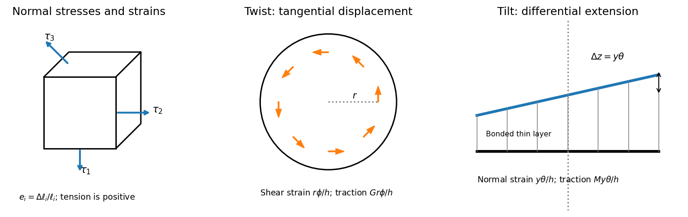

<h1 id="section-c/12/solution">Solution</h1>

↑ **Parent:** [12](../12.md)

Use positive [normal stress](../../../../../normal-stress.md) for tension. On a small rectangular material element, $\tau_i$ is the normal force per unit area on the face perpendicular to axis $i$, and $e_i=\Delta\ell_i/\ell_i$ is the corresponding [normal strain](../../../../../normal-strain.md). [Young's modulus](../../../../../young-s-modulus.md) $E$ is the ratio of axial [normal stress](../../../../../normal-stress.md) to axial [strain](../../../../../strain.md) in uniaxial stress; [Poisson's ratio](../../../../../poisson-s-ratio.md) $\sigma$ is minus the transverse-to-axial strain ratio in the same test. Thus isotropic [linear elasticity](../../../../../linear-elasticity.md) gives $Ee_1=\tau_1-\sigma\tau_2-\sigma\tau_3$ and cyclic permutations. The stress symbols here follow the question; $\sigma$ denotes [Poisson's ratio](../../../../../poisson-s-ratio.md), not a stress component.

**[Figure 4](#section-c/12/image-normal-stresses-on-a-material-element-and-the-distinct-deformation-fields-in-twist-and-tilt). Normal stresses on a material element and the distinct deformation fields in twist and tilt**.

For $e_2=e_3=0$, the two transverse compliance equations imply $\tau_2=\tau_3=\sigma\tau_1/(1-\sigma)$. Substitution into the first gives

$$
Ee_1=\frac{(1+\sigma)(1-2\sigma)}{1-\sigma}\tau_1,\qquad
\boxed{M=\frac{E(1-\sigma)}{(1+\sigma)(1-2\sigma)}.}
$$

This [uniaxial strain modulus](../../../../../uniaxial-strain-modulus.md) is greater than the uniaxial-stress [Young's modulus](../../../../../young-s-modulus.md) for the positive [Poisson's ratio](../../../../../poisson-s-ratio.md) of interest, because the lateral [constraints](../../../../../constraint-mechanics.md) prevent free Poisson contraction.

For a small twist $\phi$, the bonded faces' relative tangential displacement at radius $r$ is $r\phi$. The layer's [shear strain](../../../../../shear-strain.md) is $r\phi/h$, so the [shear stress](../../../../../shear-stress.md) is $Gr\phi/h$. Integrating the [torque](../../../../../torque.md) gives

$$
T_V=-\frac{G\phi}h\int_A r^2\,dA
=-\frac{G\phi}h\int_0^a2\pi r^3dr
=\boxed{-\frac\pi2\frac{Ga^4}h\phi.}
$$

The minus sign denotes a restoring [torque](../../../../../torque.md); the question quotes its magnitude. This uses the disk's [polar second moment of area](../../../../../polar-second-moment-of-area.md).

For tilt about H, choose $y$ in the plate perpendicular to H. The vertical displacement of the bonded top face is $y\theta$ to first order, giving [normal strain](../../../../../normal-strain.md) $y\theta/h$. The thin layer is constrained laterally by bonding, so its leading normal traction is $My\theta/h$, not $Ey\theta/h$. Integrating its moment about H gives

$$
T_H=-\frac{M\theta}h\int_Ay^2dA
=\boxed{-\frac\pi4\frac{Ma^4}h\theta,}
$$

since the diametric [second moment of area](../../../../../second-moment-of-area.md) is $\pi a^4/4$. This is the specified thin-layer approximation to the [torsion and tilt stiffness of a bonded elastic disk](../../../../../torsion-and-tilt-stiffness-of-a-bonded-elastic-disk.md). Relaxation near the free cylindrical edge is neglected; for a nearly incompressible layer it can limit quantitative accuracy unless the thinness is sufficient.

The thin square plate's [moment of inertia](../../../../../moment-of-inertia.md) about V is $I_V=2mb^2/3$. Its two perpendicular in-plane central moments are equal and sum to $I_V$, so the diagonal H has $I_H=mb^2/3$. Dividing the two angular stiffnesses by the appropriate [moments of inertia](../../../../../moment-of-inertia.md) gives

$$
\boxed{\omega_V=\sqrt{\frac{3\pi Ga^4}{4hmb^2}},\qquad
\omega_H=\sqrt{\frac{3\pi Ma^4}{4hmb^2}}.}
$$

The geometry factors cancel in their ratio. Using the supplied relation between [shear modulus](../../../../../shear-modulus.md) and [Young's modulus](../../../../../young-s-modulus.md),

$$
R^2=\left(\frac{\omega_H}{\omega_V}\right)^2=\frac MG
=\frac{2(1-\sigma)}{1-2\sigma},\qquad
\boxed{\sigma=\frac{R^2-2}{2(R^2-1)}=0.4919\quad(R=7.9).}
$$

The result lies just below the incompressible isotropic limit $1/2$, as expected for a rubber with a large compression stiffness compared with its [shear modulus](../../../../../shear-modulus.md). It is an inference within the bonded-layer model, rather than an independently measured material constant.

## ↑ Ancestors (14)

1. [12](../12.md)
2. [Section C](../../section-c.md)
3. [Paper 1](../../../paper-1-split.md)
4. [2015](../../../split.md)
5. [Past exam of the physics B course of the University of Cambridge](../../../../split.md)
6. [Physics B course of the University of Cambridge](../../../../../physics-b-course-of-the-university-of-cambridge.md)
7. [Physics course of the year 2 of the natural sciences course of the University of Cambridge](../../../../../physics-course-of-the-year-2-of-the-natural-sciences-course-of-the-university-of-cambridge.md)
8. [Year 2 of the natural sciences course of the University of Cambridge](../../../../../year-2-of-the-natural-sciences-course-of-the-university-of-cambridge.md)
9. [Year of the natural sciences course of the University of Cambridge](../../../../../year-of-the-natural-sciences-course-of-the-university-of-cambridge.md)
10. [Natural sciences course of the University of Cambridge](../../../../../natural-sciences-course-of-the-university-of-cambridge.md)
11. [Course of the University of Cambridge](../../../../../course-of-the-university-of-cambridge.md)
12. [University of Cambridge](../../../../../university-of-cambridge-split.md)
13. [List of universities](../../../../../list-of-universities.md)
14. [Codex Wiki](../../../../../split.md)
