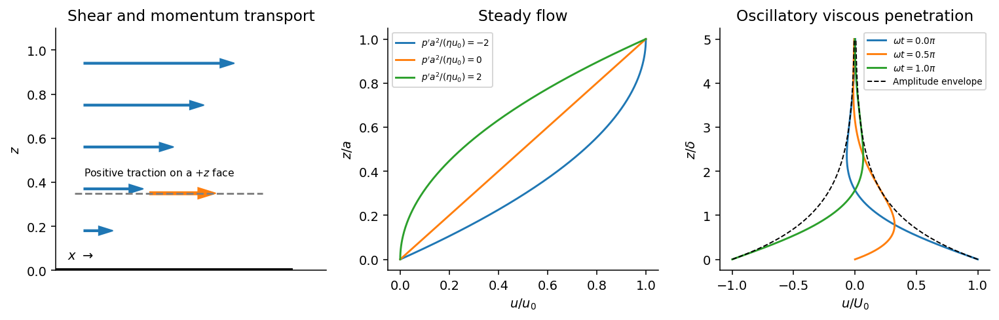

<h1 id="section-c/13/solution">Solution</h1>

↑ **Parent:** [13](../13.md)

For a [Newtonian fluid](../../../../../newtonian-fluid.md) with [velocity](../../../../../velocity.md) $u(z)\widehat{\mathbf x}$, $\tau=\eta\,\partial_z u$ is the $x$ component of traction on a plane whose normal points along $+z$. The opposite face has the opposite traction. The coefficient $\eta$ is [dynamic viscosity](../../../../../dynamic-viscosity-split.md), with units $\mathrm{Pa\,s}$. Faster layers transfer positive $x$ [momentum](../../../../../momentum-split.md) toward slower neighbours; the internal [shear stress](../../../../../shear-stress.md) resists relative sliding.

**[Figure 5](#section-c/13/image-shear-traction-convention-couette-poiseuille-profiles-and-oscillatory-viscous-penetration). Shear-traction convention, Couette-Poiseuille profiles, and oscillatory viscous penetration**.

Take a thin fluid element with horizontal area $A$ and thickness $dz$. The difference between its upper and lower viscous tractions is $A\eta u_{zz}dz$. The [pressure gradient](../../../../../pressure-gradient.md) supplies $-A p_xdz$. Incompressibility is satisfied because $u$ has no $x$ dependence, and the convective [acceleration](../../../../../acceleration.md) vanishes: $(\mathbf u\cdot\nabla)\mathbf u=u\partial_x\mathbf u=0$. Equating net force to [mass](../../../../../mass.md) times [acceleration](../../../../../acceleration.md) therefore gives the relevant component of the [Navier-Stokes equation](../../../../../navier-stokes-equation.md):

$$
\boxed{\rho\frac{\partial u}{\partial t}=-\frac{\partial p}{\partial x}
+\eta\frac{\partial^2u}{\partial z^2}.}
$$

For steady flow, integrate $\eta u''=p'$ twice and impose the [no-slip boundary condition](../../../../../no-slip-boundary-condition.md) at each plate, $u(0)=0$ and $u(a)=u_0$. The [Couette-Poiseuille flow](../../../../../couette-poiseuille-flow.md) profile is

$$
\boxed{u(z)=u_0\frac za+\frac{p'}{2\eta}z(z-a).}
$$

The linear term is [Couette flow](../../../../../couette-flow.md) and the parabolic term is [plane Poiseuille flow](../../../../../plane-poiseuille-flow.md). A negative $p'$ drives flow in $+x$. Integrating the profile across the gap gives the volumetric flow per unit width,

$$
\boxed{q=\int_0^au(z)\,dz=\frac{u_0a}{2}-\frac{p'a^3}{12\eta}.}
$$

It has units $\mathrm{m^2\,s^{-1}}$; multiplying by the plate width gives the actual volume per time.

With zero [pressure gradient](../../../../../pressure-gradient.md), substituting $u=\operatorname{Re}[A e^{i(kz-\omega t)}]$ gives $-i\rho\omega=-\eta k^2$. Select the root that decays into fluid occupying $z>0$:

$$
\boxed{k=(1+i)\sqrt{\frac{\rho\omega}{2\eta}}=\frac{1+i}{\delta},\qquad
\delta=\sqrt{\frac{2\eta}{\rho\omega}}.}
$$

The other sign applies to decay in the opposite half-space. With a real wall velocity amplitude $U_0$, the established periodic solution of [Stokes' second problem](../../../../../stokes-second-problem.md) is

$$
u(z,t)=U_0e^{-z/\delta}\cos(z/\delta-\omega t).
$$

The oscillation's [amplitude](../../../../../wave-amplitude.md) decays exponentially and its phase lags with distance from the plate. This is diffusion of tangential [momentum](../../../../../momentum-split.md), not a freely propagating undamped elastic wave. Initial transients must have decayed before this purely periodic expression applies.

The fluid-displacement amplitude and the wall-displacement amplitude have the same ratio as their velocity amplitudes, since both are divided by the common $\omega$. Thus for the specified amplitudes,

$$
\frac{0.002}{0.10}=e^{-z/\delta},\qquad
\boxed{z=\sqrt{\frac{2\eta}{\rho(2\pi f)}}\ln50.}
$$

Using the standard approximate water [density](../../../../../density.md) $\rho\simeq10^3\ \mathrm{kg\,m^{-3}}$, explicitly an approximation rather than another value printed on the paper, gives $\delta=0.564\ \mathrm{mm}$ and **$z\simeq2.21\ \mathrm{mm}$ from either face of a sufficiently large plate**. The [viscous penetration depth](../../../../../viscous-penetration-depth.md) varies as $\rho^{-1/2}$ if a more precise water [density](../../../../../density.md) is used. The ideal parallel-flow solution ignores finite plate edges and tank walls.

## ↑ Ancestors (14)

1. [13](../13.md)
2. [Section C](../../section-c.md)
3. [Paper 1](../../../paper-1-split.md)
4. [2015](../../../split.md)
5. [Past exam of the physics B course of the University of Cambridge](../../../../split.md)
6. [Physics B course of the University of Cambridge](../../../../../physics-b-course-of-the-university-of-cambridge.md)
7. [Physics course of the year 2 of the natural sciences course of the University of Cambridge](../../../../../physics-course-of-the-year-2-of-the-natural-sciences-course-of-the-university-of-cambridge.md)
8. [Year 2 of the natural sciences course of the University of Cambridge](../../../../../year-2-of-the-natural-sciences-course-of-the-university-of-cambridge.md)
9. [Year of the natural sciences course of the University of Cambridge](../../../../../year-of-the-natural-sciences-course-of-the-university-of-cambridge.md)
10. [Natural sciences course of the University of Cambridge](../../../../../natural-sciences-course-of-the-university-of-cambridge.md)
11. [Course of the University of Cambridge](../../../../../course-of-the-university-of-cambridge.md)
12. [University of Cambridge](../../../../../university-of-cambridge-split.md)
13. [List of universities](../../../../../list-of-universities.md)
14. [Codex Wiki](../../../../../split.md)
