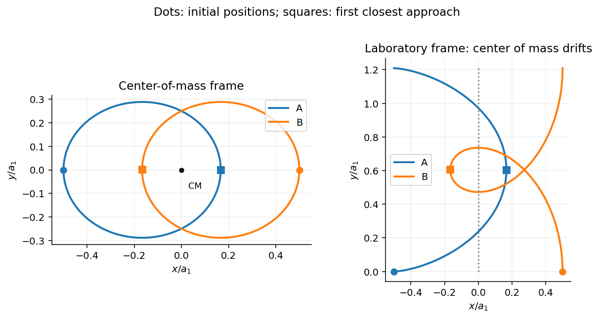

<h1 id="section-c/c10/solution">Solution</h1>

↑ **Parent:** [C10](../c10.md)

For the attractive [inverse-square force](../../../../../inverse-square-force.md), choose zero [potential energy](../../../../../potential-energy.md) at infinity, so $U=-A/r$. At either radial turning point $r_p,r_a$, the [kinetic energy](../../../../../kinetic-energy.md) is purely tangential, with conserved [angular momentum](../../../../../angular-momentum.md) $J$. Thus

$$
E=\frac{J^2}{2mr^2}-\frac Ar,\qquad
Er^2+Ar-\frac{J^2}{2m}=0.
$$

Its two roots are the periapsis and apoapsis distances. Their sum is $r_p+r_a=-A/E$, whereas the [ellipse](../../../../../ellipse.md) has $r_p+r_a=2a$. Therefore **$a=-A/(2E)$**, with $E<0$ for a nondegenerate bound [ellipse](../../../../../ellipse.md). The circular case follows by the double-root limit.

For the [two-body problem](../../../../../two-body-problem.md), define $\mathbf r=\mathbf r_B-\mathbf r_A$, total [mass](../../../../../mass.md) $M=m_A+m_B$, [reduced mass](../../../../../reduced-mass.md) $\mu=m_Am_B/M$, and [center of mass](../../../../../center-of-mass.md) $\mathbf R$. The relative equation is $\mu\ddot{\mathbf r}=\mathbf F$, while the isolated [center of mass](../../../../../center-of-mass.md) has $\ddot{\mathbf R}=0$. Once the relative [orbit](../../../../../orbit-dynamical-system.md) is known,

$$
\mathbf r_A=\mathbf R-\frac{m_B}{M}\mathbf r,\qquad
\mathbf r_B=\mathbf R+\frac{m_A}{M}\mathbf r.
$$

The relative [energy](../../../../../energy-split.md) uses $\mu$ in its [kinetic energy](../../../../../kinetic-energy.md) and $A=Gm_Am_B$ in the gravitational [potential energy](../../../../../potential-energy.md).

In the equal-mass case the initial relative [speed](../../../../../speed.md) is $u$, $\mu=m/2$, and the center-of-mass [velocity](../../../../../velocity.md) is half B's initial [velocity](../../../../../velocity.md). Thus

$$
E_{\rm rel}=\frac14mu^2-\frac{Gm^2}{a_1}.
$$

Negative relative [energy](../../../../../energy-split.md) requires $u^2<4Gm/a_1$. The **escape threshold is $u_E=2\sqrt{Gm/a_1}$**; equality is marginal parabolic escape, so a strictly bound pair has $u<u_E$.

For $u=u_E/2=\sqrt{Gm/a_1}$, $E_{\rm rel}=-3Gm^2/(4a_1)$ and the relative semimajor axis is $a=2a_1/3$. The initial transverse [speed](../../../../../speed.md) is below the relative circular value $\sqrt{2Gm/a_1}$, so the initial turning point is apoapsis. Hence

$$
\boxed{r_p=2a-a_1=\frac{a_1}{3},\qquad e=\frac12.}
$$

Choose the initial separation along $+x$ from A to B, with B's initial [velocity](../../../../../velocity.md) $+u\widehat{\mathbf y}$. [Conservation of angular momentum](../../../../../conservation-of-angular-momentum.md) gives relative periapsis [speed](../../../../../speed.md) $3u$. At the opposite end of the [ellipse](../../../../../ellipse.md) the direction is $-\widehat{\mathbf y}$, so

$$
\mathbf V_{\rm CM}=\frac u2\widehat{\mathbf y},\qquad
\mathbf v_{B,p}=\mathbf V_{\rm CM}+\frac12\mathbf v_{{\rm rel},p}
=\boxed{-u\widehat{\mathbf y}}.
$$

Thus B has the same [speed](../../../../../speed.md) as initially but the opposite [velocity](../../../../../velocity.md). A has $2u\widehat{\mathbf y}$ at that instant. A value $3u/2$ for B would be its center-of-mass-frame [speed](../../../../../speed.md), not the requested initial laboratory frame result.

The relative [orbital period](../../../../../orbital-period.md) follows from [Kepler's third law](../../../../../kepler-s-third-law.md) with total gravitating [mass](../../../../../mass.md) $2m$:

$$
\boxed{T=2\pi\sqrt{\frac{(2a_1/3)^3}{2Gm}}
=\frac{4\pi}{3\sqrt3}\sqrt{\frac{a_1^3}{Gm}}
=\frac{4\pi a_1}{3\sqrt3\,u}.}
$$

In the center-of-mass frame each star follows an [ellipse](../../../../../ellipse.md) of semimajor axis $a_1/3$ and [eccentricity](../../../../../eccentricity-of-a-conic.md) $1/2$, with the [center of mass](../../../../../center-of-mass.md) at a focus; they remain opposite on their simultaneous position vectors. In the laboratory frame add the uniform drift $ut/2$ along $y$. The [laboratory paths of an equal-mass binary](../../../../../laboratory-paths-of-an-equal-mass-binary.md) are therefore not closed [ellipses](../../../../../ellipse.md), even though their relative motion repeats.

**[Figure 2](#section-c/c10/image-equal-mass-binary-trajectories-in-the-center-of-mass-frame-and-the-original-laboratory-frame). Equal-mass binary trajectories in the center-of-mass frame and the original laboratory frame**.

## ↑ Ancestors (14)

1. [C10](../c10.md)
2. [Section C](../../section-c.md)
3. [Paper 1](../../../paper-1-split.md)
4. [2015](../../../split.md)
5. [Past exam of the physics B course of the University of Cambridge](../../../../split.md)
6. [Physics B course of the University of Cambridge](../../../../../physics-b-course-of-the-university-of-cambridge.md)
7. [Physics course of the year 2 of the natural sciences course of the University of Cambridge](../../../../../physics-course-of-the-year-2-of-the-natural-sciences-course-of-the-university-of-cambridge.md)
8. [Year 2 of the natural sciences course of the University of Cambridge](../../../../../year-2-of-the-natural-sciences-course-of-the-university-of-cambridge.md)
9. [Year of the natural sciences course of the University of Cambridge](../../../../../year-of-the-natural-sciences-course-of-the-university-of-cambridge.md)
10. [Natural sciences course of the University of Cambridge](../../../../../natural-sciences-course-of-the-university-of-cambridge.md)
11. [Course of the University of Cambridge](../../../../../course-of-the-university-of-cambridge.md)
12. [University of Cambridge](../../../../../university-of-cambridge-split.md)
13. [List of universities](../../../../../list-of-universities.md)
14. [Codex Wiki](../../../../../split.md)
