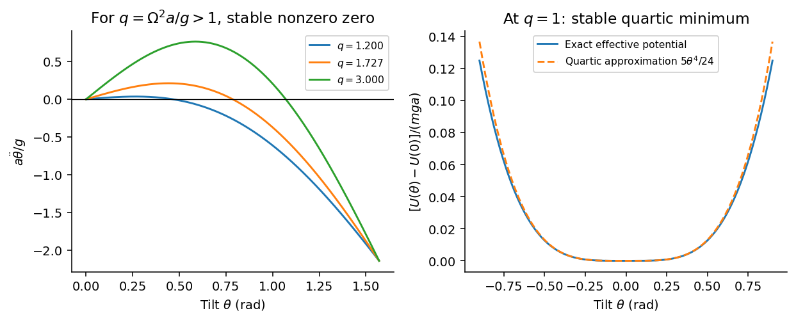

<h1 id="section-c/c11/solution">Solution</h1>

↑ **Parent:** [C11](../c11.md)

In [Lagrangian mechanics](../../../../../lagrangian-mechanics-split.md), choose independent [generalized coordinates](../../../../../generalized-coordinate.md) $q_i$ compatible with the mechanical [constraints](../../../../../constraint-mechanics.md), write $L=T-U$, and apply the [Euler-Lagrange equation](../../../../../euler-lagrange-equation.md)

$$
\frac d{dt}\frac{\partial L}{\partial\dot q_i}-\frac{\partial L}{\partial q_i}=0.
$$

Equivalently, the physical path makes the [action](../../../../../action.md) stationary under variations with fixed endpoints. For ideal holonomic [constraints](../../../../../constraint-mechanics.md), their unknown reaction forces need not appear in the reduced equations. Direct use of [Newton's laws of motion](../../../../../newton-s-laws-of-motion.md) instead resolves vector [forces](../../../../../force-split.md) and reactions and enforces the [constraints](../../../../../constraint-mechanics.md) separately. Both approaches describe the same mechanics; the scalar [Lagrangian](../../../../../lagrangian.md) is often shorter in curvilinear coordinates. Nonconservative generalized forces must be added separately. Here a drive maintains the prescribed azimuthal [angular velocity](../../../../../angular-velocity.md) $\Omega$.

The mass has polar [speed](../../../../../speed.md) $a\dot\theta$ and azimuthal [speed](../../../../../speed.md) $a\Omega\sin\theta$, so its [kinetic energy](../../../../../kinetic-energy.md) is $ma^2(\dot\theta^2+\Omega^2\sin^2\theta)/2$. The elastic [potential energy](../../../../../potential-energy.md) is $\mu\theta^2/2$, and the height is $a\cos\theta$, giving gravitational [potential energy](../../../../../potential-energy.md) $mga\cos\theta$. Therefore

$$
L=\frac12ma^2\dot\theta^2+\frac12ma^2\Omega^2\sin^2\theta
-\frac12\mu\theta^2-mga\cos\theta,
$$

and the [Euler-Lagrange equation](../../../../../euler-lagrange-equation.md) gives

$$
\boxed{\ddot\theta=\Omega^2\sin\theta\cos\theta
-\frac\mu{ma^2}\theta+\frac ga\sin\theta.}
$$

For $\mu=2mga$, define $q=\Omega^2a/g$ and $F(\theta)=q\sin\theta\cos\theta-2\theta+\sin\theta$, so $\ddot\theta=(g/a)F(\theta)$. Near zero,

$$
F(\theta)=(q-1)\theta-\left(\frac{2q}{3}+\frac16\right)\theta^3+O(\theta^5).
$$

When $q<1$ the upright [equilibrium](../../../../../equilibrium-point-of-a-dynamical-system.md) is linearly stable and the [small oscillations](../../../../../small-oscillation.md) have **$\omega_1^2=g/a-\Omega^2$**.

For $q>1$, the graph of $F$ initially rises, whereas $F(\pi/2)=1-\pi<0$. There must therefore be a zero inside the interval. More strongly, for $0<\theta<\pi/2$,

$$
\frac{F(\theta)}{\sin\theta}=q\cos\theta+1-\frac{2\theta}{\sin\theta}
$$

is strictly decreasing: $\cos\theta$ decreases and $\theta/\sin\theta$ increases because $\sin\theta-\theta\cos\theta>0$. The ratio goes from $q-1>0$ to $1-\pi<0$, giving exactly one zero $\theta_0$ in that interval. At the zero, $F'(\theta_0)<0$, so it is a stable [equilibrium](../../../../../equilibrium-point-of-a-dynamical-system.md). The [rotating torsion-stabilized inverted pendulum](../../../../../rotating-torsion-stabilized-inverted-pendulum.md) also has a symmetric stable angle $-\theta_0$ if both signs of tilt are permitted.

**[Figure 3](#section-c/c11/image-acceleration-curves-after-the-upright-instability-and-the-quartic-potential-at-the-threshold). Acceleration curves after the upright instability and the quartic potential at the threshold**.

At $\theta_0=\pi/4$, setting $F(\theta_0)=0$ gives $q/2-\pi/2+1/\sqrt2=0$, so

$$
\boxed{\Omega=\sqrt{\frac ga(\pi-\sqrt2)}.}
$$

For $\theta=\theta_0+\xi$, the linearized equation is $\ddot\xi=(g/a)F'(\theta_0)\xi$. Since $F'=q\cos2\theta-2+\cos\theta$,

$$
\boxed{\omega_2^2=\frac ga\left(2-\frac1{\sqrt2}\right).}
$$

At the threshold $q=1$ the linear restoring term vanishes, but the cubic term remains:

$$
\ddot\theta=-\frac{5g}{6a}\theta^3+O(\theta^5),\qquad
U_{\rm eff}(\theta)-U_{\rm eff}(0)=\frac{5mga}{24}\theta^4+O(\theta^6).
$$

**The upright state remains nonlinearly stable, with no nonzero infinitesimal harmonic frequency.** Small finite disturbances produce [quartic oscillator](../../../../../quartic-oscillator.md) motion whose [frequency](../../../../../frequency.md) is proportional to its small angular [amplitude](../../../../../wave-amplitude.md); its [period](../../../../../period-of-a-function.md) tends to infinity as that amplitude tends to zero. Zero linear stiffness is not the same as an absent restoring [torque](../../../../../torque.md).

## ↑ Ancestors (14)

1. [C11](../c11.md)
2. [Section C](../../section-c.md)
3. [Paper 1](../../../paper-1-split.md)
4. [2015](../../../split.md)
5. [Past exam of the physics B course of the University of Cambridge](../../../../split.md)
6. [Physics B course of the University of Cambridge](../../../../../physics-b-course-of-the-university-of-cambridge.md)
7. [Physics course of the year 2 of the natural sciences course of the University of Cambridge](../../../../../physics-course-of-the-year-2-of-the-natural-sciences-course-of-the-university-of-cambridge.md)
8. [Year 2 of the natural sciences course of the University of Cambridge](../../../../../year-2-of-the-natural-sciences-course-of-the-university-of-cambridge.md)
9. [Year of the natural sciences course of the University of Cambridge](../../../../../year-of-the-natural-sciences-course-of-the-university-of-cambridge.md)
10. [Natural sciences course of the University of Cambridge](../../../../../natural-sciences-course-of-the-university-of-cambridge.md)
11. [Course of the University of Cambridge](../../../../../course-of-the-university-of-cambridge.md)
12. [University of Cambridge](../../../../../university-of-cambridge-split.md)
13. [List of universities](../../../../../list-of-universities.md)
14. [Codex Wiki](../../../../../split.md)
