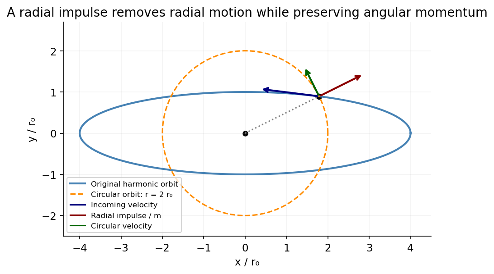

<h1 id="section-a/a3/solution">Solution</h1>

↑ **Parent:** [A3](../a3.md)

Interpret the two radial turning values as $r_{\min}=r_0$ and $r_{\max}=4r_0$; the printed maximum/minimum order is reversed. The potential is $V(r)=Ar^2/2$. At either turning point,

$$
E=\frac{L^2}{2mr^2}+\frac A2r^2.
$$

Equating these two energies gives $L^2=mA r_{\min}^2r_{\max}^2$. A radial impulse changes the radial velocity and energy but exerts no torque about the centre, so it preserves $L$. For [radial-impulse circularization of a harmonic central orbit](../../../../../radial-impulse-circularization-of-a-harmonic-central-orbit.md), the circular orbit satisfies $L^2/(mr_c^3)=Ar_c$. Hence

$$
\boxed{r_c=\sqrt{r_{\min}r_{\max}}=2r_0.}
$$

The original orbit crosses this radius. Cancelling its radial velocity there leaves the tangential speed required for the circular orbit; the impulse is not applied at an original radial turning point.

**[Figure 1](#section-a/a3/image-a-radial-impulse-at-the-geometric-mean-radius-turns-an-elliptical-harmonic-orbit-into-a-circular-orbit). A radial impulse at the geometric-mean radius turns an elliptical harmonic orbit into a circular orbit**. [Source](paper-2-harmonic-circularization.py).

## ↑ Ancestors (14)

1. [A3](../a3.md)
2. [Section A](../../section-a.md)
3. [Paper 2](../../../paper-2-split.md)
4. [2015](../../../split.md)
5. [Past exam of the physics B course of the University of Cambridge](../../../../split.md)
6. [Physics B course of the University of Cambridge](../../../../../physics-b-course-of-the-university-of-cambridge.md)
7. [Physics course of the year 2 of the natural sciences course of the University of Cambridge](../../../../../physics-course-of-the-year-2-of-the-natural-sciences-course-of-the-university-of-cambridge.md)
8. [Year 2 of the natural sciences course of the University of Cambridge](../../../../../year-2-of-the-natural-sciences-course-of-the-university-of-cambridge.md)
9. [Year of the natural sciences course of the University of Cambridge](../../../../../year-of-the-natural-sciences-course-of-the-university-of-cambridge.md)
10. [Natural sciences course of the University of Cambridge](../../../../../natural-sciences-course-of-the-university-of-cambridge.md)
11. [Course of the University of Cambridge](../../../../../course-of-the-university-of-cambridge.md)
12. [University of Cambridge](../../../../../university-of-cambridge-split.md)
13. [List of universities](../../../../../list-of-universities.md)
14. [Codex Wiki](../../../../../split.md)
