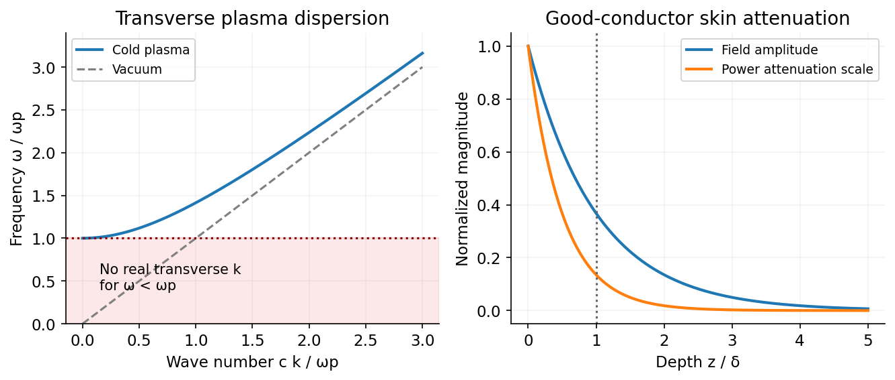

<h1 id="section-b/b7/solution">Solution</h1>

↑ **Parent:** [B7](../b7.md)

**[Displacement current](../../../../../displacement-current.md) makes [Ampère's law](../../../../../ampere-s-circuital-law.md) compatible with [charge conservation](../../../../../charge-conservation.md).** The macroscopic [Maxwell equations](../../../../../maxwell-equations-split.md) are

$$
\nabla\cdot\mathbf D=\rho_f,\qquad\nabla\cdot\mathbf B=0,\qquad\nabla\times\mathbf E=-\partial_t\mathbf B,\qquad\boxed{\nabla\times\mathbf H=\mathbf J_f+\partial_t\mathbf D.}
$$

Taking the divergence of the last equation and using [Gauss's law](../../../../../gauss-s-law.md) gives $\nabla\cdot\mathbf J_f+\partial_t\rho_f=0$. Omitting $\partial_t\mathbf D$ would wrongly require the conduction current to be divergence free during charging. The displacement-current density $\partial_t\mathbf D$ has current-density units, but need not represent free charges crossing a region.

The [surface independence of Ampère circulation during capacitor charging](../../../../../surface-independence-of-ampere-circulation-during-capacitor-charging.md) illustrates the need directly. A surface spanning the circuit can cut the wire or pass between the plates. For ideal parallel plates, $Q=\epsilon_0AE$ and

$$
I=\dot Q=\epsilon_0 A\dot E=\int_{\rm gap}\partial_t\mathbf D\cdot d\mathbf A.
$$

The corrected circulation of $\mathbf H$ is independent of that surface choice. Free conduction current stops at a plate; [displacement current](../../../../../displacement-current.md) supplies the gap contribution.

**In vacuum the two time-dependent curl equations support waves.** Taking a curl of Faraday's law in a source-free region yields

$$
\nabla^2\mathbf E-\mu_0\epsilon_0\partial_t^2\mathbf E=0,\qquad c=(\mu_0\epsilon_0)^{-1/2}.
$$

The corresponding magnetic equation is identical. For a [plane wave](../../../../../plane-wave.md), $\mathbf k\cdot\mathbf E=\mathbf k\cdot\mathbf B=0$ and $\mathbf B=\mathbf k\times\mathbf E/\omega$. The fields carry energy through the Poynting flux. Dropping [displacement current](../../../../../displacement-current.md) everywhere would remove these freely propagating solutions.[Sections 4.2–4.3: Maxwell's equations, charge conservation and electromagnetic waves](../../../../../electromagnetism-by-david-tong.md)

**In a metal, conduction and displacement compete.** For a uniform ohmic material with $\mathbf J_f=\sigma\mathbf E$, constant $\epsilon,\mu$, and transverse waves,

$$
\nabla^2\mathbf E=\mu\epsilon\partial_t^2\mathbf E+\mu\sigma\partial_t\mathbf E.
$$

Use $e^{i\mathbf k\cdot\mathbf r-i\omega t}$. The [dispersion relation](../../../../../dispersion-relation-split.md) and [conduction-to-displacement current ratio](../../../../../conduction-to-displacement-current-ratio.md) are

$$
\boxed{k^2=\mu\epsilon\omega^2+i\mu\sigma\omega,\qquad\frac{|J_{\rm cond}|}{|J_{\rm disp}|}=\frac\sigma{\omega\epsilon}.}
$$

When $\sigma\gg\omega\epsilon$, $k\simeq(1+i)/\delta$ with $\delta=\sqrt{2/(\mu\sigma\omega)}$: fields are screened within a [skin depth](../../../../../skin-depth.md) and energy is dissipated by [Joule heating](../../../../../joule-heating.md). This quasistatic limit neglects [displacement current](../../../../../displacement-current.md) locally compared with conduction; it does not invalidate the full Maxwell law. At sufficiently high frequency, conductivity and permittivity are frequency dependent, so a constant-$\sigma$ approximation must be replaced by a material model.

**In an unmagnetized cold plasma, electron inertia gives a cutoff.** With immobile ions and negligible collisions, $m_e\dot{\mathbf v}=-e\mathbf E$ and $\mathbf J=-n_e e\mathbf v$ give $\sigma(\omega)=in_ee^2/(m_e\omega)$. For the [transverse wave cutoff in a cold unmagnetized plasma](../../../../../transverse-wave-cutoff-in-a-cold-unmagnetized-plasma.md), combining this carrier current with vacuum [displacement current](../../../../../displacement-current.md) gives

$$
\boxed{\epsilon_{\rm eff}=\epsilon_0\left(1-\frac{\omega_p^2}{\omega^2}\right),\quad\omega_p^2=\frac{n_ee^2}{m_e\epsilon_0},\quad\omega^2=\omega_p^2+c^2k^2.}
$$

Transverse waves propagate above $\omega_p$ and are evanescent below it. The [group velocity](../../../../../group-velocity.md) is $c\sqrt{1-\omega_p^2/\omega^2}<c$ even though the [phase velocity](../../../../../phase-velocity.md) exceeds $c$. The cold model also has longitudinal charge-density oscillations at $\omega_p$, distinct from transverse light waves. Collisions add [damping](../../../../../damping.md), and [pressure](../../../../../pressure-split.md) or magnetic fields modify these simple dispersions. To avoid [carrier-current double counting in effective permittivity](../../../../../carrier-current-double-counting-in-effective-permittivity.md), once the carrier response is included in $\epsilon_{\rm eff}$ it must not be counted a second time as a separate conductivity. [Displacement current](../../../../../displacement-current.md) therefore connects circuit continuity, vacuum radiation, conductor screening and plasma propagation within one consistent field theory.[Sections 7.6.2–7.6.3: conductors, plasma frequency and longitudinal plasma oscillations](../../../../../electromagnetism-by-david-tong.md)

**[Figure 2](#section-b/b7/image-electron-inertia-gives-transverse-plasma-waves-a-cutoff-while-a-good-conductor-attenuates-fields-over-a-skin-depth). Electron inertia gives transverse plasma waves a cutoff, while a good conductor attenuates fields over a skin depth**. [Source](paper-2-plasma-and-skin.py).

## ↑ Ancestors (14)

1. [B7](../b7.md)
2. [Section B](../../section-b.md)
3. [Paper 2](../../../paper-2-split.md)
4. [2015](../../../split.md)
5. [Past exam of the physics B course of the University of Cambridge](../../../../split.md)
6. [Physics B course of the University of Cambridge](../../../../../physics-b-course-of-the-university-of-cambridge.md)
7. [Physics course of the year 2 of the natural sciences course of the University of Cambridge](../../../../../physics-course-of-the-year-2-of-the-natural-sciences-course-of-the-university-of-cambridge.md)
8. [Year 2 of the natural sciences course of the University of Cambridge](../../../../../year-2-of-the-natural-sciences-course-of-the-university-of-cambridge.md)
9. [Year of the natural sciences course of the University of Cambridge](../../../../../year-of-the-natural-sciences-course-of-the-university-of-cambridge.md)
10. [Natural sciences course of the University of Cambridge](../../../../../natural-sciences-course-of-the-university-of-cambridge.md)
11. [Course of the University of Cambridge](../../../../../course-of-the-university-of-cambridge.md)
12. [University of Cambridge](../../../../../university-of-cambridge-split.md)
13. [List of universities](../../../../../list-of-universities.md)
14. [Codex Wiki](../../../../../split.md)
