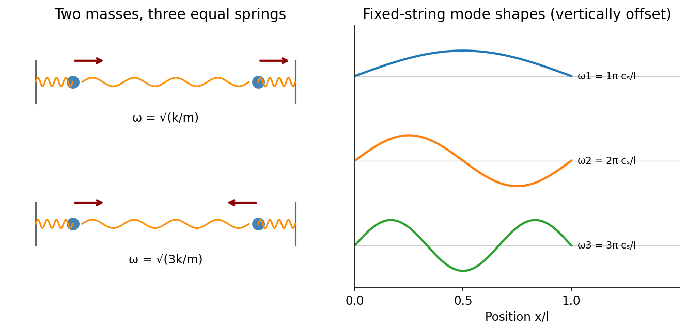

<h1 id="section-b/b9/solution">Solution</h1>

↑ **Parent:** [B9](../b9.md)

**A [normal mode](../../../../../normal-mode.md) is a motion in which all coordinates have a fixed relative pattern and oscillate at one frequency.** Near a stable equilibrium, let the quadratic kinetic and potential energies be $T=\dot{\mathbf q}^{\mathsf T}\mathbf M\dot{\mathbf q}/2$ and $V=\mathbf q^{\mathsf T}\mathbf K\mathbf q/2$. With positive-definite [mass matrix](../../../../../mass-matrix.md) $\mathbf M$, the equations and harmonic ansatz give

$$
\mathbf M\ddot{\mathbf q}+\mathbf K\mathbf q=0,\qquad\boxed{\mathbf K\mathbf a_s=\omega_s^2\mathbf M\mathbf a_s.}
$$

The stiffness and mass matrices are symmetric. For distinct frequencies, their symmetry gives $(\omega_s^2-\omega_r^2)\mathbf a_r^{\mathsf T}\mathbf M\mathbf a_s=0$, so the mode vectors are orthogonal in the mass inner product. A basis can also be chosen in a degenerate eigenspace. Expanding $\mathbf q=\sum_s Q_s\mathbf a_s$ decouples the equations into $\ddot Q_s+\omega_s^2Q_s=0$; initial displacements and velocities determine the coefficients. Positive stiffness gives real frequencies, a zero [eigenvalue](../../../../../eigenvalue.md) can describe a free symmetry motion, and a negative one signals instability rather than an oscillatory mode.[Section 2.6: small oscillations and generalized normal-mode eigenvalue equations](../../../../../classical-dynamics-by-david-tong.md)

For **two equal masses between fixed walls with three equal springs**, the [stiffness matrix](../../../../../stiffness-matrix.md) is $k\begin{pmatrix}2&-1\\-1&2\end{pmatrix}$ and the [mass matrix](../../../../../mass-matrix.md) is $m\mathbf1$. The patterns $(1,1)$ and $(1,-1)$ have frequencies $\sqrt{k/m}$ and $\sqrt{3k/m}$. An initial displacement of one mass excites both modes and can produce [beats](../../../../../beat.md).

For **a uniform taut string fixed at both ends**, the [wave equation](../../../../../wave-equation-split.md) $\partial_t^2y=c_s^2\partial_x^2y$, with $c_s=\sqrt{\mathcal T/\mu_\ell}$, has patterns and angular frequencies

$$
\boxed{y_n(x)\propto\sin(n\pi x/l),\qquad\omega_n=n\pi c_s/l,\quad n=1,2,\ldots.}
$$

The [boundary conditions](../../../../../boundary-condition.md) select the spectrum. [Fourier expansion](../../../../../fourier-series-split.md) of arbitrary admissible initial data provides the mode amplitudes, illustrating the extension from a finite set of coordinates to a field.

For the [normal modes of inductively coupled LC circuits](../../../../../normal-modes-of-inductively-coupled-lc-circuits.md), take two identical circuits with self-inductance $L$, capacitance $C$ and [mutual inductance](../../../../../mutual-inductance.md) $\mathcal M$, where $|\mathcal M|<L$. The [capacitor](../../../../../capacitor.md) charges obey $L\ddot q_1+\mathcal M\ddot q_2+q_1/C=0$ and the exchanged equation. In-phase and opposite-phase charge patterns have

$$
\boxed{\omega_+=\frac1{\sqrt{C(L+\mathcal M)}},\qquad\omega_-=\frac1{\sqrt{C(L-\mathcal M)}}.}
$$

The [positive inductance matrix for two identical coils](../../../../../positive-inductance-matrix-for-two-identical-coils.md) is the physical counterpart of positive mass. Here [inductance](../../../../../inductance.md) plays the role of the [mass matrix](../../../../../mass-matrix.md). Mechanical, wave and electrical examples therefore share the same [eigenvalue](../../../../../eigenvalue.md) structure. Weak forcing excites modes according to its spatial overlap with each pattern; [damping](../../../../../damping.md) broadens the [resonances](../../../../../resonance.md), while strong nonlinearity can invalidate a fixed linear-mode decomposition.

**[Figure 3](#section-b/b9/image-normal-modes-range-from-two-mass-displacement-patterns-to-the-standing-wave-harmonics-of-a-fixed-string). Normal modes range from two-mass displacement patterns to the standing-wave harmonics of a fixed string**. [Source](paper-2-normal-modes.py).

## ↑ Ancestors (14)

1. [B9](../b9.md)
2. [Section B](../../section-b.md)
3. [Paper 2](../../../paper-2-split.md)
4. [2015](../../../split.md)
5. [Past exam of the physics B course of the University of Cambridge](../../../../split.md)
6. [Physics B course of the University of Cambridge](../../../../../physics-b-course-of-the-university-of-cambridge.md)
7. [Physics course of the year 2 of the natural sciences course of the University of Cambridge](../../../../../physics-course-of-the-year-2-of-the-natural-sciences-course-of-the-university-of-cambridge.md)
8. [Year 2 of the natural sciences course of the University of Cambridge](../../../../../year-2-of-the-natural-sciences-course-of-the-university-of-cambridge.md)
9. [Year of the natural sciences course of the University of Cambridge](../../../../../year-of-the-natural-sciences-course-of-the-university-of-cambridge.md)
10. [Natural sciences course of the University of Cambridge](../../../../../natural-sciences-course-of-the-university-of-cambridge.md)
11. [Course of the University of Cambridge](../../../../../course-of-the-university-of-cambridge.md)
12. [University of Cambridge](../../../../../university-of-cambridge-split.md)
13. [List of universities](../../../../../list-of-universities.md)
14. [Codex Wiki](../../../../../split.md)
