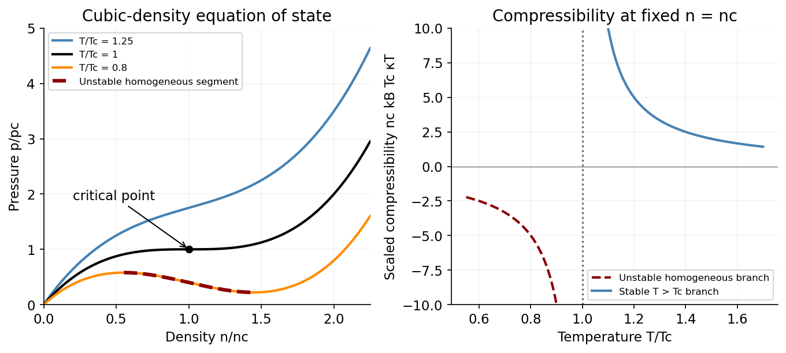

<h1 id="section-c/c10/solution">Solution</h1>

↑ **Parent:** [C10](../c10.md)

A liquid-gas [thermodynamic critical point](../../../../../thermodynamic-critical-point.md) is the endpoint of the coexistence curve where distinct liquid and gas densities merge. In the van der Waals illustration, write the original constants as $a_v,b_v$ to distinguish them from the later polynomial coefficients. The critical isotherm has a horizontal inflection in $p(V)$; setting its first two volume derivatives to zero gives

$$
\boxed{V_c=3Nb_v,\qquad k_BT_c=\frac{8a_v}{27b_v},\qquad p_c=\frac{a_v}{27b_v^2}.}
$$

Below this [temperature](../../../../../temperature-split.md) the homogeneous van der Waals loop contains an unstable region; physical equilibrium instead separates into liquid and gas.[Section 2.5.2: van der Waals equation and its critical point](../../../../../classical-gases-by-david-tong.md)

For the [critical point of a cubic density equation of state](../../../../../critical-point-of-a-cubic-density-equation-of-state.md), assume $b,c>0$. Its density derivatives are

$$
p_n=k_BT-bn+\tfrac c2n^2,\qquad p_{nn}=-b+cn.
$$

Because $n=N/V$ is a smooth monotone function of $V$ at finite positive density, a stationary inflection obeys $p_n=p_{nn}=0$ as well. Solving these equations and substituting back gives

$$
\boxed{n_c=\frac bc,\qquad k_BT_c=\frac{b^2}{2c},\qquad p_c=\frac{b^3}{6c^2}.}
$$

The symbols $b,c$ here have different units from the van der Waals excluded-volume parameter. With $x=n/n_c$, $t=T/T_c$, the isotherms become

$$
\frac p{p_c}=x^3-3x^2+3tx,\qquad\frac{d(p/p_c)}{dx}=3[(x-1)^2+t-1].
$$

The [spinodal densities of a cubic gas](../../../../../spinodal-densities-of-a-cubic-gas.md) delimit the two-extrema regime. The curves are monotone for $t>1$, have a stationary inflection at $(x,p/p_c)=(1,1)$ for $t=1$, and have two extrema $x=1\pm\sqrt{1-t}$ for $0<t<1$.

For the [critical-density compressibility of a cubic gas](../../../../../critical-density-compressibility-of-a-cubic-gas.md), since $\kappa_T=(1/n)(\partial n/\partial p)_T$, evaluation at the critical density gives

$$
\boxed{\kappa_T(n_c,T)=\frac1{n_ck_B(T-T_c)}.}
$$

It diverges as $T\to T_c^+$ in this mean-field model. For $T<T_c$ it is negative on the homogeneous branch at $n_c$, violating [mechanical stability](../../../../../mechanical-stability.md): a [pressure](../../../../../pressure-split.md) increase would expand rather than compress that branch.

**[Figure 4](#section-c/c10/image-polynomial-gas-isotherms-develop-an-unstable-negative-slope-region-below-criticality-the-homogeneous-compressibility-becomes-negative-there). Polynomial gas isotherms develop an unstable negative-slope region below criticality; the homogeneous compressibility becomes negative there**. [Source](paper-2-critical-isotherms.py).

**The actual equilibrium below criticality is coexistence of two phases**, with equal [pressure](../../../../../pressure-split.md) and [chemical potential](../../../../../chemical-potential-split.md) and different densities. A sample's mean density can change by changing phase proportions. The unstable homogeneous branch is not a realizable equilibrium isotherm. The [Maxwell construction in density coordinates](../../../../../maxwell-construction-in-density-coordinates.md) requires care: the equal-area construction is performed in $p$ versus volume, not by using unweighted area in $p$ versus density. The truncated polynomial is an approximate mean-field equation, so its predictions need not give quantitative critical behaviour for a real gas.

## ↑ Ancestors (14)

1. [C10](../c10.md)
2. [Section C](../../section-c.md)
3. [Paper 2](../../../paper-2-split.md)
4. [2015](../../../split.md)
5. [Past exam of the physics B course of the University of Cambridge](../../../../split.md)
6. [Physics B course of the University of Cambridge](../../../../../physics-b-course-of-the-university-of-cambridge.md)
7. [Physics course of the year 2 of the natural sciences course of the University of Cambridge](../../../../../physics-course-of-the-year-2-of-the-natural-sciences-course-of-the-university-of-cambridge.md)
8. [Year 2 of the natural sciences course of the University of Cambridge](../../../../../year-2-of-the-natural-sciences-course-of-the-university-of-cambridge.md)
9. [Year of the natural sciences course of the University of Cambridge](../../../../../year-of-the-natural-sciences-course-of-the-university-of-cambridge.md)
10. [Natural sciences course of the University of Cambridge](../../../../../natural-sciences-course-of-the-university-of-cambridge.md)
11. [Course of the University of Cambridge](../../../../../course-of-the-university-of-cambridge.md)
12. [University of Cambridge](../../../../../university-of-cambridge-split.md)
13. [List of universities](../../../../../list-of-universities.md)
14. [Codex Wiki](../../../../../split.md)
