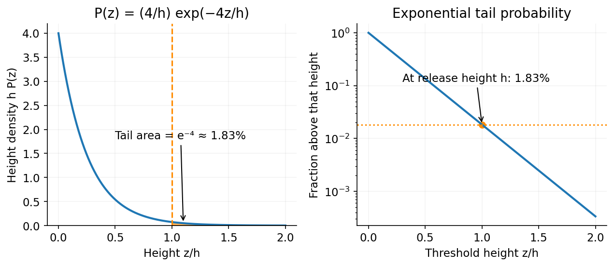

<h1 id="section-c/c11/solution">Solution</h1>

↑ **Parent:** [C11](../c11.md)

The [Boltzmann distribution](../../../../../boltzmann-distribution.md) assigns probability $P_i=e^{-E_i/(k_BT)}/Z$ to each microstate. For the [equilibrium height distribution in a uniform gravitational field](../../../../../equilibrium-height-distribution-in-a-uniform-gravitational-field.md), take a dilute gas above a floor in a constant gravitational field. Uniform cross-section and no relevant upper boundary give the normalized height density

$$
P(z)=\frac{mg}{k_BT}e^{-mgz/(k_BT)},\qquad z\geq0.
$$

Thus

$$
\boxed{\langle U_g\rangle=\int_0^\infty mgz\,P(z)\,dz=k_BT.}
$$

The gravitational potential is linear in height, so its mean is not a quadratic-mode contribution of $k_BT/2$.

The [equipartition](../../../../../equipartition-theorem.md) states that each independent quadratic term in a classical equilibrium Hamiltonian contributes mean energy $k_BT/2$, provided the relevant degrees of freedom are thermally accessible. Equivalently, $\langle x_i\partial H/\partial x_i\rangle=k_BT$ when the phase-space integration by parts has vanishing boundary terms. Three translational velocity components therefore contribute $3k_BT/2$.

For [rotational equipartition in a rough-ball gas](../../../../../rotational-equipartition-in-a-rough-ball-gas.md), collisions exchange both translational and rotational energy. In the intended three-dimensional classical equilibrium model there are three translational and three rotational quadratic terms, giving $3k_BT$ in total [kinetic energy](../../../../../kinetic-energy.md) per ball. Adding $\langle U_g\rangle=k_BT$, and conserving the initial energy $mgh$ per ball, gives

$$
\boxed{mgh=\left(\tfrac32+\tfrac32+1\right)k_BT=4k_BT,\qquad T=\frac{mgh}{4k_B}.}
$$

Roughness is relevant because it allows rotation to thermalize. The [effective mechanical temperature of released rough balls](../../../../../effective-mechanical-temperature-of-released-rough-balls.md) describes the balls' mechanical degrees of freedom, not their internal material [temperature](../../../../../temperature-split.md); finite ball size and excluded-volume effects are neglected.[Sections 2.2.1 and 2.3: equipartition and classical thermal distributions](../../../../../classical-gases-by-david-tong.md)

The height tail is

$$
\boxed{P(z>h)=\int_h^\infty P(z)\,dz=e^{-mgh/(k_BT)}=e^{-4}=0.0183\simeq1.83\%.}
$$

This can be nonzero because collisions redistribute energy between balls; an individual ball is not restricted to its original energy. The exponential distribution is the large-number statistical approximation under the stated effective-equilibrium assumption.

**[Figure 5](#section-c/c11/image-the-thermal-height-distribution-puts-about-1-83-percent-of-the-rough-balls-above-their-release-height). The thermal height distribution puts about 1.83 percent of the rough balls above their release height**. [Source](paper-2-gravitational-height.py).

## ↑ Ancestors (14)

1. [C11](../c11.md)
2. [Section C](../../section-c.md)
3. [Paper 2](../../../paper-2-split.md)
4. [2015](../../../split.md)
5. [Past exam of the physics B course of the University of Cambridge](../../../../split.md)
6. [Physics B course of the University of Cambridge](../../../../../physics-b-course-of-the-university-of-cambridge.md)
7. [Physics course of the year 2 of the natural sciences course of the University of Cambridge](../../../../../physics-course-of-the-year-2-of-the-natural-sciences-course-of-the-university-of-cambridge.md)
8. [Year 2 of the natural sciences course of the University of Cambridge](../../../../../year-2-of-the-natural-sciences-course-of-the-university-of-cambridge.md)
9. [Year of the natural sciences course of the University of Cambridge](../../../../../year-of-the-natural-sciences-course-of-the-university-of-cambridge.md)
10. [Natural sciences course of the University of Cambridge](../../../../../natural-sciences-course-of-the-university-of-cambridge.md)
11. [Course of the University of Cambridge](../../../../../course-of-the-university-of-cambridge.md)
12. [University of Cambridge](../../../../../university-of-cambridge-split.md)
13. [List of universities](../../../../../list-of-universities.md)
14. [Codex Wiki](../../../../../split.md)
