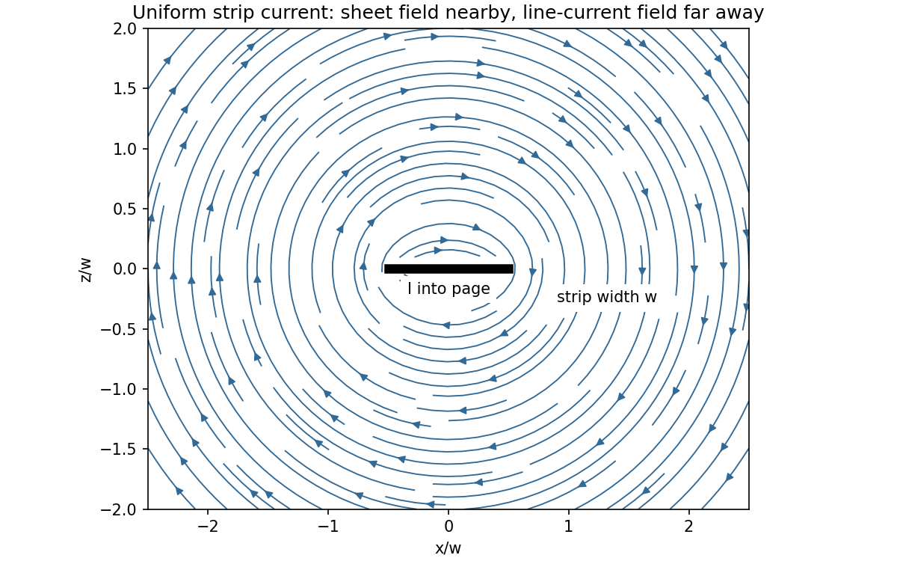
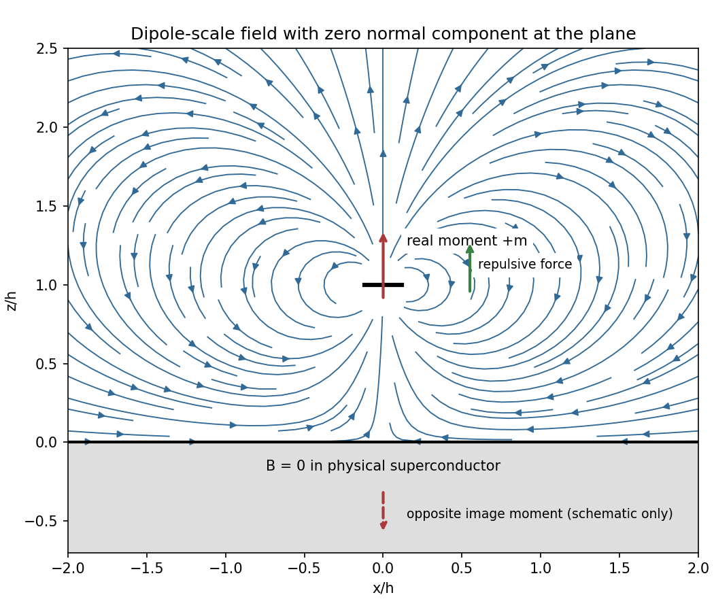
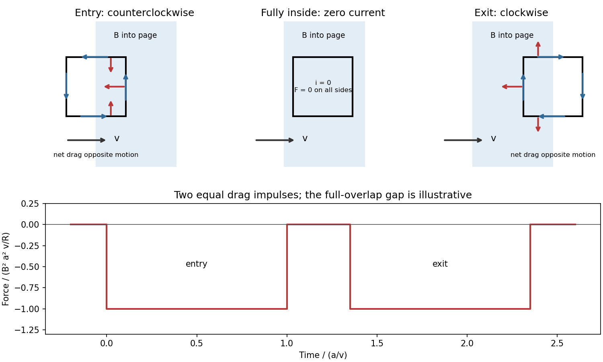
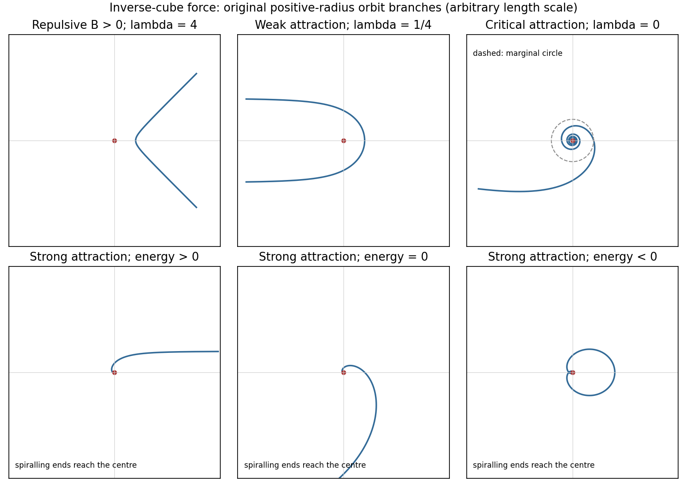
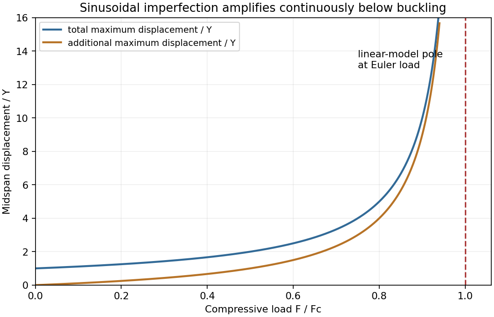

# Paper 1

↑ **Parent:** [2016](../2016.md)

Original solutions to the released 2016 paper. [Original public PDF, physical pages 186–194; question pages 187–194](https://www.whatdotheyknow.com/request/natural_science_tripos_physics_e_2/response/2340776/attach/2/FOI%202023%20399%20Zahid%20materials.pdf?cookie_passthrough=1#page=186)

**Table of contents**

- [Section A](#section-a)
  - [A1](#section-a/a1)
    - [i](#section-a/a1/i)
      - [Solution](#section-a/a1/i/solution)
    - [ii](#section-a/a1/ii)
      - [Solution](#section-a/a1/ii/solution)
  - [A2](#section-a/a2)
    - [Solution](#section-a/a2/solution)
  - [A3](#section-a/a3)
    - [Solution](#section-a/a3/solution)
  - [A4](#section-a/a4)
    - [Solution](#section-a/a4/solution)
  - [A5](#section-a/a5)
    - [Solution](#section-a/a5/solution)
- [Section B](#section-b)
  - [B6](#section-b/b6)
    - [Solution](#section-b/b6/solution)
  - [B7](#section-b/b7)
    - [Solution](#section-b/b7/solution)
  - [B8](#section-b/b8)
    - [Solution](#section-b/b8/solution)
  - [B9](#section-b/b9)
    - [Solution](#section-b/b9/solution)
- [Section C](#section-c)
  - [C10](#section-c/c10)
    - [Solution](#section-c/c10/solution)
  - [C11](#section-c/c11)
    - [Solution](#section-c/c11/solution)
  - [C12](#section-c/c12)
    - [Solution](#section-c/c12/solution)
  - [C13](#section-c/c13)
    - [Solution](#section-c/c13/solution)

## Section A

↑ **Parent:** [Paper 1](paper-1.md)

<h3 id="section-a/a1">A1</h3>

↑ **Parent:** [Section A](#section-a)

Take a long strip along $y$, occupying $-w/2<x<w/2$ in $z=0$, with uniform surface current $K=I/w$. Above the strip's centre, the contributions odd in $x$ cancel, while the [Biot-Savart law](../../electromagnetism.md#biot-savart-law) gives the [magnetic field of a uniformly conducting strip](../../electromagnetism.md#magnetic-field-of-a-uniformly-conducting-strip)

$$
B_x(0,z)=\frac{\mu_0I}{2\pi w}\int_{-w/2}^{w/2}\frac{z\,dx'}{x'^2+z^2}=\frac{\mu_0I}{\pi w}\tan^{-1}\frac{w}{2z},\qquad z>0.
$$

The field reverses below the strip. Its field lines wrap around the longitudinal current: nearly parallel to the faces near the centre, then curving round the edges and approaching circles at large [distances](../../geometry-and-topology.md#distance). The sketch is an original field integration; the conductor thickness is idealized as negligible.

**[Figure 1](#section-a/a1/image-original-magnetic-field-line-integration-for-a-uniformly-current-carrying-thin-strip). Original magnetic field-line integration for a uniformly current-carrying thin strip**.

<h4 id="section-a/a1/i">i</h4>

↑ **Parent:** [A1](#section-a/a1)

<h5 id="section-a/a1/i/solution">Solution</h5>

↑ **Parent:** [I](#section-a/a1/i)

At [distance](../../geometry-and-topology.md#distance) $r\gg w$, the strip is indistinguishable to leading order from a straight line current. [Ampère's law](../../maxwell-equations.md#ampere-s-circuital-law) on a large circular contour gives **$B\simeq\mu_0I/(2\pi r)$**, directed tangentially around the strip's longitudinal axis by the [right-hand rule](../../electromagnetism.md#right-hand-rule). On the perpendicular centreline this also follows by expanding $\tan^{-1}(w/(2z))\simeq w/(2z)$.

<h4 id="section-a/a1/ii">ii</h4>

↑ **Parent:** [A1](#section-a/a1)

<h5 id="section-a/a1/ii/solution">Solution</h5>

↑ **Parent:** [Ii](#section-a/a1/ii)

At perpendicular [distance](../../geometry-and-topology.md#distance) $z\ll w$ from the middle of a face, but outside the conductor, the strip approximates an infinite current sheet. The tangential field jump is $\mu_0K$ and symmetry gives equal opposite fields on the two sides. Hence **$B\simeq\mu_0I/(2w)$** on either side. The centreline integral gives the same limit as $\tan^{-1}(w/(2z))\to\pi/2$. Uniform current across the width and [distance](../../geometry-and-topology.md#distance) from the strip edges are implicit in this sheet approximation; a nonuniform surface current would require its local value instead.

<h3 id="section-a/a2">A2</h3>

↑ **Parent:** [Section A](#section-a)

<h4 id="section-a/a2/solution">Solution</h4>

↑ **Parent:** [A2](#section-a/a2)

Let $A$ be the initial plan [area](../../differential-geometry.md#surface-area) and take compression normal to the sheet. Smooth plates exert no lateral traction, so the uniaxial [stress](../../continuum-mechanics.md#stress) is $\sigma_z=-F/A$ and the two lateral [strains](../../continuum-mechanics.md#strain) are $\varepsilon_x=\varepsilon_y=\nu F/(EA)$. To first order in [strain](../../continuum-mechanics.md#strain),

$$
\Delta A=A(\varepsilon_x+\varepsilon_y)=\frac{2\nu F}{E}=\frac{2(0.48)(200)}{50\times10^6}=\boxed{3.84\times10^{-6}\,\mathrm{m^2}=3.84\,\mathrm{mm^2}.}
$$

This [area expansion under uniaxial compression](../../elasticity-physics.md#area-expansion-under-uniaxial-compression) is the increase of the sheet's plan [area](../../differential-geometry.md#surface-area), equivalently the [area](../../differential-geometry.md#surface-area) of either broad face. Counting the sum of both broad faces would give twice this change; edge [area](../../differential-geometry.md#surface-area) would require thickness information. The cancellation of $A$ is a small-strain linear-elastic result, not a statement that arbitrarily large compressions need no geometry data.

<h3 id="section-a/a3">A3</h3>

↑ **Parent:** [Section A](#section-a)

<h4 id="section-a/a3/solution">Solution</h4>

↑ **Parent:** [A3](#section-a/a3)

Use a cold, unmagnetized, collisionless [plasma](../../physics.md#plasma-physics) with a sharp interface, and take the incident medium to be vacuum. Its [relative permittivity](../../quantum-mechanics.md#relative-permittivity) is $\epsilon_r=1-\omega_p^2/\omega^2$, so at the stated [frequencies](../../wave.md#frequency) $n=\sqrt{1-(10/12)^2}=\sqrt{11}/6$. Conservation of tangential [wavenumber](../../wave-equation.md#wavenumber) gives

$$
k_{z,\rm plasma}^2=\frac{\omega^2}{c^2}\left(\cos^2\theta_i-\frac{\omega_p^2}{\omega^2}\right).
$$

For [oblique total reflection at an unmagnetized plasma](../../physics.md#oblique-total-reflection-at-an-unmagnetized-plasma), require $k_{z,\rm plasma}^2<0$, or $\cos\theta_i<5/6$. Thus **total reflection occurs for $\theta_i>33.56^\circ$ measured from the normal**, up to grazing incidence. At the ideal critical [angle](../../geometry-and-topology.md#angle) $\theta_c=\cos^{-1}(5/6)$ the transmitted normal [energy](../../energy.md) flux also vanishes, so the lossless reflectance reaches unity there. Collisions or an imposed [magnetic field](../../magnetic-field.md) change this simple criterion. The constitutive response used here follows the electron-motion derivation in the cited university notes.[Section 9.7, equations 9.27–9.30, unmagnetized-plasma dispersion and refractive index](../../physics-bibliography.md#oscillations-and-waves-by-richard-fitzpatrick)

<h3 id="section-a/a4">A4</h3>

↑ **Parent:** [Section A](#section-a)

<h4 id="section-a/a4/solution">Solution</h4>

↑ **Parent:** [A4](#section-a/a4)

To obtain the [maximum work from two finite heat reservoirs](../../second-law-of-thermodynamics.md#maximum-work-from-two-finite-heat-reservoirs), operate a [reversible heat engine](../../thermodynamics.md#reversible-heat-engine) between the bodies until their [temperatures](../../temperature.md) coincide. Include the [work](../../energy.md#work) store in the isolated total system: no [heat](../../heat.md) enters from outside, while the bodies can transfer [energy](../../energy.md) to that store. With the stated constant [heat capacities](../../heat.md#heat-capacity), reversibility requires

$$
C_1\ln\frac{T_f}{T_1}+C_2\ln\frac{T_f}{T_2}=0,
\qquad T_f=T_1^{C_1/(C_1+C_2)}T_2^{C_2/(C_1+C_2)}.
$$

Numerically, $T_f=450^{5/8}273^{3/8}=373.094\,\mathrm K$. The decrease of the bodies' [internal energy](../../internal-energy.md) is

$$
W_{\max}=C_1T_1+C_2T_2-(C_1+C_2)T_f=\boxed{2.1061\times10^4\,\mathrm J\simeq21.1\,\mathrm{kJ}.}
$$

Direct thermal equilibration without an engine would instead reach the arithmetic heat-capacity-weighted [temperature](../../temperature.md) $383.625\,\mathrm K$ and deliver no [work](../../energy.md#work). [entropy production](../../stochastic-thermodynamics.md#entropy-production) can only raise the final common [temperature](../../temperature.md) above the value for zero [entropy production](../../stochastic-thermodynamics.md#entropy-production) and reduce extractable [work](../../energy.md#work).

<h3 id="section-a/a5">A5</h3>

↑ **Parent:** [Section A](#section-a)

<h4 id="section-a/a5/solution">Solution</h4>

↑ **Parent:** [A5](#section-a/a5)

A stationary person relative to the rim has [centripetal acceleration](../../classical-mechanics.md#centripetal-acceleration) $a\omega^2=g$. If $u$ is a signed walking [speed](../../classical-mechanics.md#speed) relative to the rim, the inertial tangential [speed](../../classical-mechanics.md#speed) is $a\omega+u$, so the inward normal reaction satisfies

$$
\frac Nm=\frac{(a\omega+u)^2}{a}=g+2\omega u+\frac{u^2}{a}.
$$

Consequently the support [force](../../force.md) per [mass](../../classical-mechanics.md#mass), and hence apparent weight, is **$4g$ for $u=+a\omega$ and zero for $u=-a\omega$**. In the latter case the walker has zero inertial [speed](../../classical-mechanics.md#speed) and needs no centripetal support; ordinary weight-bearing contact cannot be assumed to persist without a restraint. For [artificial gravity in a rotating ring](../../mathematical-physics.md#artificial-gravity-in-a-rotating-ring), the [centrifugal force](../../mathematical-physics.md#centrifugal-force) and the [Coriolis force](../../mathematical-physics.md#coriolis-force) alone are insufficient: the walker also has relative-path [centripetal acceleration](../../classical-mechanics.md#centripetal-acceleration) $u^2/a$. Omitting it would give the wrong apparent weights at these large walking [speeds](../../classical-mechanics.md#speed).

## Section B

↑ **Parent:** [Paper 1](paper-1.md)

<h3 id="section-b/b6">B6</h3>

↑ **Parent:** [Section B](#section-b)

<h4 id="section-b/b6/solution">Solution</h4>

↑ **Parent:** [B6](#section-b/b6)

The [method of images](../../mathematics.md#method-of-images) replaces induced charges or currents on a boundary by fictitious sources outside the physical region, chosen to satisfy that boundary's conditions. For example, a point charge $q$ a height $d$ above a grounded conducting plane has an image $-q$ at the reflected point. The sum has zero potential on the plane, and the electrostatic uniqueness theorem identifies it with the physical solution in the upper half-space. Images do not describe a second physical charge below the metal.

For the superconducting plane, use the different [boundary condition](../../differential-equation.md#boundary-condition) **$B_z=0$ at its surface**: [magnetic flux](../../magnetic-field.md#magnetic-flux) cannot enter the ideal bulk. Choose the real ring moment $\mathbf m=m\widehat z$, where $m=I\pi R^2$, at $z=h$. Its image has moment $-m\widehat z$ at $z=-h$. This [superconducting plane image dipole](../../magnetic-field.md#superconducting-plane-image-dipole) makes the normal fields cancel at $z=0$, while their tangential fields add. The image is a computational continuation; the physical field inside the plane is zero. The original sketch shows the dipole-scale field, appropriate to $h\gg R$; the fine field close to the ring wire is outside that approximation.

**[Figure 2](#section-b/b6/image-original-dipole-scale-field-above-a-flux-excluding-plane-with-the-opposite-image-moment-shown-schematically). Original dipole-scale field above a flux-excluding plane, with the opposite image moment shown schematically**.

In the vacuum region the [magnetic scalar potential](../../electromagnetism.md#magnetic-scalar-potential) is

$$
\phi_m(\rho,z)=\frac m{4\pi}\left[\frac{z-h}{(\rho^2+(z-h)^2)^{3/2}}-\frac{z+h}{(\rho^2+(z+h)^2)^{3/2}}\right],\qquad \mathbf B=-\mu_0\nabla\phi_m.
$$

At the surface $z=0$, it reduces to $-mh/[2\pi(\rho^2+h^2)^{3/2}]$. Its tangential derivative therefore gives

$$
\boxed{\mathbf B(a,0)=-\frac{3\mu_0mha}{2\pi(a^2+h^2)^{5/2}}\widehat{\boldsymbol\rho}=-\frac{3\mu_0IR^2ha}{2(a^2+h^2)^{5/2}}\widehat{\boldsymbol\rho}.}
$$

Both $B_z$ and $B_\phi$ vanish there; the sign is inward radially for the chosen positive moment. The expression is the leading dipole result, not an exact finite-ring formula at arbitrary $R/h$.

For the [force](../../force.md), calculate the external image field on the axis near the real dipole:

$$
B_{{\rm im},z}(z)=-\frac{\mu_0m}{2\pi(z+h)^3}.
$$

Differentiate this field with the image location held fixed, then evaluate at $z=h$. The [dipole levitation force above a superconducting plane](../../magnetic-field.md#dipole-levitation-force-above-a-superconducting-plane) is

$$
F_z=m\left.\frac{\partial B_{{\rm im},z}}{\partial z}\right|_{z=h}=\frac{3\mu_0m^2}{32\pi h^4}=\boxed{\frac{3\pi\mu_0I^2R^4}{32h^4}},
$$

directed upward. Differentiating a substituted separation $2h$ while moving both dipoles in the [force](../../force.md) derivative would incorrectly double the result.

To levitate ring [mass](../../classical-mechanics.md#mass) $M$, balance this [force](../../force.md) against $Mg$:

$$
\boxed{I_{\rm lev}=\sqrt{\frac{32Mgh^4}{3\pi\mu_0R^4}}.}
$$

A light, thin wire and the smallest practical gap reduce current. At fixed gap and wire cross-section $s$, $M=2\pi R s\rho_w$ gives $I_{\rm lev}\propto h^2\sqrt{s\rho_w}/R^{3/2}$, favouring a larger ring until the dipole-limit constraint on $R/h$ matters. There is no unique least current without geometric and material constraints. As a geometrically consistent order-of-magnitude example, take $R=1\,\mathrm{mm}$, $h=10\,\mathrm{mm}$, wire radius $50\,\mathrm{\mu m}$ and an assumed metallic-scale [density](../../fluid-mechanics.md#density) $\rho_w=6.0\times10^3\,\mathrm{kg\,m^{-3}}$. Then $M=2.96\times10^{-7}\,\mathrm{kg}$ and **$I_{\rm lev}\simeq2.8\times10^2\,\mathrm A$**. The large value reflects the weak $h^{-4}$ [force](../../force.md) in the stipulated far-field geometry. Uniformly shrinking this geometrical example reduces current as size to the [power](../../energy.md#power) $3/2$, but increases required [electric current density](../../electric-charge.md#current-density); arbitrarily thin wire is therefore not a free optimization.

This balance estimate is not a verified superconducting design. The actual wire must carry that current without quenching, its self-field counts toward the limit, the plane must remain in its assumed flux-excluding state, and leads or supports add load. Transport critical-current measurements specify [temperature](../../temperature.md), applied field and the [voltage](../../random-walk.md#voltage) criterion rather than a material-independent limiting current.[NBS SP 260-91, Section 7 and Table 3, field/temperature-dependent critical-current specification](../../physics-bibliography.md#standard-reference-materials-critical-current-measurements-on-an-nbti-superconducting-wire-standard-reference-material-by-a-f-clark-and-others)

<h3 id="section-b/b7">B7</h3>

↑ **Parent:** [Section B](#section-b)

<h4 id="section-b/b7/solution">Solution</h4>

↑ **Parent:** [B7](#section-b/b7)

[Faraday's law](../../maxwell-equations.md#faraday-s-law-of-induction) for the moving loop is $\mathcal E=-d\Phi_B/dt$, equivalently $\mathcal E=\oint(\mathbf E+\mathbf v\times\mathbf B)\cdot d\boldsymbol\ell$ for its moving circuit. [Lenz's law](../../maxwell-equations.md#lenz-s-law) fixes its orientation: the induced current opposes the change in linked [magnetic flux](../../magnetic-field.md#magnetic-flux). The minus sign represents this opposition, not opposition to the existing field in every phase of motion.

Unroll the small loop's motion locally into translation to the right at [speed](../../classical-mechanics.md#speed) $v\simeq b\omega$, where $b$ is the radius marked in the source figure. Take the imposed field into the page. On entry the linked into-page flux increases, so the current is counterclockwise. The leading vertical side carries current upward and feels a leftward magnetic [force](../../force.md) $iBa$. The in-field parts of the horizontal sides feel equal opposite vertical [forces](../../force.md); the trailing side is outside the field. On exit the current is clockwise. The trailing vertical side is now the one in the field and again carries upward current, producing leftward drag; the horizontal [forces](../../force.md) reverse and still cancel. When the entire loop is within the uniform region, its flux is constant, so **$i=0$ and every side [force](../../force.md) is zero** under the stated negligible-self-inductance approximation.

**[Figure 3](#section-b/b7/image-original-entry-full-overlap-and-exit-current-force-diagrams-with-the-ideal-drag-pulses). Original entry, full-overlap and exit current-force diagrams, with the ideal drag pulses**.

For a [loop crossing a magnetic field boundary](../../electromagnetism.md#loop-crossing-a-magnetic-field-boundary), overlap changes at rate $av$, hence

$$
|\mathcal E|=Bav,\qquad |i|=\frac{Bav}{R},\qquad F_x=-\frac{B^2a^2v}{R}.
$$

For approximately constant [speed](../../classical-mechanics.md#speed) this gives two negative rectangular [force](../../force.md) pulses of duration $a/v$, separated by a short zero-force interval while the loop is fully inside. Their time integral is

$$
\boxed{J_x=-2\frac{B^2a^2v}{R}\frac av=-\frac{2B^2a^3}{R}.}
$$

The quoted [impulse](../../classical-mechanics.md#impulse) is its magnitude; this [impulse of magnetic braking](../../electromagnetism.md#impulse-of-magnetic-braking) opposes the motion. In fact its independence of [speed](../../classical-mechanics.md#speed) remains exact within this locally translational sharp-boundary model even if [speed](../../classical-mechanics.md#speed) changes: each crossing contributes $-(B^2a^2/R)\int v\,dt=-(B^2a^2/R)\int dx$ over [distance](../../geometry-and-topology.md#distance) $a$.

Write the system's [moment of inertia](../../rigid-body-dynamics.md#moment-of-inertia) as $\mathcal I$. Since $dK_{\rm rot}/dt=\tau\omega=F_xb\omega=F_xv$, the local [energy](../../energy.md) balance during overlap is

$$
-\frac{dK_{\rm rot}}{dt}=\frac{B^2a^2v^2}{R}=i^2R.
$$

Thus rotational [energy](../../energy.md) lost is exactly resistive [heat](../../heat.md) in this model. At nearly constant $v$, each pass gives

$$
\boxed{\Delta K_{\rm loss}=|J_x|v=\frac{2B^2a^3v}{R}=2i^2R\frac av.}
$$

For a finite [speed](../../classical-mechanics.md#speed) reduction the exact relation is the integral of $i(t)^2R$, rather than initial [speed](../../classical-mechanics.md#speed) times [impulse](../../classical-mechanics.md#impulse); the equality of [work](../../energy.md#work) and heating still holds. Fringing fields, loop [curvature](../../differential-geometry.md#curvature) and finite [self-inductance](../../electromagnetism.md#self-inductance) smooth the ideal pulses. A practical user control is to vary the electromagnet current, hence $B$: braking scales as $B^2$.

<h3 id="section-b/b8">B8</h3>

↑ **Parent:** [Section B](#section-b)

<h4 id="section-b/b8/solution">Solution</h4>

↑ **Parent:** [B8](#section-b/b8)

Use peak [phasors](../../wave.md#phasor) with time dependence $e^{-i\omega t}$, real positive [electrical conductivity](../../electric-charge.md#electrical-conductivity) $\sigma$, and absolute permeability $\mu_a=\mu\mu_0$. [Ampère-Maxwell equation](../../maxwell-equations.md#ampere-s-circuital-law) and Faraday equations give

$$
\nabla\times\mathbf H=(\sigma-i\omega\epsilon\epsilon_0)\mathbf E=-i\omega\epsilon_0\epsilon'\mathbf E,\qquad \nabla\times\mathbf E=i\omega\mu_a\mathbf H,
$$

so **$\epsilon'=\epsilon+i\sigma/(\omega\epsilon_0)$**. The sign of the imaginary term follows from the stated time convention. For a transverse [plane wave](../../wave-function.md#plane-wave) in a homogeneous conductor,

$$
k^2=\mu_a\epsilon\epsilon_0\omega^2+i\mu_a\sigma\omega.
$$

In the good-conductor limit, choose the root that decays into $z>0$:

$$
\boxed{k=\frac{1+i}{\delta},\qquad \delta=\sqrt{\frac2{\sigma\mu_a\omega}}.}
$$

The electric [phasor](../../wave.md#phasor) and physical field are consequently $\widetilde E_x=E_0e^{(i-1)z/\delta}$ and $E_x=\operatorname{Re}[E_0e^{i(z/\delta-\omega t)-z/\delta}]$, as required. Tangential boundary matching sets $E_0$; it need not equal the incident [amplitude](../../wave.md#wave-amplitude).

[Faraday's law](../../maxwell-equations.md#faraday-s-law-of-induction) fixes the [magnetic field](../../magnetic-field.md), including its phase:

$$
\boxed{\widetilde{\mathbf H}=\frac{1+i}{\omega\mu_a\delta}E_0e^{(i-1)z/\delta}\widehat{\mathbf y}.}
$$

For real $E_0$ and $\psi=z/\delta-\omega t$, this means $H_y=E_0e^{-z/\delta}(\cos\psi-\sin\psi)/(\omega\mu_a\delta)$, with other components zero. The time-averaged [Poynting vector](../../electromagnetic-wave.md#poynting-vector) is

$$
\boxed{\langle\mathbf N(z)\rangle=\frac12\operatorname{Re}(\widetilde{\mathbf E}\times\widetilde{\mathbf H}^{*})=\frac{|E_0|^2}{2\omega\mu_a\delta}e^{-2z/\delta}\widehat{\mathbf z}.}
$$

The [energy](../../energy.md) entering a thin slab exceeds that leaving it by $-d\langle N_z\rangle/dz$ per unit [volume](../../geometry-and-topology.md#volume), giving

$$
p_{\rm loss}=\frac{|E_0|^2}{\omega\mu_a\delta^2}e^{-2z/\delta}=\boxed{\frac{\sigma|E_0|^2}{2}e^{-2z/\delta}.}
$$

Directly, $\mathbf J=\sigma\mathbf E$ and $\mathbf J\cdot\mathbf E=J^2/\sigma$ at each time. Therefore $\langle J^2/\sigma\rangle=\sigma|\widetilde E_x|^2/2$ is exactly this loss. The factors one half use peak rather than [root mean square](../../analysis.md#root-mean-square) [phasors](../../wave.md#phasor); [amplitude](../../wave.md#wave-amplitude) decays over $\delta$, while intensity decays over $\delta/2$.

For a cold collisionless unmagnetized [plasma](../../physics.md#plasma-physics), [electron](../../physics.md#electron) inertia gives $\widetilde\sigma=i\epsilon_0\omega_p^2/\omega$ and real $\epsilon'=1-\omega_p^2/\omega^2$. Above the [plasma frequency](../../physics.md#plasma-frequency) the [wave](../../wave.md) propagates without this resistive attenuation. Below it, a semi-infinite [plasma](../../physics.md#plasma-physics) supports an evanescent field with electric and magnetic components in quadrature and **zero mean inward [energy](../../energy.md) flux**: the incident [energy](../../energy.md) is reflected, not absorbed as [Joule heating](../../electric-charge.md#joule-heating). [electron](../../physics.md#electron) [kinetic energy](../../energy.md#kinetic-energy) is reversibly stored, so the nondispersive [dielectric](../../permittivity.md#dielectric) field-energy formula alone is incomplete. Collisions introduce a real dissipative [electrical conductivity](../../electric-charge.md#electrical-conductivity) and can produce absorption.[Section 9.7, equations 9.36–9.53, evanescence, phase quadrature and unit reflectance](../../physics-bibliography.md#oscillations-and-waves-by-richard-fitzpatrick)

<h3 id="section-b/b9">B9</h3>

↑ **Parent:** [Section B](#section-b)

<h4 id="section-b/b9/solution">Solution</h4>

↑ **Parent:** [B9](#section-b/b9)

For a linear nondispersive medium with real absolute [permittivity](../../permittivity.md) $\epsilon_a=\epsilon\epsilon_0$ and permeability $\mu_0$, instantaneous field [energy density](../../statistical-physics.md#energy-density) and [energy](../../energy.md) flux are

$$
u=\frac12\epsilon_aE^2+\frac{B^2}{2\mu_0},\qquad \mathbf N=\mathbf E\times\mathbf H,
$$

with local balance $\partial_tu+\nabla\cdot\mathbf N=-\mathbf J\cdot\mathbf E$. [energy](../../energy.md) stored locally and [energy](../../energy.md) passing through a surface are distinct: integrating the balance relates their rates and the [power](../../energy.md#power) given to charges.

Between the coaxial conductors, cylindrical Gauss and Ampère laws give

$$
\boxed{\mathbf E=\frac{V}{r\ln(b/a)}\widehat{\mathbf r},\qquad \mathbf B=\frac{\mu_0I}{2\pi r}\widehat{\boldsymbol\phi},\qquad a<r<b.}
$$

The inner line charge is $\lambda=2\pi\epsilon_a V/\ln(b/a)$, so the [capacitance](../../electromagnetism.md#capacitance) per [length](../../physics.md#length) is $C=2\pi\epsilon_a/\ln(b/a)$. Integrating magnetic [energy](../../energy.md) over the annulus gives $\int B^2(2\pi r\,dr)/(2\mu_0)=\mu_0I^2\ln(b/a)/(4\pi)=LI^2/2$, hence $L=\mu_0\ln(b/a)/(2\pi)$. Thus

$$
\boxed{Z_0=\sqrt{\frac LC}=\frac{\ln(b/a)}{2\pi}\sqrt{\frac{\mu_0}{\epsilon\epsilon_0}}.}
$$

These are per-length parameters for ideal conductors, excluding internal magnetic penetration.

Now let the [voltage](../../random-walk.md#voltage) and current [amplitudes](../../wave.md#wave-amplitude) be $V_0,I_0$ and multiply both transverse fields by $e^{i(kz-\omega t)}$. Their divergences vanish in the annular [dielectric](../../permittivity.md#dielectric). The two nontrivial curl equations reduce to

$$
k\widetilde E_r=\omega\widetilde B_\phi,\qquad k\widetilde B_\phi=\omega\mu_0\epsilon_a\widetilde E_r.
$$

Consequently **both $k^2=\omega^2\mu_0\epsilon_a$ and $V_0=Z_0I_0$ are required for a forward [wave](../../wave.md)**. Arbitrary independent static $V$ and $I$ cannot acquire the same forward-wave factor and still satisfy [Maxwell's equations](../../maxwell-equations.md). This [TEM travelling-wave voltage-current relation](../../electrical-engineering.md#tem-travelling-wave-voltage-current-relation) and the dispersion constraint identify the [transverse electromagnetic mode](../../electromagnetic-wave.md#transverse-electromagnetic-mode) and its [speed](../../classical-mechanics.md#speed) $v_p=1/\sqrt{LC}$.

For the travelling [wave](../../wave.md), $\langle N_z\rangle=\operatorname{Re}(V_0I_0^*)/[4\pi r^2\ln(b/a)]$. Integrating over the [dielectric](../../permittivity.md#dielectric) annulus yields

$$
\boxed{\langle P\rangle=\frac12\operatorname{Re}(V_0I_0^*)=\frac{|V_0|^2}{2Z_0}=\frac{Z_0|I_0|^2}{2}.}
$$

This is the familiar circuit [power](../../energy.md#power), carried here through the [dielectric](../../permittivity.md#dielectric) rather than through the ideal metal. In [root mean square](../../analysis.md#root-mean-square) notation it is $V_{\rm rms}I_{\rm rms}$ for the forward lossless [wave](../../wave.md); the corresponding static fields give $VI$ without a time-average factor. The average line [energy](../../energy.md) is $(C|V_0|^2+L|I_0|^2)/4=C|V_0|^2/2$, whose product with [wave](../../wave.md) [speed](../../classical-mechanics.md#speed) agrees with the [power](../../energy.md#power).

Finite conductor resistance requires a small longitudinal electric field to drive current. Its [cross product](../../vector-space.md#cross-product) with the azimuthal [magnetic field](../../magnetic-field.md) produces a radial Poynting component into each conductor: inward radially at the inner conductor and outward radially into the outer conductor. This [Poynting flux into lossy coaxial conductors](../../electrical-engineering.md#poynting-flux-into-lossy-coaxial-conductors) explains why forward [power](../../energy.md#power) decreases along the cable as [energy](../../energy.md) becomes [heat](../../heat.md) in the metal. The mode is then only approximately TEM; strictly zero longitudinal electric field would be inconsistent with resistive current.

## Section C

↑ **Parent:** [Paper 1](paper-1.md)

<h3 id="section-c/c10">C10</h3>

↑ **Parent:** [Section C](#section-c)

<h4 id="section-c/c10/solution">Solution</h4>

↑ **Parent:** [C10](#section-c/c10)

For a [central potential](../../energy.md#central-potential), [angular momentum](../../momentum.md#angular-momentum) is conserved and the motion lies in a plane. With $L=mr^2\dot\theta$, radial [energy](../../energy.md) conservation becomes

$$
\mathcal E=\frac12m\dot r^2+V_{\rm eff}(r),\qquad V_{\rm eff}(r)=V(r)+\frac{L^2}{2mr^2}.
$$

Allowed radii have $\mathcal E\ge V_{\rm eff}$; equality gives radial [turning points](../../energy.md#turning-point). A well with two finite [turning points](../../energy.md#turning-point) gives regular radially bound motion. Access to arbitrarily large radii gives an unbound branch, while access to the origin can lead to collision in a singular potential. Stationary points are circular-orbit candidates; a strict local minimum gives radial [stability](../../numerical-analysis.md#stability-of-a-numerical-method). For a potential tending to zero at infinity, [energy](../../energy.md) relative to that asymptote is useful, but a singular inner potential and centrifugal barrier must still be examined.

Integrating the angular-momentum relation with the origin of [angle](../../geometry-and-topology.md#angle) at $t=0$ gives

$$
\boxed{\theta(t)=\frac Lm\int_0^t\frac{dt'}{r(t')^2}.}
$$

For $V=-A/r+B/r^2$ at $L=L_0$, the [effective potential](../../mathematical-physics.md#effective-potential) is $-A/r+(L_0^2+2mB_0)/(2mr^2)$. It is exactly the Kepler [effective potential](../../mathematical-physics.md#effective-potential) with $L_{\rm K}=\sqrt{L_0^2+2mB_0}$, provided that expression is real. Equal radial [energy](../../energy.md) and initial radial phase therefore give identical $r(t)$, although the angular motion differs. Writing $\psi$ for the Kepler [angle](../../geometry-and-topology.md#angle), $\dot\theta/\dot\psi=L_0/L_{\rm K}=k$. With matched periapsis origins,

$$
\theta=k\psi,\qquad \boxed{r(\theta)=\frac{r_0}{1+e\cos(\theta/k)},\quad k=\frac{L_0}{\sqrt{L_0^2+2mB_0}}.}
$$

Here $r_0=L_{\rm K}^2/(mA)$ and the [eccentricity](../../euclidean-geometry.md#eccentricity-of-a-conic) is fixed by radial [energy](../../energy.md). For $B_0>0$, $k<1$ and successive periapses are separated by $2\pi k$, so there is retrograde apsidal motion relative to a closed Kepler ellipse. The radial equivalence is the relevant content of the [Newton's theorem of revolving orbits](../../energy.md#newton-s-theorem-of-revolving-orbits).

For the pure [inverse-cube central force](../../mathematical-physics.md#inverse-cube-central-force) set $A=0$. The free-particle reference orbit at $B=0$ is a straight line, $r=d/\cos(\psi-\psi_0)$, not a finite-$A$ conic with its old $r_0$ held fixed. To cover attractive as well as repulsive cases completely, put

$$
u=1/r,\qquad \lambda=1+\frac{2mB}{L^2},\qquad u''+\lambda u=0,\qquad \mathcal E=\frac{L^2}{2m}(u'^2+\lambda u^2),
$$

where primes denote [angle](../../geometry-and-topology.md#angle) derivatives and $L\ne0$. The [inverse-cube central orbit classification](../../mathematical-physics.md#inverse-cube-central-orbit-classification) gives the following physically positive-radius branches.

For **$\lambda>0$**, write $u=C\cos[\sqrt\lambda(\theta-\theta_0)]$ with $C>0$, so $r=C^{-1}\sec[\sqrt\lambda(\theta-\theta_0)]$. These are scattering orbits with positive [energy](../../energy.md) and an inner turning radius $1/C$; the angular interval between the two infinite-radius ends is $\pi/\sqrt\lambda$. Repulsion ($B>0$) gives an interval smaller than $\pi$; weak attraction ($-L^2/(2m)<B<0$) gives a larger interval and can cause winding. The $B=0$ limit is the straight line.

For **$\lambda=0$**, $u=C+D(\theta-\theta_0)$. If $D\ne0$, reciprocal-linear spirals connect an infinite-radius end to collision at infinite accumulated [angle](../../geometry-and-topology.md#angle). If $D=0$ and $C>0$, every radius admits a circular solution at zero [energy](../../energy.md): attraction exactly balances centrifugal acceleration. Each is a [marginal circular orbit under an inverse-cube force](../../mathematical-physics.md#marginal-circular-orbit-under-an-inverse-cube-force), with no radial restoring [force](../../force.md).

For **$\lambda<0$**, put $\beta=\sqrt{-\lambda}$ and $u=C_+e^{\beta\theta}+C_-e^{-\beta\theta}$. Up to [angle](../../geometry-and-topology.md#angle) shifts and reversal, the three [energy](../../energy.md) classes are

$$
\begin{array}{c|c|c}
\mathcal E>0&r=d\,\operatorname{csch}[\beta(\theta-\theta_0)]&\text{infinity to collision}\\
\mathcal E=0&r=d e^{-\beta(\theta-\theta_0)}&\text{logarithmic collision/escape spiral}\\
\mathcal E<0&r=d\,\operatorname{sech}[\beta(\theta-\theta_0)]&\text{outer turning radius }d
\end{array}
$$

with positive-radius domains understood. The negative-energy branch is radially bounded but reaches the singular centre on either side of its outer [turning point](../../energy.md#turning-point); it is not a regular closed orbit. Collision requires additional physics to continue through $r=0$. Zero [angular momentum](../../momentum.md#angular-momentum) gives radial trajectories and is excluded from the angular parametrization above.

**[Figure 4](#section-c/c10/image-original-representative-inverse-cube-orbit-branches-with-force-sign-and-critical-attraction-distinguished). Original representative inverse-cube orbit branches, with force sign and critical attraction distinguished**.

<h3 id="section-c/c11">C11</h3>

↑ **Parent:** [Section C](#section-c)

<h4 id="section-c/c11/solution">Solution</h4>

↑ **Parent:** [C11](#section-c/c11)

For a body-fixed [mass](../../classical-mechanics.md#mass) element at position $\mathbf r$ relative to the fixed tip, $\mathbf v=\boldsymbol\omega\times\mathbf r$. Therefore

$$
\mathbf L=\int\mathbf r\times(\boldsymbol\omega\times\mathbf r)\,dm=\mathsf I\boldsymbol\omega,\qquad I_{ij}=\int(r^2\delta_{ij}-r_ir_j)\,dm.
$$

The [inertia tensor](../../rigid-body-dynamics.md#inertia-tensor) is real symmetric. Its orthogonal [eigenvectors](../../linear-operator-theory.md#eigenvector) define [principal axes](../../rigid-body-dynamics.md#principal-axis) and its [eigenvalues](../../linear-operator-theory.md#eigenvalue) are [principal moments of inertia](../../rigid-body-dynamics.md#principal-moment-of-inertia). [angular momentum](../../momentum.md#angular-momentum) is parallel to [angular velocity](../../rigid-body-dynamics.md#angular-velocity) when rotation is along a [principal axis](../../rigid-body-dynamics.md#principal-axis), but generally not for arbitrary rotation.

Write $\mathbf n=\hat{\mathbf e}_3$ and $s=I_3\omega_3$. Axial symmetry gives $\mathbf L=I_1\boldsymbol\omega+(I_3-I_1)\omega_3\mathbf n$. Since $\dot{\mathbf n}=\boldsymbol\omega\times\mathbf n$, the vector triple-product identity gives $\mathbf n\times\dot{\mathbf n}=\boldsymbol\omega-\omega_3\mathbf n$. Hence

$$
\boxed{\mathbf L=I_1\mathbf n\times\dot{\mathbf n}+s\mathbf n.}
$$

Differentiate in the [inertial frame](../../mathematical-physics.md#inertial-frame), using constant $s$ and $\dot{\mathbf n}\times\dot{\mathbf n}=0$. The gravitational [torque](../../momentum.md#torque) about the fixed tip is $(\ell\mathbf n)\times(-mg\hat{\mathbf z})$, yielding the [symmetry-axis equation of a heavy symmetric top](../../rigid-body-dynamics.md#symmetry-axis-equation-of-a-heavy-symmetric-top):

$$
\boxed{s\dot{\mathbf n}+I_1\mathbf n\times\ddot{\mathbf n}=-mg\ell\mathbf n\times\hat{\mathbf z}.}
$$

The tip reaction exerts no moment about that tip.

For steady precession, $\mathbf n=(\sin\theta\cos\Omega_Pt,\sin\theta\sin\Omega_Pt,\cos\theta)$. At azimuth zero, put $s_\theta=\sin\theta$ and $c_\theta=\cos\theta$. Then $\dot{\mathbf n}=(0,\Omega_Ps_\theta,0)$, $\ddot{\mathbf n}=(-\Omega_P^2s_\theta,0,0)$, and the $y$ component gives $s\Omega_Ps_\theta-I_1\Omega_P^2s_\theta c_\theta=mg\ell s_\theta$. For a nonvertical axis this becomes

$$
I_1\cos\theta\,\Omega_P^2-s\Omega_P+mg\ell=0,
$$

$$
\boxed{\Omega_P=\frac{I_3\omega_3\pm\sqrt{I_3^2\omega_3^2-4mg\ell I_1\cos\theta}}{2I_1\cos\theta}.}
$$

Real steady branches require a nonnegative discriminant. In particular, for a top pointing above the horizontal there is a spin threshold for these fixed-angle solutions. At $\cos\theta=0$ use the quadratic's linear limit $\Omega_P=mg\ell/s$, rather than dividing by zero. For a vertical axis, azimuth does not describe a physical conical motion and the division by $\sin\theta$ is inappropriate.

For rapid positive spin $s$ with $s^2\gg4mg\ell I_1\cos\theta$, the [slow and fast steady precession](../../rigid-body-dynamics.md#slow-and-fast-steady-precession) roots are

$$
\boxed{\Omega_{\rm slow}\simeq\frac{mg\ell}{s},\qquad \Omega_{\rm fast}\simeq\frac{s}{I_1\cos\theta}-\frac{mg\ell}{s}.}
$$

The approximation assumes a nonsingular fixed inclination. For $g=0$, the quadratic instead gives **$\Omega_P=0$ or $\Omega_P=s/(I_1\cos\theta)$**. The zero branch has a stationary symmetry axis and pure axial spin. On the other branch [angular momentum](../../momentum.md#angular-momentum) is constant and parallel or antiparallel to the chosen $z$ axis; $L_z=I_1\Omega_P$ and $s=L_z\cos\theta$. This is torque-free precession in space, not the different rate at which transverse components rotate in body coordinates.

<h3 id="section-c/c12">C12</h3>

↑ **Parent:** [Section C](#section-c)

<h4 id="section-c/c12/solution">Solution</h4>

↑ **Parent:** [C12](#section-c/c12)

Take $\zeta$ as signed [distance](../../geometry-and-topology.md#distance) from the [neutral axis](../../elasticity-physics.md#neutral-axis) within the beam cross-section. Bending into a large radius $R$ changes the [length](../../physics.md#length) of a fibre proportionally to $\zeta/R$, so [linear elasticity](../../elasticity-physics.md#linear-elasticity) gives $\sigma=E\zeta/R$, up to the [curvature](../../differential-geometry.md#curvature) sign convention. The moment magnitude is

$$
B=\int_A\sigma\zeta\,dA=\frac ER\int_A\zeta^2\,dA=\boxed{\frac{EI}{R}},\qquad I=\int_A\zeta^2\,dA.
$$

Here $I$ is the [second moment of area](../../elasticity-physics.md#second-moment-of-area) about the [neutral axis](../../elasticity-physics.md#neutral-axis), with units of [length](../../physics.md#length) to the fourth [power](../../energy.md#power), not the [mass](../../classical-mechanics.md#mass) [moment of inertia](../../rigid-body-dynamics.md#moment-of-inertia). A homogeneous cross-section has its [neutral axis](../../elasticity-physics.md#neutral-axis) through the [centroid](../../euclidean-geometry.md#centroid) under pure bending.

For the straight pin-ended beam, the compressive dead load produces [bending moment](../../elasticity-physics.md#bending-moment) $-Fy$ at transverse offset $y$. In the small-slope approximation, [curvature](../../differential-geometry.md#curvature) is $y''$ with the corresponding sign convention, giving

$$
\boxed{EIy''+Fy=0,\qquad y(0)=y(L)=0.}
$$

The stated endpoints fix positions rather than slopes: this interpretation is consistent with the illustrated end [forces](../../force.md) and the later sinusoidal unstressed shape. Truly clamped endpoints would have a different threshold. A nonzero solution $y=A_n\sin(n\pi x/L)$ requires $F_n=n^2\pi^2EI/L^2$. Thus the first Euler load is **$F_c=\pi^2EI/L^2$**. Below it the perfect straight state is stable, at it the first mode is marginal in linear theory, and above it the straight state is unstable. The linear equation selects thresholds but cannot set the [amplitude](../../wave.md#wave-amplitude) or describe a finite postbuckled equilibrium.

For the [initially curved compressed beam](../../elasticity-physics.md#initially-curved-compressed-beam), elastic [stress](../../continuum-mechanics.md#stress) responds to the change from its stress-free [curvature](../../differential-geometry.md#curvature). With $y=y_0+\eta$, the moment is $EI(y''-y_0'')=EI\eta''$, so [force](../../force.md) balance gives

$$
\boxed{EI\eta''=-F(y_0+\eta),\qquad \eta(0)=\eta(L)=0.}
$$

Put $q=\pi/L$ and seek the branch continuously connected to the unloaded shape. Since $y_0=Y\sin qx$, substitute $\eta=C\sin qx$ to obtain $-EIq^2C=-F(Y+C)$, or

$$
\boxed{\eta(x)=\frac{F}{F_c-F}Y\sin\frac{\pi x}{L},\qquad y(x)=\frac{F_c}{F_c-F}Y\sin\frac{\pi x}{L}.}
$$

Away from [eigenvalues](../../linear-operator-theory.md#eigenvalue), the homogeneous solution $A\sin(\sqrt{F/(EI)}x)+B\cos(\sqrt{F/(EI)}x)$ vanishes under the two end conditions, so this particular solution is the unique linear equilibrium. For $0\le F<F_c$ and $Y>0$, the maximum additional displacement is $\eta_{\max}=YF/(F_c-F)$ and maximum total displacement is $y_{\max}=Y/(1-F/F_c)$, both at midspan.

**[Figure 5](#section-c/c12/image-original-small-deflection-amplification-curves-for-a-sinusoidally-imperfect-pin-ended-beam). Original small-deflection amplification curves for a sinusoidally imperfect pin-ended beam**.

This [sinusoidal imperfection amplification of a column](../../elasticity-physics.md#sinusoidal-imperfection-amplification-of-a-column) produces deflection at every positive load and strong amplification near $F_c$. The apparent divergence signals loss of the small-slope model before infinite displacement; nonlinear geometry is needed there. The formal continuation above the first threshold is not a stable physical loading branch. Both total and additional displacement are distinguished in the graph.

<h3 id="section-c/c13">C13</h3>

↑ **Parent:** [Section C](#section-c)

<h4 id="section-c/c13/solution">Solution</h4>

↑ **Parent:** [C13](#section-c/c13)

[irrotational flow](../../vorticity.md#irrotational-flow) has $\nabla\times\mathbf v=0$, so locally $\mathbf v=\nabla\Phi$; the simply connected fluid domain here permits a globally single-valued [velocity potential](../../fluid-mechanics.md#velocity-potential). Incompressibility gives $\nabla\cdot\mathbf v=0$, hence **$\nabla^2\Phi=0$**. In a multiply connected domain, zero local [vorticity](../../vorticity.md) alone would not rule out [circulation](../../vorticity.md#circulation-physics) and a multivalued potential.

Take $k>0$ so the disturbance decays at depth. Differentiating the given candidate potential yields

$$
v_x=h_0\omega\cos(\omega t)\cos(kx)e^{kz},\qquad v_y=0,\qquad v_z=h_0\omega\cos(\omega t)\sin(kx)e^{kz}.
$$

The $x$ and $z$ second derivatives of $\Phi$ cancel in the [Laplacian](../../multivariable-calculus.md#laplacian). At $z=0$, $v_z=h_0\omega\cos(\omega t)\sin(kx)=\partial_t Z$, so the linearized kinematic free-surface condition holds. This uses $kh_0\ll1$; advection of the displaced surface is higher order.

Since $\cos^2(kx)+\sin^2(kx)=1$, the local squared [speed](../../classical-mechanics.md#speed) is $h_0^2\omega^2\cos^2(\omega t)e^{2kz}$. The depth integral is therefore

$$
T=\frac{\rho h_0^2\omega^2}{2}\cos^2(\omega t)\int_{-\infty}^0e^{2kz}\,dz=\boxed{\frac{\rho h_0^2\omega^2}{4k}\cos^2(\omega t).}
$$

It is independent of horizontal position; no further spatial average is needed for this [kinetic energy](../../energy.md#kinetic-energy). Replacing the upper boundary $Z$ by zero changes it only beyond quadratic order in [amplitude](../../wave.md#wave-amplitude).

Relative to the flat surface, the gravitational [energy](../../energy.md) at each horizontal position changes by $\rho g\int_0^Z z\,dz=\rho gZ^2/2$. Averaging over one [wavelength](../../wave-equation.md#wavelength) gives

$$
\boxed{\langle U\rangle_x=\frac{\rho gh_0^2}{4}\sin^2(\omega t).}
$$

The [energy of a deep-water standing gravity wave](../../fluid-mechanics.md#energy-of-a-deep-water-standing-gravity-wave), averaged over [wavelength](../../wave-equation.md#wavelength), is $T+\langle U\rangle_x$ and must be constant for a free inviscid [standing wave](../../mathematical-physics.md#standing-wave), which requires equal coefficients of the complementary squared sine and cosine:

$$
\boxed{\omega^2=gk.}
$$

As an independent check, the linearized dynamic [boundary condition](../../differential-equation.md#boundary-condition) $\partial_t\Phi+gZ=0$ at $z=0$ gives exactly $g-\omega^2/k=0$. Infinite depth, negligible [surface tension](../../surface-tension.md) and no dissipative forcing are part of this gravity-wave model.

## ↑ Ancestors (11)

1. [2016](../2016.md)
2. [Past exam of the physics B course of the University of Cambridge](../../past-exam-of-the-physics-b-course-of-the-university-of-cambridge.md)
3. [Physics B course of the University of Cambridge](../../university-of-cambridge.md#physics-b-course-of-the-university-of-cambridge)
4. [Physics course of the year 2 of the natural sciences course of the University of Cambridge](../../university-of-cambridge.md#physics-course-of-the-year-2-of-the-natural-sciences-course-of-the-university-of-cambridge)
5. [Year 2 of the natural sciences course of the University of Cambridge](../../university-of-cambridge.md#year-2-of-the-natural-sciences-course-of-the-university-of-cambridge)
6. [Year of the natural sciences course of the University of Cambridge](../../university-of-cambridge.md#year-of-the-natural-sciences-course-of-the-university-of-cambridge)
7. [Natural sciences course of the University of Cambridge](../../university-of-cambridge.md#natural-sciences-course-of-the-university-of-cambridge)
8. [Course of the University of Cambridge](../../university-of-cambridge.md#course-of-the-university-of-cambridge)
9. [University of Cambridge](../../university-of-cambridge.md)
10. [List of universities](../../README.md#list-of-universities)
11. [Codex Wiki](../../README.md)
