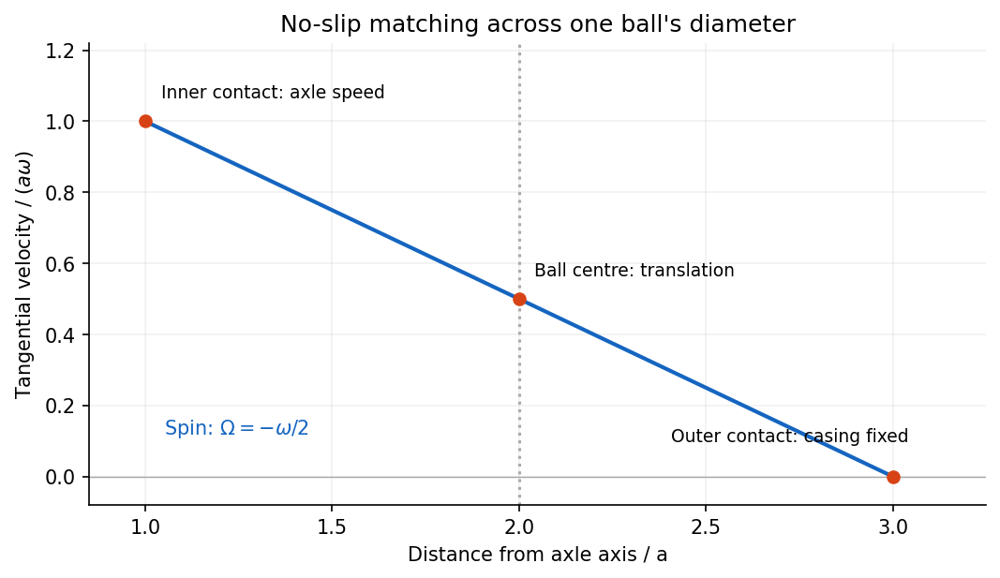
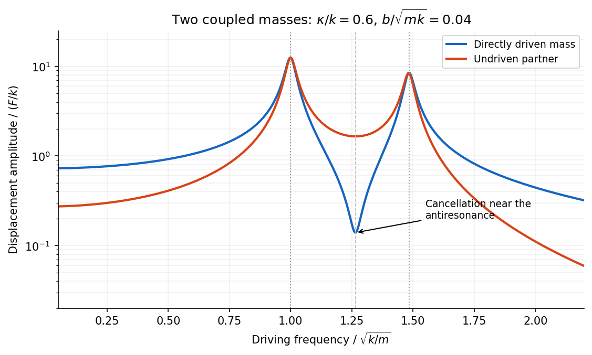
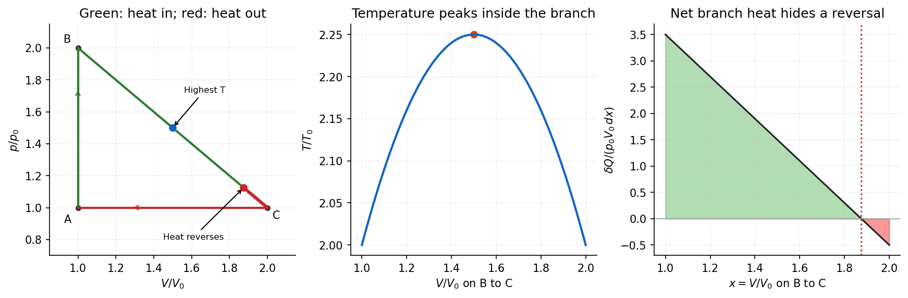

# Paper 2

↑ **Parent:** [2016](../2016.md)

[Original public PDF, physical pages 195–198; examination dated 2 June 2016](https://www.whatdotheyknow.com/request/natural_science_tripos_physics_e_2/response/2340776/attach/2/FOI%202023%20399%20Zahid%20materials.pdf?cookie_passthrough=1#page=195)

**Table of contents**

- [Section A](#section-a)
  - [A1](#section-a/a1)
    - [Solution](#section-a/a1/solution)
  - [A2](#section-a/a2)
    - [Solution](#section-a/a2/solution)
  - [A3](#section-a/a3)
    - [Solution](#section-a/a3/solution)
  - [A4](#section-a/a4)
    - [Solution](#section-a/a4/solution)
  - [A5](#section-a/a5)
    - [Solution](#section-a/a5/solution)
- [Section B](#section-b)
  - [B6](#section-b/b6)
    - [a](#section-b/b6/a)
      - [Solution](#section-b/b6/a/solution)
    - [b](#section-b/b6/b)
      - [Solution](#section-b/b6/b/solution)
    - [c](#section-b/b6/c)
      - [Solution](#section-b/b6/c/solution)
    - [d](#section-b/b6/d)
      - [Solution](#section-b/b6/d/solution)
  - [B7](#section-b/b7)
    - [Solution](#section-b/b7/solution)
  - [B8](#section-b/b8)
    - [a](#section-b/b8/a)
      - [Solution](#section-b/b8/a/solution)
    - [b](#section-b/b8/b)
      - [Solution](#section-b/b8/b/solution)
    - [c](#section-b/b8/c)
      - [Solution](#section-b/b8/c/solution)
    - [d](#section-b/b8/d)
      - [Solution](#section-b/b8/d/solution)
  - [B9](#section-b/b9)
    - [Solution](#section-b/b9/solution)
- [Section C](#section-c)
  - [C10](#section-c/c10)
    - [Solution](#section-c/c10/solution)
  - [C11](#section-c/c11)
    - [Solution](#section-c/c11/solution)
  - [C12](#section-c/c12)
    - [Solution](#section-c/c12/solution)
    - [a](#section-c/c12/a)
      - [Solution](#section-c/c12/a/solution)
    - [b](#section-c/c12/b)
      - [Solution](#section-c/c12/b/solution)
    - [c](#section-c/c12/c)
      - [Solution](#section-c/c12/c/solution)
  - [C13](#section-c/c13)
    - [Solution](#section-c/c13/solution)

## Section A

↑ **Parent:** [Paper 2](paper-2.md)

<h3 id="section-a/a1">A1</h3>

↑ **Parent:** [Section A](#section-a)

<h4 id="section-a/a1/solution">Solution</h4>

↑ **Parent:** [A1](#section-a/a1)

The [Boltzmann entropy](../../entropy.md#boltzmann-s-entropy-formula) is

$$
S=k_B\ln\Omega=k_B\ln\Omega_0+\frac{5N}{2}k_B\ln(E/E_0).
$$

The thermodynamic definition of [temperature](../../temperature.md) gives

$$
\frac1T=\left(\frac{\partial S}{\partial E}\right)_{N,\ldots}=\frac{5Nk_B}{2E},\qquad \boxed{T=\frac{2E}{5Nk_B}.}
$$

Holding the other system parameters fixed, $E=(5N/2)k_BT$, so its [heat capacity](../../heat.md#heat-capacity) is **$C=5Nk_B/2$**. The constants $\Omega_0$ and $E_0$ set an additive reference for [entropy](../../entropy.md); neither affects this derivative or the resulting [heat capacity](../../heat.md#heat-capacity).

<h3 id="section-a/a2">A2</h3>

↑ **Parent:** [Section A](#section-a)

<h4 id="section-a/a2/solution">Solution</h4>

↑ **Parent:** [A2](#section-a/a2)

For a lossless [transmission line](../../electrical-engineering.md#transmission-line) with [characteristic impedance](../../electrical-engineering.md#characteristic-impedance) $Z_0$ and resistive termination $R_L$, the voltage [reflection coefficient](../../partial-differential-equation.md#reflection-coefficient) is

$$
\Gamma=\frac{R_L-Z_0}{R_L+Z_0}.
$$

The reflected pulse is inverted and has half the incident [voltage](../../random-walk.md#voltage), so $\Gamma=-1/2$. Substituting the termination gives

$$
\frac{25-Z_0}{25+Z_0}=-\frac12,\qquad \boxed{Z_0=75\ \Omega.}
$$

The echo delay is a round trip from the observation point to the termination and back, not a one-way travel time. Thus the propagation [speed](../../classical-mechanics.md#speed) is

$$
v=\frac{2(1\ \mathrm m)}{10\ \mathrm{ns}}=2.0\times10^8\ \mathrm{m\,s^{-1}}.
$$

For a homogeneous, nonmagnetic [coaxial cable](../../electrical-engineering.md#coaxial-cable) dielectric, $v=c/\sqrt{\epsilon_r}$, giving **$\epsilon_r\simeq2.25$**. More generally the measured [speed](../../classical-mechanics.md#speed) fixes $\epsilon_r\mu_r=(c/v)^2$; identifying this with [relative permittivity](../../quantum-mechanics.md#relative-permittivity) assumes $\mu_r\simeq1$ and negligible dispersion or attenuation of the pulse.

<h3 id="section-a/a3">A3</h3>

↑ **Parent:** [Section A](#section-a)

<h4 id="section-a/a3/solution">Solution</h4>

↑ **Parent:** [A3](#section-a/a3)

Separate a ball's orbital motion from its spin. For a [rolling ball between concentric races](../../rigid-body-dynamics.md#rolling-ball-between-concentric-races), the ball centre lies $2a$ from the axle axis. Let its tangential centre [velocity](../../classical-mechanics.md#velocity) be $v$ in the direction of axle motion and let its signed spin [angular velocity](../../rigid-body-dynamics.md#angular-velocity) be $\Omega$, positive in the same sense as $\omega$. [Rolling without slipping](../../rigid-body-dynamics.md#rolling-without-slipping) at the moving inner contact and stationary outer contact requires

$$
v-a\Omega=a\omega,\qquad v+a\Omega=0.
$$

Hence

$$
\boxed{v=\frac{a\omega}{2},\qquad \Omega=-\frac\omega2,\qquad \omega_{\rm orbit}=\frac{v}{2a}=\frac\omega4.}
$$

The spin is opposite to the axle's rotation, while the centre orbits in the same sense. The total [angular momentum](../../momentum.md#angular-momentum) about the axle is the sum of its orbital [angular momentum](../../momentum.md#angular-momentum) and its [angular momentum about the centre of mass](../../classical-mechanics.md#angular-momentum-about-the-centre-of-mass):

$$
L_z=(2a)mv+I_{\rm cm}\Omega=ma^2\omega-\frac12I_{\rm cm}\omega.
$$

For a uniform solid spherical ball, $I_{\rm cm}=2ma^2/5$, so

$$
\boxed{\mathbf L=\frac45ma^2\boldsymbol\omega.}
$$

The solid-ball assumption supplies the usual [moment of inertia](../../rigid-body-dynamics.md#moment-of-inertia); the preceding expression in terms of $I_{\rm cm}$ also states the answer for a different internal [mass distribution](../../classical-mechanics.md#mass-distribution).

**[Figure 1](#section-a/a3/image-original-contact-velocity-construction-separating-orbital-motion-and-opposite-ball-spin). Original contact-velocity construction separating orbital motion and opposite ball spin**.

<h3 id="section-a/a4">A4</h3>

↑ **Parent:** [Section A](#section-a)

<h4 id="section-a/a4/solution">Solution</h4>

↑ **Parent:** [A4](#section-a/a4)

In the thin-gap [Couette flow](../../viscous-fluid-flow.md#couette-flow) approximation, the tangential [velocity](../../classical-mechanics.md#velocity) varies linearly through the gap. At radius $r$, its difference between the two discs is $r\omega$, so a [Newtonian fluid](../../viscous-fluid-flow.md#newtonian-fluid) exerts [shear stress](../../viscous-fluid-flow.md#shear-stress)

$$
\tau_{\theta z}=\eta\frac{r\omega}{d}.
$$

An annulus has area $2\pi r\,dr$, and its tangential [force](../../force.md) acts at lever arm $r$. Integrating its [torque](../../momentum.md#torque) gives

$$
\tau_{\rm drive}=\int_0^a r\frac{\eta r\omega}{d}\,2\pi r\,dr,\qquad \boxed{\tau_{\rm drive}=\frac{\pi\eta\omega a^4}{2d}.}
$$

The driving [torque](../../momentum.md#torque) is in the direction of rotation; the liquid's resisting [torque](../../momentum.md#torque) has the opposite sign. This [parallel-disc viscometer](../../viscous-fluid-flow.md#parallel-disc-viscometer) result assumes laminar shear with no slip, negligible edge effects and negligible secondary circulation. Its fourth-power radius dependence comes from the combined radial dependence of speed, annular area and lever arm.

<h3 id="section-a/a5">A5</h3>

↑ **Parent:** [Section A](#section-a)

<h4 id="section-a/a5/solution">Solution</h4>

↑ **Parent:** [A5](#section-a/a5)

At fixed [temperature](../../temperature.md), equilibrium [blackbody radiation](../../statistical-physics.md#black-body-radiation) has fixed [energy density](../../statistical-physics.md#energy-density) $u$, with [radiation pressure](../../pressure.md#radiation-pressure) $p=u/3$. Doubling the [volume](../../thermodynamics.md#volume-thermodynamics) therefore doubles its internal [energy](../../energy.md), so $\Delta U=U_0$. The [work](../../energy.md#work) done by the radiation is

$$
W=\int_{V_0}^{2V_0}p\,dV=\frac u3V_0=\frac{U_0}{3}.
$$

The [first law of thermodynamics](../../first-law-of-thermodynamics.md), with positive [work](../../energy.md#work) done by the radiation, gives

$$
\boxed{Q=\Delta U+W=\frac43U_0=1000\ \mu\mathrm J=1.00\ \mathrm{mJ}.}
$$

Thus **$1.00\ \mathrm{mJ}$ is absorbed from the walls**. The walls must replace the [energy](../../energy.md) used to do [work](../../energy.md#work) as well as supply the extra stored [energy](../../energy.md); using only $\Delta U=750\ \mu\mathrm J$ would omit that work. This is a [reversible isothermal expansion of a photon gas](../../statistical-physics.md#reversible-isothermal-expansion-of-a-photon-gas), not an adiabatic expansion.

## Section B

↑ **Parent:** [Paper 2](paper-2.md)

<h3 id="section-b/b6">B6</h3>

↑ **Parent:** [Section B](#section-b)

<h4 id="section-b/b6/a">a</h4>

↑ **Parent:** [B6](#section-b/b6)

<h5 id="section-b/b6/a/solution">Solution</h5>

↑ **Parent:** [A](#section-b/b6/a)

An [electric dipole](../../electrostatics.md#electric-dipole) consists of equal and opposite [electric charges](../../electric-charge.md) separated by a displacement $\mathbf d$. Its [electric dipole moment](../../electrostatics.md#electric-dipole-moment) is $\mathbf p=q\mathbf d$, directed from negative to positive [electric charge](../../electric-charge.md). At distances large compared with the separation, its leading [electric potential](../../electric-field.md#electric-potential) and [electric field](../../electric-field.md) are

$$
\boxed{\phi(\mathbf r)=\frac{\mathbf p\cdot\widehat{\mathbf r}}{4\pi\epsilon_0r^2},\qquad \mathbf E=\frac{3(\mathbf p\cdot\widehat{\mathbf r})\widehat{\mathbf r}-\mathbf p}{4\pi\epsilon_0r^3}.}
$$

There is no monopole term because the net [electric charge](../../electric-charge.md) is zero. The axial [electric field](../../electric-field.md) points along $\mathbf p$ with magnitude $2p/(4\pi\epsilon_0r^3)$, while the equatorial [electric field](../../electric-field.md) points oppositely with half that magnitude.

A uniform applied [electric field](../../electric-field.md) exerts zero net [force](../../force.md) on an ideal fixed [electric dipole](../../electrostatics.md#electric-dipole), but it exerts [torque](../../momentum.md#torque) $\boldsymbol\tau=\mathbf p\times\mathbf E$. Its orientation-dependent [potential energy](../../energy.md#potential-energy) is $U=-\mathbf p\cdot\mathbf E$, so alignment with the [electric field](../../electric-field.md) is stable. A nonuniform applied [electric field](../../electric-field.md) can also exert a net [force](../../force.md), $\mathbf F=\nabla(\mathbf p\cdot\mathbf E)$ for a fixed permanent [electric dipole moment](../../electrostatics.md#electric-dipole-moment).

A permanent [electric dipole moment](../../electrostatics.md#electric-dipole-moment) exists without an applied [electric field](../../electric-field.md). An induced [electric dipole moment](../../electrostatics.md#electric-dipole-moment) instead develops in response to the local [electric field](../../electric-field.md); in an isotropic linear model $\mathbf p=\alpha\mathbf E$. Creating that induced moment requires accounting for the work of polarization, so its mechanical [potential energy](../../energy.md#potential-energy) in a specified applied [electric field](../../electric-field.md) is $-\alpha E^2/2$, rather than $-\alpha E^2$. In matter, the dipole moment per unit volume is the [polarization density](../../electromagnetism.md#polarization-density) $\mathbf P$.

<h4 id="section-b/b6/b">b</h4>

↑ **Parent:** [B6](#section-b/b6)

<h5 id="section-b/b6/b/solution">Solution</h5>

↑ **Parent:** [B](#section-b/b6/b)

[Mutual inductance](../../electromagnetism.md#mutual-inductance) expresses how a changing [electric current](../../electric-charge.md#electric-current) in one circuit induces an [electromotive force](../../electric-charge.md#electromotive-force) in another. Choose winding orientations and define their linked [magnetic fluxes](../../magnetic-field.md#magnetic-flux) by

$$
\Lambda_1=L_1I_1+MI_2,\qquad \Lambda_2=MI_1+L_2I_2.
$$

For a reciprocal linear magnetic system, the same $M$ appears in both expressions. [Faraday's law of induction](../../maxwell-equations.md#faraday-s-law-of-induction) gives $\mathcal E_2=-M\,dI_1/dt$ when the secondary [electric current](../../electric-charge.md#electric-current) does not itself change. The sign depends on winding orientation and is consistent with [Lenz's law](../../maxwell-equations.md#lenz-s-law).

The stored [magnetic energy](../../electromagnetic-wave.md#magnetic-energy) is

$$
U=\frac12L_1I_1^2+MI_1I_2+\frac12L_2I_2^2.
$$

Its nonnegativity for arbitrary [electric currents](../../electric-charge.md#electric-current) requires $M^2\leq L_1L_2$. Strong coupling makes $|M|$ approach $\sqrt{L_1L_2}$; flux leakage makes it smaller.

An ideal [electrical transformer](../../electrical-engineering.md#transformer-electrical-engineering) has two windings linked by the same time-varying core [magnetic flux](../../magnetic-field.md#magnetic-flux). The induced winding [voltages](../../random-walk.md#voltage) are proportional to their turn counts. For appropriately chosen terminal polarities,

$$
\boxed{\frac{V_2}{V_1}=\frac{N_2}{N_1},\qquad V_1I_1=V_2I_2,\qquad \frac{I_2}{I_1}=\frac{N_1}{N_2}.}
$$

The [electric current](../../electric-charge.md#electric-current) convention in the [power](../../energy.md#power) relation takes primary power into the device and secondary power out to the load. Consequently a load [electrical impedance](../../electrical-circuit.md#electrical-impedance) $Z_L$ appears at the primary as $Z_{\rm in}=(N_1/N_2)^2Z_L$. A larger secondary [voltage](../../random-walk.md#voltage) therefore comes with a smaller available secondary [electric current](../../electric-charge.md#electric-current), rather than extra [energy](../../energy.md).

A steady direct [electric current](../../electric-charge.md#electric-current) produces no sustained transformer action after its switching transient. Practical departures from the ideal include winding [electrical resistance](../../electric-charge.md#electrical-resistance), leakage [magnetic flux](../../magnetic-field.md#magnetic-flux), finite magnetizing [electric current](../../electric-charge.md#electric-current), core saturation, [eddy currents](../../electromagnetism.md#eddy-current) and [magnetic hysteresis](../../critical-phenomenon.md#magnetic-hysteresis) losses.

<h4 id="section-b/b6/c">c</h4>

↑ **Parent:** [B6](#section-b/b6)

<h5 id="section-b/b6/c/solution">Solution</h5>

↑ **Parent:** [C](#section-b/b6/c)

[Free charge](../../electric-charge.md#free-charge) is charge assigned to externally supplied or mobile carriers in a macroscopic description. [Bound charge](../../electromagnetism.md#bound-charge) describes the net charge associated with a material's [polarization density](../../electromagnetism.md#polarization-density) $\mathbf P$. Its bulk and surface densities are

$$
\boxed{\rho_b=-\nabla\cdot\mathbf P,\qquad \sigma_b=\mathbf P\cdot\widehat{\mathbf n},}
$$

where the normal points out of the polarized material. Uniform bulk [polarization density](../../electromagnetism.md#polarization-density) has no bulk [bound charge](../../electromagnetism.md#bound-charge), but it can still have surface [bound charge](../../electromagnetism.md#bound-charge).

The [electric field](../../electric-field.md) is sourced by the total [electric charge](../../electric-charge.md). Introducing the [electric displacement field](../../electromagnetism.md#electric-displacement-field) separates the free source in the macroscopic field equation:

$$
\nabla\cdot\mathbf E=\frac{\rho_f+\rho_b}{\epsilon_0},\qquad \boxed{\mathbf D=\epsilon_0\mathbf E+\mathbf P,\qquad\nabla\cdot\mathbf D=\rho_f.}
$$

This does not mean that [bound charges](../../electromagnetism.md#bound-charge) are physically absent from $\mathbf D$: they are represented through $\mathbf P$. In a linear isotropic dielectric, $\mathbf P=\epsilon_0\chi_e\mathbf E$ and $\mathbf D=\epsilon\mathbf E$, with $\epsilon=\epsilon_0(1+\chi_e)$.

Across a stationary ordinary dielectric interface, electrostatics gives continuity of tangential [electric field](../../electric-field.md), while a free sheet charge gives

$$
\boxed{\widehat{\mathbf n}\times(\mathbf E_2-\mathbf E_1)=0,\qquad \widehat{\mathbf n}\cdot(\mathbf D_2-\mathbf D_1)=\sigma_f.}
$$

The normal [electric field](../../electric-field.md) need not be continuous. For a fully filled [parallel-plate capacitor](../../electromagnetism.md#parallel-plate-capacitor) at fixed free plate charge, polarization reduces the internal [electric field](../../electric-field.md) by $\epsilon_r$ and increases [capacitance](../../electromagnetism.md#capacitance) by the same factor. If a battery instead holds the [voltage](../../random-walk.md#voltage) fixed, extra free plate charge flows from the battery; the constraint must be stated before comparing stored [energies](../../energy.md).[Chapter 10, §§10–1 to 10–4: dielectric capacitor, polarization charge and the field equations](../../physics-bibliography.md#the-feynman-lectures-on-physics-volume-ii-by-richard-feynman-and-others)

<h4 id="section-b/b6/d">d</h4>

↑ **Parent:** [B6](#section-b/b6)

<h5 id="section-b/b6/d/solution">Solution</h5>

↑ **Parent:** [D](#section-b/b6/d)

A [permanent magnet](../../electromagnetism.md#permanent-magnet) retains a substantial [magnetization](../../electromagnetism.md#magnetization) without an applied coil [electric current](../../electric-charge.md#electric-current). In a ferromagnetic material this reflects microscopic magnetic moments, [magnetic domains](../../electromagnetism.md#magnetic-domain) and their resistance to rearrangement. The history-dependent relation between applied field and [magnetization](../../electromagnetism.md#magnetization) gives [magnetic hysteresis](../../critical-phenomenon.md#magnetic-hysteresis), remanence and coercivity. A soft core used in an [electromagnet](../../magnetic-field.md#electromagnet) or [electrical transformer](../../electrical-engineering.md#transformer-electrical-engineering) is chosen for easy magnetization and small hysteretic loss; a permanent-magnet material must resist demagnetization.[Chapter 36, especially §36–3 and Figures 36–8 to 36–9: magnetization curves, remanence and hysteresis loss](../../physics-bibliography.md#the-feynman-lectures-on-physics-volume-ii-by-richard-feynman-and-others)

The macroscopic fields obey

$$
\boxed{\mathbf B=\mu_0(\mathbf H+\mathbf M),\qquad \nabla\times\mathbf H=\mathbf J_f,\qquad\nabla\cdot\mathbf B=0}
$$

in [magnetostatics](../../electromagnetism.md#magnetostatics). The [magnetization](../../electromagnetism.md#magnetization) can be represented by equivalent [bound currents](../../electromagnetism.md#bound-current),

$$
\mathbf J_b=\nabla\times\mathbf M,\qquad \mathbf K_b=\mathbf M\times\widehat{\mathbf n}.
$$

Thus both permanent magnetic matter and free coil [electric currents](../../electric-charge.md#electric-current) generate a [magnetic field](../../magnetic-field.md). Its [magnetic field lines](../../magnetic-field.md#magnetic-field-line) form continuous loops; apparent north and south poles are not isolated magnetic charges.

In a long ideal [solenoid](../../magnetic-field.md#solenoid), $H\simeq nI$. A linear core would give $B\simeq\mu_0\mu_r nI$, until saturation or other nonlinear effects invalidate a constant [magnetic permeability](../../maxwell-equations.md#permeability-electromagnetism). In a finite magnetic circuit, air gaps and demagnetizing fields affect the field strongly: because the gap has low [magnetic permeability](../../maxwell-equations.md#permeability-electromagnetism), it often needs most of the available magnetomotive force. A [permanent magnet](../../electromagnetism.md#permanent-magnet) can have a nonzero internal $\mathbf H$ even when $\mathbf J_f=0$, because its boundaries create a demagnetizing field. Hence setting $\mathbf H=0$ merely because there is no free coil [electric current](../../electric-charge.md#electric-current) is generally incorrect.

<h3 id="section-b/b7">B7</h3>

↑ **Parent:** [Section B](#section-b)

<h4 id="section-b/b7/solution">Solution</h4>

↑ **Parent:** [B7](#section-b/b7)

An electrostatic field calculation begins by specifying the charge information, material response and boundary conditions. In [vacuum](../../physics.md#vacuum), prescribed volume and surface [electric charge](../../electric-charge.md) densities can be superposed directly using [Coulomb's law](../../electrostatics.md#coulomb-s-law). For a volume distribution,

$$
\phi(\mathbf r)=\frac1{4\pi\epsilon_0}\int\frac{\rho(\mathbf r')}{|\mathbf r-\mathbf r'|}\,d^3r',\qquad \mathbf E=-\nabla\phi.
$$

Differentiating this [electric potential](../../electric-field.md#electric-potential) gives the [electric field](../../electric-field.md). This is useful for known source distributions, but in the presence of conductors the induced surface [electric charge](../../electric-charge.md) is usually an unknown rather than an independently specified input.

[Gauss's law](../../maxwell-equations.md#gauss-s-law) is especially effective when [symmetry](../../physics.md#symmetry-physics) fixes the direction and magnitude of the [electric field](../../electric-field.md) on a suitable closed surface. A spherical charge distribution gives a radial field, an infinitely long uniform line gives a cylindrical field, and a uniform infinite sheet gives a planar field. In an arbitrary geometry, the flux law remains true but does not alone determine the pointwise [electric field](../../electric-field.md). A [multipole expansion](../../electrostatics.md#electric-multipole-expansion) is another useful approximation: far from a localized charge distribution, successive monopole, dipole and higher terms separate the effects of total charge and its spatial structure.

For a boundary-value formulation, use the electrostatic equations

$$
\nabla\times\mathbf E=0,\qquad\nabla\cdot\mathbf E=\rho/\epsilon_0.
$$

They imply [Poisson equation](../../partial-differential-equation.md#poisson-s-equation) $\nabla^2\phi=-\rho/\epsilon_0$, or [Laplace equation](../../partial-differential-equation.md#laplace-equation) where $\rho=0$. A conductor in electrostatic equilibrium is an equipotential with zero internal [electric field](../../electric-field.md). Its exterior normal [electric field](../../electric-field.md) fixes the surface [electric charge](../../electric-charge.md) through $E_n=\sigma/\epsilon_0$. One must specify whether each conductor is grounded, maintained at a prescribed [voltage](../../random-walk.md#voltage), or isolated with prescribed total [electric charge](../../electric-charge.md).

[Uniqueness of Poisson equation](../../analysis.md#uniqueness-of-poisson-equation) justifies methods that construct a convenient candidate solution. With fixed boundary [electric potential](../../electric-field.md#electric-potential) and suitable behaviour at infinity, a solution satisfying the field equation is the solution. With normal-derivative boundary conditions, the source and flux must be compatible, and the [electric potential](../../electric-field.md#electric-potential) is determined only up to an additive constant.

For example, a point charge $q$ a distance $h$ above a grounded infinite plane has the same upper-half-space [electric potential](../../electric-field.md#electric-potential) as $q$ and a mirrored [image charge](../../electric-field.md#image-charge) $-q$ below it. Their potentials cancel on the plane. The image is a mathematical source in the excluded region, not a second physical charge. [Separation of variables](../../partial-differential-equation.md#separation-of-variables) similarly constructs solutions suited to rectangular, cylindrical or spherical boundaries; matching coefficients enforces the prescribed boundary data.

In dielectrics, the distinction between total and [free charge](../../electric-charge.md#free-charge) is essential. In a linear isotropic material,

$$
\mathbf D=\epsilon(\mathbf r)\mathbf E,\qquad \boxed{\nabla\cdot[\epsilon(\mathbf r)\nabla\phi]=-\rho_f.}
$$

Only where [permittivity](../../permittivity.md) is constant may this be reduced to $\nabla^2\phi=-\rho_f/\epsilon$. At an ordinary interface, $\phi$ and the tangential [electric field](../../electric-field.md) are continuous, while the jump in normal [electric displacement field](../../electromagnetism.md#electric-displacement-field) is the free surface charge. Applying [Gauss's law](../../maxwell-equations.md#gauss-s-law) to total charge with $\epsilon_0$, or its displacement-field form to [free charge](../../electric-charge.md#free-charge), gives consistent descriptions; mixing their sources and permittivities does not.

A useful interface example is the [image charge at a dielectric interface](../../electric-field.md#image-charge-at-a-dielectric-interface). If $q$ lies in medium 1, the source-side potential is represented by

$$
\phi_1=\frac1{4\pi\epsilon_1}\left(\frac q{r_1}+\frac{q'}{r_2}\right),\qquad \boxed{q'=q\frac{\epsilon_1-\epsilon_2}{\epsilon_1+\epsilon_2}},
$$

where $r_1$ is distance to the real charge and $r_2$ to its mirrored position. The other-side potential can be written $\phi_2=q_t/(4\pi\epsilon_2r_1)$, where $q_t=2\epsilon_2q/(\epsilon_1+\epsilon_2)$. Continuity of $\phi$ and of normal $\mathbf D$ fixes both coefficients. The equal-[permittivity](../../permittivity.md) limit gives no image; the conductor limit $\epsilon_2\to\infty$ gives $q'\to-q$.

For a sphere of radius $a$ and relative [permittivity](../../permittivity.md) $\epsilon_r$ in a uniform external [electric field](../../electric-field.md) $\mathbf E_0$, matching the spherical solutions gives a uniform internal [electric field](../../electric-field.md) and an external induced [electric dipole moment](../../electrostatics.md#electric-dipole-moment):

$$
\boxed{\mathbf E_{\rm in}=\frac3{\epsilon_r+2}\mathbf E_0,\qquad \mathbf p=4\pi\epsilon_0a^3\frac{\epsilon_r-1}{\epsilon_r+2}\mathbf E_0.}
$$

This illustrates how a material boundary modifies an otherwise simple applied [electric field](../../electric-field.md).

For complex boundaries or spatially varying materials, [finite difference methods](../../finite-difference.md#finite-difference-method) or the [finite element method](../../finite-element-method.md) solve the same [boundary value problem](../../boundary-value-problem.md) numerically. A sound calculation checks its boundary conditions, charge or flux balance and convergence with mesh refinement. The governing equations, source classification and uniqueness argument remain the organizing principles even when an analytic formula is unavailable.

<h3 id="section-b/b8">B8</h3>

↑ **Parent:** [Section B](#section-b)

<h4 id="section-b/b8/a">a</h4>

↑ **Parent:** [B8](#section-b/b8)

<h5 id="section-b/b8/a/solution">Solution</h5>

↑ **Parent:** [A](#section-b/b8/a)

A horizontal [pressure gradient force](../../fluid-mechanics.md#pressure-gradient-force) accelerates air from higher toward lower [pressure](../../pressure.md). In a rotating frame the [Coriolis force](../../mathematical-physics.md#coriolis-force) deflects the flow. Away from strong friction, at large spatial scales and small [Rossby number](../../geophysical-fluid-dynamics.md#rossby-number), a slowly changing flow can reach [geostrophic balance](../../mathematical-physics.md#geostrophic-balance):

$$
f\widehat{\mathbf z}\times\mathbf u_g=-\frac1\rho\nabla_h p,\qquad \boxed{\mathbf u_g=\frac1{\rho f}\widehat{\mathbf z}\times\nabla_h p},
$$

where $f=2\Omega\sin\varphi$ is the [Coriolis parameter](../../geophysical-fluid-dynamics.md#coriolis-parameter). The [geostrophic wind](../../mathematical-physics.md#geostrophic-wind) runs along [atmospheric isobars](../../mathematical-physics.md#atmospheric-isobar), with speed $|\nabla_h p|/(\rho|f|)$. Closely spaced [atmospheric isobars](../../mathematical-physics.md#atmospheric-isobar) therefore indicate stronger [geostrophic wind](../../mathematical-physics.md#geostrophic-wind) when [density](../../fluid-mechanics.md#density) and latitude are comparable. In the northern hemisphere lower [pressure](../../pressure.md) lies to the left of this wind, producing counterclockwise circulation around a low; the sense reverses in the southern hemisphere.

A curved flow also has [centripetal acceleration](../../classical-mechanics.md#centripetal-acceleration). For cyclonic circular flow in the northern hemisphere, the [gradient wind](../../mathematical-physics.md#gradient-wind) relation is

$$
\frac{v^2}{r}+fv=\frac1\rho\frac{dp}{dr}.
$$

Near the ground, friction reduces wind speed and weakens its Coriolis contribution, so air crosses [atmospheric isobars](../../mathematical-physics.md#atmospheric-isobar) toward lower [pressure](../../pressure.md). The simple geostrophic formula fails near the equator, where $f$ becomes small, and where rapid changes or tight curvature make neglected acceleration important. Vertically, large-scale motion is often approximated by [hydrostatic balance](../../fluid-mechanics.md#hydrostatic-balance), $dp/dz=-\rho g$.

[Bernoulli's principle](../../euler-equations-for-an-inviscid-fluid.md#bernoulli-s-principle) can relate speed changes to [pressure](../../pressure.md) changes along an appropriate inviscid streamline, but its simple dynamic-pressure relation is not a replacement for the rotating force balance governing a broad atmospheric pressure map.

<h4 id="section-b/b8/b">b</h4>

↑ **Parent:** [B8](#section-b/b8)

<h5 id="section-b/b8/b/solution">Solution</h5>

↑ **Parent:** [B](#section-b/b8/b)

[Coupled oscillators](../../wave.md#coupled-oscillator) have more than one collective pattern of motion. For two equal [masses](../../classical-mechanics.md#mass) $m$, each attached to a fixed support by a spring of stiffness $k$ and linked to each other by stiffness $\kappa$, small displacements obey

$$
m\ddot x_1+b\dot x_1+(k+\kappa)x_1-\kappa x_2=F_1\cos\Omega t,
$$

$$
m\ddot x_2+b\dot x_2+(k+\kappa)x_2-\kappa x_1=F_2\cos\Omega t.
$$

Here equal linear damping $b$ is included to make finite [steady-state responses](../../analysis.md#steady-state-response) at resonance. The [normal mode coordinates](../../classical-mechanics.md#normal-coordinate) $q_+=(x_1+x_2)/\sqrt2$ and $q_-=(x_1-x_2)/\sqrt2$ diagonalize these equations. Their natural [angular frequencies](../../lagrangian-mechanics.md#angular-frequency) are

$$
\boxed{\omega_+^2=k/m,\qquad \omega_-^2=(k+2\kappa)/m.}
$$

The symmetric [normal mode](../../wave-equation.md#normal-mode) leaves the coupling spring unextended; the antisymmetric [normal mode](../../wave-equation.md#normal-mode) stretches it and therefore has the higher [frequency](../../wave.md#frequency). With $F_\pm=(F_1\pm F_2)/\sqrt2$, their complex [steady-state responses](../../analysis.md#steady-state-response) are

$$
\boxed{\widetilde q_\pm=\frac{F_\pm}{m(\omega_\pm^2-\Omega^2)+ib\Omega}.}
$$

Thus the drive's spatial pattern matters as well as its [frequency](../../wave.md#frequency). Equal in-phase [forces](../../force.md) drive only the symmetric [normal mode](../../wave-equation.md#normal-mode); opposite [forces](../../force.md) drive only the antisymmetric one; driving a single mass generally excites both. Finite damping broadens the [resonance](../../dynamical-systems.md#resonance) peaks and produces a phase lag. In the ideal undamped system, a resonant drive with nonzero projection onto a [normal mode](../../wave-equation.md#normal-mode) produces secular growth rather than a bounded resonant steady state.

**[Figure 2](#section-b/b8/b/image-original-driven-two-mass-response-showing-two-resonances-and-an-intervening-antiresonance). Original driven two-mass response showing two resonances and an intervening antiresonance**.

The displacement of a particular mass adds contributions from both [normal modes](../../wave-equation.md#normal-mode). They can cancel at an [antiresonance](../../electrical-engineering.md#antiresonance). For $F_2=0$ and no damping, $x_1$ vanishes at $\Omega^2=(k+\kappa)/m$, while the partner still moves. This differs from the two nearby resonances, where a mode responds strongly; a small measured response need not mean that no motion or stored [energy](../../energy.md) exists elsewhere.

<h4 id="section-b/b8/c">c</h4>

↑ **Parent:** [B8](#section-b/b8)

<h5 id="section-b/b8/c/solution">Solution</h5>

↑ **Parent:** [C](#section-b/b8/c)

A [Newtonian fluid](../../viscous-fluid-flow.md#newtonian-fluid) exerts viscous [shear stress](../../viscous-fluid-flow.md#shear-stress) proportional to the rate of strain. For an incompressible fluid of constant [dynamic viscosity](../../dynamic-viscosity.md) $\eta$,

$$
\boldsymbol\sigma=-p\mathbf I+\eta[\nabla\mathbf u+(\nabla\mathbf u)^T].
$$

The local momentum balance is the [Navier-Stokes equation](../../viscous-fluid-flow.md#navier-stokes-equation):

$$
\boxed{\rho\left(\frac{\partial\mathbf u}{\partial t}+\mathbf u\cdot\nabla\mathbf u\right)=-\nabla p+\eta\nabla^2\mathbf u+\rho\mathbf g.}
$$

The left side is density times [material acceleration](../../continuum-mechanics.md#material-acceleration). A steady velocity field can still have convective [acceleration](../../classical-mechanics.md#acceleration) when a moving parcel changes speed or direction; setting $\partial\mathbf u/\partial t=0$ does not eliminate it.

The [Reynolds number](../../dynamic-viscosity.md#reynolds-number) $\mathrm{Re}=\rho UL/\eta$ compares inertia with viscous effects. At low [Reynolds number](../../dynamic-viscosity.md#reynolds-number), the fluid's own inertia can often be neglected, giving [Stokes flow](../../stokes-flow.md). This does not say that every immersed body has zero [acceleration](../../classical-mechanics.md#acceleration): its [mass](../../classical-mechanics.md#mass) and the net pressure, viscous and body [forces](../../force.md) still enter its own [equation of motion](../../classical-mechanics.md#equation-of-motion).

For a small rigid sphere moving through a slowly varying viscous background, [Stokes drag](../../stokes-flow.md#stokes-s-law) is $-6\pi\eta a(\mathbf v-\mathbf u)$. In still fluid, a simple settling model includes [weight](../../semisimple-lie-algebra.md#weight-representation-theory), [buoyancy](../../fluid-mechanics.md#buoyancy) and drag:

$$
m\dot v=(m-\rho_fV_s)g-6\pi\eta av.
$$

Ignoring fluid added mass and unsteady history forces, this gives relaxation time $m/(6\pi\eta a)$ and [terminal velocity](../../classical-mechanics.md#terminal-velocity)

$$
\boxed{v_t=\frac{2a^2(\rho_s-\rho_f)g}{9\eta}.}
$$

At the terminal [velocity](../../classical-mechanics.md#velocity) the net [force](../../force.md) and [acceleration](../../classical-mechanics.md#acceleration) vanish, while viscous drag and gravity remain individually nonzero. The dissipated [power](../../energy.md#power) $6\pi\eta av_t^2$ is supplied by the loss of gravitational [potential energy](../../energy.md#potential-energy) relative to buoyant support. The creeping-flow and quasisteady-drag assumptions must be checked before applying this expression at large speed or immediately after a rapid start.

<h4 id="section-b/b8/d">d</h4>

↑ **Parent:** [B8](#section-b/b8)

<h5 id="section-b/b8/d/solution">Solution</h5>

↑ **Parent:** [D](#section-b/b8/d)

For two bodies interacting through a [potential energy](../../energy.md#potential-energy) that depends only on their separation, introduce the [centre of mass](../../classical-mechanics.md#center-of-mass) coordinate and the [two-particle relative coordinate](../../classical-mechanics.md#two-particle-relative-coordinate):

$$
\mathbf R=\frac{m_1\mathbf r_1+m_2\mathbf r_2}{M},\qquad\mathbf r=\mathbf r_1-\mathbf r_2,\qquad M=m_1+m_2.
$$

Their [kinetic energy](../../energy.md#kinetic-energy) separates exactly:

$$
T=\frac12M\dot{\mathbf R}^2+\frac12\mu\dot{\mathbf r}^2,\qquad \boxed{\mu=\frac{m_1m_2}{m_1+m_2}.}
$$

The [centre of mass](../../classical-mechanics.md#center-of-mass) moves uniformly if there is no external [force](../../force.md), while the internal [two-body problem](../../celestial-mechanics.md#two-body-problem) reduces to one effective particle of [reduced mass](../../classical-mechanics.md#reduced-mass) $\mu$:

$$
M\ddot{\mathbf R}=0,\qquad \mu\ddot{\mathbf r}=-\nabla U(r).
$$

The original trajectories follow from $\mathbf r_1=\mathbf R+(m_2/M)\mathbf r$ and $\mathbf r_2=\mathbf R-(m_1/M)\mathbf r$.

For [Newtonian gravity](../../newton-s-law-of-universal-gravitation.md#gravitational-acceleration), $U=-Gm_1m_2/r$, so the relative [acceleration](../../classical-mechanics.md#acceleration) is $\ddot{\mathbf r}=-GM\mathbf r/r^3$. Conserved relative [angular momentum](../../momentum.md#angular-momentum) and [energy](../../energy.md) then give the usual [conic sections](../../euclidean-geometry.md#conic-section). For a bound orbit of relative semimajor axis $a$,

$$
\boxed{E=-\frac{Gm_1m_2}{2a},\qquad T_{\rm orb}=2\pi\sqrt{\frac{a^3}{G(m_1+m_2)}}.}
$$

The two bodies share this [orbital period](../../celestial-mechanics.md#orbital-period) and orbit their common [centre of mass](../../classical-mechanics.md#center-of-mass) with semimajor axes in inverse proportion to their [masses](../../classical-mechanics.md#mass). If $m_2\gg m_1$, then $\mu\simeq m_1$, recovering the fixed-heavy-centre approximation. Using $M$ as the internal inertial [mass](../../classical-mechanics.md#mass) would confuse centre-of-mass translation with relative motion.

<h3 id="section-b/b9">B9</h3>

↑ **Parent:** [Section B](#section-b)

<h4 id="section-b/b9/solution">Solution</h4>

↑ **Parent:** [B9](#section-b/b9)

[Elasticity](../../elasticity-physics.md) describes recoverable deformation. For small displacements $\mathbf u(\mathbf x)$, the [infinitesimal strain tensor](../../continuum-mechanics.md#infinitesimal-strain-tensor) is the symmetric part of the displacement gradient,

$$
\boxed{\epsilon_{ij}=\frac12(\partial_i u_j+\partial_j u_i).}
$$

Its diagonal entries describe extension, while its off-diagonal entries describe shear. The engineering shear strain is $\gamma_{xy}=2\epsilon_{xy}$; the antisymmetric part of the displacement gradient is a small rigid rotation, not elastic strain.

The [stress tensor](../../continuum-mechanics.md#cauchy-stress-tensor) specifies the [force](../../force.md) per unit area on each oriented plane: $\mathbf t(\widehat{\mathbf n})=\boldsymbol\sigma\widehat{\mathbf n}$. Positive normal stress is tensile in the convention used here; tangential traction gives [shear stress](../../viscous-fluid-flow.md#shear-stress). In the absence of internal couples, angular-momentum balance makes the [stress tensor](../../continuum-mechanics.md#cauchy-stress-tensor) symmetric. Force balance gives $\nabla\cdot\boldsymbol\sigma+\mathbf f=0$ in static equilibrium, where $\mathbf f$ is body [force](../../force.md) per unit volume.

[Linear elasticity](../../elasticity-physics.md#linear-elasticity) relates stress and strain. A homogeneous isotropic solid needs two independent elastic constants:

$$
\boxed{\sigma_{ij}=\lambda\epsilon_{kk}\delta_{ij}+2G\epsilon_{ij}.}
$$

Here $G$ is the [shear modulus](../../elasticity-physics.md#shear-modulus) and $\lambda$ is the other [Lamé parameter](../../elasticity-physics.md#lame-parameter). For uniaxial loading, [Young's modulus](../../elasticity-physics.md#young-s-modulus) is $E=\sigma_{xx}/\epsilon_{xx}$, with lateral contraction described by [Poisson's ratio](../../elasticity-physics.md#poisson-s-ratio) $\nu=-\epsilon_{yy}/\epsilon_{xx}$. The [bulk modulus](../../elasticity-physics.md#bulk-modulus) is $K=-p/(\Delta V/V)$ for a small hydrostatic compression. The relations between these constants are

$$
\boxed{E=2G(1+\nu)=3K(1-2\nu),\qquad K=\lambda+\frac{2G}{3}.}
$$

Stable isotropic elastic [strain energy density](../../elasticity-physics.md#strain-energy-density) requires $G>0$ and $K>0$, implying $-1<\nu<1/2$. The incompressible limit is approached as $\nu\to1/2$. Anisotropic crystals generally need more constants; the isotropic relations should not be imposed on arbitrary directions in such a crystal.

The elastic [energy density](../../statistical-physics.md#energy-density) is $w=\boldsymbol\sigma:\boldsymbol\epsilon/2$. In the isotropic linear model this becomes $\lambda(\operatorname{tr}\boldsymbol\epsilon)^2/2+G\boldsymbol\epsilon:\boldsymbol\epsilon$. The quadratic form explains why reversible loading stores [energy](../../energy.md) and unloading can return it, unlike plastic deformation or a dissipative hysteresis cycle.

For a slender beam described by the [Euler-Bernoulli beam equation](../../elasticity-physics.md#euler-bernoulli-beam-equation), plane sections approximately remain plane. A fibre a distance $y$ from the neutral axis has axial strain $-y\kappa$, where $\kappa$ is curvature, and stress $-Ey\kappa$. Integrating its moment about the neutral axis gives, with consistent signs,

$$
\boxed{M=EI_A\kappa,\qquad I_A=\int_A y^2\,dA.}
$$

$I_A$ is a [second moment of area](../../elasticity-physics.md#second-moment-of-area), with units of length to the fourth power; it is not a mass [moment of inertia](../../rigid-body-dynamics.md#moment-of-inertia). For a rectangular section of width $b$ and thickness $h$, $I_A=bh^3/12$, explaining the strong dependence of bending stiffness on thickness. For small transverse deflection $w(x)$, curvature is approximately $w''$, and the [Euler-Bernoulli beam equation](../../elasticity-physics.md#euler-bernoulli-beam-equation) is $EI_Aw''''=q(x)$ with a suitable load-sign convention. A cantilever of length $\ell$ under end load $F$ has tip deflection $F\ell^3/(3EI_A)$ and largest bending stress of magnitude $F\ell c/I_A$, where $c$ is the furthest distance from the neutral axis.

In [torsion of a solid circular shaft](../../elasticity-physics.md#torsion-of-a-solid-circular-shaft), a cross-section rotated by angle $\theta(x)$ has shear strain $r\theta'(x)$. Therefore

$$
\tau(r)=Gr\theta',\qquad \boxed{\mathcal T=GJ\theta',\quad J=\int_A r^2\,dA=\frac{\pi a^4}{2}.}
$$

Here $J$ is the [polar second moment of area](../../elasticity-physics.md#polar-second-moment-of-area). A uniform shaft of length $\ell$ under constant torque twists by $\mathcal T\ell/(GJ)$, and its largest shear stress is $\mathcal T a/J$. Noncircular sections can warp, so replacing their torsional stiffness by $G$ times their polar area moment is not generally valid. Both bending and torsion formulas presume small, elastic deformations; exceeding the elastic limit can produce permanent deformation or fracture.

## Section C

↑ **Parent:** [Paper 2](paper-2.md)

<h3 id="section-c/c10">C10</h3>

↑ **Parent:** [Section C](#section-c)

<h4 id="section-c/c10/solution">Solution</h4>

↑ **Parent:** [C10](#section-c/c10)

A [Carnot cycle](../../second-law-of-thermodynamics.md#carnot-cycle) consists of two reversible isothermal branches joined by two reversible adiabatic branches. Let the hot isothermal expansion run from volume $V_a$ to $V_b$, and the cold isothermal compression from $V_c$ to $V_d$. For $n$ moles of an [ideal gas](../../ideal-gas.md), their absorbed and rejected [heat](../../heat.md) magnitudes are

$$
Q_h=nRT_1\ln(V_b/V_a),\qquad Q_c=nRT_2\ln(V_c/V_d).
$$

On a reversible ideal-gas adiabat, $TV^{\gamma-1}$ is constant. Applying this to the two joining branches gives $V_b/V_a=V_c/V_d$. Therefore

$$
\frac{Q_c}{Q_h}=\frac{T_2}{T_1},\qquad \boxed{\eta_C=\frac{Q_h-Q_c}{Q_h}=1-\frac{T_2}{T_1}.}
$$

The result is independent of the gas's heat-capacity ratio. This derivation presumes the usual constant-heat-capacity ideal-gas model; more generally the equal entropy changes on the two isotherms give the same heat ratio without that restriction.

To establish the upper bound, suppose an engine were more efficient between these same two reservoirs. Use its output [work](../../energy.md#work) to drive a reversed [Carnot cycle](../../second-law-of-thermodynamics.md#carnot-cycle), scaled so that the work magnitudes match. For fixed work $W$, the hypothetical engine would take $W/\eta$ from the hot bath, whereas the reversed [Carnot cycle](../../second-law-of-thermodynamics.md#carnot-cycle) would return $W/\eta_C>W/\eta$ to it. The combined device would transfer [heat](../../heat.md) from the cold bath to the hot bath without any net external [work](../../energy.md#work). That contradicts the [Clausius statement of the second law](../../second-law-of-thermodynamics.md#clausius-statement-of-the-second-law). Hence **no such two-reservoir engine can exceed $1-T_2/T_1$**.

For the triangular cycle, call the three successive vertices $A,B,C$, and measure [energies](../../energy.md) in units of $p_0V_0$. For one mole of a monatomic [ideal gas](../../ideal-gas.md), $U=3pV/2$, and positive [work](../../energy.md#work) done by the gas is $W=\int p\,dV$. The net values on the three complete branches are

$$
\begin{array}{c|rrr}
\text{branch}&\Delta U/(p_0V_0)&W/(p_0V_0)&Q_{\rm net}/(p_0V_0)\\\hline
A\to B&3/2&0&3/2\\
B\to C&0&3/2&3/2\\
C\to A&-3/2&-1&-5/2
\end{array}
$$

Thus the net [work](../../energy.md#work) is **$W_{\rm cycle}=p_0V_0/2$**, equal to the triangle's enclosed area.

There is a small but important distinction between the net heat on a branch and its total positive [heat input to a cycle](../../thermodynamics.md#heat-input-to-a-cycle). On the sloping branch put $x=V/V_0$, so $p/p_0=3-x$, with $1\leq x\leq2$. Then

$$
\frac{U}{p_0V_0}=\frac32x(3-x),\qquad \frac{\delta Q}{p_0V_0}=\left(\frac{15}{2}-4x\right)dx.
$$

There is a [heat-flow reversal along a thermodynamic path](../../first-law-of-thermodynamics.md#heat-flow-reversal-along-a-thermodynamic-path) at $x=15/8$. The first part absorbs heat; the final part rejects it. Integrating the two signed contributions separately gives

$$
\frac{Q_{BC,+}}{p_0V_0}=\int_1^{15/8}\left(\frac{15}{2}-4x\right)dx=\frac{49}{32},\qquad \frac{Q_{BC,-}}{p_0V_0}=\int_{15/8}^2\left(\frac{15}{2}-4x\right)dx=-\frac1{32}.
$$

The true total absorbed and rejected [heats](../../heat.md) and [thermal efficiency](../../thermodynamics.md#thermal-efficiency) are therefore

$$
\boxed{Q_{\rm in}=\frac{97}{32}p_0V_0,\qquad Q_{\rm out}=\frac{81}{32}p_0V_0,\qquad\eta=\frac{W_{\rm cycle}}{Q_{\rm in}}=\frac{16}{97}\simeq0.16495.}
$$

For clarity, the positive heat input on $A\to B$ is $3p_0V_0/2$, on $B\to C$ it is $49p_0V_0/32$, and on $C\to A$ it is zero. Using just the positive net heats of the complete branches would give $Q_{\rm in}=3p_0V_0$ and $\eta=1/6$; that shortcut misses the short heat-rejection interval on $B\to C$.

**[Figure 3](#section-c/c10/image-original-pressure-volume-cycle-with-the-interior-temperature-maximum-and-the-late-reversal-of-heat-flow). Original pressure-volume cycle with the interior temperature maximum and the late reversal of heat flow**.

Finally, put $T_0=p_0V_0/R$. The minimum [temperature](../../temperature.md) is $T_0$ at $A$. Along $B\to C$,

$$
T/T_0=x(3-x),
$$

which has its maximum $9/4$ at $x=3/2$, not at either endpoint. Thus the corresponding two-reservoir [Carnot efficiency](../../second-law-of-thermodynamics.md#carnot-efficiency) is

$$
\boxed{\eta_{C,\rm extremes}=1-\frac{T_{\min}}{T_{\max}}=1-\frac49=\frac59\simeq0.556.}
$$

The triangular cycle receives heat at a range of temperatures below $T_{\max}$ and rejects it at temperatures above $T_{\min}$. It therefore makes less [work](../../energy.md#work) per unit input [heat](../../heat.md) than a [Carnot cycle](../../second-law-of-thermodynamics.md#carnot-cycle) using only those extrema. The geometric path alone does not prove irreversibility: it could in principle exchange heat reversibly with a continuum of matched-temperature reservoirs, while still having this lower efficiency. Restricting it to only the two extreme-temperature reservoirs would introduce additional irreversible heat transfers.

<h3 id="section-c/c11">C11</h3>

↑ **Parent:** [Section C](#section-c)

<h4 id="section-c/c11/solution">Solution</h4>

↑ **Parent:** [C11](#section-c/c11)

The classical [equipartition theorem](../../canonical-ensemble.md#equipartition-theorem) assigns mean [energy](../../energy.md) $k_BT/2$ to each independent quadratic term in the Hamiltonian, provided the canonical distribution and its relevant boundary integrals exist. For a quadratic term $aq^2$, the [Boltzmann distribution](../../thermodynamics.md#boltzmann-distribution) is proportional to $e^{-\beta aq^2}$, with $\beta=1/(k_BT)$. Integrating a total derivative gives

$$
0=\int_{-\infty}^{\infty}\frac{d}{dq}\left(qe^{-\beta aq^2}\right)dq=\int e^{-\beta aq^2}dq-2\beta a\int q^2e^{-\beta aq^2}dq.
$$

After dividing by the normalization,

$$
\boxed{\langle aq^2\rangle=\frac1{2\beta}=\frac12k_BT.}
$$

The same argument applies to quadratic momentum terms. Other independent canonical coordinates factor out of the ratio. It is a classical statement: widely spaced quantum energy levels can freeze out a contribution at low [temperature](../../temperature.md).

The confining quartic [potential energy](../../energy.md#potential-energy) $U(x)=Qx^4$, with $Q>0$, is not quadratic, so the $k_BT/2$ rule cannot be assigned to it. This does not invalidate the canonical [Boltzmann distribution](../../thermodynamics.md#boltzmann-distribution) or its generalized integration-by-parts identity. Indeed,

$$
0=\int_{-\infty}^{\infty}\frac{d}{dx}\left(xe^{-\beta Qx^4}\right)dx=Z_x-4\beta Q\int_{-\infty}^{\infty}x^4e^{-\beta Qx^4}dx.
$$

Hence [equipartition for a homogeneous potential](../../canonical-ensemble.md#equipartition-for-a-homogeneous-potential) gives

$$
\boxed{\langle U\rangle=Q\langle x^4\rangle=\frac14k_BT,\qquad C_{\rm potential}=\frac{d\langle U\rangle}{dT}=\frac14k_B.}
$$

Equivalently, $Z_x=\Gamma(1/4)(\beta Q)^{-1/4}/2$ and $-\partial\ln Z_x/\partial\beta=1/(4\beta)$. This is the potential contribution only; an additional standard kinetic term $p^2/(2m)$ would contribute a further $k_BT/2$ to [energy](../../energy.md) and $k_B/2$ to [heat capacity](../../heat.md#heat-capacity).

For an intact diatomic molecule, the classical degrees of freedom comprise three translational quadratic terms, two rotational quadratic terms, and two terms for its one bond-stretching vibration: one kinetic and one potential. Thus complete classical equipartition predicts

$$
\boxed{C_{V,\rm molar}=\frac72R.}
$$

The [heat capacity of a diatomic gas](../../heat.md#heat-capacity-of-a-diatomic-gas) has lower-temperature regimes because rotational and vibrational levels are quantized. In a dilute molecular gas, the expected progression is

$$
\frac{C_V}{R}\simeq\begin{cases}
3/2,&\text{rotations and vibrations frozen},\\
5/2,&\text{rotations active, vibrations frozen},\\
7/2,&\text{rotations and vibrations active}.
\end{cases}
$$

The rotational energy scale is normally much smaller than the vibrational scale, so these steps are separated. The high-temperature value treats the vibration as harmonic and excludes dissociation and electronic excitation; the lowest-temperature gas regime is meaningful only while the sample remains dilute and gaseous.[§2.4, molecular rotation and vibration, and §3.4, quantum heat capacity of a diatomic gas](../../physics-bibliography.md#statistical-physics-by-david-tong)

**[Figure 4](#section-c/c11/image-original-ideal-diatomic-heat-capacity-model-showing-rotational-and-vibrational-activation-without-dissociation). Original ideal diatomic heat-capacity model showing rotational and vibrational activation, without dissociation**.

The plotted example uses a quantum rigid rotor and harmonic vibration, with an illustrative ratio of characteristic temperatures. It is a model calculation, not measured data for a particular molecular species. For the vibrational part,

$$
\frac{C_{V,\rm vib}}R=\left(\frac{\Theta_v}{T}\right)^2\frac{e^{\Theta_v/T}}{(e^{\Theta_v/T}-1)^2},
$$

which tends to zero on freezing out and to one when many vibrational levels are accessible. The classical [equipartition theorem](../../canonical-ensemble.md#equipartition-theorem) is recovered when the relevant level spacings are small compared with $k_BT$.

<h3 id="section-c/c12">C12</h3>

↑ **Parent:** [Section C](#section-c)

<h4 id="section-c/c12/solution">Solution</h4>

↑ **Parent:** [C12](#section-c/c12)

For the two unlabelled follow-up requests, distinguish re-equilibrating [effusion](../../kinetic-theory.md#effusion) from [collisionless effusion](../../kinetic-theory.md#collisionless-effusion). The calculations below show that escaping atoms carry mean [kinetic energy](../../energy.md#kinetic-energy) $2k_BT$, whereas a bulk atom has mean [kinetic energy](../../energy.md#kinetic-energy) $3k_BT/2$. If the aperture is small and interatomic collisions maintain near-equilibrium conditions, faster atoms escape preferentially, and the remaining gas relaxes toward a lower-temperature [Maxwell-Boltzmann distribution](../../quantum-ideal-gas-statistics.md#maxwell-boltzmann-distribution). No [heat](../../heat.md) supplied by the walls is available to replace the lost energy.

For a monatomic gas at fixed container volume, [conservation of energy](../../mathematical-physics.md#conservation-of-energy) gives a quantitative check on this [effusive cooling](../../kinetic-theory.md#effusive-cooling) picture:

$$
d\left(\frac32Nk_BT\right)=2k_BT\,dN,\qquad \boxed{\frac{dT}{T}=\frac13\frac{dN}{N}.}
$$

Since $dN<0$, the temperature falls. Under these idealizations $T\propto N^{1/3}$; the gas is not left with a permanently truncated velocity tail when collisions rapidly restore equilibrium.

If interatomic collisions are absent, the individual surviving atoms do not rethermalize to a new common temperature. Their [speed distribution](../../kinetic-theory.md#speed-distribution) becomes selectively depleted, generally favouring slower survivors, and their angular and spatial distribution can also develop structure determined by which trajectories reach the hole. A single lower [temperature](../../temperature.md) does not describe the full nonequilibrium distribution. With a direction-randomizing but energy-preserving wall model, an illustrative survival law is $f(v,t)\propto f(v,0)e^{-\kappa vt}$; specular walls can give more detailed directional selection and even persistent nonescaping trajectories. The question supplies no wall-scattering or container-geometry model from which a unique collisionless loss law could be inferred.

For the labelled wall integrals, choose the polar axis toward the wall so that incoming atoms have $0\leq\theta\leq\pi/2$, and put

$$
\alpha=\frac{m}{2k_BT},\qquad A=\left(\frac{\alpha}{\pi}\right)^{3/2},\qquad I_j=\int_0^\infty v^j e^{-\alpha v^2}\,dv.
$$

The needed radial integrals are $I_3=1/(2\alpha^2)$, $I_4=3\sqrt\pi/(8\alpha^{5/2})$ and $I_5=1/\alpha^3$. They are related to the supplied integrals by rescaling the speed.

<h4 id="section-c/c12/a">a</h4>

↑ **Parent:** [C12](#section-c/c12)

<h5 id="section-c/c12/a/solution">Solution</h5>

↑ **Parent:** [A](#section-c/c12/a)

The collision flux contains an extra normal [velocity](../../classical-mechanics.md#velocity) $v\cos\theta$: a faster atom sweeps out a longer approach cylinder per unit time. Integrating the [Maxwell-Boltzmann distribution](../../quantum-ideal-gas-statistics.md#maxwell-boltzmann-distribution) over the incoming hemisphere gives

$$
J=nA\int_0^\infty v^3e^{-\alpha v^2}dv\int_0^{\pi/2}\sin\theta\cos\theta\,d\theta\int_0^{2\pi}d\phi=nA\pi I_3.
$$

Therefore

$$
\boxed{J=n\sqrt{\frac{k_BT}{2\pi m}}=\frac14n\overline v.}
$$

Here $J$ is the number striking unit area per unit time and $\overline v=\sqrt{8k_BT/(\pi m)}$ is the bulk mean speed. A simple factor of one half would count the incoming hemisphere but miss the projection factor and velocity weighting.

<h4 id="section-c/c12/b">b</h4>

↑ **Parent:** [C12](#section-c/c12)

<h5 id="section-c/c12/b/solution">Solution</h5>

↑ **Parent:** [B](#section-c/c12/b)

An elastic reflection transfers normal [momentum](../../momentum.md) $2mv\cos\theta$ to the wall. Multiplying this impulse by the collision flux and integrating gives

$$
p=2mnA I_4\int_0^{\pi/2}\sin\theta\cos^2\theta\,d\theta\int_0^{2\pi}d\phi=\frac{4\pi}{3}mnAI_4.
$$

Using the radial integral and $\alpha=m/(2k_BT)$ yields

$$
\boxed{p=\frac{nm}{2\alpha}=nk_BT.}
$$

This agrees with the ideal-gas [equation of state](../../pressure.md#equation-of-state). The calculation assumes a stationary wall and elastic normal momentum reversal, appropriate to a gas in equilibrium with it.

<h4 id="section-c/c12/c">c</h4>

↑ **Parent:** [C12](#section-c/c12)

<h5 id="section-c/c12/c/solution">Solution</h5>

↑ **Parent:** [C](#section-c/c12/c)

The energy average must be taken over the atoms that actually arrive, not over the bulk population. Weighting the collision flux by $mv^2/2$ gives

$$
\langle K\rangle_{\rm hit}=\frac{(m/2)nA\pi I_5}{nA\pi I_3}=\frac m2\frac{I_5}{I_3},\qquad \boxed{\langle K\rangle_{\rm hit}=2k_BT.}
$$

The [wall-impact speed distribution](../../quantum-ideal-gas-statistics.md#wall-impact-speed-distribution) is proportional to $v^3e^{-\alpha v^2}$ rather than the bulk $v^2e^{-\alpha v^2}$. Faster atoms are overrepresented among arrivals. Equivalently, the mean normal [kinetic energy](../../energy.md#kinetic-energy) of the arriving flux is $k_BT$, while each tangential component still contributes $k_BT/2$.

<h3 id="section-c/c13">C13</h3>

↑ **Parent:** [Section C](#section-c)

<h4 id="section-c/c13/solution">Solution</h4>

↑ **Parent:** [C13](#section-c/c13)

An [equation of state](../../pressure.md#equation-of-state) relates thermodynamic variables within a material model; a [phase diagram](../../thermodynamic-potential.md#phase-diagram) records which equilibrium phase or phases are stable under specified controls. For a pure substance at fixed [temperature](../../temperature.md) and [pressure](../../pressure.md), stability means minimizing [Gibbs free energy](../../thermodynamic-potential.md#gibbs-free-energy). Two phases coexist when their molar [chemical potentials](../../chemical-potential.md) agree. The equation of state and the free-energy stability condition must therefore be used together: an algebraic relation between $p,V,T$ alone need not identify the stable branch.

A pressure-temperature [phase diagram](../../thermodynamic-potential.md#phase-diagram) contains single-phase regions separated by [phase coexistence curves](../../thermodynamic-potential.md#phase-coexistence-curve). For a one-component system the [Gibbs phase rule](../../thermodynamic-potential.md#phase-rule) gives $F=3-P$: a single phase has two independent controls, two-phase coexistence lies on a curve, and three phases coexist at a [triple point](../../thermodynamic-potential.md#triple-point). The liquid-gas coexistence curve ends at a [liquid-gas critical point](../../critical-phenomenon.md#liquid-gas-critical-point); beyond it a continuous path connects liquidlike and gaslike states without crossing a first-order coexistence boundary. A fixed $p,T$ point on a coexistence curve does not specify the proportions of the two phases: an additional extensive constraint, such as total volume, fixes the phase fraction.

At a [first-order phase transition](../../thermodynamic-potential.md#first-order-phase-transition), first derivatives of [Gibbs free energy](../../thermodynamic-potential.md#gibbs-free-energy), such as molar entropy or volume, are discontinuous. The conversion has [latent heat](../../thermodynamic-potential.md#latent-heat) $L=T\Delta s$. At a continuous transition the first derivatives match, while response functions associated with higher derivatives can be singular or discontinuous. At an ordinary liquid-gas critical endpoint, the two coexisting densities approach one another and the latent heat tends to zero; the material does not retain a sharp liquid-gas boundary above it.

The coexistence slope follows directly from equality of the two molar [chemical potentials](../../chemical-potential.md). Since $d\mu=-s\,dT+v\,dp$, differentiating $\mu_\alpha=\mu_\beta$ along the boundary gives

$$
-\Delta s\,dT+\Delta v\,dp=0,\qquad \boxed{\frac{dp}{dT}=\frac{\Delta s}{\Delta v}=\frac{L}{T\Delta v}.}
$$

This is the exact [Clapeyron equation](../../thermodynamic-potential.md#clausius-clapeyron-relation), also commonly called the [Clausius-Clapeyron relation](../../thermodynamic-potential.md#clausius-clapeyron-relation). For vaporization, both $L$ and $\Delta v$ are positive, so the saturation pressure rises with [temperature](../../temperature.md). For ordinary ice melting into liquid water, $L>0$ but the molar volume decreases, giving the familiar negative melting-curve slope. The sign follows from the volume change, not from a different law.

For a dilute ideal vapour with $v_g\gg v_l$, $\Delta v\simeq RT/p$. The [ideal-vapor Clausius-Clapeyron approximation](../../thermodynamic-potential.md#ideal-vapor-clausius-clapeyron-approximation) becomes

$$
\frac{d\ln p_{\rm sat}}{dT}\simeq\frac{L}{RT^2}.
$$

If molar latent heat is approximately constant over the interval,

$$
\boxed{\ln\frac{p_{\rm sat}(T)}{p_{\rm sat}(T_0)}=-\frac LR\left(\frac1T-\frac1{T_0}\right).}
$$

These approximations deteriorate close to the critical point, where liquid and gas volumes become comparable, or over a range in which latent heat changes appreciably.[§5.1.2, coexistence slope and ideal-vapour approximation; surrounding discussion of the liquid-gas critical point and solid-liquid boundary](../../physics-bibliography.md#statistical-physics-by-david-tong)

The [ideal gas law](../../ideal-gas.md#ideal-gas-law) $pV=nRT$ is an equation of state for a dilute gas, but it has no liquid branch and cannot predict condensation. A simple model including repulsion and attraction is the [Van der Waals molar equation](../../pressure.md#van-der-waals-molar-equation),

$$
p=\frac{RT}{v-b}-\frac a{v^2},
$$

where $b>0$ represents excluded molar volume and $a>0$ represents attraction. At its critical point, $\partial p/\partial v=\partial^2p/\partial v^2=0$, giving

$$
\boxed{v_c=3b,\qquad p_c=\frac a{27b^2},\qquad T_c=\frac{8a}{27Rb}.}
$$

Below $T_c$, the homogeneous isotherm has an interval with $\partial p/\partial v>0$. That would have negative isothermal compressibility and is mechanically unstable. Equilibrium liquid-gas coexistence replaces the loop by a constant-pressure segment. Equality of chemical potentials gives the [Maxwell construction](../../thermodynamic-potential.md#maxwell-construction):

$$
\boxed{p(v_l,T)=p(v_g,T)=p_*,\qquad\int_{v_l}^{v_g}[p(v,T)-p_*],dv=0.}
$$

The equal-area condition enforces the common tangent to the appropriate free energy; it is a stability construction rather than permission to follow the unstable loop physically. The average molar volume between $v_l$ and $v_g$ varies by changing the phase fraction.

**[Figure 5](#section-c/c13/image-original-reduced-van-der-waals-isotherms-and-equal-area-liquid-gas-coexistence-construction). Original reduced Van der Waals isotherms and equal-area liquid-gas coexistence construction**.

The model captures a liquid-gas critical point and qualitative coexistence, but its simple constants are not a complete quantitative description of real fluids and it has no solid phase. A full phase diagram needs additional solid free energies and can contain several crystal phases. Conversely, an experimentally determined coexistence curve and latent heat constrain equations of state through the [Clapeyron equation](../../thermodynamic-potential.md#clausius-clapeyron-relation). This is the useful connection: local thermodynamic response, global free-energy stability and the geometry of phase boundaries describe the same material at different levels.

## ↑ Ancestors (11)

1. [2016](../2016.md)
2. [Past exam of the physics B course of the University of Cambridge](../../past-exam-of-the-physics-b-course-of-the-university-of-cambridge.md)
3. [Physics B course of the University of Cambridge](../../university-of-cambridge.md#physics-b-course-of-the-university-of-cambridge)
4. [Physics course of the year 2 of the natural sciences course of the University of Cambridge](../../university-of-cambridge.md#physics-course-of-the-year-2-of-the-natural-sciences-course-of-the-university-of-cambridge)
5. [Year 2 of the natural sciences course of the University of Cambridge](../../university-of-cambridge.md#year-2-of-the-natural-sciences-course-of-the-university-of-cambridge)
6. [Year of the natural sciences course of the University of Cambridge](../../university-of-cambridge.md#year-of-the-natural-sciences-course-of-the-university-of-cambridge)
7. [Natural sciences course of the University of Cambridge](../../university-of-cambridge.md#natural-sciences-course-of-the-university-of-cambridge)
8. [Course of the University of Cambridge](../../university-of-cambridge.md#course-of-the-university-of-cambridge)
9. [University of Cambridge](../../university-of-cambridge.md)
10. [List of universities](../../README.md#list-of-universities)
11. [Codex Wiki](../../README.md)
