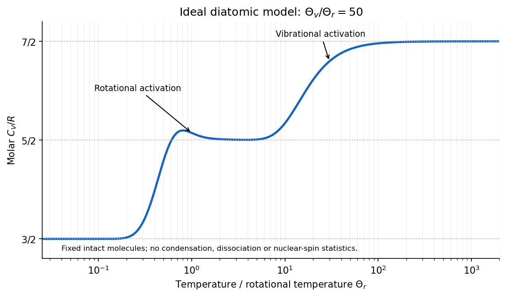

<h1 id="section-c/c11/solution">Solution</h1>

↑ **Parent:** [C11](../c11.md)

The classical [equipartition theorem](../../../../../equipartition-theorem.md) assigns mean [energy](../../../../../energy-split.md) $k_BT/2$ to each independent quadratic term in the Hamiltonian, provided the canonical distribution and its relevant boundary integrals exist. For a quadratic term $aq^2$, the [Boltzmann distribution](../../../../../boltzmann-distribution.md) is proportional to $e^{-\beta aq^2}$, with $\beta=1/(k_BT)$. Integrating a total derivative gives

$$
0=\int_{-\infty}^{\infty}\frac{d}{dq}\left(qe^{-\beta aq^2}\right)dq=\int e^{-\beta aq^2}dq-2\beta a\int q^2e^{-\beta aq^2}dq.
$$

After dividing by the normalization,

$$
\boxed{\langle aq^2\rangle=\frac1{2\beta}=\frac12k_BT.}
$$

The same argument applies to quadratic momentum terms. Other independent canonical coordinates factor out of the ratio. It is a classical statement: widely spaced quantum energy levels can freeze out a contribution at low [temperature](../../../../../temperature-split.md).

The confining quartic [potential energy](../../../../../potential-energy.md) $U(x)=Qx^4$, with $Q>0$, is not quadratic, so the $k_BT/2$ rule cannot be assigned to it. This does not invalidate the canonical [Boltzmann distribution](../../../../../boltzmann-distribution.md) or its generalized integration-by-parts identity. Indeed,

$$
0=\int_{-\infty}^{\infty}\frac{d}{dx}\left(xe^{-\beta Qx^4}\right)dx=Z_x-4\beta Q\int_{-\infty}^{\infty}x^4e^{-\beta Qx^4}dx.
$$

Hence [equipartition for a homogeneous potential](../../../../../equipartition-for-a-homogeneous-potential.md) gives

$$
\boxed{\langle U\rangle=Q\langle x^4\rangle=\frac14k_BT,\qquad C_{\rm potential}=\frac{d\langle U\rangle}{dT}=\frac14k_B.}
$$

Equivalently, $Z_x=\Gamma(1/4)(\beta Q)^{-1/4}/2$ and $-\partial\ln Z_x/\partial\beta=1/(4\beta)$. This is the potential contribution only; an additional standard kinetic term $p^2/(2m)$ would contribute a further $k_BT/2$ to [energy](../../../../../energy-split.md) and $k_B/2$ to [heat capacity](../../../../../heat-capacity.md).

For an intact diatomic molecule, the classical degrees of freedom comprise three translational quadratic terms, two rotational quadratic terms, and two terms for its one bond-stretching vibration: one kinetic and one potential. Thus complete classical equipartition predicts

$$
\boxed{C_{V,\rm molar}=\frac72R.}
$$

The [heat capacity of a diatomic gas](../../../../../heat-capacity-of-a-diatomic-gas.md) has lower-temperature regimes because rotational and vibrational levels are quantized. In a dilute molecular gas, the expected progression is

$$
\frac{C_V}{R}\simeq\begin{cases}
3/2,&\text{rotations and vibrations frozen},\\
5/2,&\text{rotations active, vibrations frozen},\\
7/2,&\text{rotations and vibrations active}.
\end{cases}
$$

The rotational energy scale is normally much smaller than the vibrational scale, so these steps are separated. The high-temperature value treats the vibration as harmonic and excludes dissociation and electronic excitation; the lowest-temperature gas regime is meaningful only while the sample remains dilute and gaseous.[§2.4, molecular rotation and vibration, and §3.4, quantum heat capacity of a diatomic gas](../../../../../statistical-physics-by-david-tong.md)

**[Figure 4](#section-c/c11/image-original-ideal-diatomic-heat-capacity-model-showing-rotational-and-vibrational-activation-without-dissociation). Original ideal diatomic heat-capacity model showing rotational and vibrational activation, without dissociation**.

The plotted example uses a quantum rigid rotor and harmonic vibration, with an illustrative ratio of characteristic temperatures. It is a model calculation, not measured data for a particular molecular species. For the vibrational part,

$$
\frac{C_{V,\rm vib}}R=\left(\frac{\Theta_v}{T}\right)^2\frac{e^{\Theta_v/T}}{(e^{\Theta_v/T}-1)^2},
$$

which tends to zero on freezing out and to one when many vibrational levels are accessible. The classical [equipartition theorem](../../../../../equipartition-theorem.md) is recovered when the relevant level spacings are small compared with $k_BT$.

## ↑ Ancestors (14)

1. [C11](../c11.md)
2. [Section C](../../section-c.md)
3. [Paper 2](../../../paper-2-split.md)
4. [2016](../../../split.md)
5. [Past exam of the physics B course of the University of Cambridge](../../../../split.md)
6. [Physics B course of the University of Cambridge](../../../../../physics-b-course-of-the-university-of-cambridge.md)
7. [Physics course of the year 2 of the natural sciences course of the University of Cambridge](../../../../../physics-course-of-the-year-2-of-the-natural-sciences-course-of-the-university-of-cambridge.md)
8. [Year 2 of the natural sciences course of the University of Cambridge](../../../../../year-2-of-the-natural-sciences-course-of-the-university-of-cambridge.md)
9. [Year of the natural sciences course of the University of Cambridge](../../../../../year-of-the-natural-sciences-course-of-the-university-of-cambridge.md)
10. [Natural sciences course of the University of Cambridge](../../../../../natural-sciences-course-of-the-university-of-cambridge.md)
11. [Course of the University of Cambridge](../../../../../course-of-the-university-of-cambridge.md)
12. [University of Cambridge](../../../../../university-of-cambridge-split.md)
13. [List of universities](../../../../../list-of-universities.md)
14. [Codex Wiki](../../../../../split.md)
