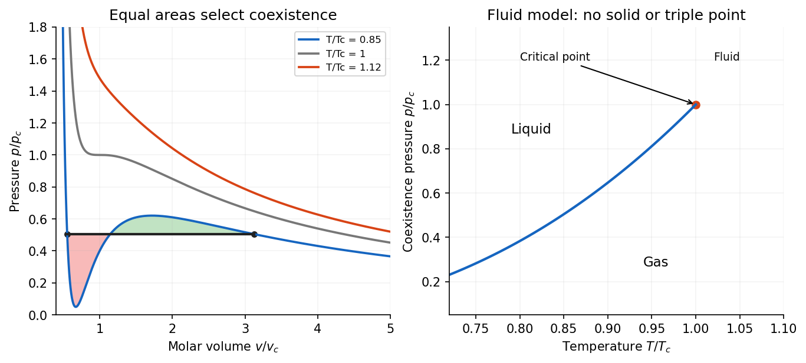

<h1 id="section-c/c13/solution">Solution</h1>

↑ **Parent:** [C13](../c13.md)

An [equation of state](../../../../../equation-of-state.md) relates thermodynamic variables within a material model; a [phase diagram](../../../../../phase-diagram.md) records which equilibrium phase or phases are stable under specified controls. For a pure substance at fixed [temperature](../../../../../temperature-split.md) and [pressure](../../../../../pressure-split.md), stability means minimizing [Gibbs free energy](../../../../../gibbs-free-energy.md). Two phases coexist when their molar [chemical potentials](../../../../../chemical-potential-split.md) agree. The equation of state and the free-energy stability condition must therefore be used together: an algebraic relation between $p,V,T$ alone need not identify the stable branch.

A pressure-temperature [phase diagram](../../../../../phase-diagram.md) contains single-phase regions separated by [phase coexistence curves](../../../../../phase-coexistence-curve.md). For a one-component system the [Gibbs phase rule](../../../../../phase-rule.md) gives $F=3-P$: a single phase has two independent controls, two-phase coexistence lies on a curve, and three phases coexist at a [triple point](../../../../../triple-point.md). The liquid-gas coexistence curve ends at a [liquid-gas critical point](../../../../../liquid-gas-critical-point.md); beyond it a continuous path connects liquidlike and gaslike states without crossing a first-order coexistence boundary. A fixed $p,T$ point on a coexistence curve does not specify the proportions of the two phases: an additional extensive constraint, such as total volume, fixes the phase fraction.

At a [first-order phase transition](../../../../../first-order-phase-transition.md), first derivatives of [Gibbs free energy](../../../../../gibbs-free-energy.md), such as molar entropy or volume, are discontinuous. The conversion has [latent heat](../../../../../latent-heat.md) $L=T\Delta s$. At a continuous transition the first derivatives match, while response functions associated with higher derivatives can be singular or discontinuous. At an ordinary liquid-gas critical endpoint, the two coexisting densities approach one another and the latent heat tends to zero; the material does not retain a sharp liquid-gas boundary above it.

The coexistence slope follows directly from equality of the two molar [chemical potentials](../../../../../chemical-potential-split.md). Since $d\mu=-s\,dT+v\,dp$, differentiating $\mu_\alpha=\mu_\beta$ along the boundary gives

$$
-\Delta s\,dT+\Delta v\,dp=0,\qquad \boxed{\frac{dp}{dT}=\frac{\Delta s}{\Delta v}=\frac{L}{T\Delta v}.}
$$

This is the exact [Clapeyron equation](../../../../../clausius-clapeyron-relation.md), also commonly called the [Clausius-Clapeyron relation](../../../../../clausius-clapeyron-relation.md). For vaporization, both $L$ and $\Delta v$ are positive, so the saturation pressure rises with [temperature](../../../../../temperature-split.md). For ordinary ice melting into liquid water, $L>0$ but the molar volume decreases, giving the familiar negative melting-curve slope. The sign follows from the volume change, not from a different law.

For a dilute ideal vapour with $v_g\gg v_l$, $\Delta v\simeq RT/p$. The [ideal-vapor Clausius-Clapeyron approximation](../../../../../ideal-vapor-clausius-clapeyron-approximation.md) becomes

$$
\frac{d\ln p_{\rm sat}}{dT}\simeq\frac{L}{RT^2}.
$$

If molar latent heat is approximately constant over the interval,

$$
\boxed{\ln\frac{p_{\rm sat}(T)}{p_{\rm sat}(T_0)}=-\frac LR\left(\frac1T-\frac1{T_0}\right).}
$$

These approximations deteriorate close to the critical point, where liquid and gas volumes become comparable, or over a range in which latent heat changes appreciably.[§5.1.2, coexistence slope and ideal-vapour approximation; surrounding discussion of the liquid-gas critical point and solid-liquid boundary](../../../../../statistical-physics-by-david-tong.md)

The [ideal gas law](../../../../../ideal-gas-law.md) $pV=nRT$ is an equation of state for a dilute gas, but it has no liquid branch and cannot predict condensation. A simple model including repulsion and attraction is the [Van der Waals molar equation](../../../../../van-der-waals-molar-equation.md),

$$
p=\frac{RT}{v-b}-\frac a{v^2},
$$

where $b>0$ represents excluded molar volume and $a>0$ represents attraction. At its critical point, $\partial p/\partial v=\partial^2p/\partial v^2=0$, giving

$$
\boxed{v_c=3b,\qquad p_c=\frac a{27b^2},\qquad T_c=\frac{8a}{27Rb}.}
$$

Below $T_c$, the homogeneous isotherm has an interval with $\partial p/\partial v>0$. That would have negative isothermal compressibility and is mechanically unstable. Equilibrium liquid-gas coexistence replaces the loop by a constant-pressure segment. Equality of chemical potentials gives the [Maxwell construction](../../../../../maxwell-construction.md):

$$
\boxed{p(v_l,T)=p(v_g,T)=p_*,\qquad\int_{v_l}^{v_g}[p(v,T)-p_*],dv=0.}
$$

The equal-area condition enforces the common tangent to the appropriate free energy; it is a stability construction rather than permission to follow the unstable loop physically. The average molar volume between $v_l$ and $v_g$ varies by changing the phase fraction.

**[Figure 5](#section-c/c13/image-original-reduced-van-der-waals-isotherms-and-equal-area-liquid-gas-coexistence-construction). Original reduced Van der Waals isotherms and equal-area liquid-gas coexistence construction**.

The model captures a liquid-gas critical point and qualitative coexistence, but its simple constants are not a complete quantitative description of real fluids and it has no solid phase. A full phase diagram needs additional solid free energies and can contain several crystal phases. Conversely, an experimentally determined coexistence curve and latent heat constrain equations of state through the [Clapeyron equation](../../../../../clausius-clapeyron-relation.md). This is the useful connection: local thermodynamic response, global free-energy stability and the geometry of phase boundaries describe the same material at different levels.

## ↑ Ancestors (14)

1. [C13](../c13.md)
2. [Section C](../../section-c.md)
3. [Paper 2](../../../paper-2-split.md)
4. [2016](../../../split.md)
5. [Past exam of the physics B course of the University of Cambridge](../../../../split.md)
6. [Physics B course of the University of Cambridge](../../../../../physics-b-course-of-the-university-of-cambridge.md)
7. [Physics course of the year 2 of the natural sciences course of the University of Cambridge](../../../../../physics-course-of-the-year-2-of-the-natural-sciences-course-of-the-university-of-cambridge.md)
8. [Year 2 of the natural sciences course of the University of Cambridge](../../../../../year-2-of-the-natural-sciences-course-of-the-university-of-cambridge.md)
9. [Year of the natural sciences course of the University of Cambridge](../../../../../year-of-the-natural-sciences-course-of-the-university-of-cambridge.md)
10. [Natural sciences course of the University of Cambridge](../../../../../natural-sciences-course-of-the-university-of-cambridge.md)
11. [Course of the University of Cambridge](../../../../../course-of-the-university-of-cambridge.md)
12. [University of Cambridge](../../../../../university-of-cambridge-split.md)
13. [List of universities](../../../../../list-of-universities.md)
14. [Codex Wiki](../../../../../split.md)
