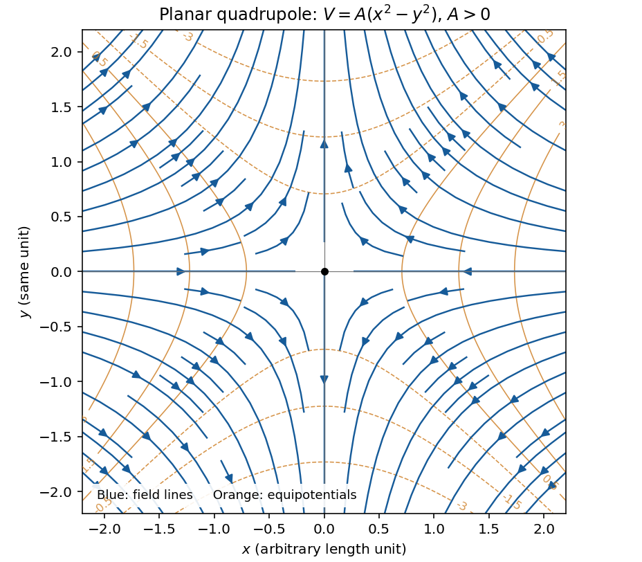
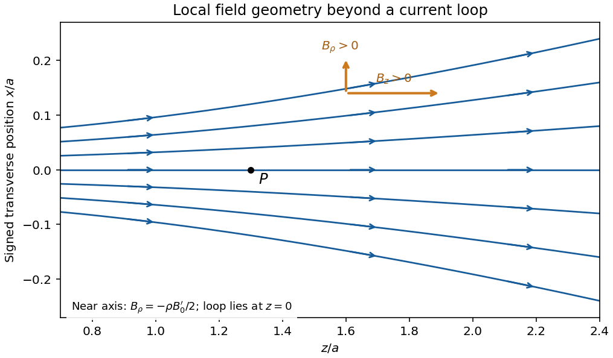
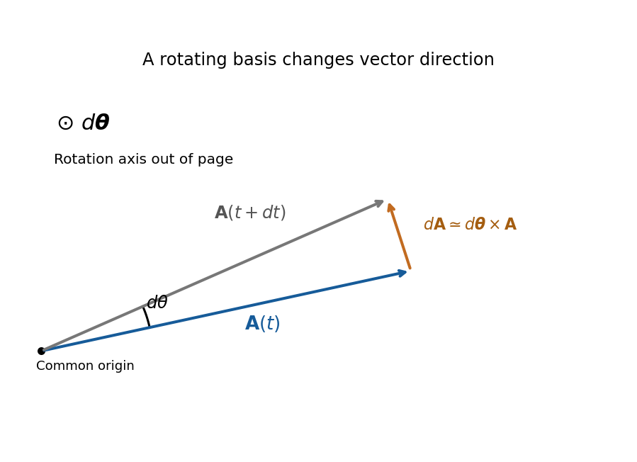
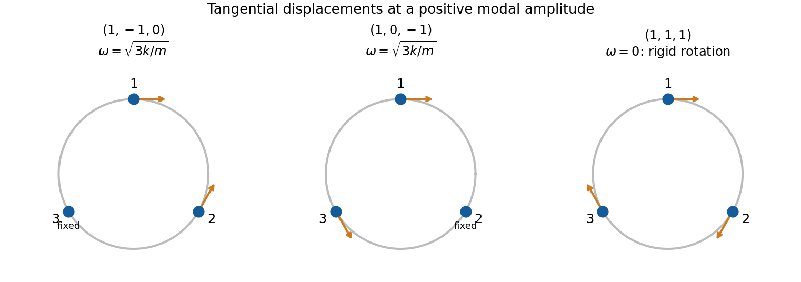

# Paper 1

↑ **Parent:** [2017](../2017.md)

[Original paper, released PDF pages 165–174](https://www.whatdotheyknow.com/request/natural_science_tripos_physics_e/response/2127325/attach/3/FOI%202022%20639%20Sullivan%20materials.pdf?cookie_passthrough=1#page=165)

Selected final answers: [Partial answer sheet, PDF page 175](https://www.whatdotheyknow.com/request/natural_science_tripos_physics_e/response/2127325/attach/3/FOI%202022%20639%20Sullivan%20materials.pdf?cookie_passthrough=1#page=175). This sheet does not cover every question.

**Table of contents**

- [Section A](#section-a)
  - [A1](#section-a/a1)
    - [Solution](#section-a/a1/solution)
  - [A2](#section-a/a2)
    - [Solution](#section-a/a2/solution)
  - [A3](#section-a/a3)
    - [Solution](#section-a/a3/solution)
  - [A4](#section-a/a4)
    - [Solution](#section-a/a4/solution)
  - [A5](#section-a/a5)
    - [Solution](#section-a/a5/solution)
- [Section B](#section-b)
  - [B6](#section-b/b6)
    - [Solution](#section-b/b6/solution)
  - [B7](#section-b/b7)
    - [Solution](#section-b/b7/solution)
  - [B8](#section-b/b8)
    - [Solution](#section-b/b8/solution)
  - [B9](#section-b/b9)
    - [Solution](#section-b/b9/solution)
- [Section C](#section-c)
  - [C10](#section-c/c10)
    - [Solution](#section-c/c10/solution)
  - [C11](#section-c/c11)
    - [Solution](#section-c/c11/solution)
  - [C12](#section-c/c12)
    - [Solution](#section-c/c12/solution)
  - [C13](#section-c/c13)
    - [Solution](#section-c/c13/solution)

## Section A

↑ **Parent:** [Paper 1](paper-1.md)

<h3 id="section-a/a1">A1</h3>

↑ **Parent:** [Section A](#section-a)

<h4 id="section-a/a1/solution">Solution</h4>

↑ **Parent:** [A1](#section-a/a1)

Write the plate area as $S$ and separation as $d$, so the original [capacitance](../../electromagnetism.md#capacitance) is $C=\varepsilon_0S/d$. Neglect edge fields. The greatest [capacitance](../../electromagnetism.md#capacitance) occurs when each material occupies half the plate area and spans the full separation. These two regions are [capacitors](../../electromagnetism.md#capacitor) in parallel, sharing the same [electric potential difference](../../electric-field.md#electric-potential-difference):

$$
\boxed{C_{\max}=\frac C2+\frac{\epsilon C}{2}
=\frac{1+\epsilon}{2}C.}
$$

The least [capacitance](../../electromagnetism.md#capacitance) occurs when a dielectric layer of thickness $d/2$ covers the whole area, leaving a vacuum layer of the same thickness. The two layers are [capacitors](../../electromagnetism.md#capacitor) in series: the normal [electric displacement field](../../electromagnetism.md#electric-displacement-field) is continuous and the voltage drops add. Their individual capacitances are $2\epsilon C$ and $2C$, giving

$$
\boxed{C_{\min}=\left(\frac1{2C}+\frac1{2\epsilon C}\right)^{-1}
=\frac{2\epsilon}{1+\epsilon}C.}
$$

The [arithmetic-harmonic bounds for dielectric capacitance](../../electromagnetism.md#arithmetic-harmonic-bounds-for-dielectric-capacitance) show that these are genuine extrema over other arrangements of the same two volumes, within the ideal parallel-plate model. A uniform trial [electric field](../../electric-field.md) in the fixed-voltage energy principle bounds $C$ above by the arithmetic mean of the two permittivities; a uniform trial [electric displacement field](../../electromagnetism.md#electric-displacement-field) in the fixed-charge principle bounds it below by their harmonic mean. The two layer arrangements attain those bounds. Both reduce to $C$ when $\epsilon=1$.

<h3 id="section-a/a2">A2</h3>

↑ **Parent:** [Section A](#section-a)

<h4 id="section-a/a2/solution">Solution</h4>

↑ **Parent:** [A2](#section-a/a2)

In steady rigid [rotation](../../riemannian-geometry.md#rotation-mathematics) of the liquid about its vertical axis, [centrifugal acceleration](../../mathematical-physics.md#centrifugal-acceleration) is $\Omega^2r$ outward. [Hydrostatic pressure](../../fluid-mechanics.md#hydrostatic-pressure) balance in the rotating frame gives

$$
\frac{\partial p}{\partial r}=\rho\Omega^2r,\qquad
\frac{\partial p}{\partial z}=-\rho g.
$$

The [free surface](../../fluid-mechanics.md#free-surface) is at constant atmospheric [pressure](../../pressure.md), so its slope obeys

$$
0=dp=\rho\Omega^2r\,dr-\rho g\,dz,
\qquad z-z_0=\frac{\Omega^2r^2}{2g}.
$$

Compare this [parabolic free surface of a rigidly rotating liquid](../../mathematical-physics.md#parabolic-free-surface-of-a-rigidly-rotating-liquid) with $z-z_0=r^2/(4f)$. For [focal length](../../geometrical-optics.md#focal-length) $f=1\ \mathrm m$,

$$
\boxed{\Omega=\sqrt{\frac{g}{2f}}
\simeq2.21\ \mathrm{rad\,s^{-1}}
\simeq21.1\ \mathrm{rev\,min^{-1}}.}
$$

Either sense of [rotation](../../riemannian-geometry.md#rotation-mathematics) gives the same shape. The result assumes the liquid has reached rigid [rotation](../../riemannian-geometry.md#rotation-mathematics) before solidifying and that surface-tension and solidification distortions can be neglected.

<h3 id="section-a/a3">A3</h3>

↑ **Parent:** [Section A](#section-a)

<h4 id="section-a/a3/solution">Solution</h4>

↑ **Parent:** [A3](#section-a/a3)

Use $x=\rho\cos\phi$, $y=\rho\sin\phi$ to recognize the [planar quadrupole potential](../../electrostatics.md#planar-quadrupole-potential), $V=A(x^2-y^2)$. Its [electric field](../../electric-field.md) is minus the [gradient](../../multivariable-calculus.md#gradient):

$$
\boxed{\mathbf E=(-2Ax,\,2Ay,\,0),}
$$

or, in [cylindrical coordinates](../../multivariable-calculus.md#cylindrical-coordinate-system),

$$
E_\rho=-2A\rho\cos2\phi,\qquad
E_\phi=2A\rho\sin2\phi,\qquad E_z=0.
$$

For $A>0$, arrows point toward the origin along the $x$ axis and away from it along the $y$ axis. The off-axis [electric field lines](../../electric-field.md#electric-field-line) satisfy

$$
\frac{dy}{dx}=\frac{E_y}{E_x}=-\frac yx,
\qquad \boxed{xy=\mathrm{constant}.}
$$

The axes themselves are the separating field lines; the origin is a field null. Reversing $A$ reverses every arrow. The field is independent of $z$, and $A$ has units $\mathrm{V\,m^{-2}}$.

**[Figure 1](#section-a/a3/image-original-calculated-electric-field-lines-and-equipotentials-for-the-planar-quadrupole-with-positive-a-arrows-approach-along-x-and-leave-along-y). Original calculated electric-field lines and equipotentials for the planar quadrupole with positive A; arrows approach along x and leave along y**.

<h3 id="section-a/a4">A4</h3>

↑ **Parent:** [Section A](#section-a)

<h4 id="section-a/a4/solution">Solution</h4>

↑ **Parent:** [A4](#section-a/a4)

First estimate the excess [pressure](../../pressure.md) as weight divided by contact area:

$$
\Delta p=\frac{mg}{S}
=\frac{50(9.81)}{10^{-4}}\ \mathrm{Pa}
\simeq4.91\times10^6\ \mathrm{Pa}.
$$

For the equilibrium estimate, use the [Clapeyron equation](../../thermodynamic-potential.md#clausius-clapeyron-relation) for [melting](../../critical-phenomenon.md#melting). The [specific volume](../../thermodynamics.md#specific-volume) change on melting is $\Delta v=1/\rho_w-1/\rho_i$, and the [latent heat of fusion](../../statistical-physics.md#latent-heat-of-fusion) $L$ gives $\Delta s=L/T_m$. Thus the [common-pressure melting-point slope](../../thermodynamic-potential.md#common-pressure-melting-point-slope) is

$$
\frac{dT_m}{dp}=\frac{T_m}{L}
\left(\frac1{\rho_w}-\frac1{\rho_i}\right).
$$

Take $T_m\simeq273.15\ \mathrm K$ and the usual rounded [water](../../chemical-substance.md#water) density $\rho_w\simeq1000\ \mathrm{kg\,m^{-3}}$, in addition to the supplied $\rho_i=920\ \mathrm{kg\,m^{-3}}$ and $L=3.3\times10^5\ \mathrm{J\,kg^{-1}}$. Then

$$
\frac{dT_m}{dp}\simeq-7.20\times10^{-8}\ \mathrm{K\,Pa^{-1}},
\qquad \Delta T_m\simeq-0.353\ \mathrm K,
$$

so

$$
\boxed{T_m\simeq272.80\ \mathrm K\simeq-0.35\,{}^\circ\mathrm C.}
$$

The sign is negative because [ice](../../chemical-substance.md#ice) contracts on melting. This is a linear equilibrium estimate treating the load as a common local [pressure](../../pressure.md) on coexisting ice and water. The actual contact [stress](../../continuum-mechanics.md#stress) is nonuniform, and frictional heating, deformation and drainage also affect skating; the estimate is not a complete account of the lubricating water film.

<h3 id="section-a/a5">A5</h3>

↑ **Parent:** [Section A](#section-a)

<h4 id="section-a/a5/solution">Solution</h4>

↑ **Parent:** [A5](#section-a/a5)

Cold air is denser than room air at approximately the same [pressure](../../pressure.md). The [ideal gas law](../../ideal-gas.md#ideal-gas-law) gives a fractional [mass density](../../fluid-mechanics.md#density) contrast of order $\Delta\rho/\rho\sim\Delta T/T$. The initial outflow is therefore a [gravity current](../../reduced-gravity.md#gravity-current) driven by [reduced gravity](../../reduced-gravity.md)

$$
g'=g\frac{\Delta\rho}{\rho}\sim g\frac{\Delta T}{T}.
$$

For an illustrative refrigerator height $H\sim1\ \mathrm m$, room [temperature](../../temperature.md) $T\sim295\ \mathrm K$ and [temperature](../../temperature.md) difference $\Delta T\sim20\ \mathrm K$, this gives $g'\sim0.66\ \mathrm{m\,s^{-2}}$. Balancing the released [potential energy](../../energy.md#potential-energy) with [kinetic energy](../../energy.md#kinetic-energy) gives $U\sim\sqrt{g'H}\sim0.8\ \mathrm{m\,s^{-1}}$. The [buoyancy exchange time of a cold-air enclosure](../../reduced-gravity.md#buoyancy-exchange-time-of-a-cold-air-enclosure) is consequently

$$
\boxed{t\sim\frac H{\sqrt{g'H}}=\sqrt{\frac H{g'}}
\sim1\text{–}2\ \mathrm s,\quad\text{of order seconds}.}
$$

Using constant [acceleration](../../classical-mechanics.md#acceleration) over height $H$ gives $\sqrt{2H/g'}\sim1.7\ \mathrm s$, consistent at this level. Warm air enters as cold air leaves, so unrestricted vacuum free fall is not the right [acceleration](../../classical-mechanics.md#acceleration) model. No dimensions or temperatures are specified in the source, so an order-of-magnitude estimate with explicit representative values is the appropriate result; shelves and mixing can delay complete replacement.

## Section B

↑ **Parent:** [Paper 1](paper-1.md)

<h3 id="section-b/b6">B6</h3>

↑ **Parent:** [Section B](#section-b)

<h4 id="section-b/b6/solution">Solution</h4>

↑ **Parent:** [B6](#section-b/b6)

**Images and uniqueness.** The [method of images](../../mathematics.md#method-of-images) replaces a conducting boundary by fictitious charges outside the physical field region. Choose them so that the resulting [electric potential](../../electric-field.md#electric-potential) satisfies the required conductor potentials. The [Uniqueness of the Dirichlet problem](../../analysis.md#uniqueness-of-the-dirichlet-problem) then guarantees the same physical exterior field. For example, a point charge $q$ at height $h$ above a grounded plane has an image $-q$ at height $-h$: the plane is an equipotential at zero, and the charge is attracted toward it by $q^2/(16\pi\varepsilon_0h^2)$. The image is a computational device; the physical conductor carries a continuous induced [surface charge density](../../electrostatics.md#surface-charge-density).

**Potential of a line.** Surround an infinite [line charge](../../electric-charge.md#line-charge) $\lambda$ by a coaxial Gaussian cylinder of radius $r$ and length $L$. [Gauss's law](../../maxwell-equations.md#gauss-s-law) gives $E_r(2\pi rL)=\lambda L/\varepsilon_0$, hence $E_r=\lambda/(2\pi\varepsilon_0r)$. Integrating $E_r=-dV/dr$ gives

$$
\boxed{V(r)-V(r_0)=-\frac\lambda{2\pi\varepsilon_0}\ln\frac r{r_0}.}
$$

Writing an additive constant instead is equivalent. The reference length makes the logarithm dimensionless; an isolated infinite line cannot be assigned a finite zero potential at infinity.

**Locating the two lines.** Put the grounded plane at $x=0$ and the physical cylinder at $(x,y)=(d,0)$, with axis along $z$ and radius $a<d$. Set $c=\sqrt{d^2-a^2}$, and place [line charges](../../electric-charge.md#line-charge) $+\lambda$ and $-\lambda$ at $(c,0)$ and $(-c,0)$. If $R_+$ and $R_-$ are their distances from an observation point, the [cylinder-plane image charges](../../mathematics.md#cylinder-plane-image-charges) give

$$
V(x,y)=\frac\lambda{2\pi\varepsilon_0}\ln\frac{R_-}{R_+},
\quad R_\pm^2=(x\mp c)^2+y^2.
$$

On $x=0$, $R_-=R_+$, so $V=0$. To check the cylinder, define $q=(d+c)/a$. The level set $R_-=qR_+$ is a circle: completing the square gives

$$
\left(x-c\frac{q^2+1}{q^2-1}\right)^2+y^2
=\left(\frac{2cq}{q^2-1}\right)^2.
$$

Since $d^2-c^2=a^2$, its centre is $d$ and radius is $a$. The positive line lies inside the cylinder; the negative line lies behind the plane. There is consequently no fictitious charge in the exterior physical region. A Gaussian contour around the cylinder encloses $+\lambda$ only, so the required physical charge per unit length is also correct. These boundary conditions and the far-field behaviour determine the physical solution by [Uniqueness of the Dirichlet problem](../../analysis.md#uniqueness-of-the-dirichlet-problem).

**Cylinder voltage.** The constant distance ratio on the cylinder immediately gives

$$
\boxed{V_c=\frac\lambda{2\pi\varepsilon_0}
\ln\frac{d+\sqrt{d^2-a^2}}a
=\frac\lambda{2\pi\varepsilon_0}\operatorname{arcosh}\frac da.}
$$

Its [capacitance per unit length](../../electromagnetism.md#capacitance-per-unit-length) is $C'=2\pi\varepsilon_0/\operatorname{arcosh}(d/a)$. In the thin-cable limit, $\operatorname{arcosh}(d/a)\simeq\ln(2d/a)$.

**Cable attraction.** Because the cable is idealized as infinite, the meaningful answer is [force](../../force.md) per unit length. For $a=0.020\ \mathrm m$, centre height $d\simeq10\ \mathrm m$ and $V_c=1.1\times10^4\ \mathrm V$,

$$
\lambda=\frac{2\pi\varepsilon_0V_c}{\operatorname{arcosh}(500)}
\simeq8.86\times10^{-8}\ \mathrm{C\,m^{-1}}.
$$

The [electrostatic attraction per unit length of a cylinder above a plane](../../mathematics.md#electrostatic-attraction-per-unit-length-of-a-cylinder-above-a-plane) is

$$
\boxed{f=\frac{\lambda^2}{4\pi\varepsilon_0\sqrt{d^2-a^2}}
\simeq7.05\times10^{-6}\ \mathrm{N\,m^{-1}},\qquad\text{downward}.}
$$

For example, this follows without any ambiguity about moving image positions from $F_d=\tfrac12V_c^2\,dC'/dd$ at fixed voltage, including the work of the voltage source. Its sign is negative because [capacitance](../../electromagnetism.md#capacitance) decreases with height. A cable length $L$ experiences approximately $fL$ downward when end effects are negligible. This is the electrostatic contribution only.

<h3 id="section-b/b7">B7</h3>

↑ **Parent:** [Section B](#section-b)

<h4 id="section-b/b7/solution">Solution</h4>

↑ **Parent:** [B7](#section-b/b7)

**Inductance and interface conditions.** For a linear coil, [self-inductance](../../electromagnetism.md#self-inductance) is the ratio $L=\Lambda/I$ of its own [magnetic flux linkage](../../electromagnetism.md#magnetic-flux-linkage) $\Lambda=N\Phi$ to current. Its induced [electromotive force](../../electric-charge.md#electromotive-force) is $-L\,dI/dt$ for fixed $L$. Across an interface with unit normal $\mathbf n$ from medium 1 to 2,

$$
\boxed{\mathbf n\cdot(\mathbf B_2-\mathbf B_1)=0,\qquad
\mathbf n\times(\mathbf H_2-\mathbf H_1)=\mathbf K_f.}
$$

These [electromagnetic boundary conditions](../../mathematical-physics.md#electromagnetic-boundary-condition) follow from [Gauss's law for magnetism](../../maxwell-equations.md#gauss-s-law-for-magnetism) and [Ampère's law](../../maxwell-equations.md#ampere-s-circuital-law). Here $\mathbf K_f$ is [free surface](../../fluid-mechanics.md#free-surface) current. At the iron–air faces there is no [free surface](../../fluid-mechanics.md#free-surface) current, so normal [magnetic flux density](../../magnetic-field.md) and tangential [magnetic field intensity](../../electromagnetism.md#magnetic-field-intensity) are continuous. In each isotropic linear medium, $\mathbf B=\mu_0\mu_r\mathbf H$.

**Complete core.** A slender [toroid](../../differential-geometry.md#toroid) has approximately uniform $H$ along mean path length $\ell$. [Ampère's law](../../maxwell-equations.md#ampere-s-circuital-law) gives $H\ell=NI$, so $B=\mu\mu_0NI/\ell$. The flux per turn is $\Phi=BA$, yielding the [inductance of a toroidal winding](../../electromagnetism.md#inductance-of-a-toroidal-winding),

$$
\boxed{L_0=\frac{N\Phi}{I}=\frac{\mu\mu_0N^2A}{\ell}.}
$$

This uses constant relative [magnetic permeability](../../maxwell-equations.md#permeability-electromagnetism) $\mu$ and neglects leakage, fringing and saturation.

**Why the gap lowers inductance.** The gap replaces an easy magnetic path in iron with air. Maintaining the same flux now requires a much larger [magnetic field intensity](../../electromagnetism.md#magnetic-field-intensity) in part of the path and therefore more ampere-turns. Equivalently, [magnetic reluctance](../../electromagnetism.md#magnetic-reluctance) increases, so the flux linkage for a fixed current and hence [self-inductance](../../electromagnetism.md#self-inductance) decrease. A narrow gap can matter greatly because its permeability is smaller by the factor $\mu$.

**Oblique-gap calculation.** In the original diagram $t$ is the perpendicular separation of the cut faces. Let $\mathbf s$ point along the core, and let $\mathbf n,\mathbf q$ be normal and tangential to the gap faces. With the face at angle $\theta$ to the core direction, $\mathbf s=\sin\theta\,\mathbf n+\cos\theta\,\mathbf q$. Write the core flux density as $B\mathbf s$. The boundary conditions give

$$
B_{g,n}=B\sin\theta,\qquad
H_{g,q}=\frac{B\cos\theta}{\mu\mu_0},
$$

so

$$
\mathbf H_g=\frac B{\mu_0}
\left(\sin\theta\,\mathbf n+\frac{\cos\theta}{\mu}\mathbf q\right).
$$

The gap area normal to its nearly normal field is $A/\sin\theta$, not $A$. Its leading reluctance is consequently $t\sin\theta/(\mu_0A)$. Adding the core reluctance gives the [inductance of a toroid with an oblique narrow air gap](../../electromagnetism.md#inductance-of-a-toroid-with-an-oblique-narrow-air-gap),

$$
NI\simeq\frac B{\mu_0}
\left(\frac\ell\mu+t\sin\theta\right),
\qquad L\simeq\frac{\mu_0N^2A}{\ell/\mu+t\sin\theta}.
$$

Thus at $\theta=45^\circ$,

$$
\boxed{L\simeq\frac{\mu\mu_0N^2A}{\ell+\mu t/\sqrt2}.}
$$

The approximation retains the possibly order-one ratio $\mu t/\ell$ while neglecting $t/\ell$, fringing and the small tangential gap contribution. More precisely, a local uniform-field path along the core, with missing iron length $t/\sin\theta$ subtracted, gives denominator $\ell/\mu+t\sin\theta(1-1/\mu)$. Its correction is beyond the stipulated large-$\mu$, narrow-gap accuracy; simply neglecting $\mu t$ would not be justified.

**Field in the slot.** The component expression above gives

$$
H_g=\frac B{\mu_0}\sqrt{\sin^2\theta+\frac{\cos^2\theta}{\mu^2}}.
$$

For the $45^\circ$ gap and $\mu\gg1$,

$$
\boxed{H_g\simeq\frac{B}{\sqrt2\mu_0}
\simeq\frac{NI}{t+\sqrt2\ell/\mu}.}
$$

Its units are $\mathrm{A\,m^{-1}}$. The field is almost perpendicular to the cut faces, rather than following the iron direction straight across the cut. Its small angle away from the face normal satisfies $\tan\alpha=1/\mu$ at $45^\circ$; the sense reverses if the current reverses.

<h3 id="section-b/b8">B8</h3>

↑ **Parent:** [Section B](#section-b)

<h4 id="section-b/b8/solution">Solution</h4>

↑ **Parent:** [B8](#section-b/b8)

**Field law and centre value.** The [Biot-Savart law](../../electromagnetism.md#biot-savart-law) for a steady thin wire is

$$
d\mathbf B=\frac{\mu_0I}{4\pi}
\frac{d\boldsymbol\ell'\times(\mathbf r-\mathbf r')}{|\mathbf r-\mathbf r'|^3}.
$$

Here $d\boldsymbol\ell'$ follows the conventional [electric current](../../electric-charge.md#electric-current) and the displacement points from source to observation point. For a circular loop of radius $a$, every element at the centre has distance $a$ and contributes in the same axial direction. Choose $+z$ by the [right-hand rule](../../electromagnetism.md#right-hand-rule). Then

$$
\boxed{\mathbf B(0)=\frac{\mu_0I}{4\pi a^2}(2\pi a)\widehat{\mathbf z}
=\frac{\mu_0I}{2a}\widehat{\mathbf z}.}
$$

**On-axis integration.** At axial distance $z$, every wire element has distance $\sqrt{a^2+z^2}$. Azimuthal symmetry cancels transverse components. Parameterizing $\mathbf r'=(a\cos\varphi,a\sin\varphi,0)$ gives axial cross-product element $a^2\,d\varphi$, so the [on-axis magnetic field of a circular current loop](../../electromagnetism.md#on-axis-magnetic-field-of-a-circular-current-loop) is

$$
\boxed{\mathbf B(0,z)=B_0(z)\widehat{\mathbf z},\qquad
B_0(z)=\frac{\mu_0Ia^2}{2(a^2+z^2)^{3/2}}.}
$$

It points the same way on the two halves of the axis; its strength is even in $z$.

**Directions near the axial point.** At a point on the positive axis the field is axial, but nearby lines spread outward because $B_0$ decreases as $z$ increases. On the negative-axis side they converge toward the axis while still progressing in the positive axial direction. There is no azimuthal field. The near-axis sketch shows this local spreading; the complete [magnetic field lines](../../magnetic-field.md#magnetic-field-line) return around the outside of the loop and form closed curves.

**[Figure 2](#section-b/b8/image-original-calculated-leading-near-axis-field-line-geometry-on-the-positive-side-of-a-circular-current-loop-the-lines-spread-as-the-axial-field-weakens). Original calculated leading near-axis field-line geometry on the positive side of a circular current loop; the lines spread as the axial field weakens**.

**Radial component from zero divergence.** Smooth axial symmetry gives $B_z(\rho,z)=B_0(z)+O(\rho^2)$ and $B_\rho=O(\rho)$. By [Gauss's law for magnetism](../../maxwell-equations.md#gauss-s-law-for-magnetism),

$$
\frac1\rho\partial_\rho(\rho B_\rho)+\partial_zB_z=0.
$$

Integrate radially from zero, excluding a singular $1/\rho$ term, to obtain the [near-axis radial magnetic field](../../maxwell-equations.md#near-axis-radial-magnetic-field), $B_\rho=-\rho B_0'(z)/2+O(\rho^3)$. Differentiating the axial field therefore gives

$$
\boxed{B_\rho\simeq
\frac{3\mu_0Ia^2z\rho}{4(a^2+z^2)^{5/2}}.}
$$

For $z>0$ it is outward; for $z<0$ it is inward. This supplies the direction reasoning used in the sketch.

**Force on the second loop.** Put the second loop at $z=d$ and radius $\rho=a$. For $d\gg a$, the radial field due to the first loop is $B_\rho\simeq3\mu_0Ia^3/(4d^4)$. The element $d\boldsymbol\ell=a\,d\varphi\,\widehat{\boldsymbol\varphi}$ experiences [Lorentz force](../../relativistic-electromagnetism.md#lorentz-force)

$$
d\mathbf F=I a\,d\varphi\left(B_z\widehat{\boldsymbol\rho}-B_\rho\widehat{\mathbf z}\right).
$$

The radial contributions cancel as vectors around the loop. The axial contributions add, giving the [force between distant coaxial current loops](../../magnetic-field.md#force-between-distant-coaxial-current-loops),

$$
\boxed{F_z=-2\pi aI B_\rho
\simeq-\frac{3\pi\mu_0I^2a^4}{2d^4}.}
$$

The sign follows $\widehat{\boldsymbol\varphi}\times\widehat{\boldsymbol\rho}=-\widehat{\mathbf z}$. Both the small radial coordinate relative to $d$ and the dipole approximation are justified by $a/d\ll1$.

**Force direction.** The second loop is pulled back toward the first: **the force is attractive** for the same current sense. Reversing one current reverses the [force](../../force.md). The much larger axial field chiefly produces radial element forces; retaining the smaller radial field is essential for the net axial attraction.

<h3 id="section-b/b9">B9</h3>

↑ **Parent:** [Section B](#section-b)

<h4 id="section-b/b9/solution">Solution</h4>

↑ **Parent:** [B9](#section-b/b9)

**Field equations.** In a homogeneous source-free nonmagnetic medium, $\mathbf D=\epsilon\varepsilon_0\mathbf E$ and $\mathbf B=\mu_0\mathbf H$. [Maxwell's equations](../../maxwell-equations.md) become

$$
\boxed{\nabla\cdot\mathbf E=0,\quad\nabla\cdot\mathbf H=0,\quad
\nabla\times\mathbf E=-\mu_0\partial_t\mathbf H,\quad
\nabla\times\mathbf H=\epsilon\varepsilon_0\partial_t\mathbf E.}
$$

The first equation follows from $\nabla\cdot\mathbf D=0$ for spatially constant nonzero $\epsilon$. When the effective relative [permittivity](../../permittivity.md) is negative below, its charge response is already included in $\mathbf D$; it must not also be counted as an extra free source.

**Amplitude relations and bulk dispersion.** Work with complex [phasors](../../wave.md#phasor) proportional to $e^{ikx-Kz-i\omega t}$. For $\mathbf H=(0,H_y,0)$, the [Ampere-Maxwell law](../../maxwell-equations.md#ampere-s-circuital-law) gives

$$
(KH_y,0,ikH_y)=-i\omega\epsilon\varepsilon_0(E_x,0,E_z),
$$

so the amplitudes must obey

$$
\boxed{E_x=\frac{iK}{\omega\epsilon\varepsilon_0}H_y,\qquad
E_z=-\frac{k}{\omega\epsilon\varepsilon_0}H_y.}
$$

They are not arbitrary independent constants: the dispersion relation alone would not make arbitrary amplitudes satisfy the equations. These relations give $ikE_x-KE_z=0$, so the electric divergence vanishes; the magnetic divergence vanishes because there is no $y$ dependence. The only nonzero component of [Faraday's law of induction](../../maxwell-equations.md#faraday-s-law-of-induction) is

$$
-KE_x-ikE_z=i\omega\mu_0H_y.
$$

Substitution then gives

$$
\boxed{k^2-K^2=\omega^2\epsilon\varepsilon_0\mu_0
=\frac{\omega^2\epsilon}{c^2}.}
$$

This proves that all four field equations hold for the specified [transverse magnetic polarization](../../electromagnetic-wave.md#transverse-magnetic-polarization) when both the amplitude relations and the dispersion relation are imposed.

**Interface matching.** Let region 1 be vacuum above the interface, with $\epsilon_1=1$, $K=\beta_1>0$; region 2 has $\epsilon_2=\epsilon$, $K=\beta_2<0$. These signs make the [evanescent](../../elasticity-physics.md#evanescent-wave) fields decay as $z\to\pm\infty$. In the absence of [free surface](../../fluid-mechanics.md#free-surface) current, tangential $H_y$ is continuous, giving a common interface amplitude. Tangential $E_x$ is also continuous, hence

$$
\frac{i\beta_1H_y}{\omega\varepsilon_0}
=\frac{i\beta_2H_y}{\omega\epsilon\varepsilon_0},
\qquad \boxed{\epsilon\beta_1=\beta_2.}
$$

Normal $D_z$ is continuous as well: both sides have $D_z=-kH_y/\omega$. This does not require $E_z$ itself to be continuous; the material can have polarization surface charge. The normal [magnetic field](../../magnetic-field.md) is zero on both sides.

**Existence and surface dispersion.** The opposite signs of $\beta_1$ and $\beta_2$ require $\epsilon<0$. The two bulk equations are

$$
k^2-\beta_1^2=\frac{\omega^2}{c^2},\qquad
k^2-\beta_2^2=\frac{\omega^2\epsilon}{c^2}.
$$

Use $\beta_2^2=\epsilon^2\beta_1^2$ to eliminate the decay constants. For the nontrivial interface branch,

$$
\boxed{k^2=\frac{\omega^2}{c^2}\frac\epsilon{\epsilon+1},\qquad
\beta_1^2=-\frac{\omega^2/c^2}{\epsilon+1}.}
$$

A positive $\beta_1^2$ together with real propagating $k$ gives **$\epsilon<-1$**. A negative [permittivity](../../permittivity.md) between $-1$ and zero is insufficient. This [lossless planar surface-plasmon dispersion](../../physics.md#lossless-planar-surface-plasmon-dispersion) describes a [surface plasmon polariton](../../physics.md#surface-plasmon-polariton); $\epsilon=1$ would instead be identical media and supplies no decaying bound mode.

**Frequency range and long wavelengths.** With $\epsilon=1-\omega_p^2/\omega^2$, the existence condition becomes

$$
\boxed{0<\omega<\frac{\omega_p}{\sqrt2}.}
$$

The upper value is a limiting [frequency](../../wave.md#frequency) approached as $k\to\infty$, not an attained maximum at finite $k$. Substitution into the dispersion relation gives

$$
k^2=\frac{\omega^2}{c^2}
\frac{\omega_p^2-\omega^2}{\omega_p^2-2\omega^2}.
$$

For $\omega\ll\omega_p$, choosing propagation in the positive $x$ direction,

$$
\boxed{k=\frac\omega c\left[1+\frac{\omega^2}{2\omega_p^2}
+O\left(\frac{\omega^4}{\omega_p^4}\right)\right]
\simeq\frac\omega c.}
$$

It approaches the vacuum light line from larger $k$. The vacuum decay constant is then $\beta_1\simeq\omega^2/(c\omega_p)$, so confinement becomes weak at low [frequency](../../wave.md#frequency). This calculation assumes the stated real, lossless effective [permittivity](../../permittivity.md); dissipation would require complex propagation and decay constants.

## Section C

↑ **Parent:** [Paper 1](paper-1.md)

<h3 id="section-c/c10">C10</h3>

↑ **Parent:** [Section C](#section-c)

<h4 id="section-c/c10/solution">Solution</h4>

↑ **Parent:** [C10](#section-c/c10)

**Changing basis and acceleration.** Attach orthonormal [unit vectors](../../vector-space.md#unit-vector) $\mathbf e_i(t)$ to the rotating frame, with a common origin fixed in the [inertial frame](../../mathematical-physics.md#inertial-frame). An infinitesimal [rotation](../../riemannian-geometry.md#rotation-mathematics) $d\boldsymbol\theta=\boldsymbol\omega\,dt$ changes a vector fixed in those axes by $d\mathbf A=d\boldsymbol\theta\times\mathbf A$: its tip moves tangentially to the circle about the [rotation](../../riemannian-geometry.md#rotation-mathematics) axis. More generally, write $\mathbf A=\sum_iA_i\mathbf e_i$. Differentiating the components and the rotating basis separately proves the [rotating-frame derivative formula](../../mathematical-physics.md#rotating-frame-derivative-formula),

$$
\boxed{\left.\frac{d\mathbf A}{dt}\right|_0
=\left.\frac{d\mathbf A}{dt}\right|_S
+\boldsymbol\omega\times\mathbf A.}
$$

**[Figure 3](#section-c/c10/image-original-geometric-construction-of-the-tangential-change-of-a-vector-during-a-small-positive-rotation-the-change-is-dtheta-crossed-with-a). Original geometric construction of the tangential change of a vector during a small positive rotation; the change is dtheta crossed with A**.

Apply the formula first to position: $\dot{\mathbf r}_0=\mathbf v+\boldsymbol\omega\times\mathbf r$, where $\mathbf v=(d\mathbf r/dt)_S$. Apply it again to both terms. For constant $\boldsymbol\omega$,

$$
\boxed{\ddot{\mathbf r}_0=\mathbf a
+2\boldsymbol\omega\times\mathbf v
+\boldsymbol\omega\times(\boldsymbol\omega\times\mathbf r).}
$$

One cross term comes from differentiating $\mathbf v$ in the inertial frame and another from differentiating $\mathbf r$ in $\boldsymbol\omega\times\mathbf r$. The displayed source formula implicitly requires constant [angular velocity](../../rigid-body-dynamics.md#angular-velocity) and an unaccelerated common origin. For changing [rotation](../../riemannian-geometry.md#rotation-mathematics) rate there is also $\dot{\boldsymbol\omega}\times\mathbf r$; an accelerating origin supplies its own translational [acceleration](../../classical-mechanics.md#acceleration). Moving the [rotation](../../riemannian-geometry.md#rotation-mathematics) terms to the [force](../../force.md) side gives the apparent [Coriolis force](../../mathematical-physics.md#coriolis-force) and [centrifugal force](../../mathematical-physics.md#centrifugal-force) with negative signs.

**Southward motion on Earth.** Use local east, north and up axes, with latitude $\lambda$ positive northward. Then $\boldsymbol\Omega=\Omega(0,\cos\lambda,\sin\lambda)$ and $\mathbf v=(0,-v,0)$. The [Coriolis acceleration in local Earth coordinates](../../mathematical-physics.md#coriolis-acceleration-in-local-earth-coordinates) gives

$$
\boxed{\mathbf F_{\rm cor}=-2m\boldsymbol\Omega\times\mathbf v
=-2m\Omega v\sin\lambda\,\mathbf e_E.}
$$

It is westward in the northern hemisphere, eastward in the southern hemisphere and zero for exactly southward motion at the equator. There is no vertical Coriolis component for this particular [velocity](../../classical-mechanics.md#velocity).

**Correct steering.** On the desired meridional track, [drag](../../fluid-mechanics.md#drag-physics) has no eastward component because it is antiparallel to the [velocity](../../classical-mechanics.md#velocity). If the [thrust](../../force.md#thrust) makes signed angle $\phi$ east of south, its eastward component is $T\sin\phi$. The cross-track [force](../../force.md) balance is therefore

$$
T\sin\phi-2m\Omega v\sin\lambda=0,
$$

so

$$
\boxed{\phi=\sin^{-1}\!\left(\frac{2m\Omega v\sin\lambda}{T}\right).}
$$

The argument must have magnitude at most one for this simple thrust-only correction to be feasible. The signed angle changes sign at the equator: correction is east of south in the north and west of south in the south. Thus the phrase “east of south” cannot describe a positive correction throughout the entire flight.

**Wrong-sign correction and the miss distance.** A literally constant [velocity](../../classical-mechanics.md#velocity) vector cannot develop a cross-track displacement. The physically useful interpretation of the last task is constant speed, with an erroneous lateral steering correction. In the usual leading-track model, [thrust](../../force.md#thrust) and [drag](../../fluid-mechanics.md#drag-physics) balance along the actual motion, and the applied transverse correction has the correct magnitude but the wrong sign. It therefore reinforces rather than cancels the [Coriolis force](../../mathematical-physics.md#coriolis-force). Starting at the equator, use the unperturbed southward track $\lambda\simeq-vt/R$, and let $x_E$ be the eastward departure from that track. To first order in the departure,

$$
\ddot x_E=-4\Omega v\sin\lambda
=4\Omega v\sin\frac{vt}{R},\qquad x_E(0)=\dot x_E(0)=0.
$$

There is a factor two relative to uncompensated Coriolis deflection because the wrong correction adds an equal lateral [force](../../force.md). Integration gives the [wrong-sign Coriolis steering error](../../mathematical-physics.md#wrong-sign-coriolis-steering-error),

$$
\dot x_E=4\Omega R\left(1-\cos\frac{vt}{R}\right),\qquad
x_E=4\Omega R\left[t-\frac Rv\sin\frac{vt}{R}\right].
$$

For southern angular distance $\Lambda=16\pi/180=0.27925$, $R=6.4\times10^6\ \mathrm m$ and $v=800/3.6=222.2\ \mathrm{m\,s^{-1}}$, the nominal flight time after the equator is

$$
t_f=\frac{R\Lambda}{v}\simeq8.04\times10^3\ \mathrm s=2.23\ \mathrm h.
$$

Taking $\Omega\simeq2\pi/(86400\ \mathrm s)$ gives

$$
\boxed{x_E(t_f)\simeq\frac{4\Omega R^2}{v}(\Lambda-\sin\Lambda)
\simeq1.94\times10^5\ \mathrm m,
\quad\text{about }200\ \mathrm{km\ east}.}
$$

The small-latitude approximation $\sin(vt/R)\simeq vt/R$ gives $\ddot x_E\simeq4\Omega v^2t/R$ and $x_E\simeq2\Omega v^2t^3/(3R)$, or $1.95\times10^5\ \mathrm m$, confirming the scale and direction.

This is an estimate under an explicit steering model, not an exact trajectory forced by the wording. For example, retaining spherical transport of the local axes while still linearizing in the cross-track motion gives, with $s=-\lambda$, $\dot u-(v/R)u\tan s=4\Omega v\sin s$. Consequently $u\cos s=2\Omega R\sin^2s$ and the longitude departure is $\Delta\ell=2\Omega R(\tan\Lambda-\Lambda)/v$. The distance along the destination parallel is then $R\cos\Lambda\,\Delta\ell\simeq1.93\times10^5\ \mathrm m$. Corrections from the changed track and a more detailed control law are not fixed by the problem. If “keeps the [velocity](../../classical-mechanics.md#velocity) constant” instead means the full vector, the pilot would need an additional compensating [force](../../force.md) and there would be no miss; if [thrust](../../force.md#thrust) is kept at a specified geographical bearing despite drift, its along-track component and lateral [drag](../../fluid-mechanics.md#drag-physics) must also be modelled.

<h3 id="section-c/c11">C11</h3>

↑ **Parent:** [Section C](#section-c)

<h4 id="section-c/c11/solution">Solution</h4>

↑ **Parent:** [C11](#section-c/c11)

**Radial energy and effective potential.** For a [central force](../../mathematical-physics.md#central-force) with [potential energy](../../energy.md#potential-energy) $U(r)$, [angular momentum conservation](../../momentum.md#conservation-of-angular-momentum) fixes $J=mr^2\dot\phi$ and confines motion to a plane. The [kinetic energy](../../energy.md#kinetic-energy) separates into radial and angular parts, giving

$$
\boxed{E=\frac12m\dot r^2+U_{\rm eff}(r),\qquad
U_{\rm eff}(r)=U(r)+\frac{J^2}{2mr^2}.}
$$

The second term is the [centrifugal barrier](../../mathematical-physics.md#centrifugal-barrier). It converts the radial motion to a one-dimensional energy problem: allowed radii have $E\geq U_{\rm eff}$, turning points have equality, and a circular orbit occurs at a stationary point of $U_{\rm eff}$. Stability of that radial orbit requires a local minimum.

**The first-order orbit equation.** Write $A=GMm$. Since $f=-dU/dr=-A/r^2-A\gamma/r^3$, choose zero potential at infinity to get

$$
U(r)=-\frac Ar-\frac{A\gamma}{2r^2},\qquad
U_{\rm eff}(r)=-\frac Ar+\frac{J^2-mA\gamma}{2mr^2}.
$$

Also $\dot r=(dr/d\phi)J/(mr^2)$. Substitute this into the energy equation and multiply by $2mr^4/J^2$:

$$
\boxed{\left(\frac{dr}{d\phi}\right)^2
-\frac{2mE}{J^2}r^4-\frac{2mA}{J^2}r^3
+\left(1-\frac{mA\gamma}{J^2}\right)r^2=0.}
$$

Here $\gamma$ has units of length. A regular bound orbit with a centrifugal barrier requires $J^2>mA\gamma$ as well as the appropriate negative energy.

**Solving in inverse radius.** Let $u=1/r$ and define

$$
q=1-\frac{mA\gamma}{J^2}>0,\qquad b=\frac{mA}{J^2}.
$$

Dividing the first-order equation by $r^4$ gives

$$
(u')^2+qu^2-2bu-\frac{2mE}{J^2}=0.
$$

Differentiating, or directly using the [Binet equation](../../celestial-mechanics.md#binet-equation), gives $u''+qu=b$. The continuation through turning points follows from this smooth second-order equation. Its noncircular bound solution, with angular origin at a pericentre, is

$$
u=\frac bq\left[1+e\cos(\sqrt q\,\phi)\right],\qquad
 e^2=1+\frac{2E(J^2-mA\gamma)}{mA^2},\quad0<e<1.
$$

Substitution into the first-order equation fixes the amplitude through this $e$. Therefore the requested representation holds with

$$
\boxed{\alpha_1=\frac{q}{be}
=\frac{J^2-mA\gamma}{mAe},\qquad
\alpha_2=\frac1e,\qquad
\alpha_3=\sqrt{1-\frac{mA\gamma}{J^2}},}
$$

since $\alpha_1/r-\alpha_2=\cos(\alpha_3\phi)$. A general angular origin replaces $\phi$ by $\phi-\phi_0$. This is the [orbit equation for combined inverse-square and inverse-cube attraction](../../celestial-mechanics.md#orbit-equation-for-combined-inverse-square-and-inverse-cube-attraction). The circular limit $e=0$ is regular in $u=b/q$ but is not represented by finite $\alpha_1,\alpha_2$ in the source's normalized cosine form.

**Precession and the inferred length.** The last expression immediately gives

$$
\boxed{\gamma=\frac{J^2(1-\alpha_3^2)}{mA}.}
$$

Successive pericentres occur after angular advance $2\pi/\alpha_3$, so the [apsidal precession](../../planetary-science.md#apsidal-precession) per orbit is

$$
\Delta\varpi=2\pi\left(\frac1{\alpha_3}-1\right).
$$

For $\alpha_3$ near one, $1-\alpha_3^2\simeq\Delta\varpi/\pi$. [Inferring an inverse-cube perturbation from apsidal precession](../../celestial-mechanics.md#inferring-an-inverse-cube-perturbation-from-apsidal-precession) consequently gives $\gamma\simeq[J^2/(mA)]\Delta\varpi/\pi$. For the stipulated nearly circular approximation, $J^2/(mA)\simeq r_0$, and [Kepler's third law](../../mathematical-physics.md#kepler-s-third-law) gives

$$
r_0\simeq\left[GM\left(\frac P{2\pi}\right)^2\right]^{1/3}
\simeq5.80\times10^{10}\ \mathrm m,
$$

using $P=88(86400)\ \mathrm s$, $M=2.0\times10^{30}\ \mathrm{kg}$ and $G=6.6743\times10^{-11}\ \mathrm{m^3\,kg^{-1}\,s^{-2}}$. A century contains about $36525/88=415.1$ orbits. Convert the observed advance to radians per orbit before using it:

$$
\Delta\varpi=\frac{43}{415.1}\frac{\pi}{180(3600)}
\simeq5.02\times10^{-7}\ \mathrm{rad}.
$$

Hence

$$
\boxed{\gamma\simeq\frac{(5.80\times10^{10})(5.02\times10^{-7})}{\pi}
\simeq9.3\times10^3\ \mathrm m\simeq9.3\ \mathrm{km}.}
$$

The positive sign strengthens the attraction and gives prograde precession. The fractional perturbation $\gamma/r_0\simeq1.6\times10^{-7}$ validates the small-deviation expansion. This is the parameter fitting the proposed phenomenological [force](../../force.md) law under the specified small-eccentricity approximation, not a derivation of that law as the physical explanation of Mercury's anomaly.

<h3 id="section-c/c12">C12</h3>

↑ **Parent:** [Section C](#section-c)

<h4 id="section-c/c12/solution">Solution</h4>

↑ **Parent:** [C12](#section-c/c12)

**Normal-mode idea.** Near a stable equilibrium, expand the [potential energy](../../energy.md#potential-energy) to quadratic order and the [kinetic energy](../../energy.md#kinetic-energy) as a quadratic form in generalized velocities. The [Euler-Lagrange equations](../../analysis.md#euler-lagrange-equation) then take the linear form $\mathsf M\ddot{\mathbf x}+\mathsf K\mathbf x=0$. A [normal mode](../../wave-equation.md#normal-mode) has fixed displacement ratios, $\mathbf x=\mathbf q\cos(\omega t+\varphi)$, with $\mathsf K\mathbf q=\omega^2\mathsf M\mathbf q$. Real systems admit this description for sufficiently small motion, before higher-order nonlinearities or strong damping matter. [Superposition](../../vector-space.md#superposition-principle) permits a general motion to be assembled from the modes. A free symmetry direction may instead be a [zero mode](../../linear-operator-theory.md#zero-mode), with constant or linearly changing coordinate.

**Lagrangian and bead equations.** Take each $x_i$ as an arc-length displacement positive in the same sense around the fixed circular wire. Spring length changes are $x_2-x_1$, $x_3-x_2$ and $x_1-x_3$. Equal equilibrium spring tensions give no net tangential [force](../../force.md); their linear energy terms sum to zero. Dropping an irrelevant constant, the [Lagrangian](../../calculus-of-variations.md#lagrangian) is

$$
\boxed{\mathcal L=\frac m2(\dot x_1^2+\dot x_2^2+\dot x_3^2)
-\frac k2\left[(x_2-x_1)^2+(x_3-x_2)^2+(x_1-x_3)^2\right].}
$$

For example, differentiating the potential with respect to $x_1$ gives $k(2x_1-x_2-x_3)$. The three [Euler-Lagrange equations](../../analysis.md#euler-lagrange-equation) therefore are

$$
\boxed{\begin{aligned}
m\ddot x_1&=-k(2x_1-x_2-x_3),\\
m\ddot x_2&=-k(2x_2-x_3-x_1),\\
m\ddot x_3&=-k(2x_3-x_1-x_2).
\end{aligned}}
$$

The wire supplies normal constraint forces but does no tangential work. These are the equal-mass case of the [normal modes of three beads connected by springs on a circular hoop](../../lagrangian-mechanics.md#normal-modes-of-three-beads-connected-by-springs-on-a-circular-hoop).

**Frequencies.** The stiffness matrix divided by $k$ is

$$
\mathsf K/k=\begin{pmatrix}2&-1&-1\\-1&2&-1\\-1&-1&2\end{pmatrix}
=3\mathsf I-\mathbf 1\mathbf 1^{\mathsf T},\qquad
\mathbf 1=(1,1,1)^{\mathsf T}.
$$

It annihilates $\mathbf 1$. On the two-dimensional subspace $q_1+q_2+q_3=0$, its action is multiplication by three. Thus the [angular frequencies](../../lagrangian-mechanics.md#angular-frequency) of the [normal modes](../../wave-equation.md#normal-mode) are

$$
\boxed{\omega_0=0,\qquad\omega_1=\omega_2=\sqrt{\frac{3k}{m}}.}
$$

The repeated [frequency](../../wave.md#frequency) is a [degeneracy of normal modes](../../wave-equation.md#degeneracy-of-normal-modes), while the zero [frequency](../../wave.md#frequency) expresses free rigid [rotation](../../riemannian-geometry.md#rotation-mathematics) of all beads along the wire.

**General solution.** Two independent vectors spanning the vibrating subspace are $\mathbf q_A=(1,-1,0)^{\mathsf T}$ and $\mathbf q_B=(1,0,-1)^{\mathsf T}$. Each amplitude satisfies $\ddot Q+\omega^2Q=0$, with $\omega=\sqrt{3k/m}$. The uniform coordinate satisfies $\ddot Q_0=0$. Hence

$$
\boxed{\mathbf x(t)=\mathbf q_A A\cos(\omega t+\phi)
+\mathbf q_B B\cos(\omega t+\psi)
+\mathbf 1(Ct+D).}
$$

The six freely specifiable real constants $A,\phi,B,\psi,C,D$ give the six initial data; $\omega$ is fixed by $k,m$ and is not an additional independent integration constant. The linear zero-mode term must be included to allow nonzero total tangential momentum.

**Shapes and uniqueness.** In the first term beads 1 and 2 have opposite equal displacements and bead 3 remains at its equilibrium position. In the second term beads 1 and 3 do this while bead 2 stays fixed. The last term moves all three identically, leaving spring extensions unchanged: $D$ is a rigid phase shift and $C$ a uniform drift around the wire. The sketches show positive modal amplitudes; all arrows reverse half a vibration period later.

**[Figure 4](#section-c/c12/image-original-displacement-sketches-for-two-independent-equal-frequency-bead-modes-and-the-rigid-rotation-zero-mode-arrows-indicate-displacement-along-the-ring-rather-than-its-radius). Original displacement sketches for two independent equal-frequency bead modes and the rigid-rotation zero mode; arrows indicate displacement along the ring rather than its radius**.

The two nonzero-[frequency](../../wave.md#frequency) [eigenvectors](../../linear-operator-theory.md#eigenvector) are not unique, because any independent linear combinations in their degenerate two-dimensional [eigenspace](../../linear-operator-theory.md#eigenspace) form an equally valid basis. In particular the displayed pair is independent but not orthogonal; one could use $(1,-1,0)$ and $(1,1,-2)$ instead. The zero [eigenspace](../../linear-operator-theory.md#eigenspace) is one-dimensional, so its vector is fixed up to scale and sign.

**Specified release.** Zero initial velocities permit $\phi=\psi=0$ and require $C=0$. At $t=0$, the three displacement conditions become $A+B+D=a$, $-A+D=0$, $-B+D=0$. Therefore one convenient set of constants is

$$
\boxed{A=B=D=\frac a3,\quad C=0,\quad\phi=\psi=0,
\quad\omega=\sqrt{3k/m}.}
$$

Equivalently,

$$
\boxed{x_1(t)=\frac a3[1+2\cos(\omega t)],\qquad
x_2(t)=x_3(t)=\frac a3[1-\cos(\omega t)].}
$$

Their sum remains $a$, as required by zero initial total tangential momentum. Alternative amplitude signs with compensating phase shifts represent the same motion.

<h3 id="section-c/c13">C13</h3>

↑ **Parent:** [Section C](#section-c)

<h4 id="section-c/c13/solution">Solution</h4>

↑ **Parent:** [C13](#section-c/c13)

**Constitutive law and Poisson ratio.** Use positive [stress](../../continuum-mechanics.md#stress) for tension. In an isotropic linearly elastic medium, [Hooke's law](../../elasticity-physics.md#hooke-s-law) gives

$$
\boxed{e_1=\frac{\tau_1-\sigma(\tau_2+\tau_3)}E.}
$$

The analogous equations follow by cyclic permutation. Under uniaxial tension in direction 1, $e_1=\tau_1/E$ and $e_2=e_3=-\sigma\tau_1/E$. Thus [Poisson's ratio](../../elasticity-physics.md#poisson-s-ratio) $\sigma=-e_2/e_1$ measures transverse contraction relative to longitudinal extension when the transverse stresses are zero. It is dimensionless; it is not the ratio of transverse [stress](../../continuum-mechanics.md#stress) to longitudinal [stress](../../continuum-mechanics.md#stress).

**Radial and hoop strains.** Let a material point originally at radius $r$ move to $r+R(r)$, with small axisymmetric displacement. Two neighbouring radii separated by $dr$ move apart by $dr+dR$, so the radial fractional extension is $dR/dr$. A circle's circumference changes from $2\pi r$ to $2\pi(r+R)$, so its fractional extension is $R/r$. Consequently

$$
\boxed{e_r=R'(r),\qquad e_\phi=\frac{R(r)}r.}
$$

The absence of longitudinal [stress](../../continuum-mechanics.md#stress) is a [plane stress](../../elasticity-physics.md#plane-stress) condition, not a claim of zero longitudinal [strain](../../continuum-mechanics.md#strain).

**Equilibrium of an annular wedge.** Consider a slice of unit axial length, radial thickness $dr$ and small angular width $d\phi$. The difference of the outward and inward radial face forces is $(r\tau_r)'dr\,d\phi$ to leading order. The two tangential face tensions have inward radial resultant $\tau_\phi dr\,d\phi$: each contributes $\tau_\phi dr\sin(d\phi/2)$. With no body [force](../../force.md), their balance gives the [radial equilibrium of a thick elastic cylinder](../../elasticity-physics.md#radial-equilibrium-of-a-thick-elastic-cylinder),

$$
\boxed{\tau_\phi=\frac d{dr}(r\tau_r)
=\tau_r+r\tau_r'.}
$$

This hoop contribution is why the radial [stress](../../continuum-mechanics.md#stress) need not be spatially constant in a thick wall.

**Displacement equation.** With $\tau_z=0$, the two [Hooke's law](../../elasticity-physics.md#hooke-s-law) equations read

$$
R'=\frac{\tau_r-\sigma\tau_\phi}E,\qquad
\frac Rr=\frac{\tau_\phi-\sigma\tau_r}E.
$$

Invert them:

$$
\tau_r=\frac E{1-\sigma^2}\left(R'+\sigma\frac Rr\right),\qquad
\tau_\phi=\frac E{1-\sigma^2}\left(\frac Rr+\sigma R'\right).
$$

Substitute in $\tau_\phi=(r\tau_r)'$. After cancelling the common factor, the right-hand side is $rR''+(1+\sigma)R'$, so

$$
\frac Rr+\sigma R'=rR''+(1+\sigma)R',
\qquad
\boxed{r^2R''+rR'-R=0.}
$$

The cancellation explains why this displacement equation does not depend on the value of [Poisson's ratio](../../elasticity-physics.md#poisson-s-ratio).

**Power laws and wall pressure.** Try $R\propto r^n$. The indicial equation is $n(n-1)+n-1=n^2-1=0$, so

$$
R=c_1r+\frac{c_2}r.
$$

The resulting [Lamé stress distribution in a pressurized cylindrical wall](../../elasticity-physics.md#lame-stress-distribution-in-a-pressurized-cylindrical-wall) can be written

$$
\tau_r=P-\frac Q{r^2},\qquad
\tau_\phi=P+\frac Q{r^2},
\quad P=\frac{Ec_1}{1-\sigma},\quad Q=\frac{Ec_2}{1+\sigma}.
$$

The [pressure](../../pressure.md) boundary tractions are $\tau_r(a)=-p_1$ and $\tau_r(b)=-p_0$. Solving them yields

$$
P=\frac{p_1a^2-p_0b^2}{b^2-a^2},\qquad
Q=\frac{(p_1-p_0)a^2b^2}{b^2-a^2}.
$$

Hence the positive compressive radial [pressure](../../pressure.md) in the wall is

$$
\boxed{p(r)=-\tau_r(r)=
\frac{p_0b^2-p_1a^2+(p_1-p_0)a^2b^2/r^2}{b^2-a^2},
\qquad a\leq r\leq b.}
$$

It equals $p_1$ at $a$ and $p_0$ at $b$. This directional radial [pressure](../../pressure.md) is not an isotropic fluid [pressure](../../pressure.md): radial and tangential stresses differ. The associated displacement is $R=[(1-\sigma)Pr+(1+\sigma)Q/r]/E$. Also $e_z=-\sigma(\tau_r+\tau_\phi)/E=-2\sigma P/E$, generally nonzero even though $\tau_z=0$.

**Maximum absolute tangential stress.** For $p_1>p_0$, $Q>0$ and $\tau_\phi'= -2Q/r^3<0$. Therefore the maximum of its absolute value must be at one of the two surfaces. Keeping the specified external [pressure](../../pressure.md) gives the fully general answer

$$
\boxed{\max_{a\leq r\leq b}|\tau_\phi(r)|
=\frac1{b^2-a^2}\max\left\{
\left|p_1(a^2+b^2)-2p_0b^2\right|,
\left|2p_1a^2-p_0(a^2+b^2)\right|
\right\}.}
$$

For the usual high internal [pressure](../../pressure.md) with negligible external [pressure](../../pressure.md), the largest magnitude is the tensile [stress](../../continuum-mechanics.md#stress) on the inner wall:

$$
\boxed{\tau_{\phi,\max}\simeq\tau_\phi(a)
=\frac{p_1(a^2+b^2)}{b^2-a^2}\quad(p_0\simeq0).}
$$

For finite $p_0$, the inner-wall expression is $[p_1(a^2+b^2)-2p_0b^2]/(b^2-a^2)$, but its absolute value is not always the larger endpoint value. For example, nearly equal internal and external pressures can leave the outer surface more compressive. With $p_1=p_0=p$, both stresses correctly reduce to $-p$ everywhere. These results use a homogeneous linear elastic wall without axial loading; a closed-ended pipe would require a different longitudinal-[stress](../../continuum-mechanics.md#stress) condition.

## ↑ Ancestors (11)

1. [2017](../2017.md)
2. [Past exam of the physics B course of the University of Cambridge](../../past-exam-of-the-physics-b-course-of-the-university-of-cambridge.md)
3. [Physics B course of the University of Cambridge](../../university-of-cambridge.md#physics-b-course-of-the-university-of-cambridge)
4. [Physics course of the year 2 of the natural sciences course of the University of Cambridge](../../university-of-cambridge.md#physics-course-of-the-year-2-of-the-natural-sciences-course-of-the-university-of-cambridge)
5. [Year 2 of the natural sciences course of the University of Cambridge](../../university-of-cambridge.md#year-2-of-the-natural-sciences-course-of-the-university-of-cambridge)
6. [Year of the natural sciences course of the University of Cambridge](../../university-of-cambridge.md#year-of-the-natural-sciences-course-of-the-university-of-cambridge)
7. [Natural sciences course of the University of Cambridge](../../university-of-cambridge.md#natural-sciences-course-of-the-university-of-cambridge)
8. [Course of the University of Cambridge](../../university-of-cambridge.md#course-of-the-university-of-cambridge)
9. [University of Cambridge](../../university-of-cambridge.md)
10. [List of universities](../../README.md#list-of-universities)
11. [Codex Wiki](../../README.md)
