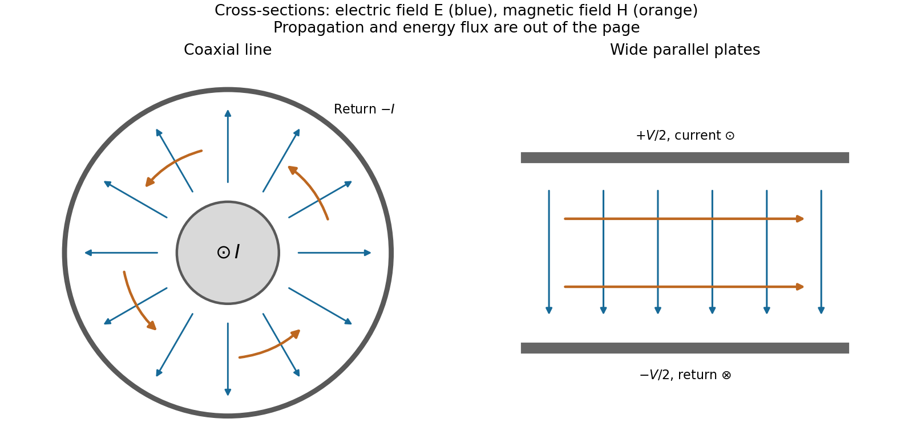
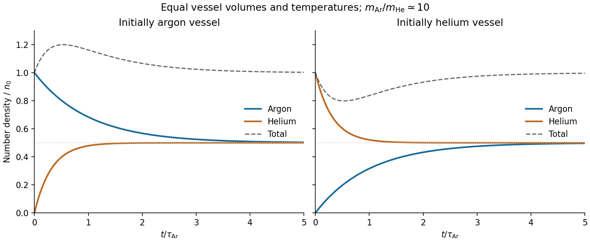

# Paper 2

↑ **Parent:** [2017](../2017.md)

[Original paper, released PDF pages 176–180](https://www.whatdotheyknow.com/request/natural_science_tripos_physics_e/response/2127325/attach/3/FOI%202022%20639%20Sullivan%20materials.pdf?cookie_passthrough=1#page=176)

Selected final answers: [Partial answer sheet, PDF page 181](https://www.whatdotheyknow.com/request/natural_science_tripos_physics_e/response/2127325/attach/3/FOI%202022%20639%20Sullivan%20materials.pdf?cookie_passthrough=1#page=181). This sheet does not cover every question.

**Table of contents**

- [Section A](#section-a)
  - [A1](#section-a/a1)
    - [Solution](#section-a/a1/solution)
  - [A2](#section-a/a2)
    - [Solution](#section-a/a2/solution)
  - [A3](#section-a/a3)
    - [Solution](#section-a/a3/solution)
  - [A4](#section-a/a4)
    - [Solution](#section-a/a4/solution)
  - [A5](#section-a/a5)
    - [Solution](#section-a/a5/solution)
- [Section B](#section-b)
  - [B6](#section-b/b6)
    - [a](#section-b/b6/a)
      - [Solution](#section-b/b6/a/solution)
    - [b](#section-b/b6/b)
      - [Solution](#section-b/b6/b/solution)
    - [c](#section-b/b6/c)
      - [Solution](#section-b/b6/c/solution)
    - [d](#section-b/b6/d)
      - [Solution](#section-b/b6/d/solution)
  - [B7](#section-b/b7)
    - [Solution](#section-b/b7/solution)
  - [B8](#section-b/b8)
    - [a](#section-b/b8/a)
      - [Solution](#section-b/b8/a/solution)
    - [b](#section-b/b8/b)
      - [Solution](#section-b/b8/b/solution)
    - [c](#section-b/b8/c)
      - [Solution](#section-b/b8/c/solution)
    - [d](#section-b/b8/d)
      - [Solution](#section-b/b8/d/solution)
  - [B9](#section-b/b9)
    - [Solution](#section-b/b9/solution)
- [Section C](#section-c)
  - [C10](#section-c/c10)
    - [Solution](#section-c/c10/solution)
    - [Diesel-cycle geometry](#section-c/c10/diesel-cycle-geometry)
      - [Solution](#section-c/c10/diesel-cycle-geometry/solution)
    - [State temperatures](#section-c/c10/state-temperatures)
      - [Solution](#section-c/c10/state-temperatures/solution)
    - [Heat exchanges and efficiency](#section-c/c10/heat-exchanges-and-efficiency)
      - [Solution](#section-c/c10/heat-exchanges-and-efficiency/solution)
    - [Limit of vanishing heat addition](#section-c/c10/limit-of-vanishing-heat-addition)
      - [Solution](#section-c/c10/limit-of-vanishing-heat-addition/solution)
  - [C11](#section-c/c11)
    - [Equations of state and transitions](#section-c/c11/equations-of-state-and-transitions)
      - [Solution](#section-c/c11/equations-of-state-and-transitions/solution)
    - [Isotherms and excluded volume](#section-c/c11/isotherms-and-excluded-volume)
      - [Solution](#section-c/c11/isotherms-and-excluded-volume/solution)
    - [a](#section-c/c11/a)
      - [Solution](#section-c/c11/a/solution)
    - [b](#section-c/c11/b)
      - [Solution](#section-c/c11/b/solution)
    - [c](#section-c/c11/c)
      - [Solution](#section-c/c11/c/solution)
    - [Phase-transition test](#section-c/c11/phase-transition-test)
      - [Solution](#section-c/c11/phase-transition-test/solution)
  - [C12](#section-c/c12)
    - [Solution](#section-c/c12/solution)
    - [Wall arrival rate](#section-c/c12/wall-arrival-rate)
      - [Solution](#section-c/c12/wall-arrival-rate/solution)
    - [Energy of incident particles](#section-c/c12/energy-of-incident-particles)
      - [Solution](#section-c/c12/energy-of-incident-particles/solution)
    - [Pressures in heated connected vessels](#section-c/c12/pressures-in-heated-connected-vessels)
      - [Solution](#section-c/c12/pressures-in-heated-connected-vessels/solution)
    - [Mixing by effusion](#section-c/c12/mixing-by-effusion)
      - [Solution](#section-c/c12/mixing-by-effusion/solution)
  - [C13](#section-c/c13)
    - [Solution](#section-c/c13/solution)

## Section A

↑ **Parent:** [Paper 2](paper-2.md)

<h3 id="section-a/a1">A1</h3>

↑ **Parent:** [Section A](#section-a)

<h4 id="section-a/a1/solution">Solution</h4>

↑ **Parent:** [A1](#section-a/a1)

Assume a hollow square [electromagnetic waveguide](../../electromagnetic-wave.md#electromagnetic-waveguide) with perfectly conducting walls, filled with [vacuum](../../physics.md#vacuum) or air. For side $a$, the [waveguide cutoff frequency](../../electromagnetic-wave.md#waveguide-cutoff-frequency) is

$$
f_{c,mn}=\frac{c}{2}\sqrt{\left(\frac m a\right)^2+\left(\frac n a\right)^2}.
$$

A transverse electric mode can have one zero index, but not both. A transverse magnetic mode requires both indices positive. Thus the lowest cutoff belongs to the two degenerate transverse electric modes $\mathrm{TE}_{10}$ and $\mathrm{TE}_{01}$, with

$$
\boxed{f_c=\frac{c}{2a}=\frac{2.9979\times10^8}{2\times10^{-2}}\,\mathrm{Hz}
\simeq15.0\,\mathrm{GHz}.}
$$

The corresponding cutoff [vacuum](../../physics.md#vacuum) [wavelength](../../wave-equation.md#wavelength) is $2a=2.0\,\mathrm{cm}$. Strictly, a travelling mode carrying [power](../../energy.md#power) along the guide needs $f>f_c$: at the cutoff itself, the axial [wavenumber](../../wave-equation.md#wavenumber) and [group velocity](../../dispersion-relation.md#group-velocity) are zero. The number above is therefore the lower [frequency](../../wave.md#frequency) threshold, not a propagating mode with nonzero longitudinal [energy flux](../../mathematical-physics.md#energy-flux) exactly at that [frequency](../../wave.md#frequency). A [dielectric](../../permittivity.md#dielectric) filling would replace $c$ by the wave [speed](../../classical-mechanics.md#speed) in that medium.

<h3 id="section-a/a2">A2</h3>

↑ **Parent:** [Section A](#section-a)

<h4 id="section-a/a2/solution">Solution</h4>

↑ **Parent:** [A2](#section-a/a2)

Treat the lake as a large [thermal reservoir](../../thermal-equilibrium.md#heat-bath) at $T_f=283.15\,\mathrm K$, and take the copper's [heat capacity](../../heat.md#heat-capacity) $C=50\,\mathrm{J\,K^{-1}}$ constant over the cooling interval from $T_i=783.15\,\mathrm K$. Although the actual cooling is irreversible, [entropy](../../entropy.md) is a state function, so its change can be calculated along a hypothetical reversible path:

$$
\Delta S_{\rm block}=\int_{T_i}^{T_f}\frac{C}{T}\,dT
=C\ln\left(\frac{T_f}{T_i}\right)
=\boxed{-50.9\,\mathrm{J\,K^{-1}}.}
$$

The lake receives $Q=C(T_i-T_f)=2.50\times10^4\,\mathrm J$ at constant [temperature](../../temperature.md), giving

$$
\Delta S_{\rm lake}=\frac{Q}{T_f}=88.3\,\mathrm{J\,K^{-1}}.
$$

Therefore, neglecting other changes,

$$
\boxed{\Delta S_{\rm Universe}=\Delta S_{\rm block}+\Delta S_{\rm lake}
=37.4\,\mathrm{J\,K^{-1}}>0.}
$$

The positive total is the [entropy](../../entropy.md) generated by transferring [heat](../../heat.md) across a finite [temperature](../../temperature.md) difference. The copper's [entropy](../../entropy.md) decreases, but the colder lake gains a greater amount.

<h3 id="section-a/a3">A3</h3>

↑ **Parent:** [Section A](#section-a)

<h4 id="section-a/a3/solution">Solution</h4>

↑ **Parent:** [A3](#section-a/a3)

Let $s(t)$ be the [length](../../physics.md#length) of the free straight segment from the current contact point to the [mass](../../classical-mechanics.md#mass), and let $\theta$ measure the contact point's [rotation](../../riemannian-geometry.md#rotation-mathematics) from first contact. For an inextensible taut rope, winding through angle $\theta$ uses [length](../../physics.md#length) $R\theta$:

$$
s=L-R\theta.
$$

The point [mass](../../classical-mechanics.md#mass) follows an [involute](../../algebraic-geometry.md#involute) of the pole's circular cross-section. Its instantaneous [velocity](../../classical-mechanics.md#velocity) is perpendicular to the free rope. To verify the geometry explicitly, use planar polar [unit vectors](../../vector-space.md#unit-vector) at the contact point:

$$
\mathbf x=R\mathbf e_r(\theta)+s\mathbf e_\theta(\theta),
\qquad \frac{d\mathbf x}{d\theta}
=(R+s')\mathbf e_\theta-s\mathbf e_r=-s\mathbf e_r.
$$

The rope's [tension](../../force.md#tension) therefore does no [work](../../energy.md#work), and the [speed](../../classical-mechanics.md#speed) stays at its initial value $v$. The geometry gives $v=s\dot\theta$. Consequently

$$
\frac{ds}{dt}=-R\dot\theta=-\frac{Rv}{s},
\qquad s^2=L^2-2Rvt.
$$

The distance from the pole's axis is $\sqrt{R^2+s^2}$, so a point [mass](../../classical-mechanics.md#mass) first reaches the pole when $s=0$. The [winding time around a circular pole](../../algebraic-geometry.md#winding-time-around-a-circular-pole) is thus

$$
\boxed{t_{\rm hit}=\frac{L^2}{2Rv}.}
$$

This has units of [time](../../classical-mechanics.md#time-in-physics). The model assumes a light inextensible rope, no [energy](../../energy.md) loss at contact and a point [mass](../../classical-mechanics.md#mass). The required [tension](../../force.md#tension) $mv^2/s$ diverges at the ideal final contact, so finite strength and size matter very close to impact.

<h3 id="section-a/a4">A4</h3>

↑ **Parent:** [Section A](#section-a)

<h4 id="section-a/a4/solution">Solution</h4>

↑ **Parent:** [A4](#section-a/a4)

The [symmetry](../../physics.md#symmetry-physics) is [electromagnetic reciprocity](../../electromagnetism.md#reciprocity-electromagnetism) applied to [mutual inductance](../../electromagnetism.md#mutual-inductance). For thin closed circuits in [vacuum](../../physics.md#vacuum), the magnetic [vector](../../vector-space.md#vector) potential generated by circuit B is

$$
\mathbf A_B(\mathbf r)=\frac{\mu_0I_B}{4\pi}\oint_B\frac{d\boldsymbol\ell_B}{|\mathbf r-\mathbf r_B|}.
$$

Stokes theorem converts the [magnetic flux](../../magnetic-field.md#magnetic-flux) through circuit A into its magnetic [vector](../../vector-space.md#vector) potential [circulation](../../vorticity.md#circulation-physics). Dividing by $I_B$ gives [Neumann's mutual-inductance formula](../../electromagnetism.md#neumann-s-mutual-inductance-formula),

$$
M_{AB}=\frac{\Phi_{A\leftarrow B}}{I_B}
=\frac{\mu_0}{4\pi}\oint_A\oint_B
\frac{d\boldsymbol\ell_A\cdot d\boldsymbol\ell_B}{|\mathbf r_A-\mathbf r_B|}.
$$

The [dot product](../../inner-product.md#dot-product) and separation are unchanged by interchanging A and B, so

$$
\boxed{M_{AB}=M_{BA}.}
$$

Each has units $\mathrm{Wb\,A^{-1}}=\mathrm H$. The winding orientations must be used consistently to determine the common sign. The same reciprocity holds in ordinary linear reciprocal magnetic media; it is not an unrestricted statement about biased nonreciprocal materials. Equivalently, a reversible [magnetic energy](../../electromagnetic-wave.md#magnetic-energy) function has equal mixed [derivatives](../../calculus.md#derivative) with respect to the two currents.

<h3 id="section-a/a5">A5</h3>

↑ **Parent:** [Section A](#section-a)

<h4 id="section-a/a5/solution">Solution</h4>

↑ **Parent:** [A5](#section-a/a5)

Assume all rings have the same [circulation](../../vorticity.md#circulation-physics) $\Gamma$ and orientation, and that there is no imposed background flow. [Vortex lines](../../vorticity.md#vortex-line) describe the direction of [vorticity](../../vorticity.md), not the direction of [velocity](../../classical-mechanics.md#velocity). For an incompressible [fluid](../../fluid-mechanics.md#fluid), the [velocity](../../classical-mechanics.md#velocity) induced by a thin [vortex filament](../../vorticity.md#vortex-filament) has the same Biot-Savart [integral](../../integral.md) form as the [magnetic field](../../magnetic-field.md) of a current filament:

$$
\mathbf u(\mathbf x)=\frac{\Gamma}{4\pi}\oint
\frac{d\boldsymbol\ell\times(\mathbf x-\mathbf x')}{|\mathbf x-\mathbf x'|^3}.
$$

A closely spaced coaxial array of [vortex rings](../../vorticity.md#vortex-ring) is therefore analogous to a solenoid. The [velocity field](../../fluid-mechanics.md#velocity-field) passes **along the common axis through the rings and returns outside a finite array**. Its orientation reverses if every [circulation](../../vorticity.md#circulation-physics) is reversed. In a long array, far from its ends and vortex cores, the [velocity field of a dense coaxial vortex-ring array](../../vorticity.md#velocity-field-of-a-dense-coaxial-vortex-ring-array) is approximately

$$
\boxed{\mathbf u\simeq\frac{\Gamma}{l}\widehat{\mathbf z}\quad(\rho<r),
\qquad \mathbf u\simeq0\quad(\rho>r).}
$$

The exterior field is exactly zero only in the ideal continuous infinitely long limit, with the background [velocity](../../classical-mechanics.md#velocity) set to zero. In a finite array the [streamlines](../../fluid-mechanics.md#streamline) spread out at one end, run back outside, and converge into the other. A large number of closely spaced rings alone does not guarantee that the total array [length](../../physics.md#length) greatly exceeds $r$; if it does not, the end and return flows remain substantial. Different unspecified ring circulations would require superposing their actual signed contributions.

**[Figure 1](#section-a/a5/image-induced-velocity-through-and-around-a-finite-array-of-co-oriented-vortex-rings). Induced velocity through and around a finite array of co-oriented vortex rings**. Original Biot-Savart calculation for 81 equal rings with spacing 0.1 radii and a small numerical core smoothing. Streamlines lie in a plane containing the common axis; the grey markers sample intersections with the vortex rings, rather than fluid trajectories. Flow returns outside the finite array.

## Section B

↑ **Parent:** [Paper 2](paper-2.md)

<h3 id="section-b/b6">B6</h3>

↑ **Parent:** [Section B](#section-b)

<h4 id="section-b/b6/a">a</h4>

↑ **Parent:** [B6](#section-b/b6)

<h5 id="section-b/b6/a/solution">Solution</h5>

↑ **Parent:** [A](#section-b/b6/a)

Maxwell's [displacement current](../../maxwell-equations.md#displacement-current) is the electric-field contribution needed to make [Ampère's law](../../maxwell-equations.md#ampere-s-circuital-law) consistent with [charge conservation](../../electric-charge.md#charge-conservation). In macroscopic form,

$$
\boxed{\nabla\times\mathbf H=\mathbf J_f+\frac{\partial\mathbf D}{\partial t}.}
$$

The [displacement current](../../maxwell-equations.md#displacement-current) density $\mathbf J_d=\partial_t\mathbf D$ has units $\mathrm{A\,m^{-2}}$. Since $\mathbf D=\epsilon_0\mathbf E+\mathbf P$, it contains the [vacuum](../../physics.md#vacuum) field term and, in matter, the polarization-current contribution. It need not represent [free charge](../../electric-charge.md#free-charge) moving through a material.

Taking the [divergence](../../multivariable-calculus.md#divergence) gives $0=\nabla\cdot\mathbf J_f+\partial_t(\nabla\cdot\mathbf D)$. [Gauss's law](../../maxwell-equations.md#gauss-s-law), $\nabla\cdot\mathbf D=\rho_f$, then yields the [continuity equation](../../mathematical-physics.md#continuity-equation) $\partial_t\rho_f+\nabla\cdot\mathbf J_f=0$. Without the [displacement](../../classical-mechanics.md#displacement) term, Ampère's original law would incorrectly require every current distribution to be divergence-free even while charge accumulates.

A charging parallel-plate [capacitor](../../electromagnetism.md#capacitor) makes this concrete. Ignoring fringing, $D=Q/A$, so the [displacement current](../../maxwell-equations.md#displacement-current) across its [dielectric](../../permittivity.md#dielectric) gap is $I_d=A\partial_tD=dQ/dt$, equal to the conduction [electric current](../../electric-charge.md#electric-current) in its wire. The [integral](../../integral.md) law

$$
\oint\mathbf H\cdot d\boldsymbol\ell
=\int_S\mathbf J_f\cdot d\mathbf S+\frac{d}{dt}\int_S\mathbf D\cdot d\mathbf S
$$

therefore gives the same answer whether the spanning surface cuts the wire or passes through the gap. Together with [Faraday's law](../../maxwell-equations.md#faraday-s-law-of-induction), this field term also permits self-consistent [electromagnetic waves](../../electromagnetic-wave.md) in [vacuum](../../physics.md#vacuum), with [speed](../../classical-mechanics.md#speed) $c=1/\sqrt{\mu_0\epsilon_0}$.

<h4 id="section-b/b6/b">b</h4>

↑ **Parent:** [B6](#section-b/b6)

<h5 id="section-b/b6/b/solution">Solution</h5>

↑ **Parent:** [B](#section-b/b6/b)

For a cold, unmagnetized, collisionless [plasma](../../physics.md#plasma-physics), take an equilibrium [electron](../../physics.md#electron) density $n_e$, [electrons](../../physics.md#electron) of [mass](../../classical-mechanics.md#mass) $m_e$ and charge $-e$, and approximately stationary ions. Use fields proportional to $e^{-i\omega t}$. The [electron](../../physics.md#electron) [displacement](../../classical-mechanics.md#displacement) satisfies

$$
m_e\ddot{\mathbf x}=-e\mathbf E,
\qquad \mathbf x=\frac{e\mathbf E}{m_e\omega^2}.
$$

Its [electric polarization](../../electromagnetism.md#polarization-density) is $\mathbf P=-n_ee\mathbf x$, hence the [cold collisionless plasma dielectric response](../../physics.md#cold-collisionless-plasma-dielectric-response)

$$
\boxed{\epsilon_r(\omega)=1-\frac{\omega_p^2}{\omega^2},
\qquad \omega_p^2=\frac{n_ee^2}{\epsilon_0m_e}.}
$$

The negative susceptibility arises from the inertial [electron](../../physics.md#electron) response, rather than a restoring [force](../../force.md) binding an [electron](../../physics.md#electron) to a particular atom.

A transverse [electromagnetic wave](../../electromagnetic-wave.md) then obeys

$$
k^2c^2=\omega^2\epsilon_r=\omega^2-\omega_p^2.
$$

For $\omega>\omega_p$, the [plasma](../../physics.md#plasma-physics) supports propagation, with [refractive index](../../electromagnetic-wave.md#refractive-index) $n_r=\sqrt{1-\omega_p^2/\omega^2}<1$. The [phase velocity](../../dispersion-relation.md#phase-velocity) is greater than $c$, while the [group velocity](../../dispersion-relation.md#group-velocity) is $c\sqrt{1-\omega_p^2/\omega^2}<c$; their product is $c^2$, and no superluminal [signal](../../electrical-engineering.md#signal) is implied. Below the [plasma frequency](../../physics.md#plasma-frequency), the bulk [wavenumber](../../wave-equation.md#wavenumber) is imaginary and the field is evanescent. A sufficiently thick [plasma](../../physics.md#plasma-physics) largely reflects such radiation in the lossless model.

Including an [electron](../../physics.md#electron) momentum-relaxation rate $\nu_c$ replaces the denominator by $\omega(\omega+i\nu_c)$:

$$
\epsilon_r=1-\frac{\omega_p^2}{\omega(\omega+i\nu_c)}.
$$

Its [imaginary part](../../complex-analysis.md#imaginary-part) describes absorption with the stated [time](../../classical-mechanics.md#time-in-physics) convention. Finite [electron](../../physics.md#electron) [temperature](../../temperature.md) also produces [plasma screening](../../physics.md#plasma-screening) of slowly varying electrostatic fields, with $\lambda_D=\sqrt{\epsilon_0k_BT_e/(n_ee^2)}$. That spatial, longitudinal screening problem is distinct from simply taking $\omega=0$ in the cold transverse-wave formula. Magnetic bias, ion motion and kinetic resonances require more general [dielectric](../../permittivity.md#dielectric) responses.

<h4 id="section-b/b6/c">c</h4>

↑ **Parent:** [B6](#section-b/b6)

<h5 id="section-b/b6/c/solution">Solution</h5>

↑ **Parent:** [C](#section-b/b6/c)

For weak fields in a linear isotropic material, [magnetization](../../electromagnetism.md#magnetization) is $\mathbf M=\chi_m\mathbf H$, with [magnetic susceptibility](../../statistical-physics.md#magnetic-susceptibility) $\chi_m$. **[Paramagnetism](../../electromagnetism.md#paramagnetism) has $\chi_m>0$**, while **[diamagnetism](../../electromagnetism.md#diamagnetism) has $\chi_m<0$**. In either case, $\mathbf B=\mu_0(\mathbf H+\mathbf M)=\mu_0(1+\chi_m)\mathbf H$. These weak responses generally disappear when the applied field is removed, unlike hysteretic [ferromagnetism](../../electromagnetism.md#ferromagnetism).

A paramagnet can contain permanent [magnetic moments](../../electromagnetism.md#magnetic-dipole-moment) from unpaired [electrons](../../physics.md#electron) or atomic [angular momentum](../../momentum.md#angular-momentum). Alignment lowers the [energy](../../energy.md) $-\boldsymbol\mu\cdot\mathbf B$, while thermal disorder opposes it. For independent classical moments of magnitude $\mu$, their weak-field average projection is $\mu^2B/(3k_BT)$, so

$$
\chi_m\simeq\frac{\mu_0n\mu^2}{3k_BT}.
$$

This is [Curie's law](../../statistical-physics.md#curie-s-law); it assumes weak [magnetization](../../electromagnetism.md#magnetization) and no important interactions between moments. With quantum [angular momentum](../../momentum.md#angular-momentum) $J$, replace $\mu^2$ by $(g\mu_B)^2J(J+1)$. Strong-field [magnetization](../../electromagnetism.md#magnetization) saturates instead of growing linearly without limit. Conduction [electrons](../../physics.md#electron) also exhibit [Pauli paramagnetism](../../quantum-ideal-gas-statistics.md#pauli-paramagnetism): only occupations near the [Fermi surface](../../fermi-liquid.md#fermi-surface) readily redistribute between [spin](../../angular-momentum-operator.md#spin) states, giving a nearly temperature-independent susceptibility when $T\ll T_F$.

[Diamagnetism](../../electromagnetism.md#diamagnetism) is an induced orbital response opposing the applied [magnetic field](../../magnetic-field.md). For bound [electrons](../../physics.md#electron), a weak field changes orbital motion and induces an opposing [magnetic moment](../../electromagnetism.md#magnetic-dipole-moment). For an isotropic collection of atoms, the elementary orbital estimate is

$$
\chi_{\rm dia}=-\frac{\mu_0ne^2}{6m_e}\sum_j\langle r_j^2\rangle,
$$

where the sum runs over the [electrons](../../physics.md#electron) of one atom. It is usually small and weakly [temperature](../../temperature.md) dependent. Delocalized [electrons](../../physics.md#electron) also have orbital Landau [diamagnetism](../../electromagnetism.md#diamagnetism); for an ideal three-dimensional free [electron](../../physics.md#electron) [gas](../../thermodynamics.md#gas) with a quadratic isotropic dispersion and [electron spin](../../angular-momentum-operator.md#electron-spin) with $g=2$, $\chi_L=-\chi_P/3$. Both [spin](../../angular-momentum-operator.md#spin) and orbital contributions must be included to determine the total response. [Diamagnetism](../../electromagnetism.md#diamagnetism) is not a consequence of permanent dipoles choosing to align against the field; that orientation would increase their [energy](../../energy.md).

<h4 id="section-b/b6/d">d</h4>

↑ **Parent:** [B6](#section-b/b6)

<h5 id="section-b/b6/d/solution">Solution</h5>

↑ **Parent:** [D](#section-b/b6/d)

The [Poynting vector](../../electromagnetic-wave.md#poynting-vector) is the [electromagnetic energy](../../electromagnetic-wave.md#electromagnetic-energy) flux density,

$$
\boxed{\mathbf S=\mathbf E\times\mathbf H,\qquad [\mathbf S]=\mathrm{W\,m^{-2}}.}
$$

In [vacuum](../../physics.md#vacuum) it equals $\mathbf E\times\mathbf B/\mu_0$. For a linear nondispersive medium with time-independent constitutive coefficients, [Maxwell's equations](../../maxwell-equations.md) and the identity $\nabla\cdot(\mathbf E\times\mathbf H)=\mathbf H\cdot\nabla\times\mathbf E-\mathbf E\cdot\nabla\times\mathbf H$ give [Poynting's theorem](../../electromagnetic-wave.md#poynting-theorem),

$$
\frac{\partial u_{\rm EM}}{\partial t}+\nabla\cdot\mathbf S=-\mathbf J_f\cdot\mathbf E,
\qquad
u_{\rm EM}=\frac12\mathbf E\cdot\mathbf D+\frac12\mathbf B\cdot\mathbf H.
$$

The source term is [work](../../energy.md#work) done by the fields on free charges; for an Ohmic conductor it is the positive [local Joule heating rate](../../electric-charge.md#local-joule-heating-rate) $\sigma E^2$. Integrating over a [volume](../../thermodynamics.md#volume-thermodynamics) states that loss of stored field [energy](../../energy.md) plus outward [energy](../../energy.md) flow equals [energy](../../energy.md) transferred to matter. In dispersive media, such as a [plasma](../../physics.md#plasma-physics), material motion contributes to stored [energy](../../energy.md) and the simple nondispersive expression cannot be used indiscriminately.

For a [vacuum](../../physics.md#vacuum) [plane wave](../../wave-function.md#plane-wave), $B=E/c$ and $\mathbf E$, $\mathbf H$ and the propagation direction form a right-handed triad. With real peak field $E_0$, the time-averaged [wave intensity](../../wave.md#intensity-physics) is

$$
\langle S\rangle=\frac{E_0^2}{2\mu_0c}=\frac12\epsilon_0cE_0^2.
$$

More generally, complex peak amplitudes give $\langle\mathbf S\rangle=\tfrac12\operatorname{Re}(\mathbf E_0\times\mathbf H_0^*)$. Along a [transmission line](../../electrical-engineering.md#transmission-line), the cross-section [integral](../../integral.md) of the longitudinal [Poynting vector](../../electromagnetic-wave.md#poynting-vector) is the transmitted electrical [power](../../energy.md#power) $VI$. [Energy](../../energy.md) flows through the electromagnetic fields in the surrounding [dielectric](../../permittivity.md#dielectric), even though the conductors guide the currents.

<h3 id="section-b/b7">B7</h3>

↑ **Parent:** [Section B](#section-b)

<h4 id="section-b/b7/solution">Solution</h4>

↑ **Parent:** [B7](#section-b/b7)

**Distributed circuit model.** A [transmission line](../../electrical-engineering.md#transmission-line) must be treated as a distributed system when its propagation [time](../../classical-mechanics.md#time-in-physics) is appreciable compared with the [signal](../../electrical-engineering.md#signal) timescale. Divide a uniform two-conductor line into elements of [length](../../physics.md#length) $dx$. Each has series resistance $R'dx$ and [inductance](../../electromagnetism.md#inductance) $L'dx$, and shunt [electrical conductance](../../electric-charge.md#electrical-conductance) $G'dx$ and [capacitance](../../electromagnetism.md#capacitance) $C'dx$. The primes denote quantities per unit [length](../../physics.md#length), with units $\mathrm{\Omega\,m^{-1}}$, $\mathrm{H\,m^{-1}}$, $\mathrm{S\,m^{-1}}$ and $\mathrm{F\,m^{-1}}$, respectively.

Kirchhoff's [voltage](../../random-walk.md#voltage) and current laws give the [Telegrapher's equations](../../electrical-engineering.md#telegrapher-s-equations):

$$
\boxed{\frac{\partial V}{\partial x}=-R'I-L'\frac{\partial I}{\partial t},
\qquad \frac{\partial I}{\partial x}=-G'V-C'\frac{\partial V}{\partial t}.}
$$

For a lossless line, $R'=G'=0$, differentiation gives $V_{xx}=L'C'V_{tt}$ and the same [wave equation](../../wave-equation.md) for $I$. The propagation [speed](../../classical-mechanics.md#speed) and [characteristic impedance](../../electrical-engineering.md#characteristic-impedance) are

$$
\boxed{u=\frac1{\sqrt{L'C'}},\qquad Z_0=\sqrt{\frac{L'}{C'}}.}
$$

A general lossless [signal](../../electrical-engineering.md#signal) has $V=V^+(t-x/u)+V^-(t+x/u)$ and $I=[V^+(t-x/u)-V^-(t+x/u)]/Z_0$. Thus [characteristic impedance](../../electrical-engineering.md#characteristic-impedance) is the [voltage](../../random-walk.md#voltage)/current ratio of one travelling wave, not simply the resistance of the wires. It can be real even when the line dissipates no [energy](../../energy.md), because [energy](../../energy.md) is carried away by propagation.

For sinusoidal quantities with convention $e^{i\omega t}$, the general lossy-line formulas are

$$
\gamma_{\rm prop}=\sqrt{(R'+i\omega L')(G'+i\omega C')},
\qquad Z_0=\sqrt{\frac{R'+i\omega L'}{G'+i\omega C'}}.
$$

Choose the square-root branches for forward attenuation and positive forward [power](../../energy.md#power). The [real part](../../complex-analysis.md#real-part) of $\gamma_{\rm prop}$ is attenuation per unit [length](../../physics.md#length); its [imaginary part](../../complex-analysis.md#imaginary-part) is the phase [wavenumber](../../wave-equation.md#wavenumber). For small losses, attenuation is approximately $R'/(2Z_0)+G'Z_0/2$, using the lossless real $Z_0$ in this estimate.

**Fields and geometry.** Two separated conductors support a [transverse electromagnetic mode](../../electromagnetic-wave.md#transverse-electromagnetic-mode), with electric and [magnetic fields](../../magnetic-field.md) transverse to the propagation axis. For a homogeneous [dielectric](../../permittivity.md#dielectric) and negligible conductor penetration, both examples below have $L'C'=\mu\epsilon$ and hence $u=1/\sqrt{\mu\epsilon}$. The distributed circuit model follows from the field [energy](../../energy.md) and charges in each slice.

For a [coaxial cable](../../electrical-engineering.md#coaxial-cable) with inner radius $a$ and inner surface of the outer conductor at $b$, [Gauss's law](../../maxwell-equations.md#gauss-s-law) and [Ampère's law](../../maxwell-equations.md#ampere-s-circuital-law) give

$$
E_\rho=\frac{V}{\rho\ln(b/a)},\qquad H_\phi=\frac{I}{2\pi\rho},\quad a<\rho<b.
$$

The [electric field](../../electric-field.md) is radial and the [magnetic field](../../magnetic-field.md) circles the axis. Integration of [voltage](../../random-walk.md#voltage) and field [energy](../../energy.md) gives

$$
C'=\frac{2\pi\epsilon}{\ln(b/a)},\qquad
L'=\frac{\mu}{2\pi}\ln(b/a),\qquad
\boxed{Z_0=\frac1{2\pi}\sqrt{\frac\mu\epsilon}\ln\frac ba.}
$$

The equal and opposite return current on the outer conductor confines the ideal external field to the annulus.

For wide parallel plates of width $w$ separated by $d\ll w$, neglect fringing. The [electric field](../../electric-field.md) crosses the gap, $E\simeq V/d$, while the [magnetic field](../../magnetic-field.md) lies in the gap parallel to the plates and perpendicular to propagation, $H\simeq I/w$. Therefore

$$
C'=\frac{\epsilon w}{d},\qquad L'=\frac{\mu d}{w},\qquad
\boxed{Z_0=\frac d w\sqrt{\frac\mu\epsilon}.}
$$

For a forward wave, $\mathbf E\times\mathbf H$ points along the line. Integrating this [Poynting vector](../../electromagnetic-wave.md#poynting-vector) over either cross-section gives instantaneous [power](../../energy.md#power) $VI$. For complex peak amplitudes, average [power](../../energy.md#power) is $\operatorname{Re}(VI^*)/2$, or $|V^+|^2/(2Z_0)$ for a single forward wave on a lossless line. The conductors guide an [energy flux](../../mathematical-physics.md#energy-flux) predominantly in the [dielectric](../../permittivity.md#dielectric) between them.

**[Figure 2](#section-b/b7/image-electric-and-magnetic-fields-in-coaxial-and-parallel-plate-transmission-lines). Electric and magnetic fields in coaxial and parallel-plate transmission lines**. Original transverse cross-sections for a forward TEM wave. Blue arrows show the electric field and orange arrows the magnetic field strength. Dots denote current out of the page and crosses current into it. Parallel-plate edge fields and coaxial conductor penetration are neglected.

**Terminations and reflection.** At a load $Z_L$, require $V_L=Z_LI_L$. If $V^+$ and $V^-$ are the incident and reflected [voltage](../../random-walk.md#voltage) amplitudes there, the total current is $(V^+-V^-)/Z_0$. Thus

$$
\boxed{\Gamma_V=\frac{V^-}{V^+}=\frac{Z_L-Z_0}{Z_L+Z_0},\qquad \Gamma_I=-\Gamma_V.}
$$

A matched load, $Z_L=Z_0$, absorbs the incident [power](../../energy.md#power) with no reflection. An [open circuit](../../electrical-circuit.md#open-circuit) has $\Gamma_V=+1$, a current node and a doubled [voltage](../../random-walk.md#voltage) at the end. A [short circuit](../../electrical-circuit.md#short-circuit) has $\Gamma_V=-1$, a [voltage](../../random-walk.md#voltage) node and a doubled current there. A purely reactive load on a lossless line has $|\Gamma_V|=1$ and accepts no average [power](../../energy.md#power). For real $Z_0$, the reflected [power](../../energy.md#power) fraction is $|\Gamma_V|^2$ and the accepted fraction is $1-|\Gamma_V|^2$.

Incident and reflected waves produce a standing-wave pattern with [voltage](../../random-walk.md#voltage) [standing wave ratio](../../electrical-engineering.md#standing-wave-ratio) $(1+|\Gamma_V|)/(1-|\Gamma_V|)$. The [input impedance](../../electrical-circuit.md#input-impedance) of a lossless [length](../../physics.md#length) $\ell$ is

$$
Z_{\rm in}=Z_0\frac{Z_L+iZ_0\tan(k\ell)}{Z_0+iZ_L\tan(k\ell)}.
$$

This gives $iZ_0\tan(k\ell)$ for a short and $-iZ_0\cot(k\ell)$ for an open. A quarter-wave section gives $Z_{\rm in}=Z_0^2/Z_L$, enabling impedance transformation. After a source launches a pulse, a distant termination affects it only after the reflected pulse returns; the return [time](../../classical-mechanics.md#time-in-physics) is $2\ell/u$. Real conductor resistance, [dielectric loss](../../permittivity.md#dielectric-loss) and departures from a TEM field profile limit the ideal model at high [frequency](../../wave.md#frequency).

<h3 id="section-b/b8">B8</h3>

↑ **Parent:** [Section B](#section-b)

<h4 id="section-b/b8/a">a</h4>

↑ **Parent:** [B8](#section-b/b8)

<h5 id="section-b/b8/a/solution">Solution</h5>

↑ **Parent:** [A](#section-b/b8/a)

An Euler strut is a slender elastic column under axial compression. Let its [bending stiffness](../../elasticity-physics.md#bending-stiffness) about the weaker section axis be $EI_A$ and its [length](../../physics.md#length) be $L$. With small lateral deflection $y(x)$ and a dead compressive load $P$, the quadratic total [potential energy](../../energy.md#potential-energy) is

$$
\Pi[y]=\frac12\int_0^L EI_A(y'')^2\,dx
-\frac P2\int_0^L(y')^2\,dx.
$$

The first term is bending [energy](../../energy.md); the negative term is [work](../../energy.md#work) released by the load as bending shortens the end-to-end distance. Stationarity gives $EI_Ay''''+Py''=0$. For pinned ends, $y=y''=0$ at $0,L$, and $y\propto\sin(n\pi x/L)$ requires $P_n=n^2\pi^2EI_A/L^2$. The first instability is [Euler's critical load](../../elasticity-physics.md#euler-s-critical-load),

$$
\boxed{P_{\rm cr}=\frac{\pi^2EI_A}{L^2}.}
$$

Below this load, the straight state has positive quadratic [energy](../../energy.md) against these perturbations. At the threshold, the lowest bending mode has zero quadratic restoring [energy](../../energy.md); above it the straight state is unstable. For a rectangular section, $I_A=bh^3/12$ about the appropriate bending axis, so the smaller [second moment of area](../../elasticity-physics.md#second-moment-of-area) controls the first buckling direction.

Endpoint [constraints](../../classical-mechanics.md#constraint-mechanics) matter. Write $P_{\rm cr}=\pi^2EI_A/(KL)^2$: $K=1$ for pinned-pinned, $2$ for fixed-free and $1/2$ for fixed-fixed conditions. This elastic instability differs from compressive material failure. Imperfections cause bending before the ideal threshold, and a short column may yield before [Euler buckling](../../elasticity-physics.md#euler-s-critical-load) occurs.

<h4 id="section-b/b8/b">b</h4>

↑ **Parent:** [B8](#section-b/b8)

<h5 id="section-b/b8/b/solution">Solution</h5>

↑ **Parent:** [B](#section-b/b8/b)

A [gravitational assist](../../celestial-mechanics.md#gravitational-assist) changes a spacecraft's [velocity](../../classical-mechanics.md#velocity) relative to the Sun by scattering it in the [gravitational field](../../physics.md#gravitational-field) of a moving planet. In the planet's rest frame, ignore other [forces](../../force.md) during the encounter and take the spacecraft [mass](../../classical-mechanics.md#mass) negligible. The incoming and outgoing asymptotic [velocities](../../classical-mechanics.md#velocity) have equal magnitude,

$$
|\mathbf u_{\rm in}|=|\mathbf u_{\rm out}|=u_\infty,
$$

because the encounter is conservative, but their directions differ along a hyperbolic [orbit](../../dynamical-systems.md#orbit-dynamical-system). If the planet has approximately constant heliocentric [velocity](../../classical-mechanics.md#velocity) $\mathbf V_p$, the heliocentric spacecraft [velocities](../../classical-mechanics.md#velocity) are $\mathbf v_{\rm in,out}=\mathbf V_p+\mathbf u_{\rm in,out}$. Its specific [energy](../../energy.md) change is

$$
\boxed{\Delta\mathcal E=\frac12(v_{\rm out}^2-v_{\rm in}^2)
=\mathbf V_p\cdot(\mathbf u_{\rm out}-\mathbf u_{\rm in}).}
$$

Thus a flyby can increase or decrease heliocentric [energy](../../energy.md) depending on its geometry. The planet exchanges [momentum](../../momentum.md) and orbital [energy](../../energy.md) with the spacecraft; its [speed](../../classical-mechanics.md#speed) change is extremely small because its [mass](../../classical-mechanics.md#mass) is much greater. There is no [energy](../../energy.md) creation and no increase of asymptotic [speed](../../classical-mechanics.md#speed) in the planet's own frame.

For a point-mass planet, [conservation of energy](../../mathematical-physics.md#conservation-of-energy) and [angular momentum](../../momentum.md#angular-momentum) gives the hyperbolic eccentricity and deflection angle

$$
e=1+\frac{r_pu_\infty^2}{GM_p},\qquad
\delta=2\sin^{-1}(1/e),
\qquad \tan\frac\delta2=\frac{GM_p}{b u_\infty^2},
$$

where $r_p$ is [periapsis](../../celestial-mechanics.md#periapsis) distance and $b$ the [impact parameter](../../classical-mechanics.md#impact-parameter). The velocity-vector change has magnitude $2u_\infty\sin(\delta/2)$, so the maximum energy-change magnitude for this fixed deflection is $2V_pu_\infty\sin(\delta/2)$. A small [periapsis](../../celestial-mechanics.md#periapsis) increases the turning angle, but [collision](../../classical-mechanics.md#collision), atmosphere and [tidal forces](../../newton-s-law-of-universal-gravitation.md#tidal-force) limit how close a real spacecraft may pass. Multiple encounters allow large changes without expending the propellant that equivalent direct [velocity](../../classical-mechanics.md#velocity) changes would require.

<h4 id="section-b/b8/c">c</h4>

↑ **Parent:** [B8](#section-b/b8)

<h5 id="section-b/b8/c/solution">Solution</h5>

↑ **Parent:** [C](#section-b/b8/c)

Take axes fixed in a [rigid body](../../rigid-body-dynamics.md), chosen along its [principal axes](../../rigid-body-dynamics.md#principal-axis), with moments of inertia $I_1,I_2,I_3$. The [angular momentum](../../momentum.md#angular-momentum) components are $H_i=I_i\omega_i$. Newton's rotational equation is $\boldsymbol\tau=(d\mathbf H/dt)_{\rm inertial}$, while the rotating-frame transport rule gives

$$
\left(\frac{d\mathbf H}{dt}\right)_{\rm inertial}
=\left(\frac{d\mathbf H}{dt}\right)_{\rm body}+\boldsymbol\omega\times\mathbf H.
$$

Thus [Euler's equations](../../rigid-body-dynamics.md#euler-s-equations-rigid-body-dynamics) are

$$
\boxed{\begin{aligned}
I_1\dot\omega_1+(I_3-I_2)\omega_2\omega_3&=\tau_1,\\
I_2\dot\omega_2+(I_1-I_3)\omega_3\omega_1&=\tau_2,\\
I_3\dot\omega_3+(I_2-I_1)\omega_1\omega_2&=\tau_3.
\end{aligned}}
$$

The nonlinear cross terms arise because the [principal axes](../../rigid-body-dynamics.md#principal-axis) rotate. Even with no external [torque](../../momentum.md#torque), the body-frame components of [angular momentum](../../momentum.md#angular-momentum) can vary while the [angular momentum](../../momentum.md#angular-momentum) [vector](../../vector-space.md#vector) stays fixed in inertial space.

With zero [torque](../../momentum.md#torque), the equations conserve

$$
E=\tfrac12\sum_i I_i\omega_i^2,\qquad
H^2=\sum_iI_i^2\omega_i^2.
$$

Uniform [rotation](../../riemannian-geometry.md#rotation-mathematics) about any [principal axis](../../rigid-body-dynamics.md#principal-axis) is a torque-free solution. If $I_1<I_2<I_3$, [linearization](../../algebra.md#linearization) about the intermediate-axis solution $\omega_2=\Omega$ gives

$$
\delta\ddot\omega_1=\Omega^2\frac{(I_2-I_1)(I_3-I_2)}{I_1I_3}\delta\omega_1.
$$

The positive coefficient gives exponential growth: intermediate-axis [rotation](../../riemannian-geometry.md#rotation-mathematics) is unstable, whereas [rotation](../../riemannian-geometry.md#rotation-mathematics) about the largest or smallest moment is linearly stable. For a symmetric body, [Euler's equations](../../rigid-body-dynamics.md#euler-s-equations-rigid-body-dynamics) also describe the [precession](../../rigid-body-dynamics.md#precession) of the transverse [angular velocity](../../rigid-body-dynamics.md#angular-velocity) around its [symmetry](../../physics.md#symmetry-physics) axis. [Torques](../../momentum.md#torque) from gravity or an applied couple enter through the right-hand sides rather than being absorbed into the inertial cross terms.

<h4 id="section-b/b8/d">d</h4>

↑ **Parent:** [B8](#section-b/b8)

<h5 id="section-b/b8/d/solution">Solution</h5>

↑ **Parent:** [D](#section-b/b8/d)

[Archimedes' principle](../../fluid-mechanics.md#archimedes-principle) states that the resultant [hydrostatic pressure](../../fluid-mechanics.md#hydrostatic-pressure) [force](../../force.md) on a body equals the weight of the [fluid](../../fluid-mechanics.md#fluid) displaced, directed opposite to gravity. Let $V_d$ be the displaced [fluid](../../fluid-mechanics.md#fluid) region, with outward normal $\widehat{\mathbf n}$ from the body into the [fluid](../../fluid-mechanics.md#fluid). Since the [fluid](../../fluid-mechanics.md#fluid) [pressure](../../pressure.md) [force](../../force.md) is inward,

$$
\mathbf F_b=-\oint_{\partial V_d}p\widehat{\mathbf n}\,dA
=-\int_{V_d}\nabla p\,dV.
$$

Hydrostatic balance is $\nabla p=\rho_f\mathbf g$, with downward [gravitational acceleration](../../newton-s-law-of-universal-gravitation.md#gravitational-acceleration) $\mathbf g$. Therefore

$$
\boxed{\mathbf F_b=-\int_{V_d}\rho_f\mathbf g\,dV
=-\rho_fV_d\mathbf g}
$$

for uniform [fluid](../../fluid-mechanics.md#fluid) density and gravity. Uniform atmospheric [pressure](../../pressure.md) gives no net [force](../../force.md) on a closed surface. For a floating body, the same displaced-volume construction includes the free surface; any significant air [buoyancy](../../fluid-mechanics.md#buoyancy) can be included as a second displaced [fluid](../../fluid-mechanics.md#fluid).

A freely floating body of [mass](../../classical-mechanics.md#mass) $m$ satisfies $mg=\rho_f gV_d$, so its displaced [volume](../../thermodynamics.md#volume-thermodynamics) is $m/\rho_f$. A homogeneous body of density $\rho_b<\rho_f$ floats with submerged fraction $\rho_b/\rho_f$; if $\rho_b>\rho_f$, hydrostatic [buoyancy](../../fluid-mechanics.md#buoyancy) alone cannot support it. The [buoyant force](../../fluid-mechanics.md#buoyancy) acts through the [centre of buoyancy](../../fluid-mechanics.md#centre-of-buoyancy), the [centroid](../../euclidean-geometry.md#centroid) of the displaced [volume](../../thermodynamics.md#volume-thermodynamics) for constant density, while weight acts through the [centre of mass](../../classical-mechanics.md#center-of-mass). Their relative positions determine rotational equilibrium and stability. For a fully submerged body, a [centre of mass](../../classical-mechanics.md#center-of-mass) below the [centre of buoyancy](../../fluid-mechanics.md#centre-of-buoyancy) gives a restoring [torque](../../momentum.md#torque); a floating body's changing displaced shape additionally requires the [metacentric height](../../fluid-mechanics.md#metacentric-height) criterion. [Surface tension](../../surface-tension.md), externally driven flow and contact [forces](../../force.md) can alter the simple [force](../../force.md) balance.

<h3 id="section-b/b9">B9</h3>

↑ **Parent:** [Section B](#section-b)

<h4 id="section-b/b9/solution">Solution</h4>

↑ **Parent:** [B9](#section-b/b9)

**Following the moving [fluid](../../fluid-mechanics.md#fluid).** The Eulerian [velocity field](../../fluid-mechanics.md#velocity-field) $\mathbf u(\mathbf x,t)$ assigns a [velocity](../../classical-mechanics.md#velocity) to each position. A [fluid](../../fluid-mechanics.md#fluid) [particle](../../physics.md#particle-physics) satisfies $\dot{\mathbf x}=\mathbf u$, so the [chain rule](../../calculus.md#chain-rule) gives the [material derivative](../../continuum-mechanics.md#material-derivative), also called the convective [derivative](../../calculus.md#derivative),

$$
\boxed{\frac D{Dt}=\frac\partial{\partial t}+\mathbf u\cdot\nabla,
\qquad \mathbf a=\frac{D\mathbf u}{Dt}.}
$$

Even in steady flow a [particle](../../physics.md#particle-physics) can accelerate because it moves between regions with different [velocity](../../classical-mechanics.md#velocity). For example, flow around a curved obstacle changes direction despite $\partial_t\mathbf u=0$. [Mass](../../classical-mechanics.md#mass) conservation is

$$
\partial_t\rho+\nabla\cdot(\rho\mathbf u)=0,
\qquad \frac{D\rho}{Dt}+\rho\nabla\cdot\mathbf u=0.
$$

For a constant-density incompressible [fluid](../../fluid-mechanics.md#fluid), $\nabla\cdot\mathbf u=0$.

**[Euler equations for an inviscid fluid](../../euler-equations-for-an-inviscid-fluid.md) and [Bernoulli's equation](../../euler-equations-for-an-inviscid-fluid.md#bernoulli-equation).** Neglect [viscosity](../../dynamic-viscosity.md) and take the body [force](../../force.md) per unit [mass](../../classical-mechanics.md#mass) to be $-\nabla\Phi$. [Newton's second law](../../force.md#newton-s-second-law) for a [fluid](../../fluid-mechanics.md#fluid) element gives

$$
\rho\frac{D\mathbf u}{Dt}=-\nabla p-\rho\nabla\Phi.
$$

For steady flow, dot with [displacement](../../classical-mechanics.md#displacement) along a [streamline](../../fluid-mechanics.md#streamline). The tangential component of $\mathbf u\cdot\nabla\mathbf u$ is the [derivative](../../calculus.md#derivative) of $u^2/2$ along that line. For constant density, integration gives

$$
\boxed{\frac p\rho+\frac{u^2}{2}+\Phi=B,\qquad B\text{ constant along a streamline}.}
$$

In uniform gravity, $\Phi=gz$. Thus [pressure](../../pressure.md), [kinetic energy](../../energy.md#kinetic-energy) per unit [mass](../../classical-mechanics.md#mass) and [gravitational potential energy](../../energy.md#gravitational-energy) per unit [mass](../../classical-mechanics.md#mass) exchange along a [streamline](../../fluid-mechanics.md#streamline). For a barotropic compressible [fluid](../../fluid-mechanics.md#fluid), replace $p/\rho$ by $\int dp/\rho(p)$. Different [streamlines](../../fluid-mechanics.md#streamline) need not have the same Bernoulli constant.

**[Vorticity](../../vorticity.md) and [potential flow](../../fluid-mechanics.md#potential-flow).** [Vorticity](../../vorticity.md) is $\boldsymbol\omega=\nabla\times\mathbf u$. A small [fluid](../../fluid-mechanics.md#fluid) element rotates locally with [angular velocity](../../rigid-body-dynamics.md#angular-velocity) $\boldsymbol\omega/2$ after its deformational part is separated. The [vector](../../vector-space.md#vector) identity

$$
(\mathbf u\cdot\nabla)\mathbf u=\nabla(u^2/2)-\mathbf u\times\boldsymbol\omega
$$

gives $\nabla B=\mathbf u\times\boldsymbol\omega$ for steady constant-density [inviscid flow](../../fluid-mechanics.md#inviscid-flow). Thus an irrotational region has one common Bernoulli constant on each connected region. In a simply connected irrotational domain, introduce a [velocity potential](../../fluid-mechanics.md#velocity-potential) $\mathbf u=\nabla\phi$. [Incompressibility](../../fluid-mechanics.md#incompressible-flow) then gives [Laplace's equation](../../partial-differential-equation.md#laplace-equation), $\nabla^2\phi=0$. For unsteady [irrotational flow](../../vorticity.md#irrotational-flow),

$$
\partial_t\phi+\frac12|\nabla\phi|^2+\frac p\rho+\Phi=C(t).
$$

An impermeable stationary wall fixes $\partial_n\phi=0$, but ideal [potential flow](../../fluid-mechanics.md#potential-flow) does not enforce no slip. In a multiply connected domain, [irrotational flow](../../vorticity.md#irrotational-flow) may still have nonzero [circulation](../../vorticity.md#circulation-physics) around an excluded vortex core, so a globally single-valued potential requires care.

For example, uniform two-dimensional flow past a circular cylinder has $\phi=U(r+a^2/r)\cos\theta$ outside $r=a$. Its normal [velocity](../../classical-mechanics.md#velocity) vanishes at the cylinder, and its surface tangential [velocity](../../classical-mechanics.md#velocity) is $-2U\sin\theta$. [Bernoulli's equation](../../euler-equations-for-an-inviscid-fluid.md#bernoulli-equation) predicts a symmetric [pressure](../../pressure.md) distribution and zero [drag](../../fluid-mechanics.md#drag-physics). This is [D'Alembert's paradox](../../fluid-mechanics.md#d-alembert-s-paradox): the assumptions omit the viscous [boundary layers](../../continuum-mechanics.md#boundary-layer), separation and wake responsible for real [drag](../../fluid-mechanics.md#drag-physics).

For an incompressible [fluid](../../fluid-mechanics.md#fluid) of constant [kinematic viscosity](../../dynamic-viscosity.md#kinematic-viscosity) $\nu$, the [curl](../../multivariable-calculus.md#curl) of the motion equation gives

$$
\frac{D\boldsymbol\omega}{Dt}=(\boldsymbol\omega\cdot\nabla)\mathbf u+\nu\nabla^2\boldsymbol\omega.
$$

The first term stretches and tilts [vortex lines](../../vorticity.md#vortex-line); the second diffuses [vorticity](../../vorticity.md). In two-dimensional incompressible [inviscid flow](../../fluid-mechanics.md#inviscid-flow) the stretching term is absent and [vorticity](../../vorticity.md) is carried with the [fluid](../../fluid-mechanics.md#fluid). In a three-dimensional [inviscid flow](../../fluid-mechanics.md#inviscid-flow) it can be amplified by stretching. Density gradients not parallel to [pressure](../../pressure.md) gradients provide an additional source in a general compressible [fluid](../../fluid-mechanics.md#fluid).

**Viscous flow.** A [Newtonian fluid](../../viscous-fluid-flow.md#newtonian-fluid)'s shear [stress](../../continuum-mechanics.md#stress) is proportional to rate of [strain](../../continuum-mechanics.md#strain). For constant [viscosity](../../dynamic-viscosity.md) and [incompressibility](../../fluid-mechanics.md#incompressible-flow) the [Navier-Stokes equation](../../viscous-fluid-flow.md#navier-stokes-equation) is

$$
\boxed{\rho\frac{D\mathbf u}{Dt}=-\nabla p-\rho\nabla\Phi+\eta\nabla^2\mathbf u,}
$$

with [dynamic viscosity](../../dynamic-viscosity.md) $\eta$ and [kinematic viscosity](../../dynamic-viscosity.md#kinematic-viscosity) $\nu=\eta/\rho$. At an ordinary [solid](../../thermodynamics.md#solid) wall, the [no-slip boundary condition](../../viscous-fluid-flow.md#no-slip-boundary-condition) sets [fluid](../../fluid-mechanics.md#fluid) [velocity](../../classical-mechanics.md#velocity) equal to the wall [velocity](../../classical-mechanics.md#velocity). [Viscosity](../../dynamic-viscosity.md) transfers [momentum](../../momentum.md) between neighbouring layers and converts mechanical [energy](../../energy.md) into [heat](../../heat.md); unlike the [pressure](../../pressure.md) [force](../../force.md), its shear contribution depends on [velocity](../../classical-mechanics.md#velocity) gradients.

For plane [Couette flow](../../viscous-fluid-flow.md#couette-flow) between plates $y=0,h$, with the upper plate moving at $U$, the steady solution is $u_x=Uy/h$, with shear [stress](../../continuum-mechanics.md#stress) $\eta U/h$. For pressure-driven flow through a pipe of radius $a$, a constant [pressure](../../pressure.md) gradient gives the parabolic Poiseuille profile

$$
u_z(r)=\frac{-dp/dz}{4\eta}(a^2-r^2),\qquad
Q=\frac{\pi a^4}{8\eta}\left(-\frac{dp}{dz}\right).
$$

The [Reynolds number](../../dynamic-viscosity.md#reynolds-number) $\mathrm{Re}=\rho UL/\eta$ compares convective inertia with viscous [force](../../force.md). Small [Reynolds number](../../dynamic-viscosity.md#reynolds-number) often permits the Stokes-flow approximation; large [Reynolds number](../../dynamic-viscosity.md#reynolds-number) can produce thin [boundary layers](../../continuum-mechanics.md#boundary-layer) and, under suitable conditions, [turbulence](../../turbulence.md). It does not justify neglecting the wall conditions. Bernoulli's inviscid constant is generally not conserved along a viscous [streamline](../../fluid-mechanics.md#streamline), and pipe flow instead shows a [pressure](../../pressure.md) loss corresponding to dissipation.

## Section C

↑ **Parent:** [Paper 2](paper-2.md)

<h3 id="section-c/c10">C10</h3>

↑ **Parent:** [Section C](#section-c)

<h4 id="section-c/c10/solution">Solution</h4>

↑ **Parent:** [C10](#section-c/c10)

A [Carnot cycle](../../second-law-of-thermodynamics.md#carnot-cycle) consists of four reversible stages: isothermal expansion at the hot-reservoir [temperature](../../temperature.md) $T_h$, adiabatic expansion to $T_c$, isothermal compression at $T_c$, and adiabatic compression back to the starting state. The adiabatic stages exchange no [heat](../../heat.md). For one mole of an [ideal gas](../../ideal-gas.md), the two isothermal stages have heats $Q_h=RT_h\ln(V_B/V_A)$ and $Q_c=RT_c\ln(V_C/V_D)$ in magnitude. The reversible adiabatic relations ensure $V_B/V_A=V_C/V_D$.

More generally, the total [entropy](../../entropy.md) change over any reversible cycle is zero. The two [heat](../../heat.md) exchanges therefore satisfy

$$
\frac{Q_h}{T_h}-\frac{Q_c}{T_c}=0.
$$

With [work](../../energy.md#work) output $W=Q_h-Q_c$, its [thermal efficiency](../../thermodynamics.md#thermal-efficiency) is

$$
\boxed{\eta_C=\frac W{Q_h}=1-\frac{T_c}{T_h}.}
$$

The [temperatures](../../temperature.md) must be absolute. The second law makes this the maximum efficiency for an engine exchanging [heat](../../heat.md) only with those two reservoirs; irreversible [entropy](../../entropy.md) production lowers the efficiency.

<h4 id="section-c/c10/diesel-cycle-geometry">Diesel-cycle geometry</h4>

↑ **Parent:** [C10](#section-c/c10)

<h5 id="section-c/c10/diesel-cycle-geometry/solution">Solution</h5>

↑ **Parent:** [Diesel-cycle geometry](#section-c/c10/diesel-cycle-geometry)

Label the initial state 1, the end of compression 2, the end of constant-pressure heating 3, and the end of adiabatic expansion 4. The [volume](../../thermodynamics.md#volume-thermodynamics) sequence is $V_1\to V_2\to V_3\to V_1\to V_1$, with $V_2<V_3<V_1$. The [Diesel cycle](../../thermodynamics.md#diesel-cycle) has a compression [adiabat](../../first-law-of-thermodynamics.md#adiabat) $1\to2$, a horizontal constant-pressure heat-input segment $2\to3$, an expansion [adiabat](../../first-law-of-thermodynamics.md#adiabat) $3\to4$, and a vertical constant-volume cooling segment $4\to1$.

**[Figure 3](#section-c/c10/diesel-cycle-geometry/image-clockwise-ideal-diesel-cycle-with-its-four-thermodynamic-states). Clockwise ideal Diesel cycle with its four thermodynamic states**. Original dimensionless example with V2/V1=0.2, V3/V1=0.4 and gamma=1.4. The curved segments are reversible adiabats, the upper horizontal segment adds heat at fixed pressure and the right vertical segment rejects heat at fixed volume. The enclosed area is the positive net work output.

For an [ideal gas](../../ideal-gas.md), a reversible [adiabat](../../first-law-of-thermodynamics.md#adiabat) obeys $pV^\gamma=\mathrm{constant}$, so it falls more steeply than an [isotherm](../../second-law-of-thermodynamics.md#isotherm). The expansion [adiabat](../../first-law-of-thermodynamics.md#adiabat) lies above the compression [adiabat](../../first-law-of-thermodynamics.md#adiabat) at equal [volume](../../thermodynamics.md#volume-thermodynamics) between $V_3$ and $V_1$, giving a clockwise cycle with positive [work](../../energy.md#work) output.

<h4 id="section-c/c10/state-temperatures">State temperatures</h4>

↑ **Parent:** [C10](#section-c/c10)

<h5 id="section-c/c10/state-temperatures/solution">Solution</h5>

↑ **Parent:** [State temperatures](#section-c/c10/state-temperatures)

For one mole, $pV=RT$, and constant [heat capacities](../../heat.md#heat-capacity) satisfy $C_p-C_V=R$. The specified diatomic-gas model has

$$
\gamma=1.4=\frac75,\qquad C_V=\frac{R}{\gamma-1}=\frac52R,
\qquad C_p=\frac72R.
$$

A reversible [adiabatic process](../../first-law-of-thermodynamics.md#adiabatic-process) satisfies $TV^{\gamma-1}=\mathrm{constant}$. Constant-pressure expansion satisfies $T\propto V$. Applying these in order gives

$$
\boxed{\begin{aligned}
T_2&=T_1\left(\frac{V_1}{V_2}\right)^{\gamma-1},\\
T_3&=T_2\frac{V_3}{V_2}
=T_1\left(\frac{V_1}{V_2}\right)^{\gamma-1}\frac{V_3}{V_2},\\
T_4&=T_3\left(\frac{V_3}{V_1}\right)^{\gamma-1}
=T_1\left(\frac{V_3}{V_2}\right)^\gamma,\\
T_{\rm final}&=T_1.
\end{aligned}}
$$

Every [volume](../../thermodynamics.md#volume-thermodynamics) ratio is dimensionless, so the expressions have units of [temperature](../../temperature.md). For the intended [volume](../../thermodynamics.md#volume-thermodynamics) ordering, the minimum [temperature](../../temperature.md) is $T_1$ and the maximum is $T_3$.

<h4 id="section-c/c10/heat-exchanges-and-efficiency">Heat exchanges and efficiency</h4>

↑ **Parent:** [C10](#section-c/c10)

<h5 id="section-c/c10/heat-exchanges-and-efficiency/solution">Solution</h5>

↑ **Parent:** [Heat exchanges and efficiency](#section-c/c10/heat-exchanges-and-efficiency)

Use [heat](../../heat.md) into the [gas](../../thermodynamics.md#gas) as positive. The two adiabatic stages have $Q_{12}=Q_{34}=0$. During constant-pressure heating and constant-volume cooling,

$$
\boxed{Q_{23}=C_p(T_3-T_2)>0,\qquad Q_{41}=C_V(T_1-T_4)<0.}
$$

The first law over a complete cycle gives $W_{\rm out}=Q_{23}+Q_{41}$, since the [internal energy](../../internal-energy.md) returns to its initial value. Therefore

$$
\eta=1-\frac{C_V(T_4-T_1)}{C_p(T_3-T_2)}.
$$

Substitute the [temperatures](../../temperature.md):

$$
\frac{T_4-T_1}{T_3-T_2}
=\frac{(V_3/V_2)^\gamma-1}
{(V_1/V_2)^{\gamma-1}(V_3/V_2-1)}
=\frac{V_3^\gamma-V_2^\gamma}{V_1^{\gamma-1}(V_3-V_2)}.
$$

Hence

$$
\boxed{\eta=1-\frac1\gamma
\frac{(V_3/V_1)^\gamma-(V_2/V_1)^\gamma}
{V_3/V_1-V_2/V_1}.}
$$

Equivalently, define compression ratio $r=V_1/V_2$ and cutoff ratio $\rho=V_3/V_2$:

$$
\boxed{\eta=1-\frac{\rho^\gamma-1}{\gamma r^{\gamma-1}(\rho-1)}.}
$$

These formulas use the ideal constant-heat-capacity model and reversible adiabatic strokes. The heat-addition and heat-rejection strokes occur over changing [gas](../../thermodynamics.md#gas) [temperatures](../../temperature.md), unlike the isothermal [heat](../../heat.md) exchanges of a Carnot engine.

<h4 id="section-c/c10/limit-of-vanishing-heat-addition">Limit of vanishing heat addition</h4>

↑ **Parent:** [C10](#section-c/c10)

<h5 id="section-c/c10/limit-of-vanishing-heat-addition/solution">Solution</h5>

↑ **Parent:** [Limit of vanishing heat addition](#section-c/c10/limit-of-vanishing-heat-addition)

For $\rho\to1^+$, [Taylor expansion](../../calculus.md#taylor-expansion) gives $\rho^\gamma-1=\gamma(\rho-1)+O((\rho-1)^2)$. The [vanishing-cutoff limit of the Diesel cycle](../../thermodynamics.md#vanishing-cutoff-limit-of-the-diesel-cycle) is

$$
\boxed{\eta\longrightarrow1-\frac1{r^{\gamma-1}}
=1-\left(\frac{V_2}{V_1}\right)^{0.4}.}
$$

The maximum [temperature](../../temperature.md) tends to $T_2=T_1r^{\gamma-1}$, while the minimum stays at $T_1$. A Carnot engine between those limiting extrema has

$$
\eta_C=1-\frac{T_1}{T_2}=1-r^{1-\gamma},
$$

so **the limiting efficiencies coincide**. At exactly $V_3=V_2$, however, both [heat](../../heat.md) input and net [work](../../energy.md#work) vanish, and the cycle retraces its compression [adiabat](../../first-law-of-thermodynamics.md#adiabat). The efficiency there is an undefined $0/0$; the boxed value is the continuous limit for neighbouring nonzero cycles, not finite [work](../../energy.md#work) at zero [heat](../../heat.md) input.

For a finite cutoff ratio $\rho>1$, the Carnot comparison uses $T_{\max}=T_3=T_1r^{\gamma-1}\rho$, giving $\eta_C=1-1/(r^{\gamma-1}\rho)$. The [Diesel cycle](../../thermodynamics.md#diesel-cycle) has smaller efficiency. For example,

$$
\frac{\rho^\gamma-1}{\gamma(\rho-1)}
=\frac1{\rho-1}\int_1^\rho x^{\gamma-1}\,dx>1>\frac1\rho,
$$

which makes its rejected/input [heat](../../heat.md) ratio larger than the Carnot ratio.

<h3 id="section-c/c11">C11</h3>

↑ **Parent:** [Section C](#section-c)

<h4 id="section-c/c11/equations-of-state-and-transitions">Equations of state and transitions</h4>

↑ **Parent:** [C11](#section-c/c11)

<h5 id="section-c/c11/equations-of-state-and-transitions/solution">Solution</h5>

↑ **Parent:** [Equations of state and transitions](#section-c/c11/equations-of-state-and-transitions)

An [equation of state](../../pressure.md#equation-of-state) relates equilibrium state variables such as [pressure](../../pressure.md), [volume](../../thermodynamics.md#volume-thermodynamics), [temperature](../../temperature.md) and material amount. At fixed composition, it reduces the number of independent thermodynamic variables. It does not by itself specify all caloric properties: information such as [heat capacity](../../heat.md#heat-capacity) or [internal energy](../../internal-energy.md) is also needed.

At a liquid-gas first-order transition, an equilibrium [isotherm](../../second-law-of-thermodynamics.md#isotherm) can contain a constant-pressure interval in which changing total [volume](../../thermodynamics.md#volume-thermodynamics) changes the phase fractions. A [metastable](../../critical-phenomenon.md#metastability) single-phase extrapolation can instead show a region with $(\partial p/\partial V)_T>0$; that region has negative [isothermal compressibility](../../thermodynamics.md#isothermal-compressibility) and is mechanically unstable. [Thermodynamic phase](../../thermodynamics.md#thermodynamic-phase) coexistence requires equal [temperature](../../temperature.md), [pressure](../../pressure.md) and [chemical potential](../../chemical-potential.md), and a consistent free-energy description replaces the unstable region by coexistence. For an appropriate analytic [fluid](../../fluid-mechanics.md#fluid) [equation of state](../../pressure.md#equation-of-state), a [liquid-gas critical point](../../critical-phenomenon.md#liquid-gas-critical-point) occurs where $(\partial p/\partial V)_T=(\partial^2p/\partial V^2)_T=0$.

These tests diagnose the phase behaviour represented by that [equation of state](../../pressure.md#equation-of-state). They do not guarantee detection of every possible transition involving an additional [order parameter](../../critical-phenomenon.md#order-parameter) which the mechanical equation omits.

<h4 id="section-c/c11/isotherms-and-excluded-volume">Isotherms and excluded volume</h4>

↑ **Parent:** [C11](#section-c/c11)

<h5 id="section-c/c11/isotherms-and-excluded-volume/solution">Solution</h5>

↑ **Parent:** [Isotherms and excluded volume](#section-c/c11/isotherms-and-excluded-volume)

For the given one-mole model,

$$
p=\frac{RT}{V-b},\qquad V>b.
$$

At fixed positive [temperature](../../temperature.md) its [isotherm](../../second-law-of-thermodynamics.md#isotherm) is an ideal-gas hyperbola shifted right by $b$: [pressure](../../pressure.md) diverges as $V\to b^+$ and tends to zero as $V\to\infty$. Higher [temperatures](../../temperature.md) give higher [pressure](../../pressure.md) at any fixed allowed [volume](../../thermodynamics.md#volume-thermodynamics).

**[Figure 4](#section-c/c11/isotherms-and-excluded-volume/image-pressure-volume-isotherms-for-the-excluded-volume-ideal-gas). Pressure-volume isotherms for the excluded-volume ideal gas**. Original dimensionless isotherms with a common vertical asymptote at V=b. They are monotonically decreasing and have no coexistence plateau or critical inflection.

For positive $b$, the [volume](../../thermodynamics.md#volume-thermodynamics) $V-b$ is the effective [volume](../../thermodynamics.md#volume-thermodynamics) available to molecular motion. Thus $b$ describes excluded-volume repulsion or an effective incompressible molecular core. It is a molar [volume](../../thermodynamics.md#volume-thermodynamics) in this one-mole equation, not necessarily the literal sum of molecular geometric [volume](../../thermodynamics.md#volume-thermodynamics). Setting $b=0$ recovers the [ideal gas law](../../ideal-gas.md#ideal-gas-law). No attractive-energy term is included.

<h4 id="section-c/c11/a">a</h4>

↑ **Parent:** [C11](#section-c/c11)

<h5 id="section-c/c11/a/solution">Solution</h5>

↑ **Parent:** [A](#section-c/c11/a)

Start with the fundamental relation at fixed material amount, $dU=T\,dS-p\,dV$, and expand [entropy](../../entropy.md) in independent variables $T,V$:

$$
dS=\left(\frac{\partial S}{\partial T}\right)_VdT
+\left(\frac{\partial S}{\partial V}\right)_TdV
=\frac{C_V}{T}dT+\left(\frac{\partial p}{\partial T}\right)_VdV.
$$

The last equality uses the supplied [Maxwell relation](../../thermodynamics.md#maxwell-relations). Consequently

$$
dU=C_V\,dT+\left[T\left(\frac{\partial p}{\partial T}\right)_V-p\right]dV.
$$

For the [excluded-volume ideal gas](../../statistical-physics.md#excluded-volume-ideal-gas), $(\partial p/\partial T)_V=R/(V-b)=p/T$, so the bracket vanishes:

$$
\boxed{\left(\frac{\partial U}{\partial V}\right)_T=0,
\qquad U=U(T),\qquad dU=C_V\,dT.}
$$

Once $U$ depends only on [temperature](../../temperature.md), $C_V=dU/dT$ cannot depend on [volume](../../thermodynamics.md#volume-thermodynamics) either. Its stipulated [temperature](../../temperature.md) independence therefore makes it a constant, giving $U=C_VT+U_*$ with arbitrary [energy](../../energy.md) reference $U_*$. [Excluded volume](../../statistical-physics.md#excluded-volume) changes the [pressure](../../pressure.md) without adding the volume-dependent attractive [internal energy](../../internal-energy.md) that a more general interacting-gas model might have.

<h4 id="section-c/c11/b">b</h4>

↑ **Parent:** [C11](#section-c/c11)

<h5 id="section-c/c11/b/solution">Solution</h5>

↑ **Parent:** [B](#section-c/c11/b)

Use the [enthalpy](../../enthalpy.md) $H=U+pV$. The [equation of state](../../pressure.md#equation-of-state) gives $pV=RT+pb$, so

$$
H=C_VT+U_*+RT+pb.
$$

At fixed [pressure](../../pressure.md), $pb$ is constant. Therefore

$$
\boxed{C_p=\left(\frac{\partial H}{\partial T}\right)_p=C_V+R,
\qquad \gamma=\frac{C_p}{C_V}=1+\frac R{C_V}.}
$$

Since $C_V$ and $R$ are constants, this ratio is independent of both [temperature](../../temperature.md) and [pressure](../../pressure.md). Although the [gas](../../thermodynamics.md#gas) is not mechanically ideal when $b\ne0$, its constant-pressure/constant-volume heat-capacity difference remains $R$ in this model.

<h4 id="section-c/c11/c">c</h4>

↑ **Parent:** [C11](#section-c/c11)

<h5 id="section-c/c11/c/solution">Solution</h5>

↑ **Parent:** [C](#section-c/c11/c)

For a reversible adiabatic change, $dS=0$, equivalently $C_VdT=-p\,dV$. Substitute $p=RT/(V-b)$:

$$
C_V\frac{dT}{T}+R\frac{dV}{V-b}=0.
$$

Integration, with fixed positive reference values $T_*,W_*$, gives

$$
C_V\ln\frac{T}{T_*}+R\ln\frac{V-b}{W_*}=\mathrm{constant},
\qquad T(V-b)^{R/C_V}=\mathrm{constant}.
$$

Since $T=p(V-b)/R$ and $\gamma=1+R/C_V$,

$$
\boxed{p(V-b)^\gamma=\mathrm{constant}.}
$$

The relation applies to the quasistatic reversible [adiabat](../../first-law-of-thermodynamics.md#adiabat). Adiabatic [heat](../../heat.md) isolation alone does not enforce it for an irreversible process which generates [entropy](../../entropy.md). The shifted [volume](../../thermodynamics.md#volume-thermodynamics) $V-b$, rather than $V$ itself, is the appropriate coordinate in this model.

<h4 id="section-c/c11/phase-transition-test">Phase-transition test</h4>

↑ **Parent:** [C11](#section-c/c11)

<h5 id="section-c/c11/phase-transition-test/solution">Solution</h5>

↑ **Parent:** [Phase-transition test](#section-c/c11/phase-transition-test)

At every $T>0$, $V>b$,

$$
\left(\frac{\partial p}{\partial V}\right)_T=-\frac{RT}{(V-b)^2}<0,
\qquad
\left(\frac{\partial^2p}{\partial V^2}\right)_T=\frac{2RT}{(V-b)^3}>0.
$$

There is no constant-pressure coexistence interval, unstable loop or finite-temperature critical inflection. The [isothermal compressibility](../../thermodynamics.md#isothermal-compressibility) is positive:

$$
\kappa_T=-\frac1V\left(\frac{\partial V}{\partial p}\right)_T
=\frac{V-b}{pV}>0.
$$

Thus **this [equation of state](../../pressure.md#equation-of-state) predicts no liquid-gas [phase transition](../../critical-phenomenon.md#phase-transition) in its physical domain**. Its [divergence](../../multivariable-calculus.md#divergence) at the excluded-volume boundary is a repulsive [constraint](../../classical-mechanics.md#constraint-mechanics), not a liquid-gas coexistence mechanism. This conclusion concerns the stated model and cannot rule out an ordering transition requiring additional physics or an additional thermodynamic variable. Extrapolation to [absolute zero](../../temperature.md#absolute-zero) is also outside the classical [gas](../../thermodynamics.md#gas) model's reliable regime.

<h3 id="section-c/c12">C12</h3>

↑ **Parent:** [Section C](#section-c)

<h4 id="section-c/c12/solution">Solution</h4>

↑ **Parent:** [C12](#section-c/c12)

For a classical dilute [ideal gas](../../ideal-gas.md) in [thermal equilibrium](../../thermal-equilibrium.md), the [probability](../../probability-theory.md#probability) of a single-particle [velocity](../../classical-mechanics.md#velocity) is proportional to the [Boltzmann factor](../../canonical-ensemble.md#boltzmann-factor) for [kinetic energy](../../energy.md#kinetic-energy), $e^{-mv^2/(2k_BT)}$. [Velocities](../../classical-mechanics.md#velocity) with [speed](../../classical-mechanics.md#speed) between $v$ and $v+dv$ fill a spherical shell of velocity-space [volume](../../thermodynamics.md#volume-thermodynamics) $4\pi v^2dv$. The normalized [Maxwell speed distribution](../../quantum-ideal-gas-statistics.md#maxwell-speed-distribution) is therefore

$$
f(v)=4\pi\left(\frac{m}{2\pi k_BT}\right)^{3/2}v^2e^{-mv^2/(2k_BT)},\qquad v\geq0.
$$

The factor $v^2$ counts states, rather than representing an extra Boltzmann [energy](../../energy.md) factor.

Set $\alpha=m/(2k_BT)$ and use $I_j=\int_0^\infty v^j e^{-\alpha v^2}dv$. Normalization cancels in ratios, so the given recurrence gives

$$
\overline v=\frac{I_3}{I_2}=\frac{2}{\sqrt{\pi\alpha}}
=\sqrt{\frac{8k_BT}{\pi m}},\qquad
\overline{v^2}=\frac{I_4}{I_2}=\frac{3}{2\alpha}=\frac{3k_BT}{m}.
$$

Consequently

$$
\boxed{\overline{v^2}=\frac{3\pi}{8}\,\overline v^{\,2}.}
$$

The [root mean square](../../analysis.md#root-mean-square) [speed](../../classical-mechanics.md#speed) is larger than the [mean](../../expected-value.md) [speed](../../classical-mechanics.md#speed), consistent with the positive [variance](../../variance.md) of the [speed distribution](../../kinetic-theory.md#speed-distribution).

<h4 id="section-c/c12/wall-arrival-rate">Wall arrival rate</h4>

↑ **Parent:** [C12](#section-c/c12)

<h5 id="section-c/c12/wall-arrival-rate/solution">Solution</h5>

↑ **Parent:** [Wall arrival rate](#section-c/c12/wall-arrival-rate)

Choose a flat wall and let $\theta$ measure the angle from the direction towards it. [Particles](../../physics.md#particle-physics) of [speed](../../classical-mechanics.md#speed) $v$ in [solid angle](../../euclidean-geometry.md#solid-angle) $d\Omega$ occupy fraction $f(v)dv\,d\Omega/(4\pi)$ of an isotropic [gas](../../thermodynamics.md#gas). In [time](../../classical-mechanics.md#time-in-physics) $dt$, those within normal distance $v\cos\theta\,dt$ reach the wall. Their number per [area](../../differential-geometry.md#surface-area) per [time](../../classical-mechanics.md#time-in-physics) is therefore $n f(v)dv\,v\cos\theta\,d\Omega/(4\pi)$.

Only the incoming [hemisphere](../../euclidean-geometry.md#hemisphere) contributes. Integrating gives the one-way [collision](../../classical-mechanics.md#collision) rate per unit [area](../../differential-geometry.md#surface-area),

$$
J_N=n\int_0^\infty vf(v)\,dv\,
\frac1{4\pi}\int_0^{2\pi}d\phi\int_0^{\pi/2}\cos\theta\sin\theta\,d\theta
=\boxed{\frac14n\overline v.}
$$

Its units are $\mathrm{m^{-2}s^{-1}}$. This is not $n\overline v/2$: selecting the incoming half of the [particles](../../physics.md#particle-physics) must also account for their [mean](../../expected-value.md) normal [velocity](../../classical-mechanics.md#velocity). For [effusion](../../kinetic-theory.md#effusion) through a thin hole whose diameter is much less than the [mean free path](../../ideal-gas.md#mean-free-path), the same one-way rate applies because [collisions](../../classical-mechanics.md#collision) within the opening can be neglected.

<h4 id="section-c/c12/energy-of-incident-particles">Energy of incident particles</h4>

↑ **Parent:** [C12](#section-c/c12)

<h5 id="section-c/c12/energy-of-incident-particles/solution">Solution</h5>

↑ **Parent:** [Energy of incident particles](#section-c/c12/energy-of-incident-particles)

Wall arrivals are not an unbiased sample of the [gas](../../thermodynamics.md#gas): faster atoms arrive more frequently. The normalized [speed distribution](../../kinetic-theory.md#speed-distribution) among incident atoms is

$$
f_{\rm hit}(v)=\frac{vf(v)}{\overline v}.
$$

The angular factor in the arrival rate cancels when calculating the [mean](../../expected-value.md) [kinetic energy](../../energy.md#kinetic-energy). Thus

$$
\langle K\rangle_{\rm hit}
=\frac m2\frac{\int_0^\infty v^3f(v)\,dv}{\int_0^\infty vf(v)\,dv}
=\frac m2\frac{I_5}{I_3}.
$$

Using $I_5=2I_3/\alpha$ gives

$$
\boxed{\langle K\rangle_{\rm hit}=\frac m\alpha=2k_BT.}
$$

By contrast, an atom chosen randomly from the bulk has [mean](../../expected-value.md) [kinetic energy](../../energy.md#kinetic-energy) $3k_BT/2$. The arrival weighting raises the normal-direction contribution to $k_BT$ while each tangential direction still contributes $k_BT/2$. This is also the [mean](../../expected-value.md) [energy](../../energy.md) carried by atoms effusing through a thin aperture from an equilibrated reservoir.

<h4 id="section-c/c12/pressures-in-heated-connected-vessels">Pressures in heated connected vessels</h4>

↑ **Parent:** [C12](#section-c/c12)

<h5 id="section-c/c12/pressures-in-heated-connected-vessels/solution">Solution</h5>

↑ **Parent:** [Pressures in heated connected vessels](#section-c/c12/pressures-in-heated-connected-vessels)

Denote the heated and cold vessels by subscripts $h,c$. For [argon](../../chemical-substance.md#argon), the opposing effusive [particle](../../physics.md#particle-physics) rates are equal in the steady state:

$$
n_h\overline v(T_1)=n_c\overline v(T_0).
$$

Because $\overline v\propto\sqrt T$ and $p=nk_BT$,

$$
\boxed{\frac{p_h}{\sqrt{T_1}}=\frac{p_c}{\sqrt{T_0}},
\qquad \frac{p_h}{p_c}=\sqrt{\frac{T_1}{T_0}}.}
$$

This is [thermal transpiration](../../kinetic-theory.md#thermal-transpiration) in the free-molecular limit. It fixes a ratio; the initial conditions determine the absolute pressures.

For the stated two identical vessels, take their fixed [volume](../../thermodynamics.md#volume-thermodynamics) to be $V$ and the combined system sealed. Initially it contains $2p_0V/(k_BT_0)$ atoms. Hence

$$
\frac{p_hV}{k_BT_1}+\frac{p_cV}{k_BT_0}=\frac{2p_0V}{k_BT_0}.
$$

Let $q=\sqrt{T_1/T_0}$. Combining this inventory with $p_h=qp_c$ gives the [closed-vessel thermal transpiration](../../kinetic-theory.md#closed-vessel-thermal-transpiration) result

$$
\boxed{p_c=\frac{2p_0q}{q+1},\qquad
p_h=\frac{2p_0q^2}{q+1},\qquad
\Delta p=p_h-p_c=\frac{2p_0q(q-1)}{q+1}.}
$$

Heating makes the hot side less dense but at higher [pressure](../../pressure.md). Both expressions reduce to $p_0$ when $T_1=T_0$. For a small imposed [temperature](../../temperature.md) rise $\Delta T$, the [pressure](../../pressure.md) difference starts as $p_0\Delta T/(2T_0)$.

If instead the cold vessel is interpreted as an externally maintained [pressure](../../pressure.md) reservoir with $p_c=p_0$, the answer becomes $\Delta p=p_0(q-1)$. That alternative requires the fixed-pressure reservoir assumption; it does not conserve the initial [particle](../../physics.md#particle-physics) inventory of two sealed equal-volume vessels. Merely describing the vessels as large does not keep their pressures fixed through the redistribution. The pressures in the boxed answer assume the natural closed-vessel interpretation.

<h4 id="section-c/c12/mixing-by-effusion">Mixing by effusion</h4>

↑ **Parent:** [C12](#section-c/c12)

<h5 id="section-c/c12/mixing-by-effusion/solution">Solution</h5>

↑ **Parent:** [Mixing by effusion](#section-c/c12/mixing-by-effusion)

Let L be the vessel initially containing [argon](../../chemical-substance.md#argon) and R the vessel initially containing [helium](../../chemical-substance.md#helium). Both have [volume](../../thermodynamics.md#volume-thermodynamics) $V$ and fixed [temperature](../../temperature.md) $T_0$, and the aperture has [area](../../differential-geometry.md#surface-area) $A_h$. The incoming and outgoing rates of each species must be considered separately. For species $s$,

$$
\frac{dn_{s,L}}{dt}=-\frac{A_h\overline v_s}{4V}(n_{s,L}-n_{s,R}),
\qquad n_{s,L}+n_{s,R}=n_0.
$$

Thus its density difference relaxes exponentially with [time](../../classical-mechanics.md#time-in-physics) constant

$$
\tau_s=\frac{2V}{A_h\overline v_s},\qquad
\overline v_s=\sqrt{\frac{8k_BT_0}{\pi m_s}}.
$$

The [two-vessel effusive mixing](../../kinetic-theory.md#two-vessel-effusive-mixing) solution for the four densities is

$$
\boxed{\begin{aligned}
n_{{\rm Ar},L}&=\tfrac12n_0(1+e^{-t/\tau_{\rm Ar}}),&
n_{{\rm Ar},R}&=\tfrac12n_0(1-e^{-t/\tau_{\rm Ar}}),\\
n_{{\rm He},L}&=\tfrac12n_0(1-e^{-t/\tau_{\rm He}}),&
n_{{\rm He},R}&=\tfrac12n_0(1+e^{-t/\tau_{\rm He}}).
\end{aligned}}
$$

Using atomic masses of approximately $40$ and $4$ atomic [mass](../../classical-mechanics.md#mass) units gives $\tau_{\rm He}/\tau_{\rm Ar}\simeq1/\sqrt{10}\simeq0.32$. [Helium](../../chemical-substance.md#helium) therefore transfers faster. Each species eventually reaches $n_0/2$ in each vessel, but its transient is different. In particular, the total density temporarily rises in the initially [argon](../../chemical-substance.md#argon) vessel and falls in the initially [helium](../../chemical-substance.md#helium) vessel, before both return to $n_0$.

**[Figure 5](#section-c/c12/mixing-by-effusion/image-species-densities-during-effusive-mixing-of-initially-separated-argon-and-helium). Species densities during effusive mixing of initially separated argon and helium**. Original solutions of the equal-volume, equal-temperature rate equations, with the helium rate faster by sqrt(10). The dashed total densities show the temporary pressure imbalance even though both temperatures are equal. Each species ultimately has density n0/2 in each vessel.

For unequal maintained [temperatures](../../temperature.md) $T_L,T_R$, replace the rate equation by

$$
\dot n_{s,L}=-\frac{A_h}{4V}\left[\overline v_s(T_L)n_{s,L}-\overline v_s(T_R)n_{s,R}\right].
$$

With each species' total density sum still $n_0$, its final densities and relaxation [time](../../classical-mechanics.md#time-in-physics) are

$$
\boxed{n_{s,L}^{\infty}=\frac{n_0\sqrt{T_R}}{\sqrt{T_L}+\sqrt{T_R}},\qquad
n_{s,R}^{\infty}=\frac{n_0\sqrt{T_L}}{\sqrt{T_L}+\sqrt{T_R}},\qquad
\tau_s=\frac{4V}{A_h[\overline v_s(T_L)+\overline v_s(T_R)]}.}
$$

Every species has the same final density ratio $\sqrt{T_R/T_L}$ and partial-pressure ratio $\sqrt{T_L/T_R}$. Thus there is no permanent composition separation in this ideal steady state, although the rates remain [mass](../../classical-mechanics.md#mass) dependent. A maintained hot side has lower density and higher [pressure](../../pressure.md). Equal [particle](../../physics.md#particle-physics) rates do not imply [thermal equilibrium](../../thermal-equilibrium.md): atoms arriving from the hotter side carry more [energy](../../energy.md), so external heating and cooling are required to hold different [temperatures](../../temperature.md). The model assumes thin-hole [effusion](../../kinetic-theory.md#effusion), local equilibrium within each vessel and negligible aperture [volume](../../thermodynamics.md#volume-thermodynamics).

<h3 id="section-c/c13">C13</h3>

↑ **Parent:** [Section C](#section-c)

<h4 id="section-c/c13/solution">Solution</h4>

↑ **Parent:** [C13](#section-c/c13)

**Molecular transport across gradients.** A [gas](../../thermodynamics.md#gas) can transport [momentum](../../momentum.md), thermal [energy](../../energy.md) and species abundance even when its average bulk [velocity](../../classical-mechanics.md#velocity) is zero. [Molecules](../../molecule.md) arriving at a point carry properties acquired near their preceding [collisions](../../classical-mechanics.md#collision). A small gradient makes the populations arriving from opposite sides slightly different, producing transport from larger to smaller values of the carried property. A continuum transport law requires a [mean free path](../../ideal-gas.md#mean-free-path) $\lambda$ small compared with the gradient [length](../../physics.md#length), and relaxation times short compared with the observation [time](../../classical-mechanics.md#time-in-physics).

For a dilute [hard-sphere gas](../../statistical-physics.md#hard-sphere-gas),

$$
\overline v=\sqrt{\frac{8k_BT}{\pi m}},\qquad
\lambda=\frac1{\sqrt2\,n\pi d^2},
$$

where $d$ is molecular [collision](../../classical-mechanics.md#collision) diameter. Both [speed](../../classical-mechanics.md#speed) and [collision](../../classical-mechanics.md#collision) distance matter: high [speed](../../classical-mechanics.md#speed) alone does not determine a transport coefficient.

A simple kinetic estimate makes the common structure explicit. For a quantity $a(y)$ carried per [particle](../../physics.md#particle-physics), a [molecule](../../molecule.md) moving at angle $\theta$ to $+y$ brings approximately $a(y-\lambda\cos\theta)$. Expanding to first order and averaging an isotropic [velocity](../../classical-mechanics.md#velocity) distribution gives

$$
J_a\sim n\overline v\left\langle\cos\theta\,[a(y)-\lambda\cos\theta\,a'(y)]\right\rangle
=-\frac13n\overline v\lambda\frac{da}{dy},
$$

since $\langle\cos\theta\rangle=0$ and $\langle\cos^2\theta\rangle=1/3$. This mean-free-path argument estimates the coefficients; a detailed [collision](../../classical-mechanics.md#collision) calculation changes their numerical prefactors and distinguishes different relaxation rates.

**[Momentum](../../momentum.md) transport and [viscosity](../../dynamic-viscosity.md).** For a [shear flow](../../fluid-mechanics.md#shear-flow) with [mean](../../expected-value.md) [velocity](../../classical-mechanics.md#velocity) $U_x(y)$, the transported directed [momentum](../../momentum.md) per [molecule](../../molecule.md) is $mU_x$. The net flux of $x$ [momentum](../../momentum.md) in the $+y$ direction is

$$
\Pi_{yx}=-\eta\frac{dU_x}{dy},\qquad
\boxed{\eta\sim\frac13nm\overline v\lambda.}
$$

Here $\eta$ is [dynamic viscosity](../../dynamic-viscosity.md) in $\mathrm{Pa\,s}$. The associated shear [stress](../../continuum-mechanics.md#stress) on a material surface has the corresponding traction sign convention; the flux carries [momentum](../../momentum.md) from the faster-moving layer towards the slower-moving one. The [kinematic viscosity](../../dynamic-viscosity.md#kinematic-viscosity) is $\nu=\eta/(nm)$, with units $\mathrm{m^2\,s^{-1}}$. [Viscosity](../../dynamic-viscosity.md) smooths [velocity](../../classical-mechanics.md#velocity) gradients, and the lost ordered mechanical [energy](../../energy.md) becomes [heat](../../heat.md).

**[Heat](../../heat.md) transport.** Let $c_v=d\varepsilon/dT$ be the thermal [heat capacity](../../heat.md#heat-capacity) _per [molecule](../../molecule.md)_, in $\mathrm{J\,K^{-1}}$. Substituting $a=\varepsilon(T)$ gives [Fourier's law](../../heat.md#fourier-s-law),

$$
\mathbf J_Q=-\kappa\nabla T,\qquad
\boxed{\kappa\sim\frac13n c_v\overline v\lambda.}
$$

[Thermal conductivity](../../heat.md#thermal-conductivity) has units $\mathrm{W\,m^{-1}K^{-1}}$. For a [monatomic gas](../../ideal-gas.md#monatomic-gas), translational equipartition gives $c_v=3k_B/2$. Rotational or vibrational excitations in other [gases](../../thermodynamics.md#gas) can increase the [energy](../../energy.md) carried per [molecule](../../molecule.md), while [collisions](../../classical-mechanics.md#collision) govern how those modes exchange [energy](../../energy.md). A [temperature gradient](../../heat.md#temperature-gradient) can therefore be transported differently from directed [momentum](../../momentum.md) even when the dimensional estimates look similar.

**Species transport.** For a dilute tracer or a mixture with prescribed total density and negligible bulk flow, [molecules](../../molecule.md) diffuse down concentration gradients. The first-gradient number flux is [Fick's first law](../../diffusion-equation.md#fick-s-first-law),

$$
\mathbf J_s=-D\nabla n_s,\qquad
\boxed{D\sim\frac13\overline v\lambda.}
$$

The [diffusivity](../../brownian-motion.md#diffusion-coefficient) $D$ has units $\mathrm{m^2\,s^{-1}}$; multiplying number flux by the species [mass](../../classical-mechanics.md#mass) gives [mass](../../classical-mechanics.md#mass) flux. More generally one uses [diffusion](../../thermodynamics.md#diffusion) flux relative to the mixture's bulk [velocity](../../classical-mechanics.md#velocity) and specifies [mass](../../classical-mechanics.md#mass) or mole fractions. The approximation is not a claim that an arbitrary pure-gas [pressure](../../pressure.md) gradient can remain at rest while only a Fick flux acts. In a mixture, [collision](../../classical-mechanics.md#collision) cross-sections and relative molecular [speeds](../../classical-mechanics.md#speed), including the [reduced mass](../../classical-mechanics.md#reduced-mass), determine the species diffusivities.

**Dependence on density and [temperature](../../temperature.md).** The [kinetic estimates of gas transport coefficients](../../kinetic-theory.md#kinetic-estimates-of-gas-transport-coefficients) predict, for fixed [collision](../../classical-mechanics.md#collision) diameter and molecular [heat capacity](../../heat.md#heat-capacity),

$$
\eta\propto\frac{\sqrt{m k_BT}}{d^2},\qquad
\kappa\propto\frac{c_v}{d^2}\sqrt{\frac{k_BT}{m}},\qquad
D\propto\frac1{nd^2}\sqrt{\frac{k_BT}{m}}.
$$

Thus [dynamic viscosity](../../dynamic-viscosity.md) and [thermal conductivity](../../heat.md#thermal-conductivity) are approximately density independent in the dilute continuum regime. Reducing density reduces the number of carriers but increases their [mean free path](../../ideal-gas.md#mean-free-path) in the same proportion. At fixed density all three estimates grow as $T^{1/2}$; at fixed [pressure](../../pressure.md), $n=p/(k_BT)$ and

$$
\boxed{D\propto\frac{T^{3/2}}p,\qquad
\eta\propto T^{1/2},\qquad \kappa\propto T^{1/2}.}
$$

[Kinematic viscosity](../../dynamic-viscosity.md#kinematic-viscosity) and [thermal diffusivity](../../heat.md#thermal-diffusivity) also grow roughly as $T^{3/2}/p$ at fixed [pressure](../../pressure.md) in this model. Real interaction potentials make effective [collision](../../classical-mechanics.md#collision) cross-sections [temperature](../../temperature.md) dependent, and internal excitations change $c_v$. Dense-gas correlations and boundaries invalidate the simple cancellation. In particular, when the [mean free path](../../ideal-gas.md#mean-free-path) approaches the apparatus scale, transport becomes free molecular; it cannot be described by extending the same local, pressure-independent Fourier and [viscosity](../../dynamic-viscosity.md) coefficients indefinitely.

**[Heat](../../heat.md) [diffusion equation](../../diffusion-equation.md).** For a stationary [gas](../../thermodynamics.md#gas) with constant [volumetric heat capacity](../../heat.md#volumetric-heat-capacity) $c=n c_v$, constant [thermal conductivity](../../heat.md#thermal-conductivity) and negligible compression [work](../../energy.md#work), the [energy](../../energy.md) balance in any fixed [volume](../../thermodynamics.md#volume-thermodynamics) is

$$
\frac{d}{dt}\int_V cT\,dV=-\oint_{\partial V}\mathbf J_Q\cdot\widehat{\mathbf n}\,dA+\int_VH\,dV.
$$

Here $H$ is a possible [heat](../../heat.md) generation rate per [volume](../../thermodynamics.md#volume-thermodynamics). The [divergence theorem](../../multivariable-calculus.md#divergence-theorem) and [Fourier's law](../../heat.md#fourier-s-law) yield

$$
\boxed{c\frac{\partial T}{\partial t}=\kappa\nabla^2T+H,
\qquad \frac{\partial T}{\partial t}=\alpha\nabla^2T+\frac Hc,
\qquad \alpha=\frac\kappa c.}
$$

[Thermal diffusivity](../../heat.md#thermal-diffusivity) $\alpha$ has units $\mathrm{m^2\,s^{-1}}$ and is of order $\overline v\lambda/3$. In a moving or compressing [gas](../../thermodynamics.md#gas), the [material derivative](../../continuum-mechanics.md#material-derivative), pressure-volume [work](../../energy.md#work) and viscous heating must also enter the internal-energy equation. The displayed pure [diffusion equation](../../diffusion-equation.md) describes the approximation in which those effects are absent or negligible.

**Representative solutions.** With no source, a steady one-dimensional slab between [temperatures](../../temperature.md) $T_a,T_b$ at $x=0,L$ has $T=T_a+(T_b-T_a)x/L$ and uniform [heat flux](../../heat.md#heat-flux-density) $-\kappa(T_b-T_a)/L$. Thus a constant spatial gradient transports [heat](../../heat.md) without changing local [temperature](../../temperature.md) in [time](../../classical-mechanics.md#time-in-physics) when the boundaries continually supply and remove it.

For an infinite medium and an initial sinusoidal [temperature](../../temperature.md) perturbation,

$$
\boxed{T(x,t)=T_b+A\cos(kx)e^{-\alpha k^2t}.}
$$

Short spatial wavelengths decay faster, and the characteristic smoothing [length](../../physics.md#length) after [time](../../classical-mechanics.md#time-in-physics) $t$ is $\sqrt{\alpha t}$. A finite slab with both ends held at $T_b$ has a [sine](../../geometry-and-topology.md#sine) expansion with factors $e^{-\alpha(n\pi/L)^2t}$; its slowest relaxation [time](../../classical-mechanics.md#time-in-physics) is $L^2/(\pi^2\alpha)$.

An instantaneous [heat](../../heat.md) input $Q_A$ per unit transverse [area](../../differential-geometry.md#surface-area) at $x=0$ in an otherwise uniform infinite medium gives the [Gaussian](../../probability-distribution.md#normal-distribution) solution

$$
\boxed{T(x,t)-T_b=\frac{Q_A}{c\sqrt{4\pi\alpha t}}\exp\left(-\frac{x^2}{4\alpha t}\right),\quad t>0.}
$$

Its [integral](../../integral.md) $\int c(T-T_b)dx=Q_A$ conserves the deposited [heat](../../heat.md). The peak falls as $t^{-1/2}$ while its width grows as $\sqrt t$; [diffusion](../../thermodynamics.md#diffusion) redistributes [energy](../../energy.md) instead of transporting a sharp front at a single [velocity](../../classical-mechanics.md#velocity).

Finally, a semi-infinite body initially at $T_i$ and held at surface [temperature](../../temperature.md) $T_s$ from $t=0$ has

$$
\boxed{T(x,t)=T_i+(T_s-T_i)\operatorname{erfc}\left(\frac{x}{2\sqrt{\alpha t}}\right),\quad x\geq0.}
$$

It has $T(0,t)=T_s$ and approaches $T_i$ far from the boundary at finite [time](../../classical-mechanics.md#time-in-physics). These solutions demonstrate steady conduction, mode decay, spreading of localized [heat](../../heat.md) and boundary-driven [diffusion](../../thermodynamics.md#diffusion). Their idealized behaviour at extremely short times or arbitrarily long distances must be interpreted within the continuum regime rather than as an assertion of instantaneous microscopic communication.

## ↑ Ancestors (11)

1. [2017](../2017.md)
2. [Past exam of the physics B course of the University of Cambridge](../../past-exam-of-the-physics-b-course-of-the-university-of-cambridge.md)
3. [Physics B course of the University of Cambridge](../../university-of-cambridge.md#physics-b-course-of-the-university-of-cambridge)
4. [Physics course of the year 2 of the natural sciences course of the University of Cambridge](../../university-of-cambridge.md#physics-course-of-the-year-2-of-the-natural-sciences-course-of-the-university-of-cambridge)
5. [Year 2 of the natural sciences course of the University of Cambridge](../../university-of-cambridge.md#year-2-of-the-natural-sciences-course-of-the-university-of-cambridge)
6. [Year of the natural sciences course of the University of Cambridge](../../university-of-cambridge.md#year-of-the-natural-sciences-course-of-the-university-of-cambridge)
7. [Natural sciences course of the University of Cambridge](../../university-of-cambridge.md#natural-sciences-course-of-the-university-of-cambridge)
8. [Course of the University of Cambridge](../../university-of-cambridge.md#course-of-the-university-of-cambridge)
9. [University of Cambridge](../../university-of-cambridge.md)
10. [List of universities](../../README.md#list-of-universities)
11. [Codex Wiki](../../README.md)
